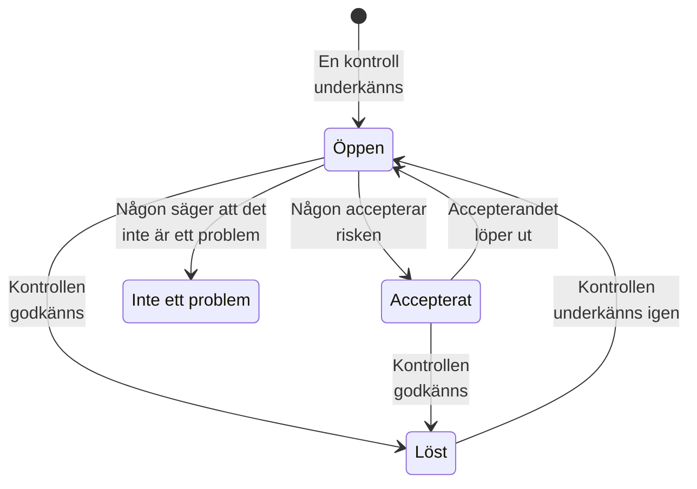

# Kontroller och problem i Datasäkerhet

Datasäkerhet kör 34 kontroller på varje datalager, i nio grupper. En kontroll läser det som är känt om ett datalager - hur det är konfigurerat, vad som har hittats i det, vem som kan nå det, var det finns - och godkänns, underkänns eller kan inte avgöra. En kontroll som underkänns öppnar ett problem på det datalagret, och problemet stängs av sig självt när kontrollen godkänns. Den här sidan listar varje kontroll, hur ett problems allvarlighetsgrad och riskpoäng räknas fram och vad som händer med ett problem under dess livstid. Säkerhetshändelser, Network Flows och säkerhetsadressvalvet är OneUptimes egna, sparade för din säkerhet: angivna, aldrig skannade eller kontrollerade (se [Datalager som OneUptime sparar för din säkerhet](/docs/data-security/compliance#datalager-som-oneuptime-sparar-för-din-säkerhet)).

:::cards
- [Hur en kontroll avgör](#hur-en-kontroll-avgör): Godkänd, underkänd eller kan inte avgöra, och hur allvarligt ett underkännande är.
- [Varje kontroll](#varje-kontroll): Alla 34, med vad var och en kontrollerar och hur det åtgärdas.
- [Riskpoäng](#riskpoäng): Hur problem ordnas inom en allvarlighetsgrad.
- [Vad som händer med ett problem](#vad-som-händer-med-ett-problem): Öppet, löst, accepterat, inte ett problem, hur vart och ett löstes, och åtgärder som följs ända till produktion.
- [OneUptime AI:s analys](#oneuptime-ais-analys): Om ett problem är verkligt, vad det sätter på spel, vad åtgärden skulle förstöra och den kortaste vägen till åtgärdat.
- [Åtgärda härifrån](#åtgärda-härifrån): Stäng en exponering, eller slå på ett skydd som saknas, med ett klick.
- [Problem med en orsak](#problem-med-en-orsak): Problemen som ett enda fel orsakade, grupperade, och deras orsak åtgärdad en gång.
:::

## Hur en kontroll avgör

Varje kontroll läser fakta om ett datalager och svarar på ett av fyra sätt:

| Svar | Vad det betyder | Vad som händer med problemet |
| --- | --- | --- |
| Godkänd | Kontrollen hittar inget fel. | Ett öppet eller accepterat problem löses. |
| Underkänd | Kontrollen hittar problemet och säger i en mening vad den såg: problemets bevis. | Ett problem öppnas, eller så uppdateras det öppna. |
| Kan inte avgöra | Ett faktum kunde inte läsas: en behörighet som rollen inte har, ett anrop som misslyckades. | Ingenting ändras: ett öppet problem förblir öppet, eftersom ingen får dra slutsatsen att ett problem är åtgärdat när OneUptime inte kunde titta. |
| Gäller inte | Datalagrets sort har ingen sådan inställning. | Ett öppet problem löses. |

### Allvarlighetsgraden följer data

Samma problem väger tyngre för känsligare data. Varje kontroll anger en allvarlighetsgrad för varje känslighetsnivå, och ett problem får den som gäller för dess datalager: en offentlig bucket med kortnummer är Kritisk, en offentlig bucket med bilder till en webbplats bara Låg. Ett streck betyder inget problem alls. Ett datalagers känslighet kommer från dess fynd (se [Känsliga datatyper](/docs/data-security/data-types#känslighet)), så innehållsprover ger rätt allvarlighetsgrader.

Några kontroller sätter i stället allvarlighetsgraden utifrån vad de såg. **Hemligheter lagras i det** är Hög på alla datalager, och Kritisk på ett datalager som är offentligt eller delat med andra konton.

## Varje kontroll

Allvarlighetsgraden anges för data som är Begränsad, Konfidentiell, Intern och Offentlig, i den ordningen. Varje problems sida visar den fullständiga åtgärden för sitt eget datalager - stegen i konsolen, CLI-kommandot och, där det passar, Terraform - med datalagrets namn och region ifyllda.

### Exponering

| Kontroll | Körs på | Vad den kontrollerar | Allvarlighetsgrad | Så åtgärdar du det |
| --- | --- | --- | --- | --- |
| Vem som helst på internet kan läsa det (`public-read`) | Objektlagring, datavaruhus, sökning | Datalagrets policy, ACL eller IAM-bindningar låter vem som helst läsa dess data utan att logga in. | Kritisk / Kritisk / Hög / Låg | Ta bort varje behörighet till anonyma huvudkonton eller till alla autentiserade huvudkonton. Filer som måste vara offentliga hör hemma i ett datalager som är markerat som **Offentlig avsiktligt** och som inte innehåller något annat. |
| Vem som helst på internet kan ändra det (`public-write`) | Objektlagring, datavaruhus, sökning | Datalagrets policy, ACL eller IAM-bindningar låter vem som helst skriva eller ta bort dess data. | Kritisk / Kritisk / Kritisk / Hög | Ta bort varje skriv- eller borttagningsbehörighet till anonyma huvudkonton eller till alla autentiserade huvudkonton. |
| Offentlig åtkomst är inte blockerad (`public-access-not-blocked`) | AWS S3 Bucket | S3 Block Public Access är inte helt påslaget för bucketen eller dess konto, så en enda policyändring kan göra den offentlig. | Hög / Medel / Låg / — | Slå på alla fyra Block Public Access-inställningarna för bucketen. |
| Databasen tar emot anslutningar från internet (`internet-reachable`) | Databas, datavaruhus, sökning, cache | Databasen har en offentlig slutpunkt eller offentlig nätverksåtkomst påslagen. | Hög / Hög / Medel / Låg | Stäng av den offentliga slutpunkten och nå databasen via ett privat nätverk eller en bastion. |
| Dess brandvägg släpper in alla adresser (`open-to-all-addresses`) | Databas, datavaruhus, sökning, cache | En brandväggsregel eller ett auktoriserat nätverk tillåter 0.0.0.0/0 eller hela adressintervallet. | Kritisk / Kritisk / Hög / Medel | Ersätt regeln som tillåter allt med de adresser eller nätverk som behöver åtkomst. |
| En ögonblicksbild av det kan återställas av vem som helst (`snapshot-public`) | Databas, ögonblicksbild | En ögonblicksbild av en databas delas offentligt, så att vilket molnkonto som helst kan återställa en fullständig kopia. | Kritisk / Kritisk / Kritisk / Hög | Gör ögonblicksbilden privat. |
| En ögonblicksbild av det delas med andra konton (`snapshot-shared-externally`) | Databas, ögonblicksbild | En ögonblicksbild av en databas delas med konton utanför dina anslutna konton. | Hög / Hög / Medel / Låg | Sluta dela ögonblicksbilden med de konton som inte ska ha den. |
| Konton utanför din organisation kan nå det (`shared-with-external-accounts`) | Alla datalager utom telemetri | Datalagrets policy ger åtkomst till konton, klientorganisationer eller projekt som inte är anslutna till OneUptime. | Hög / Hög / Medel / Låg | Granska varje externt huvudkonto och ta bort dem som inte behöver åtkomst. |

### Kryptering

| Kontroll | Körs på | Vad den kontrollerar | Allvarlighetsgrad | Så åtgärdar du det |
| --- | --- | --- | --- | --- |
| Dess data är inte krypterade i vila (`not-encrypted-at-rest`) | Alla datalager utom telemetri | Lagringskryptering är avstängd. | Hög / Medel / Låg / — | Slå på kryptering i vila. En RDS-instans kan inte krypteras på plats: återställ en krypterad kopia av dess ögonblicksbild. |
| Data klassade som Begränsad är inte krypterade med din egen nyckel (`no-customer-managed-key`) | Alla datalager utom telemetri | Datalagret innehåller data klassade som Begränsad men är krypterat med leverantörens standardnyckel, inte med en kundhanterad nyckel. | Medel / — / — / — | Kryptera datalagret med en nyckel som du hanterar i din nyckeltjänst. |
| Okrypterade anslutningar tillåts (`encryption-in-transit-not-enforced`) | Alla datalager utom telemetri | Datalagret tar emot anslutningar som inte använder TLS. | Hög / Medel / Låg / — | Kräv TLS för varje anslutning. I S3 nekar du varje begäran där `aws:SecureTransport` är false. |
| Det accepterar TLS äldre än 1.2 (`weak-tls`) | Alla datalager utom telemetri | Den lägsta TLS-versionen är 1.0 eller 1.1. | Medel / Medel / Låg / — | Ställ in den lägsta TLS-versionen på 1.2 eller senare. |

### Återställning

| Kontroll | Körs på | Vad den kontrollerar | Allvarlighetsgrad | Så åtgärdar du det |
| --- | --- | --- | --- | --- |
| Det har inga säkerhetskopior, eller sparar dem kortare än 7 dagar (`no-backups`) | Databas, datavaruhus | Automatiska säkerhetskopior är avstängda, eller sparas i färre än 7 dagar. | Hög / Medel / Låg / — | Slå på automatiska säkerhetskopior och spara dem i minst 7 dagar. |
| Återställning till en tidpunkt är avstängd (`no-point-in-time-recovery`) | AWS DynamoDB Table, Azure Cosmos DB Account | Tabellen eller databasen kan inte återställas till ett ögonblick före ett misstag. | Medel / Låg / — / — | Slå på återställning till en tidpunkt. |
| Det kan tas bort i ett enda steg (`deletion-protection-off`) | Databas, datavaruhus | Borttagningsskyddet är avstängt. | Medel / Låg / — / — | Slå på borttagningsskydd. |
| Borttagna eller överskrivna filer kan inte återställas (`deleted-data-not-recoverable`) | Objektlagring | Versionshantering och mjuk borttagning är båda avstängda. | Medel / Låg / — / — | Slå på versionshantering eller mjuk borttagning. |

### Synlighet

| Kontroll | Körs på | Vad den kontrollerar | Allvarlighetsgrad | Så åtgärdar du det |
| --- | --- | --- | --- | --- |
| Ingen skulle veta vem som läste det (`access-not-logged`) | Alla datalager utom telemetri | Läsningar av datalagret loggas inte: inga åtkomstloggar, inga granskningsloggar för dataåtkomst. | Hög / Medel / Låg / — | Slå på åtkomst- eller granskningsloggning för läsningar: S3-serveråtkomstloggar eller CloudTrail-datahändelser, diagnostikloggar för StorageRead i Azure, granskningsloggar för Data Access i Cloud Storage. |

### Åtkomst

| Kontroll | Körs på | Vad den kontrollerar | Allvarlighetsgrad | Så åtgärdar du det |
| --- | --- | --- | --- | --- |
| Vem som helst med kontonyckeln kan läsa allt (`shared-key-access`) | Azure Storage Account | Lagringskontot tillåter åtkomst med delad nyckel, som kringgår Microsoft Entra ID och inte lämnar något granskningsspår per person. | Medel / Låg / — / — | Flytta program till Microsoft Entra ID och stäng sedan av åtkomst med lagringskontots nyckel. |
| Objekt kan ha sina egna åtkomstregler (`object-acls-enabled`) | AWS S3 Bucket, Google Cloud Storage Bucket | Objekt-ACL:er är påslagna, så att ett enskilt objekt kan göras offentligt medan bucketen ser privat ut. | Låg / Låg / — / — | I S3 ställer du in Object Ownership på Bucket owner enforced. I Cloud Storage slår du på uniform bucket-level access. |
| Fler än 25 identiteter kan läsa data klassade som Begränsad (`many-readers`) | Alla datalager utom telemetri | Fler identiteter än de flesta team kan granska har läsåtkomst till datalagret. | Medel / — / — / — | Öppna datalagrets sida **Vem kan nå det** och ta bort den åtkomst som är oanvänd eller bredare än nödvändigt. |
| Identiteter som inte använts på 90 dagar kan fortfarande nå det (`unused-access`) | Alla datalager utom telemetri | Roller och användare som inte har använts på 90 dagar har fortfarande åtkomst till datalagrets känsliga data. | Medel / Låg / — / — | Öppna datalagrets sida **Vem kan nå det**, där de är markerade **Inte använd på 90 dagar**, och ta bort den åtkomst som var och en inte längre behöver. |

### Datahygien

| Kontroll | Körs på | Vad den kontrollerar | Allvarlighetsgrad | Så åtgärdar du det |
| --- | --- | --- | --- | --- |
| Hemligheter lagras i det (`secrets-stored`) | Alla datalager utom telemetri | Lösenord, API-nycklar, tokens eller privata nycklar hittades i datalagrets data. | Hög / Hög / Hög / Hög | Rotera varje hemlighet som hittas, som om den har läckt. Flytta hemligheter till en hemlighetshanterare och ta bort dem från datalagret. |
| Kortens säkerhetskoder lagras (`card-security-codes-stored`) | Alla datalager utom telemetri | CVV- eller CVC-koder hittades. PCI DSS förbjuder att spara dem efter att en betalning har auktoriserats, krypterade eller inte. | Kritisk / Kritisk / Kritisk / Kritisk | Stoppa koden som skriver dem, ta bort de lagrade koderna och kontrollera att inga finns kvar i säkerhetskopior. |
| Kortnummer lagras läsbara (`card-numbers-readable`) | Alla datalager utom telemetri | Fullständiga kortnummer hittades i läsbar form. PCI DSS kräver att de är oläsbara var de än lagras. | Hög / Hög / Hög / Hög | Tokenisera kortnummer hos din betalningsleverantör, eller kryptera dem på fältnivå, och ta bort de läsbara kopiorna. |
| Lösenord lagras i klartext (`plaintext-passwords`) | Alla datalager utom telemetri | Ett lösenordsfält innehåller värden som inte är lösenordshashar (bcrypt, argon2, scrypt eller PBKDF2). | Kritisk / Kritisk / Kritisk / Kritisk | Hasha lösenord med bcrypt, scrypt eller argon2, migrera de lagrade och tvinga varje konto att återställa sitt lösenord. |
| Produktionsdata har kopierats till ett datalager utanför produktion (`production-data-in-non-production`) | Alla datalager utom telemetri | Värden som hittades i ett produktionsdatalager hittades också här, i ett datalager för utveckling, test eller staging. | Hög / Medel / — / — | Ersätt kopian med maskerade eller syntetiska data, och ta bort de verkliga data från datalagret utanför produktion. |
| Känsliga data som ingen har använt på 90 dagar (`stale-sensitive-data`) | Alla datalager utom telemetri | Datalagret innehåller känsliga data och har inte haft några läsningar eller skrivningar på 90 dagar. | Medel / Låg / — / — | Bekräfta att data inte längre behövs, och arkivera dem sedan med ett slutdatum för lagring, eller ta bort dem. |
| En ny kolumn innehåller personuppgifter (`new-personal-data-column`) | Alla datalager utom telemetri | En kolumn som lades till under de senaste 14 dagarna har ett namn som säger att den innehåller personuppgifter. | Hög / Hög / Medel / Medel | Bekräfta att kolumnen ska innehålla dessa data och anteckna varför. Om den inte ska det, ta bort den eller sluta skriva till den. |
| Ingen äger detta känsliga datalager (`no-owner`) | Alla datalager | Datalagret innehåller känsliga data och har ingen ägare. | Medel / Låg / — / — | Lägg till en ägare på datalagrets sida **Ägare**, eller en ägarregel som matchar dess taggar. |

### Telemetri

| Kontroll | Körs på | Vad den kontrollerar | Allvarlighetsgrad | Så åtgärdar du det |
| --- | --- | --- | --- | --- |
| Känsliga data når din telemetri (`sensitive-data-in-telemetry`) | Telemetri | Loggar, spår, mätvärden, undantag, uppspelningar eller AI-konversationer innehåller känsliga data som ingen regel maskerar vid intag. | Hög / Medel / Låg / — | Tryck på **Rensa** på varje fynd för att maskera data vid intag, och åtgärda sedan koden som skriver dem. |
| Hemligheter når din telemetri (`secrets-in-telemetry`) | Telemetri | Lösenord, API-nycklar eller tokens förekommer i loggar, spår, mätvärden, undantag eller AI-konversationer. | Kritisk / Kritisk / Kritisk / Kritisk | Rotera hemligheten först, tryck sedan på **Rensa** och åtgärda koden som skriver den. |

### Hemvist

| Kontroll | Körs på | Vad den kontrollerar | Allvarlighetsgrad | Så åtgärdar du det |
| --- | --- | --- | --- | --- |
| Data lagras utanför de regioner där de får finnas (`residency-violation`) | Alla datalager utom telemetri | Datalagrets region, eller en region som dess data replikeras till, bryter mot en hemvistregel. | Hög / Hög / Medel / — | Flytta data till en tillåten region, eller sluta kopiera dem till den andra. Om överföringen är laglig accepterar du problemet och anger varför. |

### AI

| Kontroll | Körs på | Vad den kontrollerar | Allvarlighetsgrad | Så åtgärdar du det |
| --- | --- | --- | --- | --- |
| Känsliga data skickas till en AI-leverantör (`sensitive-data-to-ai`) | AI-konversationer | AI-konversationer som registrerats i OneUptime för känsliga data till en modelleverantör. | Kritisk / Hög / Låg / — | Ta bort känsliga värden ur prompterna innan de skickas, eller skicka de här anropen till en modell som du själv driver. |
| Data klassade som Begränsad finns i ett datalager som används för AI (`sensitive-data-in-ai-store`) | Alla datalager utom telemetri | Ett datalager som är taggat som tränings- eller hämtningsdata för AI innehåller data klassade som Begränsad. | Hög / Medel / — / — | Ta bort eller maskera de data som är klassade som Begränsad innan de används för att träna eller förankra en modell. |

## Riskpoäng

Allvarlighetsgraden säger hur illa ett problem är. Riskpoängen, från 0 till 100, ordnar problemen inom en allvarlighetsgrad, utifrån det som gör samma problem värre:

```text
risk = severity + 10 × exposure + 6 × volume + 5 × activity + 4 × production, at most 100
```

| Faktor | Poäng |
| --- | --- |
| Allvarlighetsgrad | 75 för Kritisk, 50 för Hög, 25 för Medel, 0 för Låg |
| Exponering | 10 för Offentlig, 8 för Andra konton, 6 för Nåbar från internet, 3 för Okänd, 0 för Privat |
| Volym | Upp till 6, efter datalagrets uppskattade antal känsliga poster på en logaritmisk skala: 1 för 10 poster, 3 för 1 000, 5 för en miljon, 6 för tio miljoner eller fler |
| Aktivitet | 5 när Security Operations har sett detektioner på datalagret under den senaste veckan |
| Produktion | 4 för ett datalager i produktion |

Tilläggen ger högst 25 poäng, så ett problem får aldrig lägre poäng än ett problem med lägre allvarlighetsgrad. En offentlig produktionsbucket med en miljon poster med data klassade som Begränsad får 75 + 10 + 5 + 4 = 94 för ett kritiskt problem. Varje problem listar de faktorer som bidrog till dess poäng, med sina poäng, och datalagret visar poängen för sitt värsta öppna problem.

Ett datalagers miljö - Produktion, Staging, Development, Test eller Okänd - kommer från dess taggar (`env`, `environment`, `stage`, `tier` och liknande) eller, om det inte har någon, från orden i dess namn, som `prod`, `staging`, `dev` eller `qa`. Ange den på datalagret när ingetdera säger något.

## Vad som händer med ett problem



OneUptime öppnar, uppdaterar och löser problem när kontrollerna körs. Det en person gör med ett problem är att bestämma vad som händer härnäst:

| Status | Hur det hamnar där | Vad som följer |
| --- | --- | --- |
| **Öppen** | Dess kontroll underkänns på datalagret nu. | Det räknas i Översikt, i datalagrets sammanfattning och i efterlevnaden, tills kontrollen godkänns. |
| **Löst** | Dess kontroll godkändes vid en senare körning, gäller inte längre eller stängdes av, eller så arkiverades dess datalager. En person kan också välja **Markera som löst**: datalagret kontrolleras då igen direkt. | Det visar hur det löstes (se nedan). Det öppnas igen om kontrollen underkänns igen, och problemet räknar hur ofta det har öppnats igen. |
| **Accepterat** | En person valde **Acceptera risk**, med en **Orsak** och ett datum i **Accepterat till**, högst ett år framåt. | Det förblir stängt till det datumet och öppnas sedan igen om kontrollen fortfarande underkänns. Acceptera det då igen om orsaken fortfarande gäller. |
| **Inte ett problem** | En person valde **Inte ett problem** och sa varför under **Orsak**: fyndet var fel. | Det förblir stängt, även medan kontrollen misslyckas, och behåller orsaken. **Öppna igen** sätter tillbaka det till Öppet. |

Rollerna Säkerhetsmedlem, Säkerhetsadministratör, Projektadministratör och Projektägare kan ändra ett problems status och **Tilldela** det till en person eller ett team. Varje ändring skrivs till problemets **Tidslinje**: när det öppnades, varje ändring av allvarlighetsgrad, varje statusändring och vem som gjorde den, de omkontroller som begärts och vad integrationerna gjorde.

Ett problem som öppnas igen behåller sin historik. Accepterade risker granskas igen varje dag, så att en acceptans löper ut i tid även när inget har skannats.

### Hur det löstes

Ett löst problem visar hur, överst på sin sida och i problemlistan, som kan filtreras på det under **Lösning**:

| Lösning | Vad det betyder |
| --- | --- |
| **Åtgärdat i koden** | En kodåtgärds pull request levererades, och tjänstens nya version skriver inte längre dessa data. Problemet visar vilken och när: ”Åtgärdat i pull request #482, driftsatt i version 2.4.1, verifierat”. |
| **Åtgärdat i infrastrukturkoden** | En pull request till den Terraform, CloudFormation eller Bicep som deklarerar datalagret slogs samman, och datalagrets kontroll godkändes när ändringen hade tillämpats. |
| **Åtgärdat härifrån** | En responsåtgärd ([Åtgärda härifrån](#åtgärda-härifrån)) ändrade datalagret, och dess kontroll godkändes efteråt. |
| **Begränsat vid inmatning** | Varje fynd i ett telemetriproblem döljs av en rensningsregel innan det lagras. Det här är ingen åtgärd: koden skriver fortfarande dessa data, till stdout och till varje annan plats dit tjänsten skickar sin telemetri. Problemet säger det i orange, med vad regeln har ändrat den senaste veckan, och erbjuder **Åtgärda koden**. |
| **Kontroll godkänd** | Dess kontroll godkänns, utan att OneUptime har ändrat något. |
| **Löst av en person** | Någon valde **Markera som löst**. Datalagret kontrolleras igen direkt, och problemet öppnas igen om dess kontroll fortfarande underkänns. |
| **Kontrolleras inte längre** | Dess kontroll stängdes av eller gäller inte längre för datalagret. |
| **Datalager arkiverat** | Dess datalager är borta från sin källa. |

Översikten räknar problemen som åtgärdats där de uppstår separat från läckorna som bara begränsats vid intaget, och **I din telemetri** håller ett begränsat fynd synligt, markerat **Rensat**, tills koden slutar skriva det.

### Åtgärder som följs ända till produktion

En pull request som OneUptime AI öppnade för ett problem (**Åtgärda med AI**, eller en pull request för en [grupp av problem](#problem-med-en-orsak)) har ännu inte åtgärdat något när den slås samman. OneUptime följer den tills produktionen bevisar det:

- **En läcka i koden.** OneUptime väntar på en registrerad driftsättning av tjänsten som innehåller sammanslagningen och bevakar sedan dess nya version. Där en rensningsregel döljer dessa data får regeln inte ändra något värde i den versionen; där ingen regel gör det får ingen av versionens poster innehålla dessa data på de platser där de hittades. Den nya versionen måste också köras i ett dygn och skicka minst lika många loggar eller spans som den gamla gjorde under timmen då läckan senast sågs. Då är problemet **Åtgärdat i koden**. Ett ändrat värde, eller en post som fortfarande innehåller dessa data, betyder att åtgärden inte stoppade läckan, och om en version som skickar för lite under en vecka går det inte att säga något. Driftsättningar matchas via sin commit: registrera dem med `oneuptime deploy`, eller skicka `vcs.ref.head.revision` (se [Driftsättningar och ändringar](/docs/telemetry/change-events)).
- **Ett datalagers konfiguration.** När pull requesten slås samman läses dess datalager in igen direkt. Varje problem vars kontroll godkänns efter det är **Åtgärdat i infrastrukturkoden**. Om ett datalager fortfarande underkänns i sin kontroll när det läses in igen ett dygn efter sammanslagningen blev åtgärden **mergad, inte tillämpad**: datalagrets ägare och personen som bad om pull requesten får ett e-postmeddelande, en gång, och problemets och datalagrets tidslinjer visar det. Det som saknas är oftast en apply.
- **Rensningsregeln behålls.** Efter en verifierad kodåtgärd finns rensningsregeln som begränsade läckan kvar, så att en regression döljs så snart den dyker upp. Problemet visar att regeln inte har ändrat något sedan åtgärden, och erbjuder **Ta bort regel**.
- **En regression.** En verifierad åtgärd bevakas även efteråt: när en behållen regel ändrar värden igen, eller skanningen hittar dessa data igen, öppnas problemet igen och visar vilken version som förde tillbaka dem. Det förblir öppet tills det har åtgärdats igen, även medan en regel döljer dessa data.

Varje steg finns på problemets **Tidslinje** och på datalagrets, och AI-resultat räknar de verifierade åtgärderna efter typ (se [Hur bra OneUptime AI klarar sig](/docs/ai/ai-sre#hur-bra-oneuptime-ai-klarar-sig)).

## OneUptime AI:s analys

Medan **Arbeta med nya problem** är påslaget under **Datasäkerhet → AI** analyserar OneUptime AI själv varje nytt eller återöppnat problem med allvarlighetsgrad Kritisk eller Hög, innan någon öppnar det; dina AI-regler för datasäkerhet kan välja andra problem. Alla problem kan analyseras från sin sida med **Analysera problemet**. Analysen öppnar problemets **Översikt**, under **OneUptime AI-analys**, och svarar utifrån det som Datasäkerhet vet:

- om det är verkligt: **Verkligt**, **Troligen avsiktligt**, **Troligen ett felaktigt fynd** eller **Går inte att avgöra**, och varför;
- vad det sätter på spel: datan och ungefär hur många poster, vem som kan nå den, kopior av den i andra lager och säkerhetsärendena om den;
- vad åtgärden skulle förstöra: de tjänster som setts använda lagret, de identiteter som använde sin åtkomst de senaste 90 dagarna och de behörigheter som åtgärden tar bort och som något fortfarande använder;
- den kortaste vägen till åtgärdat: vad som begränsar det nu, koden som deklarerar lagret och vem som bör göra det.

Varje rad nämner de fakta den bygger på, listade under den av en knapp som **Visa de 3 fakta som den bygger på**. En rad som inte bygger på något faktum utelämnas, en bedömning vars orsak inte bygger på något är **Går inte att avgöra**, och ett lager med begränsad data är aldrig **Troligen avsiktligt** på OneUptime AI:s ord. En rad som bygger på något som du inte får läsa, till exempel vem som kan nå lagret, döljs för dig och säger det.

OneUptime AI ändrar aldrig problemet: status och allvarlighetsgrad stannar hos kontrollen och hos dig. För **Troligen avsiktligt** erbjuder den **Acceptera risk** med orsaken skriven, och **Offentlig avsiktligt** för ett offentligt lager; för **Troligen ett felaktigt fynd** **Inte ett problem** med orsaken skriven. Inget ändras förrän du väljer.

Analysen sparas på problemet, med en post i dess **Tidslinje** varje gång den skrivs, på det språk som de flesta av projektets medlemmar valt (**Analysera igen** skriver den på ditt). Den skrivs bara om när det den bygger på har ändrats, så att öppna problemet frågar inte OneUptime AI om något; **Analysera igen** frågar ändå. **Problem** filtrerar och visar problem efter **OneUptime AI:s bedömning**. Vad den skickar och aldrig skickar finns i [OneUptime AI i Datasäkerhet](/docs/data-security/ai). Med AI avstängt finns ingen analys.

## Åtgärda härifrån

Ett öppet problem som en enda ändring av ett datalagers inställningar åtgärdar – en offentlig bucket, en delad ögonblicksbild, en bucket vars borttagna filer inte kan återställas – kan åtgärdas från dess sida. Ovanför stegen i konsolen erbjuder **Åtgärda härifrån** den ändring som åtgärdar det:

| Problemet | Dess datalager | Knappen | Vad den ändrar |
| --- | --- | --- | --- |
| `public-read`, `public-write` eller `public-access-not-blocked` | En S3-bucket, ett Azure-lagringskonto eller en Cloud Storage-bucket | **Blockera offentlig åtkomst** | Slår på bucketens fyra Block Public Access-inställningar, stänger av lagringskontots anonyma blobåtkomst eller tillämpar bucketens förhindrande av offentlig åtkomst |
| `snapshot-public` eller `snapshot-shared-externally` | En RDS-ögonblicksbild, en RDS-databas, eller ett Aurora- eller DocumentDB-kluster | **Återkalla delning** | Slutar dela ögonblicksbilden, eller varje delad manuell ögonblicksbild av databasen, med alla och med konton utanför dem som du har anslutit |
| `deleted-data-not-recoverable` | En S3-bucket eller en Cloud Storage-bucket | **Slå på versionshantering** | Sparar den tidigare versionen av varje objekt som skrivs över eller tas bort, tills en livscykelregel tar bort den |
| `deleted-data-not-recoverable` | Ett Azure-lagringskonto | **Slå på mjuk borttagning** | Sparar borttagna blobbar och containrar i 14 dagar, så att de kan återställas |
| `object-acls-enabled` | En S3-bucket | **Stäng av objekt-ACL:er** | Ställer in Object Ownership på Bucket owner enforced, så att bucketens policy ensam avgör vem som läser den |
| `object-acls-enabled` | En Cloud Storage-bucket | **Slå på enhetlig åtkomst** | Slår på enhetlig åtkomst på bucketnivå, så att bucketens IAM-policy ensam avgör vem som läser den |
| `encryption-in-transit-not-enforced` eller `weak-tls` | Ett Azure-lagringskonto | **Kräv säker överföring** | Slår på säker överföring och sätter lägsta TLS-version till 1.2, så att kontot bara tar emot HTTPS med TLS 1.2 eller senare |
| `no-point-in-time-recovery` | En DynamoDB-tabell | **Slå på återställning till en tidpunkt** | Låter tabellen återställas till vilken sekund som helst under de senaste 35 dagarna |

Den frågar först och säger vad som ändras, vad som slutar fungera och vad det kostar. Den ändrar datalagrets inställningar, aldrig dess data, och ändrar inget som redan är som det ska. Ett datalager som är markerat som **Offentlig avsiktligt** blockeras aldrig.

Den agerar via datalagrets molnanslutning, så anslutningen behöver ha **Datasäkerhetsrespons** påslaget och sitt installationskommando kört igen (se [Konfigurera Datasäkerhet](/docs/data-security/setup#låt-datasäkerhet-stänga-en-exponering)). Tills dess säger panelen vad som ska slås på. Datalagret kontrolleras igen direkt efteråt, och problemet löses av sig självt när dess kontroll godkänns. Problemets **Tidslinje** och datalagrets **Tidslinje** visar vad som gjordes och vem som gjorde det.

## Problem med en orsak

En Terraform-modul som stänger av åtkomstloggar skapar fyrtio buckets med fyrtio problem. Datasäkerhet samlar problemen som ett enda fel orsakade, så att deras orsak åtgärdas en gång.

**Gruppera efter orsak** under **Problem** visar varje grupp ovanför listan: ”40 problem, en orsak: modulen static-site”, vad dess kontroll hittar, hur många som är åtgärdade och hur många som är kvar. Dess datalager fälls ut under den, vart och ett med en länk till sitt problem, och listans filter begränsar dem som de begränsar raderna. Problemen utan grupp visas under grupperna. Grupperingen är på så snart en grupp har fem problem, och din webbläsare kommer ihåg ditt val.

Fakta bildar en grupp, aldrig OneUptime AI. Problem från en kontroll, på datalager i ett moln, är en grupp när deras datalager har ett av dessa fakta gemensamt, det starkaste först:

| Fakta | Var det läses |
| --- | --- |
| Koden som deklarerar dem | En fil i en ansluten lagringsplats, uppkallad efter modulen eller stacken som deras taggar nämner |
| Deras stack | CloudFormation-stackens egen tagg, eller en tagg som nämner en stack |
| En tagg | En tagg som nämner modulen, stacken eller komponenten som skapade dem, som `module` eller `component` |
| Vem som skapade dem | Identiteten som skapade dem enligt molnets ändringslogg, för datalager vars taggar inte nämner något som skapade dem |
| Ett namnmönster | En del av deras namn som få andra datalager har, som `static-site-*` |

En grupp har minst två problem, ett problem finns i högst en grupp, och ett problem stannar i sin grupp så länge dess datalager delar gruppens fakta. Medan **Arbeta med nya problem** är påslaget under **Datasäkerhet → AI** namnger OneUptime AI varje grupp utifrån dess fakta, som ”modulen static-site stänger av åtkomstloggar”, och ett namn som säger något som dess fakta inte säger behålls inte. Annars får en grupp namn efter sitt fakta.

**Åtgärda orsaken** på en grupp säger vad den ändrar, vad den utelämnar och varför, innan något ändras:

- **En pull request**, för de datalager som är deklarerade som kod: OneUptime AI ändrar modulen eller filen som deklarerar dem, i den lagringsplats du bekräftar, i stället för varje datalager. Pull requesten listar varje datalager och varje problem den åtgärdar, och visas under **Kod** och på varje problems **Tidslinje**. Den kräver samma som **Åtgärda med AI**: behörighet att ändra datasäkerhetsproblem och en lagringsplats som OneUptime AI får arbeta i.
- **Ett godkännande**, för de datalager som skapades i konsolen: ändringen som [Åtgärda härifrån](#åtgärda-härifrån) gör, på vart och ett av dem via dess molnanslutning. Det kräver behörighet att redigera datalager.
- **Utelämnade**: Ett datalager markerat som **Offentlig avsiktligt** blockeras aldrig. Ett datalager vars analys säger att åtgärden skulle ta bort åtkomst som något fortfarande använder väntar på att du markerar **Åtgärda ändå**. Ett datalager som ingen molnanslutning låter Datasäkerhet ändra lämnas åt sin konsol, med orsaken.

När en grupp har båda sorters datalager gör ett klick båda delarna, och vilken som helst av dem kan utelämnas. Varje problem löses av sig självt när dess kontroll godkänns, och gruppen visar hur många som är kvar tills inga är det. En grupp vars problem alla är åtgärdade stannar i listan i sju dagar.

OneUptime AI föreslår varje grupps åtgärd som dina AI-regler för datasäkerhet säger: utan regler väntar pull requesten på dig under **Datasäkerhet → AI**, och en regel vars **Åtgärd** är **Utan att fråga** öppnar den av sig själv. En ändring via molnanslutningarna väntar alltid på dig. I ett datasäkerhetsärende ber en playbooks steg **Fix the code with AI** om pull requesten för ärendets grupp. Ett problem i en grupp säger det under **OneUptime AI-analys**, med **Åtgärda orsaken**.

Bara personer som läser datasäkerhetsproblem i hela projektet ser grupper: en grupp nämner datalager som en läsbehörighet begränsad till etiketter inte får nå.

## Var data i ett telemetriproblem hittades

Ett telemetriproblem - **Känsliga data når din telemetri** eller **Hemligheter når din telemetri** - nämner i sitt bevis varje typ av data som ingen rensningsregel maskerar, till exempel "2 kinds of sensitive data are not scrubbed: IP address, Ireland PPS number." Dess sida visar under **Var det hittades** var var och en finns:

- **Vad och var.** Varje datatyp med sin känslighet och platsen i telemetrin där den finns: ett attribut som `attributes.user.pps`, texten i en loggrad, meddelandet i ett undantag, en prompt. Under, hur många av provvärdena som matchade, när en skanning senast såg den och dess maskerade prov. Tjänsten, eller RUM-applikationen, länkar till sina loggar, spår, mätvärden, undantag eller sessionsuppspelningar.
- **Posterna där data sågs.** **Visa posterna de sågs i** visar just de poster som den senaste skanningen hittade data i - varje skanning sparar upp till 10 av dem med fyndet - eller, för ett fynd från innan skanningar sparade dem, posterna som skrevs under den timme som skanningen läste. Var och en visar sin rad - en loggrad, ett spans attribut, ett undantags meddelande, en prompt - beskuren kring data, som är markerade, med varje känsligt värde i den maskerat som ett fynds prov är, och säger vad posten är (en loggrad och dess allvarlighetsgrad, ett span och dess namn, ett undantag och dess typ, ett AI-anrop, en session, en datapunkt i ett mätvärde och dess mätvärde), när den skrevs och vilken tjänst som skickade den. Var och en öppnas där OneUptime redan visar den: **Öppna spår** fokuserar spårvyn på spannet, **Öppna i Loggar** öppnar just den raden i loggutforskaren, ovanför raderna från dess span under minuterna runt den, **Öppna undantag** visar undantagets grupp, **Öppna sessionsuppspelning** spelar upp sessionen och **Öppna i Mätvärden** öppnar mätvärdesutforskaren på punktens mätvärde, grupperat efter det attribut som data finns under. De tre första posterna visas, resten finns ett klick bort, och det första fyndet visar sina poster när sidan öppnas. När telemetrins lagring inte längre behåller dem säger fyndet det och visar sina maskerade prov i stället.
- **Rensa.** Bredvid varje fynd som ännu inte är maskerat skapar **Rensa** den regel som maskerar det vid inmatning (se [Rensa](/docs/data-security/telemetry#rensa)). Där ingen regel kan det, som för ett mätvärdes namn eller en sessions egna uppgifter, säger den varför i stället. På ett mätvärdes namn kan **Kassera det här mätvärdet** sluta lagra de mätvärdena tills koden är rättad (se [Kassera det här mätvärdet](/docs/data-security/telemetry#kassera-det-här-mätvärdet)). Ett fynd som redan är rensat stannar kvar i listan, markerat **Rensat** (**Kasserade** för ett mätvärdes namn), så att du ser vad som återstår. Problemet löses av sig självt så snart alla fynd bakom det är rensade och datalagret kontrolleras igen.

**Datasäkerhet > I din telemetri** listar fynden i varje tjänsts telemetri, och de som ingen regel maskerar står först. **Visa poster** på varje rad öppnar samma poster bredvid listan, med **Rensa** under dem, för den som får läsa maskerade prov.

Listan innehåller de fynd som kontrollen räknar: de som är minst medelsäkra, som ett värde matchade eller en person bekräftade, sedda de senaste 30 dagarna och inte markerade som inte känsliga. Ett värde visas aldrig i sin helhet här: öppna posten för att se det, vilket kräver samma behörighet som att läsa den telemetrin någon annanstans. Posterna visas alltså för den som får läsa maskerade prov - Säkerhetsmedlemmar och uppåt - och får läsa tjänstens loggar, spår, mätvärden, undantag eller sessioner; Säkerhetstittare ser vad som hittades och var, utan prov eller poster. Ett värde som bara är ett testvärde, ett värde som projektet tillåter eller ett som en rensningsregel redan har maskerat vid inmatning är ingen träff.

## Inställningar för kontroller

**Datasäkerhet → Inställningar → Kontroller** listar varje kontroll efter grupp, med vad den letar efter och den allvarlighetsgrad som ett underkännande får för varje känslighet. Varje kontroll kan justeras för projektet, och varje ändring sparas direkt:

- **Dess reglage** stänger av kontrollen, när den inte passar hur du arbetar. Dess öppna och accepterade problem löses och anger att kontrollen inte längre körs.
- **Dess allvarlighetsgrad** är **Efter känslighet** från start, eller en enda allvarlighetsgrad som varje underkännande av kontrollen får, oavsett vad datalagret innehåller.

För att tysta en kontroll på bara ett datalager accepterar du risken på det datalagrets problem, eller markerar problemet som inte ett problem. För ett fynd som är fel, snarare än ett problem som inte spelar någon roll, markerar du i stället fyndet som inte känsligt (se [Känsliga datatyper](/docs/data-security/data-types#inte-känsligt-och-aldrig-känsligt)).

**Kontrollera nu** på ett datalager läser dess konfiguration igen och kör dess kontroller. **Skanna nu** tar prover på dess innehåll, och dess kontroller körs när skanningen är klar.

## Nästa steg

:::cards
- [Integrationer för Datasäkerhet](/docs/data-security/integrations): Säkerhetsärenden, larm och e-post till ägare när ett problem öppnas.
- [Dataflöden, åtkomst och hemvist](/docs/data-security/flows-access-residency): Åtkomsten, kopiorna och regionerna som flera kontroller läser.
- [Efterlevnad i Datasäkerhet](/docs/data-security/compliance): Ramverkskraven som varje kontroll utgör bevis för.
:::
