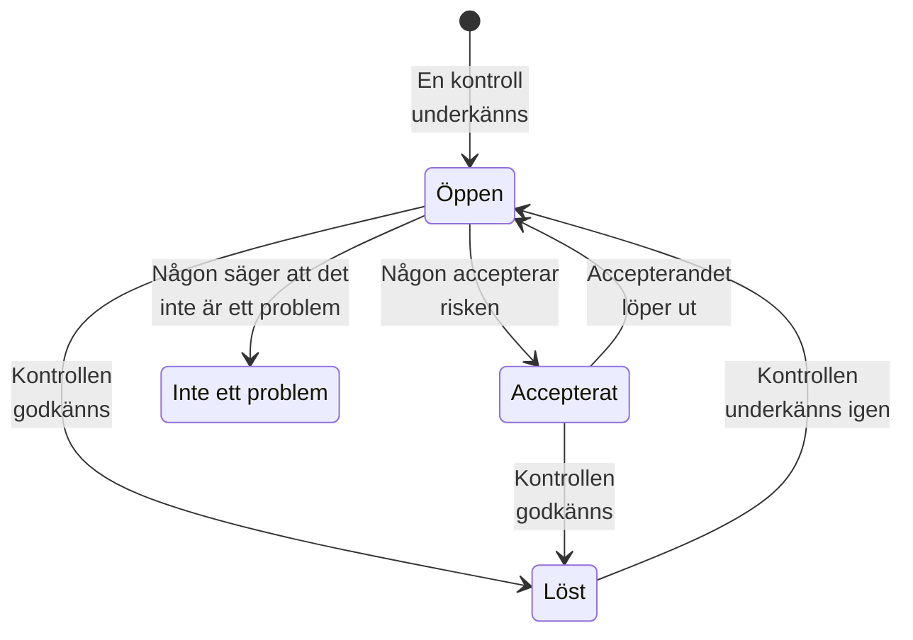

# Kontroller och problem i Datasäkerhet

Datasäkerhet kör 32 kontroller på varje datalager, i nio grupper. En kontroll läser det som är känt om ett datalager - hur det är konfigurerat, vad som har hittats i det, vem som kan nå det, var det finns - och godkänns, underkänns eller kan inte avgöra. En kontroll som underkänns öppnar ett problem på det datalagret, och problemet stängs av sig självt när kontrollen godkänns. Den här sidan listar varje kontroll, hur ett problems allvarlighetsgrad och riskpoäng räknas fram och vad som händer med ett problem under dess livstid.

:::cards
- [Hur en kontroll avgör](#hur-en-kontroll-avgör): Godkänd, underkänd eller kan inte avgöra, och hur allvarligt ett underkännande är.
- [Varje kontroll](#varje-kontroll): Alla 32, med vad var och en kontrollerar och hur det åtgärdas.
- [Riskpoäng](#riskpoäng): Hur problem ordnas inom en allvarlighetsgrad.
- [Vad som händer med ett problem](#vad-som-händer-med-ett-problem): Öppet, löst, accepterat, inte ett problem.
- [Åtgärda härifrån](#åtgärda-härifrån): Blockera en offentlig bucket, eller sluta dela en ögonblicksbild, med ett klick.
:::

## Hur en kontroll avgör

Varje kontroll läser fakta om ett datalager och svarar på ett av fyra sätt:

| Svar | Vad det betyder | Vad som händer med problemet |
| --- | --- | --- |
| Godkänd | Kontrollen hittar inget fel. | Ett öppet eller accepterat problem löses. |
| Underkänd | Kontrollen hittar problemet och säger i en mening vad den såg: problemets bevis. | Ett problem öppnas, eller så uppdateras det öppna. |
| Kan inte avgöra | Ett faktum kunde inte läsas: en behörighet som rollen inte har, ett anrop som misslyckades. | Ingenting ändras: ett öppet problem förblir öppet, eftersom ingen får dra slutsatsen att ett problem är åtgärdat när OneUptime inte kunde titta. |
| Gäller inte | Datalagrets sort har ingen sådan inställning. | Ett öppet problem löses. |

### Allvarlighetsgraden följer data

Samma problem väger tyngre för känsligare data. Varje kontroll anger en allvarlighetsgrad för varje känslighetsnivå, och ett problem får den som gäller för dess datalager: en offentlig bucket med kortnummer är Kritisk, en offentlig bucket med bilder till en webbplats bara Låg. Ett streck betyder inget problem alls. Ett datalagers känslighet kommer från dess fynd (se [Känsliga datatyper](/docs/data-security/data-types#känslighet)), så innehållsprover ger rätt allvarlighetsgrader.

Några kontroller sätter i stället allvarlighetsgraden utifrån vad de såg. **Hemligheter lagras i det** är Hög på alla datalager, och Kritisk på ett datalager som är offentligt eller delat med andra konton.

## Varje kontroll

Allvarlighetsgraden anges för data som är Begränsad, Konfidentiell, Intern och Offentlig, i den ordningen. Varje problems sida visar den fullständiga åtgärden för sitt eget datalager - stegen i konsolen, CLI-kommandot och, där det passar, Terraform - med datalagrets namn och region ifyllda.

### Exponering

| Kontroll | Körs på | Vad den kontrollerar | Allvarlighetsgrad | Så åtgärdar du det |
| --- | --- | --- | --- | --- |
| Vem som helst på internet kan läsa det (`public-read`) | Objektlagring, datavaruhus, sökning | Datalagrets policy, ACL eller IAM-bindningar låter vem som helst läsa dess data utan att logga in. | Kritisk / Kritisk / Hög / Låg | Ta bort varje behörighet till anonyma huvudkonton eller till alla autentiserade huvudkonton. Filer som måste vara offentliga hör hemma i ett datalager som är markerat som **Offentlig avsiktligt** och som inte innehåller något annat. |
| Vem som helst på internet kan ändra det (`public-write`) | Objektlagring, datavaruhus, sökning | Datalagrets policy, ACL eller IAM-bindningar låter vem som helst skriva eller ta bort dess data. | Kritisk / Kritisk / Kritisk / Hög | Ta bort varje skriv- eller borttagningsbehörighet till anonyma huvudkonton eller till alla autentiserade huvudkonton. |
| Offentlig åtkomst är inte blockerad (`public-access-not-blocked`) | AWS S3 Bucket | S3 Block Public Access är inte helt påslaget för bucketen eller dess konto, så en enda policyändring kan göra den offentlig. | Hög / Medel / Låg / — | Slå på alla fyra Block Public Access-inställningarna för bucketen. |
| Databasen tar emot anslutningar från internet (`internet-reachable`) | Databas, datavaruhus, sökning, cache | Databasen har en offentlig slutpunkt eller offentlig nätverksåtkomst påslagen. | Hög / Hög / Medel / Låg | Stäng av den offentliga slutpunkten och nå databasen via ett privat nätverk eller en bastion. |
| Dess brandvägg släpper in alla adresser (`open-to-all-addresses`) | Databas, datavaruhus, sökning, cache | En brandväggsregel eller ett auktoriserat nätverk tillåter 0.0.0.0/0 eller hela adressintervallet. | Kritisk / Kritisk / Hög / Medel | Ersätt regeln som tillåter allt med de adresser eller nätverk som behöver åtkomst. |
| En ögonblicksbild av det kan återställas av vem som helst (`snapshot-public`) | Databas, ögonblicksbild | En ögonblicksbild av en databas delas offentligt, så att vilket molnkonto som helst kan återställa en fullständig kopia. | Kritisk / Kritisk / Kritisk / Hög | Gör ögonblicksbilden privat. |
| En ögonblicksbild av det delas med andra konton (`snapshot-shared-externally`) | Databas, ögonblicksbild | En ögonblicksbild av en databas delas med konton utanför dina anslutna konton. | Hög / Hög / Medel / Låg | Sluta dela ögonblicksbilden med de konton som inte ska ha den. |
| Konton utanför din organisation kan nå det (`shared-with-external-accounts`) | Alla datalager utom telemetri | Datalagrets policy ger åtkomst till konton, klientorganisationer eller projekt som inte är anslutna till OneUptime. | Hög / Hög / Medel / Låg | Granska varje externt huvudkonto och ta bort dem som inte behöver åtkomst. |

### Kryptering

| Kontroll | Körs på | Vad den kontrollerar | Allvarlighetsgrad | Så åtgärdar du det |
| --- | --- | --- | --- | --- |
| Dess data är inte krypterade i vila (`not-encrypted-at-rest`) | Alla datalager utom telemetri | Lagringskryptering är avstängd. | Hög / Medel / Låg / — | Slå på kryptering i vila. En RDS-instans kan inte krypteras på plats: återställ en krypterad kopia av dess ögonblicksbild. |
| Data klassade som Begränsad är inte krypterade med din egen nyckel (`no-customer-managed-key`) | Alla datalager utom telemetri | Datalagret innehåller data klassade som Begränsad men är krypterat med leverantörens standardnyckel, inte med en kundhanterad nyckel. | Medel / — / — / — | Kryptera datalagret med en nyckel som du hanterar i din nyckeltjänst. |
| Okrypterade anslutningar tillåts (`encryption-in-transit-not-enforced`) | Alla datalager utom telemetri | Datalagret tar emot anslutningar som inte använder TLS. | Hög / Medel / Låg / — | Kräv TLS för varje anslutning. I S3 nekar du varje begäran där `aws:SecureTransport` är false. |
| Det accepterar TLS äldre än 1.2 (`weak-tls`) | Alla datalager utom telemetri | Den lägsta TLS-versionen är 1.0 eller 1.1. | Medel / Medel / Låg / — | Ställ in den lägsta TLS-versionen på 1.2 eller senare. |

### Återställning

| Kontroll | Körs på | Vad den kontrollerar | Allvarlighetsgrad | Så åtgärdar du det |
| --- | --- | --- | --- | --- |
| Det har inga säkerhetskopior, eller sparar dem kortare än 7 dagar (`no-backups`) | Databas, datavaruhus | Automatiska säkerhetskopior är avstängda, eller sparas i färre än 7 dagar. | Hög / Medel / Låg / — | Slå på automatiska säkerhetskopior och spara dem i minst 7 dagar. |
| Återställning till en tidpunkt är avstängd (`no-point-in-time-recovery`) | AWS DynamoDB Table, Azure Cosmos DB Account | Tabellen eller databasen kan inte återställas till ett ögonblick före ett misstag. | Medel / Låg / — / — | Slå på återställning till en tidpunkt. |
| Det kan tas bort i ett enda steg (`deletion-protection-off`) | Databas, datavaruhus | Borttagningsskyddet är avstängt. | Medel / Låg / — / — | Slå på borttagningsskydd. |
| Borttagna eller överskrivna filer kan inte återställas (`deleted-data-not-recoverable`) | Objektlagring | Versionshantering och mjuk borttagning är båda avstängda. | Medel / Låg / — / — | Slå på versionshantering eller mjuk borttagning. |

### Synlighet

| Kontroll | Körs på | Vad den kontrollerar | Allvarlighetsgrad | Så åtgärdar du det |
| --- | --- | --- | --- | --- |
| Ingen skulle veta vem som läste det (`access-not-logged`) | Alla datalager utom telemetri | Läsningar av datalagret loggas inte: inga åtkomstloggar, inga granskningsloggar för dataåtkomst. | Hög / Medel / Låg / — | Slå på åtkomst- eller granskningsloggning för läsningar: S3-serveråtkomstloggar eller CloudTrail-datahändelser, diagnostikloggar för StorageRead i Azure, granskningsloggar för Data Access i Cloud Storage. |

### Åtkomst

| Kontroll | Körs på | Vad den kontrollerar | Allvarlighetsgrad | Så åtgärdar du det |
| --- | --- | --- | --- | --- |
| Vem som helst med kontonyckeln kan läsa allt (`shared-key-access`) | Azure Storage Account | Lagringskontot tillåter åtkomst med delad nyckel, som kringgår Microsoft Entra ID och inte lämnar något granskningsspår per person. | Medel / Låg / — / — | Flytta program till Microsoft Entra ID och stäng sedan av åtkomst med lagringskontots nyckel. |
| Objekt kan ha sina egna åtkomstregler (`object-acls-enabled`) | AWS S3 Bucket, Google Cloud Storage Bucket | Objekt-ACL:er är påslagna, så att ett enskilt objekt kan göras offentligt medan bucketen ser privat ut. | Låg / Låg / — / — | I S3 ställer du in Object Ownership på Bucket owner enforced. I Cloud Storage slår du på uniform bucket-level access. |
| Fler än 25 identiteter kan läsa data klassade som Begränsad (`many-readers`) | Alla datalager utom telemetri | Fler identiteter än de flesta team kan granska har läsåtkomst till datalagret. | Medel / — / — / — | Öppna datalagrets sida **Vem kan nå det** och ta bort den åtkomst som är oanvänd eller bredare än nödvändigt. |

### Datahygien

| Kontroll | Körs på | Vad den kontrollerar | Allvarlighetsgrad | Så åtgärdar du det |
| --- | --- | --- | --- | --- |
| Hemligheter lagras i det (`secrets-stored`) | Alla datalager utom telemetri | Lösenord, API-nycklar, tokens eller privata nycklar hittades i datalagrets data. | Hög / Hög / Hög / Hög | Rotera varje hemlighet som hittas, som om den har läckt. Flytta hemligheter till en hemlighetshanterare och ta bort dem från datalagret. |
| Kortens säkerhetskoder lagras (`card-security-codes-stored`) | Alla datalager utom telemetri | CVV- eller CVC-koder hittades. PCI DSS förbjuder att spara dem efter att en betalning har auktoriserats, krypterade eller inte. | Kritisk / Kritisk / Kritisk / Kritisk | Stoppa koden som skriver dem, ta bort de lagrade koderna och kontrollera att inga finns kvar i säkerhetskopior. |
| Kortnummer lagras läsbara (`card-numbers-readable`) | Alla datalager utom telemetri | Fullständiga kortnummer hittades i läsbar form. PCI DSS kräver att de är oläsbara var de än lagras. | Hög / Hög / Hög / Hög | Tokenisera kortnummer hos din betalningsleverantör, eller kryptera dem på fältnivå, och ta bort de läsbara kopiorna. |
| Lösenord lagras i klartext (`plaintext-passwords`) | Alla datalager utom telemetri | Ett lösenordsfält innehåller värden som inte är lösenordshashar (bcrypt, argon2, scrypt eller PBKDF2). | Kritisk / Kritisk / Kritisk / Kritisk | Hasha lösenord med bcrypt, scrypt eller argon2, migrera de lagrade och tvinga varje konto att återställa sitt lösenord. |
| Produktionsdata har kopierats till ett datalager utanför produktion (`production-data-in-non-production`) | Alla datalager utom telemetri | Värden som hittades i ett produktionsdatalager hittades också här, i ett datalager för utveckling, test eller staging. | Hög / Medel / — / — | Ersätt kopian med maskerade eller syntetiska data, och ta bort de verkliga data från datalagret utanför produktion. |
| Känsliga data som ingen har använt på 90 dagar (`stale-sensitive-data`) | Alla datalager utom telemetri | Datalagret innehåller känsliga data och har inte haft några läsningar eller skrivningar på 90 dagar. | Medel / Låg / — / — | Bekräfta att data inte längre behövs, och arkivera dem sedan med ett slutdatum för lagring, eller ta bort dem. |
| Ingen äger detta känsliga datalager (`no-owner`) | Alla datalager | Datalagret innehåller känsliga data och har ingen ägare. | Medel / Låg / — / — | Lägg till en ägare på datalagrets sida **Ägare**, eller en ägarregel som matchar dess taggar. |

### Telemetri

| Kontroll | Körs på | Vad den kontrollerar | Allvarlighetsgrad | Så åtgärdar du det |
| --- | --- | --- | --- | --- |
| Känsliga data når din telemetri (`sensitive-data-in-telemetry`) | Telemetri | Loggar, spår, undantag, uppspelningar eller AI-konversationer innehåller känsliga data som ingen rensningsregel maskerar. | Hög / Medel / Låg / — | Tryck på **Rensa** på varje fynd för att maskera data vid intag, och åtgärda sedan koden som skriver dem. |
| Hemligheter når din telemetri (`secrets-in-telemetry`) | Telemetri | Lösenord, API-nycklar eller tokens förekommer i loggar, spår, undantag eller AI-konversationer. | Kritisk / Kritisk / Kritisk / Kritisk | Rotera hemligheten först, tryck sedan på **Rensa** och åtgärda koden som skriver den. |

### Hemvist

| Kontroll | Körs på | Vad den kontrollerar | Allvarlighetsgrad | Så åtgärdar du det |
| --- | --- | --- | --- | --- |
| Data lagras utanför de regioner där de får finnas (`residency-violation`) | Alla datalager utom telemetri | Datalagrets region, eller en region som dess data replikeras till, bryter mot en hemvistregel. | Hög / Hög / Medel / — | Flytta data till en tillåten region, eller sluta kopiera dem till den andra. Om överföringen är laglig accepterar du problemet och anger varför. |

### AI

| Kontroll | Körs på | Vad den kontrollerar | Allvarlighetsgrad | Så åtgärdar du det |
| --- | --- | --- | --- | --- |
| Känsliga data skickas till en AI-leverantör (`sensitive-data-to-ai`) | AI-konversationer | AI-konversationer som registrerats i OneUptime för känsliga data till en modelleverantör. | Kritisk / Hög / Låg / — | Ta bort känsliga värden ur prompterna innan de skickas, eller skicka de här anropen till en modell som du själv driver. |
| Data klassade som Begränsad finns i ett datalager som används för AI (`sensitive-data-in-ai-store`) | Alla datalager utom telemetri | Ett datalager som är taggat som tränings- eller hämtningsdata för AI innehåller data klassade som Begränsad. | Hög / Medel / — / — | Ta bort eller maskera de data som är klassade som Begränsad innan de används för att träna eller förankra en modell. |

## Riskpoäng

Allvarlighetsgraden säger hur illa ett problem är. Riskpoängen, från 0 till 100, ordnar problemen inom en allvarlighetsgrad, utifrån det som gör samma problem värre:

```text
risk = severity + 10 × exposure + 6 × volume + 5 × activity + 4 × production, at most 100
```

| Faktor | Poäng |
| --- | --- |
| Allvarlighetsgrad | 75 för Kritisk, 50 för Hög, 25 för Medel, 0 för Låg |
| Exponering | 10 för Offentlig, 8 för Andra konton, 6 för Nåbar från internet, 3 för Okänd, 0 för Privat |
| Volym | Upp till 6, efter datalagrets uppskattade antal känsliga poster på en logaritmisk skala: 1 för 10 poster, 3 för 1 000, 5 för en miljon, 6 för tio miljoner eller fler |
| Aktivitet | 5 när Security Operations har sett detektioner på datalagret under den senaste veckan |
| Produktion | 4 för ett datalager i produktion |

Tilläggen ger högst 25 poäng, så ett problem får aldrig lägre poäng än ett problem med lägre allvarlighetsgrad. En offentlig produktionsbucket med en miljon poster med data klassade som Begränsad får 75 + 10 + 5 + 4 = 94 för ett kritiskt problem. Varje problem listar de faktorer som bidrog till dess poäng, med sina poäng, och datalagret visar poängen för sitt värsta öppna problem.

Ett datalagers miljö - Produktion, Staging, Development, Test eller Okänd - kommer från dess taggar (`env`, `environment`, `stage`, `tier` och liknande) eller, om det inte har någon, från orden i dess namn, som `prod`, `staging`, `dev` eller `qa`. Ange den på datalagret när ingetdera säger något.

## Vad som händer med ett problem



OneUptime öppnar, uppdaterar och löser problem när kontrollerna körs. Det en person gör med ett problem är att bestämma vad som händer härnäst:

| Status | Hur det hamnar där | Vad som följer |
| --- | --- | --- |
| **Öppen** | Dess kontroll underkänns på datalagret nu. | Det räknas i Översikt, i datalagrets sammanfattning och i efterlevnaden, tills kontrollen godkänns. |
| **Löst** | Dess kontroll godkändes vid en senare körning, gäller inte längre eller stängdes av, eller så arkiverades dess datalager. En person kan också välja **Markera som löst**: datalagret kontrolleras då igen direkt. | Det öppnas igen om kontrollen underkänns igen, och problemet räknar hur ofta det har öppnats igen. |
| **Accepterat** | En person valde **Acceptera risk**, med en **Orsak** och ett datum i **Accepterat till**, högst ett år framåt. | Det förblir stängt till det datumet och öppnas sedan igen om kontrollen fortfarande underkänns. Acceptera det då igen om orsaken fortfarande gäller. |
| **Inte ett problem** | En person valde **Inte ett problem**: fyndet var fel. | Det förblir stängt, även när kontrollen underkänns. **Öppna igen** sätter tillbaka det till Öppen. |

Rollerna Security Member, Security Admin, Project Admin och Project Owner kan ändra ett problems status och **Tilldela** det till en person eller ett team. Varje ändring skrivs till problemets **Tidslinje**: när det öppnades, varje ändring av allvarlighetsgrad, varje statusändring och vem som gjorde den, de omkontroller som begärts och vad integrationerna gjorde.

Ett problem som öppnas igen behåller sin historik. Accepterade risker granskas igen varje dag, så att en acceptans löper ut i tid även när inget har skannats.

## Åtgärda härifrån

Ett öppet problem som gäller en offentlig bucket eller en delad ögonblicksbild kan åtgärdas från dess sida. Ovanför stegen i konsolen erbjuder **Åtgärda härifrån** den ändring som åtgärdar det:

| Problemet | Dess datalager | Knappen | Vad den ändrar |
| --- | --- | --- | --- |
| `public-read`, `public-write` eller `public-access-not-blocked` | En S3-bucket, ett Azure-lagringskonto eller en Cloud Storage-bucket | **Blockera offentlig åtkomst** | Slår på bucketens fyra Block Public Access-inställningar, stänger av lagringskontots anonyma blobåtkomst eller tillämpar bucketens förhindrande av offentlig åtkomst |
| `snapshot-public` eller `snapshot-shared-externally` | En RDS-ögonblicksbild, en RDS-databas, eller ett Aurora- eller DocumentDB-kluster | **Återkalla delning** | Slutar dela ögonblicksbilden, eller varje delad manuell ögonblicksbild av databasen, med alla och med konton utanför dem som du har anslutit |

Den frågar först och säger vad som ändras och vad som slutar fungera. Den ändrar hur datalagret delas, aldrig dess data, och ändrar inget som redan är stängt. Ett datalager som är markerat som **Offentlig avsiktligt** blockeras aldrig.

Den agerar via datalagrets molnanslutning, så anslutningen behöver ha **Datasäkerhetsrespons** påslaget och sitt installationskommando kört igen (se [Konfigurera Datasäkerhet](/docs/data-security/setup#låt-datasäkerhet-stänga-en-exponering)). Tills dess säger panelen vad som ska slås på. Datalagret kontrolleras igen direkt efteråt, och problemet löses av sig självt när dess kontroll godkänns. Problemets **Tidslinje** och datalagrets **Tidslinje** visar vad som gjordes och vem som gjorde det.

## Inställningar för kontroller

**Datasäkerhet → Inställningar → Kontroller** listar varje kontroll efter grupp, med vad den letar efter och den allvarlighetsgrad som ett underkännande får för varje känslighet. Varje kontroll kan justeras för projektet, och varje ändring sparas direkt:

- **Dess reglage** stänger av kontrollen, när den inte passar hur du arbetar. Dess öppna och accepterade problem löses och anger att kontrollen inte längre körs.
- **Dess allvarlighetsgrad** är **Efter känslighet** från start, eller en enda allvarlighetsgrad som varje underkännande av kontrollen får, oavsett vad datalagret innehåller.

För att tysta en kontroll på bara ett datalager accepterar du risken på det datalagrets problem, eller markerar problemet som inte ett problem. För ett fynd som är fel, snarare än ett problem som inte spelar någon roll, markerar du i stället fyndet som inte känsligt (se [Känsliga datatyper](/docs/data-security/data-types#inte-känsligt-och-aldrig-känsligt)).

**Kontrollera nu** på ett datalager läser dess konfiguration igen och kör dess kontroller. **Skanna nu** tar prover på dess innehåll, och dess kontroller körs när skanningen är klar.

## Nästa steg

:::cards
- [Integrationer för Datasäkerhet](/docs/data-security/integrations): Säkerhetsärenden, larm och e-post till ägare när ett problem öppnas.
- [Dataflöden, åtkomst och hemvist](/docs/data-security/flows-access-residency): Åtkomsten, kopiorna och regionerna som flera kontroller läser.
- [Efterlevnad i Datasäkerhet](/docs/data-security/compliance): Ramverkskraven som varje kontroll utgör bevis för.
:::
