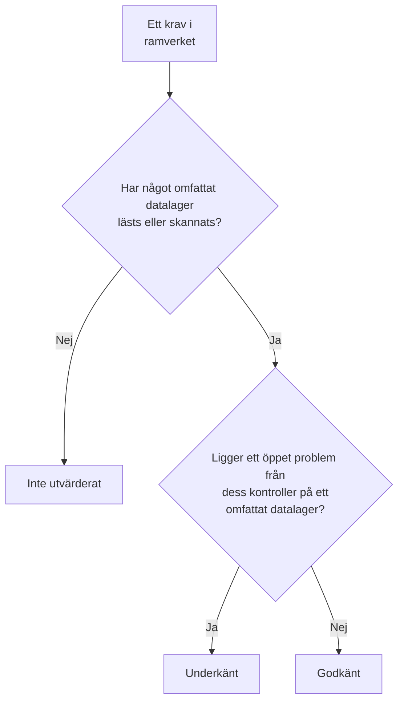

# Efterlevnad i Datasäkerhet

Datasäkerhet poängsätter nio ramverk utifrån det som dess skanningar hittade. Varje ramverk omfattar de datalager som dess regler handlar om – GDPR de datalager som innehåller personuppgifter, PCI DSS de datalager där kortdata hittades, SOC 2 varje datalager – och vart och ett av dess krav uppfylls eller underkänns av de kontroller som är bevis för det. **Datasäkerhet → Efterlevnad** visar varje ramverks poäng, hur många datalager det omfattar, och varje krav med hur många öppna problem som underkänner det. En poäng är bevis inför en revision, inte ett certifikat: den säger vad OneUptime kan se av de datalager som det läser.

:::cards
- [Ramverken](#ramverken): De nio, och vilka datalager vart och ett omfattar.
- [Hur ett ramverk poängsätts](#hur-ett-ramverk-poängsätts): Krav som godkänns, underkänns eller inte utvärderas.
- [Krav och deras kontroller](#krav-och-deras-kontroller): Varje krav, och de kontroller som är bevis för det.
- [Register över behandling](#register-över-behandling): GDPR artikel 30, skrivet utifrån dina datalager.
:::

## Ramverken

| Ramverk | Fullständigt namn | Datalager som omfattas |
| --- | --- | --- |
| GDPR | EU:s allmänna dataskyddsförordning | Datalager som innehåller personuppgifter. |
| CCPA | California Consumer Privacy Act, i dess lydelse enligt CPRA | Datalager som innehåller personlig information. |
| HIPAA | HIPAA Security Rule | Datalager som innehåller hälsodata. |
| PCI DSS | PCI DSS v4.0 | Datalager där kortnummer hittades. |
| SOC 2 | SOC 2 Trust Services Criteria | Varje datalager. |
| ISO 27001 | ISO/IEC 27001:2022 | Varje datalager. |
| NIST CSF | NIST Cybersecurity Framework 2.0 | Varje datalager. |
| LGPD | Brasiliens allmänna dataskyddslag | Datalager som innehåller personuppgifter om personer i Brasilien. |
| DPDP | Indiens Digital Personal Data Protection Act från 2023 | Datalager som innehåller personuppgifter om personer i Indien. |

## Vilka datalager ett ramverk omfattar

Ett datalagers omfattning kommer från de data som har hittats i det, så den ändras när skanningarna hittar mer:

- **SOC 2, ISO 27001 och NIST CSF** är säkerhetsramverk: de omfattar varje datalager, oavsett vad det innehåller.
- **GDPR, CCPA, HIPAA och PCI DSS** omfattar de datalager som innehåller en datatyp som de skyddar. Personuppgifter gör GDPR och CCPA tillämpliga, hälsodata även HIPAA, och kortnummer, kortens säkerhetskoder och kortens utgångsdatum PCI DSS. Ett datalager som bara innehåller hemligheter eller affärsdokument omfattas inte av något av dem.
- **LGPD och DPDP** är enskilda länders egna lagar: de omfattar de datalager som innehåller personuppgifter om personer i Brasilien eller i Indien, utlästa från datatyper som hör till landet, till exempel ett brasilianskt CPF eller ett indiskt Aadhaar-nummer.

[Känsliga datatyper](/docs/data-security/data-types#inbyggda-datatyper) listar varje datatyp, med dess land.

## Hur ett ramverk poängsätts

- **Ett krav godkänns** när inget öppet problem från de kontroller som är kopplade till det ligger på ett datalager som ramverket omfattar, och **underkänns** när ett gör det.
- **Det utvärderas inte** så länge inget omfattat datalager har fått sin konfiguration läst eller sitt innehåll skannat.
- **Två krav uppfylls av Datasäkerhet själv**: GDPR artikel 30, register över behandling, och ISO 27001 A.5.12, klassificering av information. De godkänns när varje omfattat datalager har lästs eller skannats, och underkänns så länge något inte har det.
- **Poängen** är andelen av ett ramverks utvärderade krav som godkänns, som ett heltal i procent. Ett ramverk där inget har utvärderats har ingen poäng.

Bara öppna problem räknas. Ett problem vars risk har accepterats, eller som inte är ett problem, underkänner inte sina krav, så en accepterad risk är ett beslut som din revision kan se på problemet: vem som accepterade den, varför och till när.

## Krav och deras kontroller

### GDPR

| Krav | Vad det kräver | Kontroller |
| --- | --- | --- |
| Art. 5(1)(c) | Uppgiftsminimering | `production-data-in-non-production`, `stale-sensitive-data`, `sensitive-data-in-telemetry`, `sensitive-data-to-ai`, `sensitive-data-in-ai-store` |
| Art. 5(1)(e) | Lagringsminimering | `stale-sensitive-data` |
| Art. 25 | Inbyggt dataskydd och dataskydd som standard | `production-data-in-non-production`, `stale-sensitive-data`, `sensitive-data-in-telemetry`, `sensitive-data-to-ai`, `sensitive-data-in-ai-store` |
| Art. 28 | Personuppgiftsbiträden | `sensitive-data-to-ai` |
| Art. 30 | Register över behandling | Uppfylls av Datasäkerhet själv |
| Art. 32 | Säkerhet i samband med behandlingen | `public-read`, `public-write`, `public-access-not-blocked`, `internet-reachable`, `open-to-all-addresses`, `snapshot-public`, `snapshot-shared-externally`, `shared-with-external-accounts`, `not-encrypted-at-rest`, `no-customer-managed-key`, `encryption-in-transit-not-enforced`, `weak-tls`, `no-backups`, `no-point-in-time-recovery`, `deletion-protection-off`, `deleted-data-not-recoverable`, `access-not-logged`, `shared-key-access`, `object-acls-enabled`, `many-readers`, `secrets-stored`, `plaintext-passwords`, `secrets-in-telemetry` |
| Art. 44-49 | Överföringar till tredjeländer | `residency-violation` |

### CCPA

| Krav | Vad det kräver | Kontroller |
| --- | --- | --- |
| 1798.100(c) | Insamling begränsad till det som är nödvändigt | `production-data-in-non-production`, `stale-sensitive-data`, `sensitive-data-in-telemetry`, `sensitive-data-to-ai`, `sensitive-data-in-ai-store` |
| 1798.150 | Rimliga säkerhetsrutiner | `public-read`, `public-write`, `public-access-not-blocked`, `internet-reachable`, `open-to-all-addresses`, `snapshot-public`, `snapshot-shared-externally`, `shared-with-external-accounts`, `shared-key-access`, `object-acls-enabled`, `many-readers` |

### HIPAA

| Krav | Vad det kräver | Kontroller |
| --- | --- | --- |
| 164.308(a)(7) | Beredskapsplan | `no-backups`, `no-point-in-time-recovery`, `deletion-protection-off`, `deleted-data-not-recoverable` |
| 164.312(a)(1) | Åtkomstkontroll | `public-read`, `public-write`, `public-access-not-blocked`, `internet-reachable`, `open-to-all-addresses`, `snapshot-public`, `snapshot-shared-externally`, `shared-with-external-accounts`, `shared-key-access`, `object-acls-enabled`, `many-readers` |
| 164.312(a)(2)(iv) | Kryptering och dekryptering | `not-encrypted-at-rest`, `no-customer-managed-key` |
| 164.312(b) | Granskningskontroller | `access-not-logged` |
| 164.312(e)(1) | Säkerhet vid överföring | `encryption-in-transit-not-enforced`, `weak-tls` |

### PCI DSS

| Krav | Vad det kräver | Kontroller |
| --- | --- | --- |
| 3.3.1 | Känsliga autentiseringsdata sparas inte efter auktorisering | `card-security-codes-stored` |
| 3.4.1 | Kortnummer maskeras när de visas | `card-numbers-readable`, `sensitive-data-in-telemetry` |
| 3.5.1 | Kortnummer är oläsbara var de än lagras | `not-encrypted-at-rest`, `no-customer-managed-key`, `card-numbers-readable` |
| 4.2.1 | Stark kryptografi skyddar kortdata under överföring | `encryption-in-transit-not-enforced`, `weak-tls` |
| 7.2 | Åtkomst definieras och tilldelas efter behov | `public-read`, `public-write`, `public-access-not-blocked`, `internet-reachable`, `open-to-all-addresses`, `snapshot-public`, `snapshot-shared-externally`, `shared-with-external-accounts`, `shared-key-access`, `object-acls-enabled`, `many-readers` |
| 8.3.2 | Autentiseringsfaktorer är oläsbara när de lagras | `plaintext-passwords` |
| 10.2 | Granskningsloggar registrerar åtkomst till kortdata | `access-not-logged` |

### SOC 2

| Krav | Vad det kräver | Kontroller |
| --- | --- | --- |
| A1.2 | Säkerhetskopiering och återställning | `no-backups`, `no-point-in-time-recovery`, `deletion-protection-off`, `deleted-data-not-recoverable` |
| CC6.1 | Logisk åtkomstsäkerhet | `public-read`, `public-write`, `public-access-not-blocked`, `internet-reachable`, `open-to-all-addresses`, `snapshot-public`, `snapshot-shared-externally`, `shared-with-external-accounts`, `not-encrypted-at-rest`, `no-customer-managed-key`, `shared-key-access`, `object-acls-enabled`, `many-readers`, `secrets-stored`, `plaintext-passwords`, `secrets-in-telemetry` |
| CC6.7 | Överföring av information | `encryption-in-transit-not-enforced`, `weak-tls` |
| CC7.2 | Övervakning av systemkomponenter | `access-not-logged` |

### ISO 27001

| Krav | Vad det kräver | Kontroller |
| --- | --- | --- |
| A.5.9 | Förteckning över information och andra tillhörande tillgångar | `no-owner` |
| A.5.12 | Klassificering av information | Uppfylls av Datasäkerhet själv |
| A.5.15 | Åtkomststyrning | `public-read`, `public-write`, `public-access-not-blocked`, `internet-reachable`, `open-to-all-addresses`, `snapshot-public`, `snapshot-shared-externally`, `shared-with-external-accounts`, `shared-key-access`, `object-acls-enabled`, `many-readers` |
| A.5.34 | Integritet och skydd av PII | `production-data-in-non-production`, `stale-sensitive-data`, `sensitive-data-in-telemetry`, `sensitive-data-to-ai`, `sensitive-data-in-ai-store` |
| A.8.11 | Datamaskering | `production-data-in-non-production`, `stale-sensitive-data`, `sensitive-data-in-telemetry`, `sensitive-data-to-ai`, `sensitive-data-in-ai-store` |
| A.8.12 | Förhindrande av dataläckage | `secrets-stored`, `secrets-in-telemetry` |
| A.8.13 | Säkerhetskopiering av information | `no-backups`, `no-point-in-time-recovery`, `deletion-protection-off`, `deleted-data-not-recoverable` |
| A.8.15 | Loggning | `access-not-logged` |
| A.8.24 | Användning av kryptografi | `not-encrypted-at-rest`, `no-customer-managed-key`, `encryption-in-transit-not-enforced`, `weak-tls`, `plaintext-passwords` |

### NIST CSF

| Krav | Vad det kräver | Kontroller |
| --- | --- | --- |
| ID.AM-07 | Förteckningar över data och metadata upprätthålls | `no-owner` |
| PR.AA-05 | Åtkomstbehörigheter hanteras | `public-read`, `public-write`, `public-access-not-blocked`, `internet-reachable`, `open-to-all-addresses`, `snapshot-public`, `snapshot-shared-externally`, `shared-with-external-accounts`, `shared-key-access`, `object-acls-enabled`, `many-readers` |
| PR.DS-01 | Data i vila skyddas | `not-encrypted-at-rest`, `no-customer-managed-key`, `secrets-stored`, `secrets-in-telemetry` |
| PR.DS-02 | Data under överföring skyddas | `encryption-in-transit-not-enforced`, `weak-tls` |
| PR.DS-11 | Säkerhetskopior av data sparas och testas | `no-backups`, `no-point-in-time-recovery`, `deletion-protection-off`, `deleted-data-not-recoverable` |
| DE.CM-09 | Data och deras användning övervakas | `access-not-logged` |

### LGPD

| Krav | Vad det kräver | Kontroller |
| --- | --- | --- |
| Art. 6 | Nödvändighet och ändamålsbegränsning | `production-data-in-non-production`, `stale-sensitive-data`, `sensitive-data-in-telemetry`, `sensitive-data-to-ai`, `sensitive-data-in-ai-store` |
| Art. 33 | Internationell överföring av data | `residency-violation` |
| Art. 46 | Säkerhetsåtgärder | `public-read`, `public-write`, `public-access-not-blocked`, `internet-reachable`, `open-to-all-addresses`, `snapshot-public`, `snapshot-shared-externally`, `shared-with-external-accounts`, `not-encrypted-at-rest`, `no-customer-managed-key`, `shared-key-access`, `object-acls-enabled`, `many-readers` |

### DPDP

| Krav | Vad det kräver | Kontroller |
| --- | --- | --- |
| Sec. 8(5) | Rimliga säkerhetsskydd | `public-read`, `public-write`, `public-access-not-blocked`, `internet-reachable`, `open-to-all-addresses`, `snapshot-public`, `snapshot-shared-externally`, `shared-with-external-accounts`, `not-encrypted-at-rest`, `no-customer-managed-key`, `shared-key-access`, `object-acls-enabled`, `many-readers` |
| Sec. 8(7) | Radering när ändamålet är uppfyllt | `production-data-in-non-production`, `stale-sensitive-data`, `sensitive-data-in-telemetry`, `sensitive-data-to-ai`, `sensitive-data-in-ai-store` |
| Sec. 16 | Överföring utanför Indien | `residency-violation` |

## Register över behandling

GDPR artikel 30 kräver att du för ett register över dina behandlingar. Datasäkerhet skriver den del av det som handlar om var personuppgifter förvaras: en rad för varje datalager som innehåller personuppgifter.

| Kolumn | Var den kommer ifrån |
| --- | --- |
| Datalager, typ, leverantör och region | Discovery |
| Miljö | Datalagrets taggar eller namn, eller det som du anger |
| Känslighet, kategorier och datatyper | Det som skanningarna hittade, eller den känslighet som du anger |
| Ägare | Datalagrets ägare, personer och medlemmarna i dess team |
| Syfte | Det som du skriver i datalagrets **Syfte**: varför det innehåller personuppgifter |
| Lagringstid | Det som du skriver i datalagrets **Lagringstid**: hur länge data sparas i det |
| Ramverk | De ramverk som dess datatyper gör tillämpliga |

Fyll i **Syfte** och **Lagringstid** i varje datalagers **Inställningar**: det är de två saker som ingen skanning kan veta. Registret och poängen går också att hämta via Datasäkerhets API, på `/data-security/record-of-processing` och `/data-security/compliance`, för alla som får läsa datalager (se [Integrationer för Datasäkerhet](/docs/data-security/integrations#api-terraform-och-mcp)).

## Nästa steg

:::cards
- [Kontroller och problem i Datasäkerhet](/docs/data-security/checks-and-issues): Kontrollerna bakom varje krav, och hur du åtgärdar dem.
- [Dataflöden, åtkomst och hemvist](/docs/data-security/flows-access-residency): Hemvistregler, för överföringar enligt GDPR, LGPD och DPDP.
- [Känsliga datatyper](/docs/data-security/data-types): De datatyper som gör att ett datalager omfattas av ett ramverk.
:::
