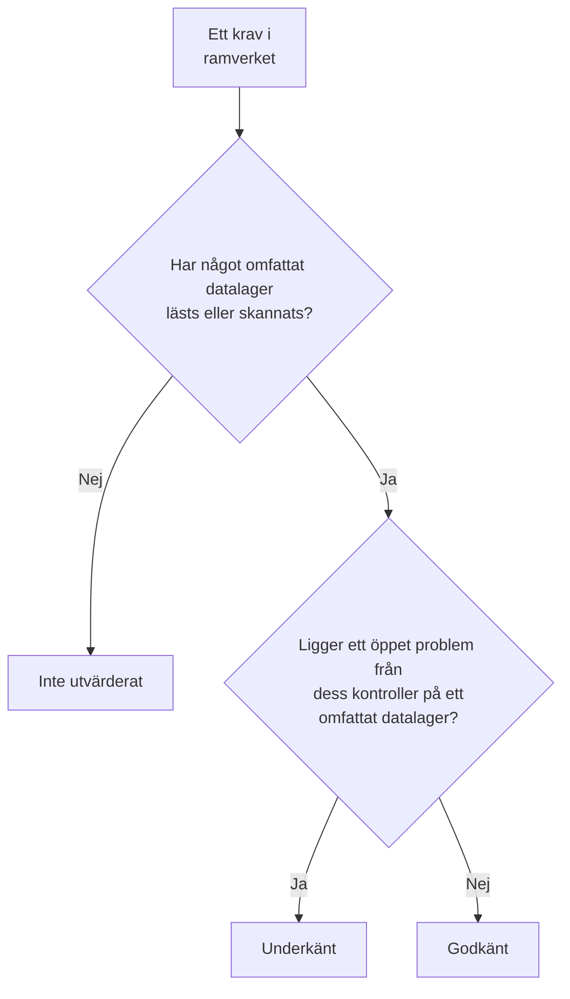

# Efterlevnad i Datasäkerhet

Datasäkerhet poängsätter nio ramverk utifrån det som dess skanningar hittade. Varje ramverk omfattar de datalager som dess regler handlar om – GDPR de datalager som innehåller personuppgifter, PCI DSS de datalager där kortdata hittades, SOC 2 varje datalager – och vart och ett av dess krav uppfylls eller underkänns av de kontroller som är bevis för det. **Datasäkerhet → Efterlevnad** visar varje ramverks poäng, hur många datalager det omfattar, och varje krav med hur många öppna problem som underkänner det. Varje resurs som innehåller datalager – ett Kubernetes-kluster, en Docker- eller Podman-värd, en databas, en tjänst eller en molnresurs – har en egen sådan sida, där det som inte gäller för den kan stängas av. En poäng är bevis inför en revision, inte ett certifikat: den säger vad OneUptime kan se av de datalager som det läser.

:::cards
- [Ramverken](#ramverken): De nio, och vilka datalager vart och ett omfattar.
- [Hur ett ramverk poängsätts](#hur-ett-ramverk-poängsätts): Krav som godkänns, underkänns eller inte utvärderas.
- [På en resurs sida](#på-en-resurs-sida): Efterlevnaden för ett kluster, en värd, en databas, en tjänst eller en molnresurs, och vad som är avstängt för den.
- [Krav och deras kontroller](#krav-och-deras-kontroller): Varje krav, och de kontroller som är bevis för det.
- [Register över behandling](#register-över-behandling): GDPR artikel 30, skrivet utifrån dina datalager, med utkast från OneUptime AI som du bekräftar.
- [Konsekvensbedömningar](#konsekvensbedömningar): En konsekvensbedömning avseende dataskydd för varje datalager som behöver en.
- [Revisionsbevis](#revisionsbevis): Det som en revisor läser under varje krav, exporterat med ditt register och din problemhistorik.
:::

## Ramverken

| Ramverk | Fullständigt namn | Datalager som omfattas |
| --- | --- | --- |
| GDPR | EU:s allmänna dataskyddsförordning | Datalager som innehåller personuppgifter. |
| CCPA | California Consumer Privacy Act, i dess lydelse enligt CPRA | Datalager som innehåller personlig information. |
| HIPAA | HIPAA Security Rule | Datalager som innehåller hälsodata. |
| PCI DSS | PCI DSS v4.0 | Datalager där kortnummer hittades. |
| SOC 2 | SOC 2 Trust Services Criteria | Varje datalager. |
| ISO 27001 | ISO/IEC 27001:2022 | Varje datalager. |
| NIST CSF | NIST Cybersecurity Framework 2.0 | Varje datalager. |
| LGPD | Brasiliens allmänna dataskyddslag | Datalager som innehåller personuppgifter om personer i Brasilien. |
| DPDP | Indiens Digital Personal Data Protection Act från 2023 | Datalager som innehåller personuppgifter om personer i Indien. |

## Vilka datalager ett ramverk omfattar

Ett datalagers omfattning kommer från de data som har hittats i det, så den ändras när skanningarna hittar mer:

- **SOC 2, ISO 27001 och NIST CSF** är säkerhetsramverk: de omfattar varje datalager, oavsett vad det innehåller.
- **GDPR, CCPA, HIPAA och PCI DSS** omfattar de datalager som innehåller en datatyp som de skyddar. Personuppgifter gör GDPR och CCPA tillämpliga, hälsodata även HIPAA, och kortnummer, kortens säkerhetskoder och kortens utgångsdatum PCI DSS. Ett datalager som bara innehåller hemligheter eller affärsdokument omfattas inte av något av dem.
- **LGPD och DPDP** är enskilda länders egna lagar: de omfattar de datalager som innehåller personuppgifter om personer i Brasilien eller i Indien, utlästa från datatyper som hör till landet, till exempel ett brasilianskt CPF eller ett indiskt Aadhaar-nummer.

[Känsliga datatyper](/docs/data-security/data-types#inbyggda-datatyper) listar varje datatyp, med dess land.

## Hur ett ramverk poängsätts

- **Ett krav godkänns** när inget öppet problem från de kontroller som är kopplade till det ligger på ett datalager som ramverket omfattar, och **underkänns** när ett gör det.
- **Det utvärderas inte** så länge inget omfattat datalager har fått sin konfiguration läst eller sitt innehåll skannat.
- **Två krav uppfylls av Datasäkerhet själv**: GDPR artikel 30, register över behandling, och ISO 27001 A.5.12, klassificering av information. De godkänns när varje omfattat datalager har lästs eller skannats, och underkänns så länge något inte har det.
- **Det är avstängt** när varje omfattat datalager tillhör en resurs som har stängt av kravet (se [På en resurs sida](#på-en-resurs-sida)).
- **Poängen** är andelen av ett ramverks utvärderade krav som godkänns, som ett heltal i procent: ett avstängt krav räknas varken för eller emot. Ett ramverk där inget har utvärderats har ingen poäng.

Bara öppna problem räknas. Ett problem vars risk har accepterats, eller som inte är ett problem, underkänner inte sina krav, så en accepterad risk är ett beslut som din revision kan se på problemet: vem som accepterade den, varför och till när.

## På en resurs sida

En resurs meny får ett **Säkerhet**-avsnitt, ihopfällt tills du öppnar det, så snart resursen innehåller ett datalager som Datasäkerhet känner till, i ett projekt som använder Datasäkerhet och för den som får läsa datalager:

| Resurs | Dess datalager |
| --- | --- |
| Kubernetes-kluster | Databaserna som körs på det |
| Docker- eller Podman-värd | Databaserna som körs på den |
| Databas | Själva databasen |
| Tjänst | Dess telemetri: loggarna, spåren och undantagen som den skickar |
| Molnresurs | Resursen själv: en bucket, en databas eller ett datavaruhus |

- **Datasäkerhet** listar dessa datalager, de mest riskfyllda först, och de öppna problemen på dem. Vart och ett öppnas i Datasäkerhet, där det hanteras.
- **Efterlevnad** poängsätter ramverken för enbart dessa datalager. De ramverk som deras data gör tillämpliga kommer först; de avstängda, och de som inget av datalagren innehåller data för, är ihopfällda nedanför.

Varje ramverk har ett reglage, **Gäller här**, och det har vart och ett av dess krav också. Stänger du av ett, hålls resursens datalager utanför det ramverket, eller utanför det kravet, både på resursens sida och på **Datasäkerhet → Efterlevnad**, som anger hur många datalager som har stängts av på sina resurser. Slår du på det igen, räknas de med igen. Varje reglage sparas direkt, och varje ändring förs in i projektets [Granskningsloggar](/docs/configuration/audit-logs).

Stänger du av ett, frågar sidan sedan under det: **Varför gäller detta inte här?** En orsak är valfri: skriv en kort orsak och välj **Spara orsak**, eller **Inte nu** för att låta bli. Därefter står det vem som stängde av det och när, och orsaken, med **Lägg till orsak** eller **Redigera orsak** för att skriva eller ändra den senare. Precis som reglaget förs orsaken in i granskningsloggen.

**Datasäkerhet → Efterlevnad** visar detsamma för varje resurs. Ett valt ramverk listar under **Avstängt för hela ramverket** de resurser som har stängt av hela ramverket, och varje krav anger under sin status de resurser som har stängt av just det kravet: var och en länkad till sin egen efterlevnadssida, med vem som stängde av det, när och varför. Sidans **Exportera CSV** har dem i kolumnen `Turned Off On`, och **Exportera JSON** i listan `turnedOff`.

Ett datalager följer en enda resurs reglage. En databas som körs på ett Kubernetes-kluster, eller på en Docker- eller Podman-värd, följer det klustrets eller den värdens: stäng av ett ramverk för klustret, så är det avstängt för varje databas på det. Databasens egen efterlevnadssida säger det och länkar dit, med reglagen låsta.

Rollerna Säkerhetsmedlem, Säkerhetsadministratör, Projektadministratör och Projektägare kan slå på och stänga av ramverk och krav, precis som de kan justera en kontroll. Rollen Säkerhetstittare ser vad som är avstängt, och varför.

## Krav och deras kontroller

### GDPR

| Krav | Vad det kräver | Kontroller |
| --- | --- | --- |
| Art. 5(1)(c) | Uppgiftsminimering | `production-data-in-non-production`, `stale-sensitive-data`, `new-personal-data-column`, `sensitive-data-in-telemetry`, `sensitive-data-to-ai`, `sensitive-data-in-ai-store` |
| Art. 5(1)(e) | Lagringsminimering | `stale-sensitive-data` |
| Art. 25 | Inbyggt dataskydd och dataskydd som standard | `production-data-in-non-production`, `stale-sensitive-data`, `new-personal-data-column`, `sensitive-data-in-telemetry`, `sensitive-data-to-ai`, `sensitive-data-in-ai-store` |
| Art. 28 | Personuppgiftsbiträden | `sensitive-data-to-ai` |
| Art. 30 | Register över behandling | Uppfylls av Datasäkerhet själv |
| Art. 32 | Säkerhet i samband med behandlingen | `public-read`, `public-write`, `public-access-not-blocked`, `internet-reachable`, `open-to-all-addresses`, `snapshot-public`, `snapshot-shared-externally`, `shared-with-external-accounts`, `not-encrypted-at-rest`, `no-customer-managed-key`, `encryption-in-transit-not-enforced`, `weak-tls`, `no-backups`, `no-point-in-time-recovery`, `deletion-protection-off`, `deleted-data-not-recoverable`, `access-not-logged`, `shared-key-access`, `object-acls-enabled`, `many-readers`, `unused-access`, `secrets-stored`, `plaintext-passwords`, `secrets-in-telemetry` |
| Art. 44-49 | Överföringar till tredjeländer | `residency-violation` |

### CCPA

| Krav | Vad det kräver | Kontroller |
| --- | --- | --- |
| 1798.100(c) | Insamling begränsad till det som är nödvändigt | `production-data-in-non-production`, `stale-sensitive-data`, `new-personal-data-column`, `sensitive-data-in-telemetry`, `sensitive-data-to-ai`, `sensitive-data-in-ai-store` |
| 1798.150 | Rimliga säkerhetsrutiner | `public-read`, `public-write`, `public-access-not-blocked`, `internet-reachable`, `open-to-all-addresses`, `snapshot-public`, `snapshot-shared-externally`, `shared-with-external-accounts`, `shared-key-access`, `object-acls-enabled`, `many-readers` |

### HIPAA

| Krav | Vad det kräver | Kontroller |
| --- | --- | --- |
| 164.308(a)(4) | Hantering av åtkomst till information | `unused-access` |
| 164.308(a)(7) | Beredskapsplan | `no-backups`, `no-point-in-time-recovery`, `deletion-protection-off`, `deleted-data-not-recoverable` |
| 164.312(a)(1) | Åtkomstkontroll | `public-read`, `public-write`, `public-access-not-blocked`, `internet-reachable`, `open-to-all-addresses`, `snapshot-public`, `snapshot-shared-externally`, `shared-with-external-accounts`, `shared-key-access`, `object-acls-enabled`, `many-readers` |
| 164.312(a)(2)(iv) | Kryptering och dekryptering | `not-encrypted-at-rest`, `no-customer-managed-key` |
| 164.312(b) | Granskningskontroller | `access-not-logged` |
| 164.312(e)(1) | Säkerhet vid överföring | `encryption-in-transit-not-enforced`, `weak-tls` |

### PCI DSS

| Krav | Vad det kräver | Kontroller |
| --- | --- | --- |
| 3.3.1 | Känsliga autentiseringsdata sparas inte efter auktorisering | `card-security-codes-stored` |
| 3.4.1 | Kortnummer maskeras när de visas | `card-numbers-readable`, `sensitive-data-in-telemetry` |
| 3.5.1 | Kortnummer är oläsbara var de än lagras | `not-encrypted-at-rest`, `no-customer-managed-key`, `card-numbers-readable` |
| 4.2.1 | Stark kryptografi skyddar kortdata under överföring | `encryption-in-transit-not-enforced`, `weak-tls` |
| 7.2 | Åtkomst definieras och tilldelas efter behov | `public-read`, `public-write`, `public-access-not-blocked`, `internet-reachable`, `open-to-all-addresses`, `snapshot-public`, `snapshot-shared-externally`, `shared-with-external-accounts`, `shared-key-access`, `object-acls-enabled`, `many-readers` |
| 7.2.4 | Konton och deras åtkomst granskas | `unused-access` |
| 8.3.2 | Autentiseringsfaktorer är oläsbara när de lagras | `plaintext-passwords` |
| 10.2 | Granskningsloggar registrerar åtkomst till kortdata | `access-not-logged` |

### SOC 2

| Krav | Vad det kräver | Kontroller |
| --- | --- | --- |
| A1.2 | Säkerhetskopiering och återställning | `no-backups`, `no-point-in-time-recovery`, `deletion-protection-off`, `deleted-data-not-recoverable` |
| CC6.1 | Logisk åtkomstsäkerhet | `public-read`, `public-write`, `public-access-not-blocked`, `internet-reachable`, `open-to-all-addresses`, `snapshot-public`, `snapshot-shared-externally`, `shared-with-external-accounts`, `not-encrypted-at-rest`, `no-customer-managed-key`, `shared-key-access`, `object-acls-enabled`, `many-readers`, `secrets-stored`, `plaintext-passwords`, `secrets-in-telemetry` |
| CC6.2 | Åtkomst tas bort när den inte längre behövs | `unused-access` |
| CC6.7 | Överföring av information | `encryption-in-transit-not-enforced`, `weak-tls` |
| CC7.2 | Övervakning av systemkomponenter | `access-not-logged` |

### ISO 27001

| Krav | Vad det kräver | Kontroller |
| --- | --- | --- |
| A.5.9 | Förteckning över information och andra tillhörande tillgångar | `no-owner` |
| A.5.12 | Klassificering av information | Uppfylls av Datasäkerhet själv |
| A.5.15 | Åtkomststyrning | `public-read`, `public-write`, `public-access-not-blocked`, `internet-reachable`, `open-to-all-addresses`, `snapshot-public`, `snapshot-shared-externally`, `shared-with-external-accounts`, `shared-key-access`, `object-acls-enabled`, `many-readers` |
| A.5.18 | Åtkomsträttigheter | `unused-access` |
| A.5.34 | Integritet och skydd av PII | `production-data-in-non-production`, `stale-sensitive-data`, `new-personal-data-column`, `sensitive-data-in-telemetry`, `sensitive-data-to-ai`, `sensitive-data-in-ai-store` |
| A.8.11 | Datamaskering | `production-data-in-non-production`, `stale-sensitive-data`, `new-personal-data-column`, `sensitive-data-in-telemetry`, `sensitive-data-to-ai`, `sensitive-data-in-ai-store` |
| A.8.12 | Förhindrande av dataläckage | `secrets-stored`, `secrets-in-telemetry` |
| A.8.13 | Säkerhetskopiering av information | `no-backups`, `no-point-in-time-recovery`, `deletion-protection-off`, `deleted-data-not-recoverable` |
| A.8.15 | Loggning | `access-not-logged` |
| A.8.24 | Användning av kryptografi | `not-encrypted-at-rest`, `no-customer-managed-key`, `encryption-in-transit-not-enforced`, `weak-tls`, `plaintext-passwords` |

### NIST CSF

| Krav | Vad det kräver | Kontroller |
| --- | --- | --- |
| ID.AM-07 | Förteckningar över data och metadata upprätthålls | `no-owner` |
| PR.AA-05 | Åtkomstbehörigheter hanteras | `public-read`, `public-write`, `public-access-not-blocked`, `internet-reachable`, `open-to-all-addresses`, `snapshot-public`, `snapshot-shared-externally`, `shared-with-external-accounts`, `shared-key-access`, `object-acls-enabled`, `many-readers`, `unused-access` |
| PR.DS-01 | Data i vila skyddas | `not-encrypted-at-rest`, `no-customer-managed-key`, `secrets-stored`, `secrets-in-telemetry` |
| PR.DS-02 | Data under överföring skyddas | `encryption-in-transit-not-enforced`, `weak-tls` |
| PR.DS-11 | Säkerhetskopior av data sparas och testas | `no-backups`, `no-point-in-time-recovery`, `deletion-protection-off`, `deleted-data-not-recoverable` |
| DE.CM-09 | Data och deras användning övervakas | `access-not-logged` |

### LGPD

| Krav | Vad det kräver | Kontroller |
| --- | --- | --- |
| Art. 6 | Nödvändighet och ändamålsbegränsning | `production-data-in-non-production`, `stale-sensitive-data`, `new-personal-data-column`, `sensitive-data-in-telemetry`, `sensitive-data-to-ai`, `sensitive-data-in-ai-store` |
| Art. 33 | Internationell överföring av data | `residency-violation` |
| Art. 46 | Säkerhetsåtgärder | `public-read`, `public-write`, `public-access-not-blocked`, `internet-reachable`, `open-to-all-addresses`, `snapshot-public`, `snapshot-shared-externally`, `shared-with-external-accounts`, `not-encrypted-at-rest`, `no-customer-managed-key`, `shared-key-access`, `object-acls-enabled`, `many-readers` |

### DPDP

| Krav | Vad det kräver | Kontroller |
| --- | --- | --- |
| Sec. 8(5) | Rimliga säkerhetsskydd | `public-read`, `public-write`, `public-access-not-blocked`, `internet-reachable`, `open-to-all-addresses`, `snapshot-public`, `snapshot-shared-externally`, `shared-with-external-accounts`, `not-encrypted-at-rest`, `no-customer-managed-key`, `shared-key-access`, `object-acls-enabled`, `many-readers` |
| Sec. 8(7) | Radering när ändamålet är uppfyllt | `production-data-in-non-production`, `stale-sensitive-data`, `new-personal-data-column`, `sensitive-data-in-telemetry`, `sensitive-data-to-ai`, `sensitive-data-in-ai-store` |
| Sec. 16 | Överföring utanför Indien | `residency-violation` |

## Register över behandling

GDPR artikel 30 kräver att du för ett register över dina behandlingar. Datasäkerhet skriver den del av det som handlar om var personuppgifter förvaras: en rad för varje datalager som innehåller personuppgifter. Det är kortet **Register över behandling** längst ned på **Datasäkerhet → Efterlevnad**, med **Exportera CSV** och **Exportera JSON**.

| Kolumn | Var den kommer ifrån |
| --- | --- |
| Datalager, typ, leverantör och region | Discovery |
| Miljö | Datalagrets taggar eller namn, eller det som du anger |
| Känslighet, kategorier och datatyper | Det som skanningarna hittade, eller den känslighet som du anger |
| Ägare | Datalagrets ägare, personer och medlemmarna i dess team |
| Syfte | Det som du skriver eller bekräftar i datalagrets **Syfte**: varför det innehåller personuppgifter. OneUptime fyller i det för de datalager som det sparar för din säkerhet |
| Lagringstid | Det som du skriver eller bekräftar i datalagrets **Lagringstid**: hur länge data sparas i det. OneUptime fyller i den för de datalager som det sparar för din säkerhet, och för en tjänsts telemetri utifrån ditt projekts lagringstid för telemetri |
| Vem kan läsa | Vem som kan läsa ett datalager som OneUptime sparar för din säkerhet |
| Ramverk | De ramverk som dess datatyper gör tillämpliga |
| Angivet av | OneUptime, för de datalager som det sparar för din säkerhet |
| Rättslig grund | Det som du skriver eller bekräftar: datalagrets rättsliga grund enligt GDPR artikel 6, en av samtycke, avtal, rättslig förpliktelse, grundläggande intressen, uppgift av allmänt intresse och berättigade intressen. Berättigade intressen för de datalager som OneUptime sparar för din säkerhet |
| Registrerade | Det som du skriver eller bekräftar: vilka datalagrets data gäller, till exempel kunder, användare, anställda eller patienter |
| Mottagare | Härlett från datalagrets dataflöden: de externa värdar och AI-leverantörer som dess data skickas till, och de datalager som har en kopia av dem |
| Överföringar | Härlett från datalagrets region, de regioner som molnet kopierar det till och regionerna för dess kopior, jämfört med de länder som de registrerade finns i: varje överföring ut ur de länderna, eller varför den inte är känd |
| Konsekvensbedömning | Om datalagret behöver en konsekvensbedömning avseende dataskydd, och var den står: behövs inte, krävs, utkast eller redigerad |
| Väntar på granskning | De fält vars utkast väntar på en person. Ett utkast finns aldrig i registret, inte heller i dess exporter, förrän någon bekräftar det |

För ett datalager som Datasäkerhet har hittat kan ingen skanning veta varför det innehåller personuppgifter, hur länge, på vilken grund eller vilka det gäller: skriv det i dess **Inställningar**, eller bekräfta utkasten från OneUptime AI. Registret och poängen går också att hämta via Datasäkerhets API, på `/data-security/record-of-processing`, `/data-security/compliance` och, för en enskild resurs, `/data-security/resource-compliance`, för alla som får läsa datalager (se [Integrationer för Datasäkerhet](/docs/data-security/integrations#api-terraform-och-mcp)).

### Utkast från OneUptime AI

OneUptime AI skriver utkast till ett datalagers **Syfte**, **Lagringstid**, **Rättslig grund** och **Registrerade** utifrån det som Datasäkerhet vet om det: de datatyper som hittats, dess namn, taggar och beskrivning, de tjänster som använder det och vad deras team har skrivit att de är till för, vart dess data tar vägen och var de lagras. Den ser aldrig ett värde från dina data (se [OneUptime AI i Datasäkerhet](/docs/data-security/ai)).

- **Ett utkast är markerat Utkast** och säger varför, med de fakta som det bygger på ett klick bort. Det finns inte i registret förrän du trycker på **Bekräfta**, eller använder **Redigera** för att skriva om det med dina egna ord.
- **Dina ord skrivs aldrig över av ett utkast.** Ett fält som du har skrivit får aldrig något nytt utkast. Ett utkast som du har bekräftat får ett nytt utkast bara när ett faktum som det bygger på ändras, och då föreslås det i stället för att tillämpas: markerat **Ändring föreslagen**, med vad som har ändrats, **Använd nytt utkast** och **Behåll nuvarande**.
- **Granska utkast**, på kortet **Register över behandling**, går igenom de datalager vars utkast väntar på dig, ett i taget. Ett datalagers **Inställningar** har samma fält, med **Skriv utkast med OneUptime AI** för de tomma.
- **På egen hand** skriver OneUptime AI utkast till de tomma fälten i de mest riskfyllda datalagren en gång om dagen, medan **Arbeta med nya problem** är påslaget under **Datasäkerhet → AI**, så som dina AI-regler tillåter.

Lagringstiden för en tjänsts telemetri, mottagarna och överföringarna härleds med vanlig kod och får aldrig några utkast. Utkasten är en utgångspunkt, inte juridisk rådgivning: låt den som ansvarar för er efterlevnad granska dem.

### Datalager som OneUptime sparar för din säkerhet

Fyra datalager innehåller IP-adresser och användarnamn med avsikt, för att skydda ditt nätverk: **Säkerhetshändelser**, **Network Flows**, **Säkerhetsadressvalv** och **Säkerhetsanvändarvalv**. Registret tar upp vart och ett som ditt projekt har. OneUptime anger dem i stället för att hitta dem: vad de innehåller är känt från början, så ingen skanning läser dem, ingen kontroll gäller för dem, och att de innehåller dessa adresser och namn är aldrig ett problem, eftersom det är det som de är till för. De visar **Angivet av OneUptime** under **Datalager**, och **Översikt** och ramverkens poäng utelämnar dem.

| Datalager | Vad det innehåller | Lagringstid | Vem kan läsa det |
| --- | --- | --- | --- |
| Säkerhetshändelser | IP-adresserna, användarnamnen och e-postadresserna för den som agerade och det som berördes | Ditt projekts [lagringstid för telemetri](/docs/telemetry/data-retention), läst varje gång registret läses, så en ändring gäller direkt | Projektägare, Projektadministratörer, Säkerhetsadministratörer, Säkerhetsmedlemmar, Säkerhetstittare och alla med Read Security Event |
| Network Flows | IP-adresserna för vem som kommunicerade med vem | 30 dagar efter att ett flöde kommer in | Alla som får läsa nätverksenheter |
| Säkerhetsadressvalv | IP-adressen bakom varje token som en IP-adressregel som hashar lämnade i de loggar och spår som [Säkerhetshändelser](/docs/telemetry/security-events) läser | 30 dagar efter att en adress senast sågs | Bara skanningarna i Säkerhetshändelser, inne i OneUptime: ingen person, sida, export, API eller AI-verktyg |
| Säkerhetsanvändarvalv | Användaren bakom varje token som en regel som hashar lämnade där [Säkerhetshändelser](/docs/telemetry/security-events) läser en användare i loggar och spår | 30 dagar efter att en användare senast sågs | Bara skanningarna i Säkerhetshändelser, inne i OneUptime: ingen person, sida, export, API eller AI-verktyg |

Syftet med vart och ett är "Nät- och informationssäkerhet (GDPR skäl 49)". För att skriva ett eget syfte eller en egen lagringstid använder du **Redigera register** i datalagrets **Inställningar**: ett fält som lämnas tomt behåller OneUptimes.

Ett datalager visas så länge ditt projekt sparar dess data: adressvalvet så länge en aktiverad IP-adressregel hashar loggar eller spår som Säkerhetshändelser läser, användarvalvet så länge en aktiverad regel med något annat mönster gör det, och vart och ett i 31 dagar efter det (se [Rensa känsliga data](/docs/telemetry/drop-filters-and-scrub-rules#rensa-känsliga-data)). När dess data är borta arkiveras datalagret, och det kommer tillbaka med ditt syfte och din lagringstid om datan gör det.

## Konsekvensbedömningar

GDPR artikel 35 kräver en konsekvensbedömning avseende dataskydd före en behandling som sannolikt leder till en hög risk. Datasäkerhet anger vilka datalager som behöver en: ett datalager som innehåller särskilda kategorier av personuppgifter, till exempel hälsodata, data om många personer (omkring 100 000 poster eller fler), eller data som lämnar de registrerades länder.

Ett datalagers **Konsekvensbedömning**, i dess meny under **Inställningar**, säger varför datalagret behöver en, eller att det inte gör det. **Skriv utkast till bedömningen** ber OneUptime AI om de fyra delar som artikel 35(7) kräver, utifrån datalagrets register, dess öppna problem och de som åtgärdats nyligen, hur exponerat det är, hur många som kan nå det och dess kryptering:

| Del | Artikel |
| --- | --- |
| Behandlingen och dess ändamål | Art. 35(7)(a) |
| Nödvändighet och proportionalitet | Art. 35(7)(b) |
| Risker för de registrerade | Art. 35(7)(c) |
| Åtgärder för att hantera riskerna | Art. 35(7)(d) |

Varje del säger vem som skrev den och när, med de fakta som en del med utkast bygger på. **Redigera** gör en del till din, och den får aldrig något nytt utkast; **Skriv nytt utkast** skriver bara utkast till de delar som ingen har redigerat. En del som skrevs utifrån fakta som har ändrats sedan dess säger det. **Exportera PDF** och **Exportera Markdown** laddar ned bedömningen.

## Revisionsbevis

**Revisionsbevis**, för det ramverk som du väljer på **Datasäkerhet → Efterlevnad**, är det som en revisor läser under vart och ett av dess krav, under de senaste 30, 90, 180 eller 365 dagarna:

- datalagren inom kravets omfattning, och hur dess kontroller står;
- problemen från dess kontroller som öppnades och åtgärdades under tidsperioden, och hur snabbt de åtgärdades;
- riskerna som accepterats under det, med motiveringar och utgångsdatum;
- resurserna som har stängt av det, och varför.

**Skriv utkast till revisionsbeviset** ber OneUptime AI om ett stycke under varje krav, som håller sig till dessa fakta; **Redigera** gör ett stycke till ditt, och det får aldrig något nytt utkast. Ett krav utan stycke visar sitt bevis som det är. **Exportera PDF** och **Exportera Markdown** laddar ned revisionsbeviset med två bilagor: registret över behandling för datalagren inom omfattningen, och den problemhistorik som det hänvisar till.

## Nästa steg

:::cards
- [Kontroller och problem i Datasäkerhet](/docs/data-security/checks-and-issues): Kontrollerna bakom varje krav, och hur du åtgärdar dem.
- [Dataflöden, åtkomst och hemvist](/docs/data-security/flows-access-residency): Hemvistregler, för överföringar enligt GDPR, LGPD och DPDP.
- [Känsliga datatyper](/docs/data-security/data-types): De datatyper som gör att ett datalager omfattas av ett ramverk.
:::
