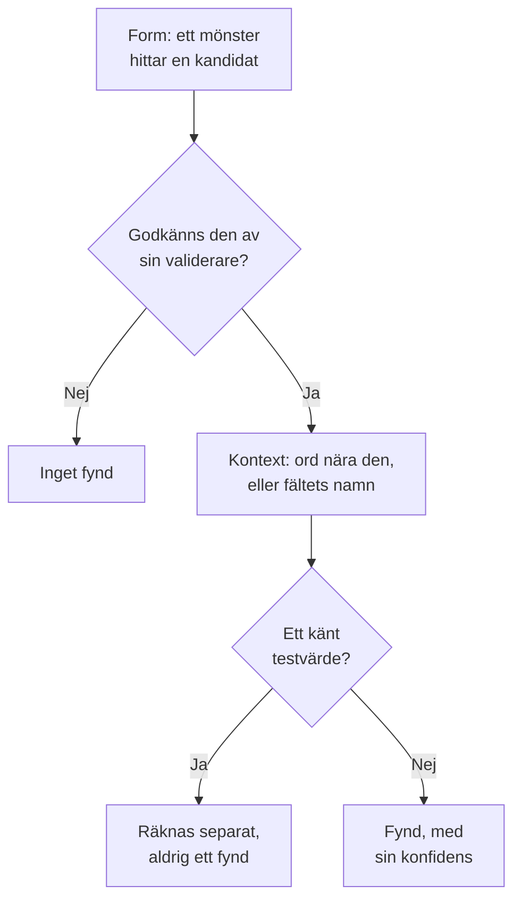

# Känsliga datatyper

Datasäkerhet känner till 143 sorters känsliga data: kortnummer, bankkonton, nationella ID-nummer från 43 länder, hälsoidentifierare, API-nycklar och tokens samt de särskilda kategorierna av personuppgifter. Var och en har en kategori, en känslighet och, när den hör till ett land, det landet. Den här sidan beskriver hur ett värde hittas och listar varje datatyp, så att du kan se varför något hittades och avgöra vad du ska göra åt det.

:::cards
- [Hur ett värde hittas](#hur-ett-värde-hittas): Form, validerare, kontext, testvärden, konfidens.
- [Fält och kolumner](#fält-och-kolumner): Hur en hel kolumn eller ett helt attribut bedöms.
- [Namn och gatuadresser i fritext](#namn-och-gatuadresser-i-fritext): Den lilla modellen inne i skannern, och hur väl den träffar.
- [Varje datatyp](#inbyggda-datatyper): Alla 143, efter kategori.
- [Dina egna datatyper](#dina-egna-datatyper): Anställnings-ID:n, försäkringsnummer och rutan Testa.
- [Datatyper som OneUptime AI hittar](#datatyper-som-oneuptime-ai-hittar): Dina egna datatyper, hittade i de fält som ingen detektor kunde placera.
- [OneUptime AI:s bedömningar](#oneuptime-ais-bedömningar): En bedömning av varje fynd som väntar på dig, med ditt teams beslut som prejudikat.
:::

## Hur ett värde hittas



Varje skanning - en loggrad, en CSV-cell, en databasrad, de första byten av ett objekt - kör samma steg:

1. **Form.** Varje datatyp har mönster som hittar kandidater: sexton siffror, `AKIA` och sexton bokstäver, ett ord, ett `@` och en domän. Ett mönster matchar aldrig inuti en längre token, så ett kortnummer hittas inte inuti en längre följd av siffror.
2. **Validerare.** En kandidat måste klara sin typs egna regler: en kontrollsumma (Luhn för kort, mod 97 för IBAN, Verhoeff för Aadhaar-nummer, kontrollsiffran i de flesta nationella ID-nummer), ett verkligt datum, ett känt prefix, tillräcklig slumpmässighet för en hemlighet. En kandidat som inte klarar dem blir inget fynd alls. Platshållare som `000000000` och `123456789` klarar ingen numerisk typ.
3. **Kontext.** Ord nära en kandidat - som standard upp till 64 tecken före den och 32 efter den - som säger vad den är höjer dess konfidens en nivå, och det gör även ett fält vars namn pekar på typen. Ord som säger att den är något annat, som ett order- eller spårningsnummer, sänker den en nivå. Ett nummer utan kontrollsumma och med en vanlig form, som ett passnummer eller ett bankkonto, räknas bara bredvid ord som namnger det. Det gör även ett nationellt telefonnummer, i en enda följd eller i de grupper som dess land skriver det i, som `tel 03-1234-5678` eller `phone 020 3123 4567`. Call, cell och contact namnger ett sådant bara i en fras som call me on, cell number eller contact number, eller före ett nummer med dess nationella prefix (trunkprefix), så att en Unix-tid efter call, som `call 1732752000`, inte är ett sådant.
4. **Kända testvärden.** Publicerade testkortnummer (som Stripes `4242 4242 4242 4242`), exempel-IBAN, adresser på `example.com` och andra reserverade domäner, IP-adresser för dokumentation, exempel-ID:n som myndigheters dokumentation trycker, nycklar i testläge som `sk_test_` och platshållarnycklar räknas separat. De ger aldrig ett fynd, så ett datalager fullt av dem läses som en testmiljö, inte som ett dataintrång.
5. **Konfidens.** Det som återstår är ett fynd, så säkert som dess bevis tillåter.

| Konfidens | Vad det betyder |
| --- | --- |
| **Hög** | Värdet klarade sin validerare, och ord runt det eller fältet det står i säger vad det är - eller, för ett fält, de flesta av dess värden är av den typen. |
| **Medel** | Värdet klarade sin validerare utan något runt det som bekräftar det, eller fältets namn säger vad det innehåller och vissa värden stämmer överens. |
| **Låg** | Formen matchar, men ingenting bekräftar det. |

Bara fynd med konfidens Hög och Medel räknas: de gör ett datalager känsligt och kan öppna ett problem. Fynd med Låg listas på datalagret, hopfällda, för en person att bedöma: **Bekräfta** på ett fynd som stämmer gör det till Hög, och det förblir Hög i senare skanningar.

När två datatyper gör anspråk på samma tecken vinner det säkrare fyndet: den högre konfidensen, sedan detektorn vars egna regler bevisar mer, sedan den längre matchningen.

Ett värde läses också som människor skriver det. En URL:s procentkodade tecken läses, även ett teckens UTF-8-byte, så att en IP-adress, en e-postadress, till exempel `jane%40example.com` eller `jos%C3%A9%40example.com`, eller en token eller en nyckel i en frågesträng hittas. En URL:s frågesträng läses också som ett formulär skriver den, med ett plustecken för varje mellanslag, så att ett nummer som skrivits i grupper hittas med ett procentkodat mellanslag eller ett plustecken mellan grupperna, till exempel `4111+1111+1111+1111` eller `DE44%205001%200517%205407%203249%2031`, och detsamma gäller ett postnummer, en gatuadress och ett födelsedatum, till exempel `SW1A+2AA`, `10+Downing+Street` eller `dob=12%2F03%2F1985`. Ett nummers siffror läses i alla skriftsystem, till exempel siffror med full bredd (`４１１１ １１１１ １１１１ １１１１`) eller arabisk-indiska siffror, först varje skriftsystem för sig och sedan tillsammans: ett kortnummer, ett korts säkerhetskod eller utgångsdatum, ett telefonnummer, ett amerikanskt Social Security-nummer, ett IBAN, ett routingnummer, ett bankkontonummer, en sort code, ett BSB, en BIC, en IFSC, ett nationellt ID-nummer, en hälsoidentifierare som ett NHS-nummer, ett postnummer eller ett födelsedatum. Ett sådant nummer som skrivits helt med full bredd, som japansk och kinesisk text skriver ett, läses också med sitt plustecken, sina bindestreck, parenteser, punkter, snedstreck och ideografiska mellanslag som ASCII-tecken, till exempel `＋８１ ３－１２３４－５６７８` eller `５３６－２２－８７３１`, och detsamma gäller ett nummer vars grupper skiljs åt av ett annat streck, som bara läses som ett bindestreck mellan två siffror: förlängningstecknet som japansk text skriver i stället för ett bindestreck, till exempel `＋８１ ３ー１２３４ー５６７８`, eller ett typografiskt bindestreck, ett siffertankstreck, ett tankstreck eller ett minustecken, till exempel `536–22–8731`. Ett värde som skrivits med bokstäver med full bredd läses med sina bokstäver, siffror och tecken som ASCII-tecken, till exempel en e-postadress `ｊａｎｅ＠ｅｘａｍｐｌｅ．ｃｏｍ`, ett IBAN `ＤＥ８９　３７０４　００４４　０５３２　０１３０　００` eller ett brittiskt postnummer `ＳＷ１Ａ　２ＡＡ`, och detsamma gäller de ord som betecknar ett nummer, till exempel `ＴＥＬ`. Text utan något värde skrivet med bokstäver med full bredd, till exempel japansk eller kinesisk prosa, läses som den är. En e-postadress hittas i alla skriftsystem, till exempel `张伟@example.com` eller `почта@пример.рф`, och en IPv6-adress direkt efter en nyckels kolon, till exempel `ip:2001:db8::1`. Varje fynd är värdet som det är skrivet, så att en rensningsregel döljer det där.

Ett långt värde läses i fönster på 64 KB som överlappar med 4 KB, så att ett värde hittas helt var det än står, och högst 4 MB av ett värde läses.

## Fält och kolumner

En kolumn, ett JSON-fält eller ett loggattribut bedöms som en helhet. Dess namn antyder en datatyp, och dess provtagna värden bevisar en. Andelen av dess värden som innehåller typen avgör hur säkert fyndet är:

| Värden som innehåller typen | Konfidens |
| --- | --- |
| 60 % eller mer | Hög |
| 25 % eller mer | Hög när fältets namn pekar på typen, annars Medel |
| Färre | Medel när fältets namn pekar på typen, annars Låg: några e-postadresser i en kolumn med något annat |

Ett fält vars värden i genomsnitt är längre än 80 tecken är fritext - anteckningar, meddelanden, beskrivningar - och förväntas inte innehålla en enda typ. Dess fynd behåller den konfidens som varje matchning fick på egen hand, och säger att de hittades i fritext. Upp till 1 000 värden i ett fält klassificeras, och upp till 16 KB av varje.

Ett fälts namn delas upp i ord - `customerEmail`, `customer_email` och `customer-email` blir alla "customer email" - och en typs namntips matchar när dess ord förekommer i den ordningen, bredvid varandra: "date of birth" matchar `customer_date_of_birth`, inte `birth_city`. Bara den sista delen av en sökväg med punkter är fältets eget namn, tillsammans med delen före den när den sista är ett generiskt ord som `number`, `id` eller `value`: `customer.address.city` är inte en gatuadress, och `card.number` är fortfarande ett kortnummer.

Vissa datatyper kan inte avgöras utifrån sina värden: inget mönster skiljer en persons namn från en gata, eller en religion från vilket annat ord som helst. De här hittas bara utifrån fältets namn, när fältet har värden: Personnamn, Användarnamn, Kön, Nationalitet, Hälsoinformation, Ras eller etniskt ursprung, Religiös övertygelse, Sexuell läggning, Politisk åsikt, Fackföreningsmedlemskap, Biometriska data, Genetiska data och Brottsregister. Ett namn, ett användarnamn, ett kön eller en nationalitet får då Hög när 60 % eller mer av värdena ser ut som ett sådant, och annars Medel. I fritext hittas personnamn och gatuadresser också av en liten modell: se [Namn och gatuadresser i fritext](#namn-och-gatuadresser-i-fritext). En persons namn hittas också i en URL:s frågesträng, under en parameter som heter som ett sådant fält skulle heta, till exempel `full_name` i `/contacts?full_name=Jos%C3%A9%20Garc%C3%ADa`: dess värde läses som en URL skriver det, det får Hög när det ser ut som ett namn, och det hittas där det är skrivet, med escape-tecknen. En parameter som bara heter `name` lämnas åt modellen.

Ett fält vars namn säger att det innehåller ett lösenord - `password`, `passwordHash`, `pwd`, inte `password_changed_at` - bör innehålla en hash: bcrypt, argon2, scrypt, PBKDF2 eller ett annat schema som ett datalager sannolikt använder. Tomma värden, platshållare som `********` och krypterade värden läggs åt sidan. När fler av resten inte är hashar än är det, innehåller fältet själva lösenorden, som inget mönster kan se, och datalagret underkänns i [Lösenord lagras i klartext](/docs/data-security/checks-and-issues#datahygien).

### Fält som ingen detektor kunde placera

En kolumn eller ett fält vars namn inte pekar på någon datatyp, och vars värden inte matchar någon detektor, är inte känt som säkert: det kan vara ditt eget kundnummer, eller en kolumn som har ett namn på ett annat språk. Med projektets **Aktivera AI** påslaget sparar en innehållsskanning sådana fält, högst 200 per skanning, och OneUptime AI tillfrågas vilken av projektets datatyper varje fält innehåller, högst 40 fält från ett datalager åt gången. Den får fältets namn, namnen på fälten bredvid och formerna på dess värden - varje bokstav skriven som `a` eller `A` och varje siffra som `9`, så `AB-1234` blir `AA-9999` - aldrig ett värde. Fritext, fält med färre än 5 värden, små heltal och fält som heter som ett id, en tidpunkt eller en status frågas det inte om.

En telemetriskanning behåller på samma sätt de attribut som ingen detektor placerade, från en tjänsts loggar, spans, mätvärden och resten av dess telemetri, högst 50 per tjänst vid varje skanning. Den behåller aldrig OneUptimes egna attribut, de attribut som OpenTelemetrys konventioner skriver på varje post för att säga var den kommer ifrån, som tjänsten, värden eller podden, eller fritext, som brödtexten i en logg.

Varje typ som OneUptime AI nämner är ett fynd med Låg, markerat **Föreslagen av OneUptime AI** med sin motivering, skriven på ditt projekts språk och visad över hela fyndets rad. Som varje fynd med Låg räknas det inte förrän en person väljer **Bekräfta** på datalagrets sida **Innehåll**; **Markera som inte känsligt** avvisar det. Ett fält som har fått svar frågas det inte om igen på 30 dagar, och ett fält som en person har bedömt aldrig igen.

## Namn och gatuadresser i fritext

Inget mönster skiljer en persons namn från vilket annat ord som helst. Därför läses fritext - en supportanteckning, en loggrad, ett undantagsmeddelande, en prompt - också av en liten språkmodell som hittar personnamn och gatuadresser. Modellen körs inne i skannern, på OneUptimes workers och på dina sonder: texten lämnar aldrig skannern, inget laddas ned medan den körs och ingen prompt skrivs. Den är inte OneUptime AI, och OneUptime AI:s reglage slår inte på eller av den: det gör **Hitta namn och gatuadresser**.

- **Vad den läser.** Ett fält vars värden i snitt är längre än 80 tecken; ett fält vars namn säger att en person skriver fritext i det, hur korta värdena än är, till exempel `delivery_note`, `comentario`, `Lieferhinweis` eller `opmerking` (se [Korta värden](#korta-värden)); och i telemetri varje loggtext, undantagsmeddelande, stackspårning och AI-konversation, hur kort den än är. Den läser upp till 100 olika värden i ett fält, 32 KB text sammanlagt, och upp till 16 KB av ett värde. En URL i det den läser läses som en URL: dess procentkodade tecken läses, och ett `+` mellan två bokstäver som ett mellanslag, så att namnet i `/profile?name=Jos%C3%A9%20Garc%C3%ADa` hittas, och döljs som det är skrivet.
- **Vad den hittar.** Ett **Personnamn** (`person-name`) och en **Gatuadress** (`postal-address`): en plats som modellen läser intill ett husnummer, till exempel `14 Calle Mayor`, med postnumret och orten som följer. En ort eller ett land ensamt är ingen gatuadress.
- **Hur säker den är.** Ett namn eller en adress som modellen hittar är Medel i sig. Det är Hög när fältets namn säger att fältet innehåller namn eller adresser, eller när ord i närheten gör det, som "customer", "Kunde" eller "dirección". Det är Låg när modellen är osäker, med ett värde under 0,6. Var och en behåller den konfidens den fick på egen hand, så ett namn bland tusen loggrader är fortfarande Medel.
- **Testvärden.** Platshållare som `Jane Doe`, `John Smith`, `Max Mustermann` och `123 Main Street` räknas för sig, som varje typs testvärden.
- **Vad den sparar.** Proverna maskeras som för ett namn som hittats från fältets namn: första tecknet och fyra stjärnor, `M****`. De får aldrig något fingeravtryck. På datalagrets sida **Innehåll** står det **Hittat i fritext av skannerns modell** vid ett sådant fynd.
- **Dess poster, och dess regler.** Ett fynd den gjorde visar posterna det hittades i, med varje rad kapad runt namnet eller adressen och varje namn och adress i den maskerade, och **Rensa** bevisar en regel på de posterna, som för alla fynd: de läses igen med modellen, med upp till 20 sekunder av dess tid varje gång. En post den inte hann med visas inte, och listan säger hur många värden den inte hann med. Där modellen inte kan köras säger listan det, och ingen regel för fyndet bevisas.

| Modell | Licens | Storlek | Revision | Uppmätta språk |
| --- | --- | --- | --- | --- |
| [openmasq/ner-multilingual](https://huggingface.co/openmasq/ner-multilingual): sex lager flerspråkig BERT, int8 ONNX | Apache 2.0 | 98 MB | `8cf7273` | Engelska, spanska, tyska, franska, italienska, portugisiska, nederländska |

### Hur väl den hittar dem

Den mättes med skannerns egen kod på en testuppsättning som skrevs för den: 392 påhittade meningar på sju språk - loggrader, supportanteckningar, e-post, promptar - varav 168 varken innehåller ett namn eller en adress. Ett fynd är rätt när det överlappar ett namn eller en adress av sin typ. Ribban skrevs innan någon modell mättes: en precision på minst 0,90 för varje typ över alla språk och 0,85 i varje språk, en recall på minst 0,70, och högst 20 felaktiga fynd per 1 000 värden som inte innehåller något av dem. Av de fyra modeller som mättes klarade två ribban, och den mindre valdes. Ett test håller fast vid de här värdena: en ändring av modellen eller skannern som sänker något av dem misslyckas.

| Språk | Namn: precision | Namn: recall | Adresser: precision | Adresser: recall |
| --- | --- | --- | --- | --- |
| Engelska | 0,96 | 0,96 | 1,00 | 1,00 |
| Spanska | 0,96 | 0,96 | 1,00 | 1,00 |
| Tyska | 1,00 | 0,93 | 1,00 | 1,00 |
| Franska | 0,96 | 0,96 | 1,00 | 1,00 |
| Italienska | 0,96 | 0,96 | 1,00 | 1,00 |
| Portugisiska | 0,93 | 0,89 | 1,00 | 1,00 |
| Nederländska | 0,96 | 0,89 | 1,00 | 1,00 |
| Alla sju | 0,96 | 0,94 | 1,00 | 1,00 |

På testuppsättningens 168 meningar som inte innehåller något av dem gör den 18 felaktiga fynd per 1 000. På en del av ett offentligt riktmärke, [gretelai/synthetic_pii_finance_multilingual](https://huggingface.co/datasets/gretelai/synthetic_pii_finance_multilingual) (Apache 2.0): 15 finansiella dokument på vart och ett av sju språk, med etiketter som en maskin satt och som inte är fullständiga, så läs det tillsammans med tabellen ovan och inte för sig:

| Språk | Namn: precision | Namn: recall | Adresser: precision | Adresser: recall |
| --- | --- | --- | --- | --- |
| Engelska | 0,91 | 0,90 | 0,83 | 1,00 |
| Spanska | 0,89 | 0,37 | 0,58 | 0,70 |
| Tyska | 0,93 | 0,58 | 0,75 | 0,70 |
| Franska | 0,84 | 0,50 | 0,42 | 0,83 |
| Italienska | 0,73 | 0,61 | 0,79 | 0,69 |
| Nederländska | 0,91 | 0,49 | 1,00 | 0,89 |
| Svenska | 1,00 | 0,61 | 1,00 | 0,93 |
| Alla sju | 0,89 | 0,54 | 0,77 | 0,82 |

De fyra modeller som mättes, på den skrivna testuppsättningen, en efter en på samma maskin, var och en tidtagen på en kärna med onnxruntimes inbyggda kod. OneUptime kör den valda med onnxruntimes WebAssembly, som körs i varje avbild, fem till åtta gånger långsammare:

| Modell | Licens | Storlek | Namn: precision / recall | Adresser: precision / recall | Felaktiga fynd per 1 000 | Tid per 1 000 värden på 75 / 1 181 tecken |
| --- | --- | --- | --- | --- | --- | --- |
| openmasq/ner-multilingual (vald) | Apache 2.0 | 98 MB | 0,963 / 0,939 | 1,000 / 1,000 | 18 | 5,9 s / 82 s |
| Wismut/nym-pii-multilingual-small | MIT | 121 MB | 0,995 / 0,974 | 0,985 / 1,000 | 12 | 7,4 s / 103 s |
| jkomyno/minilmv2-l6-h384-ner-en-it-q8 | MIT | 34 MB | 0,704 / 0,929 | 0,839 / 1,000 | 369 | 3,7 s / 68 s |
| balticml/mmbert-small-pii-redaction | Apache 2.0 | 38 MB | 0,712 / 0,995 | 0,762 / 0,992 | 589 | 7,8 s / 159 s |

### Korta värden

Ett kort fält läses bara när dess namn säger att en person skriver fritext i det. Regeln mättes innan den valdes, på 49 kolumner i en databas på de sju språken, 588 värden sammanlagt: produktnamn, titlar, etiketter, yrkestitlar och butiksnamn, där ett varumärkes, en figurs eller en gatas namn inte är ett fynd, och korta leveransanteckningar, supportkommentarer och kundanmärkningar med 91 namn och 28 gatuadresser. Att läsa varje fält med fyra eller fler ord, den första regeln som övervägdes, läste 108 av katalogens värden och gjorde 53 falska namn av dem, som `Ralph Lauren` i en pikétröjas namn och `Tom Sawyer` i en boks titel:

| Regel | Katalogvärden lästa | Namn: precision | Namn: recall | Adresser: precision | Felaktiga fynd per 1 000 |
| --- | --- | --- | --- | --- | --- |
| Fält med fyra eller fler ord (inte vald) | 108 | 0,62 | 0,99 | 1,00 | 222 |
| Fält vars namn säger fritext (vald) | 0 | 0,98 | 0,99 | 1,00 | 14 |

Den valda regeln, per språk. Ett test håller fast vid dessa resultat, och ribban modellen valdes efter:

| Språk | Namn: precision | Namn: recall | Adresser: precision | Adresser: recall |
| --- | --- | --- | --- | --- |
| Engelska | 1,00 | 1,00 | 1,00 | 1,00 |
| Spanska | 1,00 | 1,00 | 1,00 | 1,00 |
| Tyska | 1,00 | 1,00 | 1,00 | 1,00 |
| Franska | 1,00 | 1,00 | 1,00 | 1,00 |
| Italienska | 1,00 | 1,00 | 1,00 | 1,00 |
| Portugisiska | 0,86 | 0,92 | 1,00 | 1,00 |
| Nederländska | 1,00 | 1,00 | 1,00 | 1,00 |
| Alla sju | 0,98 | 0,99 | 1,00 | 1,00 |

Fältets eget namn räknas: `orders.delivery_note` läses, `notes.author` gör det inte, och inte heller ett namn som slutar på ett id, ett antal, en typ, en status eller en tid, som `message_id`. En beskrivning läses inte för sitt namn: en produkts är katalogtext.

### Var den körs, och vad den kostar

- **I varje avbild.** App-avbilden, som kör dina workers, och sondavbilden har modellen, dess ordförråd och körmiljön med sig, även luftgapade avbilder och Iron Bank-avbilder: cirka 114 MB på disk. De hämtas när avbilden byggs, från en fastlåst revision, och kontrolleras mot sin SHA-256. Inget laddas ned medan en skanning körs.
- **Minne.** Den läses in första gången en skanning behöver den, en gång per process: cirka 550 MB, som lämnas tillbaka efter 10 minuter utan skanning.
- **Tid.** På en kärna mellan 30 sekunder och en minut per 1 000 värden av en loggrads längd, och cirka 9 minuter per 1 000 värden på 1 200 tecken. En innehållsskanning av ett datalager ger den upp till 2 minuter. Telemetriskanningen varje timme ger den upp till 1 minut totalt och 6 sekunder per datalager, till en ny uppsättning datalager varje timme.
- **Turordning.** Modellen i varje innehållsskanning börjar där den förra stannade: vid den första tabellen eller containern vars fritext den inte läste, och med objekten i en bucket som den inte hann med, som läses igen före alla andra. Det den började på och inte kunde slutföra tas inte först igen, så inget håller fast dess tid skanning efter skanning, och varje tabell och varje objekt får sin tur, hur mycket fritext datalagret än har.
- **När tiden tar slut** avslutas skanningen med det modellen hann läsa, och dess varningar säger hur många av fritextvärdena den läste, aldrig vad. En worker eller en sond utan modellen skannar som förut och säger varför:

```text
Names and street addresses were looked for in 120 of 500 free-text values: this store's 6 seconds of model time ran out.
Names and street addresses in free text were not looked for: the model's model_quantized.onnx is not installed on this probe.
```

En skannings detaljer visar dessa, och alla andra varningar från en innehålls- eller telemetriskanning, på läsarens språk.

**Hitta namn och gatuadresser** är på i varje projekt: innehållsskanningar av buckets, databaser och BigQuery-dataset läser fritext med modellen, på workers och på sonder. **Hitta namn och gatuadresser i telemetri**, under det, är av: att en gång läsa varje loggtext, undantag och konversation i ett livligt projekt med 200 tjänster tar cirka 48 minuter på en kärna, och skanningens minut i timmen läser cirka 4 % av det. Slå på det för att låta varje timskanning läsa en del av dem. Båda finns under **Datasäkerhet → Inställningar → Skanningsinställningar**, i **Vad Datasäkerhet läser**. **Testa** körs i din webbläsare, utan modellen: det modellen skulle hitta visas inte där. Modellen skulle lägga till cirka 113 MB att ladda ner, 67 MB komprimerat, och cirka 440 MB i flikens minne, så den körs bara i skannern.

## Känslighet

| Känslighet | Vad det betyder |
| --- | --- |
| **Begränsad** | Skada följer om det läcker: hemligheter, kortnummer, journaler, myndighets-ID:n. |
| **Konfidentiell** | Personuppgifter, och dokument som är märkta som konfidentiella. |
| **Intern** | Verksamhetens egna data, som inte är avsedda för utomstående. |
| **Offentlig** | Inget känsligt hittades. |

Ett datalager är lika känsligt som den känsligaste datatypen som har hittats i det med minst konfidens Medel. Testvärden och fynd som markerats som inte känsliga räknas inte alls, och ett datalager där inget hittades får känsligheten Offentlig. För att behandla ett datalager som mer eller mindre känsligt än dess fynd säger anger du själv dess känslighet i datalagrets **Inställningar**: kontrollerna använder då den.

## Kategorier

| Kategori | Vad den omfattar | Personuppgifter |
| --- | --- | --- |
| Hemligheter och autentiseringsuppgifter | Lösenord, API-nycklar, tokens och privata nycklar som låser upp andra system. | Nej |
| Finansiellt | Kortnummer, bankkonton, IBAN och kryptoplånböcker. | Ja |
| Hälsa | Journalnummer, hälsoidentifierare, diagnoser och recept. | Ja |
| Myndighets-ID | Nummer för nationell identitet, skatt, pass och socialförsäkring. | Ja |
| Särskild kategori | Det som artikel 9 i GDPR skyddar mest: etnicitet, religion, sexuell läggning, politik, fackligt medlemskap, biometriska och genetiska data. | Ja |
| Kontakt och identitet | Vem någon är och hur man når personen: e-post, telefon, adress, födelsedatum, IP-adress. | Ja |
| Affärskonfidentiellt | Dokument som är märkta som konfidentiella, endast för internt bruk eller privilegierade. | Nej |

Personuppgifter är data om en person, i den mening som GDPR, CCPA, LGPD och DPDP avser. Ett datalager som bara innehåller hemligheter och affärsdokument ligger utanför ett integritetsramverks omfång, men aldrig utanför ett säkerhetsramverks (se [Efterlevnad i Datasäkerhet](/docs/data-security/compliance)).

## Inbyggda datatyper

En datatyp som hör till ett land namnger det, som en ISO 3166-1-kod: hemvistregler och de landsbundna ramverken läser den (se [Hemvist](/docs/data-security/flows-access-residency#hemvistregler)). ID:t är det namn som API:t och fynden använder för typen.

### Kontakt och identitet

| Datatyp | ID | Vad det är | Känslighet | Land |
| --- | --- | --- | --- | --- |
| E-postadress | `email-address` | En persons e-postadress. | Konfidentiell | — |
| Telefonnummer | `phone-number` | Ett telefonnummer i internationellt eller nationellt format. | Konfidentiell | — |
| Personnamn | `person-name` | En persons förnamn, efternamn eller fullständiga namn, som hittas från fältets namn, eller av skannerns modell i fritext. | Konfidentiell | — |
| Gatuadress | `postal-address` | En gatuadress: ett nummer, ett gatunamn och en gatutyp. | Konfidentiell | — |
| Postnummer | `postal-code` | Ett postnummer. Ensamt avgränsar det var någon bor. | Intern | — |
| Födelsedatum | `date-of-birth` | Ett datum bredvid ord som säger att det är någons födelsedatum. | Konfidentiell | — |
| IP-adress | `ip-address` | En offentlig IPv4- eller IPv6-adress, som GDPR behandlar som en personuppgift. | Konfidentiell | — |
| MAC-adress | `mac-address` | Ett nätverkskorts hårdvaruadress, som identifierar en enhet. | Konfidentiell | — |
| Annons-ID | `advertising-id` | Ett mobilt annons-ID (IDFA, GAID, AAID) som spårar en enhet. | Konfidentiell | — |
| Exakt plats | `geolocation` | En latitud och longitud som är tillräckligt exakta för att hitta en byggnad. | Konfidentiell | — |
| Användarnamn | `username` | En persons inloggnings- eller kontonamn, som hittas utifrån fältets namn. | Konfidentiell | — |
| Kön | `gender` | En persons genus eller kön, som hittas utifrån fältets namn. | Konfidentiell | — |
| Nationalitet | `nationality` | En persons nationalitet eller medborgarskap, som hittas utifrån fältets namn. | Konfidentiell | — |
| Fordonsidentifieringsnummer | `vehicle-identification-number` | Ett VIN på 17 tecken med en giltig kontrollsiffra. | Konfidentiell | — |

### Myndighets-ID

| Datatyp | ID | Vad det är | Känslighet | Land |
| --- | --- | --- | --- | --- |
| Amerikanskt Social Security-nummer | `us-ssn` | Ett amerikanskt Social Security-nummer. | Begränsad | US |
| Amerikanskt skatte-ID (ITIN) | `us-itin` | Ett amerikanskt Individual Taxpayer Identification Number. | Begränsad | US |
| Amerikanskt arbetsgivar-ID (EIN) | `us-ein` | Ett amerikanskt Employer Identification Number, bredvid ord som säger det. | Konfidentiell | US |
| Amerikanskt passnummer | `us-passport` | Ett amerikanskt passnummer, bredvid ord som säger det. | Begränsad | US |
| Amerikanskt körkortsnummer | `us-drivers-license` | Ett amerikanskt körkortsnummer, bredvid ord som säger det. | Begränsad | US |
| Brittiskt National Insurance-nummer | `uk-nino` | Ett brittiskt National Insurance-nummer. | Begränsad | GB |
| Brittiskt passnummer | `uk-passport` | Ett brittiskt passnummer, bredvid ord som säger det. | Begränsad | GB |
| Brittiskt körkortsnummer | `uk-driving-licence` | Ett brittiskt körkortsnummer på 16 tecken. | Begränsad | GB |
| Kanadensiskt Social Insurance-nummer | `ca-sin` | Ett kanadensiskt Social Insurance Number med en giltig kontrollsiffra. | Begränsad | CA |
| Mexikanskt CURP | `mx-curp` | Ett mexikanskt Clave Única de Registro de Población. | Begränsad | MX |
| Mexikanskt RFC | `mx-rfc` | Ett mexikanskt skatte-ID, Registro Federal de Contribuyentes. | Begränsad | MX |
| Brasilianskt CPF | `br-cpf` | Ett brasilianskt Cadastro de Pessoas Físicas-nummer. | Begränsad | BR |
| Brasilianskt CNPJ | `br-cnpj` | Ett brasilianskt organisationsnummer (CNPJ). | Konfidentiell | BR |
| Argentinskt CUIT / CUIL | `ar-cuit` | En argentinsk identifieringskod för skatt eller arbete. | Begränsad | AR |
| Chilenskt RUT | `cl-rut` | Ett chilenskt Rol Único Tributario med en giltig kontrollsiffra. | Begränsad | CL |
| Spanskt DNI | `es-dni` | Numret på en spansk nationell identitetshandling, med sin kontrollbokstav. | Begränsad | ES |
| Spanskt NIE | `es-nie` | Ett spanskt identitetsnummer för utländska medborgare, med sin kontrollbokstav. | Begränsad | ES |
| Portugisiskt NIF | `pt-nif` | Ett portugisiskt skatteidentifikationsnummer. | Begränsad | PT |
| Franskt socialförsäkringsnummer (NIR) | `fr-nir` | Ett franskt INSEE-nummer med sin tvåsiffriga nyckel. | Begränsad | FR |
| Tyskt skatte-ID | `de-tax-id` | En tysk Steuerliche Identifikationsnummer. | Begränsad | DE |
| Italiensk codice fiscale | `it-codice-fiscale` | En italiensk skattekod med ett giltigt kontrolltecken. | Begränsad | IT |
| Nederländskt BSN | `nl-bsn` | Ett nederländskt medborgarservicenummer som klarar elvatestet. | Begränsad | NL |
| Belgiskt nationellt nummer | `be-national-number` | Ett belgiskt nummer i det nationella registret. | Begränsad | BE |
| Polskt PESEL | `pl-pesel` | Ett polskt nationellt identifikationsnummer. | Begränsad | PL |
| Svenskt personnummer | `se-personnummer` | Ett svenskt personnummer med en giltig kontrollsiffra. | Begränsad | SE |
| Norskt nationellt identitetsnummer | `no-fodselsnummer` | Ett norskt fødselsnummer med båda kontrollsiffrorna. | Begränsad | NO |
| Danskt CPR-nummer | `dk-cpr` | Ett danskt folkbokföringsnummer, bredvid ord som säger det. | Begränsad | DK |
| Finsk personbeteckning | `fi-hetu` | En finsk henkilötunnus med sitt kontrolltecken. | Begränsad | FI |
| Irländskt PPS-nummer | `ie-ppsn` | Ett irländskt Personal Public Service Number. | Begränsad | IE |
| Schweiziskt AHV-nummer | `ch-ahv` | Ett schweiziskt socialförsäkringsnummer (AHV / AVS). | Begränsad | CH |
| Rumänskt CNP | `ro-cnp` | En rumänsk personlig numerisk kod. | Begränsad | RO |
| Bulgariskt EGN | `bg-egn` | Ett bulgariskt enhetligt medborgarnummer. | Begränsad | BG |
| Kroatiskt OIB | `hr-oib` | Ett kroatiskt personligt identifikationsnummer. | Begränsad | HR |
| Grekiskt AMKA | `gr-amka` | Ett grekiskt socialförsäkringsnummer. | Begränsad | GR |
| Turkiskt identitetsnummer | `tr-tckn` | Ett turkiskt T.C. Kimlik-nummer. | Begränsad | TR |
| Israeliskt identitetsnummer | `il-teudat-zehut` | Ett israeliskt Teudat Zehut-nummer. | Begränsad | IL |
| Sydafrikanskt ID-nummer | `za-id` | Ett sydafrikanskt identitetsnummer med ett giltigt datum och en giltig kontrollsiffra. | Begränsad | ZA |
| Emirates ID (Förenade Arabemiraten) | `ae-emirates-id` | Numret på ett identitetskort från Förenade Arabemiraten. | Begränsad | AE |
| Saudiskt nationellt ID | `sa-national-id` | Ett saudiskt nationellt ID- eller iqama-nummer. | Begränsad | SA |
| Indiskt Aadhaar-nummer | `in-aadhaar` | Ett 12-siffrigt Aadhaar-nummer som klarar Verhoeff-kontrollen. | Begränsad | IN |
| Indiskt PAN | `in-pan` | Ett indiskt Permanent Account Number. | Begränsad | IN |
| Kinesiskt identitetsnummer för invånare | `cn-resident-id` | Numret på 18 tecken på ett kinesiskt identitetskort för invånare. | Begränsad | CN |
| Japanskt My Number | `jp-my-number` | Ett japanskt individnummer med en giltig kontrollsiffra. | Begränsad | JP |
| Sydkoreanskt registreringsnummer för invånare | `kr-rrn` | Ett koreanskt registreringsnummer för invånare. | Begränsad | KR |
| Singaporiskt NRIC / FIN | `sg-nric` | Numret på ett identitetskort från Singapore, eller ett identifikationsnummer för utländska medborgare. | Begränsad | SG |
| Identitetskortsnummer från Hongkong | `hk-hkid` | Numret på ett identitetskort från Hongkong, med sin kontrollsiffra. | Begränsad | HK |
| Taiwanesiskt nationellt ID | `tw-national-id` | Ett taiwanesiskt nationellt identifikationsnummer. | Begränsad | TW |
| Thailändskt nationellt ID | `th-national-id` | Ett thailändskt identifikationsnummer för medborgare. | Begränsad | TH |
| Malaysiskt MyKad-nummer | `my-mykad` | Ett malaysiskt identitetskortsnummer. | Begränsad | MY |
| Indonesiskt NIK | `id-nik` | Ett indonesiskt identitetsnummer i befolkningsregistret. | Begränsad | ID |
| Australiskt tax file number | `au-tfn` | Ett australiskt tax file number med en giltig kontroll. | Begränsad | AU |
| Nyzeeländskt IRD-nummer | `nz-ird` | Ett nyzeeländskt Inland Revenue-nummer med en giltig kontrollsiffra. | Begränsad | NZ |
| Ryskt SNILS | `ru-snils` | Ett ryskt försäkringskontonummer med sitt kontrollnummer. | Begränsad | RU |
| Ryskt INN | `ru-inn` | Ett ryskt skatteidentifikationsnummer. | Begränsad | RU |
| Passnummer | `passport-number` | Ett passnummer från vilket land som helst, bredvid ord som säger det. | Begränsad | — |

### Finansiellt

| Datatyp | ID | Vad det är | Känslighet | Land |
| --- | --- | --- | --- | --- |
| Kortnummer | `credit-card-number` | Ett betalkortsnummer som klarar Luhn-kontrollen och hör till ett kortmärke. | Begränsad | — |
| Kortets säkerhetskod | `card-verification-code` | En CVV eller CVC, som PCI DSS förbjuder att spara efter att en betalning har auktoriserats. | Begränsad | — |
| Kortets utgångsdatum | `card-expiration-date` | Ett korts utgångsdatum, bredvid ord som säger det. | Konfidentiell | — |
| IBAN | `iban` | Ett internationellt bankkontonummer som klarar mod-97-kontrollen. | Begränsad | — |
| Bankkontonummer | `bank-account-number` | Ett bankkontonummer, bredvid ord som säger det. | Begränsad | — |
| SWIFT-/BIC-kod | `swift-bic` | En banks SWIFT- eller BIC-kod, bredvid ord som säger det. | Intern | — |
| Amerikanskt bankroutingnummer | `us-bank-routing-number` | Ett ABA-routingnummer med en giltig kontrollsumma, bredvid ord som säger det. | Intern | US |
| Brittisk sort code | `uk-sort-code` | En brittisk sort code för en bank, bredvid ord som säger det. | Intern | GB |
| Indisk IFSC | `in-ifsc` | En indisk Financial System Code som namnger ett bankkontor. | Intern | IN |
| Australiskt BSB | `au-bsb` | Ett australiskt bank-state-branch-nummer, bredvid ord som säger det. | Intern | AU |
| Bitcoin-adress | `bitcoin-address` | En Bitcoin-adress med en giltig kontrollsumma. | Konfidentiell | — |
| Ethereum-adress | `ethereum-address` | En Ethereum-adress, bredvid ord som säger det. | Konfidentiell | — |

### Hälsa

| Datatyp | ID | Vad det är | Känslighet | Land |
| --- | --- | --- | --- | --- |
| Brittiskt NHS-nummer | `uk-nhs-number` | Ett brittiskt National Health Service-nummer med en giltig kontrollsiffra. | Begränsad | GB |
| Amerikanskt Medicare-förmånstagar-ID | `us-medicare-mbi` | En amerikansk Medicare Beneficiary Identifier. | Begränsad | US |
| Australiskt Medicare-nummer | `au-medicare-number` | Ett australiskt Medicare-kortnummer med en giltig kontrollsiffra. | Begränsad | AU |
| Tyskt sjukförsäkringsnummer | `de-health-insurance-number` | En tysk Krankenversichertennummer med en giltig kontrollsiffra. | Begränsad | DE |
| Journalnummer | `medical-record-number` | En patients journalnummer, bredvid ord som säger det. | Begränsad | — |
| Medlems-ID för sjukförsäkring | `health-plan-id` | Ett medlems- eller försäkringsnummer för sjukförsäkring, bredvid ord som säger det. | Begränsad | — |
| Diagnoskod (ICD-10) | `diagnosis-code` | En ICD-10-diagnoskod, bredvid ord som säger det. | Begränsad | — |
| Läkemedelskod (NDC) | `drug-code` | En amerikansk National Drug Code, bredvid ord som säger det. | Konfidentiell | — |
| Amerikanskt DEA-nummer | `us-dea-number` | En förskrivares nummer hos Drug Enforcement Administration, med en giltig kontrollsiffra. | Konfidentiell | US |
| Amerikanskt vårdgivar-ID (NPI) | `us-npi` | En National Provider Identifier. Den namnger en vårdgivare, inte en patient. | Intern | US |
| Hälsoinformation | `health-information` | Diagnoser, tillstånd, läkemedel och andra hälsouppgifter, som hittas utifrån fältets namn. | Begränsad | — |

### Hemligheter och autentiseringsuppgifter

| Datatyp | ID | Vad det är | Känslighet | Land |
| --- | --- | --- | --- | --- |
| AWS-åtkomstnyckel-ID | `aws-access-key-id` | Den offentliga halvan av en AWS-åtkomstnyckel. Tillsammans med sin hemlighet signerar den AWS-förfrågningar. | Begränsad | — |
| Hemlig AWS-åtkomstnyckel | `aws-secret-access-key` | Den hemliga halvan av en AWS-åtkomstnyckel, bredvid ord som säger det. | Begränsad | — |
| Google API-nyckel | `google-api-key` | En API-nyckel för Google Cloud eller Maps. | Begränsad | — |
| Nyckel för Google-tjänstkonto | `google-service-account-key` | En nyckelfil för ett tjänstkonto i Google Cloud, med sin privata nyckel. | Begränsad | — |
| Google OAuth-klienthemlighet | `google-oauth-client-secret` | En klienthemlighet för Google OAuth. | Begränsad | — |
| Nyckel för Azure-lagringskonto | `azure-storage-account-key` | En nyckel för ett Azure-lagringskonto, eller en anslutningssträng som innehåller en. | Begränsad | — |
| Azure SAS-token | `azure-sas-token` | En Azure shared access signature, som ger åtkomst utan inloggning. | Begränsad | — |
| Azure-klienthemlighet | `azure-client-secret` | En klienthemlighet för ett program i Microsoft Entra ID. | Begränsad | — |
| GitHub-token | `github-token` | En GitHub-token för personlig åtkomst, OAuth, app eller finkornig åtkomst. | Begränsad | — |
| GitLab-token | `gitlab-token` | En personlig åtkomsttoken för GitLab. | Begränsad | — |
| Slack-token | `slack-token` | En Slack-token för bot, användare eller app. | Begränsad | — |
| Slack-webhook-URL | `slack-webhook-url` | En inkommande webhook i Slack, som låter vem som helst posta i en kanal. | Begränsad | — |
| Hemlig Stripe-nyckel | `stripe-secret-key` | En hemlig eller begränsad live-nyckel för Stripe, som kan flytta pengar. | Begränsad | — |
| Twilio API-nyckel | `twilio-api-key` | Ett API-nyckel-SID för Twilio med hemlighet. | Begränsad | — |
| SendGrid API-nyckel | `sendgrid-api-key` | En API-nyckel för SendGrid. | Begränsad | — |
| Mailgun API-nyckel | `mailgun-api-key` | En API-nyckel för Mailgun. | Begränsad | — |
| Mailchimp API-nyckel | `mailchimp-api-key` | En API-nyckel för Mailchimp. | Begränsad | — |
| OpenAI API-nyckel | `openai-api-key` | En API-nyckel för OpenAI, som förbrukar kontots kredit. | Begränsad | — |
| Anthropic API-nyckel | `anthropic-api-key` | En API-nyckel för Anthropic. | Begränsad | — |
| Hugging Face-token | `huggingface-token` | En token för Hugging Face. | Begränsad | — |
| npm-token | `npm-token` | En åtkomsttoken för npm, som kan publicera paket. | Begränsad | — |
| PyPI-token | `pypi-token` | En uppladdningstoken för PyPI. | Begränsad | — |
| Docker Hub-token | `docker-hub-token` | En personlig åtkomsttoken för Docker Hub. | Begränsad | — |
| Shopify-token | `shopify-token` | En åtkomst- eller apptoken för Shopify. | Begränsad | — |
| Square-token | `square-token` | En åtkomsttoken eller hemlighet för Square. | Begränsad | — |
| Braintree-åtkomsttoken | `braintree-access-token` | En åtkomsttoken för Braintree i produktion. | Begränsad | — |
| DigitalOcean-token | `digitalocean-token` | En personlig åtkomsttoken för DigitalOcean. | Begränsad | — |
| New Relic API-nyckel | `new-relic-api-key` | En användar-API-nyckel för New Relic. | Begränsad | — |
| Datadog API-nyckel | `datadog-api-key` | En API- eller programnyckel för Datadog, bredvid ord som säger det. | Begränsad | — |
| HashiCorp Vault-token | `vault-token` | En tjänsttoken för HashiCorp Vault. | Begränsad | — |
| Terraform Cloud-token | `terraform-cloud-token` | En API-token för Terraform Cloud eller Enterprise. | Begränsad | — |
| Atlassian API-token | `atlassian-api-token` | En API-token för Atlassian. | Begränsad | — |
| Linear API-nyckel | `linear-api-key` | En API-nyckel för Linear. | Begränsad | — |
| JSON-webbtoken | `json-web-token` | En signerad JWT, ofta en sessions- eller åtkomsttoken. | Begränsad | — |
| Privat nyckel | `private-key` | Ett block med en privat nyckel i PEM, OpenSSH eller PGP. | Begränsad | — |
| Lösenord i en URL | `password-in-url` | En URL som innehåller ett användarnamn och ett lösenord, som en anslutningssträng för en databas. | Begränsad | — |
| Lösenord i en anslutningssträng | `connection-string-password` | Ett värde för Password= eller Pwd= i en anslutningssträng. | Begränsad | — |
| Authorization-huvud | `authorization-header` | En Basic- eller Bearer-autentiseringsuppgift som kopierats från ett HTTP Authorization-huvud. | Begränsad | — |
| Lösenord eller hemlighet | `generic-secret` | Ett värde som tilldelats ett lösenord, en hemlighet, en API-nyckel eller en token, och som ser tillräckligt slumpmässigt ut för att vara äkta. | Begränsad | — |
| Privat Bitcoin-nyckel | `bitcoin-private-key` | En privat Bitcoin-nyckel i wallet import format, med en giltig kontrollsumma. | Begränsad | — |

### Särskild kategori

| Datatyp | ID | Vad det är | Känslighet | Land |
| --- | --- | --- | --- | --- |
| Ras eller etniskt ursprung | `racial-or-ethnic-origin` | Ras eller etnicitet, som hittas utifrån fältets namn. | Begränsad | — |
| Religiös övertygelse | `religious-belief` | Religion eller övertygelse, som hittas utifrån fältets namn. | Begränsad | — |
| Sexuell läggning | `sexual-orientation` | Sexuell läggning, som hittas utifrån fältets namn. | Begränsad | — |
| Politisk åsikt | `political-opinion` | Politiska åsikter eller partimedlemskap, som hittas utifrån fältets namn. | Begränsad | — |
| Fackföreningsmedlemskap | `trade-union-membership` | Fackföreningsmedlemskap, som hittas utifrån fältets namn. | Begränsad | — |
| Biometriska data | `biometric-data` | Fingeravtryck, ansiktsmallar, röstavtryck och andra biometriska uppgifter, som hittas utifrån fältets namn. | Begränsad | — |
| Genetiska data | `genetic-data` | DNA- och genomdata, som hittas utifrån fältets namn. | Begränsad | — |
| Brottsregister | `criminal-record` | Fällande domar i brottmål och lagöverträdelser (artikel 10 i GDPR), som hittas utifrån fältets namn. | Begränsad | — |

### Affärskonfidentiellt

| Datatyp | ID | Vad det är | Känslighet | Land |
| --- | --- | --- | --- | --- |
| Juridiskt privilegierat dokument | `privileged-document` | Ett dokument som är märkt som skyddat av advokatsekretess eller som juridiskt privilegierat. | Begränsad | — |
| Dokument märkt konfidentiellt | `confidential-document` | Ett dokument som är märkt konfidentiellt, strikt konfidentiellt eller affärshemlighet. | Konfidentiell | — |
| Dokument märkt internt | `internal-document` | Ett dokument som är märkt endast för internt bruk eller inte för distribution. | Intern | — |

## Dina egna datatyper

Lägg till en datatyp för det som bara ditt företag har: ett anställnings-ID, ett försäkringsnummer, en projektkod. Gå till **Datasäkerhet → Inställningar → Datatyper** och lägg till den under **Dina datatyper**. Den skannas precis som de inbyggda, i buckets, databaser och telemetri, från och med nästa skanning.

:::steps
### Ange vad den är

Ge den ett **Namn**, som Anställnings-ID, en **Kategori** och en **Känslighet**: hur känsligt ett datalager som innehåller den är. En **Beskrivning** säger vad den är, för den som läser ett fynd av den.

### Ange hur den hittas

Ange ett **Mönster**: ett reguljärt uttryck i JavaScript för ett värde, som `EMP-\d{6}`. Lägg till de **Fältnamn** som innehåller den, som `employee id`, och de **Nyckelord** som, nära ett värde, bekräftar att det är den här typen. Lämna mönstret tomt för att hitta typen enbart utifrån fältnamn.

### Testa den

Klistra in exempeltext i **Testa** för att se vad din datatyp hittar i den. Det kör skannerns egen kod på texten, i din webbläsare: texten skickas aldrig till OneUptime, och bara dess första 64 KB testas.
:::

Under **Fler fält** matchar **Ignorera skiftläge** mönstret oavsett om bokstäverna är versaler eller gemener, **Kräver ett nyckelord** räknar ett värde bara när ett nyckelord finns nära det eller när fältets namn säger att det är den här typen, och **Kontrollsumma** kräver att ett värde klarar en kontroll: **Inga**, **Luhn** (kontrollsiffran som kortnummer har), **Mod97** (kontrollsiffrorna i ett IBAN) eller **Verhoeff** (kontrollsiffran i ett Aadhaar-nummer).

Ett mönster kontrolleras när du sparar det: det måste kompilera, inte matcha någon tom text och köras på en tid som växer linjärt med texten. Det körs av en matchare som aldrig backtrackar, så inget mönster kan hålla fast en skanning, hur det än är skrivet. En typ tar högst 50 nyckelord och 50 fältnamn.

Ett värde av din typ får Medel ensamt och Hög med ett nyckelord nära sig när det klarar en kontrollsumma, och Låg ensamt och Medel med ett nyckelord när typen inte har någon. I en kolumn avgör andelen värden som matchar, som för varje typ.

### Beskriv

Överst i formuläret för en ny datatyp fyller **Beskriv** i formuläret åt dig. Skriv hur datan ser ut, till exempel "våra anställningsnummer ser ut som EMP-123456, ibland utan bindestreck", lägg till några exempel om du vill, ett per rad, och välj **Fyll i formuläret**. OneUptime AI får din mening och formerna på dina exempel, aldrig själva exemplen: de stannar i din webbläsare, där **Testa** visar hur många av dem mönstret hittar. Läs vad den fyllde i, ändra det du vill och spara: inget sparas förrän du gör det, och mönstret kontrolleras som ett du själv skrivit. Beskriv kräver att **Aktivera AI** är påslaget för projektet.

## Datatyper som OneUptime AI hittar

De fält som ingen detektor kunde placera innehåller ofta en datatyp som är ditt företags egen, sparad på många ställen under namn som säger samma sak: ett försäkringsbolags försäkringsnummer i kolumner som heter `policy_no`, `policyNumber` och `police_nr`, i alla dess databaser. Med **Aktivera AI** påslaget för projektet hittar OneUptime AI en sådan datatyp i de fält dina skanningar behöll, och frågar dig först när dina egna skanningar har bevisat den.

:::steps
### Den hittar en grupp fält

Tre eller fler fält i två eller fler datalager bildar en grupp när de flesta av deras värden har en form, med eller utan avgränsarna mellan dess delar, och deras namn delar ett ord som säger vad de innehåller. En form utan siffror, ett datum, en tid eller ett decimaltal bildar aldrig en grupp, och ett ord som `id`, `no` eller `number` säger ingenting i sig.

### Den utformar en datatyp

OneUptime AI utformar en datatyp för varje ny grupp, högst 3 åt gången, utifrån fältens namn och formerna på deras värden, aldrig utifrån ett värde. Utkastet måste klara det en sparad typ måste klara och hitta de former det utformades utifrån. Ett utkast som inte gör det begärs en gång till, med orsaken.

### Dina nästa skanningar bevisar den

Utkastet körs i nästa skanning av varje datalager i dess grupp, i upp till 48 timmar eller ett skanningsintervall, beroende på vilket som är längst. Det skapar inget fynd: varje skanning räknar hur många värden det skulle hitta, i gruppens fält och i alla andra fält i samma datalager. Det erbjuds när det hittar minst 80 % av värdena i sina fält och högst 1 % av de övriga värdena. Ett fält på annat håll där det hittar nästan varje värde innehåller samma data under ett annat namn: det nämns och räknas inte mot utkastet.
:::

Varje utkast räknas samtidigt också i en snävare version: utanför gruppens fält hittar ett snävare utkast ett värde bara bredvid ett av sina nyckelord eller under ett fältnamn som nämner det. Ett utkast som hittar för mycket på annat håll erbjuds i den snävare versionen när det räcker. Ett utkast som inte räcker på något av de två sätten släpps, och dess grupp utformas inte igen på 30 dagar.

Varje datatyp den erbjuder väntar under **Datatyper att granska**, överst på **Datasäkerhet → Inställningar → Datatyper** och på **Datasäkerhet → AI**, med det dina skanningar räknade, till exempel "Matchar 98 % av värdena i de här 11 fälten, och 0,1 % av värdena på andra ställen i samma datalager." **Lägg till datatyp** öppnar formuläret för en datatyp ifyllt med den, så att du kan ändra och testa den; när du sparar läggs typen till, och skanningar hittar den från nästa körning. **Inte en datatyp** avvisar den: den erbjuds aldrig igen för de fälten. Att lägga till en kräver en roll som får skapa datatyper.

## Inte känsligt, och aldrig känsligt

En skanning kan hitta något som inte är vad det ser ut att vara: en kolumn med ordernummer som klarar Luhn-kontrollen, din egen supportadress i varje loggrad. Säg det till OneUptime, så slutar det räkna:

- **Markera fyndet som inte känsligt.** På datalagrets sida **Innehåll** väljer du **Markera som inte känsligt** på fyndet och anger varför. Det räknas inte längre till datalagrets känslighet eller dess kontroller, och datalagret kontrolleras igen direkt. Fyndet finns kvar på datalagret, markerat, med din orsak, så att nästa person ser vad som har beslutats.
- **Lägg till värdet i Aldrig känsligt**, i inställningarna för Datasäkerhet, för ett värde som aldrig är ett fynd någonstans, som `support@yourcompany.com`. Värden jämförs efter att skannern har normaliserat dem, utan hänsyn till skiftläge.
- **Stäng av en inbyggd datatyp.** Under **Inbyggda datatyper**, på **Datasäkerhet → Inställningar → Datatyper**, har varje datatyp ett reglage, som sparas i samma ögonblick som det slås om. Ingen skanning i projektet letar efter en typ som är avstängd.

## OneUptime AI:s bedömningar

Med projektets **Aktivera AI** påslaget och **Arbeta med nya problem** påslaget under **Datasäkerhet → AI** ger OneUptime AI sin bedömning av varje fynd som väntar på en person, efter varje skanning av dess datalager. Ett fynd väntar när skanningen inte var säker på det - ett fynd med Låg, eller ett av OneUptime AI:s förslag - eller när ett fynd med Medel eller Hög visar tecken på en felaktig matchning:

- det mesta av det som matchade var kända testvärden;
- fältets namn pekar på en annan datatyp, och inte på den här;
- ett id-fält, som `order_number`, `invoice_no` eller `ref_id`, innehåller en typ som kontrolleras med Luhn-algoritmen, som var tionde slumpmässig sifferföljd klarar, och fältets namn pekar inte på den typen.

Bedömningen är **Bekräfta det**, **Inte känsligt** eller **Går inte att avgöra**, med en motivering på ditt projekts språk. Den visas över hela fyndets rad på datalagrets sida **Innehåll** och på **I din telemetri**, tillsammans med de beslut från ditt team som den bygger på, till exempel "Ditt team markerade `order_number` som inte känsligt i 4 datalager". **Visa besluten** listar vart och ett: dess datalager, dess fält och motiveringen som ditt team gav.

### Ditt teams beslut som prejudikat

OneUptime AI får ditt teams tidigare beslut om fynd av samma datatyp, högst tio. Först kommer de i ett fält med samma namn, i vilket datalager som helst: `order_number`, `orderNumber` och `public.orders.order_number` blir alla "order number". Samma plats kommer först, sedan det senaste beslutet. Sedan kommer fält vars namn, eller motiveringarna som gavs för dem, säger samma sak, till exempel `order_ref` med motiveringen "Shopify-ordernummer". Den får veta var varje fynd fanns, vad som beslutades och motiveringen som gavs, med eventuella värden i en motivering utelämnade. Den får aldrig ett värde, ett maskerat prov eller en post.

Ett fynd i fritext, som en loggtext eller ett meddelande, har inget fältnamn att matcha mot. Dess prejudikat är samma plats i ett annat datalager, till exempel en annan tjänsts loggtext.

### Vad OneUptime AI beslutar på egen hand

- **Den markerar aldrig ett fynd som inte känsligt**, vad en regel än säger. Det gör en person, med sin egen motivering. Där bedömningen är **Inte känsligt** börjar **Markera som inte känsligt** från den motivering som OneUptime AI har skrivit ett utkast till, och som du kan ändra.
- **Den bekräftar bara ett fynd på egen hand där en AI-regel säger det**: en AI-regel för Datasäkerhet vars **Bedöm** är **Automatiskt**, för datalagret och datatypen. Det krävs också att ditt team självt har bekräftat ett liknande fynd, eller ett fält som är namngivet efter typen. Bekräftelsen finns på datalagrets **Tidslinje** och under **Gjort av AI** på **Datasäkerhet → AI**, och **Ångra** tar tillbaka den.

Annars väntar bedömningen på fyndets rad. Där projektet har AI-regler får ett fynd bara en bedömning när en regel för dess datalager och datatyp har **Bedöm** påslaget; en regel som är begränsad till vissa kontroller eller allvarlighetsgrader gäller problem och bedömer inga fynd. OneUptime AI bedömer högst 40 av ett datalagers fynd efter en skanning, först de som den aldrig har bedömt, och resten efter nästa skanning. Efter en senare skanning frågas det om ett fynd igen bara när det som dess bedömning bygger på har ändrats, till exempel genom ett nytt beslut om ett liknande fynd.

## Liknande fynd

När du har bekräftat ett fynd eller markerat det som inte känsligt listar **Tillämpa på liknande fynd** de liknande fynd som ingen har tagit ställning till än: samma datatyp, i ett fält med samma namn, i det här datalagret och i alla andra datalager som du får läsa. Vart och ett är markerat. Avmarkera dem som du vill bedöma var för sig, så får resten samma beslut, med din motivering, som din egen ändring; ett fynd som du inte får ändra lämnas som det var. **Inte nu** låter dem alla vara som de är. Ett fynd i fritext har aldrig liknande fynd: det som en text innehåller säger ingenting om en annan.

## Vad dina beslut säger om skanningarna

När ditt team markerar fynd som inte känsliga föreslår OneUptime AI ändringar av skanningarna under **Väntar på dig** på **Datasäkerhet → AI**:

- **Stäng av en inbyggd datatyp** när vartenda ett av dess fynd har markerats som inte känsligt: minst 3 fynd, i minst 2 datalager. Ett fynd som OneUptime AI bara föreslog räknas inte.
- **Uteslut en plats från ett datalagers skanningar** när varje fynd där har markerats som inte känsligt, minst 2 av dem. Det föreslås för en databaskolumn eller ett telemetriattribut, som en skanning kan utesluta för sig.

Varje förslag väntar alltid på att en person godkänner det: en skanning som slutar leta missar de verkliga data som kommer senare. Inget föreslås någonsin till **Aldrig känsligt**, eftersom den innehåller värden, och OneUptime AI ser aldrig ett värde.

## Nästa steg

:::cards
- [Kontroller och problem i Datasäkerhet](/docs/data-security/checks-and-issues): Vad ett datalagers känslighet ändrar i dess problem.
- [Känsliga data i telemetri](/docs/data-security/telemetry): Datatyperna som hittas i dina loggar, spår och prompter.
- [Efterlevnad i Datasäkerhet](/docs/data-security/compliance): Ramverken som varje datatyp gör tillämpliga.
:::
