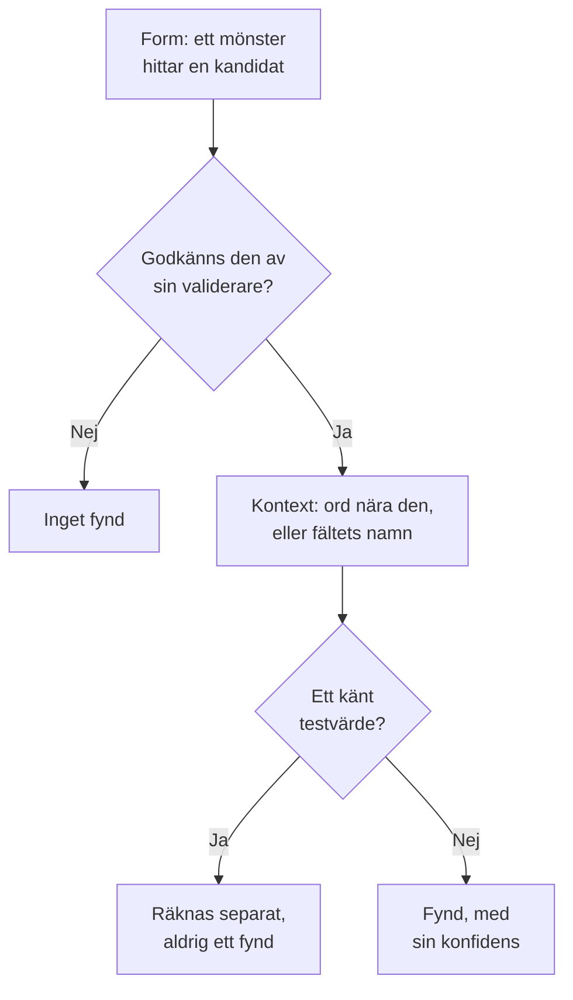

# Känsliga datatyper

Datasäkerhet känner till 143 sorters känsliga data: kortnummer, bankkonton, nationella ID-nummer från 43 länder, hälsoidentifierare, API-nycklar och tokens samt de särskilda kategorierna av personuppgifter. Var och en har en kategori, en känslighet och, när den hör till ett land, det landet. Den här sidan beskriver hur ett värde hittas och listar varje datatyp, så att du kan se varför något hittades och avgöra vad du ska göra åt det.

:::cards
- [Hur ett värde hittas](#hur-ett-värde-hittas): Form, validerare, kontext, testvärden, konfidens.
- [Fält och kolumner](#fält-och-kolumner): Hur en hel kolumn eller ett helt attribut bedöms.
- [Varje datatyp](#inbyggda-datatyper): Alla 143, efter kategori.
- [Dina egna datatyper](#dina-egna-datatyper): Anställnings-ID:n, försäkringsnummer och rutan Testa.
:::

## Hur ett värde hittas

Varje skanning - en loggrad, en CSV-cell, en databasrad, de första byten av ett objekt - kör samma steg:

1. **Form.** Varje datatyp har mönster som hittar kandidater: sexton siffror, `AKIA` och sexton bokstäver, ett ord, ett `@` och en domän. Ett mönster matchar aldrig inuti en längre token, så ett kortnummer hittas inte inuti en längre följd av siffror.
2. **Validerare.** En kandidat måste klara sin typs egna regler: en kontrollsumma (Luhn för kort, mod 97 för IBAN, Verhoeff för Aadhaar-nummer, kontrollsiffran i de flesta nationella ID-nummer), ett verkligt datum, ett känt prefix, tillräcklig slumpmässighet för en hemlighet. En kandidat som inte klarar dem blir inget fynd alls. Platshållare som `000000000` och `123456789` klarar ingen numerisk typ.
3. **Kontext.** Ord nära en kandidat - som standard upp till 64 tecken före den och 32 efter den - som säger vad den är höjer dess konfidens en nivå, och det gör även ett fält vars namn pekar på typen. Ord som säger att den är något annat, som ett order- eller spårningsnummer, sänker den en nivå. Ett nummer utan kontrollsumma och med en vanlig form, som ett passnummer eller ett bankkonto, räknas bara bredvid ord som namnger det.
4. **Kända testvärden.** Publicerade testkortnummer (som Stripes `4242 4242 4242 4242`), exempel-IBAN, adresser på `example.com` och andra reserverade domäner, IP-adresser för dokumentation, exempel-ID:n som myndigheters dokumentation trycker, nycklar i testläge som `sk_test_` och platshållarnycklar räknas separat. De ger aldrig ett fynd, så ett datalager fullt av dem läses som en testmiljö, inte som ett dataintrång.
5. **Konfidens.** Det som återstår är ett fynd, så säkert som dess bevis tillåter.

| Konfidens | Vad det betyder |
| --- | --- |
| **Hög** | Värdet klarade sin validerare, och ord runt det eller fältet det står i säger vad det är - eller, för ett fält, de flesta av dess värden är av den typen. |
| **Medel** | Värdet klarade sin validerare utan något runt det som bekräftar det, eller fältets namn säger vad det innehåller och vissa värden stämmer överens. |
| **Låg** | Formen matchar, men ingenting bekräftar det. |

Bara fynd med konfidens Hög och Medel räknas: de gör ett datalager känsligt och kan öppna ett problem. Fynd med Låg listas på datalagret, hopfällda, för en person att bedöma.

När två datatyper gör anspråk på samma tecken vinner det säkrare fyndet: den högre konfidensen, sedan detektorn vars egna regler bevisar mer, sedan den längre matchningen.

Ett långt värde läses i fönster på 64 KB som överlappar med 4 KB, så att ett värde hittas helt var det än står, och högst 4 MB av ett värde läses.

## Fält och kolumner

En kolumn, ett JSON-fält eller ett loggattribut bedöms som en helhet. Dess namn antyder en datatyp, och dess provtagna värden bevisar en. Andelen av dess värden som innehåller typen avgör hur säkert fyndet är:

| Värden som innehåller typen | Konfidens |
| --- | --- |
| 60 % eller mer | Hög |
| 25 % eller mer | Hög när fältets namn pekar på typen, annars Medel |
| Färre | Medel när fältets namn pekar på typen, annars Låg: några e-postadresser i en kolumn med något annat |

Ett fält vars värden i genomsnitt är längre än 80 tecken är fritext - anteckningar, meddelanden, beskrivningar - och förväntas inte innehålla en enda typ. Dess fynd behåller den konfidens som varje matchning fick på egen hand, och säger att de hittades i fritext. Upp till 1 000 värden i ett fält klassificeras, och upp till 16 KB av varje.

Ett fälts namn delas upp i ord - `customerEmail`, `customer_email` och `customer-email` blir alla "customer email" - och en typs namntips matchar när dess ord förekommer i den ordningen, bredvid varandra: "date of birth" matchar `customer_date_of_birth`, inte `birth_city`. Bara den sista delen av en sökväg med punkter är fältets eget namn, tillsammans med delen före den när den sista är ett generiskt ord som `number`, `id` eller `value`: `customer.address.city` är inte en gatuadress, och `card.number` är fortfarande ett kortnummer.

Vissa datatyper kan inte avgöras utifrån sina värden: inget mönster skiljer en persons namn från en gata, eller en religion från vilket annat ord som helst. De här hittas bara utifrån fältets namn, när fältet har värden: Personnamn, Användarnamn, Kön, Nationalitet, Hälsoinformation, Ras eller etniskt ursprung, Religiös övertygelse, Sexuell läggning, Politisk åsikt, Fackföreningsmedlemskap, Biometriska data, Genetiska data och Brottsregister. Ett namn, ett användarnamn, ett kön eller en nationalitet får då Hög när 60 % eller mer av värdena ser ut som ett sådant, och annars Medel.

Ett fält vars namn säger att det innehåller ett lösenord - `password`, `passwordHash`, `pwd`, inte `password_changed_at` - bör innehålla en hash: bcrypt, argon2, scrypt, PBKDF2 eller ett annat schema som ett datalager sannolikt använder. Tomma värden, platshållare som `********` och krypterade värden läggs åt sidan. När fler av resten inte är hashar än är det, innehåller fältet själva lösenorden, som inget mönster kan se, och datalagret underkänns i [Lösenord lagras i klartext](/docs/data-security/checks-and-issues#datahygien).

## Känslighet

| Känslighet | Vad det betyder |
| --- | --- |
| **Begränsad** | Skada följer om det läcker: hemligheter, kortnummer, journaler, myndighets-ID:n. |
| **Konfidentiell** | Personuppgifter, och dokument som är märkta som konfidentiella. |
| **Intern** | Verksamhetens egna data, som inte är avsedda för utomstående. |
| **Offentlig** | Inget känsligt hittades. |

Ett datalager är lika känsligt som den känsligaste datatypen som har hittats i det med minst konfidens Medel. Testvärden och fynd som markerats som inte känsliga räknas inte alls, och ett datalager där inget hittades får känsligheten Offentlig. För att behandla ett datalager som mer eller mindre känsligt än dess fynd säger anger du själv dess känslighet i datalagrets **Inställningar**: kontrollerna använder då den.

## Kategorier

| Kategori | Vad den omfattar | Personuppgifter |
| --- | --- | --- |
| Hemligheter och autentiseringsuppgifter | Lösenord, API-nycklar, tokens och privata nycklar som låser upp andra system. | Nej |
| Finansiellt | Kortnummer, bankkonton, IBAN och kryptoplånböcker. | Ja |
| Hälsa | Journalnummer, hälsoidentifierare, diagnoser och recept. | Ja |
| Myndighets-ID | Nummer för nationell identitet, skatt, pass och socialförsäkring. | Ja |
| Särskild kategori | Det som artikel 9 i GDPR skyddar mest: etnicitet, religion, sexuell läggning, politik, fackligt medlemskap, biometriska och genetiska data. | Ja |
| Kontakt och identitet | Vem någon är och hur man når personen: e-post, telefon, adress, födelsedatum, IP-adress. | Ja |
| Affärskonfidentiellt | Dokument som är märkta som konfidentiella, endast för internt bruk eller privilegierade. | Nej |

Personuppgifter är data om en person, i den mening som GDPR, CCPA, LGPD och DPDP avser. Ett datalager som bara innehåller hemligheter och affärsdokument ligger utanför ett integritetsramverks omfång, men aldrig utanför ett säkerhetsramverks (se [Efterlevnad i Datasäkerhet](/docs/data-security/compliance)).

## Inbyggda datatyper

En datatyp som hör till ett land namnger det, som en ISO 3166-1-kod: hemvistregler och de landsbundna ramverken läser den (se [Hemvist](/docs/data-security/flows-access-residency#hemvistregler)). ID:t är det namn som API:t och fynden använder för typen.

### Kontakt och identitet

| Datatyp | ID | Vad det är | Känslighet | Land |
| --- | --- | --- | --- | --- |
| E-postadress | `email-address` | En persons e-postadress. | Konfidentiell | — |
| Telefonnummer | `phone-number` | Ett telefonnummer i internationellt eller nationellt format. | Konfidentiell | — |
| Personnamn | `person-name` | En persons förnamn, efternamn eller fullständiga namn, som hittas utifrån fältets namn. | Konfidentiell | — |
| Gatuadress | `postal-address` | En gatuadress: ett nummer, ett gatunamn och en gatutyp. | Konfidentiell | — |
| Postnummer | `postal-code` | Ett postnummer. Ensamt avgränsar det var någon bor. | Intern | — |
| Födelsedatum | `date-of-birth` | Ett datum bredvid ord som säger att det är någons födelsedatum. | Konfidentiell | — |
| IP-adress | `ip-address` | En offentlig IPv4- eller IPv6-adress, som GDPR behandlar som en personuppgift. | Konfidentiell | — |
| MAC-adress | `mac-address` | Ett nätverkskorts hårdvaruadress, som identifierar en enhet. | Konfidentiell | — |
| Annons-ID | `advertising-id` | Ett mobilt annons-ID (IDFA, GAID, AAID) som spårar en enhet. | Konfidentiell | — |
| Exakt plats | `geolocation` | En latitud och longitud som är tillräckligt exakta för att hitta en byggnad. | Konfidentiell | — |
| Användarnamn | `username` | En persons inloggnings- eller kontonamn, som hittas utifrån fältets namn. | Konfidentiell | — |
| Kön | `gender` | En persons genus eller kön, som hittas utifrån fältets namn. | Konfidentiell | — |
| Nationalitet | `nationality` | En persons nationalitet eller medborgarskap, som hittas utifrån fältets namn. | Konfidentiell | — |
| Fordonsidentifieringsnummer | `vehicle-identification-number` | Ett VIN på 17 tecken med en giltig kontrollsiffra. | Konfidentiell | — |

### Myndighets-ID

| Datatyp | ID | Vad det är | Känslighet | Land |
| --- | --- | --- | --- | --- |
| Amerikanskt Social Security-nummer | `us-ssn` | Ett amerikanskt Social Security-nummer. | Begränsad | US |
| Amerikanskt skatte-ID (ITIN) | `us-itin` | Ett amerikanskt Individual Taxpayer Identification Number. | Begränsad | US |
| Amerikanskt arbetsgivar-ID (EIN) | `us-ein` | Ett amerikanskt Employer Identification Number, bredvid ord som säger det. | Konfidentiell | US |
| Amerikanskt passnummer | `us-passport` | Ett amerikanskt passnummer, bredvid ord som säger det. | Begränsad | US |
| Amerikanskt körkortsnummer | `us-drivers-license` | Ett amerikanskt körkortsnummer, bredvid ord som säger det. | Begränsad | US |
| Brittiskt National Insurance-nummer | `uk-nino` | Ett brittiskt National Insurance-nummer. | Begränsad | GB |
| Brittiskt passnummer | `uk-passport` | Ett brittiskt passnummer, bredvid ord som säger det. | Begränsad | GB |
| Brittiskt körkortsnummer | `uk-driving-licence` | Ett brittiskt körkortsnummer på 16 tecken. | Begränsad | GB |
| Kanadensiskt Social Insurance-nummer | `ca-sin` | Ett kanadensiskt Social Insurance Number med en giltig kontrollsiffra. | Begränsad | CA |
| Mexikanskt CURP | `mx-curp` | Ett mexikanskt Clave Única de Registro de Población. | Begränsad | MX |
| Mexikanskt RFC | `mx-rfc` | Ett mexikanskt skatte-ID, Registro Federal de Contribuyentes. | Begränsad | MX |
| Brasilianskt CPF | `br-cpf` | Ett brasilianskt Cadastro de Pessoas Físicas-nummer. | Begränsad | BR |
| Brasilianskt CNPJ | `br-cnpj` | Ett brasilianskt organisationsnummer (CNPJ). | Konfidentiell | BR |
| Argentinskt CUIT / CUIL | `ar-cuit` | En argentinsk identifieringskod för skatt eller arbete. | Begränsad | AR |
| Chilenskt RUT | `cl-rut` | Ett chilenskt Rol Único Tributario med en giltig kontrollsiffra. | Begränsad | CL |
| Spanskt DNI | `es-dni` | Numret på en spansk nationell identitetshandling, med sin kontrollbokstav. | Begränsad | ES |
| Spanskt NIE | `es-nie` | Ett spanskt identitetsnummer för utländska medborgare, med sin kontrollbokstav. | Begränsad | ES |
| Portugisiskt NIF | `pt-nif` | Ett portugisiskt skatteidentifikationsnummer. | Begränsad | PT |
| Franskt socialförsäkringsnummer (NIR) | `fr-nir` | Ett franskt INSEE-nummer med sin tvåsiffriga nyckel. | Begränsad | FR |
| Tyskt skatte-ID | `de-tax-id` | En tysk Steuerliche Identifikationsnummer. | Begränsad | DE |
| Italiensk codice fiscale | `it-codice-fiscale` | En italiensk skattekod med ett giltigt kontrolltecken. | Begränsad | IT |
| Nederländskt BSN | `nl-bsn` | Ett nederländskt medborgarservicenummer som klarar elvatestet. | Begränsad | NL |
| Belgiskt nationellt nummer | `be-national-number` | Ett belgiskt nummer i det nationella registret. | Begränsad | BE |
| Polskt PESEL | `pl-pesel` | Ett polskt nationellt identifikationsnummer. | Begränsad | PL |
| Svenskt personnummer | `se-personnummer` | Ett svenskt personnummer med en giltig kontrollsiffra. | Begränsad | SE |
| Norskt nationellt identitetsnummer | `no-fodselsnummer` | Ett norskt fødselsnummer med båda kontrollsiffrorna. | Begränsad | NO |
| Danskt CPR-nummer | `dk-cpr` | Ett danskt folkbokföringsnummer, bredvid ord som säger det. | Begränsad | DK |
| Finsk personbeteckning | `fi-hetu` | En finsk henkilötunnus med sitt kontrolltecken. | Begränsad | FI |
| Irländskt PPS-nummer | `ie-ppsn` | Ett irländskt Personal Public Service Number. | Begränsad | IE |
| Schweiziskt AHV-nummer | `ch-ahv` | Ett schweiziskt socialförsäkringsnummer (AHV / AVS). | Begränsad | CH |
| Rumänskt CNP | `ro-cnp` | En rumänsk personlig numerisk kod. | Begränsad | RO |
| Bulgariskt EGN | `bg-egn` | Ett bulgariskt enhetligt medborgarnummer. | Begränsad | BG |
| Kroatiskt OIB | `hr-oib` | Ett kroatiskt personligt identifikationsnummer. | Begränsad | HR |
| Grekiskt AMKA | `gr-amka` | Ett grekiskt socialförsäkringsnummer. | Begränsad | GR |
| Turkiskt identitetsnummer | `tr-tckn` | Ett turkiskt T.C. Kimlik-nummer. | Begränsad | TR |
| Israeliskt identitetsnummer | `il-teudat-zehut` | Ett israeliskt Teudat Zehut-nummer. | Begränsad | IL |
| Sydafrikanskt ID-nummer | `za-id` | Ett sydafrikanskt identitetsnummer med ett giltigt datum och en giltig kontrollsiffra. | Begränsad | ZA |
| Emirates ID (Förenade Arabemiraten) | `ae-emirates-id` | Numret på ett identitetskort från Förenade Arabemiraten. | Begränsad | AE |
| Saudiskt nationellt ID | `sa-national-id` | Ett saudiskt nationellt ID- eller iqama-nummer. | Begränsad | SA |
| Indiskt Aadhaar-nummer | `in-aadhaar` | Ett 12-siffrigt Aadhaar-nummer som klarar Verhoeff-kontrollen. | Begränsad | IN |
| Indiskt PAN | `in-pan` | Ett indiskt Permanent Account Number. | Begränsad | IN |
| Kinesiskt identitetsnummer för invånare | `cn-resident-id` | Numret på 18 tecken på ett kinesiskt identitetskort för invånare. | Begränsad | CN |
| Japanskt My Number | `jp-my-number` | Ett japanskt individnummer med en giltig kontrollsiffra. | Begränsad | JP |
| Sydkoreanskt registreringsnummer för invånare | `kr-rrn` | Ett koreanskt registreringsnummer för invånare. | Begränsad | KR |
| Singaporiskt NRIC / FIN | `sg-nric` | Numret på ett identitetskort från Singapore, eller ett identifikationsnummer för utländska medborgare. | Begränsad | SG |
| Identitetskortsnummer från Hongkong | `hk-hkid` | Numret på ett identitetskort från Hongkong, med sin kontrollsiffra. | Begränsad | HK |
| Taiwanesiskt nationellt ID | `tw-national-id` | Ett taiwanesiskt nationellt identifikationsnummer. | Begränsad | TW |
| Thailändskt nationellt ID | `th-national-id` | Ett thailändskt identifikationsnummer för medborgare. | Begränsad | TH |
| Malaysiskt MyKad-nummer | `my-mykad` | Ett malaysiskt identitetskortsnummer. | Begränsad | MY |
| Indonesiskt NIK | `id-nik` | Ett indonesiskt identitetsnummer i befolkningsregistret. | Begränsad | ID |
| Australiskt tax file number | `au-tfn` | Ett australiskt tax file number med en giltig kontroll. | Begränsad | AU |
| Nyzeeländskt IRD-nummer | `nz-ird` | Ett nyzeeländskt Inland Revenue-nummer med en giltig kontrollsiffra. | Begränsad | NZ |
| Ryskt SNILS | `ru-snils` | Ett ryskt försäkringskontonummer med sitt kontrollnummer. | Begränsad | RU |
| Ryskt INN | `ru-inn` | Ett ryskt skatteidentifikationsnummer. | Begränsad | RU |
| Passnummer | `passport-number` | Ett passnummer från vilket land som helst, bredvid ord som säger det. | Begränsad | — |

### Finansiellt

| Datatyp | ID | Vad det är | Känslighet | Land |
| --- | --- | --- | --- | --- |
| Kortnummer | `credit-card-number` | Ett betalkortsnummer som klarar Luhn-kontrollen och hör till ett kortmärke. | Begränsad | — |
| Kortets säkerhetskod | `card-verification-code` | En CVV eller CVC, som PCI DSS förbjuder att spara efter att en betalning har auktoriserats. | Begränsad | — |
| Kortets utgångsdatum | `card-expiration-date` | Ett korts utgångsdatum, bredvid ord som säger det. | Konfidentiell | — |
| IBAN | `iban` | Ett internationellt bankkontonummer som klarar mod-97-kontrollen. | Begränsad | — |
| Bankkontonummer | `bank-account-number` | Ett bankkontonummer, bredvid ord som säger det. | Begränsad | — |
| SWIFT-/BIC-kod | `swift-bic` | En banks SWIFT- eller BIC-kod, bredvid ord som säger det. | Intern | — |
| Amerikanskt bankroutingnummer | `us-bank-routing-number` | Ett ABA-routingnummer med en giltig kontrollsumma, bredvid ord som säger det. | Intern | US |
| Brittisk sort code | `uk-sort-code` | En brittisk sort code för en bank, bredvid ord som säger det. | Intern | GB |
| Indisk IFSC | `in-ifsc` | En indisk Financial System Code som namnger ett bankkontor. | Intern | IN |
| Australiskt BSB | `au-bsb` | Ett australiskt bank-state-branch-nummer, bredvid ord som säger det. | Intern | AU |
| Bitcoin-adress | `bitcoin-address` | En Bitcoin-adress med en giltig kontrollsumma. | Konfidentiell | — |
| Ethereum-adress | `ethereum-address` | En Ethereum-adress, bredvid ord som säger det. | Konfidentiell | — |

### Hälsa

| Datatyp | ID | Vad det är | Känslighet | Land |
| --- | --- | --- | --- | --- |
| Brittiskt NHS-nummer | `uk-nhs-number` | Ett brittiskt National Health Service-nummer med en giltig kontrollsiffra. | Begränsad | GB |
| Amerikanskt Medicare-förmånstagar-ID | `us-medicare-mbi` | En amerikansk Medicare Beneficiary Identifier. | Begränsad | US |
| Australiskt Medicare-nummer | `au-medicare-number` | Ett australiskt Medicare-kortnummer med en giltig kontrollsiffra. | Begränsad | AU |
| Tyskt sjukförsäkringsnummer | `de-health-insurance-number` | En tysk Krankenversichertennummer med en giltig kontrollsiffra. | Begränsad | DE |
| Journalnummer | `medical-record-number` | En patients journalnummer, bredvid ord som säger det. | Begränsad | — |
| Medlems-ID för sjukförsäkring | `health-plan-id` | Ett medlems- eller försäkringsnummer för sjukförsäkring, bredvid ord som säger det. | Begränsad | — |
| Diagnoskod (ICD-10) | `diagnosis-code` | En ICD-10-diagnoskod, bredvid ord som säger det. | Begränsad | — |
| Läkemedelskod (NDC) | `drug-code` | En amerikansk National Drug Code, bredvid ord som säger det. | Konfidentiell | — |
| Amerikanskt DEA-nummer | `us-dea-number` | En förskrivares nummer hos Drug Enforcement Administration, med en giltig kontrollsiffra. | Konfidentiell | US |
| Amerikanskt vårdgivar-ID (NPI) | `us-npi` | En National Provider Identifier. Den namnger en vårdgivare, inte en patient. | Intern | US |
| Hälsoinformation | `health-information` | Diagnoser, tillstånd, läkemedel och andra hälsouppgifter, som hittas utifrån fältets namn. | Begränsad | — |

### Hemligheter och autentiseringsuppgifter

| Datatyp | ID | Vad det är | Känslighet | Land |
| --- | --- | --- | --- | --- |
| AWS-åtkomstnyckel-ID | `aws-access-key-id` | Den offentliga halvan av en AWS-åtkomstnyckel. Tillsammans med sin hemlighet signerar den AWS-förfrågningar. | Begränsad | — |
| Hemlig AWS-åtkomstnyckel | `aws-secret-access-key` | Den hemliga halvan av en AWS-åtkomstnyckel, bredvid ord som säger det. | Begränsad | — |
| Google API-nyckel | `google-api-key` | En API-nyckel för Google Cloud eller Maps. | Begränsad | — |
| Nyckel för Google-tjänstkonto | `google-service-account-key` | En nyckelfil för ett tjänstkonto i Google Cloud, med sin privata nyckel. | Begränsad | — |
| Google OAuth-klienthemlighet | `google-oauth-client-secret` | En klienthemlighet för Google OAuth. | Begränsad | — |
| Nyckel för Azure-lagringskonto | `azure-storage-account-key` | En nyckel för ett Azure-lagringskonto, eller en anslutningssträng som innehåller en. | Begränsad | — |
| Azure SAS-token | `azure-sas-token` | En Azure shared access signature, som ger åtkomst utan inloggning. | Begränsad | — |
| Azure-klienthemlighet | `azure-client-secret` | En klienthemlighet för ett program i Microsoft Entra ID. | Begränsad | — |
| GitHub-token | `github-token` | En GitHub-token för personlig åtkomst, OAuth, app eller finkornig åtkomst. | Begränsad | — |
| GitLab-token | `gitlab-token` | En personlig åtkomsttoken för GitLab. | Begränsad | — |
| Slack-token | `slack-token` | En Slack-token för bot, användare eller app. | Begränsad | — |
| Slack-webhook-URL | `slack-webhook-url` | En inkommande webhook i Slack, som låter vem som helst posta i en kanal. | Begränsad | — |
| Hemlig Stripe-nyckel | `stripe-secret-key` | En hemlig eller begränsad live-nyckel för Stripe, som kan flytta pengar. | Begränsad | — |
| Twilio API-nyckel | `twilio-api-key` | Ett API-nyckel-SID för Twilio med hemlighet. | Begränsad | — |
| SendGrid API-nyckel | `sendgrid-api-key` | En API-nyckel för SendGrid. | Begränsad | — |
| Mailgun API-nyckel | `mailgun-api-key` | En API-nyckel för Mailgun. | Begränsad | — |
| Mailchimp API-nyckel | `mailchimp-api-key` | En API-nyckel för Mailchimp. | Begränsad | — |
| OpenAI API-nyckel | `openai-api-key` | En API-nyckel för OpenAI, som förbrukar kontots kredit. | Begränsad | — |
| Anthropic API-nyckel | `anthropic-api-key` | En API-nyckel för Anthropic. | Begränsad | — |
| Hugging Face-token | `huggingface-token` | En token för Hugging Face. | Begränsad | — |
| npm-token | `npm-token` | En åtkomsttoken för npm, som kan publicera paket. | Begränsad | — |
| PyPI-token | `pypi-token` | En uppladdningstoken för PyPI. | Begränsad | — |
| Docker Hub-token | `docker-hub-token` | En personlig åtkomsttoken för Docker Hub. | Begränsad | — |
| Shopify-token | `shopify-token` | En åtkomst- eller apptoken för Shopify. | Begränsad | — |
| Square-token | `square-token` | En åtkomsttoken eller hemlighet för Square. | Begränsad | — |
| Braintree-åtkomsttoken | `braintree-access-token` | En åtkomsttoken för Braintree i produktion. | Begränsad | — |
| DigitalOcean-token | `digitalocean-token` | En personlig åtkomsttoken för DigitalOcean. | Begränsad | — |
| New Relic API-nyckel | `new-relic-api-key` | En användar-API-nyckel för New Relic. | Begränsad | — |
| Datadog API-nyckel | `datadog-api-key` | En API- eller programnyckel för Datadog, bredvid ord som säger det. | Begränsad | — |
| HashiCorp Vault-token | `vault-token` | En tjänsttoken för HashiCorp Vault. | Begränsad | — |
| Terraform Cloud-token | `terraform-cloud-token` | En API-token för Terraform Cloud eller Enterprise. | Begränsad | — |
| Atlassian API-token | `atlassian-api-token` | En API-token för Atlassian. | Begränsad | — |
| Linear API-nyckel | `linear-api-key` | En API-nyckel för Linear. | Begränsad | — |
| JSON-webbtoken | `json-web-token` | En signerad JWT, ofta en sessions- eller åtkomsttoken. | Begränsad | — |
| Privat nyckel | `private-key` | Ett block med en privat nyckel i PEM, OpenSSH eller PGP. | Begränsad | — |
| Lösenord i en URL | `password-in-url` | En URL som innehåller ett användarnamn och ett lösenord, som en anslutningssträng för en databas. | Begränsad | — |
| Lösenord i en anslutningssträng | `connection-string-password` | Ett värde för Password= eller Pwd= i en anslutningssträng. | Begränsad | — |
| Authorization-huvud | `authorization-header` | En Basic- eller Bearer-autentiseringsuppgift som kopierats från ett HTTP Authorization-huvud. | Begränsad | — |
| Lösenord eller hemlighet | `generic-secret` | Ett värde som tilldelats ett lösenord, en hemlighet, en API-nyckel eller en token, och som ser tillräckligt slumpmässigt ut för att vara äkta. | Begränsad | — |
| Privat Bitcoin-nyckel | `bitcoin-private-key` | En privat Bitcoin-nyckel i wallet import format, med en giltig kontrollsumma. | Begränsad | — |

### Särskild kategori

| Datatyp | ID | Vad det är | Känslighet | Land |
| --- | --- | --- | --- | --- |
| Ras eller etniskt ursprung | `racial-or-ethnic-origin` | Ras eller etnicitet, som hittas utifrån fältets namn. | Begränsad | — |
| Religiös övertygelse | `religious-belief` | Religion eller övertygelse, som hittas utifrån fältets namn. | Begränsad | — |
| Sexuell läggning | `sexual-orientation` | Sexuell läggning, som hittas utifrån fältets namn. | Begränsad | — |
| Politisk åsikt | `political-opinion` | Politiska åsikter eller partimedlemskap, som hittas utifrån fältets namn. | Begränsad | — |
| Fackföreningsmedlemskap | `trade-union-membership` | Fackföreningsmedlemskap, som hittas utifrån fältets namn. | Begränsad | — |
| Biometriska data | `biometric-data` | Fingeravtryck, ansiktsmallar, röstavtryck och andra biometriska uppgifter, som hittas utifrån fältets namn. | Begränsad | — |
| Genetiska data | `genetic-data` | DNA- och genomdata, som hittas utifrån fältets namn. | Begränsad | — |
| Brottsregister | `criminal-record` | Fällande domar i brottmål och lagöverträdelser (artikel 10 i GDPR), som hittas utifrån fältets namn. | Begränsad | — |

### Affärskonfidentiellt

| Datatyp | ID | Vad det är | Känslighet | Land |
| --- | --- | --- | --- | --- |
| Juridiskt privilegierat dokument | `privileged-document` | Ett dokument som är märkt som skyddat av advokatsekretess eller som juridiskt privilegierat. | Begränsad | — |
| Dokument märkt konfidentiellt | `confidential-document` | Ett dokument som är märkt konfidentiellt, strikt konfidentiellt eller affärshemlighet. | Konfidentiell | — |
| Dokument märkt internt | `internal-document` | Ett dokument som är märkt endast för internt bruk eller inte för distribution. | Intern | — |

## Dina egna datatyper

Lägg till en datatyp för det som bara ditt företag har: ett anställnings-ID, ett försäkringsnummer, en projektkod. Gå till **Datasäkerhet → Inställningar → Datatyper** och lägg till den under **Dina datatyper**. Den skannas precis som de inbyggda, i buckets, databaser och telemetri, från och med nästa skanning.

:::steps
### Ange vad den är

Ge den ett **Namn**, som Anställnings-ID, en **Kategori** och en **Känslighet**: hur känsligt ett datalager som innehåller den är. En **Beskrivning** säger vad den är, för den som läser ett fynd av den.

### Ange hur den hittas

Ange ett **Mönster**: ett reguljärt uttryck i JavaScript för ett värde, som `EMP-\d{6}`. Lägg till de **Fältnamn** som innehåller den, som `employee id`, och de **Nyckelord** som, nära ett värde, bekräftar att det är den här typen. Lämna mönstret tomt för att hitta typen enbart utifrån fältnamn.

### Testa den

Klistra in exempeltext i **Testa** för att se vad din datatyp hittar i den. Det kör skannerns egen kod på texten, i din webbläsare: texten skickas aldrig till OneUptime, och bara dess första 64 KB testas.
:::

Under **Fler fält** matchar **Ignorera skiftläge** mönstret oavsett om bokstäverna är versaler eller gemener, **Kräver ett nyckelord** räknar ett värde bara när ett nyckelord finns nära det eller när fältets namn säger att det är den här typen, och **Kontrollsumma** kräver att ett värde klarar en kontroll: **Inga**, **Luhn** (kontrollsiffran som kortnummer har), **Mod97** (kontrollsiffrorna i ett IBAN) eller **Verhoeff** (kontrollsiffran i ett Aadhaar-nummer).

Ett mönster kontrolleras när du sparar det: det måste kompilera, inte matcha någon tom text och köras på en tid som växer linjärt med texten. Det körs av en matchare som aldrig backtrackar, så inget mönster kan hålla fast en skanning, hur det än är skrivet. En typ tar högst 50 nyckelord och 50 fältnamn.

Ett värde av din typ får Medel ensamt och Hög med ett nyckelord nära sig när det klarar en kontrollsumma, och Låg ensamt och Medel med ett nyckelord när typen inte har någon. I en kolumn avgör andelen värden som matchar, som för varje typ.

## Inte känsligt, och aldrig känsligt

En skanning kan hitta något som inte är vad det ser ut att vara: en kolumn med ordernummer som klarar Luhn-kontrollen, din egen supportadress i varje loggrad. Säg det till OneUptime, så slutar det räkna:

- **Markera fyndet som inte känsligt.** På datalagrets sida **Innehåll** väljer du **Markera som inte känsligt** på fyndet och anger varför. Det räknas inte längre till datalagrets känslighet eller dess kontroller, och datalagret kontrolleras igen direkt. Fyndet finns kvar på datalagret, markerat, med din orsak, så att nästa person ser vad som har beslutats.
- **Lägg till värdet i Aldrig känsligt**, i inställningarna för Datasäkerhet, för ett värde som aldrig är ett fynd någonstans, som `support@yourcompany.com`. Värden jämförs efter att skannern har normaliserat dem, utan hänsyn till skiftläge.
- **Stäng av en inbyggd datatyp.** Under **Inbyggda datatyper**, på **Datasäkerhet → Inställningar → Datatyper**, har varje datatyp ett reglage, som sparas i samma ögonblick som det slås om. Ingen skanning i projektet letar efter en typ som är avstängd.

## Nästa steg

:::cards
- [Kontroller och problem i Datasäkerhet](/docs/data-security/checks-and-issues): Vad ett datalagers känslighet ändrar i dess problem.
- [Känsliga data i telemetri](/docs/data-security/telemetry): Datatyperna som hittas i dina loggar, spår och prompter.
- [Efterlevnad i Datasäkerhet](/docs/data-security/compliance): Ramverken som varje datatyp gör tillämpliga.
:::
