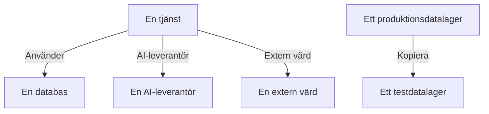

# Dataflöden, åtkomst och hemvist

Att veta vad ett datalager innehåller är bara halva saken. Datasäkerhet räknar också ut vart dessa data tar vägen – vilka tjänster som använder datalagret, vilka AI-leverantörer och externa värdar som dessa data når, och var de har kopierats – vem som kan nå varje datalager, och om det ligger i de regioner där det får ligga. Allt kommer från bevis som OneUptime redan har: dina spår, ditt molns egna åtkomstinställningar och fingeravtryck av det som skanningarna hittade.

:::cards
- [Dataflöden](#dataflöden): Tjänster, AI-leverantörer, externa värdar och kopior.
- [Vem som kan nå ett datalager](#vem-som-kan-nå-ett-datalager): Varje behörighet som ditt moln rapporterar, och hur exponerat datalagret är.
- [Hemvistregler](#hemvistregler): De regioner som varje sorts data får ligga i.
:::

## Dataflöden

| Flöde | Vad det betyder | Var det kommer ifrån |
| --- | --- | --- |
| **Använder** | En tjänst kommunicerar med ett datalager. | Tjänstekartan, som OneUptime räknar ut från dina tjänsters klient-spans var tionde minut. Varje databas på den kopplas till sitt datalager via namn, adress eller slutpunkt, så en databas som ingen annan källa listar blir ett eget datalager. |
| **AI-leverantör** | En tjänst skickar data till en AI-leverantör. | AI-anropen i tjänstens spår från de senaste 7 dagarna, som anger vilken leverantör de når. |
| **Extern värd** | En tjänst anropar en värd utanför dina system. | Tjänstekartans fjärrtjänster, efter adressen de anropas på. |
| **Kopiera** | Ett datalager innehåller värden från ett annat. | Fingeravtryck av värdena som varje skanning hittade: två datalager delar data när deras fingeravtryck för en datatyp överlappar till hälften eller mer. |

Ett flöde bär med sig de datatyper som dess källa innehåller, och deras känslighet. Ett flöde är bekräftat när en skanning har bevisat att dessa data finns där, inte bara att det finns en väg dit: en kopia är alltid bekräftad, och ett flöde till en AI-leverantör är det när tjänstens AI-konversationer innehåller data med känsligheten Konfidentiell eller Begränsad. Ett flöde som inte har setts igen på 30 dagar tas bort.

Två kontroller läser flödena. [Produktionsdata kopierades till ett datalager utanför produktion](/docs/data-security/checks-and-issues#datahygien) misslyckas för målet för en kopia. En kopia går från produktionsdatalagret när bara ett av de två är i produktion, och annars från det datalager som OneUptime hittade först. [Känsliga data skickas till en AI-leverantör](/docs/data-security/checks-and-issues#ai) misslyckas för en tjänsts AI-konversationer när de innehåller känsliga data, och anger vilka leverantörer de nådde.

### Hur fingeravtrycken förblir privata

En kopia hittas utan något av datalagrens värden. För varje datatyp som en skanning hittar med konfidensen Hög skissar den värdena den läste som en MinHash: 128 fack, vart och ett det minsta värdet av en hashfunktion över värdena, där bara de lägsta 16 bitarna behålls. Två skisser stämmer överens i ungefär lika många fack som deras två värdemängder överlappar, så en jämförelse av skisser uppskattar hur mycket av ett datalager som finns i det andra.

- **Värdena hashas med en nyckel som är projektets egen** (HMAC-SHA256), så ingen utan nyckeln kan testa ett känt värde mot en skiss, och två projekts skisser kan aldrig jämföras.
- **Bara 16 bitar av varje minimum lämnar skanningen.** Inget värde, och ingen hash av ett värde, kan läsas tillbaka ur en skiss.
- **En skiss gäller en datatyp, inte ett fält.** Ett datalager har en för varje datatyp som har hittats i det med konfidensen Hög, och inget mer.

## Vem som kan nå ett datalager

Konfigurationsläsningen gör om varje molns egna åtkomstinställningar – bucket-policyer och ACL:er, rolltilldelningar i Azure, IAM-bindningar i Google Cloud, delningar av ögonblicksbilder – till en enda lista över vem som kan nå datalagret, på dess sida **Vem kan nå det**:

| Kolumn | Vad den anger |
| --- | --- |
| **Huvudkonto** | Vem eller vad som har åtkomst, så som molnet namnger det: `*`, ett konto-ID, en ARN, en e-postadress, ett tjänstkonto. |
| **Typ av huvudkonto** | Public, Konto, Roll, Användare, Grupp, Tjänsthuvudkonto, Tjänstkonto eller Tjänst. |
| **Åtkomstnivå** | Läsning, Skrivning eller Administratör. |
| **Beviljad via** | Det som ger åtkomsten: en bucket-policy, en ACL, en rolltilldelning, en IAM-bindning eller en delning av en ögonblicksbild. |
| **Extern** | Huvudkontot finns utanför de konton, prenumerationer och projekt som är anslutna till OneUptime. |
| **Offentlig** | Huvudkontot är vem som helst på internet. |

Listan läses på nytt vid varje konfigurationsläsning, och en behörighet som molnet inte längre rapporterar tas bort. [Fler än 25 identiteter kan läsa data med känsligheten Begränsad](/docs/data-security/checks-and-issues#åtkomst) räknar läsarna i den. Tjänsterna som använder ett datalager är dess flöden av typen **Använder**.

Utifrån det som läses får varje datalager en exponering:

| Exponering | Vad den betyder |
| --- | --- |
| **Offentlig** | Vem som helst på internet kan läsa det. |
| **Andra konton** | Konton utanför dina anslutna konton kan nå det. |
| **Nåbar från internet** | Dess nätverksslutpunkt tar emot anslutningar från internet. |
| **Privat** | Bara dina egna konton och nätverk når det. |
| **Okänd** | OneUptime kunde inte läsa tillräckligt av dess konfiguration för att avgöra det. |

Public går före delad, och delad går före nåbar: en offentlig bucket som också delas med ett annat konto får exponeringen Public. Exponeringen höjer ett problems [riskpoäng](/docs/data-security/checks-and-issues#riskpoäng).

## Hemvistregler

En hemvistregel anger var en sorts data får ligga. Lägg till en under **Datasäkerhet → Inställningar → Hemvistregler**:

| Fält | Vad det gör |
| --- | --- |
| **Namn** | Vad regeln är, till exempel EU-personuppgifter stannar i EU. |
| **Tillåtna regioner** | De regioner där dessa data får lagras och kopieras, skrivna så som ditt moln namnger dem. En regel utan regioner kontrollerar ingenting. |
| **Datakategorier** | De kategorier av data som regeln täcker. Tomt täcker alla sorters personuppgifter. |
| **Data om personer i** | Bara data om personer i dessa länder, som ISO 3166-1-koder som `DE` eller `IN`. Tomt täcker data om personer var som helst. |
| **Beskrivning** | Vad regeln är till för, till exempel att våra EU-kunders data bara lagras i EU. |
| **Aktiverad** | Om datalager kontrolleras mot regeln. |

Ett datalager bryter mot en regel när det innehåller data som regeln täcker, och dess egen region, eller en region som dess data kopieras till, inte matchar någon av de tillåtna regionerna. Kopior är de regioner som ett datalagers data replikeras till: S3-replikering, ett lagringskontos georedundanta kopia, en databas repliker. Datalagret misslyckas då med [Data lagras utanför de regioner där de får ligga](/docs/data-security/checks-and-issues#hemvist), med regionen och regeln som det bröt mot.

### Regioner och jokertecken

Ett `*` i en tillåten region står för vilka tecken som helst, versaler och gemener räknas som samma, och mönstret måste matcha hela regionen:

| Tillåten region | Matchar | Matchar inte |
| --- | --- | --- |
| `eu-*` (AWS) | `eu-west-1`, `eu-central-1` | `us-east-1`, `us-eu-1` |
| `europe-*` (Google Cloud) | `europe-west1`, `europe-north1` | `us-central1` |
| `westeurope` (Azure) | `westeurope` | `northeurope` |

Ange ett mönster för varje moln du använder: `eu-*`, `europe-*`, `westeurope` och `northeurope` tillsammans håller data i Europa i alla tre.

### Vems data ett datalager innehåller

OneUptime läser ut vems data ett datalager innehåller ur själva datan. En datatyp som hör till ett land säger att dess personer finns i det landet: ett tyskt skatte-ID säger `DE`, ett indiskt Aadhaar-nummer `IN`, ett brittiskt NHS-nummer `GB`. Datalagret listar de länderna som de registrerades länder, och en regel som är begränsad till personer i vissa länder täcker bara de datalager som innehåller deras data. [Känsliga datatyper](/docs/data-security/data-types#inbyggda-datatyper) anger landet för varje datatyp som har ett.

## Nästa steg

:::cards
- [Kontroller och problem i Datasäkerhet](/docs/data-security/checks-and-issues): Varje kontroll som dessa flöden, behörigheter och regler matar.
- [Efterlevnad i Datasäkerhet](/docs/data-security/compliance): Hur hemvist och åtkomst räknas för GDPR, LGPD och DPDP.
- [Topologi](/docs/telemetry/topology): Tjänstekartan som flödena kommer från.
:::
