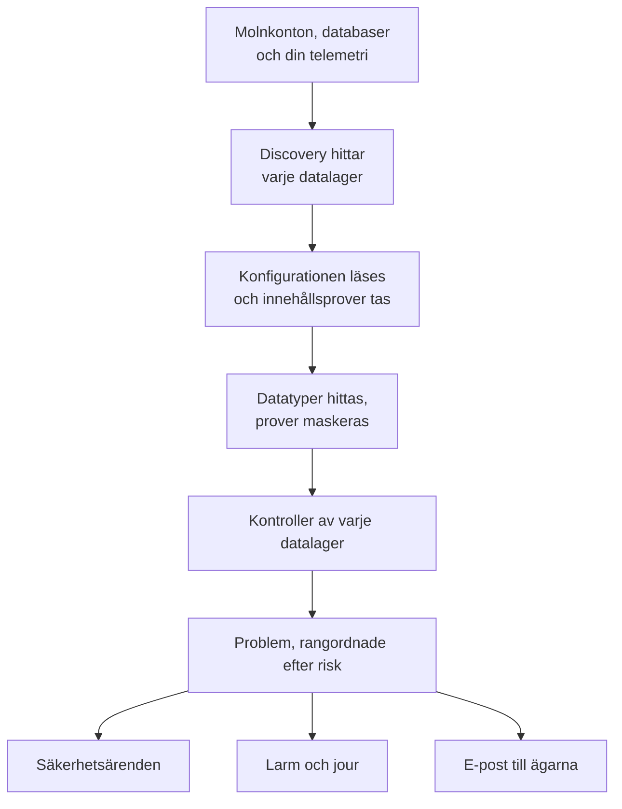

# Datasäkerhet

Datasäkerhet hittar de känsliga data som ditt företag har - i buckets i molnet, i databaser och datavaruhus, och i telemetrin du skickar till OneUptime - och berättar vad som är fel med hur de lagras. Den hittar datalagren på egen hand, läser hur vart och ett är uppsatt, tar prover på vad det innehåller och öppnar ett problem för varje brist, rangordnat efter risk.

Den svarar på fyra frågor:

:::cards
- [Var finns våra känsliga data?](/docs/data-security/data-types): 143 datatyper, från kortnummer och nationella ID-nummer till API-nycklar, som hittas i buckets, tabeller och telemetri.
- [Är de exponerade?](/docs/data-security/checks-and-issues): 32 kontroller av varje datalager: offentlig åtkomst, kryptering, säkerhetskopior, loggning, hemligheter och kopior.
- [Vem kan nå dem, och vart tar de vägen?](/docs/data-security/flows-access-residency): Vem som kan läsa varje datalager, vilka tjänster som använder det och vilka AI-leverantörer och värdar dess data når.
- [Följer de våra regler?](/docs/data-security/compliance): Hemvistregler, och nio ramverk som poängsätts utifrån vad skanningarna hittade.
:::

## Så fungerar det

1. **Discovery** hittar de datalager som OneUptime redan känner till: din molninventering, databaserna som produkten Database övervakar, databaserna som dina tjänster pratar med på tjänstekartan och varje tjänsts telemetri. Du lägger bara till ett datalager för hand när ingen källa listar det.
2. **Konfigurationsläsningen** frågar varje moln hur varje datalager är uppsatt: vem som kan nå det och hur det krypteras, säkerhetskopieras och loggas. Den läser inställningar, aldrig data.
3. **Innehållsprover** läser lite av vad ett datalager innehåller, där du tillåter det: några objekt av varje sort i en bucket, några rader i varje tabell, de senaste posterna i varje tjänsts telemetri.
4. **Klassificering** hittar känsliga värden i proverna och sparar antal och maskerade prov, aldrig ett värde.
5. **Kontroller** avgör vad som är fel med varje datalager, och hur allvarligt det är för de data det innehåller. Varje kontroll som inte godkänns öppnar ett problem, som stängs av sig självt när kontrollen godkänns.

## Vad som gör den annorlunda

- **Din telemetri är ett datalager.** Varje tjänsts loggar, spår, undantag, sessionsuppspelningar och AI-konversationer kontrolleras som en bucket, varje timme. En e-postadress i en loggrad är ett fynd, och **Rensa** maskerar den vid intag från och med då. Se [Känsliga data i telemetri](/docs/data-security/telemetry).
- **Flöden kommer från verklig trafik.** Tjänstekartan visar vilken tjänst som använder vilken databas, AI-anrop namnger leverantören de når, och kopior av produktionsdata hittas genom att jämföra fingeravtryck. Se [Dataflöden, åtkomst och hemvist](/docs/data-security/flows-access-residency).
- **Bevis maskeras, alltid.** Ett fynd sparar antal och högst tre maskerade prov, som `j***@e******.com`, maskerade inuti skannern innan något lämnar den. Stäng av prover så sparar det bara antal.
- **Skannern är öppen källkod.** Varje datatyps mönster, kontrollsumma, kontextord och testvärden finns i OneUptimes källkod, så du kan läsa exakt vad som ger ett fynd. Samma kod körs på OneUptimes workers, på en sond och i rutan **Testa**.
- **Den fungerar med resten av OneUptime.** Ett kritiskt problem öppnar ett säkerhetsärende på datalagret, så att [Security Operations](/docs/telemetry/security-cases) hanterar det som vilket annat hot som helst. Det kan skapa ett larm som når den som har jour, och det skickar e-post till datalagrets ägare. Se [Integrationer för Datasäkerhet](/docs/data-security/integrations).
- **OneUptime AI hjälper dig att åtgärda det.** **Förklara med AI** berättar för ett datalagers ägare vad som är fel och hur det åtgärdas i deras moln, och **Åtgärda med AI** öppnar en pull request i din infrastrukturkod.

## Innan du börjar

- **En roll som kan sätta upp den.** Rollerna Project Owner, Project Admin och Security Admin ändrar inställningarna för Datasäkerhet. Security Member arbetar med problem och skannar datalager, och Security Viewer läser vad den har hittat. Andra roller ser ingenting av det om inte deras team får dess behörigheter: vilka buckets som innehåller kortnummer är precis vad en angripare vill veta. Se [Roller](/docs/permissions/reference#roller).
- **Ett molnkonto att läsa, eller en databas.** Datasäkerhet läser ett molnkonto via en [molnanslutning](/docs/telemetry/cloud-accounts), och en databas som du driver via en anslutningssträng med enbart läsbehörighet. Telemetri behöver ingenting: den skannas varje timme.

## Snabbstart

:::steps
### Anslut ett molnkonto

Gå till **Moln → Anslut** och välj ditt moln. Om kontot redan är anslutet väljer du **Redigera** på dess anslutning i stället. [Anslut ett molnkonto](/docs/telemetry/cloud-accounts) går igenom varje moln.

### Välj nivå för datasäkerhet

Under **Fler fält** ställer du in **Datasäkerhet** på **Endast konfiguration** för att kontrollera hur varje datalager är uppsatt, eller på **Konfiguration och innehållsprover** för att också hitta de känsliga data som finns i dem. Kommandot som formuläret visar ändras med ditt val: kör det i ditt molns skal, som formuläret säger. [Konfigurera Datasäkerhet](/docs/data-security/setup) listar exakt vad varje nivå beviljar, och [Anslut ett molnkonto](/docs/telemetry/cloud-accounts#datasäkerhet) visar kommandot för varje nivå.

### Granska problemen

Öppna **Datasäkerhet**. Datalager visas under **Datalager** allteftersom de upptäcks, var 15:e minut, och en anslutnings konfiguration läses inom en timme. Problem öppnas under **Problem** så snart en läsning eller en skanning är klar, vart och ett med sin riskpoäng, och **Översikt** visar de fem mest riskfyllda. Varje problem säger vad som är fel, varför det spelar roll och hur det åtgärdas, med kommandona för ditt moln.
:::

## Vad som räknas som ett datalager

| Var | Datalager | Innehållsprover |
| --- | --- | --- |
| AWS | AWS S3 Bucket, AWS RDS Instance, AWS Aurora Cluster, AWS RDS Snapshot, AWS DynamoDB Table, AWS Redshift Cluster, AWS DocumentDB Cluster, AWS OpenSearch Domain, AWS ElastiCache Cluster, AWS EFS File System | AWS S3 Bucket |
| Azure | Azure Storage Account, Azure SQL Database, Azure Cosmos DB Account, Azure PostgreSQL Server, Azure MySQL Server | Azure Storage Account |
| Google Cloud | Google Cloud Storage Bucket, Google Cloud SQL Instance, Google BigQuery Dataset, Google Firestore Database, Google Spanner Instance, Google Bigtable Instance | Google Cloud Storage Bucket, Google BigQuery Dataset |
| Databaser som du driver | PostgreSQL, MySQL, MongoDB, SQL Server, Oracle, Redis, Elasticsearch | PostgreSQL, MySQL |
| OneUptime | Loggar, spår, undantag, sessionsuppspelningar, AI-konversationer | Loggar, spår, undantag, sessionsuppspelningar, AI-konversationer |

Varje datalager får de kontroller som gäller för dess sort. Ett datalager vars innehåll inte kan provtas kontrolleras ändå: en offentlig bucket eller en okrypterad databas är ett problem oavsett vad den innehåller.

Ett datalager arkiveras, med sin historik, när dess källa inte längre listar det: **Arkiverade datalager**, längst ned i menyn för Datasäkerhet, behåller det. Det kommer tillbaka av sig självt om källan listar det igen.

Ett datalagers **Tidslinje** visar vad som har hänt med det, och vem som gjorde det: när det hittades eller lades till, varje ändring av dess inställningar och ägare, när det arkiverades eller kom tillbaka, och varje exponering som stängts från ett problem eller en playbook.

## Hur ofta den körs

| Vad | När |
| --- | --- |
| Hitta nya datalager | Var 15:e minut |
| Läsa en molnanslutnings konfiguration | En gång om dagen, och inom en timme efter att CloudTrail registrerar en ändring av ett AWS-datalagers åtkomst, kryptering, säkerhetskopior eller delning |
| Ta prover på ett datalagers innehåll | Var 24:e timme, eller så ofta som **Skanningsintervall (timmar)** anger |
| Ta prover på varje tjänsts telemetri | Varje timme, den senaste timmen av den |
| Kontrollera varje datalager igen | Efter varje läsning och skanning, efter att du har ändrat något som en kontroll beror på, och en gång om dagen |

**Skanna nu** på ett datalager tar prover på dess innehåll direkt, och **Kontrollera nu** läser dess konfiguration igen.

## Nästa steg

:::cards
- [Konfigurera Datasäkerhet](/docs/data-security/setup): De tre nivåerna, behörigheterna som varje nivå beviljar och skanning av dina egna databaser.
- [Känsliga datatyper](/docs/data-security/data-types): Hur ett värde hittas, och varje datatyp som Datasäkerhet känner till.
- [Kontroller och problem i Datasäkerhet](/docs/data-security/checks-and-issues): Varje kontroll, riskpoängen och vad som händer med ett problem.
- [Integrationer för Datasäkerhet](/docs/data-security/integrations): Säkerhetsärenden, larm, ägare, arbetsflöden och OneUptime AI.
:::
