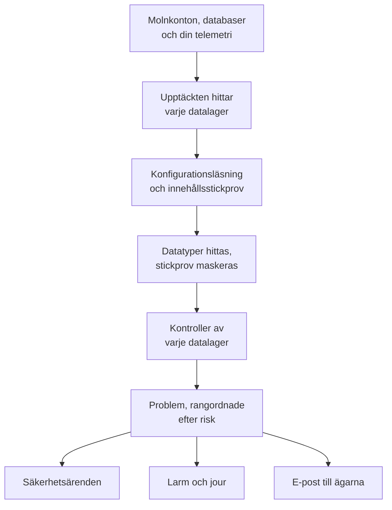

# Datasäkerhet

Data Security hittar de känsliga data som ditt företag har - i buckets i molnet, i databaser och datavaruhus, och i telemetrin du skickar till OneUptime - och talar om vad som är fel med hur de förvaras. Den hittar datalagren på egen hand, läser hur vart och ett är konfigurerat, tar stickprov av det de innehåller och öppnar ett problem för varje brist, rangordnat efter risk.

Den besvarar fyra frågor:

:::cards
- [Var finns våra känsliga data?](/docs/data-security/data-types): 143 datatyper, från kortnummer och nationella id-nummer till API-nycklar, som hittas i buckets, tabeller och telemetri.
- [Är de exponerade?](/docs/data-security/checks-and-issues): 32 kontroller av varje datalager: offentlig åtkomst, kryptering, säkerhetskopior, loggning, hemligheter och kopior.
- [Vem kan nå dem, och vart tar de vägen?](/docs/data-security/flows-access-residency): Vem som kan läsa varje datalager, vilka tjänster som använder det och vilka AI-leverantörer och värdar dess data når.
- [Följer de våra regler?](/docs/data-security/compliance): Hemvistregler, och nio ramverk som poängsätts utifrån det som skanningarna hittade.
:::

## Så fungerar det

1. **Upptäckten** hittar de datalager som OneUptime redan känner till: ditt molninventarie, databaserna som produkten Databaser övervakar, databaserna som dina tjänster pratar med på tjänstekartan och varje tjänsts telemetri. Du lägger bara till ett datalager för hand när ingen källa listar det.
2. **Konfigurationsläsningen** frågar varje moln hur varje datalager är konfigurerat: vem som kan nå det, och hur det krypteras, säkerhetskopieras och loggas. Den läser inställningar, aldrig data.
3. **Stickprov av innehållet** läser lite av det ett datalager innehåller, där du tillåter det: några objekt av varje slag i en bucket, några rader i varje tabell, de senaste posterna i varje tjänsts telemetri.
4. **Klassificeringen** hittar känsliga värden i stickproven och sparar antal och maskerade stickprov, aldrig ett värde.
5. **Kontrollerna** avgör vad som är fel med varje datalager, och hur allvarligt det är för de data det innehåller. Varje kontroll som misslyckas öppnar ett problem, som stängs av sig självt när kontrollen godkänns.

## Vad som är annorlunda

- **Din telemetri är ett datalager.** Varje tjänsts loggar, spår, undantag, sessionsuppspelningar och AI-konversationer kontrolleras som en bucket, varje timme. En e-postadress i en loggrad är ett fynd, och **Scrub It** maskerar den vid inmatningen från och med då. Se [Känsliga data i telemetri](/docs/data-security/telemetry).
- **Flödena kommer från verklig trafik.** Tjänstekartan säger vilken tjänst som använder vilken databas, AI-anrop namnger leverantören de når, och kopior av produktionsdata hittas genom att fingeravtryck jämförs. Se [Dataflöden, åtkomst och datahemvist](/docs/data-security/flows-access-residency).
- **Bevisen maskeras, alltid.** Ett fynd sparar antal och högst tre maskerade stickprov, som `j***@e******.com`, maskerade inne i skannern innan något lämnar den. Stäng av stickproven så sparar det bara antal.
- **Skannern har öppen källkod.** Varje datatyps mönster, kontrollsumma, kontextord och testvärden finns i OneUptimes källkod, så du kan läsa exakt vad som ger ett fynd. Samma kod körs på OneUptimes workers, på en sond och i rutan **Test It**.
- **Den fungerar med resten av OneUptime.** Ett kritiskt problem öppnar ett säkerhetsärende om datalagret, så att [Security Operations](/docs/telemetry/security-cases) hanterar det som vilket annat hot som helst. Den kan skapa ett larm som larmar den som har jour, och den mejlar datalagrets ägare. Se [Integrationer för datasäkerhet](/docs/data-security/integrations).
- **OneUptime AI hjälper dig att åtgärda det.** **Explain** berättar för ett datalagers ägare vad som är fel och hur det åtgärdas i deras moln, och **Åtgärda med AI** öppnar en pull request i din infrastrukturkod.

## Innan du börjar

- **En roll som får konfigurera det.** Rollerna Project Owner, Project Admin och Security Admin ändrar inställningarna för Data Security. Security Member hanterar problem och skannar datalager, och Security Viewer läser det som hittats. Andra roller ser inget av det om inte deras team får dess behörigheter: vilka buckets som innehåller kortnummer är precis vad en angripare vill veta. Se [Roller](/docs/permissions/reference#roles).
- **Ett molnkonto att läsa, eller en databas.** Data Security läser ett molnkonto genom en [molnanslutning](/docs/telemetry/cloud-accounts), och en databas som du driver genom en skrivskyddad anslutningssträng. Telemetri behöver ingenting: den skannas varje timme.

## Snabbstart

:::steps
### Anslut ett molnkonto

Gå till **Moln → Anslut** och välj ditt moln. Om kontot redan är anslutet väljer du i stället **Redigera** på dess anslutning. [Anslut ett molnkonto](/docs/telemetry/cloud-accounts) går igenom varje moln.

### Välj nivå för datasäkerhet

Under **Fler fält** sätter du **Data security** till **Configuration only** för att kontrollera hur varje datalager är konfigurerat, eller till **Configuration and content samples** för att också hitta de känsliga data som finns i dem. Kommandot som formuläret visar ändras med ditt val: kör det i molnets skal, som formuläret säger. [Konfigurera datasäkerhet](/docs/data-security/setup) listar exakt vad varje nivå ger, och [Anslut ett molnkonto](/docs/telemetry/cloud-accounts#data-security) visar kommandot för varje nivå.

### Gå igenom problemen

Öppna **Data Security**. Datalager visas under **Data Stores** när upptäckten hittar dem, var 15:e minut, och en anslutnings konfiguration läses inom en timme. Problem öppnas under **Problem** så snart en läsning eller en skanning är klar, vart och ett med sin riskpoäng, och **Översikt** visar de fem mest riskfyllda. Varje problem säger vad som är fel, varför det spelar roll och hur det åtgärdas, med kommandona för ditt moln.
:::

## Vad som räknas som ett datalager

| Var | Datalager | Stickprov av innehåll |
| --- | --- | --- |
| AWS | AWS S3 Bucket, AWS RDS Instance, AWS Aurora Cluster, AWS RDS Snapshot, AWS DynamoDB Table, AWS Redshift Cluster, AWS DocumentDB Cluster, AWS OpenSearch Domain, AWS ElastiCache Cluster, AWS EFS File System | AWS S3 Bucket |
| Azure | Azure Storage Account, Azure SQL Database, Azure Cosmos DB Account, Azure PostgreSQL Server, Azure MySQL Server | Azure Storage Account |
| Google Cloud | Google Cloud Storage Bucket, Google Cloud SQL Instance, Google BigQuery Dataset, Google Firestore Database, Google Spanner Instance, Google Bigtable Instance | Google Cloud Storage Bucket, Google BigQuery Dataset |
| Databaser som du driver | PostgreSQL, MySQL, MongoDB, SQL Server, Oracle, Redis, Elasticsearch | PostgreSQL, MySQL |
| OneUptime | Logs, Traces, Exceptions, Session Replays, AI Conversations | Logs, Traces, Exceptions, Session Replays, AI Conversations |

Varje datalager får de kontroller som gäller för dess typ. Ett datalager vars innehåll inte går att ta stickprov av kontrolleras ändå: en offentlig bucket eller en okrypterad databas är en brist vad den än innehåller.

Ett datalager arkiveras, med sin historik, när dess källa inte längre listar det: **Archived Stores**, sist i menyn för Data Security, behåller det. Det kommer tillbaka av sig självt om källan listar det igen.

## Hur ofta det körs

| Vad | När |
| --- | --- |
| Hitta nya datalager | Var 15:e minut |
| Läsa en molnanslutnings konfiguration | En gång om dagen, och inom en timme efter att CloudTrail registrerat en ändring av åtkomst, kryptering, säkerhetskopior eller delning för ett datalager i AWS |
| Ta stickprov av ett datalagers innehåll | Var 24:e timme, eller så ofta som **Scan Every (Hours)** anger |
| Ta stickprov av varje tjänsts telemetri | Varje timme, den senaste timmen av den |
| Kontrollera varje datalager igen | Efter varje läsning och skanning, efter att du har ändrat något som en kontroll beror på, och en gång om dagen |

**Scan Now** på ett datalager tar stickprov av dess innehåll direkt, och **Check Now** läser dess konfiguration igen.

## Nästa steg

:::cards
- [Konfigurera datasäkerhet](/docs/data-security/setup): De tre nivåerna, behörigheterna som var och en ger, och hur du skannar dina egna databaser.
- [Känsliga datatyper](/docs/data-security/data-types): Hur ett värde hittas, och varje datatyp som Data Security känner till.
- [Datasäkerhetskontroller och problem](/docs/data-security/checks-and-issues): Varje kontroll, riskpoängen och vad som händer med ett problem.
- [Integrationer för datasäkerhet](/docs/data-security/integrations): Säkerhetsärenden, larm, ägare, arbetsflöden och OneUptime AI.
:::
