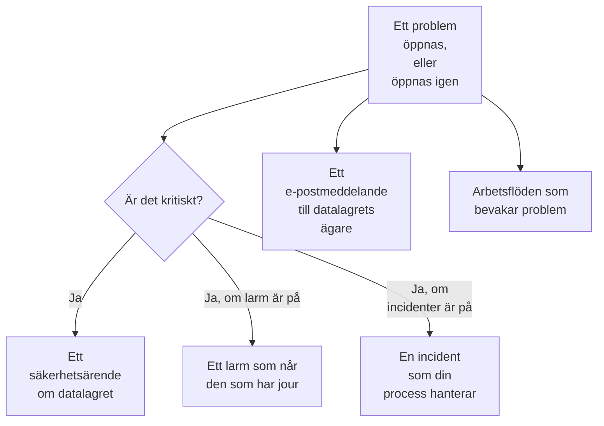

# Integrationer för Datasäkerhet

Datasäkerhet har ingen egen personsökning eller säkerhetskö. Den lämnar det den hittar till de delar av OneUptime som redan har det: ett kritiskt problem blir ett säkerhetsärende, det kan larma den som har jour eller deklarera en incident, och varje nytt problem skickas med e-post till datalagrets ägare. Arbetsflöden, OneUptime AI, API:t, Terraform och MCP-servern når allt som den sparar.

:::cards
- [Security Operations](#security-operations): Ett säkerhetsärende för varje datalager med ett kritiskt problem.
- [Larm och jour](#larm-och-jour): Larma den som har jour när ett kritiskt problem öppnas.
- [Incidenter](#incidenter): Deklarera en incident för ett intrång som din incidentprocess ska hantera.
- [Ägare](#ägare): Vem som äger varje datalager, angivet för hand eller via regler, och e-postmeddelandet de får.
- [OneUptime AI](#oneuptime-ai): Förklara ett problem, öppna en pull request som åtgärdar det, eller ställ frågor om dina data till Fråga AI.
- [Stäng en exponering](#stäng-en-exponering): Blockera offentlig åtkomst eller sluta dela, från ett problem eller en playbook.
:::

## Så fungerar det

Var och en av dessa körs när en utvärdering öppnar ett problem, eller öppnar ett igen. Var och en görs i mån av möjlighet: problemet är redan öppet och finns redan på sin tidslinje, så en integration som misslyckas loggas och hoppas över, och görs aldrig om så att den blir ett andra ärende eller ett andra larm. Det som var och en gjorde skrivs till problemets **Tidslinje**, och problemets sida länkar till ärendet, larmet och incidenten som det startade.

| Inställning | Standard | Vad den gör |
| --- | --- | --- |
| **Öppna säkerhetsärenden** | På | Ett kritiskt problem öppnar ett säkerhetsärende, grupperat efter datalager. |
| **Skapa larm** | Av | Ett kritiskt problem skapar ett larm, som larmar den som har jour. |
| **Larmallvar** | Tom | Allvarlighetsgraden för de larmen. Tom är projektets allvarligaste. |
| **Deklarera incidenter** | Av | Ett kritiskt problem deklarerar en incident, som din incidentprocess hanterar. |
| **Incidentallvar** | Tom | Allvarlighetsgraden för de incidenterna. Tom är projektets allvarligaste. |
| **Avisera ägare** | På | Varje nytt problem skickas med e-post till datalagrets ägare. |

## Security Operations

Varje datalager är en egen entitet i Security Operations, av typen **Datalager**. Med **Öppna säkerhetsärenden** påslaget skickas ett kritiskt problem till Security Operations som en detektion om datalagret:

- dess källa är **Datasäkerhet**, och dess regel är uppkallad efter kontrollen, till exempel `Data Security: public-read`;
- den är kritisk, så ärendet den öppnar får projektets kritiska prioritet;
- den grupperas efter datalagret: ett andra kritiskt problem på samma datalager läggs till i det öppna ärendet om det i stället för att öppna ett nytt.

Därifrån hanteras ärendet som vilket annat som helst: det tilldelas, får anteckningar, stängs och besvaras av projektets playbooks. Datalagrets detektioner räknas in i dess risk under [Entitetsrisk](/docs/telemetry/security-entity-risk), precis som för alla andra entiteter. Se [Säkerhetsärenden och playbooks](/docs/telemetry/security-cases).

## Larm och jour

Med **Skapa larm** påslaget skapar ett kritiskt problem ett larm, med namnet ”Data Security:” följt av problemets titel och datalagret. Larmet når den som har jour via sina egna regler, som vilket annat larm som helst (se [Larm](/docs/alerts/index) och [Jour](/docs/on-call/index)). Ett problem har högst ett öppet larm åt gången, hur ofta det än utvärderas. **Larmallvar** anger larmets allvarlighetsgrad; lämnas den tom är det projektets allvarligaste.

Ett larm avslutas tillsammans med sitt problem: när problemet inte längre är öppet – dess kontroll godkänns, eller en person markerar det som löst, accepterar dess risk eller säger att det inte är ett problem – löses larmet, och problemets **Tidslinje** anger det. Ett problem som öppnas igen skapar ett nytt larm.

Larm är avstängda som standard eftersom de flesta team vill se ett fynd från datasäkerheten i ett säkerhetsärende först. Slå på dem när en offentlig bucket med kortnummer ska väcka någon.

## Incidenter

Med **Deklarera incidenter** påslaget deklarerar ett kritiskt problem en incident, namngiven på samma sätt som problemets larm, för ett intrång som din incidentprocess ska hantera: jour, kanaler i arbetsytan, statussidor och en postmortem (se [Incidenter](/docs/incidents/index)). Ett problem har högst en öppen incident åt gången. **Incidentallvar** anger incidentens allvarlighetsgrad; lämnas den tom är det projektets allvarligaste.

Datasäkerhet löser aldrig en incident, inte ens när dess problem har lösts: en incident kan ha en statussida och en postmortem, så den som hanterar den stänger den. Ett säkerhetsärende är den andra vägen till en incident: **Deklarera incident** på ärendet öppnar en som är länkad till det (se [Deklarera en incident](/docs/telemetry/security-cases#deklarera-en-incident)).

## Ägare

Ett datalagers ägare är personer och team, på datalagrets sida **Ägare**. Det är dem ett problem är till för: de får e-postmeddelandet, och **Ingen äger detta känsliga datalager** misslyckas för ett känsligt datalager som inte har några.

Med **Avisera ägare** påslaget skickar varje utvärdering som öppnar problem på ett datalager ett e-postmeddelande till dess ägare – personerna som äger det, och medlemmarna i de team som gör det, upp till 50 – med en rubrik som anger hur många nya problem datalagret har, till exempel ”Data Security: 2 new issues on orders-db”. Det listar varje nytt problems allvarlighetsgrad och titel och datalagrets känslighet, och länkar till datalagret. Det innehåller aldrig något prov.

### Ägarregler och etikettregler

Regler anger ägare och etiketter åt dig, när datalager hittas:

| Regel | Var | Vad den gör |
| --- | --- | --- |
| **Ägarregler** | **Datasäkerhet → Regler → Ägarregler** | Lägger till ägaranvändare och ägarteam på varje datalager som matchar |
| **Etikettregler** | **Datasäkerhet → Regler → Etikettregler** | Lägger till etiketter på varje datalager som matchar |

En regel matchar ett datalager via dess etiketter, via ett mönster för dess namn eller beskrivning, eller via **Molntaggmönster**: ett mönster som matchas mot var och en av datalagrets molntaggar, skrivna `key=value`. `^team=payments$` matchar varje datalager som är taggat `team=payments`, och `^env=` varje datalager med en `env`-tagg. Ett nytt datalager får projektets regler i samma ögonblick som det hittas, och en ägarregels **Avisera ägare** anger om de ägare som den lägger till underrättas. [Etikett- och ägarregler](/docs/configuration/label-and-owner-rules) beskriver hur varje regel matchar och när regler körs.

## Arbetsflöden

**Datalager** och **Datasäkerhetsproblem** är utlösare för arbetsflöden, var och en med **Vid skapande**, **Vid uppdatering**, **Vid skapande eller uppdatering** och **Vid borttagning**. Välj dem i panelen **Lägg till utlösare**, under **OneUptime-resurser**.

- **Datasäkerhetsproblem → Vid skapande** körs när ett problem öppnas för första gången. Läs dess allvarlighetsgrad i ett block av typen **Om / Annars**, och posta kritiska problem i en kanal eller öppna en ticket i ditt ärendesystem.
- **Datasäkerhetsproblem → Vid uppdatering**, med **Fält att bevaka** inställt på dess status, körs när ett problem löses, accepteras eller öppnas igen.
- **Datalager → Vid skapande** körs när upptäckten hittar ett datalager, till exempel för att berätta för ett team om varje ny bucket.

Se [Utlösare för arbetsflöden](/docs/workflows/triggers) för de fält som varje utlösare skickar vidare.

## OneUptime AI

Två åtgärder på ett problem ber OneUptime AI om hjälp. Båda skickar till OneUptime AI problemets titel och allvarlighetsgrad, datalagrets namn, typ, region och moln-ID, dess känslighet och datatyper, bevisen, varför kontrollen spelar roll och åtgärden för datalagrets moln – aldrig ett fynds prov. Båda körs under projektets reglage och gränser för OneUptime AI.

- **Förklara med AI** skriver, för datalagrets ägare, vad som är fel, vad som kan hända och de exakta stegen för att åtgärda det i deras moln. Förklaringen sparas på problemets **Tidslinje**. Alla som kan läsa Datasäkerhet kan fråga.
- **Åtgärda med AI** ber OneUptime AI att åtgärda problemet i din infrastrukturkod – Terraform, CloudFormation, Bicep eller liknande – med den minsta ändring som får kontrollen att godkännas, och att öppna en pull request. Den kräver att arkivet som innehåller datalagrets infrastrukturkod är anslutet under **Kod**: välj det under **Arkiv** när projektet har flera. Pull requesten visas under **Kod** (se [Kod](/docs/ai/ai-agent)). Rollen Security Member och högre kan fråga.

### Fråga AI

**Fråga AI** läser också Datasäkerhet. På vilken sida i Datasäkerhet som helst kan du fråga vilka datalager som innehåller kortnummer, vad du ska åtgärda först, eller vilka datalager en roll skulle kunna nå om den läckte; på ett datalagers eller ett problems sida läser den den posten först. Den svarar med tre läsverktyg, som körs med dina egna behörigheter:

| Verktyg | Vad det läser |
| --- | --- |
| `query_data_stores` | Datalagren, de mest riskfyllda först, efter känslighet, datatyp, exponering, leverantör eller namn – eller ett datalager med vad som hittades var, vem som kan nå det och dess öppna problem |
| `query_data_security_issues` | Problemen, de mest riskfyllda först, efter status, allvarlighetsgrad, datalager eller kontroll – eller ett problem med dess bevis och åtgärden för dess moln |
| `query_data_store_access` | Vem som kan nå ett datalager, eller varje datalager som ett huvudkonto kan nå |

De läser datatyper, platser och antal, aldrig ett fynds prov, maskerade eller inte. Fråga AI ändrar ingenting i Datasäkerhet.

## Stäng en exponering

Två ändringar stänger ett molndatalagers exponering, var och en via datalagrets molnanslutning med **Datasäkerhetsrespons** påslaget (se [Konfigurera Datasäkerhet](/docs/data-security/setup#låt-datasäkerhet-stänga-en-exponering)):

- **Blockera offentlig åtkomst**, på en S3-bucket, ett Azure-lagringskonto eller en Cloud Storage-bucket.
- **Återkalla delning**, på en RDS-ögonblicksbild, eller på de delade manuella ögonblicksbilderna av en RDS-databas, ett Aurora-kluster eller ett DocumentDB-kluster.

En person kör en av dem från ett öppet problem som den åtgärdar, med **Åtgärda härifrån** (se [Kontroller och problem i Datasäkerhet](/docs/data-security/checks-and-issues#åtgärda-härifrån)). En playbook i Security Operations kör dem som steg i kategorin **Begränsa**, **Blockera offentlig åtkomst till datalager** och **Återkalla delning av datalager**: på varje datalager som ärendet gäller, högst 10, vart och ett ett steg som börjar med **Kräver godkännande** påslaget. Ett datalager som är markerat **Offentlig avsiktligt** blockeras aldrig. I båda fallen anger datalagrets tidslinje vad som gjordes, och datalagret kontrolleras igen direkt, så problemet löses när ändringen har fått effekt.

## API, Terraform och MCP

Allt som Datasäkerhet sparar är en post i OneUptimes API, som läses med samma behörigheter som i instrumentpanelen (se [API-referensen](/docs/api-reference/api-reference)):

| Poster | API-sökväg |
| --- | --- |
| Datalager, deras tidslinjer, deras fynd och vem som kan nå dem | `/data-store`, `/data-store-feed`, `/data-store-finding`, `/data-store-access` |
| Problem, deras tidslinjer och dataflöden | `/data-security-issue`, `/data-security-issue-feed`, `/data-security-flow` |
| Skanningar | `/data-security-scan` |
| Anpassade datatyper, kontrollinställningar och hemvistregler | `/data-security-custom-data-type`, `/data-security-check-setting`, `/data-security-residency-rule` |
| Projektets inställningar | `/data-security-setting` |
| Ägare, ägarregler och etikettregler | `/data-store-owner-user`, `/data-store-owner-team`, `/data-store-owner-rule`, `/data-store-label-rule` |

Några svar räknas ut på begäran i stället för att lagras. Vart och ett är en `POST`:

| Sökväg | Vad den gör |
| --- | --- |
| `/data-security/overview` | Översiktens siffror: datalager efter känslighet och kategori, öppna problem efter allvarlighetsgrad, de mest riskfyllda problemen och de senaste 30 dagarna av dem |
| `/data-security/compliance` | Varje ramverks poäng och krav |
| `/data-security/record-of-processing` | GDPR-registret över behandling, en rad för varje datalager som innehåller personuppgifter |
| `/data-store/<id>/scan-now` | **Skanna nu**: tar prov på datalagrets innehåll nu |
| `/data-store/<id>/check-now` | **Kontrollera nu**: läser datalagrets konfiguration igen och kör dess kontroller |
| `/data-store-finding/<id>/scrub` | **Rensa** på ett telemetrifynd |
| `/data-security-issue/<id>/explain` | **Förklara med AI** på ett problem |
| `/data-security-issue/<id>/fix-with-ai` | **Åtgärda med AI** på ett problem |
| `/data-store/<id>/response-actions` | Vilka responsåtgärder datalagret kan utföra nu, och varför inte |
| `/data-store/<id>/respond` | **Blockera offentlig åtkomst** eller **Återkalla delning** på datalagret, med problemet som det kördes från |

[Terraform-providern](/docs/terraform/index) har en resurs för varje sorts post som du skapar – datalager som du lägger till själv, anpassade datatyper, kontrollinställningar, hemvistregler, ägar- och etikettregler – uppkallad efter posten, till exempel `oneuptime_residency_rule`.

[MCP-servern](/docs/ai/mcp-server) har verktyg för att skapa, hämta, lista, uppdatera, ta bort och räkna för de här posterna: Data Store, Data Store Finding, Data Store Access Entry, Data Flow, Data Security Issue, Data Security Scan, Custom Data Type, Check Setting, Residency Rule och Data Security Setting. En AI-assistent kan då fråga vilka datalager som innehåller kortnummer, eller vad som är öppet på en bucket, med dina behörigheter.

## Nästa steg

:::cards
- [Säkerhetsärenden och playbooks (SOAR)](/docs/telemetry/security-cases): Hantera de ärenden som Datasäkerhet öppnar.
- [Etikett- och ägarregler](/docs/configuration/label-and-owner-rules): Hur regler matchar, och när de körs.
- [Utlösare för arbetsflöden](/docs/workflows/triggers): Kör ett arbetsflöde när ett problem öppnas eller ett datalager hittas.
- [Kontroller och problem i Datasäkerhet](/docs/data-security/checks-and-issues): Vad varje problem betyder, och hur du åtgärdar det.
:::
