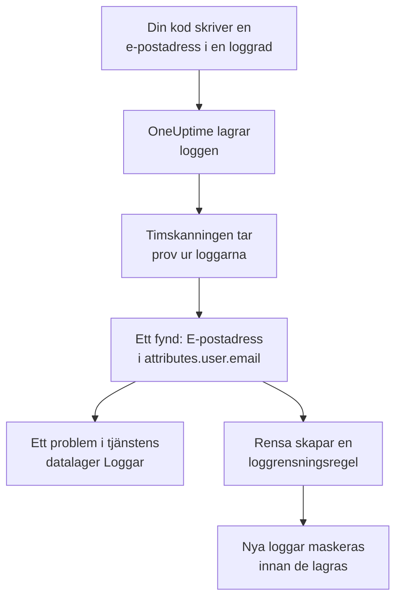

# Känsliga data i telemetri

Telemetri innehåller allt som din kod skriver: en e-postadress i en loggrad, ett kortnummer i ett span-attribut, en token i en stackspårning, en kunds fråga i en prompt. Datasäkerhet behandlar varje tjänsts loggar, spår, undantag och AI-konversationer, och varje RUM-applikations sessioner, som egna datalager. Den tar prov ur dem varje timme, hittar känsliga data i dem på samma sätt som i en bucket, och **Rensa** gör om ett fynd till en rensningsregel som maskerar dessa data vid intaget från och med då.

Det finns inget att konfigurera: varje tjänsts telemetri skannas varje timme, om inte **Skanna telemetri** är avstängt i projektets inställningar.

:::cards
- [Vad som läses](#vad-som-läses): Attributen, kropparna, meddelandena och promptarna i varje signal.
- [Hur en skanning tar prov](#hur-en-skanning-tar-prov): De nyaste posterna för varje tjänst, varje timme.
- [Rensa](#rensa): Maskera ett fynd vid intaget, med ett klick.
- [Vad som räknas som rensat](#vad-som-räknas-som-rensat): När en rensningsregel redan täcker ett fynd.
:::

## Så fungerar det

Ett fynd som en rensningsregel täcker markeras som rensat: det som finns kvar av dessa data är gamla data som väntar på att lagringstiden ska ta slut, inte en läcka som fortfarande pågår. De två telemetrikontrollerna räknar bara det som ingen regel täcker, så deras problem blir löst när varje fynd är rensat (se [Telemetrikontroller](/docs/data-security/checks-and-issues#telemetri)).

## Vad som läses

| Datalager | Vad som läses | Vart ett fynd pekar |
| --- | --- | --- |
| Loggar | Varje attribut, och kroppen | `attributes.<key>`, `body` |
| Spår | Varje span-attribut, och attributen i varje span-händelse | `attributes.<key>`, `events.<event>.<key>` |
| Undantag | Meddelandet, stackspårningen och attributen | `message`, `stackTrace`, `attributes.<key>` |
| AI-konversationer | Promptarna och svaren i varje AI-anrop, under de nycklar som GenAI-konventionerna lägger dem i, och varje annat attribut | Nyckeln de finns i, till exempel `gen_ai.input.messages` eller `gen_ai.prompt[].content` |
| Sessionsuppspelningar | Attributen i en RUM-applikations spans och loggar, dess sessioners attribut, egenskaperna som `identify()` gav dess användare och den användarreferens den har fått | `spans.attributes.<key>`, `logs.attributes.<key>`, `sessions.attributes.<key>`, `sessions.identifiedUserTraits.<key>`, `sessions.identifiedUserLabel` |

Numrerade nycklar slås ihop till en plats: `gen_ai.prompt.3.content` blir `gen_ai.prompt[].content`, så de tjugo meddelandena i en chatt är ett fynd, inte tjugo. Attribut som OneUptime lägger till själv, och som börjar med `oneuptime.`, läses inte.

### Varför en uppspelnings inspelning aldrig läses

En sessionsuppspelnings inspelning innehåller texten på sidorna som personer såg. Att titta på den kräver en egen behörighet, och ett fynd som lästs ur den skulle visa maskerad sidtext för alla som kan läsa Datasäkerhet. Därför läses en uppspelning bara via sina attribut: de spans, loggar och sessionsuppgifter som finns bredvid inspelningen. Inspelaren maskerar redan det den spelar in i webbläsaren, och loggrensningsregler körs också över inspelningar (se [Sessionsuppspelning](/docs/telemetry/session-replay)).

### AI-konversationer

Ett AI-anrops prompt bär med sig hela chatten före personens senaste meddelande, så upp till 16 384 tecken av varje värde i ett AI-anrop läses. När AI-konversationer innehåller känsliga data följer två saker till: AI-leverantören som anropen gick till blir ett dataflöde för dessa data, och [Känsliga data skickas till en AI-leverantör](/docs/data-security/checks-and-issues#ai) misslyckas för datalagret.

Konversationerna i ett [AI-verktyg för företaget](/docs/telemetry/ai-company-tools) lämnas utanför. Bara rollerna Project Owner och Project Admin får läsa dem, och ett fynd hamnar där alla som läser Datasäkerhet kan läsa det, så de tjänsternas spans läses aldrig, och deras AI-konversationer rapporteras som inte lästa.

## Hur en skanning tar prov

Varje timme läses varje signals nyaste poster från den senaste timmen, och de klassificeras fält för fält precis som i alla andra datalager (se [Fält och kolumner](/docs/data-security/data-types#fält-och-kolumner)):

| Gräns | Värde |
| --- | --- |
| Poster per tjänst och signal | **Provstorlek för telemetri**, 500 som standard, aldrig fler än 1 000 |
| Tjänster eller RUM-applikationer som läses per signal | De 200 mest aktiva |
| Poster i en läsning | 5 000, delade mellan tjänsterna; 500 för AI-anrop |
| Tecken i en loggkropp, ett undantagsmeddelande eller en stackspårning | 8 192 |
| Tecken i ett attributvärde | 4 096 |
| Tecken i ett värde i ett AI-anrop | 16 384 |
| Attribut i en post | 128; 64 för ett AI-anrop |
| Händelser i ett span, och attribut i en händelse | 16 och 32 |
| Platser i ett datalager | 500 |

Varje värde kortas av redan i databasen, så inget långt värde lämnar den, och varje läsning avbryts efter 30 sekunder. En läsning som misslyckas blir en varning på de datalager den gällde; skanningen fortsätter med nästa.

För att utesluta något lägger du till det i datalagrets **Skanningsundantag**: en plats angiven i sin helhet (`attributes.http.url`), allt under en plats (`attributes.http`), eller en attributnyckel angiven ensam (`http.url`).

## Rensa

**Rensa** på ett fynd skapar den rensningsregel som döljer den datatypen på den platsen från och med då, eller pekar på den aktiverade regel som redan gör det:

:::steps
### Öppna fyndet

Öppna telemetridatalagret – till exempel en tjänsts **Loggar** – och fyndet.

### Klicka på Rensa

Klicka på **Rensa**. OneUptime skapar en loggrensningsregel för loggar och för en RUM-applikations loggar, och en spårrensningsregel för spans, undantag och AI-anrop, på den del av posten som fyndet finns i.

### Åtgärda koden också

Regeln maskerar nya data innan de lagras. Data som redan har lagrats finns kvar tills lagringstiden tar slut, så åtgärda koden som skriver dem: fyndet anger tjänsten och attributet.
:::

Regeln namnges efter det den döljer, till exempel ”Data Security: Email address in attributes.user.email”, och listas bland dina andra rensningsregler (se [Kasseringsfilter och rensningsregler](/docs/telemetry/drop-filters-and-scrub-rules#rensa-känsliga-data)). Den är en av dessa:

| Fynd | Regel som Rensa skapar |
| --- | --- |
| E-postadress, kortnummer, amerikanskt socialförsäkringsnummer, telefonnummer eller IP-adress | Det inbyggda mönstret för den typen. Kortnummer, socialförsäkringsnummer och telefonnummer maskeras, resten döljs helt. |
| Ett värde under en nyckel som ser känslig ut, till exempel `password` eller `token` | En regel av typen **Sensitive Attribute Keys**, som döljer hela värdet i varje sådant attribut |
| Varje annan datatyp som ett mönster kan hitta | En regel av typen **Anpassad regex**, skapad av datatypens egna mönster, som döljer varje värde med den formen |

Vissa fynd kan inte rensas av en regel, och **Rensa** säger varför:

- En datatyp som bara hittas utifrån fältnamn, till exempel en persons namn: inget mönster kan hitta den. Byt namn på attributet till en nyckel som en regel för känsliga nycklar döljer, eller sluta skicka det.
- En datatyp som bara skiljs från andra värden genom orden runt den, till exempel ett routingnummer: en regel skulle dölja mycket mer än den datatypen.
- En dokumentmärkning: att dölja ordet skulle inte dölja dokumentet.
- En av dina egna datatyper: lägg själv till en anpassad rensningsregel med dess mönster.
- En sessions egna uppgifter (`sessions.*`): intaget av sessionsuppspelningar kör inga rensningsregler.

**Rensa** skapar regeln i ditt namn, med dina egna behörigheter: rollerna Project Owner och Project Admin kan klicka på den, och det kan även ett team som får skapa loggrensningsregler, och spårrensningsregler för spans, undantag och AI-anrop.

## Vad som räknas som rensat

Ett fynd markeras som rensat bara när intaget skulle köra en aktiverad regel över det och regeln skulle hitta dess datatyp:

- **Rätt poster.** Loggregler täcker loggar och en RUM-applikations loggar. Spårregler täcker spans, undantag och AI-anrop: ett undantag är en kopia av sitt spans undantagshändelse, så de regler som rensar händelser rensar det.
- **Rätt del.** Regelns **Fält att rensa** omfattar den del av posten som fyndet finns i, eller så lämnar regeln dem som standard.
- **Ett mönster som hittar typen.** En inbyggd **Mönstertyp** hittar sin egen datatyp: **E-postadress** hittar e-postadresser, **Kreditkortsnummer** kortnummer, **Personnummer (Social Security Number)** amerikanska socialförsäkringsnummer, **Telefonnummer** telefonnummer och **IP-adress** IP-adresser. **Sensitive Attribute Keys** täcker varje värde under en nyckel som ser känslig ut, oavsett vad värdet är.
- **Dina egna anpassade mönster räknas aldrig.** En **Anpassad regex** täcker ett fynd bara när den är exakt det mönster som **Rensa** skapar för dess typ. Ett fynd sparar bara maskerade prov, som inget mönster kan provas mot, så OneUptime kan inte bevisa att ditt mönster döljer dessa data, och ett fynd som felaktigt kallas rensat är en läcka som ingen tittar på.

En regel som är avstängd, eller som inte rensar något, räknas aldrig. Täckningen räknas ut på nytt efter varje skanning, så en regel som du lägger till eller tar bort för hand ändrar vad som markeras som rensat inom en timme.

## Nästa steg

:::cards
- [Kasseringsfilter och rensningsregler](/docs/telemetry/drop-filters-and-scrub-rules): Varje alternativ för rensningsregler, och de regler som du skriver själv.
- [Kontroller och problem i Datasäkerhet](/docs/data-security/checks-and-issues): De två telemetrikontrollerna och AI-kontrollerna.
- [Dataflöden, åtkomst och hemvist](/docs/data-security/flows-access-residency): AI-leverantörerna och värdarna som dina tjänster skickar data till.
:::
