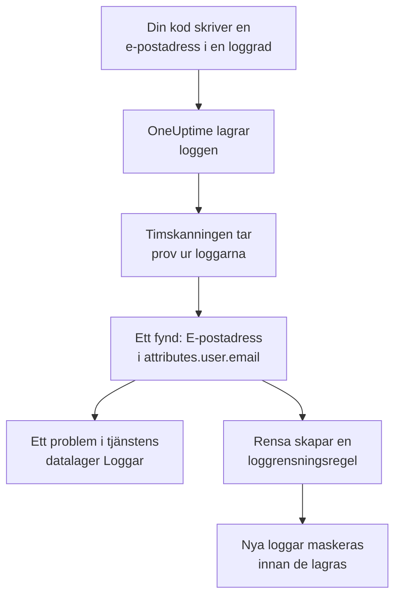

# Känsliga data i telemetri

Telemetri innehåller allt som din kod skriver: en e-postadress i en loggrad, ett kortnummer i ett span-attribut, en token i en stackspårning, en kunds fråga i en prompt, en användares IP-adress i ett mätvärdes etikett. Datasäkerhet behandlar varje tjänsts loggar, spår, mätvärden, undantag och AI-konversationer, och varje RUM-applikations sessioner, som egna datalager. Den tar prov ur dem varje timme, hittar känsliga data i dem på samma sätt som i en bucket, och **Rensa** gör om ett fynd till en regel som maskerar dessa data vid intaget från och med då.

Det finns inget att konfigurera: varje tjänsts telemetri skannas varje timme, om inte **Skanna telemetri** är avstängt i projektets inställningar. Om du vill utesluta en tjänsts loggar, spårningar eller en annan av dess signaler stänger du av **Skanna innehåll** i det datalagrets **Inställningar**: från nästa skanning läses inget av det.

:::cards
- [Vad som läses](#vad-som-läses): Attributen, kropparna, meddelandena och promptarna i varje signal.
- [Hur en skanning tar prov](#hur-en-skanning-tar-prov): De nyaste posterna för varje tjänst, varje timme.
- [Rensa](#rensa): Maskera ett fynd vid intaget, med ett klick.
- [Kassera det här mätvärdet](#kassera-det-här-mätvärdet): Sluta lagra de mätvärden vars namn innehåller känsliga data.
- [Vad som räknas som rensat](#vad-som-räknas-som-rensat): När en rensningsregel redan täcker ett fynd.
:::

## Så fungerar det

Ett fynd som en rensningsregel täcker markeras som rensat: det som finns kvar av dessa data är gamla data som väntar på att lagringstiden ska ta slut, inte en läcka som fortfarande pågår. De två telemetrikontrollerna räknar bara det som ingen regel täcker, så deras problem blir löst när varje fynd är rensat (se [Telemetrikontroller](/docs/data-security/checks-and-issues#telemetri)).

## Vad som läses

| Datalager | Vad som läses | Vart ett fynd pekar |
| --- | --- | --- |
| Loggar | Varje attribut, och kroppen | `attributes.<key>`, `body` |
| Spår | Varje span-attribut, och attributen i varje span-händelse | `attributes.<key>`, `events.<event>.<key>` |
| Undantag | Meddelandet, stackspårningen och attributen | `message`, `stackTrace`, `attributes.<key>` |
| AI-konversationer | Promptarna och svaren i varje AI-anrop, under de nycklar som GenAI-konventionerna lägger dem i, och varje annat attribut | Nyckeln de finns i, till exempel `gen_ai.input.messages` eller `gen_ai.prompt[].content` |
| Sessionsuppspelningar | Attributen i en RUM-applikations spans och loggar, dess sessioners attribut, egenskaperna som `identify()` gav dess användare och den användarreferens den har fått | `spans.attributes.<key>`, `logs.attributes.<key>`, `sessions.attributes.<key>`, `sessions.identifiedUserTraits.<key>`, `sessions.identifiedUserLabel` |
| Mätvärden | Varje attribut i en datapunkt, även resursens, och mätvärdenas namn | `attributes.<key>`, `attributes.resource.<key>`, `name` |

Numrerade nycklar slås ihop till en plats: `gen_ai.prompt.3.content` blir `gen_ai.prompt[].content`, så de tjugo meddelandena i en chatt är ett fynd, inte tjugo. Attribut som OneUptime lägger till själv, och som börjar med `oneuptime.`, läses inte.

### Mätvärden

Ett mätvärdes attribut är dess seriers etiketter. De är desamma i varje datapunkt i en serie, så ett mätvärde som skriver tusen punkter i minuten kan innehålla bara tre värden, och en etikett som läcker en användares e-postadress lägger till en serie, inte en punkt. Därför tas prov ur ett mätvärde efter dess serier, inte efter dess punkter:

- **En punkt från varje serie.** Varje mätvärde läses vid den senaste minut som det skrev under den senaste timmen: en datapunkt från var och en av upp till 100 av den minutens serier, oavsett hur ofta mätvärdet skickas, så att en aktiv serie aldrig tränger undan en lugn. Ett värde klassificeras en gång, oavsett hur många serier som upprepar det, så ett fynd räknar de olika värdena på sin plats.
- **Nya mätvärden först, sedan resten i tur och ordning.** Vilka mätvärden en tjänst skrev, och när vart och ett först skrev under det senaste dygnet, hämtas från den sammanställning per minut som mätvärdestabellen har, aldrig från dess punkter. Varje skanning läser en tjänsts mest aktiva mätvärden, de som troligast har många serier. Sedan kommer de mätvärden som den började skriva de senaste 2 timmarna, eftersom en ny läcka oftast kommer från ny kod, och sedan nästa av dess andra mätvärden, i en fast ordning, från där den förra skanningen slutade. Nya mätvärden tar högst hälften av de platserna, så att de andra alltid behåller sina.
- **Varje mätvärde inom en fast tid.** För en tjänst med M mätvärden, där varje skanning läser 10, läses vart och ett minst en gång under M ÷ 5 timmar, avrundat uppåt: 60 timmar för en tjänst med 300 mätvärden. Så länge den fortsätter att starta nya mätvärden varje timme är det högst dubbelt så lång tid.
- **Varje mätvärdes eget intervall.** Mätvärdena läses tillsammans, vart och ett efter sitt eget intervall av tabellens primärnyckel. Ett mätvärde vars senaste minut innehåller fler än 16 384 punkter, till exempel ett som har varje användares e-postadress som etikett, läses för sig, och läsningen avbryts vid dess första punkter, så det kostar inte mer än något annat mätvärde.

Ett fynd anger attributet, till exempel `attributes.user.email`, eller `name` för data i ett mätvärdes namn. Dess poster är de datapunkter som det hittades i: var och en visar sitt mätvärde och attributets värde, maskerat, och öppnas i **Mätvärden** på det mätvärdet, grupperat efter det attributet. Där ett mätvärdes namn innehåller känsliga data maskeras även namnet, och posten öppnar tjänstens mätvärden i stället.

### Varför en uppspelnings inspelning aldrig läses

En sessionsuppspelnings inspelning innehåller texten på sidorna som personer såg. Att titta på den kräver en egen behörighet, och ett fynd som lästs ur den skulle visa maskerad sidtext för alla som kan läsa Datasäkerhet. Därför läses en uppspelning bara via sina attribut: de spans, loggar och sessionsuppgifter som finns bredvid inspelningen. Inspelaren maskerar redan det den spelar in i webbläsaren, och loggrensningsregler körs också över inspelningar (se [Sessionsuppspelning](/docs/telemetry/session-replay)).

### AI-konversationer

Ett AI-anrops prompt bär med sig hela chatten före personens senaste meddelande, så upp till 16 384 tecken av varje värde i ett AI-anrop läses. När AI-konversationer innehåller känsliga data följer två saker till: AI-leverantören som anropen gick till blir ett dataflöde för dessa data, och [Känsliga data skickas till en AI-leverantör](/docs/data-security/checks-and-issues#ai) misslyckas för datalagret.

Konversationerna i ett [AI-verktyg för företaget](/docs/telemetry/ai-company-tools) lämnas utanför. Bara rollerna Projektägare och Projektadministratör får läsa dem, och ett fynd hamnar där alla som läser Datasäkerhet kan läsa det, så de tjänsternas spans läses aldrig, och deras AI-konversationer rapporteras som inte lästa.

## Hur en skanning tar prov

Varje timme läses varje signals nyaste poster från den senaste timmen, och de klassificeras fält för fält precis som i alla andra datalager (se [Fält och kolumner](/docs/data-security/data-types#fält-och-kolumner)):

| Gräns | Värde |
| --- | --- |
| Poster per tjänst och signal | **Provstorlek för telemetri**, 500 som standard, aldrig fler än 1 000 |
| Tjänster eller RUM-applikationer som läses per signal | De 200 mest aktiva |
| Poster i en läsning | 5 000, delade mellan tjänsterna; 500 för AI-anrop |
| Tecken i en loggkropp, ett undantagsmeddelande eller en stackspårning | 8 192 |
| Tecken i ett attributvärde | 4 096 |
| Tecken i ett värde i ett AI-anrop | 16 384 |
| Attribut i en post | 128; 64 för ett AI-anrop |
| Händelser i ett span, och attribut i en händelse | 16 och 32 |
| Platser i ett datalager | 500 |
| Mätvärden som läses i en skanning | 100, delade mellan tjänsterna, minst ett från varje; högst 10 från en tjänst, hälften bland dess mest aktiva och hälften bland dess nya och andra i tur och ordning |
| Ett nytt mätvärde | Ett mätvärde vars första punkt under de senaste 24 timmarna kom under de senaste 2 timmarna |
| Serier i ett mätvärde | En datapunkt från varje, från dess senaste minut, högst 100 |

Varje värde kortas av redan i databasen, så inget långt värde lämnar den, och varje läsning avbryts efter 30 sekunder. En läsning som misslyckas blir en varning på de datalager den gällde; skanningen fortsätter med nästa.

För att utesluta något lägger du till det i datalagrets **Skanningsundantag**: en plats angiven i sin helhet (`attributes.http.url`), allt under en plats (`attributes.http`), eller en attributnyckel angiven ensam (`http.url`).

## Rensa

**Rensa** på ett fynd skapar den regel som döljer den datatypen på den platsen från och med då, eller pekar på den aktiverade regel som redan gör det:

:::steps
### Öppna fyndet

Öppna problemet – **Var det hittades** listar varje fynd bakom det – eller **Datasäkerhet > I din telemetri**, där **Visa poster** öppnar posterna som ett fynd hittades i bredvid listan.

### Klicka på Rensa

Klicka på **Rensa**. OneUptime skapar en loggrensningsregel för loggar och för en RUM-applikations loggar, en spårrensningsregel för spans, undantag och AI-anrop, på den del av posten som fyndet finns i, och en pipelineregel för mätvärden för ett mätvärdes attribut.

### Åtgärda koden också

Regeln maskerar nya data innan de lagras. Data som redan har lagrats finns kvar tills lagringstiden tar slut, så åtgärda koden som skriver dem: fyndet anger tjänsten och attributet.
:::

Regeln namnges efter det den döljer, till exempel ”Data Security: Email address in attributes.user.email”, och listas bland dina andra rensningsregler (se [Kasseringsfilter och rensningsregler](/docs/telemetry/drop-filters-and-scrub-rules#rensa-känsliga-data)). Den är en av dessa:

| Fynd | Regel som Rensa skapar |
| --- | --- |
| E-postadress, kortnummer, amerikanskt socialförsäkringsnummer, telefonnummer eller IP-adress | Det inbyggda mönstret för den typen. Kortnummer, socialförsäkringsnummer och telefonnummer maskeras, resten döljs helt. |
| Ett värde under en nyckel som ser känslig ut, till exempel `password` eller `token` | En regel av typen **Känsliga attributnycklar**, som döljer hela värdet i varje sådant attribut |
| Varje annan datatyp som ett mönster kan hitta | En regel av typen **Anpassad regex**, skapad av datatypens egna mönster, som döljer varje värde med den formen |
| Varje datatyp i ett mätvärdes attribut | En pipelineregel för mätvärden av typen **Maskera attribut** för tjänsten, som ersätter de av attributets värden som har datatypens form med `[REDACTED]`, eller varje värde i attributet där inget mönster hittar datatypen |

Vissa fynd kan inte rensas av en regel, och **Rensa** säger varför. Ett mätvärdes attribut kan alltid rensas, eftersom dess regel kan dölja varje värde i attributet:

- En datatyp som bara hittas utifrån fältnamn, till exempel en persons namn: inget mönster kan hitta den. Byt namn på attributet till en nyckel som en regel för känsliga nycklar döljer, eller sluta skicka det.
- En datatyp som bara skiljs från andra värden genom orden runt den, till exempel ett routingnummer: en regel skulle dölja mycket mer än den datatypen.
- En dokumentmärkning: att dölja ordet skulle inte dölja dokumentet.
- En av dina egna datatyper: lägg själv till en anpassad rensningsregel med dess mönster.
- En sessions egna uppgifter (`sessions.*`): intaget av sessionsuppspelningar kör inga rensningsregler.
- Ett mätvärdes namn (`name`): koden som skapar mätvärdet sätter det, och en pipelineregel kan bara byta namn på ett mätvärde i sin helhet. Byt namn på mätvärdet och skicka det som varierar i namnet som ett attribut i stället. Till dess kan **Kassera det här mätvärdet** sluta lagra de mätvärdena.

**Rensa** skapar regeln i ditt namn, med dina egna behörigheter: rollerna Projektägare och Projektadministratör kan klicka på den, och det kan även ett team som får skapa loggrensningsregler, spårrensningsregler för spans, undantag och AI-anrop, och pipelineregler för mätvärden.

## Kassera det här mätvärdet

Ingen regel tar bort data ur ett mätvärdes namn, så tills koden som namnger mätvärdet är rättad fortsätter data att komma in. **Kassera det här mätvärdet** på ett fynd i ett mätvärdes namn slutar lagra de mätvärden vars namn innehåller dem, på bekostnad av deras data, och sker därför bara när du ber om det:

- **En tjänsts mätvärden.** Den skapar en pipelineregel för mätvärden av typen **Kassera** för fyndets tjänst: varje ny datapunkt från ett mätvärde vars namn innehåller den datatypen kasseras innan den lagras. Dess filter är det mönster som **Rensa** använder för typen, så en typ som inget mönster kan hitta, som en persons namn, kan inte kasseras, och dialogen säger varför.
- **Sagt innan det görs.** Dialogen säger att de datapunkterna går förlorade för gott, hur många av tjänstens mätvärden som skrevs det senaste dygnet som har ett sådant namn, vilka monitorer och instrumentpaneler som läser dem och därför inte får några nya data, att det som redan är lagrat finns kvar tills lagringstiden löper ut, och hur det ångras. Inget kasseras förrän du har kryssat i att du förstår det.
- **I ditt namn, och loggat.** Regeln skapas med din egen behörighet att skapa pipelineregler för mätvärden: rollerna Projektägare och Projektadministratör kan skapa den, och det kan även ett team som får skapa pipelineregler för mätvärden. Granskningsloggarna registrerar vem som skapade den.
- **Ångras genom att ta bort regeln.** Regeln namnges efter det den kasserar, till exempel ”Data Security: drop metrics named with Email address”, och listas med dina andra pipelineregler för mätvärden under **Mätvärden → Inställningar → Pipelineregler**. Ta bort den eller stäng av den, så lagras de mätvärdena igen från och med då. Det som kasserades under tiden kommer inte tillbaka.

Fyndet markeras då **Kasserade** och räknas som rensat: inget mer av de data lagras.

## Vad som räknas som rensat

Ett fynd markeras som rensat bara när intaget skulle köra en aktiverad regel över det och regeln skulle hitta dess datatyp:

- **Rätt poster.** Loggregler täcker loggar och en RUM-applikations loggar. Spårregler täcker spans, undantag och AI-anrop: ett undantag är en kopia av sitt spans undantagshändelse, så de regler som rensar händelser rensar det.
- **Rätt del.** Regelns **Fält att rensa** omfattar den del av posten som fyndet finns i, eller så lämnar regeln dem som standard.
- **Ett mönster som hittar typen.** En inbyggd **Mönstertyp** hittar sin egen datatyp: **E-postadress** hittar e-postadresser, **Kreditkortsnummer** kortnummer, **Personnummer (Social Security Number)** amerikanska socialförsäkringsnummer, **Telefonnummer** telefonnummer och **IP-adress** IP-adresser. **Känsliga attributnycklar** täcker varje värde under en nyckel som ser känslig ut, oavsett vad värdet är.
- **Dina egna anpassade mönster räknas aldrig.** En **Anpassad regex** täcker ett fynd bara när den är exakt det mönster som **Rensa** skapar för dess typ. Ett fynd sparar bara maskerade prov, som inget mönster kan provas mot, så OneUptime kan inte bevisa att ditt mönster döljer dessa data, och ett fynd som felaktigt kallas rensat är en läcka som ingen tittar på.
- **Ett mätvärdes attribut.** En pipelineregel för mätvärden av typen **Maskera attribut** eller **Ta bort attribut** för attributets nyckel, för fyndets tjänst eller hela projektet, täcker fyndet när den inte har något filter, eller exakt det filter som **Rensa** skapar. Ett filter som du har skrivit själv räknas aldrig, av samma skäl.
- **Ett mätvärdes namn.** En pipelineregel för mätvärden av typen **Kassera** för fyndets tjänst eller hela projektet täcker fyndet när den har exakt det filter som **Kassera det här mätvärdet** skapar, eller inget filter alls, och då lagrar den inga av tjänstens mätvärden. En sådan regel utan filter täcker alla fynd i de mätvärdena.

En regel som är avstängd, eller som inte rensar något, räknas aldrig. Täckningen räknas ut på nytt efter varje skanning, så en regel som du lägger till eller tar bort för hand ändrar vad som markeras som rensat inom en timme.

## Nästa steg

:::cards
- [Kasseringsfilter och rensningsregler](/docs/telemetry/drop-filters-and-scrub-rules): Varje alternativ för rensningsregler, och de regler som du skriver själv.
- [Kontroller och problem i Datasäkerhet](/docs/data-security/checks-and-issues): De två telemetrikontrollerna och AI-kontrollerna.
- [Dataflöden, åtkomst och hemvist](/docs/data-security/flows-access-residency): AI-leverantörerna och värdarna som dina tjänster skickar data till.
:::
