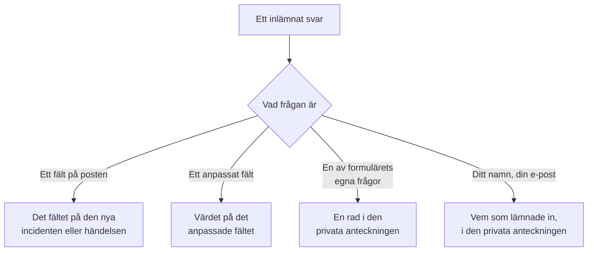

# Bygga ett formulär

Ett formulärs sida **Bygg** är där du bestämmer vad det frågar och hur dess sida ser ut. Frågorna finns till vänster, i den ordning som den offentliga sidan visar dem; **Lägg till en fråga**, till höger, visar allt du kan lägga till. Ovanför frågorna, hopfällt, finns formulärets [varumärke](#varumärke): dess logotyp och favicon. Namngivna uppsättningar svar som personer kan börja formuläret från — som var och en också kan göra en fråga obligatorisk, valfri eller dold för sitt eget fall — finns på dess sida **Mallar**: se [Mallar](#mallar).

:::cards
- [Byggaren](#byggaren): Lägg till, redigera, flytta och spara frågor.
- [Vad du kan lägga till](#vad-du-kan-lägga-till): Dina egna frågor, postens fält, anpassade fält och inlämnaren.
- [Dolda frågor](#dolda-frågor): Besvaras av en mall, aldrig av den som lämnar in.
- [Mallar](#mallar): Ett formulär, och en länk, för varje fall som ditt team ofta rapporterar.
:::

## Vart varje svar tar vägen

Varje svar sparas också med inlämningen, på formulärets sida **Inlämningar**. Ett fält som formuläret inte frågar efter, eller som lämnas tomt, fylls i från formulärets [inställningar Vid inlämning](/docs/forms/on-submit).

## Byggaren

:::steps
### Lägg till en fråga

Välj vad du vill lägga till i **Lägg till en fråga**. Den nya frågan infogas efter den valda, eller sist, och blir vald.

### Redigera den där den är

Välj ett kort för att redigera det: dess fråga, hjälptext, svarstyp och alternativ, om det är obligatoriskt eller dolt, och knapparna för att duplicera eller ta bort det. **Klar** stänger det.

### Sätt den på plats

Dra ett kort i dess handtag för att flytta det, eller använd **Flytta upp** och **Flytta ned** på det valda kortet — på en telefon, eller från tangentbordet.

### Spara formuläret

**Spara ändringar** sparar alla ändringar på en gång. Tills du sparar säger byggaren **Osparade ändringar** och erbjuder **Kasta ändringar**, och webbläsaren frågar innan du lämnar sidan.
:::

- **Formulärets sidhuvud** visar dess namn och beskrivning som den offentliga sidan kommer att göra. **Redigera namn och beskrivning** ändrar dem.
- **Frågorna** är kort. Varje kort visar frågan som personer kommer att se den, med en etikett som anger vad den är kopplad till — **Incident · Allvarlighetsgrad**, **Anpassat fält · Region**, **Inlämnare · E-post**, eller dess svarstyp för en av formulärets egna frågor. En röd asterisk markerar en obligatorisk fråga, och en etikett **Dold** en [dold](#dolda-frågor) fråga.
- **Gränser.** Ett formulär kan ha upp till 50 frågor. Personer som får läsa ett formulär men inte redigera det ser byggaren skrivskyddad.

## Varumärke

**Varumärke**, hopfällt ovanför frågorna, är hur formulärets sida ser ut: din logotyp högst upp på sidan, ovanför formulärets namn, och din favicon i webbläsarfliken medan formuläret är öppet. Tills du laddar upp dina egna visar formuläret OneUptimes logotyp och favicon.

Hopfällt visar avsnittet **Logotyp** och **Favicon** — visade som angivna så snart formuläret har sina egna — och anger vilka av OneUptimes som fortfarande gäller. Fäll ut det för att se båda som sidan visar dem: logotypen som den står högst upp på sidan, och faviconen i en webbläsarflik bredvid formulärets namn, som är flikens titel.

**Redigera varumärke** ändrar dem i en enda dialogruta:

| Fält | Vad det är |
| --- | --- |
| **Logotyp** | Visas högst upp på formulärets sida, ovanför dess namn, i stället för OneUptimes logotyp. En PNG-, JPEG-, GIF-, WebP- eller SVG-bild på högst 512 KB. Ta bort den för att gå tillbaka till OneUptimes logotyp. |
| **Logo Alt Text** | Vad logotypen säger, uppläst av skärmläsare: oftast din organisations namn. Efterfrågas så snart det finns en logotyp. Lämna den tom så hoppar skärmläsare över logotypen — formulärets namn följer efter den ändå. Att ta bort logotypen tömmer även den. |
| **Favicon** | Ikonen i webbläsarfliken medan formuläret är öppet, i stället för OneUptimes favicon. En PNG-, JPEG-, GIF-, WebP-, SVG- eller ICO-bild på högst 128 KB; en kvadratisk PNG, SVG eller ICO fungerar bäst. Ta bort den för att gå tillbaka till OneUptimes favicon. |

Logotypen behåller höjden på den OneUptime-logotyp den ersätter, och en bred logotyp anpassas till sidans bredd. Varje bild kontrolleras när den sparas — från instrumentpanelen, API:et, Terraform eller ett arbetsflöde: den måste ha laddats upp i formulärets eget projekt, vara av en av typerna ovan och inte vara större än sin gräns. En logotyp som inte är någon av de bilderna avvisas med "The logo must be a PNG, JPEG, GIF, WebP or SVG image.", en som är för stor med "The logo must be 512 KB or smaller.", och en vars uppladdning är borta — eller som laddades upp i ett annat projekt — med "The logo's file could not be found. Upload the logo again." En favicon avvisas på samma sätt, med "The favicon must be a PNG, JPEG, GIF, WebP, SVG or ICO image.", "The favicon must be 128 KB or smaller." och "The favicon's file could not be found. Upload the favicon again."

**Förhandsgranskning** visar logotypen som sidan gör. Personer som får läsa ett formulär men inte redigera det ser dess varumärke utan **Redigera varumärke**. Logotypen och faviconen når bara formulärets sida inuti själva formuläret — se [Delning & säkerhet](/docs/forms/sharing-and-security#vad-som-skyddar-ett-formulär).

## Vad du kan lägga till

**Lägg till en fråga** visar fyra grupper: formulärets egna **Frågor**, **Incidentfält** eller **Fält för schemalagt underhåll** för det formuläret skapar, **Anpassade fält** och **Inlämnare**.

### Formulärets egna frågor

| Svarstyp | Vad inlämnaren anger |
| --- | --- |
| **Kort svar** | En rad text. |
| **Stycke** | Flera rader text. |
| **Formaterad text** | Text med formatering och länkar. |
| **Tal** | Ett tal. |
| **Rullgardinslista** | Ett val från en lista. |
| **Flerval** | Valfritt antal val från en lista. |
| **Kryssruta** | En ruta att kryssa i, som en bekräftelse. |
| **Datum** | En dag. |
| **Datum och tid** | En dag och en tid. |

En listruta eller ett flerval visar de **Alternativ** du ger det, var och en med en valfri färg (knappen bredvid ett alternativ öppnar en uppsättning namngivna färger, med **Anpassad färg** för en exakt kod), mellan ett och 100 av dem. Att byta en fråga mellan **Rullgardinslista** och **Flerval** behåller dess alternativ; en fråga som blir en av dem börjar med två som du kan byta namn på, och en som slutar vara en av dem förlorar dem. **Duplicera** kopierar en av formulärets egna frågor direkt under den.

Svaren på de här frågorna sparas med inlämningen och visas i den privata anteckningen på det formuläret skapar — de fyller inte i något fält. För att fylla i ett fält lägger du till själva fältet, från de två följande grupperna.

### Fält på det formuläret skapar

Fälten på en incident, eller på en schemalagd underhållshändelse, som en inlämnare kan besvara. Svaret blir fältets värde.

| Incidentfält | Besvaras med |
| --- | --- |
| **Titel** | En rad, upp till 500 tecken. |
| **Beskrivning** | Formaterad text, upp till 20 000 tecken. |
| **Allvarlighetsgrad** | En av dina allvarlighetsgrader för incidenter. |
| **Monitorer** | Vilka som helst av de monitorer du erbjuder — incidentens berörda monitorer. |
| **Etiketter** | Vilka som helst av de etiketter du erbjuder. |
| **Påverkan började** | Ett datum och en tid: när problemet började, som inlämnaren minns det. |

| Fält för schemalagt underhåll | Besvaras med |
| --- | --- |
| **Titel** | En rad, upp till 100 tecken. |
| **Beskrivning** | Formaterad text, upp till 20 000 tecken. |
| **Börjar den** | Ett datum och en tid. Efterfrågas alltid och är alltid obligatoriskt. |
| **Slutar den** | Ett datum och en tid efter **Börjar den**. Efterfrågas alltid och är obligatoriskt. |
| **Monitorer** | Vilka som helst av de monitorer du erbjuder. |
| **Statussidor** | Vilka som helst av de statussidor du erbjuder. |
| **Etiketter** | Vilka som helst av de etiketter du erbjuder. |

Varje fält kan bara efterfrågas en gång; listan markerar de som redan finns på formuläret med **Tillagd**. Ett fält som formuläret inte frågar efter — eller som lämnas tomt — fylls i från formulärets [inställningar Vid inlämning](/docs/forms/on-submit).

**Erbjudna val.** En offentlig sida får inte visa hela ditt projekt för främlingar, så ett fält som besvaras genom att välja poster erbjuder bara de som du väljer. **Monitorer**, **Etiketter** och **Statussidor** visar exakt de val som du erbjuder, och efterfrågas inte förrän du erbjuder minst ett. **Allvarlighetsgrad** erbjuder alla allvarlighetsgrader för incidenter om du inte begränsar det, eftersom allvarlighetsgrader inte är hemliga. Svar utanför de erbjudna valen avvisas.

### Anpassade fält

Dina anpassade fält för incidenter — eller för schemalagt underhåll, i ett underhållsformulär — var och en en fråga vars svar blir fältets värde. Frågan tar sin typ och sina alternativ från det anpassade fältet, och börjar med dess namn som fråga och dess beskrivning som hjälptext, som du kan ändra.

Ett formulär frågar bara efter de anpassade fält som du lägger till i det, vad **Visa vid skapande** än säger: varje fält som ett formulär frågar efter visar sitt namn, sin beskrivning och sina alternativ för alla med länken. När ett anpassat fält tas bort ligger dess fråga kvar på formuläret men efterfrågas inte längre, och dess kort säger det — ta bort frågan. Ett fält som skapas igen med samma namn är ett nytt fält: lägg till det igen.

Ett anpassat fält som kopierar sitt värde från ett anpassat monitorfält säger det på sitt kort: när incidenten eller händelsen har monitorer som är överens om ett värde för det ersätter det värdet inlämnarens svar.

### Inlämnare

**Ditt namn** och **Din e-post** frågar vem som lämnar in. De sparas med inlämningen och nämns i den privata anteckningen, så att ditt team kan följa upp, och visas aldrig på själva incidenten eller händelsen. OneUptime skickar aldrig e-post till inlämnaren. Utelämna dem, eller gör dem valfria, för att ta emot anonyma inlämningar.

E-postadressen måste vara en enda vanlig adress, som `ada@example.com` — inte ett namn med adressen inom vinkelparenteser, och inte en lista med adresser. Namn och e-post är upp till 100 tecken var.

## Ett nytt formulärs frågor

Ett nytt formulär börjar med de frågor det nästan alltid bör ställa, så att det fungerar direkt när det skapas: **Titel**, obligatoriskt; **Beskrivning**; för ett underhållsformulär **Börjar den** och **Slutar den**; och **Ditt namn** och **Din e-post**, obligatoriska. Deras formulering är på instrumentpanelens språk. Ändra, dölj eller ta bort dem som du vill — utom en underhållshändelses början och slut, utan vilka ingen händelse kan schemaläggas. När dina egna frågor säger allt döljer du **Beskrivning** i stället för att lämna en ruta som ingen borde skriva i: se [Dolda frågor](#dolda-frågor).

## Obligatoriska frågor

**Obligatoriskt** betyder att formuläret inte kan lämnas in utan ett svar. Ett svar som bara består av mellanslag, tabbar eller radbrytningar räknas som inget svar, och en obligatorisk **Kryssruta** måste vara ikryssad. Servern kontrollerar varje obligatorisk fråga igen när formuläret lämnas in, så en begäran som görs utan sidan måste också uppfylla dem.

En fråga som inte är obligatorisk får lämnas tom: dess fält fylls då i från inställningarna Vid inlämning, som om formuläret inte hade frågat efter den.

## Dolda frågor

Slå på **Dold** på ett kort så visas frågan inte längre på formuläret. Ingen får frågan, så den är aldrig obligatorisk, och en inlämning kan inte besvara den — begäran läses inte ens för den. Bara den [mall](#mallar) som en inlämning börjar från besvarar den, och den förblir obesvarad när inlämnaren inte börjar från någon mall, eller från en som lämnar den tom. En mall kan också ställa en dold fråga ändå, för sitt eget fall: se [Så ställer en mall varje fråga](#så-ställer-en-mall-varje-fråga).

Dölj en fråga när svaret är ditt teams att bestämma, inte inlämnarens:

- **Incidentens beskrivning**, när frågorna du har lagt till säger allt. Dold bjuder den inte längre in någon att skriva där; ge varje mall den standardtext som du skickar för dess fall, eller låt incidenter börja utan.
- **Ett anpassat fält som dina arbetsflöden eller regler läser**, som en aviseringstyp, satt av varje mall.
- **En av formulärets egna frågor** vars svar bara ditt team behöver i den privata anteckningen.

En dold fråga behåller sin plats, sin etikett och sina inställningar, så att du kan visa den igen när som helst. Ett fält som formulärets mål inte kan skapas utan — en underhållshändelses **Börjar den** och **Slutar den** — kan inte döljas. Svaret på en dold fråga kontrolleras och lagras exakt som ett inskrivet svar skulle göra, och sparas med inlämningen.

## Mallar

Ett formulärs sida **Mallar** innehåller namngivna uppsättningar svar som personer kan börja formuläret från — en för varje fall som ditt team ofta rapporterar, som **Programavbrott**, **Planerat underhåll** eller **Tjänst återställd** — så att ett formulär, och en länk, räcker för alla.

:::steps
### Lägg till en mall

Klicka på **Lägg till mall**. Redigeraren har två delar. **Frågor** visar varje fråga i formuläret med hur den här mallen ställer den — se [Så ställer en mall varje fråga](#så-ställer-en-mall-varje-fråga). **Svar** visar dem igen, dolda inkluderade och ingen av dem obligatorisk: fyll i det som mallen ska besvara, och lämna resten till den som lämnar in. Ett svar på en fråga som mallen inte ställer säger det under sig — det används som det är.

### Välj standardmallen

**Standard** gör den till den mall som formuläret öppnas med. Bara en mall kan vara standardmallen, och ett formulär vars enda mall är standardmallen är helt enkelt ett förifyllt formulär.

### Dela dess länk

**Kopiera länk** kopierar mallens egen länk, som öppnar formuläret ifyllt med den. Se [Delning & säkerhet](/docs/forms/sharing-and-security#en-länk-för-varje-mall).
:::

Varje mall visar vad den fyller i och de frågor som den ställer på sitt eget sätt, som **Datum för schemalagt underhåll · Dold**, och har **Redigera**, **Duplicera** — en kopia direkt efter den, med ett namn som **Programavbrott 2** —, **Flytta upp** och **Flytta ned**, för den ordning som formuläret visar dem i, och **Ta bort**.

På den offentliga sidan visar ett formulär med mallar dem ovanför sina frågor, under **Börja från en mall**. Att välja en fyller i formuläret och ställer frågorna som den mallen ställer dem; inlämnaren kan fortfarande ändra vilket svar som helst innan inlämningen, och att välja en annan börjar om formuläret från den. Sidan öppnas med den mall som dess länk anger, annars med standardmallen, annars med ingen. **Förhandsgranskning** visar också mallarna och öppnas på standardmallen.

> [!IMPORTANT]
> Alla som öppnar länken ser varje malls namn och dess svar på de frågor den ställer — det är så sidan fyller i sig själv. En malls svar på frågor som den inte ställer lämnar aldrig servern, så håll allt internt i en dold fråga.

Varje svar i varje mall kontrolleras mot sin fråga när mallarna sparas — ett alternativ som frågan erbjuder, en post som formuläret erbjuder, text som passar —, och detsamma gäller varje fråga som en mall ställer på sitt eget sätt, och sparandet avvisas med ett meddelande som anger mallen och problemet, oavsett om det kommer från instrumentpanelen, API:et eller Terraform. En malls namn är upp till 100 tecken och unikt inom formuläret, och ett formulär har upp till 50 mallar. Om du senare ändrar frågorna används en malls svar på en fråga som du tog bort, eller som inte längre passar den, helt enkelt inte, och nästa gång den mallen sparas tas det bort. Att spara de andra mallarna avvisas aldrig på grund av det: det som en mall redan innehöll kontrolleras inte igen.

### Så ställer en mall varje fråga

Olika fall kräver olika frågor: ett avbrott behöver den berörda applikationen och inte ett underhållsfönster, planerat underhåll behöver fönstret. I stället för att bygga ett formulär för varje fall låter du varje mall ställa formulärets frågor på sitt eget sätt. I en malls **Frågor** har varje fråga en av följande:

| Inställning | När någon börjar från mallen |
| --- | --- |
| **Formulärets standard** | Frågan ställs som formuläret ställer den — obligatorisk, valfri eller dold, som dess kort i byggaren anger. Väljaren anger vilken, som **Formulärets standard (Dold)**, och följer kortet när du ändrar det. |
| **Obligatoriskt** | Frågan ställs, och formuläret kan inte lämnas in utan ett svar. |
| **Valfritt** | Frågan ställs, och får lämnas tom. |
| **Dold** | Frågan ställs inte. Mallens eget svar på den, om den har ett, är svaret, som för en fråga som formuläret döljer. |

Ett enda incidentformulär kan på så sätt täcka båda fallen:

| Fråga | Programavbrott | Planerat underhåll |
| --- | --- | --- |
| Applikationens namn | Obligatoriskt | Obligatoriskt |
| Berörda anläggningar | Obligatoriskt | Valfritt |
| Datum för schemalagt underhåll | Dold | Obligatoriskt |

Varje fråga börjar på **Formulärets standard**, och det gör även varje fråga som du lägger till i formuläret senare, i varje mall. En underhållshändelses **Börjar den** och **Slutar den** efterfrågas alltid och är alltid obligatoriska: ingen mall kan ändra dem. En mall kan dölja alla andra frågor och besvara dem själv: dess länk är då ett formulär med en enda knapp, **Skicka** — praktiskt för ett fall som **Tjänst återställd**.

Sidan följer den mall som inlämnaren väljer: att välja en annan ritar om formuläret med den mallens frågor, och **Förhandsgranskning** gör detsamma. Servern håller varje inlämning till de frågor som den mall den anger ställer, oavsett vad som skickade den: en fråga som mallen kräver måste besvaras, och en som den döljer läses inte från begäran — mallens eget svar används. En inlämning som inte anger någon mall, eller en mall som har tagits bort sedan dess, hålls till formulärets egna inställningar. En fråga som formuläret döljer visas bara för den offentliga sidan när en mall ställer den.

## När byggaren flaggar en fråga

Ett kort där något är fel säger vad, i bärnsten:

| Kortet säger | Vad som är fel |
| --- | --- |
| **Det här anpassade fältet har tagits bort, så frågan ställs inte. Ta bort frågan.** | Den offentliga sidan utelämnar frågan. |
| **Välj minst ett alternativ att erbjuda, annars ställs inte frågan.** | Ett fält som besvaras genom att välja poster erbjuder inga: välj de monitorer, etiketter eller statussidor som det erbjuder. |
| **Lägg till minst ett alternativ.** | En listruta eller ett flerval har inget att välja mellan. |
| **Skriv frågan.** | Frågan har ingen text. |

Formuläret kan inte sparas medan en fråga har något av de tre sista: **Spara ändringar** anger vilken fråga och vad som är fel, och förhandsgranskningen utelämnar en sådan fråga. Att spara kontrollerar också frågorna som helhet, och avvisas med ett meddelande som anger problemet när till exempel två frågor ber om samma fält, eller ett underhållsformulär inte frågar när underhållet börjar och slutar — oavsett om frågorna kommer från byggaren, API:et, Terraform eller ett arbetsflöde.

## Förhandsgranskning

**Förhandsgranskning** öppnar formuläret exakt som personer ser det via dess länk — samma logotyp, frågor, fält, alternativ och kontroller, dess lista med mallar, och bara de frågor som den valda mallen ställer — och låter dig fylla i det. Inget som du anger där lämnas in: **Skicka** kontrollerar bara dina svar, och **Fyll i igen** börjar om. Förhandsgranskningen visar frågorna som de är i byggaren, sparade eller inte, och anger när den utelämnar en flaggad fråga.

## Vad inlämnaren ser

Den offentliga sidan visar formulärets logotyp — OneUptimes logotyp tills du laddar upp din — sedan formulärets namn och beskrivning, dess mallar om det har några, de frågor som det ställer — som den valda mallen ställer dem, eller de som det inte döljer när ingen mall har valts — och **Skicka**, och webbläsarfliken visar formulärets namn och dess favicon. Sidan är på inlämnarens språk när OneUptime har det — det språk som inlämnaren senast valde i OneUptime i den webbläsaren, eller annars det som webbläsaren ber om — och annars på engelska. Dina frågor, alternativ och hjälptexter visas som du skrev dem.

Efter inlämningen säger sidan "Tack — ditt svar har skickats." och anger numret på det som skapades — "Ditt referensnummer är INC-42." — följt av formulärets tackmeddelande, om du skrev ett på sidan **Dela**. **Skicka ett till svar** öppnar ett tomt formulär. Inlämnaren får ingen e-post och ingen väg tillbaka till incidenten eller händelsen.

## Storleksgränser

| Svar | Gräns |
| --- | --- |
| En incidents **Titel** | 500 tecken, utan att räkna mellanslag i början och slutet. |
| En underhållshändelses **Titel** | 100 tecken. |
| **Beskrivning** | 20 000 tecken. |
| Vilket annat textsvar som helst | 10 000 tecken. |
| Ett flervalssvar | 100 val. |
| **Ditt namn**, **Din e-post** | 100 tecken var. |

En inlämning som bryter mot en gräns, utelämnar ett obligatoriskt svar eller ger ett svar som inte passar frågan avvisas med ett meddelande som anger vilket, och inget skapas. Svar på frågor som formuläret inte ställer ignoreras.

## Nästa steg

:::cards
- [Vad en inlämning skapar](/docs/forms/on-submit): Hur svaren och inställningarna Vid inlämning blir en incident eller en underhållshändelse.
- [Delning & säkerhet](/docs/forms/sharing-and-security): Dela länken, en länk för varje mall, och vad som skyddar dem.
- [Incidentinställningar och automatisering](/docs/incidents/settings): Anpassade fält och mallar för incidenter.
:::
