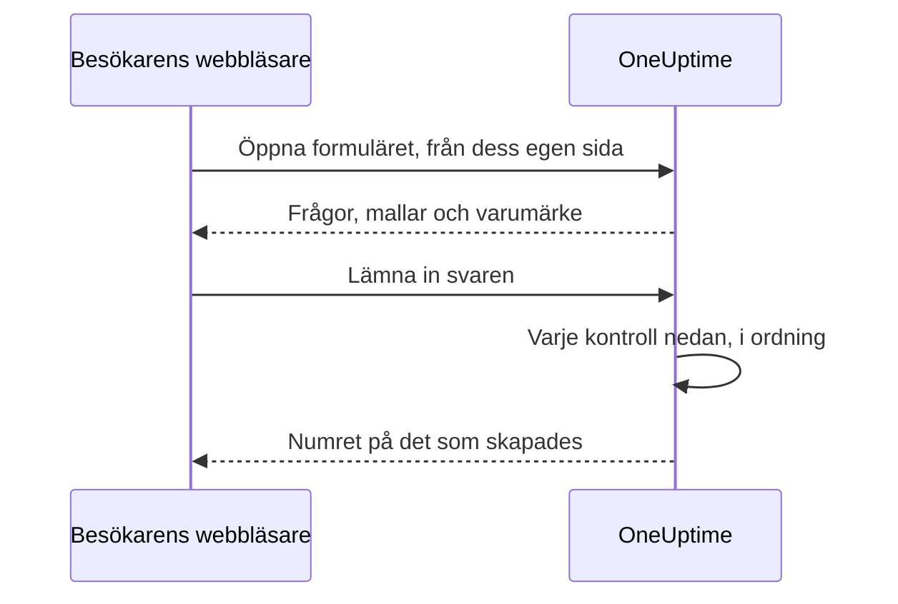

# Delning & säkerhet

Ett formulär är öppet för alla som har dess länk, och varje inlämning kan larma ditt jourteam eller lägga in ett underhållsfönster i din kalender. Den här sidan handlar om formulärets sida **Dela** — länken, att stänga av formuläret, meddelandet efter inlämningen och IP-tillåtelselistan — och varje annan kontroll som en begäran passerar på vägen. Den handlar också om att visa formuläret på din egen domän.

:::cards
- [Dela länken](#dela-länken): Kopiera den, öppna den och återställ den när den sprids för långt.
- [En länk för varje mall](#en-länk-för-varje-mall): Ett bokmärke per fall, ett enda formulär bakom alla.
- [Anpassade domäner](#anpassade-domäner): Visa formuläret på din egen domän, med ett kostnadsfritt certifikat.
- [Vad som skyddar ett formulär](#vad-som-skyddar-ett-formulär): Varje kontroll som en begäran passerar, i ordning.
- [Felsökning](#felsökning): Vad varje meddelande på formulärets sida betyder, och vad du ska göra.
:::

## Sidan Dela

| Kort | Vad det innehåller |
| --- | --- |
| **Status** | **Tar emot inlämningar** — om formulärets länk fungerar. |
| **Delningslänk** | Varje adress som formuläret svarar på, var och en med **Kopiera länk**, och **Återställ länk**. |
| **Efter inlämning** | Det **Tackmeddelande** som personer ser när de har lämnat in, under numret på det som formuläret skapade. |
| **Fler inställningar** | **IP-tillåtelselista**, hopfälld tills du öppnar den. |

## Dela länken

Kortet **Delningslänk** listar varje adress som formuläret svarar på: först formulärets [anpassade domäner](#anpassade-domäner), sedan dess länk på OneUptime, som `https://oneuptime.com/accounts/form/<share-key>`:

- Varje adress öppnar formuläret i en ny flik, så som andra ser det, och **Kopiera länk** bredvid kopierar den.
- En anpassad domän som inte fungerar än är markerad med **Inte live än**, med orsaken. Utan anpassad domän erbjuder en rad under länken **Lägg till en anpassad domän**.
- **Återställ länk** ger formuläret en ny länk, efter att du har bekräftat. Den gamla länken slutar fungera direkt och visar meddelandet om att formuläret inte är tillgängligt, så alla som du delade den med behöver den nya. Använd den när en länk har spridits längre än den borde. Formulärets anpassade domäner innehåller ingen nyckel och fortsätter att fungera.

Alla med länken kan öppna formuläret och lämna in det, utan ett OneUptime-konto och utan att logga in. Att vara inloggad ändrar ingenting: OneUptime vet bara vem som lämnade in utifrån det namn och den e-post som skrivs i formuläret. Behandla därför länken som ett telefonnummer till ditt jourteam. Dela den där de som ska använda den hittar den — en intranätsida, en supportrunbook, ett fäst chattmeddelande — och inte på en offentlig webbplats, om du inte vill ha inlämningar från vem som helst.

Länken innehåller en egen slumpmässig nyckel, inte formulärets ID. På en egenvärdad installation serveras den från din egen OneUptime-värd, och fungerar bara på den adress som `HTTP_PROTOCOL` och `HOST` konfigurerar: öppnad under ett annat namn för servern, eller på dess IP-adress, avvisas formulärets begäranden som om de kom från en annan webbplats.

Länkar till de gamla incidentformulären, `/accounts/incident-form/<share-key>`, öppnar samma formulär på dess nya adress.

### En länk för varje mall

Var och en av formulärets [mallar](/docs/forms/building#mallar) har en egen länk: formulärets länk med `?template=` och mallens id, som `https://oneuptime.com/accounts/form/<share-key>?template=<template-id>`. **Kopiera länk** på formulärets sida **Mallar** kopierar den. Den öppnar formuläret med den mallen ifylld, så att ett team kan spara ett bokmärke per fall medan du behåller ett enda formulär. När inlämnaren väljer en annan mall följer adressen i webbläsaren med, så länken som kopieras är formuläret som det visas. På en [anpassad domän](#anpassade-domäner) är en malls länk domänen med samma `?template=`, som `https://report.acme.com/?template=<template-id>`, och **Återställ länk** låter den fungera.

En malls länk är formulärets länk: den fungerar så länge formuläret står på **Tar emot inlämningar**, och **Återställ länk** drar tillbaka den tillsammans med resten. En länk som anger en mall som du har tagit bort öppnar formuläret som om den inte angav någon — med standardmallen, om det finns en.

### Stäng av ett formulär

För att sluta ta emot inlämningar utan att ta bort formuläret stänger du av **Tar emot inlämningar**. Länken visar då "Det här formuläret är inte tillgängligt. Det kan ha stängts av, eller så kan länken vara inaktuell.", och kortet **Delningslänk** påminner dig om att formuläret är avstängt. Slå på det igen så fungerar samma länk igen. Formulärets anpassade domäner visar samma meddelande medan det är avstängt.

### Tackmeddelandet

Efter en inlämning säger sidan "Tack — ditt svar har skickats." och anger numret på det som skapades, sedan ditt **Tackmeddelande**, i Markdown. Använd det för att säga vad som händer härnäst, och vart man ska vända sig när något är brådskande. Utan ett visar sidan bara standardmeddelandet.

En bild i formulärets beskrivning eller tackmeddelande visas för alla som öppnar länken så länge formuläret står på **Tar emot inlämningar**. Stäng av formuläret, eller ta bort bilden, så är bilden privat igen, om inte något annat som alla ser fortfarande innehåller den.

## Anpassade domäner

Från början visas ett formulär på sin länk, på OneUptimes egen adress. För att visa det på en egen domän, som `report.acme.com`, öppnar du formulärets sida **Anpassade domäner**, direkt efter **Dela** i sidomenyn. Den fungerar som en [statussidas anpassade domäner](/docs/status-pages/branding-and-domains#anpassade-domäner).

Att lägga formuläret på din egen domän tar tre steg, och bara de två första är dina:

1. **Lägg till domänen**: en underdomän och en av dina verifierade domäner.
2. **Lägg till dess CNAME-post** hos din DNS-leverantör. Dialogrutan **DNS-inställning** öppnas med posten så snart du lägger till domänen.
3. **Det kostnadsfria SSL-certifikatet utfärdas automatiskt** så snart posten har hittats. Det finns ingen knapp att trycka på.

När domänen är live listar kortet **Delningslänk** den ovanför formulärets länk. Båda öppnar samma formulär.

### Lägga till en domän

Klicka på **Skapa Formulärdomän**. Dialogrutan är en enda sida:

- **Underdomän**: bara etiketten, med platshållaren `report (leave blank for root)`. Skriv bara `report`, inte hela värdnamnet. Lämna fältet tomt eller skriv `@` för att använda rotdomänen.
- **Domän**: en av domänerna som är verifierade under **Projektinställningar** > **Avancerad** > **Domäner**, där du med en TXT-post visar att du äger en domän. Länken **Lägg till en domän** bredvid fältet öppnar den sidan i en ny flik.
- **Fler fält**: hopfällt. Öppna det bara för att använda ett eget certifikat: slå på **Ladda upp anpassat certifikat** och klistra in **Certifikat** och dess **Privat certifikatnyckel**.

Klicka på **Skapa Formulärdomän** igen för att lägga till den. Dialogrutan stängs och den nya domänens **DNS-inställning** öppnas. En domäns namn och dess formulär ligger fast när den har lagts till, så **Redigera** ändrar bara dess certifikat: för att ändra något av dem lägger du till den nya domänen och tar bort den gamla.

En domän visar en statussida, en instrumentpanel eller ett formulär, så ett namn som någon av dem redan har, i vilket projekt som helst, avvisas: "report.acme.com is already in use: a domain can show only one status page, dashboard or form. Choose another subdomain, or remove report.acme.com where it is used first."

### DNS-inställning och Kontrollera nu

Dialogrutan **DNS-inställning** visar posten som du lägger till hos din DNS-leverantör, varje fält med en kopieringsknapp: **Typ** `CNAME`, **Namn** hela domänen som du lade till, och **Värde** din installations CNAME-post. För en rotdomän tillåter många DNS-leverantörer ingen CNAME-post: använd i stället leverantörens ALIAS-, ANAME- eller CNAME-flattening-post med samma värde.

OneUptime kontrollerar varje overifierad domän var 15:e minut, och när den hittar posten beställer den domänens kostnadsfria Let's Encrypt-certifikat i samma kontroll. Klicka på **Kontrollera nu** för att kontrollera direkt. Tills en domän är live har dess rad en åtgärd **DNS-inställning** som öppnar samma dialogruta, där **Kontrollera nu** också beställer om ett certifikat som misslyckades eller har gått ut, högst en gång per domän var 15:e minut. Förnyelsen sker automatiskt, i god tid innan certifikatet går ut.

Kolumnen **Status** visar hur långt varje domän har kommit på vägen till HTTPS, i samma åtta tillstånd som en statussidas domäner: se [Läsa domänens kolumn Status](/docs/status-pages/branding-and-domains#läsa-domänens-kolumn-status). När en beställning misslyckades står orsaken på raden under: oftast en CAA-post på din domän som inte tillåter `letsencrypt.org` eller, på en egenvärdad installation, en server som Let's Encrypt inte når på port 80.

När ett kostnadsfritt certifikat har beställts för en domän visar dess rad **Reissue SSL**, som ber Let's Encrypt om ett helt nytt certifikat före den automatiska förnyelsen, en gång per 24 timmar och domän. Formuläret är online med det nuvarande certifikatet under tiden. Ett certifikat som du har laddat upp förnyar du själv: redigera domänen och klistra in det nya.

### Vad domänen visar

En domän visar sitt formulär i roten, som `https://report.acme.com`, och inget annat från OneUptime: ingen inloggningssida och inget annat formulär. Varje annan adress på domänen öppnar formuläret i roten och behåller sin fråga, så en malls länk fungerar där också. Sidan är formulärets egen: dess logotyp eller ingen, aldrig OneUptimes, dess namn som flikens titel, i det ljusa temat och utan OneUptimes analyser. Captcha, filer och tackmeddelandet fungerar där som på länken, och varje kontroll i [Vad som skyddar ett formulär](#vad-som-skyddar-ett-formulär) gäller, med domänen som formulärets egen sida.

- **Återställ länk** ändrar bara formulärets länk på OneUptime: dess domäner innehåller ingen nyckel, så de fortsätter att fungera.
- Att stänga av **Tar emot inlämningar** stänger formuläret även på dess domäner, med meddelandet om att det inte är tillgängligt.
- Att ta bort formuläret tar bort dess domäner, och **Duplicera formulär** kopierar ingen av dem. En borttagen domän slutar genast visa formuläret.

### På en egenvärdad installation

Formulär använder statussidornas CNAME-post: `STATUS_PAGE_CNAME_RECORD` i `config.env`, eller `statusPage.cnameRecord` i Helm-diagrammet. För att ge formulärdomäner ett eget mål anger du `FORM_CNAME_RECORD`: i `config.env` för Docker Compose, eller med diagrammets gemensamma `extraEnv` i Helm. Utan något av dem säger sidan **Anpassade domäner** att anpassade domäner inte är aktiverade i stället för att visa en post, och OneUptime verifierar inga formulärdomäner och beställer inga certifikat för dem.

Servern måste svara på port 80, där Let's Encrypt kontrollerar varje domän. En installation utan Let's Encrypt-kontonyckel, `LETS_ENCRYPT_ACCOUNT_KEY` (`letsEncrypt.accountKey` i Helm-diagrammet), beställer inga certifikat: ett formulärs domän är live så snart dess post är verifierad, och visas med din egen proxys HTTPS eller ett certifikat som du laddar upp. Med captcha påslaget måste en webbplatsnyckel som listar de värdnamn den fungerar på också lista formulärets domäner.

### Vem som kan hantera domäner

Projektets ägare och administratörer, och alla med **Edit Form**, kan lägga till ett formulärs domäner, kontrollera dem, utfärda deras certifikat på nytt och ta bort dem. Det kan även behörigheterna för enbart ett formulärs domäner, som **Edit Form Domain**: [Formulär – översikt](/docs/forms/index#behörigheter) listar dem. Alla som kan läsa ett formulär ser dess domäner, deras **Status** och posten i **DNS-inställning**; för dem är **Kontrollera nu** och **Reissue SSL** låsta och säger vilken behörighet som krävs. En API-nyckel fungerar på samma sätt på `/form-domain`: `verify-cname`, `order-ssl` och `reissue-ssl` kräver **Edit Form Domain** eller **Edit Form**.

## Vad som skyddar ett formulär

Varje begäran passerar de här kontrollerna, i den här ordningen:

1. Begäran måste komma från formulärets egen sida, inte från en annan webbplats — se [Begäranden från andra webbplatser](#begäranden-från-andra-webbplatser).
2. Den måste ligga inom frekvensgränserna.
3. Formuläret måste finnas, stå på **Tar emot inlämningar** och höra till ett projekt med en plan som omfattar formulär.
4. Den måste komma från en adress på **IP-tillåtelselista**, när formuläret har en.
5. En inlämning måste klara captchan, när instansen har captcha påslaget.
6. Varje svar måste ligga inom storleksgränserna och passa sin fråga — se [Bygga ett formulär](/docs/forms/building#storleksgränser).
7. Det som svaren och inställningarna bildar måste kunna skapas: en incident behöver en allvarlighetsgrad, en händelse ett slut efter sin början.
8. En inlämning måste rymmas inom formulärets timkvot — se [Frekvensgränser](#frekvensgränser).
9. Dess filer måste rymmas inom formulärets timkvot för filer, precis innan de sparas.

Ett formulärs logotyp och favicon är en del av formuläret: de skickas inuti svaret som öppnar det, i base64, först när det har klarat de fyra första kontrollerna, och aldrig från en egen adress. Ingen kan hämta dem utan formuläret, och ingen fil kan hämtas via sitt id genom ett formulär; själva filerna förblir privata. Ett formulär visar bara bilder som har laddats upp i dess eget projekt: en fil från ett annat projekt avvisas när formuläret sparas, och skickas aldrig till dess sida.

### IP-tillåtelselista

För att begränsa ett formulär till dina egna nätverk:

:::steps
1. Öppna formulärets sida **Dela**.
2. Öppna **Fler inställningar** och klicka på **Redigera IP-tillåtelselista**.
3. Ange ett nätverk per rad och spara. Kortet visar dem sedan under **IP-tillåtelselista**.
:::

Varje rad är något av följande:

| Post | Exempel | Anmärkning |
| --- | --- | --- |
| En IPv4-adress | `203.0.113.7` | |
| En IPv6-adress | `2001:db8::7` | Matchar oavsett hur den skrivs, med versaler eller med nollorna utskrivna. |
| Ett IPv4-intervall, i CIDR-notation | `10.0.0.0/8` | IPv6-intervall stöds inte — ange varje IPv6-adress på en egen rad. |

En IPv4-adress måste skrivas som en sådan: skriven på IPv6-sättet, som `::ffff:203.0.113.7`, avvisas den. Listan kontrolleras varje gång den sparas — från instrumentpanelen, API:et, Terraform eller ett arbetsflöde —, och en rad som aldrig kan matcha avvisas med ett meddelande som anger den. Lämna listan tom för att tillåta alla nätverk. Så snart den har en post avvisas en begäran vars adress inte kan fastställas.

På OneUptime Cloud kräver det **Scale**-planen att ange IP-tillåtelselistan — både när ett formulär skapas med en via API:et och när det redigeras —, precis som IP-tillåtelselistan för en [offentlig instrumentpanel](/docs/dashboards/sharing). Att tömma den fungerar på alla planer. Självhostat ingår det i Enterprise Edition att ändra den: i Community Edition fortsätter en redan angiven lista att gälla och kan bara tas bort.

### Begäranden från andra webbplatser

En webbläsare talar om för en server vilken sida som skickade en begäran. När en annan webbplats sida får en besökares webbläsare att öppna eller lämna in ett formulär avvisas begäran med "This form can only be used from its own page." — innan någon frekvensgräns räknar den, och oavsett länken, så svaret säger ingenting om vilka formulär som finns.

En begäran avvisas när dess huvud `Sec-Fetch-Site` finns och säger något annat än `same-origin` eller `none`, eller när dess huvud `Origin` finns och inte är din OneUptime-adress — `HTTP_PROTOCOL` och `HOST`, med porten när `HOST` har en. En inlämning måste också skickas som JSON (`application/json`); en som skickas som en webbsidas formulärfält, eller som vanlig text, avvisas med "The request must be a JSON object holding the form's answers in "data".". Att läsa ett formulär kräver också det huvud som formulärets sida lägger till i varje begäran den gör, `X-OneUptime-Form: 1`: en sida kan inte få en webbläsare att lägga till ett huvud utan ett skript, och en annan webbplats skript som lägger till ett avslöjar sig genom sitt `Origin`.

### Frekvensgränser

Att öppna ett formulär och att lämna in det begränsas per nätverksadress, och att lämna in begränsas också per formulär:

- **Att öppna ett formulär** — per formulär från en adress, och per adress över alla formulär, med marginal för att ett helt kontor öppnar länken samtidigt. Över någon av dem visar sidan "För många förfrågningar. Försök igen senare." Om frekvensbegränsaren inte kan nås öppnas formulär ändå.
- **Att lämna in, per adress** — per formulär från en adress, och per adress över alla formulär. Över någon av dem ser inlämnaren "För många inskick från ditt nätverk. Vänta några minuter och försök igen." Alla bakom samma adress — ett kontorsnätverk, en VPN-gateway — delar de här gränserna, och varje inlämning räknas, även en som sedan avvisas för ett felaktigt svar.
- **Att lämna in, per formulär** — hur många poster ett formulär får skapa på en timme, från alla adresser tillsammans, så att även inlämningar från många adresser samtidigt bara kan larma dig ett begränsat antal gånger per timme. Bara en inlämning som har klarat alla andra kontroller räknas, precis innan dess post skapas. Över den ser alla "Det här formuläret tar emot för många inskickade svar just nu. Försök igen senare." tills fönstret är slut. **Återställ länk** startar den nya länken med en ny kvot.
- **Filer, per formulär** — hur många megabyte filer ett formulär får ta emot på en timme, från alla adresser tillsammans. Bara filerna från en inlämning som har klarat alla andra kontroller räknas, precis innan de sparas. Därutöver avvisas en inlämning med filer med "Det här formuläret tar emot för många filer just nu. Försök igen senare." tills tidsfönstret är över; en inlämning utan filer går fortfarande igenom.

Varje gräns svarar `429` med ett huvud `Retry-After`, i sekunder, och sidan talar om för inlämnaren när det går att försöka igen. Fönstren är fasta, inte glidande. Varje gräns per adress räknar också adresserna i ett IPv6-/64 tillsammans, med tio gånger sitt tal. Om frekvensbegränsaren inte kan nås avvisas inlämningar i stället för att släppas igenom oräknade: API:et svarar `503`, och inlämnaren ser "Inskickade svar kan inte tas emot just nu. Försök igen om några minuter."

På en egenvärdad installation ändrar de här miljövariablerna i OneUptime-appen gränserna:

| Variabel | Standard | Vad den anger |
| --- | --- | --- |
| `FORM_RATE_LIMIT_WINDOW_SECONDS` | `60` | Fönstret för att öppna formulär, i sekunder. |
| `FORM_RATE_LIMIT_PER_FORM_AND_IP_PER_WINDOW` | `120` | Hur ofta en adress får öppna ett formulär per fönster. |
| `FORM_RATE_LIMIT_PER_IP_PER_WINDOW` | `600` | Hur ofta en adress får öppna formulär per fönster, över alla formulär. |
| `FORM_SUBMIT_RATE_LIMIT_WINDOW_SECONDS` | `900` | Fönstret för inlämningsgränserna per adress, i sekunder. |
| `FORM_SUBMIT_RATE_LIMIT_PER_FORM_AND_IP_PER_WINDOW` | `10` | Inlämningar till ett formulär från en adress per fönster. |
| `FORM_SUBMIT_RATE_LIMIT_PER_IP_PER_WINDOW` | `30` | Inlämningar från en adress per fönster, över alla formulär. |
| `FORM_SUBMIT_RATE_LIMIT_PER_FORM_WINDOW_SECONDS` | `3600` | Fönstret för gränsen per formulär, i sekunder. |
| `FORM_SUBMIT_RATE_LIMIT_PER_FORM_PER_WINDOW` | `60` | Poster som ett formulär får skapa per fönster, från alla adresser tillsammans. |
| `FORM_SUBMIT_FILE_RATE_LIMIT_WINDOW_SECONDS` | `3600` | Tidsfönstret för filgränsen per formulär, i sekunder. |
| `FORM_SUBMIT_FILE_RATE_LIMIT_MEGABYTES_PER_FORM_PER_WINDOW` | `200` | Megabyte filer som ett formulär får ta emot per tidsfönster, från alla adresser tillsammans. |

Varje variabel läser också sitt gamla namn, med `INCIDENT_FORM_` framför i stället för `FORM_` — som `INCIDENT_FORM_SUBMIT_RATE_LIMIT_PER_FORM_PER_WINDOW` —, så att en installation som hade justerat incidentformulär behåller sina gränser; det nya namnet vinner när båda är angivna. Varken `config.env` eller Helm-diagrammets värden skickar dem vidare: lägg själv till dem i miljön för containern `app` — med `app.extraEnv`, eller hela diagrammets `extraEnv`, i Helm-diagrammet, eller i en `docker-compose.override.yml` för Docker Compose. `TRUSTED_PROXY_HOPS` avgör vilken adress gränserna per adress räknar.

### Captcha

När din OneUptime-instans har hCaptcha påslaget visar formuläret en captcha, och en inlämning som inte har klarat den avvisas. Det finns ingen inställning per formulär. En egenvärdad installation slår på captcha med `CAPTCHA_ENABLED`, `CAPTCHA_SITE_KEY` och `CAPTCHA_SECRET_KEY` — samma inställningar som skyddar registrering. Utan den bär frekvensgränserna och IP-tillåtelselistan belastningen.

## Felsökning

:::details Länken säger att formuläret inte är tillgängligt
"Det här formuläret är inte tillgängligt. Det kan ha stängts av, eller så kan länken vara inaktuell." Sidan ger samma svar oavsett orsak, så att den aldrig talar om för en främling om ett formulär finns:

- **Tar emot inlämningar** är avstängt på sidan **Dela**.
- Länken ersattes med **Återställ länk**. Dela den nya.
- Formuläret togs bort.
- På OneUptime Cloud ligger projektet under **Growth**-planen, eller så är dess prenumeration obetald.
- Länken klipptes av när den kopierades.
:::

:::details Formulärets domän visar inte formuläret
Öppna formulärets sida **Anpassade domäner** och läs domänens kolumn **Status**: tills dess post är verifierad och dess certifikat är på plats visar en webbläsare en certifikatvarning, eller ingenting alls. En domän som inte längre finns på sidan, för att den själv eller dess formulär togs bort, visar en sida om att inget hittades, och en domän vars överordnade domän inte längre är verifierad visar meddelandet om att formuläret inte är tillgängligt. På en egenvärdad installation kontrollerar du att posten pekar på din OneUptime-server och att servern svarar på port 80 och 443.
:::

:::details Formuläret kan bara öppnas från ett tillåtet nätverk
"Det här formuläret kan bara öppnas från ett tillåtet nätverk." Inlämnarens adress finns inte på formulärets **IP-tillåtelselista**: lägg till personens nätverk, eller töm listan. På en egenvärdad installation bakom en proxy eller lastbalanserare kontrollerar du `TRUSTED_PROXY_HOPS` — när den är för låg ser OneUptime proxyns adress i stället för inlämnarens. Sidan säger samma sak när formuläret öppnades på en annan adress än din egen OneUptimes: öppna länken exakt som kortet **Delningslänk** visar den.
:::

:::details För många inlämningar
"För många inskick från ditt nätverk. Vänta några minuter och försök igen." Alla bakom samma adress delar gränserna per adress, vilket spelar roll under ett stort avbrott, när många rapporterar samtidigt. Sidan säger när det går att försöka igen. "Det här formuläret tar emot för många inskickade svar just nu. Försök igen senare." är i stället kvoten per formulär: den handlar inte om inlämnarens nätverk, och rapporter tas emot igen när fönstret är slut. Om inlämningarna inte är äkta eftersom länken har spridits längre än den borde stoppar **Återställ länk** den gamla länken direkt.
:::

:::details Inlämningar kan inte tas emot just nu
"Inskickade svar kan inte tas emot just nu. Försök igen om några minuter." Frekvensbegränsaren kunde inte nås, så inlämningar avvisas i stället för att släppas igenom oräknade. Att öppna formuläret fungerar fortfarande. På en egenvärdad installation kontrollerar du att Valkey, cachen som frekvensbegränsaren räknar i, är igång och kan nås från OneUptime-appen.
:::

:::details Det här formuläret kan inte skapa en incident eftersom det saknar allvarlighetsgrad
Formuläret frågar inte efter en allvarlighetsgrad, dess inställningar anger ingen — eller den angivna har tagits bort — och dess incidentmall anger inte heller någon. Välj en allvarlighetsgrad på formulärets sida **Vid inlämning**. Se [Ingen allvarlighetsgrad, ingen incident](/docs/forms/on-submit#så-blir-en-inlämning-en-incident).
:::

:::details En inlämning avvisas
Meddelandet säger vad som är fel: ett obligatoriskt svar saknas eller består bara av mellanslag, ett svar är för långt eller passar inte sin fråga, e-postadressen är inte en enda vanlig adress, eller ett underhållsfönster slutar innan det börjar. "Captcha-verifieringen misslyckades. Försök igen." betyder att captchan inte klarades, eller har gått ut: lös den igen. På en egenvärdad installation där varje inlämning misslyckas med captchan kontrollerar du att `CAPTCHA_SITE_KEY` och `CAPTCHA_SECRET_KEY` båda är angivna.
:::

:::details En fråga finns inte på formuläret
Byggaren flaggar frågor som den utelämnar från det offentliga formuläret — ett anpassat fält som har tagits bort, till exempel —, och **Förhandsgranskning** säger när den utelämnar en. Se [När byggaren flaggar en fråga](/docs/forms/building#när-byggaren-flaggar-en-fråga). En fråga med etiketten **Dold** utelämnas med avsikt: bara mallar besvarar den. Se [Dolda frågor](/docs/forms/building#dolda-frågor). En fråga kan också finnas på formuläret för en mall och saknas för en annan: varje mall kan dölja en fråga, eller ställa en som formuläret döljer. Öppna mallens **Redigera** och kontrollera dess **Frågor**. Se [Så ställer en mall varje fråga](/docs/forms/building#så-ställer-en-mall-varje-fråga).
:::

:::details En mall fyller inte i en fråga
En malls svar används bara så länge det fortfarande passar sin fråga: ett alternativ som frågan fortfarande erbjuder, en post som formuläret fortfarande erbjuder, text som inte är för lång. Redigera mallen, besvara frågan igen och spara den. Se [Mallar](/docs/forms/building#mallar).
:::

:::details Incidenten eller händelsen finns inte på statussidan
Det är avsiktligt: incidenter från ett formulär deklareras dolda, och underhållshändelser förblir dolda om inte formulärets inställningar under **Publicering** säger något annat. Se [Vad en inlämning skapar](/docs/forms/on-submit).
:::

:::details Ingen larmades
Ett formulärs incident kör de jourpolicyer som dess inställningar och dess mall anger, och det som dina jourregler lägger till, precis som vilken annan incident som helst. Utan någon av dem larmas ingen. Lägg till en jourpolicy på formulärets sida **Vid inlämning**, eller skriv en jourregel som matchar dess incidenter — på en etikett som formuläret alltid lägger till, till exempel.
:::

## Nästa steg

:::cards
- [Formulär – översikt](/docs/forms/index): Vad formulär är till för, behörigheter och API:et.
- [Bygga ett formulär](/docs/forms/building): Frågorna, dolda frågor och mallar.
- [Vad en inlämning skapar](/docs/forms/on-submit): Den incident eller händelse som varje inlämning skapar.
:::
