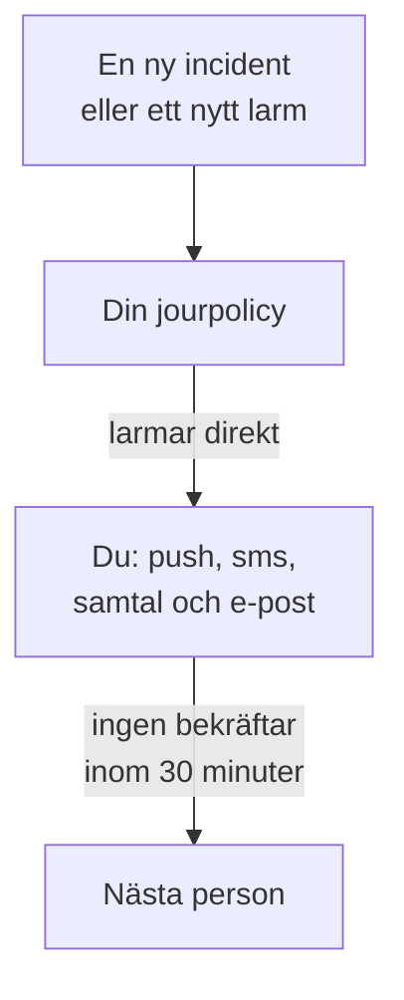

# Bli larmad via samtal, SMS eller push

När du har gått igenom den här guiden larmas du på telefonen vid varje ny incident och varje nytt larm i ditt projekt, via push-avisering, sms eller telefonsamtal, nästa person larmas om ingen bekräftar inom 30 minuter, och ett testlarm som du har bekräftat visar att det fungerar. Guiden följer den guidade konfigurationen **Larma rätt person när något går sönder** och tar ungefär 10 minuter.

## Det här behöver du

- Ett projekt som du äger: att slå på sms och samtal kräver projektets ägare, och en jourpolicy kräver ägaren eller en administratör.
- Din mobiltelefon.
- De teammedlemmar som du vill ska larmas, tillagda som medlemmar i projektet: [Bjud in personer](/docs/permissions/inviting-people) visar hur.

:::tabs
@tab OneUptime Cloud
Push-aviseringar är gratis på alla planer. Sms och samtal betalas från projektets saldo, som börjar på 0.00 USD, och när du lägger till ett telefonnummer skickas ett sms, så saldot måste först vara över 1.00 USD. En påfyllning debiteras projektets kort. Free-planen rymmer en person och en eskaleringsregel: bara du larmas, och larmet upprepas i stället för att nå någon annan.
@tab Egenvärdad
Din server måste kunna skicka e-post, sms och samtal. Serverns huvudadministratör konfigurerar dem på `/admin/setup`, med ett test för var och en, som sidan [Guide för självhosting](/docs/installation/self-hosting-guide) visar. Push-aviseringar når appen genom OneUptimes push-relä, utan något att konfigurera.
:::

## Steg

:::steps
### Öppna den guidade konfigurationen

På projektets sida **Hem** klickar du på **Konfigurera en jourpolicy** i checklistan **Välkommen till OneUptime 👋**. I ett nytt projekt börjar startsidan med frågan **Vad vill du göra först?**: kryssa i **Larma rätt person när något går sönder** och klicka på **Fortsätt**. Om steget saknas eller redan är klart trycker du på `Ctrl+K` (`Cmd+K` på en Mac), skriver `get paged` och väljer **Larma rätt person när något går sönder**.

### Installera appen på din telefon

Installera OneUptime On-Call från App Store eller Google Play och logga in: appen registrerar din telefon för push-aviseringar. Tillbaka i konfigurationen klickar du på **Kontrollera igen**: **Mobilapp eller webbläsare** under **Hur ska vi nå dig?** visar nu din telefon.

### Slå på sms och samtal

Nya projekt börjar med sms och telefonsamtal avstängda. Om du äger projektet klickar du på **Slå på sms och samtal**; alla andra får veta vem som kan. Om saldot på OneUptime Cloud är 1.00 USD eller mindre klickar du på **Fyll på saldo**, anger 20 till 1 000 USD under **Belopp (USD)** och klickar på **Fyll på**.

### Lägg till ditt telefonnummer

Skriv ditt mobilnummer med landsnummer i **Ditt telefonnummer**, till exempel `+15551234567`, och klicka på **Skicka en kod till mig via sms**. Ange koden från sms:et och klicka på **Verifiera**: samma nummer rings också upp vid larm. Klicka på **Fortsätt**. Vill du bara larmas via appen och e-post, hoppar du över numret och klickar direkt på **Fortsätt**.

### Välj vilka fler som larmas

Under **Vem mer har jour?** finns du redan i **Larmas först**. Klicka på **Lägg till teammedlemmar** för att larma andra tillsammans med dig, och klicka sedan på **Spara och fortsätt**. I ett projekt som ännu inte har någon jourpolicy skapar steget `Default on-call policy`, som larmar dem vid varje ny incident och varje nytt larm. I ett projekt som redan har en väljer du den under **Jourpolicy** och lägger i stället till personer under **Lägg till i den första eskaleringsregeln**. Om någon inte kan nås än stannar steget öppet på **Når ett larm dem?**: klicka på **Skicka påminnelse om konfiguration** för dem och sedan på **Fortsätt**.

### Bestäm vad som händer om ingen svarar

Under **Tänk om ingen svarar?** behåller du **Larma någon annan**, väljer vem under **Larmas sedan** och låter **Minuter att vänta** stå kvar på `30` eller ändrar det. Klicka på **Spara och fortsätt**. På Free-planen erbjuder steget i stället **Larma samma personer igen**, med **Antal nya larm** på `2`.

### Skicka ett testlarm

Under **Skicka ett testlarm** klickar du på **Testa den här policyn**. Välj en **Allvarlighetsgrad** och klicka på **Skicka testlarm**. Policyns första eskaleringsregel larmas på samma sätt som en riktig incident skulle larma den, och varje meddelande är märkt TEST. Ingen incident skapas, och ingen statussida eller prenumerant får veta något.

### Bekräfta testlarmet

Öppna länken i sms:et eller e-postmeddelandet och bekräfta larmet där, eller tryck på 1 under telefonsamtalet. Appen visar att larmet kom fram, men kan inte bekräfta ett test. Klicka sedan på **Klar** i dialogrutan och därefter på **Fortsätt**.
:::

## Kontrollera att det fungerade

- Teststeget visar vem som bekräftade larmet, hur och hur snabbt.
- Konfigurationen avslutas med sammanfattningen **Larmningen är konfigurerad**, som bygger på det som faktiskt har sparats: **Vem som larmas**, **Om ingen svarar** och **Testat**. Ett problem med själva policyn, till exempel någon som den inte kan nå, listas under **Kräver uppmärksamhet**.
- På sidan **Hem** markerar checklistan **Konfigurera en jourpolicy** som klar. Om det var det sista steget försvinner checklistan.

Om policyn larmar någon annan kan du också följa eskaleringen: klicka på **Öppna jourpolicyn** i sammanfattningen och sedan på **Testa den här policyn**. Slå på **Gå igenom varje eskaleringsnivå**, skicka testet och bekräfta inte det första larmet: nästa person larmas upp till 2 minuter senare.

## Vad som kan gå fel

:::details Knappen Skicka en kod till mig via sms saknas
Sms är avstängt eller kan inte skickas, och steget säger varför. Bara en projektägare, eller någon som hanterar faktureringen, ser **Slå på sms och samtal**. På OneUptime Cloud döljs fältet när saldot är 1.00 USD eller mindre. På en egenvärdad server som inte kan skicka sms ser huvudadministratören **Konfigurera sms och samtal**, som öppnar Admin Dashboard där Twilio läggs till: se [Twilio-integration](/docs/self-hosted/twilio-integration).
:::

:::details Fyll på saldo säger att ingen betalningsmetod hittades
En påfyllning debiteras projektets kort. Lägg till ett kort under **Projektinställningar → Fakturering och fakturor → Fakturering** med **Lägg till betalningsmetod** och fyll sedan på saldot igen. Fram till dess larmar appen och e-posten dig fortfarande.
:::

:::details Egenvärdad: numret avvisas eftersom inget Twilio-konto är konfigurerat
Bara huvudadministratören varnas i förväg om att servern inte kan skicka sms. Be hen konfigurera sms och samtal på `/admin/setup`. Klicka under tiden på **Fortsätt**: appen och e-posten larmar dig fortfarande.
:::

:::details Koden eller testlarmet kommer aldrig fram
Kontrollera först numrets landsnummer. Efter ett testlarm stänger du dialogrutan med **Klar** och klickar på **Jag fick inget**: där står vad du ska kontrollera, och **Öppna mina aviseringsmetoder** listar alla sätt som du kan nås på. På en egenvärdad server skickar du ett test-sms från `/admin/setup` och kör `npm run doctor` på servern.
:::

## Nästa steg

:::cards
- [Jourscheman](/docs/on-call/schedules): Turas om, så att varje larm går till den som har jour. På Cloud från Growth-planen.
- [Eskaleringsregler](/docs/on-call/escalation-rules): Lägg till nivåer, team och scheman i policyn.
- [Så når man mig](/docs/notifications/on-call-rules): Välj vilken metod som når dig först, och när.
- [Publicera en statussida](/docs/guides/status-page): Berätta för dina kunder vad som händer, på din egen domän.
:::
