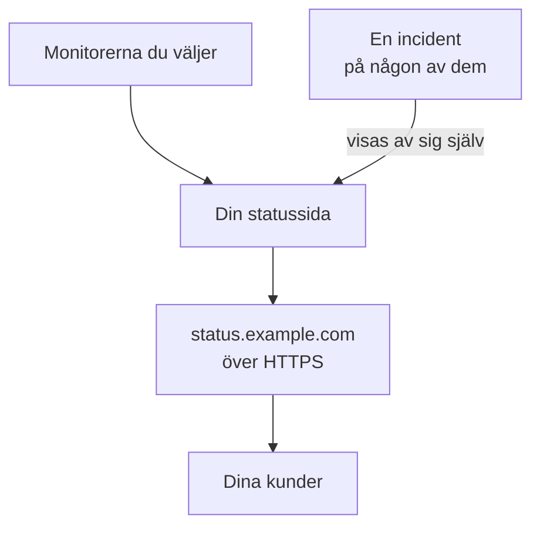

# Publicera en statussida

När du har gått igenom den här guiden öppnar dina kunder en statussida på en egen adress, till exempel `status.example.com`, över HTTPS. Den visar de monitorer som du väljer, med deras status och upptid, och en incident på någon av dem visas där av sig själv. Guiden följer den guidade konfigurationen **Publicera en statussida** och lägger sedan till din domän under sidans **Anpassade domäner**: ungefär 15 minuter, plus den tid som din DNS-leverantör behöver.

## Det här behöver du

- Minst en monitor: en statussida visar monitorer. Har du ingen än, erbjuder den guidade konfigurationen först **Konfigurera en monitor**.
- Rollen projektägare eller administratör: sidan kräver behörighet att skapa statussidor, och din domän kräver behörighet att lägga till och verifiera projektets domäner.
- En domän som du kontrollerar, och åtkomst till dess DNS-poster hos din DNS-leverantör.

:::tabs
@tab OneUptime Cloud
En anpassad domän och dess kostnadsfria SSL-certifikat ingår i alla planer. Free-planen har en statussida per projekt: har du redan en, öppnar du dess **Anpassade domäner** och börjar vid steget som lägger till din domän. En ny statussida är offentlig; att göra den privat kräver Growth-planen.
@tab Egenvärdad
Din server behöver ett eget värdnamn med en A-post som pekar på den, till exempel `oneuptime.example.com`, som svarar på portarna 80 och 443. Ange det som `STATUS_PAGE_CNAME_RECORD` i `config.env` (`statusPage.cnameRecord` i Helm-diagrammet), i stället för exempelvärdet där. Gratis certifikat kräver också `LETS_ENCRYPT_ACCOUNT_KEY` (`letsEncrypt.accountKey`): en privat nyckel som skapats med openssl och kodats i base64. Starta om OneUptime när du har ändrat dem. **Lägg till anpassad domän** kontrollerar servern först och listar det som fortfarande saknas.
:::

## Steg

:::steps
### Öppna den guidade konfigurationen

På projektets sida **Hem** klickar du på **Publicera en statussida** i checklistan **Välkommen till OneUptime 👋**. I ett nytt projekt börjar startsidan med frågan **Vad vill du göra först?**: kryssa i **Berätta för mina kunder med en statussida** och klicka på **Fortsätt**. Om steget saknas eller redan är klart trycker du på `Ctrl+K` (`Cmd+K` på en Mac), skriver `status page` och väljer **Publicera en statussida**.

### Ge den ett namn och välj vad den visar

Under **Ge den ett namn och välj vad den visar** behåller du det föreslagna namnet i **Statussidans namn** eller skriver ett eget. Under **Vad den visar** kryssar du i de monitorer som dina kunder ska se, eller klickar på **Markera alla**. Klicka på **Skapa statussidan**. Från och med nu är sidan offentlig på sin länk och visar bara de monitorer som du kryssade i.

### Se vad dina kunder ser

Under **Det här ser dina kunder** öppnar du adressen under **Offentlig länk**: dina monitorer listas med sin status. Tillbaka i konfigurationen klickar du på **Ser bra ut**.

### Öppna Anpassade domäner

Konfigurationen avslutas med en sammanfattning. Under **Gör den till din egen (valfritt)** klickar du på **Din egen domän**. Statussidans **Anpassade domäner** öppnas.

### Lägg till din domän

Klicka på **Lägg till anpassad domän**. I **Domän** skriver du adressen som dina kunder ska öppna, till exempel `status.example.com`, och klickar på **Fortsätt**. **DNS-inställning** öppnas med posterna som ska läggas till.

### Lägg till DNS-posterna

Hos din DNS-leverantör lägger du till varje post som **DNS-inställning** listar, med dess **Typ**, **Namn** och **Värde**: en CNAME-post som pekar adressen mot OneUptime och, första gången projektet använder den här domänen, en TXT-post som visar att projektet äger den. Om din leverantör själv lägger till domänen efter varje namn, skriver du bara delen före den, till exempel `status`, och `@` för själva domänen.

### Kontrollera posterna

Låt **DNS-inställning** vara öppen och klicka på **Kontrollera nu**. Under varje post står vad som slogs upp och vad som kom tillbaka. TXT-posten kommer först: tills den har hittats läggs domänen inte till, så klicka på **Kontrollera nu** igen tills den hittas. Så snart CNAME-posten har hittats säger dialogrutan **Din CNAME-post är verifierad.**, och ett kostnadsfritt SSL-certifikat utfärdas, vanligtvis inom 15 minuter.
:::

## Kontrollera att det fungerade

- Öppna `https://status.example.com`, fast med din egen adress: din statussida öppnas utan certifikatvarning.
- Under **Anpassade domäner** står det **Certifikat utfärdat, förnyas automatiskt.** i domänens kolumn **Status**. Där kan det stå **Utfärdar ett gratis certifikat, vanligtvis inom 15 minuter.** en stund efter att sidan redan går att öppna.
- På sidan **Hem** markerar checklistan **Publicera en statussida** som klar: den är klar så snart en statussida visar en monitor. Om det var det sista steget försvinner checklistan.

Mer behövs inte: OneUptime förnyar certifikatet av sig självt. Så snart domänen finns i listan kontrollerar OneUptime dess CNAME-post var 15:e minut och verifierar den när posten är aktiv, även om du stänger **DNS-inställning**.

## Vad som kan gå fel

:::details Domänen finns inte i listan efter att DNS-inställning har stängts
**DNS-inställning** stängdes innan dess TXT-post hittades, så domänen lades aldrig till. Klicka på **Lägg till anpassad domän**, skriv samma adress, klicka på **Fortsätt** och sedan på **Kontrollera nu** tills dialogrutan hittar båda posterna.
:::

:::details Domänen står kvar på "Väntar på DNS"
Öppna **DNS-inställning** från domänens rad och klicka på **Kontrollera nu**: där står vad den hittade. Kontrollera att postens namn är hela adressen, till exempel `status.example.com`, och att dess värde är det som **DNS-inställning** visar. Om namnet svarar med en adress har det en A-post, eller så proxar din DNS-leverantör det: ersätt A-posten, eller ställ in namnet på endast DNS. För en rotdomän, till exempel `example.com`, använder du leverantörens ALIAS-, ANAME- eller flattened CNAME-post.
:::

:::details Kolumnen Status säger att den inte kunde utfärda ett gratis certifikat
En CAA-post på din domän som utesluter `letsencrypt.org` blockerar certifikatet. På en egenvärdad server måste Let's Encrypt nå servern på port 80. Åtgärda orsaken: OneUptime fortsätter att försöka av sig självt, och **Kontrollera nu** i **DNS-inställning** beställer på nytt, högst en gång var 15:e minut per domän.
:::

:::details Egenvärdad: servern är inte redo för anpassade domäner
**Lägg till anpassad domän** säger **Den här servern är inte redo för anpassade domäner än**, med en rad för varje sak som fortfarande saknas och vad som ska ändras: inställningarna i [Det här behöver du](#det-här-behöver-du). Utan `LETS_ENCRYPT_ACCOUNT_KEY` säger en verifierad domän **Verifierad. Använder din egen proxys HTTPS.**: låt din egen proxy servera dess HTTPS. [Statussidans varumärke och domäner](/docs/status-pages/branding-and-domains#innan-du-börjar) har detaljerna.
:::

## Nästa steg

:::cards
- [Statussidans varumärke och domäner](/docs/status-pages/branding-and-domains): Din logotyp, dina färger, sidhuvudslänkar och sidfot.
- [Prenumeranter och meddelanden](/docs/status-pages/subscribers): Låt kunderna prenumerera, och publicera meddelanden.
- [Schemalagt underhåll – Översikt](/docs/scheduled-maintenance/index): Berätta för kunderna om planerat arbete innan det börjar.
- [Bli larmad via samtal, SMS eller push](/docs/guides/paging): Bli larmad när någon av de monitorerna går ner.
:::
