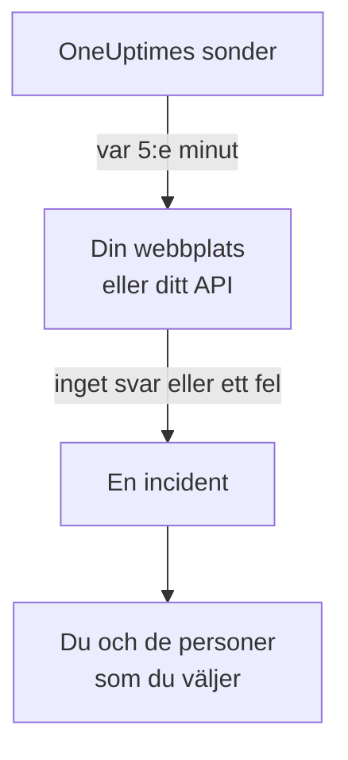

# Få veta när din webbplats eller ditt API går ner

När du har gått igenom den här guiden kontrollerar OneUptime din webbplats eller ditt API var 5:e minut, öppnar en incident när svaret uteblir eller är ett fel och meddelar dig, och ett testlarm som du har bekräftat visar att meddelandet når fram till dig. Guiden följer den guidade konfigurationen **Veta när min webbplats eller mitt API ligger nere** och tar ungefär 5 minuter.

## Det här behöver du

- Ett OneUptime-projekt där du får skapa monitorer: det får en ägare, en administratör eller en medlem göra. För att skapa ett konto och ett projekt följer du den första delen av [Snabbstart](/docs/introduction/quickstart#skapa-ett-projekt).
- Adressen som ska kontrolleras, till exempel `https://example.com`. För ett API väljer du en endpoint som svarar på en vanlig `GET` utan nyckel, till exempel en hälsokontroll: ett svar som `401` räknas som nere.

:::tabs
@tab OneUptime Cloud
Sonder i flera regioner kontrollerar adressen, så den måste gå att nå från internet. Free-planen har 10 aktiva monitorer.
@tab Egenvärdad
Adressen kontrolleras från din servers egen sond, så den måste gå att nå därifrån. För att du ska få e-post måste servern kunna skicka e-post: serverns huvudadministratör konfigurerar det på `/admin/setup`, som sidan [Guide för självhosting](/docs/installation/self-hosting-guide) visar. Huvudadministratören blir inte ägare till det som hen skapar, så för att få e-post lägger hen till sig själv på monitorns sida **Ägare**.
:::

## Steg

:::steps
### Öppna den guidade konfigurationen

I ett nytt projekt börjar sidan **Hem** med frågan **Vad vill du göra först?**: kryssa i **Veta när min webbplats eller mitt API ligger nere** och klicka på **Fortsätt**. Klicka sedan på **Skapa din första övervakare** i checklistan **Välkommen till OneUptime 👋**. Om checklistan inte visar det steget trycker du på `Ctrl+K` (`Cmd+K` på en Mac), skriver `website down` och väljer **Veta när min webbplats eller mitt API ligger nere**.

### Ange adressen

Under **Vad ska vi kontrollera?** skriver du adressen i **Adress till webbplats eller API**. För en API-endpoint kryssar du i **Det här är en API-endpoint**. Klicka på **Börja kontrollera**: sonderna kontrollerar adressen direkt, och en mening talar om vad de hittade. Klicka på **Fortsätt**.

### Välj vem som får veta

Under **Vem ska få veta?** beror det du ser på projektet:

- Om projektet ännu inte har någon jourpolicy eller jourregel finns du redan i **Vem som larmas**. Klicka på **Lägg till teammedlemmar** för att lägga till personer som redan finns i projektet, och klicka sedan på **Spara och fortsätt**. Då skapas `Default on-call policy`, som larmar dem vid varje ny incident och varje nytt larm i projektet.
- Om projektet har en jourpolicy eller jourregel avgör projektets egna regler vem som larmas: klicka på **Fortsätt**.
- Är du medlem, och får alltså inte konfigurera larmning, får du veta att du kommer att få e-post som monitorns ägare: klicka på **Fortsätt**.

### Skicka ett test till dig själv

Under **Skicka ett test** klickar du på **Skicka ett testlarm till mig**. Välj en **Allvarlighetsgrad** och klicka på **Skicka testlarm**. Testet når dig på samma sätt som ett riktigt larm skulle göra, och varje meddelande är märkt TEST. Ingen incident skapas.

### Bekräfta testlarmet

Öppna länken i e-postmeddelandet och bekräfta larmet där. Ett verifierat telefonnummer fungerar också, när sms och samtal är påslagna i projektet: öppna länken i sms:et, eller tryck på 1 under samtalet. Klicka sedan på **Klar** i dialogrutan och därefter på **Fortsätt**.
:::

## Kontrollera att det fungerade

- Konfigurationen avslutas med sin sammanfattning, som bygger på det som faktiskt har sparats: **Kontrollerad**, **När den går ner**, **Vem som får veta** och **Testat**.
- Klicka på **Öppna monitorn** och sedan på **Visa kedjan** på monitorns kort **När den går ner**: där visas kedjan från monitorn till de personer som den når, och när inget skulle stoppa kedjan står det **Inget stoppar kedjan.**
- På sidan **Hem** markerar checklistan **Skapa din första övervakare** som klar så snart den första kontrollen har kommit in. Om det var det sista steget försvinner checklistan.

För att konfigurera ytterligare en adress senare öppnar du konfigurationen igen och klickar på **Kontrollera en annan adress**.

## Vad som kan gå fel

:::details Den första kontrollen kommer aldrig tillbaka
En mening som säger att ingen plats kontrollerar adressen betyder att monitorn saknar sond; en mening som hela tiden säger att kontrollen pågår betyder att dess sond inte är ansluten. Öppna **Monitorer → Inställningar → Sonder** för att se varje sonds status. På en egenvärdad server kontrollerar huvudadministratören serverns sond på `/admin/setup`. Öppna sedan monitorn, lägg till en ansluten sond i den och öppna konfigurationen igen.
:::

:::details Webbplatsen fungerar, men monitorn säger att den ligger nere
Monitorn räknar inget svar, eller ett svar utanför 200 till 399, som nere. En brandvägg som blockerar sonderna ser ut som inget svar: på OneUptime Cloud tillåter du adresserna på sidan [IP-adresser](/docs/configuration/ip-addresses); på en egenvärdad server tillåter du maskinen som sonden körs på. Om du vill ändra regeln, se [Webbplatsövervakning](/docs/monitor/website-monitor) eller [API-övervakning](/docs/monitor/api-monitor).
:::

:::details Testlarmet går inte att bekräfta
Inget meddelande har kommit fram som larmet kan bekräftas från, vilket på en egenvärdad server oftast betyder att servern inte kan skicka e-post än: steget säger det, och serverns huvudadministratör ser **Ställ in e-post**. Ställ in e-posten och klicka sedan på **Skicka ett test till**, eller klicka på **Hoppa över testet** och kom tillbaka senare. Efter ett test stänger du dialogrutan med **Klar** och klickar på **Jag fick inget**: där står vad du ska kontrollera.
:::

## Nästa steg

:::cards
- [Bli larmad via samtal, SMS eller push](/docs/guides/paging): Bli larmad på telefonen, och larma nästa person om ingen svarar.
- [Publicera en statussida](/docs/guides/status-page): Visa monitorn för dina kunder, på din egen domän.
- [Kriterier och statusar](/docs/monitor/criteria-and-statuses): Bestäm exakt när en monitor räknas som nere.
:::
