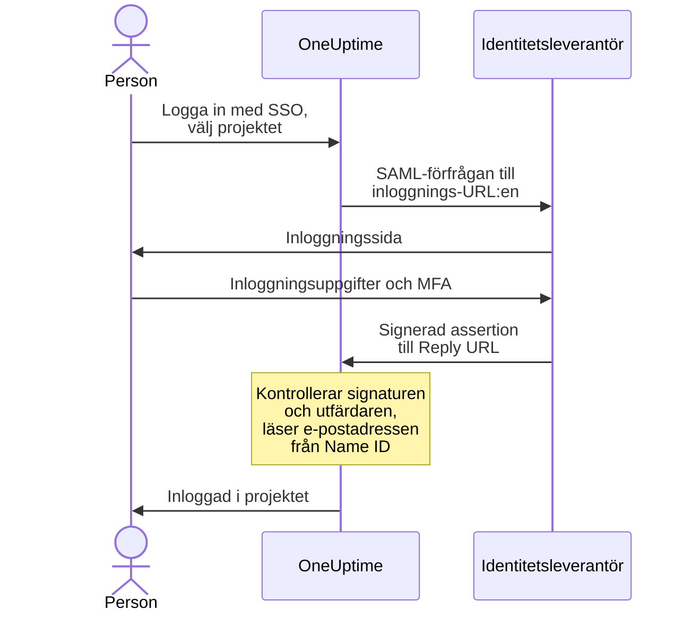

# SSO

Med enkel inloggning (SSO) loggar personerna i ditt projekt in i OneUptime via organisationens identitetsleverantör (IdP), över SAML 2.0 eller OpenID Connect. Du hanterar åtkomst, lösenord och multifaktorautentisering på ett ställe, och du kan kräva SSO för alla i projektet.

> [!NOTE]
> **Utgåva:** SSO, inklusive "Require SSO to sign in", ingår i alla OneUptime-utgåvor: självhostade installationer får det i Community Edition, utan att någon licens behövs. På OneUptime Cloud är det tillgängligt från planen **Scale** och uppåt. Se [Enterprise Edition](/docs/self-hosted/enterprise) för vad varje utgåva innehåller.

:::cards
- [Konfigurera en SAML-leverantör](#konfigurera-sso): Skapa den i OneUptime och ge din IdP två URL:er.
- [Guider för identitetsleverantörer](#guider-för-identitetsleverantörer): Keycloak, Microsoft Entra ID och Okta, steg för steg.
- [OpenID Connect](#openid-connect-oidc): Logga in via en OIDC-app i stället.
- [Kräv SSO](#kräv-sso-för-ditt-projekt): Gör SSO till den enda vägen in i projektet.
:::

## Så fungerar SAML-inloggning

En SAML-leverantör kopplar ett projekt till ett program i din identitetsleverantör. Den som loggar in väljer projektet på OneUptimes sida **Logga in med SSO**, loggar in hos din IdP och kommer tillbaka inloggad.



OneUptime läser bara några få saker från den assertion som din IdP skickar:

| Från assertionen | Vad OneUptime gör med det |
| --- | --- |
| Signatur | Kontrollerar den mot leverantörens **Offentligt certifikat**. Svaret måste vara signerat och får inte vara krypterat. |
| Issuer | Måste exakt matcha leverantörens **Utfärdare**. |
| Audience | Måste vara leverantörens **Identifierare (Entity ID)**. Ett svar som din IdP skapade för ett annat program avvisas. |
| Recipient och Destination | Måste vara leverantörens **Svars-URL**, adressen som svaret skickades till. |
| `NotBefore` och `NotOnOrAfter` | Svaret tas bara emot så länge de tillåter det, och senast 10 minuter efter att det utfärdades, med 3 minuters marginal för klockor som går olika. |
| Name ID | Personens e-postadress. Den måste vara en giltig e-postadress. |
| Namnattribut | Personens namn, som används när OneUptime skapar kontot: ett visningsnamn (`displayName` eller `http://schemas.microsoft.com/identity/claims/displayname`), eller ett för- och efternamn (`firstName` och `lastName`, eller anspråken `givenname` och `surname` som Microsoft Entra ID skickar som standard). Valfritt. |
| `http://schemas.microsoft.com/identity/claims/objectidentifier` | Personens objekt-ID, som Microsoft Entra ID skickar som standard. Den första inloggningen via leverantören kopplar kontot till det, och en senare inloggning som anger kontots e-postadress med ett annat objekt-ID avvisas. Valfritt. |

Varje svar loggar in en enda gång. Skickas det igen, till exempel när du går tillbaka i webbläsaren efter inloggningen, avvisas det: logga in igen.

Personer som loggar in för första gången går med i leverantörens **Team**, som avgör vad de kan göra: se [Roller och team för SSO-användare](#roller-och-team-för-sso-användare).

> [!NOTE]
> På OneUptime Cloud loggar OneUptime inte in en person som för första gången loggar in i projektet med en av projektets SAML- eller OIDC-leverantörer; i stället skickar OneUptime en länk via e-post. Personen öppnar länken, bekräftar att projektets enkla inloggning får logga in hen och fortsätter inloggningen. Länken gäller i 24 timmar. Detta sker en gång per projekt, och igen om personen lämnar projektet och kommer tillbaka. En person som du bjuder in och vars inloggning hanteras av SSO får inget sådant e-postmeddelande, oavsett om personen redan har ett OneUptime-konto: väljer personen en av projektets leverantörer på sidan som inbjudan öppnar loggas hen in direkt, eftersom länken i inbjudan redan har bevisat att inkorgen är personens. Självhostade installationer loggar in personer direkt. På OneUptime Cloud får varje inloggning som inte går igenom direkt samma svar, oavsett om adressen har ett konto: den som inte har något konto ännu får också e-postmeddelandet, och kontot skapas när personen bekräftar, medan ett blockerat konto eller en OneUptime-administratör inte får något e-postmeddelande. En självhostad installation avvisar i stället de två med ett enda meddelande.

På OneUptime Cloud tar en person som går med i projektet via SSO en plats, precis som någon du bjuder in. Om din plan har ett fast antal platser och alla är upptagna kan nya personer inte gå med via SSO förrän en plats blir ledig.

## Konfigurera SSO

Du behöver behörighet att lägga till SSO-leverantörer — **Projektägare**, **Projektadministratör** eller **Create Project SSO** — och, på OneUptime Cloud, planen **Scale**. För din identitetsleverantörs sida, se [guiderna för identitetsleverantörer](#guider-för-identitetsleverantörer).

:::steps
1. **Gå till projektinställningarna**

   - Öppna ditt OneUptime-projekt
   - Gå till **Projektinställningar** > **Säkerhet** > **SSO**

2. **Skapa SSO-konfigurationen**

   - Klicka på **Lägg till SAML-leverantör**
   - Ange ett **Namn** för SSO-konfigurationen (t.ex. "Keycloak SAML" eller "Okta SAML")
   - Ange **Inloggnings-URL** från din identitetsleverantör
   - Ange **Utfärdare** (Entity ID) från din identitetsleverantör
   - Klistra in **Offentligt certifikat** från din identitetsleverantör
   - I steget **Inloggning** börjar **Team** med projektets medlemsteam: personer som loggar in för första gången går med i dessa team. Endast team som du själv kan bjuda in någon till godtas: ett team som ger mer åtkomst än du har nämns under **Team**
   - Resten är redan ifyllt under **Fler fält**: **Signaturmetod** (`RSA-SHA256`), **Digest-metod** (`SHA256`) och en beskrivning ("Sign in with" och namnet). Ändra dem bara om din identitetsleverantör kräver det

3. **Hämta OneUptimes SSO-metadata**
   - När du sparar öppnas dialogen **SSO-konfiguration**. Du kan öppna den igen med knappen **Visa SSO-konfiguration**
   - Kopiera **Identifierare (Entity ID)**, till exempel `https://oneuptime.com/<project-id>/<provider-id>` — den behövs i din IdP-konfiguration
   - Kopiera **Svars-URL (Assertion Consumer Service-URL)**, till exempel `https://oneuptime.com/identity/idp-login/<project-id>/<provider-id>` — den behövs i din IdP-konfiguration
   - En ny leverantör börjar avstängd. När din IdP har dessa två värden redigerar du leverantören och slår på **Aktiverad**

4. **Testa leverantören**
   - Öppna länken i kortet **SSO-inloggningslänk** och välj leverantören på sidan som öppnas. Du skickas till din identitetsleverantörs inloggningssida och sedan tillbaka till OneUptime, inloggad
   - När det fungerar kan du [kräva SSO](#kräv-sso-för-ditt-projekt) för projektet
:::

## Guider för identitetsleverantörer

Välj din identitetsleverantör. Varje guide hämtar IdP:ns värden, skapar leverantören i OneUptime och ger sedan IdP:n OneUptimes **Identifierare (Entity ID)** och **Svars-URL**.

:::tabs
@tab Keycloak
Keycloak är en populär lösning med öppen källkod för identitets- och åtkomsthantering. Du behöver en körande Keycloak-instans med en realm, och administratörsåtkomst till både Keycloak och OneUptime.

:::steps
1. **Samla in värdena från din realm**

   - **Inloggnings-URL**: `https://<your-keycloak-domain>/auth/realms/<your-realm>/protocol/saml`
   - **Utfärdare**: `https://<your-keycloak-domain>/auth/realms/<your-realm>`
   - **Certifikat**: realmens signeringscertifikat. Öppna `https://<your-keycloak-domain>/auth/realms/<your-realm>/protocol/saml/descriptor` och kopiera värdet `X509Certificate`, eller öppna **Realm settings** > **Keys** och klicka på **Certificate** vid RS256-nyckeln

   Keycloak 17 och senare levererar dessa URL:er utan prefixet `/auth`. Placera certifikatet mellan sina egna rader, så här:

   ```text
   -----BEGIN CERTIFICATE-----
   MIICnzCCAYcCBgFyPZ8QFzANBgkqhkiG.......
   -----END CERTIFICATE-----
   ```

2. **Skapa leverantören i OneUptime**

   Gå till **Projektinställningar** > **Säkerhet** > **SSO**, klicka på **Lägg till SAML-leverantör** och fyll i:
   - **Namn**: ett beskrivande namn (t.ex. `my-project-oneuptime`)
   - **Inloggnings-URL** och **Utfärdare**: värdena ovan
   - **Offentligt certifikat**: certifikatet, mellan sina egna rader `BEGIN CERTIFICATE` och `END CERTIFICATE`
   - **Signaturmetod** och **Digest-metod**: redan angivna under **Fler fält** (`RSA-SHA256` och `SHA256`)

   Spara och kopiera **Identifierare (Entity ID)** och **Svars-URL (Assertion Consumer Service-URL)** från dialogen som öppnas.

3. **Skapa Keycloak-klienten**

   Öppna **Clients** i din realm i Keycloak och skapa en klient, eller redigera en befintlig:
   - **Client Protocol** (klienttyp): `saml`
   - **Client ID**: **Identifierare (Entity ID)** från OneUptime
   - **Root URL** och **Valid Redirect URIs**: din OneUptime-URL
   - **Assertion Consumer Service POST Binding URL**: **Svars-URL (Assertion Consumer Service-URL)** från OneUptime

4. **Justera klientinställningarna**

   - Ställ in **Name ID Format** på `email` och slå på **Force Name ID Format**, så att Keycloak alltid skickar e-postadressen som Name ID
   - Stäng av **Client signature required** (under **Signing keys config**) på klientens flik **Keys**: OneUptime signerar inte sina inloggningsförfrågningar

5. **Slå på leverantören och testa den**

   Redigera leverantören i OneUptime och slå på **Aktiverad**, öppna sedan länken i kortet **SSO-inloggningslänk** och välj leverantören. Du ska skickas till inloggningssidan i Keycloak och tillbaka till OneUptime.
:::
@tab Microsoft Entra ID
Microsoft Entra ID (tidigare Azure AD / Active Directory) är Microsofts molnbaserade identitetstjänst. Du behöver en klientorganisation som stöder företagsprogram med SAML-SSO, och administratörsåtkomst till både Entra ID och OneUptime. På OneUptime Cloud lägger du till OneUptime från Microsoft Entra-programgalleriet om det finns där: programmet har redan de anspråk som OneUptime läser och mönstren för OneUptimes URL:er.

:::steps
1. **Skapa ett företagsprogram i Entra ID**

   - Logga in i [Microsoft Entra admin center](https://entra.microsoft.com)
   - Gå till **Identity** > **Applications** > **Enterprise applications** och klicka på **+ New application**
   - Från galleriet: sök efter OneUptime, välj det och klicka på **Create**
   - Annars: klicka på **+ Create your own application**, ange ett namn (t.ex. "OneUptime"), välj **Integrate any other application you don't find in the gallery (Non-gallery)** och klicka på **Create**

2. **Kopiera SAML-värdena från Entra ID**

   - Gå till **Single sign-on** i programmet och välj **SAML**
   - Ladda ned **Certificate (Base64)** under **SAML Certificates**, öppna filen i en textredigerare och kopiera innehållet
   - Kopiera **Login URL** och **Microsoft Entra Identifier** (**Azure AD Identifier** i äldre klientorganisationer) under **Set up OneUptime**

3. **Skapa leverantören i OneUptime**

   Gå till **Projektinställningar** > **Säkerhet** > **SSO**, klicka på **Lägg till SAML-leverantör** och fyll i:
   - **Namn**: ett beskrivande namn (t.ex. `Azure AD SAML`)
   - **Inloggnings-URL**: **Login URL**
   - **Utfärdare**: **Microsoft Entra Identifier**
   - **Offentligt certifikat**: Base64-certifikatet, inklusive raderna `BEGIN CERTIFICATE` och `END CERTIFICATE`
   - **Signaturmetod** och **Digest-metod**: redan angivna under **Fler fält** (`RSA-SHA256` och `SHA256`)

   Spara och kopiera **Identifierare (Entity ID)** och **Svars-URL (Assertion Consumer Service-URL)** från dialogen som öppnas.

4. **Ge Entra ID OneUptimes URL:er**

   Klicka på **Edit** under **Basic SAML Configuration** och ange:
   - **Identifier (Entity ID)**: **Identifierare (Entity ID)** från OneUptime
   - **Reply URL (Assertion Consumer Service URL)**: **Svars-URL** från OneUptime

   Klicka på **Save**.

5. **Skicka e-postadressen som Name ID**

   Klicka på **Edit** under **Attributes & Claims**. Programmet från galleriet har redan dessa inställningar: kontrollera dem.
   - Ställ in **Unique User Identifier (Name ID)** på användarens e-postadress: `user.mail`, eller `user.userprincipalname` där det är e-postadressen
   - Ställ in **Name identifier format** på `Email address`
   - Behåll Entra ID:s standardanspråk: nya konton får personens namn från `givenname` och `surname`, och kontot kopplas till personens objekt-ID, `objectidentifier`. Lägg eventuellt till ett anspråk med namnet `http://schemas.microsoft.com/identity/claims/displayname` och källattributet `user.displayname` för att i stället ge nya konton visningsnamnet. OneUptime ignorerar de andra anspråken

6. **Tilldela användare och grupper**

   Klicka på **+ Add user/group** under programmets **Users and groups**, välj de användare och grupper som ska få SSO-åtkomst och klicka på **Assign**.

7. **Slå på leverantören och testa den**

   Redigera leverantören i OneUptime och slå på **Aktiverad**, öppna sedan länken i kortet **SSO-inloggningslänk** och välj leverantören. Du ska skickas till Microsofts inloggningssida och tillbaka till OneUptime.
:::
@tab Okta
Okta är en vanlig identitetsplattform med SAML-SSO. Du behöver en Okta-organisation med administratörsåtkomst, och administratörsåtkomst till OneUptime. På OneUptime Cloud lägger du till OneUptime från Okta Integration Network om det finns där: programmet loggar in personer från OneUptimes sida **Logga in med SSO** och från deras Okta-instrumentpanel, ger dem ett konto vid den första inloggningen och frågar efter två ID:n i stället för OneUptimes URL:er.

:::steps
1. **Lägg till OneUptime i Okta**

   - Gå till **Applications** > **Applications** i Okta Admin Console
   - Från Okta Integration Network: klicka på **Browse App Catalog**, sök efter OneUptime och klicka på **Add Integration**. Okta frågar efter **OneUptime Project ID** och **OneUptime SSO Provider ID** innan OneUptime kan visa dem: ange `0` i båda tills vidare, du ersätter dem i steg 4. Klicka på **Done** och fortsätt med steg 2
   - Annars klickar du på **Create App Integration**, väljer **SAML 2.0** och klickar på **Next**, anger "OneUptime" som **App name** och klickar på **Next**
   - Okta frågar efter OneUptimes URL:er innan den visar sina egna. Ange tills vidare din OneUptime-adress (till exempel `https://oneuptime.com`) som **Single sign-on URL** och **Audience URI (SP Entity ID)**: du ersätter båda i steg 4
   - Ställ in **Name ID format** på `EmailAddress` och **Application username** på `Email`
   - Klicka på **Next**, välj **I'm an Okta customer adding an internal app** och klicka på **Finish**

2. **Kopiera SAML-värdena från Okta**

   Hitta det aktiva certifikatet under **SAML Signing Certificates** på programmets flik **Sign On**:
   - Klicka på **Actions** > **View IdP metadata** och kopiera **Inloggnings-URL** (Identity Provider Single Sign-On URL) och **Utfärdare** (Identity Provider Issuer)
   - Klicka på **Actions** > **Download certificate**, öppna filen `.cert` i en textredigerare och kopiera innehållet

3. **Skapa leverantören i OneUptime**

   Gå till **Projektinställningar** > **Säkerhet** > **SSO**, klicka på **Lägg till SAML-leverantör** och fyll i:
   - **Namn**: ett beskrivande namn (t.ex. `Okta SAML`)
   - **Inloggnings-URL** och **Utfärdare**: värdena från Okta
   - **Offentligt certifikat**: certifikatet, inklusive raderna `BEGIN CERTIFICATE` och `END CERTIFICATE`
   - **Signaturmetod** och **Digest-metod**: redan angivna under **Fler fält** (`RSA-SHA256` och `SHA256`)

   Spara och kopiera **Identifierare (Entity ID)** och **Svars-URL (Assertion Consumer Service-URL)** från dialogen som öppnas.

4. **Ge Okta OneUptimes URL:er**

   För programmet från Okta Integration Network klickar du på **Edit** under **App Settings** på fliken **General** och anger:
   - **OneUptime Project ID** och **OneUptime SSO Provider ID**: de två ID:na i **Identifierare (Entity ID)** från OneUptime, `https://oneuptime.com/<project-id>/<provider-id>`

   Klicka på **Save** och kontrollera att **Application username format** är `Email` på fliken **Sign On**.

   För ditt eget program klickar du på **Edit** under **SAML Settings** på fliken **General** och sedan på **Next**, och anger:
   - **Single sign-on URL**: **Svars-URL (Assertion Consumer Service-URL)** från OneUptime
   - **Audience URI (SP Entity ID)**: **Identifierare (Entity ID)** från OneUptime

   Lägg eventuellt till attribute statements `firstName`, med värdet `user.firstName`, och `lastName`, med värdet `user.lastName`, så att nya konton får personens namn. Klicka på **Next** och sedan på **Finish**.

5. **Tilldela personer**

   Klicka på **Assign** > **Assign to People** eller **Assign to Groups** på fliken **Assignments**, välj vilka som ska få SSO-åtkomst, klicka på **Assign** för var och en och sedan på **Done**.

6. **Slå på leverantören och testa den**

   Redigera leverantören i OneUptime och slå på **Aktiverad**, öppna sedan länken i kortet **SSO-inloggningslänk** och välj leverantören. Du ska skickas till Oktas inloggningssida och tillbaka till OneUptime.
:::
@tab Övriga
OneUptimes SSO använder SAML 2.0 och fungerar med alla kompatibla identitetsleverantörer:

:::steps
1. Hämta din identitetsleverantörs **Inloggnings-URL** (dess SSO-slutpunkt), **Utfärdare** (dess entitets-ID) och **Offentligt certifikat** (dess X.509-signeringscertifikat). Visar din IdP dem först när det finns ett program skapar du programmet med din OneUptime-adress som tillfälliga URL:er.
2. Skapa leverantören i OneUptime med dessa värden och kopiera **Identifierare (Entity ID)** och **Svars-URL (Assertion Consumer Service-URL)** från dialogen **SSO-konfiguration** (eller via **Visa SSO-konfiguration**).
3. Ställ i SAML-programmet hos din identitetsleverantör in **Assertion Consumer Service URL / Reply URL** och **Entity ID / Audience URI** på OneUptimes värden, och **Name ID Format** på e-postadress.
4. **Signaturmetod** (`RSA-SHA256`) och **Digest-metod** (`SHA256`) är redan angivna under **Fler fält**; ändra dem bara om din identitetsleverantör signerar på ett annat sätt
5. Slå på **Aktiverad** för leverantören och testa den med länken i kortet **SSO-inloggningslänk**.
:::
:::

## OpenID Connect (OIDC)

Ett projekt kan också logga in via en OpenID Connect-leverantör, till exempel Google Workspace, Okta, Microsoft Entra ID, Auth0 eller Keycloak. Du behöver behörighet att lägga till OIDC-leverantörer (**Projektägare**, **Projektadministratör** eller **Create Project OIDC**) och, på OneUptime Cloud, planen **Scale**.

:::steps
1. Registrera en app (en OIDC-klient) hos din identitetsleverantör som får använda auktoriseringskodflödet med PKCE, och kopiera dess **Utfärdar-URL**, **Klient-ID** och **Klienthemlighet**.
2. Gå till **Projektinställningar** > **Säkerhet** > **SSO** i OneUptime. Klicka på **Lägg till OIDC-leverantör** under SAML-leverantörerna.
3. Ange ett **Namn** (det som personer ser på inloggningssidan), **Utfärdar-URL**, **Klient-ID** och **Klienthemlighet**. Du kan också klistra in leverantörens discovery-URL i **Utfärdar-URL** i stället.
4. I steget **Inloggning** börjar **Team** med projektets medlemsteam: personer som loggar in för första gången går med i dessa team. Resten är redan ifyllt under **Fler fält**: **Discovery-URL** (utfärdaren följd av `/.well-known/openid-configuration`), **Omfattningar** (`openid email profile`), anspråksnamnen `email` och `name` och en beskrivning ("Sign in with" och namnet). Ändra dem bara om din leverantör kräver det. Endast team som du själv kan bjuda in någon till godtas: ett team som ger mer åtkomst än du har nämns under **Team**.
5. Spara. Dialogen **OIDC-konfiguration** öppnas med **Redirect URI**: lägg till den bland appens tillåtna omdirigerings-URI:er. En ny leverantör börjar avstängd, så redigera den sedan och slå på **Aktiverad**.
6. Öppna länken i kortet **SSO-inloggningslänk** och välj leverantören för att logga in via den innan du kräver SSO för projektet.
:::

## Logga även ut från identitetsleverantören

När man loggar ut från OneUptime förblir man inloggad hos identitetsleverantören, så på en delad dator, som en NOC-skärm eller en kiosk, kommer nästa person som väljer leverantören på inloggningssidan in som den som gick. Slå på **Logga även ut från identitetsleverantören** under **Fler fält** på en SAML- eller OIDC-leverantör för att avsluta sessionen hos leverantören när någon loggar ut från OneUptime. Den är avstängd som standard: på en personlig bärbar dator skulle den även logga ut personen från alla andra appar som använder leverantören. Den gäller personer som loggar in i en webbläsare efter att den har slagits på; mobilappen loggar bara ut från OneUptime.

:::tabs
@tab SAML
Ange identitetsleverantörens utloggnings-URL som leverantörens **Utloggnings-URL** under **Fler fält**: utan den går reglaget inte att slå på. Ge sedan identitetsleverantören **Single Logout-URL** från dialogrutan **SSO-konfiguration** och certifikatet som OneUptime signerar sina utloggningsbegäranden med, via **Ladda ned signeringscertifikat** i samma dialogruta.

| Identitetsleverantör | Utloggnings-URL | Vart Single Logout-URL:en och certifikatet ska |
| --- | --- | --- |
| Okta | **Identity Provider Single Logout URL**, under **View SAML setup instructions** på fliken **Sign On** | Redigera **SAML Settings** på fliken **General**, klicka på **Show Advanced Settings** och välj **Allow application to initiate Single Logout**. Ställ in **Single Logout URL** på Single Logout-URL:en och **SP Issuer** på identifieraren (Entity ID), och ladda upp certifikatet som **Signature Certificate**. |
| Microsoft Entra ID | **Logout URL**, under **Set up OneUptime** | Ställ in **Logout Url (Optional)** i **Basic SAML Configuration** på Single Logout-URL:en. Entra ID behöver inget certifikat. |
| Keycloak | Realmens SAML-slutpunkt, samma som inloggnings-URL:en | Ställ in **Logout Service Redirect Binding URL** på klientens flik **Advanced** på Single Logout-URL:en. Låt **Front channel logout** vara på. Keycloak behöver inget certifikat så länge **Client signature required** är avstängt, som ovan. |

Efter en utloggning där skickar identitetsleverantören tillbaka webbläsaren till Single Logout-URL:en, som öppnar inloggningssidan eller säger att identitetsleverantören inte bekräftade utloggningen. När personen loggar ut hos identitetsleverantören eller från en annan app som använder den, loggar en identitetsleverantör som skickar utloggningsbegäranden till sina appar, som Keycloak och Microsoft Entra ID gör, även ut personen från OneUptime. OneUptime tar bara emot en begäran som identitetsleverantören har signerat.
@tab OpenID Connect
Webbläsaren går till leverantörens egen utloggning så snart OneUptime har loggat ut den, och leverantören skickar tillbaka den till OneUptimes inloggningssida. Registrera den sidan hos din leverantör: dialogrutan **OIDC-konfiguration** visar den som omdirigerings-URI efter utloggning, som leverantörer kallar en post-logout redirect URI. En leverantör vars discovery-dokument inte nämner någon `end_session_endpoint`, som Google, kan inte slå på den.

| Identitetsleverantör | Var omdirigerings-URI:n efter utloggning registreras |
| --- | --- |
| Okta | Klicka på **Edit** i **General Settings** på appintegrationens flik **General** och lägg till den i **Sign-out redirect URIs**. |
| Microsoft Entra ID | Lägg till den i appregistreringens **Authentication** under **Redirect URIs** för plattformen **Web**. **Front-channel logout URL** är en annan inställning, som OneUptime inte använder. |
| Auth0 | Lägg till den i programmets **Settings** under **Allowed Logout URLs**. En tenant som skapades före den 14 november 2023 behöver även ha **RP-Initiated Logout End Session Endpoint Discovery** påslaget i sina **Advanced**-inställningar, så att dess discovery-dokument nämner en `end_session_endpoint`. |
| Keycloak | Lägg till den i klientens inställningar under **Valid post logout redirect URIs** (Keycloak 19 och senare). |

En leverantör där den inte är registrerad visar sin egen felsida efter att någon har loggat ut från OneUptime, i stället för att skicka tillbaka personen; personen är utloggad från OneUptime ändå.
:::

## Logga in igen för att bekräfta att det är du

Innan någon ändrar hur de loggar in eller tar bort sitt konto ber OneUptime dem att [bekräfta att det är de](/docs/introduction/your-account#bekräfta-att-det-är-du). Den som bara loggar in via din identitetsleverantör, utan lösenord eller passnyckel i OneUptime, bekräftar med **Logga in igen**: OneUptime skickar personen till leverantören och ber den låta personen logga in igen. Det räknas bara när leverantören säger att personen loggade in vid det tillfället eller senare, med en minuts marginal för de två klockorna. En leverantör som loggar in personen direkt igen med en session den redan har, eller inte anger när personen loggade in, bekräftar ingenting, och personen får veta att den ska be dig ändra det.

:::tabs
@tab SAML
OneUptime skickar `ForceAuthn="true"` och läser när personen loggade in från assertionens `AuthnInstant`.

| Identitetsleverantör | Vad du ska ställa in |
| --- | --- |
| Okta | Redigera **SAML Settings** på fliken **General**, klicka på **Show Advanced Settings** och sätt **Honor Force Authentication** till **Yes**. Står den på **No** ignorerar Okta begäran. OneUptime påminner dig om det bredvid en Okta-leverantör. |
| Microsoft Entra ID | Inget: Entra ID följer begäran, och dess `AuthnInstant` är när personen loggade in. |
| Keycloak | Inget: Keycloak följer begäran, men 26.8.2 och äldre kan hoppa över den när inloggningen startas om på Keycloaks inloggningssida, något som 26.8.3 och 27.0.0 åtgärdar. Dess `AuthnInstant` är när den svarar, inte när personen loggade in, så OneUptime kan inte kontrollera att Keycloak bad dem logga in igen, och säger det bredvid leverantören. Anslut Keycloak via OpenID Connect för en kontroll som OneUptime gör själv. |
| Google Workspace | Inget att ställa in. Google anger inte om den följer begäran. Dess `AuthnInstant` är när personen senast loggade in på Google, så den som fortfarande är inloggad på Google loggar först ut från Google. |
@tab OpenID Connect
OneUptime skickar `prompt=login` och `max_age=0`, eller bara `prompt=login` till Microsoft Entra ID, och läser när personen loggade in från ID-tokenets `auth_time`.

| Identitetsleverantör | Vad du ska ställa in |
| --- | --- |
| Okta | Inget: Okta följer båda och skickar alltid `auth_time`. |
| Microsoft Entra ID | Klicka på **Add optional claim** i appregistreringens **Token configuration**, välj **ID** och lägg till `auth_time`: Entra ID skickar den bara som ett valfritt anspråk. Den följer `prompt=login`. OneUptime skickar inte `max_age` till den, som Microsoft inte dokumenterar och som enligt rapporter får Entra ID att svara med en ID-token som redan har gått ut. |
| Keycloak | Behåll klientomfånget `basic` på klienten: det innehåller `auth_time`. Keycloak 25 och senare ger varje klient detta omfång. |
| Google Workspace | Slå på **Session age claims** för OAuth-klienten under **Google Auth Platform** > **Settings** > **Advanced Settings**; appen måste vara publicerad och verifierad. Google tar inte emot någon av begärandena, så OneUptime ber den i stället om `auth_time`, och den som fortfarande är inloggad på Google loggar först ut från Google. |
:::

## Roller och team för SSO-användare

OneUptime mappar inte roller eller grupper från din identitetsleverantör. Vad någon kan göra följer av de team hen är med i: en leverantör lägger till nya personer i sina **Team**, och du hanterar team och deras behörigheter i OneUptime, så som [Användare, team och behörigheter](/docs/permissions/index) beskriver. Använd [SCIM](/docs/identity/scim) för att hålla teammedlemskapet i takt med din identitetsleverantör. Varje team som någon går med i när de loggar in registreras på teamets sida **Granskningsloggar** som en ändring gjord av personen som loggade in.

En leverantörs team avgör vad de som loggar in med den kan göra, så en leverantör sparas bara med team som den som sparar den kan bjuda in någon till. Varje sparning kontrollerar dem på nytt: en leverantör vars team ger mer åtkomst än du har kan bara ändras av någon vars åtkomst täcker dem, till exempel en Projektägare. Leverantörer som sparades före den här kontrollen fortsätter att logga in personer i sina team. Alla som får redigera en leverantör kan fortfarande stänga av den, så att den kan stoppas direkt.

## Domäner

**Logga in med SSO** ber om en e-postadress och erbjuder de leverantörer som betjänar adressens domän. Den läser inget konto: en adress med ett konto i ditt projekt och en adress helt utan konto får samma svar, så sidan säger ingenting om vem som har ett konto. För att erbjudas där anger en leverantör de domäner den betjänar:

1. Lägg till din domän under **Projektinställningar** > **Avancerad** > **Domäner**, klicka på **Verifiera domän** på dess rad och lägg till TXT-posten som visas i domänens DNS. Så snart posten hittas är domänen verifierad.
2. Redigera leverantören och välj domänen under **Domäner** i steget **Inloggning**. Endast projektets verifierade domäner visas.

**Logga in med SSO** erbjuder sedan leverantören till varje adress på den domänen, oavsett vem som skriver den. Domänen måste stämma exakt: `acme.com` täcker inte `eu.acme.com`, så lägg till varje domän som folk loggar in med.

Leverantörer som sattes upp innan domäner fanns fick sitt projekts verifierade domäner när OneUptime uppgraderades: varje domän som projektet hade verifierat, om inte ett annat projekt också hade verifierat den. Välj en sådan domän själv om den är din. En domän som lades till men aldrig verifierades gavs inte till någon leverantör.

En leverantör som inte anger någon verifierad domän erbjuds ingen där. Dess kolumn **Domäner** visar **Ingen verifierad domän**, och ett meddelande ovanför dina leverantörer nämner den och säger vad du ska göra. Så länge projektet inte har någon verifierad domän öppnar **Verifiera en domän** i meddelandet **Domäner**.

Den som har sin e-post på en annan domän, till exempel en konsult, hittar inte heller någon leverantör där. Dela ditt projekts SSO-inloggningslänk med den personen: kopiera den från kortet **SSO-inloggningslänk** under dina leverantörer. Den listar projektets leverantörer och ber inte om någon e-postadress, så den säger inget om vem som har ett konto. En inloggning som börjar hos din identitetsleverantör fungerar också, oavsett domän.

## Kräv SSO för ditt projekt

En konfigurerad leverantör hindrar ingen från att logga in med lösenord. För att göra SSO till den enda vägen in i projektet använder du reglaget **Kräv SSO för inloggning** under **Projektinställningar** > **Säkerhet** > **SSO**, under dina leverantörer:

:::steps
1. Testa din leverantör först, med länken i kortet **SSO-inloggningslänk**.
2. Slå på **Kräv SSO för inloggning**. OneUptime frågar innan något sparas: från och med då måste alla i projektet, även du, logga in med SSO för att öppna det, och alla som är inloggade med lösenord stängs ute från projektet tills de loggar in med SSO.
3. Klicka på **Kräv SSO** för att bekräfta. Reglaget sparas direkt; det finns ingen separat Spara-knapp.
:::

Att slå på **Kräv SSO för inloggning** kräver en leverantör som loggar in personer i projektet: en av projektets egna SAML- eller OIDC-leverantörer som är påslagen, eller en global leverantör som är påslagen och loggar in personer i det. Utan en sådan vägrar OneUptime och ber dig först slå på en leverantör för projektet och testa den. Väljer du en leverantör som projektet kräver måste det vara en av dessa, och samma sak krävs när du senare kräver en annan leverantör.

En sparning som skickar **Kräv SSO för inloggning** som påslaget medan det redan är påslaget, eller som anger den leverantör projektet redan kräver, kontrolleras på samma sätt — API:et, Terraform och andra verktyg skickar ofta alla inställningar vid varje sparning. Så länge projektet inte har någon leverantör som loggar in personer, eller den leverantör det kräver har stängts av sedan dess, avvisas en sådan sparning därför med samma ord, oavsett vad mer den ändrar: slå först på en leverantör, kräv en annan, eller stäng av **Kräv SSO för inloggning**.

Ett nytt projekt följer samma regel. Det har ingen egen leverantör ännu, så att skapa det med **Kräv SSO för inloggning** redan påslaget — det kan bara en master admin — kräver en global leverantör som är påslagen och loggar in personer i alla projekt, och utan en sådan avvisas det med samma ord. Skapa projektet, konfigurera och testa dess leverantör, och slå sedan på reglaget.

Så länge hela servern kräver SSO (**Admin** > **Inställningar** > **Enkel inloggning** > **Kräv SSO för inloggning**) kräver det också en sådan global leverantör att skapa ett projekt, annars skulle ingen, inte ens den som skapar det, kunna öppna projektet. Utan en sådan avvisas skapandet av ett projekt, och meddelandet ber en serveradministratör att slå på en. Master admins kan fortfarande skapa projekt.

Att stänga av **Kräv SSO för inloggning** sparas så snart du slår om reglaget och släpper in medlemmar med deras lösenord direkt — om inte någon slår på det igen i exakt samma ögonblick; då kan en appserver behöva upp till en minut för att följa efter. Projektägare, Projektadministratörer och medlemmar med behörigheten **Edit Project** kan ändra det; alla andra ser reglaget låst, tillsammans med den behörighet de skulle behöva.

> [!NOTE]
> På OneUptime Cloud kräver det planen **Scale** att kräva SSO, medan det fungerar på alla planer att stänga av det. Under Scale visar **Projektinställningar** > **Säkerhet** > **SSO** planens uppgraderingserbjudande; ett projekt som en Scale-provperiod lämnade med krav på SSO hittar också **Kräv SSO för inloggning** där, under erbjudandet, så att det kan stängas av. Att slå på det igen kräver **Scale**.

### Hantera dina användares inloggning med SSO

Att kräva SSO håller projektets data bakom din identitetsleverantör, men dina användare kan fortfarande konfigurera ett lösenord, passnycklar och tvåfaktorsautentisering i OneUptime, vilket ditt projekt aldrig ber om. Så länge **Kräv SSO för inloggning** är påslaget stoppar ett andra reglage under det, **Hantera inloggning med SSO**, det.

En persons inloggning hanteras av SSO när alla projekt personen tillhör, inklusive alla projekt personen är inbjuden till, kräver SSO och har **Hantera inloggning med SSO** påslaget. Personen kan då inte konfigurera ett lösenord, en passnyckel, en säkerhetsnyckel, en autentiseringsapp, reservkoder eller tvåfaktorsautentisering, **Glömt lösenord?** skickar ingen länk, och personens **Användarprofil** visar identitetsleverantören i stället för att erbjuda de inställningarna. Inget ändras vid inloggningen: lösenordet loggar fortfarande in personen i OneUptime, och ditt projekt ber om SSO som tidigare.

Regeln kontrolleras varje gång, så:

- **Någon i ett projekt som inte hanterar inloggningen**: så snart personen är medlem i, eller inbjuden till, ett projekt som inte kräver SSO eller inte har **Hantera inloggning med SSO** påslaget, får personen tillbaka sina inställningar, och personens **Användarprofil** visar det projektet som skälet. Lämnar personen det hanteras inloggningen igen. Ett konto kan tillhöra många organisationer, så en organisation bestämmer aldrig över en annans projekt.
- **Projekt med olika leverantörer**: någon i två projekt som båda hanterar inloggningen, vart och ett med sin egen identitetsleverantör, hanteras, och profilen visar båda leverantörerna.
- **Master admins** behåller alltid sina egna inställningar.
- **Det användare konfigurerade tidigare** finns kvar, oanvänt av ditt projekt, tills det rensas: av Projektägare i ditt projekt (se nedan), eller av en serveradministratör på personens sida **Autentisering** i Admin Dashboard, med **Rensa inloggningsinställningar**.

**Hantera inloggning med SSO** sparas så snart du slår om reglaget, raderar inget, och att stänga av det ger alla tillbaka sina inställningar direkt. Den som kan ändra **Kräv SSO för inloggning** kan ändra det, med samma planer. När **Kräv SSO för inloggning** är avstängt är det dolt och ändrar inget.

### Rensa det dina användare sparade tidigare

Så länge **Hantera inloggning med SSO** är påslaget ser Projektägare i ditt projekt under det hur många av projektets användare som fortfarande har ett lösenord eller tvåfaktorsautentisering sparat i OneUptime. **Rensa inloggningsinställningar** raderar, efter att ha frågat, deras lösenord med eventuella länkar för återställning eller inloggning, passnycklar, säkerhetsnycklar, autentiseringsappar och reservkoder, stänger av tvåfaktorsautentisering och avslutar de sessioner de loggade in i utan SSO. Det går inte att ångra.

Ett konto kan tillhöra många organisationer, så du kan bara rensa inställningarna för de personer som din organisation ansvarar för. Din organisation är de projekt du äger: en persons inställningar rensas bara när alla projekt personen tillhör, inklusive alla projekt personen är inbjuden till, är projekt där du är **Projektägare** och som har **Hantera inloggning med SSO** påslaget. Alla andra behåller sina inställningar:

- någon som är medlem i, eller inbjuden till, ett projekt du inte äger, eller ett som inte hanterar inloggningen med SSO;
- någon som bara är inbjuden till ditt projekt och inte har gått med än;
- master admins, och du själv: ändra dina egna i din **Användarprofil**.

Varje person vars inställningar rensas får ett e-postmeddelande om vad som togs bort och att personen nu loggar in med SSO, och dina projekts granskningsloggar registrerar rensningen som din. Bara en **Projektägare** kan rensa, inloggad i instrumentpanelen: aldrig med en API-nyckel.

## Stänga av eller ta bort en leverantör

| Vad du ändrar | Personer som loggade in med leverantören |
| --- | --- |
| Stänga av den eller ta bort den | Loggar in med SSO igen vid nästa förfrågan, där SSO krävs |
| Ett nytt certifikat eller en ny klienthemlighet, andra URL:er, ett nytt namn eller andra team | Förblir inloggade |
| Slå på den | Kan logga in med den direkt |

Att stänga av eller ta bort en SAML- eller OIDC-leverantör avslutar de inloggningar den har gett. I ett projekt som kräver SSO, självt eller för att hela servern gör det:

- Alla som loggade in med den måste logga in med SSO igen vid nästa förfrågan, och sidorna de har öppna slutar genast att få liveuppdateringar.
- En MCP-klient som någon anslöt efter att ha loggat in med den slutar fungera i projektet. Anslut den igen efter att ha loggat in med SSO.
- Att slå på leverantören igen ger inte tillbaka de inloggningarna: personerna loggar in med den igen.

Att ändra något annat i en leverantör håller alla inloggade: ett nytt certifikat eller en ny klienthemlighet, andra URL:er, ett nytt namn eller andra team. Inloggningarna kontrollerades när de gjordes, och nästa inloggning använder de nya inställningarna.

Så länge projektet kräver SSO håller OneUptime en väg in öppen: du kan inte stänga av eller ta bort den sista leverantör som personer kan logga in i projektet med — globala leverantörer som loggar in personer i det medräknade — eller den leverantör som projektet kräver. Stäng först av **Kräv SSO för inloggning**.

Att slå på en leverantör låter personer logga in med den direkt.

När hela servern kräver SSO (**Admin** > **Inställningar** > **Enkel inloggning** > **Kräv SSO för inloggning**) behåller varje projekt en väg in på samma sätt, även ett som inte självt kräver SSO: slå först på en annan leverantör för det.

Globala leverantörer följer samma regel: en ändring av en global leverantör, eller av projekten som är anslutna till den, som skulle lämna ett projekt som kräver SSO utan leverantör avvisas, och projektet nämns. Se [Global SSO](/docs/identity/global-sso#stänga-av-eller-ta-bort-en-leverantör).

Där varken projektet eller servern kräver SSO stoppar en avstängning nya inloggningar med leverantören. Personer som redan är inloggade förblir inloggade, precis som personer som loggade in med lösenord.

## Leverantörer under planen Scale

En SAML- eller OIDC-leverantör som ett projekt fortfarande har fortsätter att logga in personer efter att en Scale-provperiod har slutat eller planen har sänkts. Därför listar sidan **SSO** under Scale projektets leverantörer under uppgraderingserbjudandet (**SAML-leverantörer som fortfarande är konfigurerade**, **OIDC-leverantörer som fortfarande är konfigurerade**):

- **Stäng av** stoppar en leverantör direkt. OneUptime frågar först.
- **Ta bort** tar bort den.

Att lägga till en leverantör, ändra en eller slå på den igen kräver **Scale**. Vem som kan göra vad är detsamma som med Scale: att stänga av en leverantör kräver behörighet att redigera den, att ta bort den behörighet att ta bort den.

Så länge projektet fortfarande kräver SSO visar sidan **SSO** också **Kräv SSO för inloggning**: stäng av det innan du stänger av den sista leverantören. Till dess kan den sista leverantör som personer kan logga in med inte stängas av eller tas bort, så att ingen stängs ute från projektet.

En statussidas sida **Enkel inloggning** listar statussidans egna leverantörer på samma sätt, på flikarna **SAML** och **OIDC**. Så länge statussidan fortfarande kräver SSO visar båda flikarna också **Kräv SSO för inloggning**: stäng av det innan du stänger av leverantörerna, annars kan statussidans privata användare inte logga in alls.

## Felsökning

:::details "SSO Config not found"
Leverantören är avstängd, eller länken gäller en leverantör som inte längre finns. En ny leverantör börjar avstängd: redigera den och slå på **Aktiverad**.
:::

:::details "No teams added."
Personen är inte med i projektet ännu, och leverantören har inga **Team** att lägga till hen i. Redigera leverantören och välj minst ett team, till exempel projektets medlemsteam.
:::

:::details "Issuer URL does not match"
Utfärdaren i din IdP:s assertion är inte leverantörens **Utfärdare**. Kopiera den igen från din IdP — realm-URL:en i Keycloak, **Microsoft Entra Identifier** eller Identity Provider Issuer i Okta — så att de två matchar exakt.
:::

:::details "SAML Audience does not match"
Svarets audience är inte den här leverantörens **Identifierare (Entity ID)**: din IdP skapade svaret för ett annat program. Ställ in programmets entity ID i din IdP till **Identifierare (Entity ID)** från **Visa SSO-konfiguration** – **Client ID** i Keycloak, **Identifier (Entity ID)** i Entra ID, **Audience URI (SP Entity ID)** i Okta. En IdP som är inställd med bara OneUptimes adress som entity ID, till exempel `https://oneuptime.com`, fungerar fortfarande.
:::

:::details "SAML Recipient does not match"
Svarets recipient är inte den här leverantörens **Svars-URL**: svaret skickades till en annan adress. Ställ in programmets reply URL i din IdP till **Svars-URL (Assertion Consumer Service-URL)** från **Visa SSO-konfiguration** – **Assertion Consumer Service POST Binding URL** i Keycloak, **Reply URL (Assertion Consumer Service URL)** i Entra ID, **Single sign-on URL** i Okta. "SAML Destination does not match" har samma orsak och samma lösning.
:::

:::details "SAML response has expired"
Svaret kom fram till OneUptime senare än din IdP tillåter, eller mer än 10 minuter efter att det utfärdades: logga in igen. Om det fortsätter att hända går klockan i din IdP eller i OneUptime-servern fel; OneUptime tillåter att de skiljer sig med 3 minuter. "SAML response is not valid yet" är samma problem åt andra hållet.
:::

:::details "SAML response was already used"
Varje svar från din IdP loggar in en enda gång. Om du går tillbaka i webbläsaren efter inloggningen, eller laddar om sidan som din IdP skickade dig via, skickas samma svar igen: logga in igen, från OneUptime eller från din IdP.
:::

:::details "This account is linked to someone else."
Microsoft Entra ID loggade in någon med e-postadressen till ett konto som via den här leverantören är kopplat till ett annat objekt-ID: en annan person har adressen i Entra ID nu, eller så har personens Entra ID-konto skapats på nytt. OneUptime avvisar inloggningen, så att den som får adressen härnäst inte kan använda kontot. Om kontot tillhör personen tar du bort hen från projektet och lägger till hen igen: hens nästa inloggning kopplar kontot till hens nya objekt-ID.
:::

:::details Inloggningen misslyckas med ett signatur- eller certifikatfel
Klistra in IdP:ns aktuella signeringscertifikat i **Offentligt certifikat**, inklusive raderna `BEGIN CERTIFICATE` och `END CERTIFICATE`. För Entra ID laddar du ned certifikatet i formatet **Base64**, inte det råa; för Okta det aktiva signeringscertifikatet; för Keycloak certifikatet från rätt realm.
:::

:::details "Encrypted SAML Responses are not supported"
OneUptime dekrypterar inte assertions. Stäng av kryptering av assertions för programmet i din IdP, så att den skickar en okrypterad, signerad assertion.
:::

:::details "SAML response did not include a valid email address"
OneUptime läser e-postadressen från Name ID. Ställ in Name ID på användarens e-postadress: **Name ID Format** `email` med **Force Name ID Format** i Keycloak, **Unique User Identifier (Name ID)** i Entra ID, eller **Name ID format** `EmailAddress` och **Application username** `Email` i Okta. Adressen måste matcha personens OneUptime-konto.
:::

:::details Entra ID: AADSTS700016
**Identifier (Entity ID)** i Entra ID matchar inte OneUptimes. Kopiera den igen från **Visa SSO-konfiguration**; de två värdena måste vara identiska.
:::

:::details Okta: 404, eller en audience som inte matchar
**Single sign-on URL** i Okta måste vara exakt OneUptimes **Svars-URL**, och **Audience URI** exakt OneUptimes **Identifierare (Entity ID)**. Kontrollera att båda har ersatt de tillfälliga värdena.
:::

:::details Användaren är inte tilldelad programmet
Entra ID och Okta loggar bara in personer som är tilldelade programmet. Tilldela användaren, eller en grupp som hen är med i.
:::

:::details Keycloak: omdirigeringsloop
Kontrollera att **Valid Redirect URIs** och **Assertion Consumer Service POST Binding URL** är angivna som ovan, på klienten i rätt realm.
:::

## Nästa steg

:::cards
- [Global SSO](/docs/identity/global-sso): En identitetsleverantör för alla projekt på en självhostad instans.
- [SCIM](/docs/identity/scim): Låt din identitetsleverantör lägga till och ta bort personer automatiskt.
- [Användare, team och behörigheter](/docs/permissions/index): Vad teamen som nya personer går med i låter dem göra.
:::
