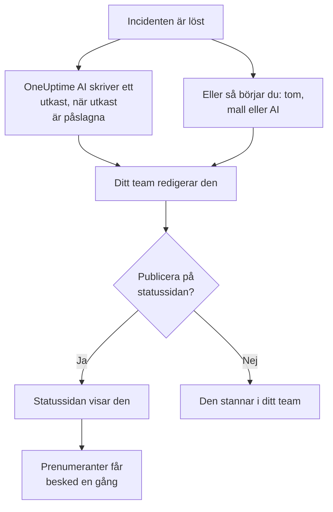

# Efteranalyser

En efteranalys är genomgången efter en incident: vad som hände, varför, vad det kostade dina användare och vad som ändras nu. I OneUptime skriver du den på själva incidenten. Den kan börja från din egen mall eller från ett utkast av OneUptime AI, och den kan publiceras på din statussida som incidentens avslutande uppdatering. Varje efteranalys har också en status, och **Incidenter → Efteranalyser** visar efteranalysen för varje incident, så att du ser vilka som fortfarande saknas.

:::cards
- [Skriv en efteranalys](#skriv-en-efteranalys): På incidentens sida Efteranalys, i fem steg.
- [Börja från en mall eller ett AI-utkast](#börja-från-en-mall-eller-ett-ai-utkast): Din disposition, eller en som OneUptime AI fyller i.
- [Publicera den på din statussida](#publicera-den-på-din-statussida): Visa den för kunderna och meddela prenumeranter en gång.
- [Följ hur långt varje efteranalys har kommit](#följ-hur-långt-varje-efteranalys-har-kommit): Inte påbörjad, Utkast, Slutförd eller en egen status.
- [Se alla efteranalyser](#se-alla-efteranalyser): Filtrera på ägare, allvarlighetsgrad och status för att hitta dem som fortfarande saknas.
- [Efteranalyser för episoder](#efteranalyser-för-episoder): En genomgång för en grupp incidenter.
:::

## Hur en efteranalys kommer till

En efteranalys har tre delar, alla på incidenten: anteckningen, skriven i Markdown; dess bilagor, som skärmbilder och rapporter; och om den visas på din statussida. De finns på incidentens sida **Efteranalys**, under **Utredning** i dess sidomeny. En efteranalys har också en status, som säger hur långt den har kommit, och ägare: incidentens ägare.

## Skriv en efteranalys

:::steps
### Öppna efteranalysen

Öppna incidenten och klicka på **Efteranalys** under **Utredning** i dess sidomeny. Kortet **Efteranalys** visar efteranalysens **Status** och **Ägare**, anteckningen, bilagorna och om efteranalysen visas på statussidan.

### Klicka på Skriv efteranalys

Dialogen **Skriv efteranalys** öppnas på sitt första steg, **Efteranalys**. När efteranalysen är skriven heter kortets knapp **Redigera obduktionsanteckning**, och den öppnar samma steg.

### Skriv anteckningen och bifoga filer

Skriv **Anteckning för efteranalys** i Markdown: vad som hände, konsekvenserna, hur det löstes och uppföljningen. Lägg till skärmbilder, rapporter eller tidslinjer under **Bilagor för efteranalys**.

### Välj om den ska publiceras

Klicka på **Nästa**. På steget **Statussida** är **Publicera på statussidan** avstängt, så efteranalysen stannar i ditt team. För att visa den för kunderna, se [Publicera den på din statussida](#publicera-den-på-din-statussida).

### Spara efteranalysen

Klicka på **Spara ändringar**. Kortet visar anteckningen och bilagorna. Efteranalysens status flyttas från **Inte påbörjad** till **Utkast**: se [Så flyttas en efteranalys](#så-flyttas-en-efteranalys).
:::

Varje ändring av anteckningen registreras i incidentens flöde och postas i incidentens Slack- eller Microsoft Teams-kanal om den har en. Så länge efteranalysen inte är publicerad får ingen prenumerant på statussidan höra om den.

Att skriva en efteranalys kräver rollen Project Owner, Project Admin, Project Member, Incident Admin eller Incident Member, eller en anpassad roll med behörigheten Edit Incident. Alla som kan läsa incidenten kan läsa dess efteranalys.

## Börja från en mall eller ett AI-utkast

Två knappar fyller i anteckningen åt dig. Så länge inget är skrivet står de bredvid **Skriv efteranalys**: **Börja från mall**, så snart projektet har en mall för efteranalys, och **Generate with AI**. När efteranalysen är skriven finns de i menyn **⋯** bredvid **Redigera obduktionsanteckning**, som **Tillämpa mall** och **Generate with AI**. Båda öppnar samma redigerare, med anteckningen ifylld och resten av efteranalysen oförändrad. Ingenting sparas förrän du klickar på **Spara ändringar**, så läs anteckningen och rätta den först.

### Tillämpa en mall

**Tillämpa mall** visas så snart projektet har en mall för efteranalys. Du skapar dem under **Incidenter → Inställningar → Postmortem-mallar**: se [Postmortem-mallar](/docs/incidents/settings#mallar-för-efteranalys). På OneUptime Cloud kräver mallar Growth-planen.

Klicka på **Börja från mall**, eller på **Tillämpa mall** i menyn **⋯**, välj en under **Välj mall** i dialogen **Tillämpa mall för efteranalys** och klicka på **Tillämpa mall**. Har projektet bara en mall är den redan vald.

### Generera den med AI

Klicka på **Generate with AI**. Dialogen **Generate Postmortem with AI** erbjuder en disposition under **Välj mall**: **Standard Postmortem**, **Detailed Technical Postmortem** eller **Brief Postmortem**, och sedan dina egna mallar för efteranalys. **Template Preview** visar dispositionen, och du kan ändra den innan du genererar.

Klicka på **Generate with AI** längst ned i dialogen. OneUptime AI läser incidenten (dess beskrivning, grundorsak och åtgärd, dess statustidslinje, dess offentliga och privata anteckningar, meddelandena i dess Slack- eller Microsoft Teams-kanal och vad som sades i [dess samtal](/docs/workspace-connections/video-calls#transkriptioner-av-samtal)) och skriver efteranalysen enligt din disposition. Sedan öppnas redigeraren med resultatet.

Att generera kräver att AI är påslaget för projektet, under **Projektinställningar → AI → AI Features**, och en LLM-leverantör: se [LLM-leverantörer](/docs/ai/llm-provider). Det kräver också rollen Project Owner eller Project Admin, eller en anpassad roll med behörigheten Edit Incident: andra roller kan skriva efteranalysen men inte generera den.

### Låt OneUptime AI skriva ett utkast när en incident löses

Med **Skriv ett utkast till efteranalys när en incident är löst** påslaget skriver OneUptime AI ett utkast till efteranalysen varje gång en incident löses, sparar det som anteckningen och postar det i incidentens flöde så att ditt team kan granska det. Brytaren finns under **Incidenter → AI → Inställningar**, och den är påslagen för nya projekt.

- Den ersätter aldrig en anteckning som redan är skriven.
- Den skriver aldrig i en efteranalys som redan är publicerad, där utkastet skulle nå statussidan ogranskat.
- Den kräver att AI är påslaget för projektet, och stannar för dagen så snart projektet når sina dagliga AI-gränser. Se [Automatisk efteranalys](/docs/ai/ai-sre#automatisk-efteranalys).
- Om transkriptionen av incidentens samtal fortfarande är på väg när incidenten löses väntar den tills OneUptime AI har läst transkriptionen, så att utkastet tar med vad som sades i samtalet: upp till sex timmar medan leverantören tar fram transkriptionen. Se [Spela in och transkribera varje samtal](/docs/workspace-connections/video-calls#spela-in-och-transkribera-varje-samtal).

#### Välj vilka incidenter som får ett utkast, och dess mall

Utan regler får varje löst incident ett utkast i OneUptime AI:s standardupplägg. **Postmortem-regler**, under **Fler inställningar** på samma sida, ändrar det:

- En regel matchar **Alla incidenter**, eller **Endast incidenter som uppfyller villkoren** på monitorer, allvarlighetsgrader, etiketter, monitoretiketter, rubrik och beskrivning, så som en AI-regel gör.
- Dess **Mallar** är de mallar för efteranalys som utkastet får följa. Utan någon följer utkastet standardupplägget; med en, den mallen; med flera, den som OneUptime AI bedömer passar incidenten bäst. Utkastets inlägg i flödet nämner mallen det följde.
- Dess **LLM-leverantör**, under **Fler fält**, är den leverantör som OneUptime AI skriver utkastet och väljer dess mall med. Med ingen vald är det projektets standardleverantör, annars den globala. Utkastets inlägg i flödet nämner den leverantör som en regel valde, eller den som användes i stället, och varför. Se [Vilken LLM-leverantör en regel använder](/docs/ai/ai-sre#vilken-llm-leverantör-en-regel-använder).
- Den första aktiverade regeln som matchar incidenten avgör, räknat från toppen av listan: dra en regel för att flytta den. En incident som ingen regel matchar får inget utkast, och det får ingen incident så länge reglerna inte kan läsas.
- **Skriv ett utkast till efteranalys när en incident är löst** är fortfarande den enda brytaren som stänger av utkast. Regler avgör bara de utkast som OneUptime AI skriver på egen hand: **Generate with AI** erbjuder alla upplägg, oavsett vad reglerna säger.
- Att skapa, redigera och ordna om regler kräver rollen Project Owner eller Project Admin. På OneUptime Cloud kräver mallar Growth-planen: under den avgör reglerna fortfarande vilka incidenter som får ett utkast, och varje utkast följer standardupplägget.

## Publicera den på din statussida

En publicerad efteranalys är incidentens avslutande uppdatering för dina kunder: statussidan visar anteckningen, framhävd i incidentens tidslinje, med dess bilagor att ladda ned.

:::steps
### Öppna steget Statussida

Klicka på **Redigera obduktionsanteckning** och sedan på **Nästa** för att komma till steget **Statussida**.

### Slå på Publicera på statussidan

Slå på **Publicera på statussidan**. Två fält till visas: **Avisera prenumeranter**, som är påslaget, och **Efteranalys publicerad**, som står på nu.

### Bestäm vem som får besked, och när den visas

Stäng av **Avisera prenumeranter** för att publicera utan att meddela prenumeranter. Ändra **Efteranalys publicerad** för att visa en annan tid bredvid efteranalysen.

### Publicera

Klicka på **Spara ändringar**. Kortet visar nu **Efteranalys synlig på statussidan?**, **Avisera prenumeranter**, **Prenumerantaviseringsstatus** och **Efteranalys publicerad**.
:::

Det som avgör om kunderna ser den och hör om den:

- **Incidenten måste visas på statussidan.** En statussida visar en efteranalys bara på en incident som den visar: **Synlig på statussidan** påslaget, och incidenten inte privat.
- **Anteckningen måste säga något.** En efteranalys som publiceras med en tom anteckning visas inte, och ingen får besked.
- **Prenumeranter får besked en gång**, första gången statussidan visar efteranalysen. Att spara den igen, eller redigera den medan den är publicerad, uppdaterar sidan utan att meddela någon. Att ta bort den och publicera den igen meddelar dem igen. En efteranalys som publiceras medan dess incident är dold skickas när incidenten görs synlig.
- **Avisera prenumeranter läses när aviseringen skickas.** Att slå på den efter att efteranalysen har publicerats skickar ingenting.

**Prenumerantaviseringsstatus** visar om aviseringen har skickats och erbjuder **Försök igen** när den misslyckades. Se [Efteranalysen](/docs/status-pages/subscribers#efteranalysen) för varje fall, och [Försök igen och skicka igen](/docs/status-pages/subscribers#försök-igen-och-skicka-igen).

**Efteranalys publicerad** är också den tidpunkt då efteranalysen räknas som publicerad för mätningen **Tid till efteranalys**: se [Färdiga mätningar](/docs/incidents/settings#färdiga-mätningar).

## Följ hur långt varje efteranalys har kommit

Varje incidents efteranalys har en av projektets efteranalysstatusar, som visas under **Status** högst upp på kortet **Efteranalys**. Ett nytt projekt har fyra. En efteranalys i **Inte påbörjad** eller **Utkast** saknas fortfarande; en i **Slutförd** eller **Behövs inte** gör det inte:

| Status | Vad den betyder | Saknas fortfarande |
| --- | --- | --- |
| **Inte påbörjad** | Ingen har skrivit den här efteranalysen ännu. | Ja |
| **Utkast** | Efteranalysen skrivs. | Ja |
| **Slutförd** | Efteranalysen är skriven och klar. | Nej |
| **Behövs inte** | Den här incidenten behöver ingen efteranalys. | Nej |

### Så flyttas en efteranalys

OneUptime flyttar en efteranalys av sig själv vid tre tillfällen:

- Efteranalysen för en ny incident börjar i **Inte påbörjad**, eller i **Utkast** när incidenten deklareras med en anteckning, eller i **Slutförd** när den anteckningen publiceras samtidigt.
- Den första anteckningen i en efteranalys i **Inte påbörjad** flyttar den till **Utkast**, oavsett om någon skriver den, tillämpar en mall eller OneUptime AI skriver ett utkast.
- När den publiceras på statussidan flyttas den till **Slutförd**, om den inte redan är klar.

Den flyttas aldrig tillbaka: att tömma anteckningen, eller ta bort efteranalysen från statussidan, låter statusen stå kvar där den är. En status som någon väljer i samma sparning gäller alltid.

### Flytta den själv

Klicka på statusen, på incidentens sida **Efteranalys** eller på dess rad i listan över efteranalyser, och välj en under **Flytta efteranalysen till**. Efteranalysen flyttas direkt. Att flytta en efteranalys kräver de roller som skriver en, och alla som kan läsa incidenten ser hur långt dess efteranalys har kommit.

### Skapa egna statusar

Har din process ett eget steg, till exempel en granskning, lägger du till en status för det. Öppna **Incidenter → Inställningar → Efteranalysstatusar**, klicka på **Skapa Efteranalysstatus** och ge den ett namn, till exempel **Under granskning**, en färg och en beskrivning. En ny status hamnar precis ovanför **Slutförd**; dra en status för att ändra var den står.

Var en status står avgör vad den räknas som, vilket visas under **Räknas som**: ovanför **Utkast** som **Inte påbörjad**, från **Utkast** och nedåt som **Pågår**, från **Slutförd** och nedåt som **Klar**, och då saknas den inte längre. **Under granskning**, mellan dem, saknas fortfarande; **Behövs inte**, under **Slutförd**, gör det inte.

**Inte påbörjad**, **Utkast** och **Slutförd** är inbyggda, eftersom OneUptime flyttar efteranalyser till dem: du kan byta namn och färg på dem, men inte ta bort eller arkivera dem, och de behåller sin ordning. Arkivera en status som du inte använder längre från menyn **⋯** på dess rad: ingen kan flytta en efteranalys dit igen, efteranalyserna i den stannar kvar tills någon flyttar dem, och listan filtrerar fortfarande på den. **Arkiverade efteranalysstatusar**, hopfällt under tabellen, visar dem, med **Avarkivera** för att hämta tillbaka en. Att skapa, redigera och ta bort statusar kräver rollen Project Owner, Project Admin eller Incident Admin, eller en anpassad roll med motsvarande behörighet för efteranalysstatusar.

## Se alla efteranalyser

**Incidenter → Efteranalyser** visar efteranalysen för varje incident i projektet, den nyaste först, med kolumnerna **Incident**, **Titel**, **Efteranalysstatus**, **Allvarlighetsgrad**, **Ägare** och **Deklarerad**. **Visa** på en rad öppnar incidentens sida **Efteranalys**.

Ovanför listan räknar en ruta per status efteranalyserna i den. Klicka på en ruta för att bara visa dem, och klicka igen för att visa alla.

Filtrera listan med chippen ovanför: **Ägare**, en person eller ett team; **Allvarlighetsgrad**; **Efteranalysstatus**; **Incidentstatus**; **Etiketter**; och **Berörda resurser**. För att se vilka efteranalyser ett team fortfarande är skyldigt för dina allvarligaste incidenter väljer du teamet under **Ägare**, allvarlighetsgraden under **Allvarlighetsgrad**, och **Inte påbörjad** och **Utkast** under **Efteranalysstatus**. Filtren står i sidans adress, så du kan spara listan som bokmärke eller dela den.

För att ändra många samtidigt markerar du dem och öppnar **Massåtgärder**: **Ändra efteranalysstatus** flyttar alla till en status, till exempel **Behövs inte** för incidenter som inte behöver någon, och **Add Owner** och **Remove Owner** ändrar vem som äger dem.

## Efteranalyser för episoder

En incidentepisod har också en sida **Efteranalys**, under **Utredning**: en genomgång för varje incident i episoden. Klicka på **Redigera obduktion** för att skriva den. **Tillämpa mall** och **Generate with AI** fungerar som på en incident, och AI läser episoden och dess medlemsincidenter.

En episods efteranalys är bara anteckningen: den har inga bilagor, och ingen statussida visar den. OneUptime AI skriver inget utkast av sig själv när en episod löses. Att generera en kräver rollen Project Owner eller Project Admin, eller en anpassad roll med behörigheten Edit Incident Episode. Den har inte heller någon status, och listan över efteranalyser utelämnar den.

Varningar och schemalagda underhållshändelser har ingen efteranalys.

## Via API:et

En efteranalys är en uppsättning fält på incidenten, som läses och skrivs via `/api/incident` precis som resten av incidenten:

| Fält | Vad det är |
| --- | --- |
| `postmortemNote` | Anteckningen, i Markdown. |
| `showPostmortemOnStatusPage` | Om efteranalysen är publicerad på dina statussidor. Börjar som `false`. |
| `notifySubscribersOnPostmortemPublished` | Om prenumeranter får besked när den publiceras. Börjar som `true`. |
| `postmortemPostedAt` | Tiden som statussidan visar bredvid den. |
| `postmortemStatusId` | Efteranalysens status: en av projektets statusar, under `/api/incident-postmortem-status`. |

Att skriva `showPostmortemOnStatusPage` som `true` över en skriven `postmortemNote` publicerar efteranalysen, precis som dialogen gör. Det flyttar också efteranalysen till **Slutförd**, om inte samma skrivning sätter `postmortemStatusId`.

## Felsökning

:::details Tillämpa mall finns inte på kortet
Projektet har ännu ingen mall för efteranalys, eller så kan din roll inte läsa dem. Skapa en under **Incidenter → Inställningar → Postmortem-mallar**. På OneUptime Cloud kräver mallar Growth-planen.
:::

:::details Generate with AI säger att AI är avstängt, eller att du saknar behörighet
Slå på AI under **Projektinställningar → AI → AI Features**. Att generera kräver rollen Project Owner eller Project Admin, eller en anpassad roll med behörigheten Edit Incident, även för den som kan redigera efteranalysen.
:::

:::details Efteranalysen visas inte på statussidan
Kontrollera tre saker: **Publicera på statussidan** är påslaget, anteckningen är inte tom, och incidenten visas på statussidan (**Synlig på statussidan** påslaget, och inte privat).
:::

:::details Prenumeranterna fick inget besked om efteranalysen
**Avisera prenumeranter** var avstängt vid publiceringen, eller så är incidenten dold: då skickas den så snart incidenten görs synlig. **Prenumerantaviseringsstatus** på kortet säger vilket det var.
:::

:::details Inget AI-utkast dök upp när incidenten löstes
Incidenten hade redan en anteckning, efteranalysen var redan publicerad, ingen postmortem-regel matchade den, eller så är **Skriv ett utkast till efteranalys när en incident är löst** avstängt. AI måste vara påslaget för projektet, och projektet får inte ha nått sina dagliga AI-gränser. När incidentens samtal har en transkription på väg kommer utkastet först när OneUptime AI har läst den.
:::

:::details Efteranalysens status flyttades inte när anteckningen skrevs
Bara en efteranalys i **Inte påbörjad**, eller i en egen status ovanför **Utkast**, flyttas av sig själv, vid sin första anteckning. En som redan pågår eller är klar stannar där den är, och det gör även en status som någon valde i samma sparning. Flytta den själv via dess status: se [Flytta den själv](#flytta-den-själv).
:::

## Nästa steg

:::cards
- [Incidenter – Översikt](/docs/incidents/index): Incidentens övriga sidor, från deklaration till lösning.
- [Incidentinställningar och automatisering](/docs/incidents/settings): Mallar för efteranalys och mätningen av tid till efteranalys.
- [Prenumeranter och meddelanden](/docs/status-pages/subscribers): Allt som en statussida berättar för sina prenumeranter.
- [AI SRE](/docs/ai/ai-sre): Vad OneUptime AI gör av sig själv efter en incident.
:::
