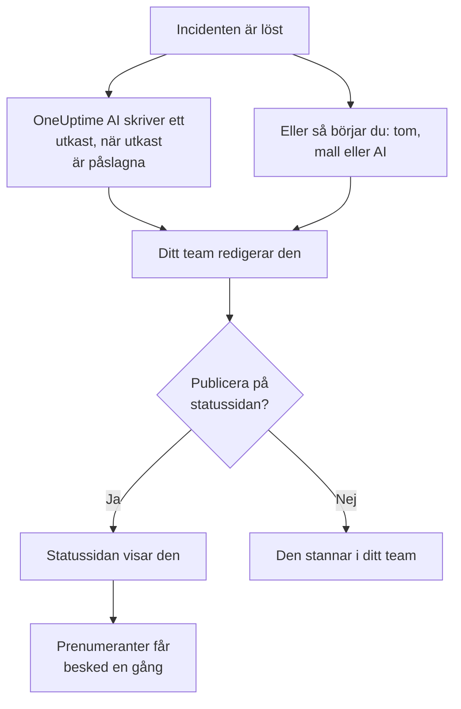

# Efteranalyser

En efteranalys är genomgången efter en incident: vad som hände, varför, vad det kostade dina användare och vad som ändras nu. I OneUptime skriver du den på själva incidenten. Den kan börja från din egen mall eller från ett utkast av OneUptime AI, och den kan publiceras på din statussida som incidentens avslutande uppdatering.

:::cards
- [Skriv en efteranalys](#skriv-en-efteranalys): På incidentens sida Efteranalys, i fem steg.
- [Börja från en mall eller ett AI-utkast](#börja-från-en-mall-eller-ett-ai-utkast): Din disposition, eller en som OneUptime AI fyller i.
- [Publicera den på din statussida](#publicera-den-på-din-statussida): Visa den för kunderna och meddela prenumeranter en gång.
- [Efteranalyser för episoder](#efteranalyser-för-episoder): En genomgång för en grupp incidenter.
:::

## Hur en efteranalys kommer till

En efteranalys har tre delar, alla på incidenten: anteckningen, skriven i Markdown; dess bilagor, som skärmbilder och rapporter; och om den visas på din statussida. De finns på incidentens sida **Efteranalys**, under **Utredning** i dess sidomeny.

## Skriv en efteranalys

:::steps
### Öppna efteranalysen

Öppna incidenten och klicka på **Efteranalys** under **Utredning** i dess sidomeny. Kortet **Anteckning för efteranalys** visar anteckningen, bilagorna och om efteranalysen visas på statussidan.

### Klicka på Redigera obduktionsanteckning

Dialogen **Redigera obduktionsanteckning** öppnas på sitt första steg, **Efteranalys**.

### Skriv anteckningen och bifoga filer

Skriv **Anteckning för efteranalys** i Markdown: vad som hände, konsekvenserna, hur det löstes och uppföljningen. Lägg till skärmbilder, rapporter eller tidslinjer under **Bilagor för efteranalys**.

### Välj om den ska publiceras

Klicka på **Nästa**. På steget **Statussida** är **Publicera på statussidan** avstängt, så efteranalysen stannar i ditt team. För att visa den för kunderna, se [Publicera den på din statussida](#publicera-den-på-din-statussida).

### Spara efteranalysen

Klicka på **Spara ändringar**. Kortet visar anteckningen och bilagorna.
:::

Varje ändring av anteckningen registreras i incidentens flöde och postas i incidentens Slack- eller Microsoft Teams-kanal om den har en. Så länge efteranalysen inte är publicerad får ingen prenumerant på statussidan höra om den.

Att skriva en efteranalys kräver rollen Project Owner, Project Admin, Project Member, Incident Admin eller Incident Member, eller en anpassad roll med behörigheten Edit Incident. Alla som kan läsa incidenten kan läsa dess efteranalys.

## Börja från en mall eller ett AI-utkast

Två knappar på kortet fyller i anteckningen åt dig: **Generate with AI**, och **Tillämpa mall** så snart projektet har en mall för efteranalys. Båda öppnar samma redigerare som **Redigera obduktionsanteckning**, med anteckningen ifylld och resten av efteranalysen oförändrad. Ingenting sparas förrän du klickar på **Spara ändringar**, så läs anteckningen och rätta den först.

### Tillämpa en mall

**Tillämpa mall** visas så snart projektet har en mall för efteranalys. Du skapar dem under **Incidenter → Inställningar → Postmortem-mallar**: se [Postmortem-mallar](/docs/incidents/settings#mallar-för-efteranalys). På OneUptime Cloud kräver mallar Growth-planen.

Klicka på **Tillämpa mall**, välj en under **Välj mall** i dialogen **Tillämpa mall för efteranalys** och klicka på **Tillämpa mall**. Har projektet bara en mall är den redan vald.

### Generera den med AI

Klicka på **Generate with AI**. Dialogen **Generate Postmortem with AI** erbjuder en disposition under **Välj mall**: **Standard Postmortem**, **Detailed Technical Postmortem** eller **Brief Postmortem**, och sedan dina egna mallar för efteranalys. **Template Preview** visar dispositionen, och du kan ändra den innan du genererar.

Klicka på **Generate with AI** längst ned i dialogen. OneUptime AI läser incidenten (dess beskrivning, grundorsak och åtgärd, dess statustidslinje, dess offentliga och privata anteckningar och meddelandena i dess Slack- eller Microsoft Teams-kanal) och skriver efteranalysen enligt din disposition. Sedan öppnas redigeraren med resultatet.

Att generera kräver att AI är påslaget för projektet, under **Projektinställningar → AI → AI Features**, och en LLM-leverantör: se [LLM-leverantörer](/docs/ai/llm-provider). Det kräver också rollen Project Owner eller Project Admin, eller en anpassad roll med behörigheten Edit Incident: andra roller kan skriva efteranalysen men inte generera den.

### Låt OneUptime AI skriva ett utkast när en incident löses

Med **Skriv ett utkast till efteranalys när en incident är löst** påslaget skriver OneUptime AI ett utkast till efteranalysen varje gång en incident löses, sparar det som anteckningen och postar det i incidentens flöde så att ditt team kan granska det. Brytaren finns under **Incidenter → AI → Inställningar**, och den är påslagen för nya projekt.

- Den ersätter aldrig en anteckning som redan är skriven.
- Den skriver aldrig i en efteranalys som redan är publicerad, där utkastet skulle nå statussidan ogranskat.
- Den kräver att AI är påslaget för projektet, och stannar för dagen så snart projektet når sina dagliga AI-gränser. Se [Automatisk efteranalys](/docs/ai/ai-sre#automatisk-efteranalys).

## Publicera den på din statussida

En publicerad efteranalys är incidentens avslutande uppdatering för dina kunder: statussidan visar anteckningen, framhävd i incidentens tidslinje, med dess bilagor att ladda ned.

:::steps
### Öppna steget Statussida

Klicka på **Redigera obduktionsanteckning** och sedan på **Nästa** för att komma till steget **Statussida**.

### Slå på Publicera på statussidan

Slå på **Publicera på statussidan**. Två fält till visas: **Avisera prenumeranter**, som är påslaget, och **Efteranalys publicerad**, som står på nu.

### Bestäm vem som får besked, och när den visas

Stäng av **Avisera prenumeranter** för att publicera utan att meddela prenumeranter. Ändra **Efteranalys publicerad** för att visa en annan tid bredvid efteranalysen.

### Publicera

Klicka på **Spara ändringar**. Kortet visar nu **Efteranalys synlig på statussidan?**, **Avisera prenumeranter**, **Prenumerantaviseringsstatus** och **Efteranalys publicerad**.
:::

Det som avgör om kunderna ser den och hör om den:

- **Incidenten måste visas på statussidan.** En statussida visar en efteranalys bara på en incident som den visar: **Synlig på statussidan** påslaget, och incidenten inte privat.
- **Anteckningen måste säga något.** En efteranalys som publiceras med en tom anteckning visas inte, och ingen får besked.
- **Prenumeranter får besked en gång**, första gången statussidan visar efteranalysen. Att spara den igen, eller redigera den medan den är publicerad, uppdaterar sidan utan att meddela någon. Att ta bort den och publicera den igen meddelar dem igen. En efteranalys som publiceras medan dess incident är dold skickas när incidenten görs synlig.
- **Avisera prenumeranter läses när aviseringen skickas.** Att slå på den efter att efteranalysen har publicerats skickar ingenting.

**Prenumerantaviseringsstatus** visar om aviseringen har skickats och erbjuder **Försök igen** när den misslyckades. Se [Efteranalysen](/docs/status-pages/subscribers#efteranalysen) för varje fall, och [Försök igen och skicka igen](/docs/status-pages/subscribers#försök-igen-och-skicka-igen).

**Efteranalys publicerad** är också den tidpunkt då efteranalysen räknas som publicerad för mätningen **Tid till efteranalys**: se [Färdiga mätningar](/docs/incidents/settings#färdiga-mätningar).

## Efteranalyser för episoder

En incidentepisod har också en sida **Efteranalys**, under **Utredning**: en genomgång för varje incident i episoden. Klicka på **Redigera obduktion** för att skriva den. **Tillämpa mall** och **Generate with AI** fungerar som på en incident, och AI läser episoden och dess medlemsincidenter.

En episods efteranalys är bara anteckningen: den har inga bilagor, och ingen statussida visar den. OneUptime AI skriver inget utkast av sig själv när en episod löses. Att generera en kräver rollen Project Owner eller Project Admin, eller en anpassad roll med behörigheten Edit Incident Episode.

Varningar och schemalagda underhållshändelser har ingen efteranalys.

## Via API:et

En efteranalys är en uppsättning fält på incidenten, som läses och skrivs via `/api/incident` precis som resten av incidenten:

| Fält | Vad det är |
| --- | --- |
| `postmortemNote` | Anteckningen, i Markdown. |
| `showPostmortemOnStatusPage` | Om efteranalysen är publicerad på dina statussidor. Börjar som `false`. |
| `notifySubscribersOnPostmortemPublished` | Om prenumeranter får besked när den publiceras. Börjar som `true`. |
| `postmortemPostedAt` | Tiden som statussidan visar bredvid den. |

Att skriva `showPostmortemOnStatusPage` som `true` över en skriven `postmortemNote` publicerar efteranalysen, precis som dialogen gör.

## Felsökning

:::details Tillämpa mall finns inte på kortet
Projektet har ännu ingen mall för efteranalys, eller så kan din roll inte läsa dem. Skapa en under **Incidenter → Inställningar → Postmortem-mallar**. På OneUptime Cloud kräver mallar Growth-planen.
:::

:::details Generate with AI säger att AI är avstängt, eller att du saknar behörighet
Slå på AI under **Projektinställningar → AI → AI Features**. Att generera kräver rollen Project Owner eller Project Admin, eller en anpassad roll med behörigheten Edit Incident, även för den som kan redigera efteranalysen.
:::

:::details Efteranalysen visas inte på statussidan
Kontrollera tre saker: **Publicera på statussidan** är påslaget, anteckningen är inte tom, och incidenten visas på statussidan (**Synlig på statussidan** påslaget, och inte privat).
:::

:::details Prenumeranterna fick inget besked om efteranalysen
**Avisera prenumeranter** var avstängt vid publiceringen, eller så är incidenten dold: då skickas den så snart incidenten görs synlig. **Prenumerantaviseringsstatus** på kortet säger vilket det var.
:::

:::details Inget AI-utkast dök upp när incidenten löstes
Incidenten hade redan en anteckning, efteranalysen var redan publicerad, eller så är **Skriv ett utkast till efteranalys när en incident är löst** avstängt. AI måste vara påslaget för projektet, och projektet får inte ha nått sina dagliga AI-gränser.
:::

## Nästa steg

:::cards
- [Incidenter – Översikt](/docs/incidents/index): Incidentens övriga sidor, från deklaration till lösning.
- [Incidentinställningar och automatisering](/docs/incidents/settings): Mallar för efteranalys och mätningen av tid till efteranalys.
- [Prenumeranter och meddelanden](/docs/status-pages/subscribers): Allt som en statussida berättar för sina prenumeranter.
- [AI SRE](/docs/ai/ai-sre): Vad OneUptime AI gör av sig själv efter en incident.
:::
