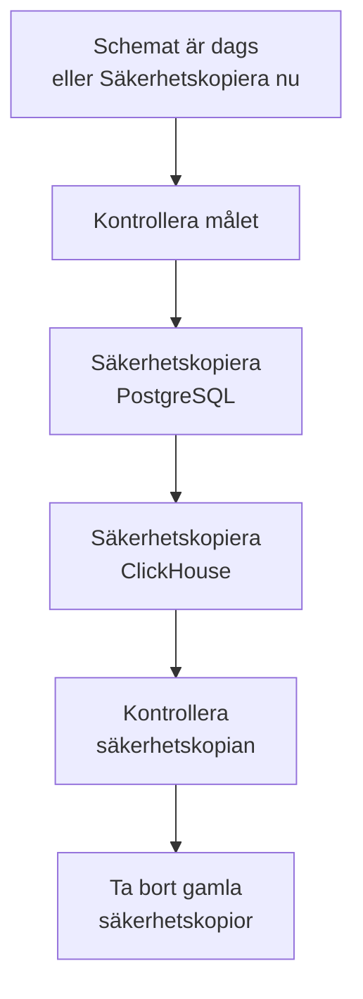

# Säkerhetskopior

Säkerhetskopiera en självhostad OneUptime till lagring du äger, enligt ett schema, och återställ den från Admin Dashboard. En säkerhetskopia innehåller PostgreSQL, med dina projekt, monitorer, incidenter, statussidor och användare, och ClickHouse, med dina loggar, spårningar och mätvärden. Säkerhetskopior sparas så många dagar du väljer, äldre tas bort åt dig, och vilken säkerhetskopia som helst kan återställas på plats. Säkerhetskopior ingår i Enterprise Edition.

:::cards
- [Konfigurera säkerhetskopior](#konfigurera-säkerhetskopior): Välj ett mål, testa det och välj ett schema.
- [Mål](#mål): Vad varje rekommenderat mål kräver.
- [Återställ en säkerhetskopia](#återställ-en-säkerhetskopia): Vad som ersätts, och hur nuvarande data hålls säkra.
- [Flytta till en ny server](#flytta-till-en-ny-server): Återställ en installations säkerhetskopior på en annan.
:::

## Så fungerar en säkerhetskopia



- **Konsekvent.** PostgreSQL dumpas i en enda transaktion, så dumpen är databasen som den var i ett ögonblick, medan OneUptime fortsätter köra. ClickHouse säkerhetskopierar varje tabell som den var när det läste tabellens parts.
- **Direkt till målet.** Utdata från `pg_dump` strömmas till lagringen medan de skrivs, och ClickHouse skriver själv sin säkerhetskopia till lagringen. Inget skrivs till serverns disk, hur stora data än är.
- **Kontrollerad.** Innan säkerhetskopian räknas läser `pg_restore` tillbaka dumpen från målet, och ClickHouses egen post om sin säkerhetskopia hittas där. Dumpens SHA-256 sparas med säkerhetskopian, och en återställning kontrollerar den innan något ersätts. En säkerhetskopia som misslyckas eller avbryts tar bort det den har skrivit, så målet innehåller bara hela säkerhetskopior.
- **Krypterad.** Säkerhetskopior skickas till lagringen över HTTPS, om du inte anger en `http://`-slutpunkt. Amazon S3, Google Cloud Storage, Azure Blob Storage och Cloudflare R2 krypterar allt de lagrar; på annan lagring slår du på bucketens kryptering i vila. Målets inloggningsuppgifter lagras krypterade och visas aldrig igen.
- **En i taget.** Bara en säkerhetskopiering eller återställning körs åt gången i hela installationen. De andra väntar på sin tur.

Varje säkerhetskopia är en egen mapp i målets mapp (`oneuptime/backups/` om du inte väljer en annan), namngiven efter tiden den startade, i UTC:

```text
oneuptime/backups/20261024T020000Z-3f2a9c1b/manifest.json
oneuptime/backups/20261024T020000Z-3f2a9c1b/postgres.dump
oneuptime/backups/20261024T020000Z-3f2a9c1b/clickhouse/
```

`manifest.json` skrivs sist: den anger vad säkerhetskopian innehåller och vilken version av OneUptime som gjorde den.

## Innan du börjar

- **Enterprise Edition**, med en licens som omfattar säkerhetskopior. Säkerhetskopior körs under provperioden och respitperioden. Utan licens görs ingen ny säkerhetskopia, och återställning och borttagning av säkerhetskopior fungerar fortfarande. Se [Enterprise Edition](/docs/self-hosted/enterprise).
- **En huvudadministratör.** Säkerhetskopior konfigureras i Admin Dashboard.
- **En bucket eller container bara för säkerhetskopior**, och inloggningsuppgifter som får läsa, skriva, lista och ta bort i den.
- **Ett mål som även ClickHouse når.** ClickHouse skriver själv sin säkerhetskopia till lagringen, så dess nätverk måste nå lagringen, precis som OneUptimes.
- **För att återställa PostgreSQL, en databasanvändare som får skapa databaser.** En återställning skriver till en ny databas bredvid den aktiva. Den PostgreSQL som följer med OneUptime ansluter som superanvändare, som får det.

## Konfigurera säkerhetskopior

:::steps
### Öppna sidan för säkerhetskopior

Gå till **Inställningar → Säkerhetskopior** i Admin Dashboard och klicka på **Konfigurera säkerhetskopior**.

### Välj var säkerhetskopior ska hamna

Välj ett av de rekommenderade målen. Vad vart och ett kräver står under [Mål](#mål).

### Fyll i anslutningen

Fyll i det som målet kräver. En mapp, en region och de inställningar som de flesta låter vara väntar under **Fler fält**, och **Installationsguide** öppnar målets avsnitt på den här sidan.

### Testa målet

Klicka på **Testa målet**. OneUptime skriver, läser, listar och tar bort en liten testfil, kontrollerar att `pg_dump` kan säkerhetskopiera din PostgreSQL och ber ClickHouse skriva en testsäkerhetskopia av definitionerna av sina tabeller. Inget sparas, och en kontroll som misslyckas anger vad du ska ändra.

### Välj när säkerhetskopior körs

Välj **Hur ofta** och tiden i **Kl. (UTC)**, och för veckovisa säkerhetskopior **Veckodag**. **Spara säkerhetskopior i (dagar)** är 30 om du inte ändrar det. Stäng av **Säkerhetskopiera även ClickHouse** för att bara säkerhetskopiera PostgreSQL.

### Börja säkerhetskopiera

Klicka på **Börja säkerhetskopiera**. Den första säkerhetskopian körs vid nästa schemalagda tid, och **Säkerhetskopiera nu** startar en direkt.
:::

Sidan visar sedan hur det går för säkerhetskopiorna: när den senaste kördes, hur stor den var och hur lång tid den tog, och när nästa körs. En säkerhetskopia som pågår visar steget den är på, och **Visa steg** visar varje steg medan det körs.

## Mål

| Mål | Lagring | Loggar in med |
| --- | --- | --- |
| [Amazon S3](#amazon-s3) | Amazon S3 | En åtkomstnyckel |
| [Cloudflare R2](#cloudflare-r2) | S3-kompatibel lagring | En R2 API-token |
| [Backblaze B2](#backblaze-b2) | S3-kompatibel lagring | En programnyckel |
| [Wasabi](#wasabi) | S3-kompatibel lagring | En åtkomstnyckel |
| [MinIO](#minio) | S3-kompatibel lagring | En åtkomstnyckel |
| [Google Cloud Storage](#google-cloud-storage) | Google Cloud Storage | En HMAC-nyckel |
| [Azure Blob Storage](#azure-blob-storage) | Azure Blob Storage | En SAS-token eller en åtkomstnyckel |
| [Annan S3-kompatibel lagring](#annan-s3-kompatibel-lagring) | S3-kompatibel lagring | En åtkomstnyckel |

En nyckel för Amazon S3 eller annan S3-kompatibel lagring behöver `s3:PutObject`, `s3:GetObject`, `s3:ListBucket`, `s3:DeleteObject` och `s3:AbortMultipartUpload` på mappen, och inget annat:

```json
{
  "Version": "2012-10-17",
  "Statement": [
    {
      "Effect": "Allow",
      "Action": "s3:ListBucket",
      "Resource": "arn:aws:s3:::my-backups"
    },
    {
      "Effect": "Allow",
      "Action": [
        "s3:PutObject",
        "s3:GetObject",
        "s3:DeleteObject",
        "s3:AbortMultipartUpload"
      ],
      "Resource": "arn:aws:s3:::my-backups/oneuptime/backups/*"
    }
  ]
}
```

### Amazon S3

| Fält | Vad du anger |
| --- | --- |
| **Bucket** | Bucketen som säkerhetskopior skrivs till. Använd den bara för säkerhetskopior. |
| **Region** | Bucketens region. Den börjar på `us-east-1`. |
| **Åtkomstnyckel-ID** | En åtkomstnyckel med behörigheterna ovan. |
| **Hemlig åtkomstnyckel** | Nyckelns hemlighet. |
| **Mapp** | Under **Fler fält**. Lämnas den tom hamnar säkerhetskopior i `oneuptime/backups/`. |

Amazon S3 krypterar varje fil det lagrar, och OneUptime begär det (SSE-S3) för varje fil det skriver.

### Cloudflare R2

Ange ditt kontos S3 API-adress som **Endpoint**, `https://<account-id>.r2.cloudflarestorage.com`, från bucketens inställningar i R2. Ange sedan **Bucket**, och **Åtkomstnyckel-ID** och **Hemlig åtkomstnyckel** för en R2 API-token som får läsa och skriva objekt i den. Att läsa tillbaka säkerhetskopior från R2 kostar ingenting.

### Backblaze B2

Ange bucketens S3-slutpunkt, som visas på dess Buckets-sida i Backblaze, till exempel `https://s3.us-west-004.backblazeb2.com`, som **Endpoint**. Ange sedan **Bucket**, och en programnyckels nyckel-ID och nyckel som **Åtkomstnyckel-ID** och **Hemlig åtkomstnyckel**. Regionen läses från slutpunkten.

### Wasabi

Ange tjänste-URL:en för bucketens region, till exempel `https://s3.us-east-1.wasabisys.com`, som **Endpoint**, sedan **Bucket** och en åtkomstnyckel. Regionen läses från slutpunkten.

### MinIO

Ange din MinIO-servers S3 API-adress, till exempel `https://minio.example.com:9000`, som **Endpoint**, sedan **Bucket** och en åtkomstnyckel vars policy får läsa, skriva, lista och ta bort i den. Både OneUptime och ClickHouse måste nå adressen.

### Google Cloud Storage

Ange **Bucket**, och **HMAC-åtkomstnyckel** och **HMAC-hemlighet** för ett tjänstkonto med rollen Storage Object Admin på bucketen. Skapa nyckeln i Cloud Storages inställningar, på fliken Interoperabilitet. OneUptime och ClickHouse når bucketen via Cloud Storages S3-kompatibla API.

### Azure Blob Storage

Ange **Lagringskonto** och **Container**, och välj under **Logga in med** hur inloggningen sker: en **SAS-token** med behörigheterna Läsa, Lägga till, Skapa, Skriva, Ta bort och Lista för containern, eller en **Åtkomstnyckel** för lagringskontot. En SAS-token kan begränsas till containern och är därför det säkrare valet. **Moln** och **Mapp** väntar under **Fler fält**.

### Annan S3-kompatibel lagring

För Ceph, DigitalOcean Spaces, Hetzner Object Storage och all lagring med ett S3 API anger du dess S3-adress som **Endpoint**, sedan **Bucket** och en åtkomstnyckel. **Region**, under **Fler fält**, behövs bara när lagringen kräver en. Lämnas den tom läses den från slutpunkten, annars är den `us-east-1`.

## Schema och lagringstid

| Inställning | Vad den gör |
| --- | --- |
| **Hur ofta** | **Varje timme**, **Var 6:e timme**, **Var 12:e timme**, **Varje dag** eller **Varje vecka**. Varje dag passar de flesta installationer. |
| **Kl. (UTC)** | Timmen då säkerhetskopior startar, i UTC, med din egen tid visad bredvid. Var 6:e eller 12:e timme räknas från den: vid `02:00` körs säkerhetskopior var 6:e timme kl. 02:00, 08:00, 14:00 och 20:00. Säkerhetskopior varje timme körs på hel timme. |
| **Veckodag** | Dagen då veckovisa säkerhetskopior körs. |
| **Spara säkerhetskopior i (dagar)** | Från 1 till 3650 dagar. 30 om du inte ändrar det. |
| **Säkerhetskopiera även ClickHouse** | På om du inte stänger av det. PostgreSQL säkerhetskopieras alltid. |

Efter varje säkerhetskopia tas de säkerhetskopior bort som startade för mer än **Spara säkerhetskopior i (dagar)** sedan, i målet och från listan, utom den senaste lyckade säkerhetskopian, som sparas hur gammal den än är. Att stänga av säkerhetskopior, eller en licens som löper ut, lämnar dig därför aldrig utan en säkerhetskopia att återställa.

**Stäng av schemalagda säkerhetskopior** i statuskortets meny stoppar schemat. **Säkerhetskopiera nu** fungerar fortfarande, och ingen säkerhetskopia tas bort. **Slå på** startar schemat igen.

## Återställ en säkerhetskopia

:::warning Vad en återställning ersätter
En återställning ersätter nuvarande data med säkerhetskopians. Allt som ändrats sedan säkerhetskopian gjordes går förlorat, om du inte säkerhetskopierar nuvarande data först.
:::

:::steps
### Välj säkerhetskopian

Klicka på **Återställ** i tabellen **Säkerhetskopior** vid säkerhetskopian du vill gå tillbaka till. OneUptime kontrollerar säkerhetskopian först: att dess filer finns i målet och är oförändrade, vilken version av OneUptime som gjorde den och att den här servern kan återställa den.

### Välj vad som ska återställas

Markera **PostgreSQL: projekt, monitorer, incidenter, användare**, **ClickHouse: loggar, spårningar, mätvärden** eller båda. Dialogen visar hur många projekt, användare och monitorer säkerhetskopian innehåller, och hur många det finns nu.

### Håll nuvarande data säkra

**Säkerhetskopiera nuvarande data först** är markerat: återställningen börjar med en säkerhetskopia av de data den ersätter, så att du kan gå tillbaka till dem. Avmarkera det bara om du har en annan kopia, för utan den kan återställningen inte ångras.

### Bekräfta

Skriv `restore` och klicka på **Återställ**.
:::

En återställning körs steg för steg, och sidan visar vart och ett:

| Steg | Vad som händer |
| --- | --- |
| **Kontrollera säkerhetskopian** | Säkerhetskopians filer finns där, och den här installationen kan återställa den. |
| **Säkerhetskopiera nuvarande data** | En säkerhetskopia av nuvarande data, om du inte avmarkerade det. |
| **Återställ PostgreSQL** | Säkerhetskopian återställs till en ny databas bredvid den aktiva och kontrolleras. |
| **Återställ ClickHouse** | Den aktiva telemetrin läggs åt sidan, och säkerhetskopians återställs i dess ställe. |
| **Byt till de återställda data** | Den återställda databasen tar den aktivas namn på ett ögonblick. |
| **Uppdatera de återställda data** | Den här versionens databasmigreringar körs på de återställda data. |
| **Städa upp** | Det som lades åt sidan tas bort. |

OneUptime fortsätter köra på nuvarande data fram till bytet, och inget det använder ändras innan dess. En återställning som misslyckas eller avbryts före bytet lämnar allt som det var, och en som misslyckas under bytet lägger tillbaka det den lade åt sidan. Telemetri som kommer in medan ClickHouse återställs lagras inte. Efter att PostgreSQL har återställts kan du bli utloggad: logga in med ett konto som finns i säkerhetskopian.

:::details Återställningen säger att säkerhetskopian gjordes med en annan ENCRYPTION_SECRET
Inloggningsuppgifterna som OneUptime lagrar, som ett måls nyckel, är krypterade med `ENCRYPTION_SECRET`. Ange den `ENCRYPTION_SECRET` som säkerhetskopian gjordes med innan du återställer, annars kan de inloggningsuppgifterna inte läsas efteråt.
:::

## Flytta till en ny server

:::steps
### Installera OneUptime på den nya servern

Installera Enterprise Edition, i den version som gjorde säkerhetskopiorna eller en nyare.

### Konfigurera samma mål

Konfigurera under **Inställningar → Säkerhetskopior** målet där dina säkerhetskopior finns. Sidan hittar säkerhetskopiorna som redan finns där och listar dem, redo att återställas. **Hitta säkerhetskopior** i statuskortets meny söker igen.

### Återställ den senaste säkerhetskopian

Återställ den som ovan. En säkerhetskopia som en äldre version av OneUptime gjorde uppdateras till den här versionen. En säkerhetskopia som en nyare version gjorde kan återställas när du har uppdaterat.
:::

## När en säkerhetskopiering misslyckas

Statuskortet visar **Den senaste säkerhetskopieringen misslyckades** med felet, och **Visa steg** visar steget där den stannade och varför. Varje huvudadministratör får också ett e-postmeddelande, högst en gång var 12:e timme så länge säkerhetskopieringar fortsätter att misslyckas. En återställning som misslyckas meddelas alltid via e-post.

## Felsökning

:::details ClickHouse når inte målet
ClickHouse ansluter själv till lagringen. Låt dess nätverk nå målets adress, precis som OneUptimes, och testa sedan målet igen.
:::

:::details pg_dump saknas eller är för gammal
Enterprise-avbildningen innehåller `pg_dump` och `pg_restore` 16, 17 och 18, som säkerhetskopierar PostgreSQL 18 och alla tidigare versioner. På en annan avbildning installerar du PostgreSQL-klientverktygen eller sätter `BACKUP_POSTGRES_BIN_DIR` till katalogen som innehåller dem. `pg_dump` måste vara minst lika ny som din PostgreSQL-server.
:::

:::details Återställning av PostgreSQL kräver en ändring
En återställning skapar en databas, vilket OneUptimes databasanvändare måste få göra. Kör detta i PostgreSQL som superanvändare, med ditt `DATABASE_USERNAME` i stället för `oneuptime`, och återställ sedan igen:

```sql
ALTER USER oneuptime CREATEDB;
```
:::

:::details En säkerhetskopia finns i ett tidigare mål
När du har bytt mål finns säkerhetskopiorna som gjordes i det gamla kvar i listan, markerade med **I ett tidigare mål**. Konfigurera det målet igen för att återställa en av dem, eller ta bort den från listan: dess filer stannar där de är.
:::

## Nästa steg

:::cards
- [Enterprise Edition](/docs/self-hosted/enterprise): Licenser, och vad Enterprise Edition lägger till.
- [Uppgradering](/docs/installation/upgrading): Säkerhetskopiera före varje uppgradering.
- [Docker Compose](/docs/installation/docker-compose): Kör OneUptime på en server.
:::
