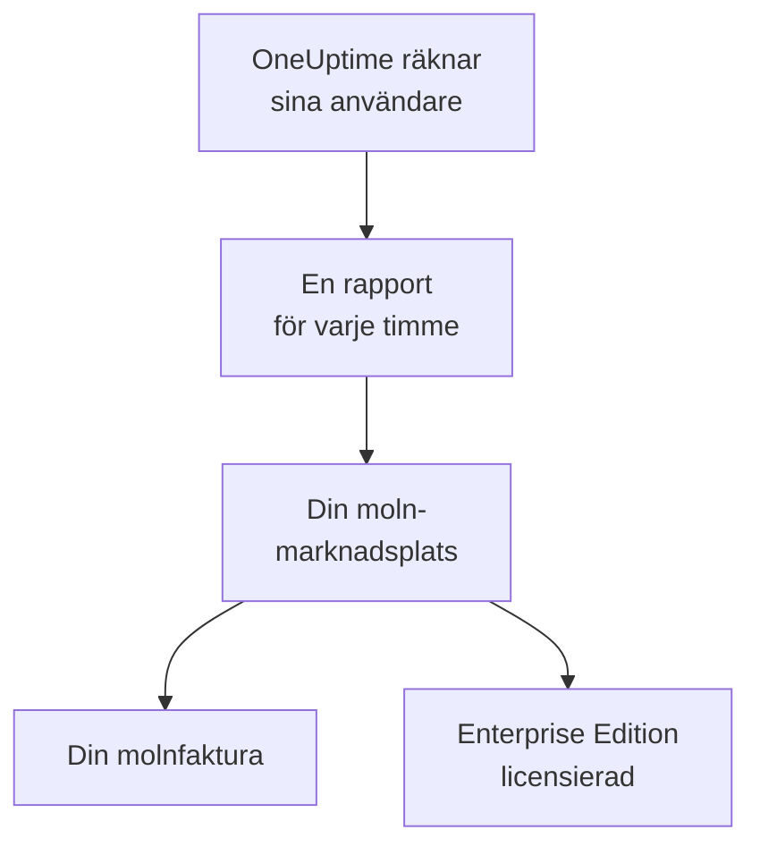

# Molnmarknadsplatser

Köp OneUptime Enterprise på AWS Marketplace, Microsoft Marketplace eller Google Cloud Marketplace och kör det i ditt eget Kubernetes-kluster. Marknadsplatsen debiterar varje användare av din installation per timme på din molnfaktura, och din prenumeration ger licens för Enterprise Edition: det finns ingen licensnyckel att aktivera.

:::cards
- [Installera OneUptime](#installera-oneuptime): På Amazon EKS, Azure Kubernetes Service eller Google Kubernetes Engine.
- [Så fungerar debiteringen](#så-fungerar-debiteringen): USD 0.10 per användare och timme, rapporterat varje timme.
- [Uppgradering](#uppgradering): Hur en ny version når ditt kluster.
- [Felsökning](#felsökning): När utgåvemärket visar en varning om marknadsplatsen.
:::

## Så fungerar det

OneUptime räknar sina användare var 15:e minut och rapporterar varje timme en gång till marknadsplatsen där du köpte det, med det högsta antal användare det såg under timmen. Marknadsplatsen lägger till timmen på din molnfaktura. Varje rapport som marknadsplatsen godtar talar också om för OneUptime att din prenumeration är aktiv, och det håller Enterprise Edition licensierad.



| | AWS | Microsoft | Google Cloud |
| --- | --- | --- | --- |
| Produktsida | Inte offentlig än: [kontakta oss](https://oneuptime.com/enterprise/demo) | [OneUptime Enterprise](https://marketplace.microsoft.com/en-us/product/oneupitme.oneuptime-enterprise) | Inte offentlig än: [kontakta oss](https://oneuptime.com/enterprise/demo) |
| Körs på | Amazon EKS | Azure Kubernetes Service (AKS) | Google Kubernetes Engine (GKE) |
| Du installerar det med | Helm, från produktens register | Azure-portalen | Google Cloud-konsolen |
| OneUptime rapporterar med | IAM-rollen för dess Kubernetes-tjänstkonto | Den hanterade identitet som Azure ger installationen | Den rapporteringshemlighet som Google Cloud Marketplace skapar för driftsättningen |
| Nya versioner | Du uppgraderar med Helm | Mindre versioner installeras åt dig | Du uppgraderar manuellt |

## Innan du börjar

- **Ett Kubernetes-kluster** i marknadsplatsens moln med minst 3 noder på 4 vCPU:er och 16 GiB minne, en standard-StorageClass och stöd för tjänster av typen `LoadBalancer`. OneUptime kör sin egen PostgreSQL, ClickHouse och Valkey i klustret; dimensionera dem med hjälp av [Dimensionering och kapacitetsplanering](/docs/installation/sizing).
- **Ett domännamn** för OneUptime, till exempel `oneuptime.example.com`, som du kan peka mot klustrets lastbalanserare.
- **Utgående HTTPS** från klustret till marknadsplatsen, så att OneUptime kan rapportera antalet användare: `metering.marketplace.<region>.amazonaws.com` och `sts.<region>.amazonaws.com` på AWS, `marketplaceapi.microsoft.com` på Azure, `servicecontrol.googleapis.com` och `oauth2.googleapis.com` på Google Cloud.

## Installera OneUptime

### AWS Marketplace

På AWS rapporterar OneUptime antalet användare med en IAM-roll som EKS ger OneUptimes Kubernetes-tjänstkonto (IAM-roller för tjänstkonton). AWS Marketplace tar bara emot förbrukning från EKS när den är signerad på det sättet.

:::steps
1. Prenumerera på OneUptime Enterprise via AWS Marketplace. Klicka sedan på **Continue to Configuration**, välj version och klicka på **Continue to Launch**.
2. Ge klustret en IAM OIDC-leverantör om det inte har någon ännu, och skapa tjänstkontot `oneuptime` med en IAM-roll som har policyn `AWSMarketplaceMeteringFullAccess`, med kommandona nedan. Kör dem i stället för `eksctl`-kommandot i steg 1 av **General launch instructions** på launch-sidan: det kommandot kopplar en roll som du först skulle behöva skapa själv.
3. Logga in Helm mot produktens register och installera charten med kommandona i steg 2 av **General launch instructions**. I kommandot `helm install` sätter du `serviceAccount.name` till `oneuptime`, `host` till ditt domännamn och `httpProtocol` till `https` om ett certifikat sitter framför OneUptime.
4. [Öppna OneUptime](#öppna-oneuptime).
:::

```bash
eksctl utils associate-iam-oidc-provider --cluster <cluster> --approve
eksctl create iamserviceaccount --name oneuptime --namespace oneuptime --cluster <cluster> \
  --attach-policy-arn arn:aws:iam::aws:policy/AWSMarketplaceMeteringFullAccess \
  --approve --override-existing-serviceaccounts
```

Spara värdena från steg 3 i en fil och ange den vid varje `helm upgrade`:

```yaml title="values.yaml"
host: oneuptime.example.com
httpProtocol: https
serviceAccount:
  name: oneuptime
```

### Microsoft Marketplace

På Azure är OneUptime en Kubernetes-applikation: AKS installerar OneUptime som ett klustertillägg och ger det den hanterade identitet som det rapporterar antalet användare med.

:::steps
1. Öppna OneUptime Enterprise på Microsoft Marketplace i Azure-portalen, eller öppna ditt AKS-kluster och välj **Extensions + applications** > **Add**. Välj sedan plan och klicka på **Create**.
2. Välj prenumeration och resursgrupp, och om du vill installera på ett befintligt AKS-kluster eller skapa ett nytt.
3. I steget **OneUptime** anger du ett namn på installationen, ditt domännamn och dess protokoll.
4. Välj **Review + create** och sedan **Create**. Installationen tar några minuter; den är klar när **Extensions + applications** visar dess etableringstillstånd som **Succeeded**.
5. [Öppna OneUptime](#öppna-oneuptime).
:::

Anpassade mätare fungerar på AKS-kluster men inte på Azure Arc-aktiverad Kubernetes, så OneUptime Enterprise på Microsoft Marketplace kan bara installeras på AKS.

### Google Cloud Marketplace

På Google Cloud kör Marketplace ett driftsättningsprogram som installerar OneUptime i det namespace du väljer, tillsammans med en rapporteringshemlighet som OneUptime rapporterar antalet användare med.

:::steps
1. Öppna OneUptime Enterprise på Google Cloud Marketplace i Google Cloud-konsolen och välj **Configure**.
2. Välj GKE-klustret och namespacet, och ange ett namn på installationen, ditt domännamn och dess protokoll.
3. Välj **Deploy**. Driftsättningen tar några minuter; den är klar när applikationen visas som redo under **Kubernetes Engine** > **Applications**.
4. [Öppna OneUptime](#öppna-oneuptime).
:::

## Öppna OneUptime

OneUptime börjar med att migrera sin databas, vilket tar några minuter på en ny installation. Peka sedan ditt domännamn mot OneUptimes lastbalanserare:

```bash
kubectl get service --namespace <namespace>
```

Tjänsten vars namn slutar på `-nginx` har en `EXTERNAL-IP`: skapa en DNS-post för ditt domännamn som pekar mot den. Öppna domännamnet och registrera dig. Det första kontot på en ny installation blir dess huvudadministratör, som kan öppna administratörspanelen på `/admin`.

Inom en timme visar utgåvemärket Enterprise Edition, licensierad via din marknadsplats. Huvudadministratörer ser utgåvemärket i sidhuvudet i administratörspanelen och i sidfoten i Dashboarden.

## Så fungerar debiteringen

| Vad | Så fungerar det |
| --- | --- |
| Pris | USD 0.10 per användare och timme, ungefär USD 73 per användare och månad. |
| Vem som räknas | Alla med en OneUptime-inloggning på installationen. Prenumeranter på statussidor och de personer som loggar in på en privat statussida räknas inte. |
| När | OneUptime räknar sina användare var 15:e minut och rapporterar varje timme en gång, med det högsta antal användare det såg under timmen. En timme då OneUptime inte var igång debiteras inte. |
| Var | På din faktura från AWS, Azure eller Google Cloud, via marknadsplatsen. |
| Ingår inte | Själva klustret: din molnleverantör fakturerar dess noder, diskar och lastbalanserare som vanligt. |

Varje installation debiteras för sig, så även en staging-installation debiteras. För årspriser, volymrabatter eller ett pris för installationer utanför produktion ber du [sales@oneuptime.com](mailto:sales@oneuptime.com) om ett privat erbjudande, som du accepterar på marknadsplatsen.

Om en rapport inte kan skickas, på grund av ett nätverksproblem eller ett avbrott på marknadsplatsen, skickar OneUptime den igen vid nästa körning. Varje rapport har en nyckel för sin timme, så att en timme aldrig debiteras två gånger.

## Så fungerar licensieringen

Din prenumeration på marknadsplatsen är din licens. Varje rapport som marknadsplatsen godtar ger licens för alla enterprise-funktioner, för alla användare, under de kommande 72 timmarna. En licensnyckel från OneUptime fungerar också på samma installation: installationen körs på den av de två som är bäst.

| Vad som händer | Vad utgåvemärket visar |
| --- | --- |
| Marknadsplatsen godtar timrapporterna | Enterprise Edition, licensierad via din marknadsplats. |
| Ingen rapport har godtagits på 72 timmar | **Enterprise Edition (Marketplace Reports Failing)**: alla enterprise-funktioner fortsätter att fungera under en frist på 30 dagar. |
| Marknadsplatsen svarar att installationen saknar prenumeration, eller fristen tar slut | **Enterprise Edition (Marketplace Subscription Ended)**: enterprise-funktionerna stoppas, precis som när en [licens löper ut](/docs/self-hosted/enterprise#när-en-licens-löper-ut-eller-saknas). |

Marknadsplatsen nekar en prenumeration som har sagts upp eller stängts av, och en installation som inte är den du köpte. Övervakning, larm, incidenter, jour och statussidor fortsätter att fungera i alla lägen, och inget tas bort. Prenumerera igen, så ger nästa godtagna rapport licens för Enterprise Edition igen, utan omstart.

## Uppgradering

| Marknadsplats | Hur en ny version når ditt kluster |
| --- | --- |
| AWS Marketplace | Varje release är en ny version av produkten på marknadsplatsen. Kör `helm upgrade` med charten från produktens register, den nya versionen och din värdefil. |
| Microsoft Marketplace | AKS installerar nya mindre versioner och korrigeringsversioner åt dig. En ny huvudversion väntar tills du godkänner den. Du kan stänga av automatiska uppgraderingar på installationens sida i **Extensions + applications**. |
| Google Cloud Marketplace | Google Cloud Marketplace behåller en driftsättning på den version den installerade och uppdaterar den aldrig. Kontakta [supporten](https://oneuptime.com/support) innan du flyttar en driftsättning till en ny version. |

OneUptime migrerar sin databas när den nya versionen startar. Läs [uppgraderingsanteckningarna](/docs/installation/upgrading) innan du byter till en ny huvudversion.

Uppgradera via marknadsplatsen. En installation från marknadsplatsen jämför sig inte med OneUptimes versioner på GitHub: versionerna som din marknadsplats erbjuder är de du uppgraderar till.

## Inställningar och skalning

Din faktura ändras inte när du skalar: OneUptime debiteras per användare. Fler repliker eller större noder ändrar bara vad din molnleverantör fakturerar för klustret.

| Marknadsplats | Var dina inställningar finns |
| --- | --- |
| AWS Marketplace | Din värdefil. Alla inställningar i [Helm-charten](https://artifacthub.io/packages/helm/oneuptime/oneuptime) fungerar, utom de medföljande operatorerna. |
| Microsoft Marketplace | Installationens konfigurationsinställningar, på dess sida i **Extensions + applications** eller med `az k8s-extension update --configuration-settings`. Varje inställning är ett värde i charten, till exempel `autoscaling.enabled=true`. |
| Google Cloud Marketplace | Fälten i driftsättningsformuläret. Allt annat ändrar du med `kubectl`, på driftsättningens egna resurser. |

- **Skala OneUptime** med chartens inställningar för repliker och autoskalning (`deployment.replicaCount`, `autoscaling.enabled` och varje tjänsts egna åsidosättningar), och noderna med ditt klusters autoskalare.
- **Behåll marknadsplatsinställningarna så som produkten sätter dem**: `enterpriseMarketplace` och, på AWS, `serviceAccount`. Utan dem kan OneUptime inte rapportera, och Enterprise Edition är inte licensierad.
- **Operatorerna KEDA, CloudNativePG och Altinity ClickHouse ingår inte**, eftersom en marknadsplats bara levererar de avbildningar som finns i produkten. För datalager med hög tillgänglighet pekar du OneUptime mot hanterade tjänster med `externalPostgres`, `externalRedis` och `externalClickhouse`.

Debiteringen beror inte på hur många repliker som körs: bara en körning i taget rapporterar, och varje timme har en rapport.

## Felsökning

:::details Utgåvemärket visar Enterprise Edition (Marketplace Reports Failing)
OneUptime kan inte rapportera till marknadsplatsen. Varje rad som OneUptime loggar om problemet börjar med `OneUptime Enterprise marketplace billing`; en rad som säger att användningen "cannot be reported" anger vad som saknas. De vanligaste orsakerna:

- **AWS:** tjänstkontot `oneuptime` har ingen IAM-roll, eller så har rollen inte policyn `AWSMarketplaceMeteringFullAccess` (`AWSMarketplaceMeteringRegisterUsage` räcker inte). Koppla policyn till rollen, eller skapa rollen med `eksctl`-kommandot under [AWS Marketplace](#aws-marketplace) och starta sedan om OneUptimes poddar med `kubectl rollout restart deployment --namespace oneuptime`.
- **Azure:** installationen är inte Microsoft Marketplace-applikationen, till exempel för att den installerades med Helm, så den har ingen identitet eller plan att rapportera med. Installera den från Azure-portalen.
- **Google Cloud:** driftsättningens rapporteringshemlighet har tagits bort eller ersatts.
- **Alla marknadsplatser:** en brandvägg eller proxy blockerar den utgående HTTPS som beskrivs i [Innan du börjar](#innan-du-börjar).

Användningen sparas medan du åtgärdar felet och debiteras så snart OneUptime kan rapportera igen. Användning som är äldre än 30 dagar debiteras inte.
:::

:::details Utgåvemärket visar Enterprise Edition (Marketplace Subscription Ended)
Marknadsplatsen har nekat installationen: prenumerationen har sagts upp eller stängts av, eller så är installationen inte den som köptes på marknadsplatsen. Kontrollera prenumerationen på marknadsplatsen och prenumerera igen; nästa godtagna rapport ger licens för Enterprise Edition igen. Utgåvemärket visar samma sak när rapporterna har fortsatt att misslyckas under hela fristen.
:::

:::details Poddarna blir kvar i Pending efter installationen
OneUptimes databaser behöver beständiga volymer. Ge klustret en standard-StorageClass: på Amazon EKS installerar du tillägget för Amazon EBS CSI-drivrutinen.
:::

## Nästa steg

:::cards
- [Enterprise Edition](/docs/self-hosted/enterprise): Vad Enterprise Edition lägger till, och vad som stoppas när en licens löper ut.
- [Uppgradering](/docs/installation/upgrading): Uppgraderingsanteckningarna för varje version.
- [Dimensionering och kapacitetsplanering](/docs/installation/sizing): Dimensionera datalagren för din telemetri.
- [Arkitektur](/docs/self-hosted/architecture): Vad som körs i ditt kluster.
- [Kubernetes-agent](/docs/telemetry/kubernetes-agent#installera-som-amazon-eks-tillägg): Gratis även på AWS Marketplace, som Amazon EKS-tillägg, för kluster som skickar data till OneUptime.
:::
