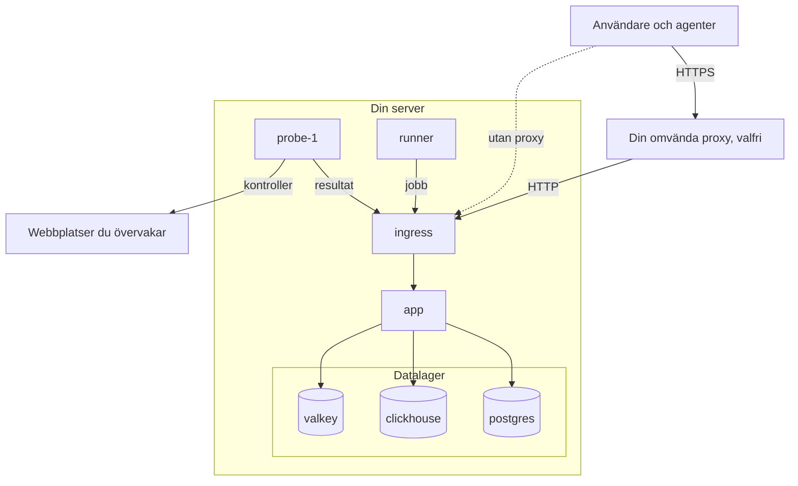

# Docker Compose

Kör en komplett, kostnadsfri OneUptime-instans på en enda Linux-server med Docker Compose. Den här sidan tar dig från en ny server till en körande instans och tar sedan upp HTTPS, härdning för produktion, säkerhetskopior, uppdateringar och borttagning.

:::cards
- [Installera OneUptime](#installera-oneuptime): Från en ny server till ditt första konto i sex steg.
- [Konfigurera HTTPS](#konfigurera-https): Låt OneUptime hämta ett certifikat, eller sätt din egen proxy framför.
- [Checklista för produktion](#checklista-för-produktion): Vad som ska vara klart innan riktig trafik kommer.
- [Uppdatera OneUptime](#uppdatera-oneuptime): Byt till den senaste releasen.
:::

## Så fungerar det

Docker Compose kör varje del av OneUptime som en container på din server. All trafik kommer in genom containern `ingress`, som skickar den vidare till `app`. Appen sparar sina data i PostgreSQL, ClickHouse och Valkey. En medföljande prob kör dina monitorers kontroller och rapporterar tillbaka genom ingressen.



| Tjänst | Image | Vad den gör |
| --- | --- | --- |
| `ingress` | `oneuptime/nginx` | Tar emot all trafik på port 80 och 443 och skickar den vidare till appen. Levererar HTTPS när OneUptime hanterar certifikatet. |
| `app` | `oneuptime/app` | Dashboarden, API:t, statussidor, inläsning av telemetri och bakgrundsarbetarna. |
| `probe-1` | `oneuptime/probe` | En global prob som kör dina monitorers kontroller. Den använder värdens nätverk. |
| `runner` | `oneuptime/runner` | Instansens Runner, som kör AI-kodkorrigeringar. Den använder värdens nätverk. |
| `postgres` | `postgres:15` | Konfiguration och tillstånd: monitorer, incidenter, användare. Lagras i volymen `postgres`. |
| `clickhouse` | `clickhouse/clickhouse-server:26.7` | Telemetri: loggar, mätvärden, traces och undantag. Lagras i volymen `clickhouse`. |
| `valkey` | `valkey/valkey:9.1-alpine` | Cache och köer. Den sparar ingenting på disk. |

> [!NOTE]
> Tjänsten `valkey` kör [Valkey](https://valkey.io), den BSD-licensierade forken av Redis 7.2, konfigurerad via inställningarna `VALKEY_*` i `config.env`. Alla servrar som talar Redis-protokollet fungerar — peka `VALKEY_HOST` mot en hanterad Redis om du föredrar det. Fram till 13.0.0 hette de här inställningarna `REDIS_*`; de gamla namnen läses fortfarande, containern svarar fortfarande på värdnamnet `redis`, och `npm run update` skriver inte om dem, så en äldre `config.env` behöver inga ändringar.

För produktion i stor skala, eller när du behöver hög tillgänglighet, använder du i stället [Helm-charten](https://artifacthub.io/packages/helm/oneuptime/oneuptime) på Kubernetes: Docker Compose kör en kopia av varje tjänst på en enda server.

## Krav

Välj serverns storlek efter vad du ska köra på den. Det är telemetrin (loggar, mätvärden, traces) som avgör minne och disk; se [Dimensionering och kapacitetsplanering](/docs/installation/sizing) när du känner till dina volymer.

| | Rekommenderat | Minimum för ett homelab |
| --- | --- | --- |
| **Minne** | 16 GB | 8 GB |
| **CPU** | 8 kärnor | 4 kärnor |
| **Disk** | 400 GB | 20 GB |
| **System** | Ubuntu 22.04, eller en annan Linux baserad på Debian, Ubuntu eller RHEL | Samma |
| **Arkitektur** | x86-64 (`amd64`) eller ARM (`arm64`) | Samma |

Minimum för ett homelab passar för personligt och experimentellt bruk — en del kör OneUptime på en Raspberry Pi.

Du behöver också:

- **Docker** med tillägget **Docker Compose v2** (kommandot `docker compose`).
- **Git**, för att hämta OneUptime.
- **Node.js och npm**, som kör skripten `npm start` och `npm run update` som omsluter Docker Compose.
- **Portarna 80 och 443** lediga på servern. Tabellen nedan listar varje port som OneUptime använder på värden.

| Värdport | Används av | Inställning | Vad den är till för |
| --- | --- | --- | --- |
| 80 | `ingress` | `ONEUPTIME_HTTP_PORT` | Dashboarden, API:t, inläsning av telemetri och validering hos Let's Encrypt. |
| 443 | `ingress` | `STATUS_PAGE_HTTPS_PORT` | HTTPS för din instans när OneUptime hanterar certifikatet, och för statussidor och dashboards på egna domäner. |
| 5400 | `postgres` | Anges i `docker-compose.yml` | Låter `npm run backup` nå PostgreSQL. Håll den stängd mot internet. |
| 3874 | `probe-1` | `GLOBAL_PROBE_1_PORT` | Probens egen server. Inget utanför servern behöver den. |
| 3876 | `runner` | `ONEUPTIME_RUNNER_PORT` | Runnerns egen server. Inget utanför servern behöver den. |

Det finns också en [videogenomgång](https://youtu.be/j1SWmMW2oL4) av installationen.

## Installera OneUptime

:::steps
### Klona release-grenen

Grenen `release` innehåller filerna för den senaste releasen.

```bash
git clone --depth 1 --single-branch --branch release https://github.com/OneUptime/oneuptime.git
cd oneuptime
```

### Skapa config.env

Alla OneUptimes inställningar finns i `config.env`. Utgå från exemplet:

```bash
cp config.example.env config.env
```

### Ange värdnamnet

Öppna `config.env` och sätt `HOST` till det domännamn eller den IP-adress som folk ska använda för att nå OneUptime, utan `http://`. Behåll `localhost` bara för att prova OneUptime på din egen dator.

```ini title="config.env"
HOST=oneuptime.example.com
```

### Generera slumpmässiga hemligheter

Exempelfilen innehåller platshållarhemligheter som är offentliga på GitHub. Ersätt var och en med ett eget slumpmässigt värde:

```bash
while grep -q "please-change-this-to-random-value" config.env; do
  sed -i "0,/please-change-this-to-random-value/{s/please-change-this-to-random-value/$(openssl rand -hex 32)/}" config.env
done
grep -c "please-change-this" config.env
```

Det sista kommandot skriver ut `0`: Ingen platshållare är kvar. Loopen använder GNU `sed`, som alla Linux-servrar har. Det här är inställningarna den fyller i:

| Inställning | Vad den skyddar |
| --- | --- |
| `ONEUPTIME_SECRET` | Anrop mellan OneUptimes egna tjänster. |
| `ENCRYPTION_SECRET` | Hemligheterna som OneUptime lagrar, som integrationstokens och SMTP-lösenord, och de inloggningstokens den utfärdar. |
| `DATABASE_PASSWORD`, `CLICKHOUSE_PASSWORD`, `VALKEY_PASSWORD` | De tre datalagren. |
| `REGISTER_PROBE_KEY` | Registrering av prober hos din instans. |
| `GLOBAL_PROBE_1_KEY`, `GLOBAL_PROBE_2_KEY` | De globala prober som Docker Compose kan köra (`probe-1` körs som standard). |
| `ONEUPTIME_RUNNER_KEY` | Den medföljande Runnern. |

> [!IMPORTANT]
> Ange hemligheterna före första starten och behåll dem sedan. PostgreSQL tar bara sitt lösenord när den skapar sin databas, och om du ändrar `ENCRYPTION_SECRET` senare blir varje värde som krypterats med det gamla oläsligt.

### Starta OneUptime

:::tabs
@tab npm
```bash
npm start
```
@tab Docker CLI
```bash
(export $(grep -v '^#' config.env | xargs) && docker compose up --remove-orphans -d)
```
:::

Första starten tar flera minuter: Docker laddar ned imagerna och OneUptime skapar sina databaser. `npm start` väntar tills varje del svarar och avslutas med **OneUptime is up!**

### Skapa det första kontot

Öppna `http://` följt av din `HOST` (till exempel `http://localhost`) och registrera dig. Det första kontot på en ny instans blir dess huvudadministratör, som kan öppna Admin Dashboard på `/admin`.

Alla som kan nå sidan kan registrera sig efter dig. För att förhindra det öppnar du Admin Dashboard, går till **Inställningar > Autentisering** och stänger av **Tillåt registrering**. Personer som du bjuder in till ett projekt kan fortfarande skapa sina konton.
:::

## Konfigurera HTTPS

OneUptime levererar vanlig HTTP tills du väljer ett av två sätt att lägga till HTTPS:

| | Låt OneUptime hämta ett certifikat | Använd din egen omvända proxy |
| --- | --- | --- |
| **TLS avslutas i** | OneUptimes `ingress`, med ett kostnadsfritt certifikat från Let's Encrypt som den förnyar själv | Din proxy: Caddy, Nginx eller en lastbalanserare |
| **Du behöver** | Ett offentligt domännamn som pekar på servern, och portarna 80 och 443 nåbara från internet | En proxy och ett certifikat för din domän |
| **Inställningar** | `PROVISION_SSL=true`, `HTTP_PROTOCOL=https` | `PROVISION_SSL=false`, `HTTP_PROTOCOL=https`, `TRUSTED_PROXY_HOPS=2` |
| **Statussidor på egna domäner** | Fungerar utan extra konfiguration | Din proxy måste också betjäna de domänerna |

Om du lägger statussidor eller dashboards på egna domäner är det enklast att låta OneUptime hantera TLS: Ingressen beställer och levererar själv certifikaten för de domänerna.

### Låt OneUptime hämta ett certifikat

:::steps
#### Peka din domän mot servern

Skapa en DNS-post `A` (eller `AAAA` för IPv6) för din domän, med serverns offentliga IP-adress som värde.

#### Slå på hämtning av certifikat

Ange de här värdena i `config.env`:

```ini title="config.env"
HOST=oneuptime.example.com
PROVISION_SSL=true
HTTP_PROTOCOL=https
```

`HOST` måste vara ett domännamn: OneUptime kan inte få ett certifikat för en IP-adress eller för `localhost`.

#### Starta om med de nya inställningarna

```bash
npm start
```

#### Öppna din instans över HTTPS

Öppna `https://oneuptime.example.com`. OneUptime beställer certifikatet när den startar, kontrollerar det sedan varje timme och förnyar det när det är mindre än 30 dagar kvar. Tills det första certifikatet kommer, oftast inom några minuter, levererar ingressen ett tillfälligt självsignerat certifikat och webbläsaren varnar dig.
:::

### Använd din egen omvända proxy

De här stegen kör proxyn på samma server som OneUptime. Om din proxy körs på en annan maskin hoppar du över det första steget och pekar proxyn mot port 80 på den här servern.

:::steps
#### Flytta ingressen från portarna 80 och 443

Proxyn behöver portarna 80 och 443, så flytta ingressen till andra portar. Proben och Runnern använder värdens nätverk och når OneUptime via `http://localhost`, så de flyttar med:

```ini title="config.env"
ONEUPTIME_HTTP_PORT=8080
STATUS_PAGE_HTTPS_PORT=8443
GLOBAL_PROBE_1_ONEUPTIME_URL=http://localhost:8080
ONEUPTIME_RUNNER_ONEUPTIME_URL=http://localhost:8080
```

#### Berätta för OneUptime att den står bakom en proxy

```ini title="config.env"
HOST=oneuptime.example.com
HTTP_PROTOCOL=https
PROVISION_SSL=false
TRUSTED_PROXY_HOPS=2
```

`HTTP_PROTOCOL=https` gör att länkarna som OneUptime bygger använder HTTPS. `TRUSTED_PROXY_HOPS=2` räknar din proxy och OneUptimes ingress, så att OneUptime läser besökarens riktiga adress för IP-tillåtelselistor och hastighetsbegränsningar. Lägg till en för varje ytterligare proxy som lägger till i `X-Forwarded-For`, som ett CDN eller en lastbalanserare.

#### Starta om OneUptime på de nya portarna

```bash
(export $(grep -v '^#' config.env | xargs) && docker compose up --remove-orphans -d)
bash Tests/Scripts/status-check.sh localhost:8080
```

`npm start` kontrollerar `http://localhost` på port 80, där din proxy kommer att ligga, så kontrollera den nya porten själv. Skriptet avslutas med **OneUptime is up!**

#### Konfigurera proxyn

:::tabs
@tab Caddy
```text title="Caddyfile"
oneuptime.example.com {
	reverse_proxy localhost:8080
}
```
Caddy hämtar och förnyar certifikatet själv, omdirigerar HTTP till HTTPS och släpper igenom WebSocket-anslutningar. Läs in Caddy igen när du har ändrat filen, till exempel med `sudo systemctl reload caddy`.
@tab Nginx
```nginx title="/etc/nginx/conf.d/oneuptime.conf"
map $http_upgrade $oneuptime_connection_upgrade {
    default upgrade;
    ""      close;
}

server {
    listen 80;
    server_name oneuptime.example.com;
    return 301 https://$host$request_uri;
}

server {
    listen 443 ssl;
    server_name oneuptime.example.com;

    ssl_certificate     /etc/letsencrypt/live/oneuptime.example.com/fullchain.pem;
    ssl_certificate_key /etc/letsencrypt/live/oneuptime.example.com/privkey.pem;

    # The limits OneUptime's own ingress uses.
    client_max_body_size 50M;
    proxy_read_timeout 300s;
    proxy_send_timeout 300s;

    proxy_http_version 1.1;
    proxy_set_header Host $host;
    proxy_set_header X-Forwarded-For $proxy_add_x_forwarded_for;
    proxy_set_header X-Forwarded-Proto $scheme;
    proxy_set_header Upgrade $http_upgrade;
    proxy_set_header Connection $oneuptime_connection_upgrade;

    location / {
        proxy_pass http://127.0.0.1:8080;
    }

    # MCP clients keep a stream open.
    location /mcp {
        proxy_pass http://127.0.0.1:8080;
        proxy_buffering off;
        proxy_read_timeout 86400s;
        proxy_send_timeout 86400s;
    }
}
```
Certifikatsökvägarna är där Certbot lägger ett certifikat från Let's Encrypt; använd sökvägarna till ditt eget certifikat om det kommer från något annat håll. Kontrollera filen och läs in Nginx igen med `sudo nginx -t && sudo systemctl reload nginx`.
:::

#### Öppna din instans genom proxyn

Öppna `https://oneuptime.example.com`. Du bör se OneUptimes inloggningssida, levererad med din proxys certifikat.
:::

> [!NOTE]
> Bakom din egen proxy skickar du telemetri över OTLP/HTTP (`/otlp`). OTLP över gRPC når bara OneUptime när dess egen ingress avslutar TLS (`PROVISION_SSL=true`).

## Checklista för produktion

Docker Compose kör en kopia av varje tjänst på en enda server, vilket passar små team och homelabs. Gå igenom den här listan innan du förlitar dig på det.

| Område | Vad du gör |
| --- | --- |
| **Hemligheter** | Inget värde i `config.env` är fortfarande en platshållare `please-change-this-to-random-value`. Se [Generera slumpmässiga hemligheter](#generera-slumpmässiga-hemligheter). |
| **HTTPS** | Folk når OneUptime över HTTPS och `HTTP_PROTOCOL=https` är angivet. Se [Konfigurera HTTPS](#konfigurera-https). |
| **Registreringar** | När ditt team har konton stänger du av **Tillåt registrering** under **Inställningar > Autentisering** i Admin Dashboard. |
| **Brandvägg** | Bara portarna 80 och 443 (och SSH) är öppna mot internet. PostgreSQL är publicerad på port 5400 för säkerhetskopior: stäng den med din molnleverantörs brandvägg, eftersom `ufw`-regler inte gäller portar som Docker publicerar. |
| **Säkerhetskopior** | PostgreSQL säkerhetskopieras varje dag och kopiorna lämnar servern. Se [Säkerhetskopiera och återställ](#säkerhetskopiera-och-återställ). |
| **E-post** | En e-postserver är konfigurerad under **Inställningar > Notifieringar > E-post** i Admin Dashboard, så att OneUptime kan skicka inbjudningar och aviseringar. Se [SMTP](/docs/emails/smtp). |
| **Disk** | Det lediga utrymmet övervakas. ClickHouse växer med den telemetri du behåller (se [Dimensionering och kapacitetsplanering](/docs/installation/sizing)); varje containers logg är begränsad till 1000 MB. |
| **Uppdateringar** | OneUptime uppdateras minst en gång i veckan. Nya releaser kommer ofta. Se [Uppdatera OneUptime](#uppdatera-oneuptime). |
| **Hög tillgänglighet** | Om du behöver det byter du till [Helm-charten](https://artifacthub.io/packages/helm/oneuptime/oneuptime) på Kubernetes. |

## Säkerhetskopiera och återställ

PostgreSQL innehåller allt du konfigurerar: monitorer, incidenter, statussidor, användare. `npm run backup` dumpar det till en fil i mappen `Backups`.

:::steps
### Ge säkerhetskopieringsskriptet databaslösenordet

Sätt `DATABASE_BACKUP_PASSWORD` i `config.env` till värdet av `DATABASE_PASSWORD`. Skriptet läser `config.env` som ren text, så det medföljande `${DATABASE_PASSWORD}` fylls aldrig i.

### Kör säkerhetskopieringen

```bash
npm run backup
```

Det frågar efter ditt sudo-lösenord och skriver `Backups/db-<day of the month>.backup`, så att dagliga säkerhetskopior ersätter dem från en månad tidigare. Kör det minst en gång om dagen.

### Kopiera säkerhetskopiorna från servern

En säkerhetskopia på samma disk som databasen överlever inte att den disken går förlorad.
:::

ClickHouse håller din telemetri i Docker-volymen `oneuptime_clickhouse`, och inget skript säkerhetskopierar den. Om du behöver behålla den telemetrin säkerhetskopierar du volymen med ett ClickHouse-verktyg som [clickhouse-backup](https://github.com/Altinity/clickhouse-backup), eller kopierar den medan OneUptime är stoppat.

För att återställa PostgreSQL anger du värdena `DATABASE_RESTORE_*` i `config.env`: `DATABASE_RESTORE_PASSWORD` till värdet av `DATABASE_PASSWORD`, som för säkerhetskopior, och `DATABASE_RESTORE_FILENAME` till den säkerhetskopia som ska återställas, till exempel `db-31.backup`. Kör sedan `bash restore.sh`. Databasen som det återställer till måste redan finnas; i en körande installation gör den det.

> [!CAUTION]
> `restore.sh` tar bort varje objekt från säkerhetskopian ur måldatabasen innan det skapas på nytt. Det frågar innan det börjar; kontrollera databasnamnet som det visar.

## Uppdatera OneUptime

Säkerhetskopiera först och kör sedan:

```bash
git checkout release
git pull
npm run update
```

`npm run update` frågar efter ditt sudo-lösenord, lägger till nya inställningar från `config.example.env` i din `config.env` (dina egna värden finns kvar), hämtar de nya imagerna och startar om OneUptime. Precis som `npm start` avslutas det med **OneUptime is up!**

Att byta till en ny huvudversion (från 13 till 14, till exempel) kan kräva mer: läs [Uppgradera OneUptime](/docs/installation/upgrading) innan du börjar.

`APP_TAG=release` i `config.env` hämtar alltid den senaste releasen av Community Edition. För att stanna på en version sätter du `APP_TAG` till dess nummer, till exempel `14.0.22`. För Enterprise Edition är taggarna `enterprise-release` och `enterprise-14.0.22`.

## Avinstallera OneUptime

Stoppa OneUptime och ta bort dess containrar och nätverk:

```bash
npm run down
```

Dina data finns kvar i volymerna `oneuptime_postgres` och `oneuptime_clickhouse`, och mappen `oneuptime` behåller `config.env` och dina säkerhetskopior. För att ta bort även data:

```bash
(export $(grep -v '^#' config.env | xargs) && docker compose down --volumes --remove-orphans)
```

Ta sedan bort mappen `oneuptime`.

> [!CAUTION]
> `--volumes` tar bort varje monitor, incident, användare och all telemetri för gott. Säkerhetskopiera först om du kan komma att behöva något av det.

## Felsökning

:::details Docker säger "permission denied" när du kör npm start
Din användare når inte Docker-daemonen. Lägg till den i gruppen `docker` och logga sedan ut och in igen:

```bash
sudo usermod -aG docker $USER
```
:::

:::details Ingressen kan inte starta eftersom port 80 eller 443 används
Ett annat program på servern, ofta en webbserver, håller porten. Stoppa det, eller flytta ingressen till andra portar och sätt programmet framför OneUptime enligt [Använd din egen omvända proxy](#använd-din-egen-omvända-proxy).
:::

:::details npm start avslutas med "Maximum retries reached"
Kontrollen som avslutar `npm start` gav upp innan OneUptime svarade. Första starten kan ta längre tid än kontrollen väntar, medan imagerna laddas ned och databaserna skapas. Se vad som körs och läs loggarna:

```bash
npm run ps
npm run logs
```

När varje container körs kör du kontrollen igen med `npm run status-check`. Om du flyttade ingressen från port 80 kontrollerar du i stället dess nya port: `bash Tests/Scripts/status-check.sh localhost:8080`.
:::

:::details Vissa sidor läses in, men liveuppdateringar eller uppladdningar misslyckas
Öppna OneUptime på adressen i `HOST`. Ingressen dirigerar begäranden efter värdnamn: bara `HOST` och `localhost` når hela applikationen, och alla andra namn, som serverns IP-adress, behandlas som en statussidas domän. Sätt `HOST` till det namn folk använder och kör sedan `npm start`.
:::

:::details Webbläsaren varnar för certifikatet efter att du har satt PROVISION_SSL
Tills Let's Encrypt utfärdar certifikatet levererar ingressen ett tillfälligt självsignerat certifikat. Om varningen ligger kvar i mer än några minuter kontrollerar du att:

- `HOST` är ett domännamn, inte en IP-adress och inte `localhost`.
- Domänens DNS-post pekar mot den här servern.
- Port 80 kan nås från internet, så att Let's Encrypt kan validera domänen.

När en beställning misslyckas loggar appen ett fel som börjar med `CoreSSL:EnsurePrimaryHostCertificate`, följt av orsaken:

```bash
(export $(grep -v '^#' config.env | xargs) && docker compose logs app) | grep -A 5 CoreSSL
```
:::

:::details Den medföljande proben visar Frånkopplad efter att du har flyttat ingressens port
Admin Dashboard listar proben under **Inställningar > Övervakning > Globala prober**. Den når OneUptime på `GLOBAL_PROBE_1_ONEUPTIME_URL`, som är `http://localhost` (port 80) som standard. Sätt den till ingressens nya port, till exempel `http://localhost:8080`, sätt `ONEUPTIME_RUNNER_ONEUPTIME_URL` på samma sätt och starta om OneUptime.
:::

## Nästa steg

:::cards
- [Uppgradera OneUptime](/docs/installation/upgrading): Vad varje huvudversion kräver av dig.
- [Dimensionering och kapacitetsplanering](/docs/installation/sizing): Planera minne och disk för din telemetri.
- [Egenvärdad arkitektur](/docs/self-hosted/architecture): Hur komponenterna hänger ihop.
- [Enterprise Edition](/docs/self-hosted/enterprise): Vad Enterprise-imagen lägger till, och dess licens.
:::
