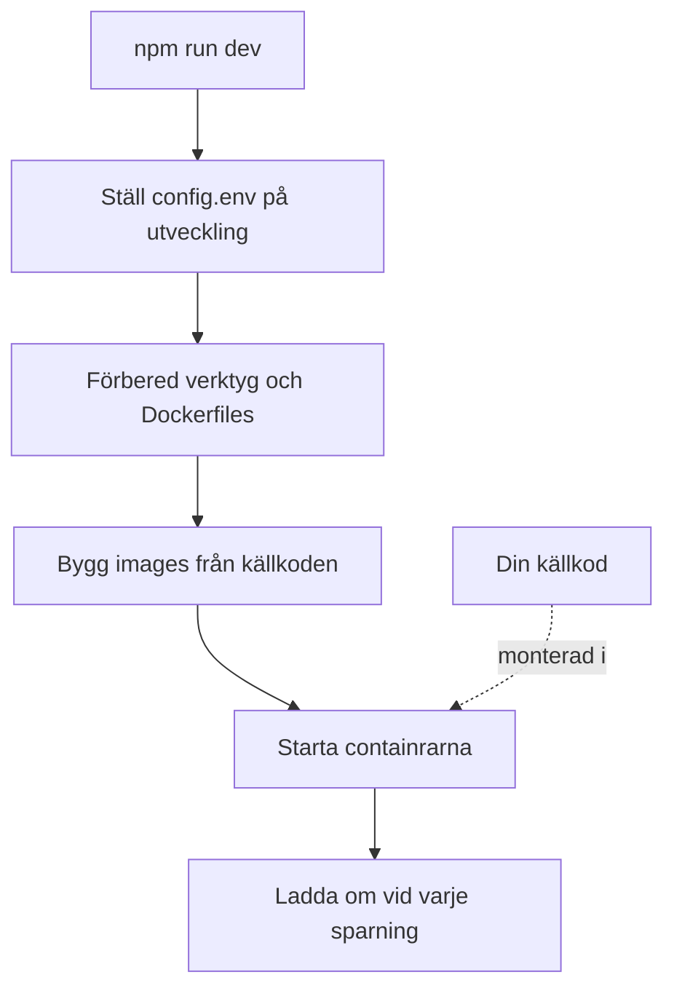

# Lokal utveckling

Kör OneUptime från källkoden på din egen dator för att arbeta med det. Utvecklingsstacken bygger varje tjänst från din utcheckning, monterar din källkod i containrarna och laddar om dem när du sparar en fil.

Vill du i stället köra en publicerad version använder du [Docker Compose](/docs/installation/docker-compose).

## Så fungerar utvecklingsstacken

`npm run dev` förbereder din utcheckning och startar sedan stacken som definieras i `Scripts/Dev/docker-compose.dev.yml`:



| Fas | Vad som händer |
| --- | --- |
| Byt till utveckling | Sätter `ENVIRONMENT=development` i `config.env`. |
| Förbered | Frågar efter ditt sudo-lösenord, installerar verktyg som saknas (Git, curl, Node.js, Docker, gomplate, ts-node), kör `git pull` på din aktuella gren, lägger till nya inställningar från `config.example.env` i `config.env` och gör en `Dockerfile` av varje `Dockerfile.tpl`. |
| Bygg | Bygger en image för varje tjänst från källkoden. Det första bygget tar en stund. |
| Kör | Startar containrarna med din källkod monterad i dem. |
| Ladda om | Appen startar om sitt API när en serverfil ändras och bygger om dashboards medan du redigerar dem. |

När repositoryts mapp `ee/` finns läser Appen in Enterprise Edition därifrån. Sätt `ONEUPTIME_EDITION=community` i `config.env` för att i stället köra Community Edition.

## Innan du börjar

| Du behöver | Anteckningar |
| --- | --- |
| **Docker** | Docker Desktop på macOS och Windows, eller Docker Engine med pluginet Docker Compose v2 på Linux. |
| **Node.js 26 eller senare, och npm** | Versionen som repositoryts `package.json` kräver och som CI använder. |
| **Git** | För att klona repositoryt. |
| **Sudo-åtkomst** | `npm run dev` frågar efter ditt lösenord innan det installerar något. |
| **Lediga portar 80 och 443** | Stacken serverar OneUptime på `http://localhost` (port 80), och HTTPS på port 443. |

## Starta utvecklingsstacken

:::steps
### Klona repositoryt

```bash
git clone https://github.com/OneUptime/oneuptime.git
cd oneuptime
```

### Skapa config.env

```bash
cp config.example.env config.env
```

Exempelvärdena fungerar som de är för utveckling. Du kan ändra dem, men du behöver inte.

### Starta stacken

```bash
npm run dev
```

Den frågar efter ditt sudo-lösenord, bygger sedan images och startar containrarna i bakgrunden. Följ när Appen startar med `docker logs -f oneuptime-app-1`.

### Öppna OneUptime

Öppna `http://localhost` och registrera dig. Det första kontot blir master admin, som kan öppna Admin Dashboard på `http://localhost/admin`.
:::

## Arbeta med koden

Redigera filerna under `packages/` och spara: containrarna tar upp ändringen.

Kontrollera din ändring på din dator, utanför containrarna, innan du öppnar en pull request. Installera beroendena för det en gång: kör `npm install` i repositoryts rot, för ESLint och migreringsverktygen, och sedan `npm run install-modules`, som tar bort och installerar om varje pakets `node_modules` och tar en stund.

:::steps
### Kompilera det du har ändrat

Kör kompilatorn i varje paket du har ändrat, till exempel Appen:

```bash
cd packages/App
npm run compile
```

### Linta bara dina filer

Ange från repositoryts rot de filer du har ändrat:

```bash
npx eslint --fix packages/App/path/to/File.ts
```

Undvik `npm run lint` och `npm run fix-lint`: de lintar hela repositoryt.

### Kör testerna som täcker din ändring

Kör från paketet de testfiler som spelar roll i stället för hela sviten:

```bash
cd packages/App
npx jest Tests/path/to/YourChange.test.ts
```
:::

### Databasmigreringar

| Databas | Så lägger du till en migrering |
| --- | --- |
| PostgreSQL | Ändra modellen och kör sedan `npm run generate-postgres-migration` i stället för att skriva migreringen för hand. Registrera den nya filen i `packages/Common/Server/Infrastructure/Postgres/SchemaMigrations/Index.ts`: den körs inte förrän den står där. `npm run check-postgres-schema-drift` skriver ut varje sats som fortfarande saknas. |
| ClickHouse | Skriv migreringen för hand i `packages/App/FeatureSet/Workers/DataMigrations`, efter mönster av de befintliga. |

## Referens

### Kommandon

Kör dem från repositoryts rot.

| Uppgift | Kommando |
| --- | --- |
| Starta stacken, eller tillämpa ändringar i `config.env` | `npm run dev` |
| Bygg om images efter en ändring av beroenden | `npm run build`, sedan `npm run dev` |
| Bygg om images från grunden | `npm run force-build-dev`, sedan `npm run dev` |
| Lista containrarna som körs | `docker ps` |
| Följ loggarna för en tjänst | `docker logs -f oneuptime-app-1` |
| Stoppa stacken och ta bort dess containrar | `npm run down` |

`npm run down` behåller dina data: volymerna för PostgreSQL och ClickHouse finns kvar.

### Portar

Utvecklingsstacken publicerar datalagren så att du kan ansluta till dem med dina egna verktyg. Lösenorden finns i `config.env`.

| Tjänst | Adress | Logga in med |
| --- | --- | --- |
| OneUptime | `http://localhost` | Kontot du skapade |
| PostgreSQL | `localhost:5400` | Användare `postgres`, databas `oneuptimedb`, lösenord `DATABASE_PASSWORD` |
| ClickHouse | `localhost:8189` (HTTP), `localhost:9034` (native) | Användare `default`, databas `oneuptime`, lösenord `CLICKHOUSE_PASSWORD` |
| Valkey | `localhost:6310` | Lösenord `VALKEY_PASSWORD` |

## Felsökning

:::details npm run dev stannar vid git pull
`npm run dev` kör `git pull` på din aktuella gren innan det bygger. Git vägrar på en gren utan upstream, eller när pull skulle skriva över dina ändringar som inte är committade. Ställ in grenens upstream (till exempel genom att pusha den med `git push -u origin <branch>`) eller committa ditt arbete, och kör sedan `npm run dev` igen.
:::

:::details npm run dev stannar när det installerar ett verktyg
Installera verktyget själv, till exempel gomplate eller ts-node, och kör `npm run dev` igen: det hoppar över alla verktyg som redan är installerade.
:::

:::details En tjänst misslyckas efter att du ändrat dess beroenden
Images innehåller fortfarande de gamla beroendena. Bygg om dem med `npm run build` och starta sedan stacken igen med `npm run dev`. Räcker inte det bygger du om från grunden med `npm run force-build-dev`.
:::

:::details Port 80 eller 443 används redan
Ett annat program på din dator, ofta en lokal webbserver, använder porten. Stoppa det och kör sedan `npm run dev` igen.
:::

## Nästa steg

:::cards
- [Egenvärdad arkitektur](/docs/self-hosted/architecture): Hur tjänsterna du just startade hänger ihop.
- [Docker Compose](/docs/installation/docker-compose): Kör en publicerad version på en server.
- [API-referens](/docs/api-reference/api-reference): Anropa API:t för din lokala instans.
:::
