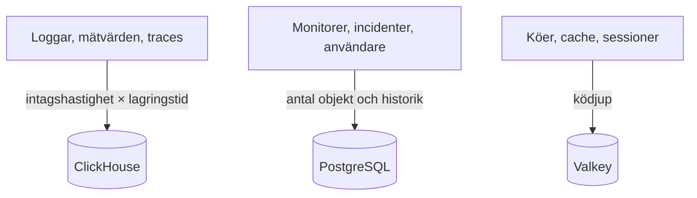

# Dimensionering och kapacitetsplanering

Planera CPU, minne och disk för en egenvärdad OneUptime på Kubernetes med [Helm-charten](https://artifacthub.io/packages/helm/oneuptime/oneuptime). Dimensionera de tre datalagren – **ClickHouse**, **PostgreSQL** och **Valkey** – och applikationen var för sig, börja från en av nivåerna nedan och justera när du har riktiga siffror.

> [!IMPORTANT]
> Chartens standardvärden är ingen produktionsdimensionering. Tjänsterna den kör som standard sätter **inga CPU- eller minnes-requests eller -gränser**, och PostgreSQL och ClickHouse får små volymer på **25 Gi**, så att charten går att installera på alla kluster. För allt utöver ett test sätter du själv resurser och lagring, med siffrorna på den här sidan.

Kör du i stället Docker Compose-installationen på en enda server? Den är enklare att dimensionera: se [kraven](/docs/installation/docker-compose#requirements) (16 GB minne, 8 kärnor och 400 GB disk rekommenderas).

:::cards
- [Vad som får varje datalager att växa](#what-drives-each-datastore): Tre lager som växer med tre olika saker.
- [Startnivåer](#starting-tiers): Små, medelstora och stora utgångspunkter.
- [Hög tillgänglighet](#high-availability): Repliker och failover för varje datalager.
- [Lagringstid](#retention-and-how-it-affects-storage): Inställningen som multiplicerar din disk.
:::

## Dimensionera din installation

:::steps
1. Ta reda på hur mycket telemetri du skickar: antal GB loggar, mätvärden och traces per dag. Mät det på en liten installation om du kan.
2. Bestäm hur många dagar du ska behålla det. Lagringstiden multiplicerar ClickHouse-disken (se [Lagringstid](#retention-and-how-it-affects-storage)).
3. Räkna ut ClickHouse-disken med [lagringsformeln](#storage-formula), och sedan PostgreSQL och Valkey utifrån deras egna avsnitt.
4. Välj den [startnivå](#starting-tiers) som ligger närmast dina siffror och sätt dess CPU, minne och lagring i dina Helm-values.
5. Slå på [hög tillgänglighet](#high-availability) för de datalager som behöver det, följ sedan den faktiska användningen och justera.
:::

## Vad som får varje datalager att växa

OneUptime behöver tre datalager i produktion. Vart och ett växer med något olika, så dimensionera dem oberoende av varandra.



| Datalager | Vad det lagrar | Vad som avgör storleken |
| --- | --- | --- |
| **ClickHouse** | All telemetri – loggar, mätvärden, traces, undantag, profiler | Telemetri: **intagshastighet × lagringstid**. Det är ~95 % av din lagring och den största kostnaden. |
| **PostgreSQL** | Konfiguration och tillstånd – monitorer, incidenter, larm, användare, team, projekt, arbetsflöden, statussidor, dashboards | **Antal objekt och historik**, inte telemetrivolymen. Växer långsamt. |
| **Valkey** | Cache, arbetsköer och sessioner | **Ködjup och aktiva sessioner**. Minnesbundet och blygsamt. Ingen auktoritativ datakälla. |

OneUptime behöver aldrig objektlagring (S3, MinIO) för att köra, och det flyttar inte äldre telemetri till objektlagring. Du behöver bara objektlagring om du väljer säkerhetskopior till objektlagring: pluginet Barman Cloud för CloudNativePG, eller [clickhouse-backup](https://github.com/Altinity/clickhouse-backup) för ClickHouse. Chartens egen CloudNativePG-säkerhetskopia (`postgresOperator.cnpg.backup`) tar volym-snapshots och behöver ingen objektlagring. CloudNativePG tar aldrig bort gamla snapshots: rensa dem själv, annars fortsätter de att växa.

## ClickHouse – den största faktorn

Nästan all din lagring och en stor del av ditt minne går till ClickHouse, eftersom varje loggrad, varje mätpunkt, varje trace-span och varje undantag finns där.

### Lagringsformel

```text
ClickHouse disk ≈ (daily raw telemetry GB ÷ compression) × retention days × replicas × 1.3 (headroom)
```

Komprimeringen beror på signalen:

| Signal | Typisk komprimering | Vad som ändrar den |
| --- | --- | --- |
| Loggar | Ungefär 5:1 | Loggar komprimeras bra. |
| Mätvärden | Ungefär 2:1 | Hög **kardinalitet** på etiketter blåser upp disk och minne snabbare än den råa volymen. Håll etiketternas kardinalitet låg. |
| Traces | Mittemellan | Span-attributen du skickar. |

### Räkneexempel

En flotta på **10 kluster**, vart och ett med ungefär 10 noder och 100 poddar som loggar på INFO-nivå, producerar ungefär **50–150 GB råa loggar per kluster på 30 dagar** (ungefär 1,7–5 GB per dag och kluster). För hela flottan, med mätvärden och traces tillagda och efter komprimering, budgetera ungefär **5–15 GB komprimerad telemetri per dag**.

| Lagringstid | En replik | 2 repliker + 30 % marginal |
| --- | --- | --- |
| 30 dagar | ~150–450 GB | **~0,4–1,2 TB** |
| 90 dagar | ~0,45–1,35 TB | **~1,2–3,5 TB** |

Lagringen växer **linjärt med lagringstiden**: ett fönster på 90 dagar kostar ungefär tre gånger så mycket som ett på 30.

### Minne och disktyp

- **Använd NVMe eller SSD.** Telemetri är skrivtung med skurar av aggregeringsläsningar; ClickHouse har det svårt på roterande diskar.
- **Ge ClickHouse rikligt med minne.** Aggregeringsfrågor kräver mycket minne. Som tumregel dimensionerar du minnet till 25–50 % av dina *heta* (nyligen efterfrågade) komprimerade data, med ett praktiskt golv på 16 GB för varje riktig produktionsflotta.
- **Håll koll på mätvärdenas kardinalitet.** Den är den enskilt största hävstången för både minne och disk i ClickHouse. Inför etikettkonventioner med låg kardinalitet där du samlar in mätvärden, och följ antalet aktiva serier.

## PostgreSQL – konfiguration och tillstånd

PostgreSQL lagrar din konfiguration och ditt driftstillstånd, inte telemetri, så det växer långsamt och förblir litet bredvid ClickHouse. Även stora installationer ligger oftast på några tiotal GB. Standardvolymen på **25 Gi** räcker för små installationer; planera 50–100 GB för större, med utrymme för historiken över incidenter och larm.

Med många repliker av app, workers och prober kan databasanslutningarna ta slut före lagringen. Varje podd öppnar som standard upp till 50 anslutningar, och den medföljande PostgreSQL tillåter 500. Just därför innehåller charten en valfri connection pooler, **PgBouncer** (`pgbouncer.enabled`): slå på den för installationer med många repliker.

## Valkey – cache, köer och sessioner

Cachelagret kör [Valkey](https://valkey.io), den BSD-licensierade forken av Redis 7.2, som cache, arbetskö och sessionslager. Vilken server som helst med Redis-protokollet kan ersätta det, och dimensioneringen nedan gäller i båda fallen. Det är **minnesbundet**, och persistens är **avstängd som standard**: det är ingen auktoritativ datakälla och kan byggas upp igen. Dimensionera det efter ködjup och samtidiga sessioner; 2–8 GB minne räcker för de flesta installationer. Dess eviction-policy är `noeviction`, så håll ett öga på minnet om köer växer under ihållande last.

## Applikationens beräkningskraft

Utöver datalagren dimensionerar du de tillståndslösa arbetslasterna. Var och en körs **utan resurs-requests eller -gränser** tills du sätter dem, och med en replik, utom telemetry writern, som har två.

| Arbetslast | Values-nyckel | Växer med |
| --- | --- | --- |
| App: dashboard, API och intag | `app` | Användare, API-anrop och inkommande telemetri |
| Workers, när de är skilda från appen | `worker` | Telemetri och bearbetning av bakgrundsjobb |
| Prober | `probes` | Antalet aktiva monitorer |
| Ingress-gateway | `nginx` | Mängden förfrågningar |
| Telemetry writer, när den är påslagen | `telemetryWriter` | Inte med lasten: den samlar varje telemetri-insert i ClickHouse, så den dimensioneras efter vad ClickHouse klarar |

Charten innehåller **KEDA**, så att appen, workers, prober och Runner kan skala efter sin köeftersläpning. Slå på `keda.enabled` tillsammans med varje tjänsts egen `keda.enabled` (till exempel `app.keda.enabled`). På ett kluster som ännu inte har KEDA behöver den första installationen en extra omgång: se chartens [KEDA-guide](https://github.com/OneUptime/oneuptime/blob/master/HelmChart/Docs/Keda.md). Tjänster som KEDA inte hanterar kan i stället använda en autoskalare baserad på CPU eller minne (`autoscaling`).

## Startnivåer

Välj den nivå som ligger närmast din miljö som utgångspunkt, följ sedan den faktiska användningen (`kubectl top pods`, diskväxten i ClickHouse och PostgreSQL) och justera.

- **Liten / PoC** – 1–3 kluster, ≤30 noder, ≤5 GB/dag rå telemetri, 30 dagars lagringstid.
- **Medel / Produktionsflotta** – ~10 kluster, ~100 noder, 10–30 GB/dag rå telemetri, 30–90 dagars lagringstid.
- **Stor / Flera flottor** – 50+ kluster, 500+ noder, 100+ GB/dag rå telemetri, 90 dagars lagringstid.

| | Liten / PoC | Medel / Produktionsflotta | Stor / Flera flottor |
| --- | --- | --- | --- |
| **ClickHouse** | 4 vCPU / 16 GB / 200 GB NVMe | 8 vCPU / 32 GB / 1–3 TB NVMe | 16+ vCPU / 64–128 GB / 5–15 TB NVMe, **shardad** |
| **PostgreSQL** | 2 vCPU / 4 GB / 50 GB SSD | 4 vCPU / 8 GB / 100 GB SSD | 8 vCPU / 16–32 GB / 250 GB SSD (+ PgBouncer) |
| **Valkey** | 1 vCPU / 2 GB | 2 vCPU / 4 GB | 4 vCPU / 8–16 GB |
| **Antagen lagringstid** | 30 dagar | 30–90 dagar | 90 dagar |

Dessa nivåer dimensionerar OneUptimes backend. Agenten du installerar på varje övervakat kluster beskrivs på sidan [Kubernetes-agent](/docs/telemetry/kubernetes-agent), som också visar hur du minskar den datamängd den skickar.

## Hög tillgänglighet

Chartens inbyggda datalager körs som standard som **enskilda instanser**. För hög tillgänglighet i produktion:

| Datalager | För hög tillgänglighet |
| --- | --- |
| **PostgreSQL** | Slå på den medföljande [CloudNativePG](https://cloudnative-pg.io)-operatorn (`postgresOperator.cnpg.enabled`) med **3 instanser** (`postgresOperator.cnpg.instances`): en primär och två hot standbys, med automatisk failover. |
| **ClickHouse** | Slå på den medföljande [Altinity](https://github.com/Altinity/clickhouse-operator)-operatorn (`clickhouseOperator.altinity.enabled`) med **2 eller fler repliker per shard** (`clickhouseOperator.altinity.cluster.replicasCount`). Dess medföljande ClickHouse Keeper körs på **3 noder** för kvorum. Lägg till shards (`shardsCount`) när en nods disk eller minne blir gränsen. |
| **Valkey** | Charten replikerar det inte. Peka OneUptime mot en extern hanterad Redis eller Valkey med automatisk failover (`externalValkey`). OneUptime ansluter till en enda värd och port, så använd tjänstens primära endpoint, inte en i klusterläge. |

> [!WARNING]
> Om du slår på någon av operatorerna för en befintlig installation startar en ny, tom databas: ingen av dem kopierar data från den enskilda instansens databas som den ersätter. Migrera dina data så som chartens guider beskriver – för [PostgreSQL](https://github.com/OneUptime/oneuptime/blob/master/HelmChart/Docs/MigratePostgresStandaloneToOperator.md) och för [ClickHouse](https://github.com/OneUptime/oneuptime/blob/master/HelmChart/Docs/MigrateClickhouseStandaloneToOperator.md).

## Lagringstid och hur den påverkar lagringen

Lagringstiden för telemetri är en **ClickHouse-TTL räknad i dagar**. Varje utgåva har projektets standard under **Projektinställningar > Telemetri och APM > Datalagring** (**Standardlagring (dagar)**); när inget är satt är den 15 dagar. [Enterprise Edition](/docs/self-hosted/enterprise) lägger till åsidosättningar: per signal (loggar, traces, mätvärden, profiler), per loggallvarlighet och trace-status, och per tjänst eller resurs.

Loggar och mätvärden tas bort en dag i taget, vid den första midnatten (ClickHouse-serverns tid) efter att deras lagringstid har gått ut, vilket besparar ClickHouse att skriva om varje dag av dem med några timmars mellanrum medan den löper ut. Strax före midnatt ligger fortfarande upp till en dag mer än lagringsfönstret kvar på disken: dimensionera loggar och mätvärden för **lagringsdagar + 1**.

Eftersom lagringstiden multiplicerar ClickHouse-lagringen bestämmer du den innan du dimensionerar disken. OneUptime arkiverar **inte** gammal telemetri och flyttar den inte heller till objektlagring. För flerårig lagring av efterlevnadsskäl förlänger du lagringsfönstret och dimensionerar ClickHouse-lagringen därefter, eller exporterar till ett externt arkiv som du väljer själv.

## Mät innan du bestämmer dig

Telemetrivolymen varierar enormt med hur utförliga applikationsloggarna är, antalet namespaces, scrape-intervallet och om DEBUG-loggning är påslagen någonstans. Se nivåerna ovan som utgångspunkter: **samla in från din miljö i minst fyra veckor**, mät de faktiska GB per dag för varje signal och dimensionera sedan lagringstid och lagring utifrån riktiga data.

## Nästa steg

:::cards
- [Docker Compose](/docs/installation/docker-compose): Krav för en installation på en enda server.
- [Egenvärdad arkitektur](/docs/self-hosted/architecture): Hur komponenterna hänger ihop.
- [Kubernetes-agent](/docs/telemetry/kubernetes-agent): Collectorn som skickar ett klusters telemetri.
- [Enterprise Edition](/docs/self-hosted/enterprise): Åsidosättningar av lagringstid och de andra Enterprise-funktionerna.
:::
