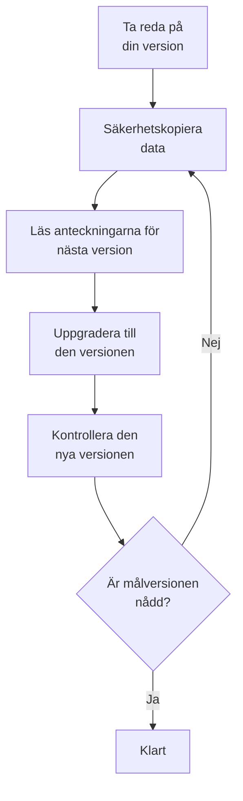

# Uppgradering

Uppgradera en självhostad OneUptime-installation – med Docker Compose, eller med Kubernetes och Helm – till en nyare version. Följ arbetsgången nedan och läs anteckningarna för varje huvudversion mellan den du kör och den du ska till.

:::cards
- [Så uppgraderar du](#så-uppgraderar-du): Arbetsgången för Docker Compose och Kubernetes.
- [Anteckningarna för varje version](#hitta-anteckningarna-för-din-version): Vad varje huvudversion kräver av dig, i korthet.
- [Avbildningar för Community Edition och Enterprise Edition](#avbildningar-för-community-edition-och-enterprise-edition): Vilken avbildning du kör från och med 14.
- [Uppgradering från OneUptime 13 → 14](#uppgradering-från-oneuptime-13-14): Den senaste huvudversionen.
:::

## Så uppgraderar du

Tre regler gör en uppgradering säker:

- **Uppgradera en huvudversion i taget** (till exempel 6 → 7 → 8). Hoppa inte över någon huvudversion.
- **Hoppa gärna över mindre versioner och korrigeringsversioner** (till exempel 8.1 → 8.4), så länge du följer deras versionsanteckningar.
- **Ta en säkerhetskopia före varje uppgradering**, och kontrollera att du kan återställa den.



:::steps
### Ta reda på din nuvarande version

Öppna som huvudadministratör utgåvemärket i sidhuvudet i administratörspanelen: **This installation** visar versionen du kör. Instansen anger den också på `/version`:

```bash
curl http://localhost/version
```

Ersätt `http://localhost` med adressen till din instans. Svaret är JSON, som `{"version":"14.0.22","commit":"..."}`.

### Säkerhetskopiera dina data

Säkerhetskopiera PostgreSQL, och ClickHouse om du behöver telemetrin där. För Docker Compose, se [Säkerhetskopiering och återställning](/docs/installation/docker-compose#säkerhetskopiera-och-återställ). På Kubernetes använder du dina volymögonblicksbilder eller chartens CloudNativePG-säkerhetskopior.

### Läs anteckningarna för nästa huvudversion

Du hittar dem i [tabellen nedan](#hitta-anteckningarna-för-din-version). Gör det de ber om innan du uppgraderar: vissa steg, som att byta namn på Helm-värden, måste göras först.

### Kör uppgraderingen

:::tabs
@tab Docker Compose
```bash
git checkout release
git pull
npm run update
```
`npm run update` lägger till nya inställningar i din `config.env` utan att ändra dina egna, hämtar de nya avbildningarna och startar om OneUptime.
@tab Kubernetes
```bash
helm repo update
helm upgrade my-oneuptime oneuptime/oneuptime -f values.yaml
```
Använd ditt eget releasenamn och din egen värdefil. Charten kör databasmigreringarna i ett eget Job innan de nya poddarna hanterar trafik.
:::

### Kontrollera den nya versionen

Med Docker Compose avslutas `npm run update` med **OneUptime is up!** På Kubernetes väntar du tills varje podd är `Running` och redo:

```bash
kubectl get pods -n <namespace>
```

Kontrollera sedan din version igen, som i första steget. Om du ännu inte har nått din målversion går du tillbaka till [Säkerhetskopiera dina data](#säkerhetskopiera-dina-data) och vidare till nästa huvudversion.
:::

### Hitta anteckningarna för din version

| Uppgradering | Vad du behöver göra |
| --- | --- |
| [13 → 14](#uppgradering-från-oneuptime-13-14) | Välj en utgåva. Docker Compose-installationer som sätter `IS_ENTERPRISE_EDITION=true` byter till `APP_TAG=enterprise-release`. Aktivera en licens på Enterprise Edition. Spara IPv6-övervakningar av typen Ping, Port och SSL igen. |
| [12 → 13](#uppgradering-från-oneuptime-12-13) | Oftast ingenting: Redis blir Valkey, och de gamla namnen på inställningarna fortsätter att fungera. Kör du Docker Compose för hand? Lägg till `--remove-orphans`. Använder du en egen cache? Läs [Om du kör en egen cache](#om-du-kör-en-egen-cache). |
| [11 → 12](#uppgradering-från-oneuptime-11-12) | Distribuera om Runbook Agents som Runners. Med Docker Compose: sätt `ONEUPTIME_RUNNER_KEY`. Med Helm: byt namn på `aiAgent:` till `runner:`. Tilldela på nytt de Runner-behörigheter som API-nycklar hade direkt. |
| [10 → 11](#uppgradering-från-oneuptime-10-11) | SCIM och teamens efterlevnadsinställningar kräver Enterprise Edition. Byt namn på de gamla ClickHouse-tabellerna före uppgraderingen för att behålla telemetrihistoriken. |
| [9 → 10](#uppgradering-från-oneuptime-9-10) | Ingenting. |
| [8 → 9](#uppgradering-från-oneuptime-8-9) | Med Helm: ta bort åsidosättningar av `oneuptimeIngress` från dina värden. |
| [7 → 8](#uppgradering-från-oneuptime-7-8) | Med Helm: gå över till den nya värdestrukturen för Postgres, Redis och ClickHouse. Ta en säkerhetskopia först. |

## Avbildningar för Community Edition och Enterprise Edition

OneUptime levererar nu applikationen som två avbildningar. **Community Edition** är öppen källkod under Apache 2.0-licensen och omfattar SAML- och OIDC-enkel inloggning, global SSO och "Require SSO for login". **Enterprise Edition** lägger till enterprise-modulerna från repositoriets katalog `ee/`: SCIM, teamefterlevnad, granskningsloggar och administratörspanelens Health-instrumentpaneler för enterprise. Före den här ändringen körde båda utgåvorna samma kod, och `IS_ENTERPRISE_EDITION` avgjorde vilka funktioner som var påslagna. Nu avgör avbildningen det, och Community-avbildningen innehåller inte katalogen `ee/`.

Sidan [Enterprise Edition](/docs/self-hosted/enterprise) har den fullständiga jämförelsen av funktioner, licensdetaljerna och vad som händer när du byter utgåva.

### Vad du ska göra före uppgraderingen

- **Community Edition utan SCIM:** ingenting. Uppgradera som vanligt.
- **Helm med `image.type: enterprise-edition`:** ingenting. Charten hämtar redan `enterprise-`-avbildningarna, som nu innehåller enterprise-modulerna.
- **Docker Compose med `IS_ENTERPRISE_EDITION=true`:** byt till Enterprise-avbildningen när du uppgraderar genom att sätta `APP_TAG=enterprise-release` (eller `enterprise-<version>`) i `config.env`. `APP_TAG=release` är Community-avbildningen, och `IS_ENTERPRISE_EDITION=true` slår inte längre på något. `npm run update` gör den här ändringen åt dig så länge `IS_ENTERPRISE_EDITION=true` (`release` blir `enterprise-release`, en låst `13.0.7` blir `enterprise-13.0.7`) och skriver ut vad den ändrade. Applikationen **vägrar nu att starta** när `IS_ENTERPRISE_EDITION=true` är satt på Community-avbildningen, i stället för att i tysthet stoppa SCIM-etablering och granskningsloggning. Felet säger vad du ska sätta: `APP_TAG=enterprise-<version>` för att behålla Enterprise Edition, eller `IS_ENTERPRISE_EDITION=false` för att köra Community Edition.
- **Community-avbildning med SCIM redan konfigurerat:** SCIM-etableringen stoppas med den här uppgraderingen, även avetableringen. Byt till Enterprise-avbildningen för att behålla den. Läs annars [Byta från Enterprise till Community](/docs/self-hosted/enterprise#byta-från-enterprise-till-community) innan du uppgraderar. Där förklaras vad som stoppas och vilka du ska ta bort först. För att köra Community Edition sätter du också `IS_ENTERPRISE_EDITION=false`. Enkel inloggning påverkas inte: Community-avbildningen levererar den också.

Din konfiguration tas aldrig bort, och ett byte av utgåva kräver ingen migrering i någon riktning.

### Licensiering efter uppgraderingen

Enterprise Edition kontrollerar nu sin licens:

- **En installation med en licensnyckel** fortsätter att köra. Den kontrollerar licensen hos OneUptime vid start och en gång om dagen. Om licensen löper ut fortsätter allt att fungera under en frist på 30 dagar, varefter samma sak händer som för en installation utan licens.
- **En installation utan licens**, till exempel en som körde Enterprise Edition enbart med `IS_ENTERPRISE_EDITION=true`, får en provperiod på 14 dagar från den första starten av den här versionen. **Om du använder SCIM eller granskningsloggning ska du aktivera en licens innan provperioden tar slut.** Efter provperioden stoppas SCIM-etableringen och granskningsloggningen slutar registrera. Enterprise-konfigurationen blir också skrivskyddad och Health-instrumentpanelerna för enterprise låses. Enkel inloggning påverkas inte. Allt fortsätter igen, utan omstart, så snart du aktiverar en licens. Provperioden är till för utvärdering: användning av Enterprise Edition i produktion kräver ett OneUptime Enterprise-abonnemang. Se [När en licens löper ut eller saknas](/docs/self-hosted/enterprise#när-en-licens-löper-ut-eller-saknas).
- **Installationer utan nätverksåtkomst** kan aktivera med en signerad licenstoken i stället för en nyckel. Se [Offlineaktivering](/docs/self-hosted/enterprise#offlineaktivering-installationer-utan-nätverksåtkomst).

### Kunder på OneUptime Cloud

För dig ändras ingenting. OneUptime Cloud kör Enterprise Edition, och din plan avgör fortfarande vilka funktioner du får: SSO, OIDC, SCIM och teamefterlevnad från Scale-planen och uppåt, och granskningsloggar på Enterprise-planen. Projekt på Scale-planen ser nu inställningarna för SSO, OIDC, SCIM och teamefterlevnad som tidigare visade en uppmaning att uppgradera.

### Ändringar i API:t och slutpunkterna

- `GET /api/global-config/license` returnerar licensnyckeln, licenstoken, listan över instanser, instans-ID:t och versionsuppgifterna bara till huvudadministratörer. Andra anropare får utgåvan och licensstatusen.
- Självhostade installationer levererar inte längre licensserverns slutpunkter under `/api/enterprise-license/`. Bara oneuptime.com använder dem.
- SCIM-slutpunkterna behåller exakt samma sökvägar på Enterprise Edition, så identitetsleverantörens konfiguration ändras inte. På Community Edition returnerar de `404`. På Enterprise Edition avvisar de förfrågningar medan licensen har löpt ut (efter provperioden eller fristen), och de svarar igen så snart en licens aktiveras.
- SSO- och OIDC-slutpunkterna (SAML-inloggnings- och ACS-URL:erna, OIDC-omdirigerings-URI:erna och slutpunkterna för global SSO) behåller exakt samma sökvägar och levereras av båda utgåvorna i varje licensstatus.

## Uppgradering från OneUptime 13 → 14

OneUptime 14 delar applikationen i två utgåvor, och avbildningen du hämtar avgör vilken du kör. **Community Edition** (Apache-2.0, taggarna `release` och `<version>`) omfattar SAML SSO, OpenID Connect, global SSO och "Require SSO for login". Den innehåller inte repositoriets katalog `ee/`, så SCIM-etablering, teamens efterlevnadsinställningar, granskningsloggar, administratörspanelens **Health**-instrumentpaneler och administratörspanelens **Query Console** finns inte alls i den avbildningen. **Enterprise Edition** (taggarna `enterprise-release` och `enterprise-<version>`) innehåller dem, och den kontrollerar en Enterprise-licens medan den kör, något OneUptime 13 aldrig gjorde. Enkel inloggning är inte beroende av den licensen.

[Avbildningar för Community Edition och Enterprise Edition](#avbildningar-för-community-edition-och-enterprise-edition) ovan är referensen för den här ändringen: vad varje utgåva innehåller, vad du ska sätta för varje typ av distribution och vad licensen gör. Det här avsnittet är själva uppgraderingen. Uppgradera från 13 – om du fortfarande är på 12 gör du 12 → 13 först.

Ingenting tas bort, i någon av utgåvorna. Enkel inloggning fungerar likadant i båda: din SSO- och OIDC-konfiguration och dina inställningar för "Require SSO for login" behålls som de är. Din SCIM-konfiguration och de granskningsloggar som har registrerats hittills ligger kvar i databasen. Community Edition levererar dem bara inte, och ett byte av utgåva kräver ingen migrering i någon riktning.

### Vad du behöver göra

1. **Bestäm vilken utgåva den här installationen kör.** Om du använder SCIM-etablering, teamens efterlevnadsinställningar eller granskningsloggar, eller vill ha administratörspanelens **Health**-instrumentpaneler, är det Enterprise Edition. Annars finns det inget att bestämma: Community Edition är det du redan har, och den omfattar SAML SSO och OpenID Connect.
2. **Med Helm: ange utgåvan i din värdefil:** `image.type: enterprise-edition` (standardvärdet är `community-edition`). Rör inte `image.tag` – charten lägger själv till prefixet `enterprise-`, så `image.tag: release` hämtar `oneuptime/app:enterprise-release`. Det här värdet är inte nytt. Om du redan kör `enterprise-edition` finns det inget att ändra: taggen du redan hämtar innehåller nu `ee/`.
3. **Med Docker Compose: sätt `APP_TAG=enterprise-release`** (eller `enterprise-<version>` för att låsa en version) i `config.env`. `APP_TAG=release` är Community-avbildningen. Det här är det enda som stoppar en installation på 13: på 13 var en Enterprise-installation med Compose `APP_TAG=release` plus `IS_ENTERPRISE_EDITION=true`, och den kombinationen **vägrar nu att starta** i stället för att komma upp som Community Edition med SCIM-etablering och granskningsloggning tyst stoppade. `npm run update` skriver om `APP_TAG` åt dig så länge `IS_ENTERPRISE_EDITION=true` (`release` blir `enterprise-release`, en låst `13.0.8` blir `enterprise-13.0.8`) och skriver ut vad den ändrade. Om du i stället hämtar avbildningarna för hand sätter du `APP_TAG` själv först.
4. **På Enterprise Edition: aktivera en licens.** En installation utan licens får en provperiod på 14 dagar, räknat från dess första start av Enterprise Edition – vid en uppgradering är det dagen du uppgraderar, inte dagen du först installerade OneUptime. En huvudadministratör aktiverar den från utgåvemärket i sidhuvudet i administratörspanelen; installationer utan nätverksåtkomst aktiverar i stället med en signerad token. Se [Licensiering](/docs/self-hosted/enterprise#licensiering).
5. **Om den här installationen ska köra Community Edition medan din identitetsleverantör avetablerar användare via SCIM, gå igenom vem som har åtkomst innan du uppgraderar.** SCIM-avetableringen stoppas, så personer som du tar bort i din identitetsleverantör behåller sina OneUptime-konton, och om inte "Require SSO for login" gäller för dem kan vem som helst som fortfarande når brevlådan för något av de kontona sätta ett lösenord med "Glömt lösenord" och logga in. Ta bort de användarna först: [Byta från Enterprise till Community](/docs/self-hosted/enterprise#byta-från-enterprise-till-community).
6. **Om du övervakar IPv6-adresser med Ping-, Port- eller SSL-övervakningar ska du spara de övervakningarna igen efter uppgraderingen.** Mål som sparades före 14 kan ha lagrats avkortade – se [IPv6-övervakningar av typen Ping, Port och SSL](#ipv6-övervakningar-av-typen-ping-port-och-ssl).

### Utgåvor: vad som ändrades och vad som inte gjorde det

| | Till och med 13 | Från 14 |
| --- | --- | --- |
| Enterprise-kod | i varje avbildning; `IS_ENTERPRISE_EDITION=true` slog på den | i `ee/`, och bara i `enterprise-`-avbildningarna |
| Väljare i Helm | `image.type` | `image.type` – oförändrad, men avbildningarna skiljer sig nu åt |
| Väljare i Compose | `IS_ENTERPRISE_EDITION=true` | `APP_TAG=enterprise-release` |
| Enterprise-licens | kontrollerades aldrig under körning | kontrolleras vid start och en gång om dagen |
| SSO- och OIDC-slutpunkter | samma sökvägar i båda utgåvorna | samma sökvägar i båda utgåvorna, oavsett licensstatus |
| SCIM-slutpunkter | samma sökvägar i båda utgåvorna | samma sökvägar på Enterprise; `404` på Community |
| Din enterprise-konfiguration | lagrad, tillämpad | lagrad i båda fallen, tillämpad på Enterprise |

En migrering körs: en kolumn `enterpriseEditionFirstSeenAt` som får vara tom, på tabellen `GlobalConfig`, som har en enda rad, så den är omedelbar. Det finns ingen ClickHouse-migrering, ingenting tas bort och ett byte av utgåva kräver ingen migrering i någon riktning.

### Licensens förlopp på Enterprise Edition

- **En installation utan licens** kör en provperiod på 14 dagar, räknat från den första starten av Enterprise Edition. Under provperioden fungerar alla enterprise-funktioner, och utgåvemärket varnar innan den tar slut. Provperioden är till för utvärdering: användning av Enterprise Edition i produktion kräver ett abonnemang enligt OneUptime Enterprise License.
- **En licens som löper ut** får en frist på 30 dagar från utgångsdatumet, under vilken alla enterprise-funktioner fungerar och utgåvemärket varnar.
- **Efter provperioden, eller efter den fristen**, och tills en licens aktiveras: SCIM-förfrågningar från din identitetsleverantör avvisas och granskningsloggningen slutar registrera. Enterprise-konfigurationen blir skrivskyddad – du kan fortfarande visa den, ta bort den och återställa en SCIM-bearertoken, vilket är det en incident kräver – och administratörspanelens Health-instrumentpaneler och Query Console låses.
- **Ingenting tas bort, och kärnövervakningen påverkas aldrig.** Övervakningar, varningar, incidenter, jour, statussidor och telemetri ligger utanför licensen, och det gör inloggningen också: inloggning med SSO och OIDC, "Require SSO for login" och inloggning med lösenord för alla användare, huvudadministratörer inräknade, fungerar likadant i varje licensstatus. När du aktiverar en licens återställs SCIM-etablering och granskningsloggning med den konfiguration du redan har, utan omstart.
- **En licensnyckel som du redan har godtas**, som licens med statusen "unverified": dess utgångsdatum och platsgräns kommer från det som licensservern redan har rapporterat till den här installationen, och den får samma frist på 30 dagar efter det utgångsdatumet. Licenser som utfärdas från och med nu är signerade och verifieras av applikationen själv. Du behöver ingen ny nyckel för den här uppgraderingen.
- **En nyckel vars utgångsdatum den här installationen aldrig har registrerat** fortsätter att fungera under provperioden i stället för att stoppas. Licensservern skriver nyckeln och utgångsdatumet var för sig, så en installation kan ha en nyckel vars utgångsdatum aldrig har rapporterats till den. En sådan installation behandlas precis som en installation utan licens: alla enterprise-funktioner fungerar under provperioden på 14 dagar, räknat från den första starten av Enterprise Edition, och efter provperioden stoppas samma saker som ovan. Platsgränsen tillämpas inte medan licensen är i det här tillståndet, eftersom installationens licenspost redan är ofullständig. En huvudadministratör som aktiverar licensen igen från utgåvemärket, eller den dagliga licenssynkroniseringen som hämtar utgångsdatumet från oneuptime.com, återställer den utan omstart.

Den fullständiga tabellen över tillstånd finns i [När en licens löper ut eller saknas](/docs/self-hosted/enterprise#när-en-licens-löper-ut-eller-saknas).

### Docker Compose: välj avbildningstaggen

```bash
git checkout release # Please make sure you're on release branch.
git pull
npm run update
```

- **`npm run update` flyttar `APP_TAG` så länge `IS_ENTERPRISE_EDITION=true`**, till Enterprise-avbildningen av samma version, och skriver ut vad den ändrade. Den behåller dina kommentarer och citattecken, lämnar en `APP_TAG` som redan är en `enterprise-`-tagg ifred och ändrar ingenting vid en andra körning.
- **Om du hämtar avbildningarna för hand hoppas det steget över**, och applikationen avslutas då vid start med ett fel som säger exakt vad du ska sätta: `APP_TAG=enterprise-<version>` för att behålla Enterprise Edition, eller `IS_ENTERPRISE_EDITION=false` för att köra Community Edition.
- **För att avsiktligt byta till Community Edition** sätter du `APP_TAG=release` och `IS_ENTERPRISE_EDITION=false`. Läs först punkt 5 ovan om din identitetsleverantör avetablerar användare via SCIM.
- Inget annat i `config.env` behöver ändras för den här versionen.

### Helm: välj avbildningstypen

```bash
helm repo update
helm upgrade my-oneuptime oneuptime/oneuptime -f values.yaml
```

- **En installation som redan är på `image.type: enterprise-edition` behöver inte ändra något värde.** Charten har länge satt prefixet framför taggen; det nya är att `enterprise-`-avbildningarna innehåller `ee/`. Licensen gäller för den från och med den här versionen, enligt förloppet ovan.
- **`image.tag: release` är standardvärdet**, så en chart som har stannat på den flytande taggen går till 14 vid nästa uppgradering utan någon ändring av värden. Om den installationen har SCIM konfigurerat på `community-edition` sätter du `image.type: enterprise-edition` i samma uppgradering.
- **`IS_ENTERPRISE_EDITION` skickas fortfarande ut av charten**, härledd från `image.type` så att de två aldrig kan vara oense. Den styr ingenting. Att tvinga den till `true` via `extraEnv` på en Community-avbildning får bara applikationen att vägra starta. Sätt aldrig `ONEUPTIME_EDITION` via charten.
- **Chartens prober respekterar åter `probes.<key>.allowPrivateNetworkMonitors`** ([#3879](https://github.com/OneUptime/oneuptime/issues/3879)). Ingenting ändras om du inte sätter den – standardvärdet förblir `false` – och den gäller för övervakningarna i alla projekt på instansen, eftersom chartens prober är globala prober. Loopback, link-local och `169.254.169.254` förblir blockerade, oavsett vad du sätter.

### Andra ändringar i 14

De här ändringarna ändrar hur OneUptime beter sig efter uppgraderingen, och de flesta kräver ingenting av dig. Läs dem om du använder anpassade roller eller API-nycklar som består av enskilda behörigheter, egna tillstånd för incidenter, varningar eller underhåll, Terraform eller API:t, SSO, eller apparna för Slack och Microsoft Teams.

:::details Läs de övriga ändringarna i 14
- **OTLP-inmatning bekräftar en batch först när kön har tagit emot den.** 13 svarade först `200` och köade efteråt, så en batch som kön avvisade gick förlorad i tysthet. 14 svarar i stället `503` med `Telemetry queue unavailable. Please retry.`, och gRPC-slutpunkten returnerar `UNAVAILABLE`; båda går att försöka igen, och exportörer försöker igen. Det gäller loggar, mätvärden, spårningar och profiler. Du behöver inte göra något, men exportörernas nya försök och köns mottryck syns nu där data tidigare försvann – bra att veta om du dimensionerar inmatningskapaciteten.
- **Administratörspanelens Health-instrumentpaneler och Query Console kräver Enterprise Edition**, tillsammans med hälsovarningarna för PostgreSQL och Valkey. På 13 följde de med enbart `IS_ENTERPRISE_EDITION=true`, så det är en synlig förlust för en Community-installation som använde dem. Kapacitetsövervakningen av ClickHouse och rensningen av den, migreringsstatus, globala prober och supportpaketet finns i båda utgåvorna.
- **HTTPS-övervakningar som når en IP-adress via en probs proxy fungerar igen.** Proben skickade IP-adressen som TLS-servernamn, vilket inte är ett giltigt servernamn och som Node avvisar direkt, så en övervakning av `https://<private IP>` från en global prob med `PROBE_ALLOW_PRIVATE_NETWORK_MONITORS` misslyckades i handskakningen. Proben utelämnar nu servernamnet för ett IP-mål och kontrollerar certifikatet mot själva IP-adressen. Mål som anges med värdnamn ändras inte.
- **CLI:n `oneuptime` anger sin verkliga version** med `--version` i stället för en platshållare.
- **En ny varning eller episod börjar i det tillstånd som skapandet anger.** API:t, Terraform (`current_alert_state_id`, `current_incident_state_id`) och arbetsflöden kan ange det tillstånd som en varning, en varningsepisod eller en incidentepisod börjar i, så som instrumentpanelens fält **Inledande tillstånd** gör. Tidigare ersattes det tillståndet av projektets skapandetillstånd; en Terraform-konfiguration som satte det fick ett annat värde än planerat. Ett skapande som inte anger något tillstånd börjar fortfarande i skapandetillståndet, och ett tillstånd från ett annat projekt avvisas. Se [Tillståndet som en ny post börjar i](/docs/api-reference/api-reference).
- **En post som skapas redan bekräftad eller löst kallar inte på någon.** En incident, varning eller episod som skapas i ett senare tillstånd – via **Inledande tillstånd**, en malls starttillstånd, API:t, Terraform eller ett arbetsflöde – kör inte längre sina jourpolicyer; dess flöde säger det i stället. En post som skapas löst grupperas inte heller längre i en episod, åtgärdas inte, utreds inte av OneUptime AI och får ingen Slack- eller Microsoft Teams-kanal, och en incident som skapas löst lämnar sina övervakningars status och övervakning ifred och startar ingen SLA. En post som skapas bekräftad startar sin SLA som redan besvarad. Poster som skapas i skapandetillståndet, som alla som en övervakning öppnar, ändras inte. Se [Deklarerad redan bekräftad eller löst](/docs/incidents/declaring-incidents#deklarerad-redan-bekräftad-eller-löst).
- **Ett tillstånd efter ditt lösta tillstånd räknas som löst överallt.** En incident, varning eller episod i ett tillstånd som du har placerat efter det lösta tillståndet – ett tillstånd **Closed** under **Löst**, till exempel – räknades som löst på vissa ställen och som öppen på andra. Alla följer nu en enda regel: projektets lösta tillstånd, och varje tillstånd efter det, är löst. Poster i ett sådant tillstånd försvinner från listorna **Aktiva incidenter** och **Aktiva varningar** och deras räknare i sidomenyn, från instrumentpanelernas listor över incidenter och varningar, från aktiva episoder och från mobilappens listor över öppna poster; sammanfattningar i Slack och Microsoft Teams räknar dem som lösta, och statussidornas tidslinjer visar en sådan rad som löst. En övervakning eller en SLO-burn-rate-regel vars incident eller varning är i ett sådant tillstånd öppnar en ny nästa gång den utlöses, där den tidigare tog den gamla för fortfarande öppen. Att flytta en incident direkt till ett sådant tillstånd löser den som **Löst** gör, och att flytta den förbi **Löst** öppnar inte längre en episod igen och startar inte en ny SLA för incidenten. Projekt vars egna tillstånd alla ligger ovanför det lösta tillståndet märker ingen skillnad. Se [Listan över aktiva incidenter](/docs/incidents/states-and-severities#listan-aktiva-incidenter).
- **Ett tillstånd efter ditt bekräftade tillstånd räknas som bekräftat överallt.** En incident, varning eller episod i ett tillstånd som du har placerat mellan dina bekräftade och lösta tillstånd – ett tillstånd **Investigating** under **Bekräftad**, till exempel – stoppade redan jouruppringningar, men mobilappen och Microsoft Teams erbjöd fortfarande **Acknowledge** för den, och att bekräfta en varning eller episod i det tillståndet (från Teams, Slack eller en joursida) flyttade tillbaka den till **Bekräftad**. Alla följer nu en enda regel: projektets bekräftade tillstånd, varje tillstånd efter det och ett löst tillstånd räknas som bekräftade. **Acknowledge** erbjuds inte längre någonstans för en sådan post, och att bekräfta den avvisas ("... is already acknowledged.") i stället för att flytta tillbaka den; en jourhavande som bekräftar sin egen uppringning för den avslutar bara uppringningen. Att flytta en post direkt till ett sådant tillstånd markerar nu incidentens SLA som besvarad – där den tidigare förblev obesvarad tills incidenten var löst, vilket kunde bryta mot svarsmålet – och räknas som dess bekräftelse i översiktens tid till bekräftelse, mätvärdet **Time to Acknowledge**, mätningarna och MTTA i sammanfattningar i Slack och Microsoft Teams. En post som löstes utan att ha bekräftats räknas nu som bekräftad vid den tidpunkt då den löstes, så som översikten redan visade. Listfiltren **Bekräftad** visar också poster i de tillstånden, och attributet `isAcknowledgedState` i mätvärdet **Time in State** är `true` för dem. Projekt vars egna tillstånd alla ligger ovanför det bekräftade tillståndet märker ingen skillnad. Se [Vad bekräftelse gör](/docs/incidents/states-and-severities#vad-bekräftelse-gör).
- **Episoder går igenom sina tillstånd enligt den regel som incidenter och varningar följer.** En incident- eller varningsepisod kunde flyttas tillbaka uppåt i sin tillståndslista – en löst episod tillbaka till **Bekräftad**, till exempel – från instrumentpanelens tillståndstidslinje, Slack, Microsoft Teams, API:t eller Terraform, och flytten gick vidare till dess incidenter eller varningar. Nu avvisas en flytt till ett tillstånd som kommer före episodens nuvarande i ordningen med det fel som en incident får ("Episode cannot transition to Acknowledged state from Resolved state because Acknowledged is before Resolved in the order of incident states."), och ingenting ändras. En grupperingsregels alternativ **Återöppna nyligen lösta episoder** öppnar fortfarande en episod igen, som OneUptimes egen flytt. För att rätta ett tillstånd som satts av misstag tar du bort dess rad från episodens tillståndstidslinje, som för en incident; episoden går tillbaka till tillståndet på sin sista kvarvarande rad, och att ta bort raden som löste den rensar dess lösningstid. En episod flyttar bara var och en av sina incidenter eller varningar dit deras eget tillstånd skulle gå: en som redan är i det tillståndet, eller längre, stannar där den är.
- **En skrivning av en posts nuvarande tillstånd följer samma regel.** Att uppdatera det nuvarande tillståndet för en incident, varning, episod eller schemalagd underhållshändelse via API:t eller Terraform (`currentIncidentStateId`, `currentAlertStateId`, `currentScheduledMaintenanceStateId`) avvisas innan något sparas när posten flyttas tillbaka uppåt i sin lista, med samma fel. Tidigare nådde skrivningen posten och tillståndstidslinjen avvisade den efteråt, så att posten lämnades i ett tillstånd som dess tidslinje aldrig hade haft. Att skriva tillståndet för en incidentepisod registrerar det nu i episodens tillståndstidslinje och flyttar dess incidenter, så som skrivning av tillståndet för en varningsepisod redan gjorde. En Terraform-plan som sätter ett tidigare tillstånd misslyckas vid apply; sätt tillstånden i ordning, eller ändra tillståndet med en rad i tillståndstidslinjen.
- **Change State i Slack och Microsoft Teams erbjuder bara de tillstånd som en post får gå till härnäst.** En post i det sista tillstånd den kan nå får svaret "There is no later state to move this incident to." i stället för ett formulär där varje val skulle avvisas. Menyn **Change state to** i instrumentpanelens sidhuvud följer samma regel.
- **Felet för en schemalagd underhållshändelse som flyttas tillbaka uppåt i sin lista lyder nu som de andra:** "Scheduled Maintenance cannot transition to Scheduled state from Ongoing state because Scheduled is before Ongoing in the order of scheduled maintenance states." (tidigare stod det `ScheduledMaintenance` och `scheduledMaintenance states`). Ett skript som jämförde med den gamla texten behöver den nya. Se [Ordningen är en verklig begränsning](/docs/incidents/states-and-severities#ordningen-är-en-verklig-begränsning-inte-en-visningspreferens).
- **Att lösa en incident ger bara tillbaka de övervakningar den håller.** OneUptime registrerar nu om en incident håller sina övervakningars status. En incident som redan har lösts en gång och sedan öppnats igen sätter inte längre tillbaka sina övervakningar till drift när den löses igen, så en status som de har fått under tiden – från sina prober, från underhåll eller satt för hand – står kvar; att ändra dess övervakningar, eller statusen den sätter dem i, medan den är öppen får den att hålla dem igen. Incidenter från före uppgraderingen ger tillbaka sina övervakningar vid nästa lösning, som de alltid har gjort. Se [Vad lösning gör](/docs/incidents/states-and-severities#vad-lösning-gör).
- **En incidents eller varnings episod sätts bara via episodens medlemmar.** `incidentEpisodeId` och `alertEpisodeId` (och relationerna `incidentEpisode` och `alertEpisode`) är skrivskyddade. API:t, Terraform (`incident_episode_id`, `alert_episode_id`), MCP-verktyg och arbetsflöden kunde skriva dem utan att lägga till posten i episoden: episodens översikt visade då en incident eller varning som dess sida **Medlemmar** inte hade, och en post som skapades med en episod satt grupperades aldrig. Ett skapande eller en uppdatering som skickar en av dem avvisas nu, med ett meddelande som hänvisar till episodens medlemmar: lägg till posten med `POST /api/incident-episode-member` (eller `/api/alert-episode-member`) och ta bort den medlemmen för att ta bort den, så följer referensen till episoden med. Läsning ändras inte. En Terraform-konfiguration som sätter `incident_episode_id` eller `alert_episode_id` måste ta bort det så snart du uppgraderar providern, som nu bara läser dem; resurserna `oneuptime_incident_episode_member` och `oneuptime_alert_episode_member` hanterar medlemskapet. Se [Episoden som en incident eller varning finns i](/docs/api-reference/api-reference).
- **Nya eskaleringsregler för inkommande samtal ringer i 20 sekunder, inte 30.** Många telefoner skickar ett obesvarat samtal till röstbrevlådan inom 30 sekunder, och en röstbrevlåda som svarar avslutar samtalet där i stället för att skicka det vidare till nästa regel. Instrumentpanelens fält **Ringtid (i sekunder)**, API:t (`escalateAfterSeconds`) och Terraform-providern (`escalate_after_seconds`) startar nu en ny regel på 20. Regler som redan finns behåller sin ringtid: uppgraderingen ändrar bara kolumnens standardvärde. En Terraform-konfiguration som utelämnar `escalate_after_seconds` kommer att planera `30 -> 20` för reglerna den hanterar så snart du uppgraderar providern; sätt `escalate_after_seconds = 30` för att behålla 30. Se [Policy för inkommande samtal](/docs/on-call/incoming-call-policy).
- **Sammanfattningar i Slack och Microsoft Teams behåller sin tid på dygnet när klockan ställs om.** En sammanfattning har nu en tidszon, och dess schema läses på den klockan. Hittills lästes det i UTC, så en sammanfattning inställd på 09:00 i Berlin kom fram där kl. 08:00 när vintertiden kom tillbaka. Uppgraderingen ger varje befintlig sammanfattning tidszonen från skaparens profil, den klocka som instrumentpanelen visade den, eller UTC när den inte har någon skapare med en tidszon (en API-nyckel skapade den), vilket är vad den lästes i hittills. Inget nästa utskick förskjuts under uppgraderingen; från och med sitt nästa utskick går en sammanfattning som hade förskjutits en timme tillbaka till tiden för sin första sammanfattning, och en månatlig sammanfattning den 29:e till 31:a glider inte längre till den 28:e. API:t och Terraform (`timezone`) godtar namnet på en IANA-tidszon; en sammanfattning som skapas utan får tidszonen från skaparens profil, eller UTC när en API-nyckel skapar den, och ett namn som inte är en tidszon avvisas. Se [Sammanfattningar](/docs/workspace-connections/slack#sammanfattningar).
- **Flödesposten "uppdaterad" för en incident eller varning registrerar bara det som ändrades.** Att spara kortet **Incidentdetaljer** efter att bara ha ändrat titeln, eller en API-klient, ett arbetsflöde eller ett skript som skrev tillbaka en incident eller varning oförändrad, lade till en post som upprepade titeln, beskrivningen, grundorsaken, åtgärdsanteckningarna och etiketterna den hade – också publicerad i incidentens eller varningens kanaler i Slack och Microsoft Teams –, och varje skrivning med etiketterna eller växeln **Skicka påminnelser** startade om påminnelseintervallet även när ingenting ändrades, så en incident som redigerades ofta sköt hela tiden upp sina påminnelser. Nu skrivs varje rad för ett värde som ändrades, och ingenting för en sparning som inte ändrade något; påminnelseregeln tillämpas igen, och intervallet startar om, bara när allvarlighetsgraden eller etiketterna ändras eller när **Skicka påminnelser** slås av eller på. Text som läses likadant räknas som likadan (bortsett från radbrytningar och blanksteg runt den), och etiketter som samma mängd i valfri ordning. Varningar registrerar nu också en ändrad grundorsak på sin sida, som de tidigare tappade om inte titeln ändrades samtidigt, och en tömd beskrivning, grundorsak eller tömda åtgärdsanteckningar. Att ta bort alla etiketter registreras som "All labels removed.". Se [Vad flödet registrerar](/docs/incidents/notes-owners-and-feed#vad-flödet-registrerar).
- **Flödesposten "uppdaterad" för en schemalagd underhållshändelse eller en övervakning registrerar också bara det som ändrades.** Att spara en underhållshändelses kort **Maintenance Details** eller **Berörda resurser**, eller en övervaknings detaljer, utan att ändra något, eller en API-klient, ett arbetsflöde, Terraform eller ett skript som skrev tillbaka en underhållshändelse eller övervakning oförändrad, lade till en post som upprepade titeln (en övervaknings namn), fönstret, beskrivningen, påminnelserna, statussidorna, de berörda resurserna och etiketterna den hade – också publicerad i dess kanaler i Slack och Microsoft Teams –, och varje skrivning med en underhållshändelses etiketter eller dess växel **Skicka påminnelser** startade om dess påminnelseintervall. Nu skrivs varje rad för ett värde som ändrades, och ingenting för en sparning som inte ändrade något; en underhållshändelses påminnelseregel tillämpas bara igen när dess etiketter ändras eller när **Skicka påminnelser** slås av eller på. En tidpunkt räknas som likadan när den anger samma ögonblick, oavsett hur den är skriven, och påminnelser, statussidor, berörda resurser och etiketter som samma mängd i valfri ordning. Att tömma en underhållshändelses beskrivning, påminnelser, statussidor eller etiketter, eller en övervaknings beskrivning eller etiketter, registreras nu, och en övervaknings namn, beskrivning och etikettnamn visas så som de skrevs i stället för att läsas som Markdown. En underhållshändelse som flyttas från **Schemalagd** direkt till ett eget tillstånd placerat mellan **Pågående** och **Avslutad** börjar nu som **Pågående** gör: dess övervakningar går till dess **Ändra övervakningsstatus till**, där de hittills stannade som de var. Se [Schemalagda underhållshändelser](/docs/status-pages/subscribers#schemalagda-underhållshändelser).
- **En underhållshändelse i ett eget tillstånd före Pågående börjar på sin tid och visas som kommande.** En schemalagd underhållshändelse som flyttades från **Schemalagd** till ett eget tillstånd placerat ovanför **Pågående** – ett steg "Confirmed", till exempel – startades aldrig vid sin **Börjar den**: dess övervakningar gick inte in i underhåll och dess ägare och prenumeranter meddelades inte, förrän någon flyttade den för hand. Den försvann också från de kommande händelserna på dess statussidor och deras RSS- och Atom-flöden, från Microsoft Teams-appens schemalagda underhåll, och påminnelserna till dess prenumeranter före händelsen kastades. Nu börjar den på sin tid som en underhållshändelse som har lämnats i **Schemalagd**, och fram till dess visas och påminns den som en kommande. En underhållshändelse i ett sådant tillstånd vars start redan har passerat startas inom en minut efter uppgraderingen – och avslutas en minut senare om dess **Slutar den** också har passerat –, och dess ägare och prenumeranter meddelas som vid varje start och avslut; så innan du uppgraderar ska du flytta vidare eller ta bort varje sådan kvarlämnad underhållshändelse. Ett eget tillstånd placerat före **Schemalagd** – ett utkast eller ett godkännandesteg – lämnas fortfarande åt en människa, som tidigare. Fyra mindre ändringar följer med. Varje tillståndsändring för en underhållshändelse beräknar direkt statusen för de nätverksplatser den täcker, även när den går tillbaka för att posten för tillståndet den är i har tagits bort från dess **Tillståndstidslinje**, där ett steg tillbaka hittills väntade på femminutersskanningen. En underhållshändelse är slutförd i **Slutförd** och i varje eget tillstånd placerat efter det – "Archived": dess ägares påminnelser schemaläggs inte längre om för den efter en ändring av påminnelseregeln, Microsoft Teams behandlar den som stängd när den letar efter reaktioner att göra till anteckningar, och dess flöde och statussidans tidslinje markerar den som avslutad. Underhållshändelsens kort **Mätningar** behandlar en underhållshändelse i ett eget tillstånd placerat efter **Avslutad** som avslutad, så som dess sidhuvud gör, och "att gå in i det avslutade tillståndet" och "att gå in i det slutförda tillståndet" är övergångarna till ett tillstånd där underhållshändelsen är avslutad eller slutförd, så en underhållshändelse som slutförs direkt från **Pågående** registrerar sitt slut där. Och ett tillstånd som bär mer än en av de fyra inbyggda flaggorna läses nu likadant i underhållshändelsens sidhuvud och på servern. Projekt utan egna tillstånd ser bara ändringarna för nätverksplatser och mätningar. Se [Schemalagda underhållshändelser](/docs/status-pages/subscribers#schemalagda-underhållshändelser).
- **En underhållshändelse i ett eget tillstånd efter Pågående räknas som pågående överallt.** En schemalagd underhållshändelse som flyttades från **Pågående** till ett eget tillstånd placerat ovanför **Avslutad** – ett steg "Verifying", till exempel – höll sina övervakningar i underhåll, men inget annat såg den som pågående: översikten på dess statussidor utelämnade den helt, nätverksplatserna och telemetriserierna den täcker tystades inte längre, SLO-burn-rate-varningar på dess övervakningar utlöstes, listorna **Pågående** under **Schemalagt underhåll** och **Hem**, deras menymärken och rutan **Pågående underhåll** utelämnade den, Microsoft Teams-appen visade den inte, och ingenting avslutade den vid dess **Slutar den**: den stannade i det tillståndet, med sina övervakningar i underhåll, tills någon flyttade den. Alla följer nu en enda regel: en underhållshändelse är pågående i det pågående tillståndet och i varje eget tillstånd placerat mellan **Pågående** och **Avslutad**. En sådan underhållshändelse avslutas vid sin **Slutar den** som en pågående och meddelar sina prenumeranter om **När händelsen slutar** är påslaget, så en underhållshändelse som har stannat i "Verifying" efter sitt slut avslutas inom en minut efter uppgraderingen. Ett eget tillstånd placerat efter **Avslutad** – "Reviewing" – är avslutat: att flytta en underhållshändelse dit från **Pågående** eller från "Verifying" avslutar den nu som **Avslutad** gör, där dess övervakningar hittills stannade i underhåll för alltid, och underhållshändelsens sidhuvud erbjuder inte längre **Markera som Avslutad** för den. Ett tillstånd placerat före **Pågående** väntar fortfarande på starten. Att flytta en underhållshändelse för hand till ett eget tillstånd som startar eller avslutar den utlöser **Meddela statussideprenumeranter** så som **Markera som Pågående** eller **Markera som Avslutad** skulle göra. Statussidans sida med schemalagda händelser och dess RSS- och Atom-flöden visar också en pågående underhållshändelse som startade före sidans historikfönster. Projekt vars egna tillstånd alla ligger före **Pågående** märker ingen skillnad. Tre mindre rättningar följer med: att flytta en underhållshändelses **Börjar den** flyttar med dess första påminnelse när dess påminnelseregel väntar på starten; att ta bort dess sista berörda resurs utöver övervakningar registreras i dess flöde som "No other affected resources."; och en **Börjar den** eller **Slutar den** som skrivits utan tidszon jämförs som UTC, så som den lagras, så en server som inte kör i UTC registrerar inte längre en flytt som inte har skett. Se [Schemalagda underhållshändelser](/docs/status-pages/subscribers#schemalagda-underhållshändelser).
- **Att spara tillbaka en hemlighet oförändrad ändrar ingenting.** En övervakningshemlighet, en arbetsflödesvariabel, en runbook-hemlighet eller -autentiseringsuppgift, API-nyckeln för en LLM-leverantör, en OIDC-klienthemlighet och de andra värden som OneUptime lagrar krypterade krypteras om vid varje sparning, så en sparning som skickade tillbaka en av dem oförändrad såg ut som en ändring: den körde postens **On Update**-arbetsflöden, skickade posten till öppna instrumentpaneler och lade till en post i granskningsloggen. Ett värde som skrivs tillbaka oförändrat räknas nu som oförändrat; ett nytt värde gör fortfarande alla tre sakerna och förblir lagrat krypterat.
- **På OneUptime Cloud slutar API-nycklar att fungera under sin plan, och SCIM tar bara bort personer.** Ett projekts API-nycklar kräver **Growth** och dess SCIM-anslutningar – projektets och dess statussidors – kräver **Scale**. Hittills fortsatte de att fungera efter att en provperiod tagit slut eller projektet gått över till en lägre plan. Nu avvisas varje förfrågan med en av projektets API-nycklar – REST-API:t, Terraform, CLI:n, MCP-klienter anslutna med en API-nyckel – med `402` och ett meddelande som anger planen, och varje SCIM-förfrågan som skulle lägga till eller ändra personer eller grupper avvisas med `402` i SCIM:s felformat. SCIM inaktiverar, tar bort och avlägsnar fortfarande personer på alla planer, så den som slutar förlorar fortfarande sin åtkomst. Ingenting tas bort: de fungerar fullt ut igen, som de är, så snart projektet är tillbaka på planen, inom en minut. Projektets ägare får ett e-postmeddelande när en planändring stoppar dem, och ägarna till projekt som redan låg under de här planerna får ett enda e-postmeddelande efter den här uppgraderingen om vad som stoppades och hur de slår på det igen. **Projektinställningar** > **Fakturering** anger hur många som en lägre plan stoppar eller begränsar. Personer som loggar in, MCP-klienter anslutna genom inloggning, inmatningsnycklar för telemetri, probnycklar och agentnycklar påverkas inte, och självhostade installationer (utan planer) märker ingen skillnad. Se [API-nycklar och SCIM under sin plan](/docs/api-reference/api-reference).
- **En växel som skrivs som text är den växel som lagras, och en sparning som inte ändrar något startar ingenting.** API:t, Terraform och arbetsflöden kan skicka ett på/av-fält som text eller som tal: `"true"`, `"yes"`, `"on"`, `"1"` eller `1` för på, `"false"`, `"no"`, `"off"`, `"0"` eller `0` för av. Databasen lagrade dem alltid som på eller av, men OneUptime självt läste texten: en schemalagd underhållshändelse som skickades med `"isVisibleOnStatusPage": "true"` dök upp på sin statussida med sina bilder lämnade privata, så att de inte laddades där, och en övervakning som skickades med `"isArchived": "false"` förblev oarkiverad men märktes med vem som hade arkiverat den, och när. Nu är vart och ett av de här värdena det på eller av som databasen lagrar, överallt där OneUptime läser det. Ett värde som databasen inte kan lagra, som `"maybe"`, `""` eller `2`, avvisas med `400` och ett meddelande som anger fältet (`isEnabled must be true or false.`) i stället för med ett serverfel; det omfattar `""` för varnings- och incidentalternativen i en SLO-burn-rate-regel, som tidigare lästes som deras standardvärde. Att skriva tillbaka en post med de värden den redan har – en avslagen växel skickad som av, ett antal på 0 som 0, samma etiketter i en annan ordning – startar inte längre dess **On Update**-arbetsflöden, skickar ingen uppdatering i realtid och lägger inte till någon post i granskningsloggen, och en post för en verklig ändring anger bara de ändrade fälten. Ett arbetsflödes **Listen on** hör nu bara de fält som en uppdatering ändrar, och hör varje ändring av dem: ett som lyssnar på en växel körs också när växeln slås av, vilket det tidigare missade. Se [Växlar](/docs/api-reference/api-reference).
- **Runners har flyttat från Projektinställningar till Runbooks.** Runners finns nu under **Runbooks → Runbook-agenter** (`…/runbooks/runners`) och autentiseringsuppgifter för Runners under **Runbooks → Runbook-agenter → Autentiseringsuppgifter** (`…/runbooks/runner-credentials`), bredvid de runbooks vars steg de kör. De gamla URL:erna `…/settings/runners` och `…/settings/runner-credentials` omdirigerar, så bokmärken fortsätter att fungera. Inget annat ändras: Runners behåller sina ID:n, nycklar, förmågor och behörigheter, och de kör fortfarande AI-kodfixar och AI-åtgärdskommandon. En Runner-avbildning som är äldre än den här versionen skriver fortfarande "Project Settings > Runners" i sina loggmeddelanden; läs det som Runbooks → Runbook-agenter.
- **Uppdateringar i realtid slutar med inloggningen som öppnade dem, och frågar det som varje förfrågan frågar.** En öppen sidas uppdateringar i realtid – räknarna i sidhuvudet, liveloggar, AI-chatten – stoppas nu när dess inloggning slutar: vid utloggning, ett lösenordsbyte, en blockering eller när åtkomsttoken på 15 minuter löper ut. En minut innan token löper ut förnyar sidan sin inloggning och ansluter igen av sig själv, så dess uppdateringar i realtid fortsätter; en inloggning som inte kan förnyas skickar personen till inloggningssidan, som tidigare. Ett projekt som kräver SSO, eller en instans som kräver det, ger bara uppdateringar i realtid till sidor som är inloggade med SSO, och skickar en sida utan sådan inloggning till inloggning med SSO, så som dess förfrågningar redan gjorde – även sidor som redan var öppna när kravet slogs på. En ändring av någons behörigheter, en blockering eller förlust av rollen som huvudadministratör når direkt personens öppna sidor, på varje applikationsserver i stället för bara den som gjorde ändringen: varje applikationsserver håller en extra anslutning till Valkey, prenumererad på kanalen `oneuptime:realtime:access-changes`. När den kanalen inte kan nås kommer en server ikapp med behörigheter inom 30 sekunder, med en blockering inom en minut och med en session eller en nyligen krävd SSO-inloggning inom åtkomsttokens 15 minuter. Se [Användare, team och behörigheter](/docs/permissions/index).
- **Att stänga av ett projekts SSO-leverantör, eller ta bort den, avslutar de inloggningar den gav.** Där SSO krävs måste personer som loggade in med en SAML- eller OIDC-leverantör som stängs av eller tas bort logga in med SSO igen vid sin nästa förfrågan, deras öppna sidor slutar få uppdateringar i realtid, och MCP-klienter som de anslöt med den inloggningen måste anslutas igen. Att slå på leverantören igen ger inte tillbaka de inloggningarna, och en leverantör som redan var avstängd vid uppgraderingen räknas som avstängd vid uppgraderingen. Ett nytt certifikat eller en ny klienthemlighet håller alla inloggade. Så länge ett projekt kräver SSO kan dess sista leverantör, och den leverantör det kräver, inte stängas av eller tas bort förrän "Require SSO for Login" har stängts av; när hela servern kräver SSO kan ett projekts sista leverantör inte stängas av eller tas bort förrän en annan är påslagen. Se [SSO](/docs/identity/sso#stänga-av-eller-ta-bort-en-leverantör).
- **Globala SSO-leverantörer och statussidors SSO-leverantörer avslutar sina inloggningar på samma sätt, och att slå på "Require SSO for Login" kräver en leverantör.** Att stänga av en global SAML- eller OIDC-leverantör, eller ta bort den, avslutar de inloggningar den gav, så som ett projekts leverantör gör, och att slå på den igen ger inte tillbaka dem; en global leverantör som redan var avstängd vid uppgraderingen räknas som avstängd vid uppgraderingen. En ändring av en global leverantör eller dess länkade projekt som skulle lämna ett projekt som kräver SSO – självt eller för att hela servern kräver det – utan en leverantör att logga in med avvisas, med projekten angivna. Att slå på "Require SSO for Login", för ett projekt eller för hela servern, avvisas så länge ingen leverantör skulle logga in folk där; meddelandet säger vad du ska konfigurera först. Att stänga av en statussidas SSO- eller OIDC-leverantör, eller ta bort den, loggar ut de privata användare som den loggade in, och en statussida som kräver SSO håller inte längre sessioner öppna som startats med ett lösenord. Privata användare som bara SSO någonsin har loggat in loggar in en gång till efter uppgraderingen. Se [Global SSO](/docs/identity/global-sso#stänga-av-eller-ta-bort-en-leverantör) och [Statussidor](/docs/status-pages/index#sso-och-oidc).
- **Att skapa ett projekt följer också SSO-reglerna, och ändringar som låter folk logga in når direkt varje applikationsserver.** Så länge hela servern kräver SSO för att logga in kräver det att skapa ett projekt en påslagen global SSO-leverantör som loggar in folk i alla projekt, eftersom ett nytt projekt ännu inte har någon egen leverantör; utan en sådan avvisas skapandet av ett projekt, och meddelandet ber en serveradministratör att slå på en. Huvudadministratörer kan fortfarande skapa projekt. Ett projekt som skapas med "Require SSO for Login" redan påslaget kräver detsamma. Att slå på en leverantör eller en global leverantörs länk, ta bort en global leverantörs begränsning till sina länkade projekt och stänga av "Require SSO for Login", för ett projekt eller för hela servern, når nu direkt varje applikationsserver, så som ändringar som avslutar inloggningar redan gjorde, i stället för när en annan servers cachade svar löper ut en minut senare. Bara när två ändringar av samma inställning sparas exakt samtidigt kan en applikationsserver fortfarande behöva upp till en minut för att komma ikapp. Se [SSO](/docs/identity/sso#kräv-sso-för-ditt-projekt) och [Global SSO](/docs/identity/global-sso#kräv-sso).
- **Att spara "Require SSO for Login" påslaget igen kontrolleras som när det slås på.** En sparning som skickar "Require SSO for Login" påslaget – för ett projekt eller för hela servern – eller som anger ett projekts krävda leverantör kontrolleras nu också när inställningen redan har det värdet, så som API:t, Terraform och andra verktyg som skickar varje inställning vid varje sparning gör. Så länge ingen leverantör skulle logga in folk där, eller ett projekts krävda leverantör är avstängd, avvisas en sådan sparning med det meddelande som påslagningen ger, oavsett vad mer som ändras: slå på en leverantör först, eller stäng av inställningen. Att stänga av den och tömma den krävda leverantören avvisas aldrig. Se [SSO](/docs/identity/sso#kräv-sso-för-ditt-projekt).
- **En post som du inte får läsa kan inte längre ändras eller tas bort, och en ändring via ID som inte når något säger det.** En ändring eller borttagning – från instrumentpanelen, API:t, Terraform, MCP-verktyg eller ett arbetsflöde – når nu bara de poster som anroparen får läsa, och en post som läses via en annan bara via en post som anroparen får läsa. De roller som OneUptime levererar fungerar som tidigare: varje roll som får ändra eller ta bort en typ av post får läsa den, varningsrollerna ser fortfarande vilka incidenter deras varningar är kopplade till, telemetrirollerna läser fortfarande reglerna för mätvärdespipelines och källkartor, och alla läser fortfarande loggen över aviseringar som skickats till dem. Det som ändras gäller anpassade roller och API-nycklar som består av enskilda behörigheter:
  - En behörighet att ändra eller ta bort en typ av post kräver en behörighet att läsa den: `EditProjectIncident` utan en behörighet att läsa incidenter ändrar ingen incident. En roll vars läsning är begränsad till vissa etiketter eller vissa ägare ändrar och tar bara bort de posterna, hur breda dess behörigheter att ändra eller ta bort än är, och en blockering av läsning tar också bort ändring och borttagning.
  - En post som läses via en annan – en incidents eller varnings anteckningar, en statussidas meddelanden och domäner, en jourpolicys eskaleringsregler och liknande – kräver en behörighet att läsa den andra posten: `ReadIncidentInternalNote` utan en behörighet att läsa incidenter når nu inga anteckningar, där den tidigare nådde anteckningarna för alla incidenter. En blockering med etiketter på läsning av incidenter utelämnar anteckningarna för de incidenter som bär dem.
  - Att ändra eller ta bort en post via dess ID (`PUT` eller `DELETE /api/<resource>/<id>`, och vägarna `update-item` och `delete-item`) svarar `404` när posten inte finns eller anroparen inte får läsa den, och `422` när anroparen får läsa den men inte ändra den. En borttagning svarade tidigare `200` utan att ta bort något, och en uppdatering `422` i båda fallen. Terraform läser en `404` under en destroy som redan borttagen.

  Ge en anpassad roll eller en API-nyckel läsbehörigheten bredvid varje behörighet att ändra eller ta bort, och den överordnade postens läsbehörighet bredvid behörigheten för en anteckning eller ett meddelande. En API-nyckel med Project Admin läser nu också projektets SSO- och OIDC-leverantörer, som den redan kunde ändra. Se [Ändra eller ta bort en post som du inte får läsa](/docs/api-reference/api-reference) och [Användare, team och behörigheter](/docs/permissions/index).
- **En post som läses via en annan skapas bara under en post som dess skapare får läsa.** Anteckningarna, tillståndstidslinjen och flödet för en incident, varning, episod eller schemalagd underhållshändelse, en statussidas meddelanden, domäner, grupper och ägare, en jourpolicys eskaleringsregler och de andra poster som läses via en annan skapas – från instrumentpanelen, API:t, Terraform eller MCP-verktyg – bara under en post som anroparen får läsa, enligt den regel som dess läsning följer: de etiketter eller ägare som anroparens läsbehörighet når, minus det som en blockering med etiketter på dess läsning tar bort. En post som anroparen inte får läsa avvisas som om den inte fanns, med den `400` som anger fältet och ID:t, och ingenting skrivs. En privat incident, varning eller episod tar bara emot dem från sina ägare, direkt eller via ett team, och från projektets ägare och administratörer. Ett meddelande skapas bara på statussidor som anroparen får läsa, var och en av dem, och en anropare vars behörighet att läsa statussidor bara når några av dem anger minst en. De roller som OneUptime levererar fungerar som tidigare, liksom en anpassad roll eller API-nyckel som läser de poster den skapar under i hela projektet. Det som ändras gäller de som består av enskilda behörigheter: `CreateIncidentInternalNote` utan en behörighet att läsa incidenter skapar nu inga anteckningar, där den tidigare kunde lägga till en till vilken incident som helst, och med `ReadProjectIncident` begränsad till vissa etiketter eller till omfattningen **Ägda** lägger den bara till anteckningar på de incidenterna. En övervaknings statustidslinje följer samma regel: en incident som någon deklarerar eller ändrar ändrar statusen för de övervakningar som den personen får läsa och lämnar de andra som de är. Ge en anpassad roll eller en API-nyckel läsbehörigheten för den post den skapar under bredvid var och en av de här behörigheterna att skapa. Se [Poster som en förfrågan anger](/docs/api-reference/api-reference) och [Användare, team och behörigheter](/docs/permissions/index).
- **En post som flyttas under en annan eller får fler poster i en lista får bara poster som den som ändrar den får läsa, och en behörighet att skapa som är begränsad till etiketter eller till omfattningen Ägda gäller också posten den skapar.** En ändring som flyttar en post som läses via en annan – ett meddelande som läggs på fler statussidor, en regel som flyttas till en annan tjänst – följer den regel som ett skapande följer: varje post som den lägger till som överordnad måste vara en som anroparen får läsa, annars avvisas ändringen med den `400` som anger fältet och ID:t, och ingenting skrivs. De poster som ett skapande eller en ändring räknar upp – en incidents övervakningar, en varnings tjänster, en schemalagd underhållshändelses statussidor – håller sig till anroparens behörighet att läsa den typen av post när anroparen har en, och i vilket fall som helst till en blockering med etiketter på anroparens läsning. Det som en ändring lämnar där det är, som överordnad eller i en lista, kontrolleras inte igen. En behörighet att skapa som är begränsad till etiketter skapar bara poster som bär en av dess etiketter – för en post utan egna etiketter: poster under en som bär en –, om inte en annan behörighet att skapa den typen av post når hela projektet, och en blockering med etiketter på en behörighet att skapa avvisar en post som bär en av dess etiketter; båda avvisas med en `422` som anger etiketterna. En behörighet att skapa med omfattningen **Ägda** skapar en övervakning, en statussida eller en annan post med egna ägare bara för en person, som blir dess ägare, och en anteckning bara på en incident som den personen eller ett av personens team äger. Roller och API-nycklar vars behörigheter når hela projektet fungerar som tidigare; ge en som är begränsad till etiketter en av de etiketterna på varje post den skapar. De ägare som väljs när man skapar en övervakning, incident, varning, schemalagd underhållshändelse, statussida eller mall, och den första eskaleringsregel som väljs när man skapar en jourpolicy, läggs till för sin skapare även när skaparens läsning inte når den nya posten. Ett val som skaparens behörighet att lägga till det inte når – begränsad till etiketter som den nya posten inte bär, till exempel – gör att skapandet avvisas, och ingenting sparas. Se [Poster som en förfrågan anger](/docs/api-reference/api-reference) och [Användare, team och behörigheter](/docs/permissions/index).
- **Den enda post som en skrivning anger, och en ändring av en posts etiketter, håller sig också till anroparens behörigheter.** Den enda post som ett skapande eller en ändring anger i ett eget fält – en varnings övervakning, den övervakning som en statussidesresurs visar, en kostnadsbudgets tjänst, den incident som en runbook-körning är kopplad till – följer den regel som de poster som en skrivning räknar upp följer, under vilket som helst av sina två namn: en post utanför anroparens behörighet att läsa den typen av post, eller med en etikett som en blockering av läsningen tar bort, avvisas med den `400` som anger fältet och ID:t, och ingenting skrivs. En ändring kontrollerar det bara när den anger en annan post. OneUptimes globala prober och AI-agenter förblir öppna för alla projekt. De poster som en tjänst fyller i åt sin anropare – de övervakningar, statussidor och jourpolicyer som en incidentmall lägger till en incident som deklareras utifrån den – kontrolleras på samma sätt, innan något sparas och innan incidenten får sitt nummer. En ändring av de etiketter som en post bär håller den inom anroparens behörighet att ändra den: är behörigheten begränsad till etiketter behåller posten en av dem, och en blockering med etiketter på ändring av den vägrar ge den en av blockeringens etiketter; båda avvisas med en `422` som anger etiketterna. En skapare vars behörighet att skapa bara når det som skaparen äger blir ägare direkt efter sparningen, innan något annat händer med posten, och när det misslyckas tas posten bort igen och skapandet avvisas med en `500`. Ägarna till övervakningar, incidenter, varningar, schemalagda underhållshändelser och deras mallar läses nu via den post de äger, så som en statussidas och en tjänsts gör. Roller och API-nycklar vars behörigheter når hela projektet fungerar som tidigare; ge en anpassad roll eller en API-nyckel som är begränsad till etiketter läsning av de poster den anger. Se [Poster som en förfrågan anger](/docs/api-reference/api-reference) och [Användare, team och behörigheter](/docs/permissions/index).
- **Det som en prenumeration, en regels Run Now, en lista över LLM-leverantörer och godkännandet av en AI-kommandoplan når håller sig inom det de får.**
  - En prenumeration på en statussida anger bara resurser från sin egen statussida. En registrering eller ändring på statussidan anger bara de resurser som sidan visar, alltså inte en vars övervakning är arkiverad, och ett skapande eller en ändring som görs av teamet, en API-nyckel eller ett arbetsflöde anger bara resurser från prenumerantens sida; varje annan resurs avvisas med den `400` som anger fältet och ID:t, så som en som inte finns avvisas. En ändring frågar bara om de resurser den lägger till, så en prenumeration behåller det den redan anger. En prenumeration som sparades före detta och som anger en annan sidas resurs lämnas som den är: den får bara höra om händelser via resurserna på sin egen sida, som den alltid har gjort.
  - **Run Now** på ett nätverks regler för tilldelning av platser, enhetsetiketter och automatisk import kräver behörigheter som når hela projektet, så som **Run Now** för varje annan regel gör: att redigera regeln, och `EditNetworkDevice` – eller, för en regel för automatisk import, `CreateNetworkDevice`, och `CreateProjectMonitor` när regeln har en övervakningsmall. En behörighet som är begränsad till etiketter eller till ägda resurser avvisas med en `422`, och det gör även ett teams blockering med etiketter på de resurser som en körning ändrar, för varje regels **Run Now**: körningen skulle också ändra de resurser som bär de etiketterna. Ge en roll eller en API-nyckel som kör regler de här behörigheterna med alla resurser i projektet som omfattning.
  - LLM-leverantörer läses bara av de medlemmar i projektet som får läsa dess inställningar (`ProjectOwner`, `ProjectAdmin`, `ProjectMember`, `Viewer`, `SettingsAdmin`, `SettingsMember`, `SettingsViewer` och `ReadProjectLlm`); en förfrågan som inte är inloggad får en `401`. Listan över globala LLM-leverantörer på **Projektinställningar → AI → LLM-leverantörer** visar deras namn, beskrivning och pris för alla som är inloggade.
  - Att godkänna en AI-kommandoplan med ett SSH-kommando kräver behörighet att läsa autentiseringsuppgifter för runbooks (`ReadRunbookCredential`, eller `ProjectOwner` eller `ProjectAdmin`), så som det krävs för att ange en autentiseringsuppgift i ett runbook-steg; utan den avvisas godkännandet med en `422` och ingenting körs. Att spara en regel för automatisk åtgärd som låter OneUptime AI köra sina kommandon utan att fråga – OneUptime AI som sätter ihop kommandon, **Åtgärda utan att fråga** och en lista över tillåtna kommandon – kräver samma behörighet när sparningen slår på det (även när en sådan regel slås på) eller lägger till mönster eller Runners i listan över tillåtna kommandon. Regler som redan körs så fortsätter, och att begränsa dem eller stänga av det kräver inget mer. Att slå på **Kör AI-åtgärdskommandon** för en Runner som har SSH-autentiseringsuppgifter kräver samma behörighet; en Runner som redan kör dem fortsätter med det. `ProjectMember` och runbook-rollerna godkänner sådana planer så snart `ReadRunbookCredential` har lagts till i deras team.
  Se [Låta prenumeranter välja resurser och händelsetyper](/docs/status-pages/subscribers#låta-prenumeranter-välja-resurser-och-händelsetyper), [Kör regler på befintliga resurser](/docs/configuration/run-rules-now#innan-du-börjar) och [Användare, team och behörigheter](/docs/permissions/index).
- **Vem som äger en resurs, och en inställning med inloggningsuppgifter, anges bara av någon som får läsa dem.** Ägarna till varje resurs – jourpolicyer och jourscheman, övervakningsgrupper, instrumentpaneler, policyer för inkommande samtal, arbetsflöden, runbooks, prober, värdar och kluster, SLO:er och resten – listas, läses, läggs till och tas bort nu via den resurs de äger, så som en övervaknings, en statussidas och en tjänsts gör: en roll eller API-nyckel som är begränsad till etiketter når ägarna till de resurser som bär dess etiketter, en blockering med etiketter på läsning av resursen utelämnar dess ägare, och en behörighet enbart för ägare når ingen. Ägarna till policyer för inkommande samtal följer nu policyns egna roller (`SettingsAdmin`, `SettingsMember`, `SettingsViewer`) i stället för jourrollerna. Ett skapande eller en ändring som anger en SMTP-server, en leverantör av samtal och sms, en autentiseringsuppgift för runbooks, SNMP-inloggningsuppgifter, en videosamtalsanslutning eller en API-nyckel – en statussidas SMTP-server eller leverantör av samtal och sms, en policy för inkommande samtals leverantör, den autentiseringsuppgift som ett Kubernetes-kluster ger OneUptime AI, en nätverksenhets eller en plats SNMP-inloggningsuppgifter, ett videosamtals anslutning, nyckeln för en API-nyckelbehörighet, autentiseringsuppgiften för en runbooks SSH- och Kubernetes-steg – kräver en behörighet att läsa den typen av inställning och avvisas annars med den `400` som anger fältet och ID:t; en ändring som behåller den inställning som en post redan anger kontrolleras inte. En roll som redigerar statussidor men inte får läsa projektets SMTP-servrar eller leverantörer av samtal och sms, som `StatusPageAdmin`, väljer inte längre någon för en statussida; en runbook-författare behöver `ReadRunbookCredential` för att ange en autentiseringsuppgift i ett steg. Att söka efter nummer att köpa och att lista de nummer som en leverantör av samtal och sms äger kräver samma läsning av den leverantör de anger. Var ett projekt har köpts – dess återförsäljare, dess återförsäljarplan och dess licens – sätts bara av OneUptime: ett skapande av ett projekt som skickar `resellerId`, `resellerPlanId`, `resellerLicenseId` eller deras relationer avvisas med en `400` som anger fältet, så som en ändring av dem redan gjordes. Se [Poster som en förfrågan anger](/docs/api-reference/api-reference) och [Användare, team och behörigheter](/docs/permissions/index).
- **Varje tilldelning och varje omfattning begränsar det de når, och en läsning via ID av en post som du inte får läsa svarar `404`.** Samma regel gäller nu på de ställen dit den ännu inte nådde:
  - Att läsa en post via dess ID (`POST /api/<resource>/<id>/get-item`) svarar `404` när posten inte finns, finns i ett annat projekt eller är en som anroparen inte får läsa – samma svar i varje fall, så som en ändring eller borttagning via ID redan ger. Tidigare svarade den `200` med en tom body. Instrumentpanelen visar en sådan post som inte hittad, som tidigare. MCP-verktygen svarar med ett inte-hittat-fel som hänvisar till listverktyget, och CLI:n avslutas med kod `3`. Terraform-providern tar bort en resurs som den inte längre kan läsa från sitt state när den uppdaterar, och nästa plan skapar den igen: ge den API-nyckel som Terraform använder de behörigheter och etiketter som krävs för att läsa varje resurs den hanterar (se [Felsökning](/docs/terraform/troubleshooting#a-resource-leaves-the-state-and-the-next-apply-creates-it-again)).
  - En behörighet **All Operational Resources** som är begränsad till etiketter (`ReadAllOperationalResources`, `EditAllOperationalResources`, `DeleteAllOperationalResources`) nådde alla projektets övervakningar, incidenter, statussidor och andra operativa resurser, oavsett deras etiketter. Nu når den de som bär en av dess etiketter, så som varje resurs egen behörighet begränsad till samma etiketter gör, och en blockering med etiketter på den tar bort de resurser som bär de etiketterna från det den ger. Ett team eller en API-nyckel som behöver alla resurser har behörigheten med omfattningen **Alla**.
  - När en roll bara får läsa incidenter med omfattningen **Ägda** är de poster som läses via en incident – dess anteckningar, tillståndstidslinje, flöde och liknande – posterna för de incidenter som rollens personer eller deras team äger, både för läsning, ändring och borttagning, oavsett omfattningen för behörigheten för själva posterna. Samma sak gäller varningar, episoder, schemalagt underhåll, övervakningar, jourpolicyer, statussidor och varje annan post som andra läses via: en episods anteckningar, eller en statussidas meddelanden, nådde tidigare de för alla episoder eller statussidor.
  - Att ta bort telemetri – loggar, spårningar, mätvärden, undantag, profiler och sessionsinspelningar – håller sig till de resurser vars telemetri anroparen både får läsa och ta bort, minus de som en blockering med etiketter tar bort, och görs i ett projekt i taget: en förfrågan över alla anroparens projekt avvisas. En borttagning av en rad via dess ID som inte når något svarar `404`, eller `422` när anroparen får läsa raden men inte ta bort den.
  - En statussidas SAML- och OIDC-inloggningsleverantörer läses av `ProjectOwner`, `ProjectAdmin`, `ProjectMember`, `Viewer` och behörigheterna **Read Status Page SSO** och **Read Status Page OIDC**, och inte längre av varje medlem som får läsa statussidan. Statussidans egen inloggningssida påverkas inte.

  Se [Läsa en post via dess ID](/docs/api-reference/api-reference) och [Användare, team och behörigheter](/docs/permissions/index).
- **Runbook Member kör runbooks och bygger inga.** `RunbookMember` kunde skapa och ta bort runbooks, Runners och deras ägare, men inte redigera dem. Nu öppnar den runbooks och deras körningar och kör dem – startar en körning, slutför eller hoppar över dess steg, avbryter den – och skapar, ändrar och tar inte bort någon av dem: ge `RunbookAdmin` till de personer som bygger runbooks. En roll kör också bara de runbooks som dess etiketter och dess omfattning av ägda resurser når, lästa med rollens egen tilldelning: tidigare kunde en `RunbookMember` som var begränsad till vissa etiketter köra varje runbook i projektet, från runbookens sida, dess API eller genom att godkänna ett åtgärdsförslag. **Run Now** är låst, med orsaken i verktygstipset, för den som inte får köra runbooks. `WorkflowMember` lägger inte längre till eller tar bort ett arbetsflödes ägare. Se [Behörigheter](/docs/runbooks/configuration#behörigheter).
- **Faktureringsrollerna gör det de säger.** `BillingViewer` läser projektets faktureringssidor och -poster – planen och abonnemanget, fakturor, användning, saldon, AI-krediter, betalningsmetoder och kontaktuppgifterna för fakturering – och ändrar ingenting. `BillingMember` laddar också ned fakturor och ändrar kontaktuppgifterna för fakturering, och `BillingAdmin` gör det som `BillingMember` gör och slår av och på sms, telefonsamtal, WhatsApp och Telegram. Tidigare kunde ett team eller en API-nyckel med enbart `BillingViewer` eller `BillingMember` inte läsa något av det, och faktureringssidan misslyckades för alla utom ägarna. **Manage Billing** läser och betalar nu också fakturor. Att ändra planen, betalningsmetoderna eller saldona, och att betala fakturor, kräver fortfarande `ProjectOwner` eller **Manage Billing**: de knapparna är låsta för alla andra och säger vem som får.
- **E-postmeddelandena till ägarna följer teamblockeringar.** De e-postmeddelanden som ett projekts ägare får – planändringar, stoppet på grund av planen, AI-gränser och -krediter, låga saldon – går till de medlemmar som har `ProjectOwner`, och inte längre till någon som ett team blockerar från den. En väntande inbjudan är inte medlemskap.
- **Varje rolls beskrivning säger vad rollen gör.** Beskrivningarna i rollväljaren har stämts av mot varje rolls behörigheter. De som lovade mer än rollen gör – `SettingsAdmin`s API-nycklar, team, etiketter, SSO och domäner, `TelemetryAdmin`s pipelines och inmatningsnycklar, `MonitorAdmin`s prober och hemligheter, `StatusPageAdmin`s SSO – säger nu vad den gör, och de som sa för lite, som `ProjectMember`s "can view most resources", säger vad den ändrar. Ingen annan roll har förlorat något den kunde göra: bara `RunbookMember` och `WorkflowMember` ovan. **Create Team** erbjuds inte längre till `ProjectMember`, `SettingsAdmin` och `SettingsMember`: ett teams namn kräver `ProjectAdmin` eller **Create Team**, så de kunde aldrig skapa något.
- **En anslutning till Slack, Microsoft Teams eller GitHub som inte slutförs säger varför, på sidan där den startade.** En anslutning som misslyckades när den slutfördes – ett tokenutbyte som Slack avvisade, en läsning eller skrivning som misslyckades – kunde lämna webbläsaren väntande utan något svar alls; en avvisad Slack- eller GitHub-anslutning slutade på en kal felsida, och de från Microsoft Teams och GitHub kunde visa vad Microsoft eller GitHub hade svarat. Nu går webbläsaren alltid tillbaka till sidan där anslutningen startade – Slack eller Microsoft Teams i Projektinställningar eller i dina egna användarinställningar, GitHub under Kodförråd – som på ditt språk säger att anslutningen inte gjordes och varför, med anslutningsknappen precis där. Det som leverantören svarade finns bara i serverloggen. En länk som inte längre kan användas går till `/dashboard/connect-return`, som öppnar leverantörens sida i det projekt du har öppet. Inget att konfigurera: omdirigerings-URL:erna för Slack-appen, Microsoft-appregistreringen och GitHub App förblir desamma. Se [Slack](/docs/self-hosted/slack-integration#felsökning), [Microsoft Teams](/docs/self-hosted/microsoft-teams-integration#anslutningen-slutfördes-inte) och [GitHub](/docs/self-hosted/github-integration#felsökning).
- **En serveradministratör är inte bunden till någon plan i ett projekt.** Där fakturering är påslagen var en förfrågan som en serveradministratör gjorde i ett projekt via API:ts egna vägar – en testavisering, start av en GitHub-anslutning – bunden till projektets plan, medan skapande av poster aldrig var det. Nu gäller en enda regel överallt: en serveradministratör som agerar i ett projekt är inte bunden till någon plan, och alla andra är bundna till projektets. Installationer med fakturering avstängd, standardvärdet vid självhosting, märker ingen skillnad.
- **Att ändra ett tillstånd kräver tillståndstidslinjens behörighet, och inget mer.** En incident, varning, episod eller schemalagd underhållshändelse byter tillstånd, och en övervakning byter status, genom en ny rad på sin tillståndstidslinje, och posten tar sedan det nya tillståndet. Den andra skrivningen gjordes med dina egna behörigheter, så en anpassad roll med **Create Incident State Timeline** men utan **Edit Incident** – eller ett team med en blockering på **Edit Incident** – fick sin ändring registrerad på tidslinjen och avvisad på incidenten, som behöll sitt gamla tillstånd. OneUptime skriver nu själv postens tillstånd så snart tidslinjeraden är tillåten, så de rollerna ändrar tillstånd. Om du använde en blockering av redigering för att hindra ett team från att ändra tillstånd blockerar du i stället tillståndstidslinjens behörighet att skapa. En anteckning som publiceras med en ändring kräver fortfarande anteckningens egen behörighet. En tillståndsändring som misslyckades efter att den startat håller inte heller längre tillbaka nästa ändring av samma post: nästa går vidare direkt, där den tidigare väntade ungefär tio sekunder och sedan gick vidare utan det lås som hindrar två ändringar från att korsa varandra. Se [Ändra ett tillstånd](/docs/permissions/index#ändra-ett-tillstånd).
- **Att bekräfta varningar medan du deklarerar en incident kräver samma sak som att bekräfta dem någon annanstans.** Att deklarera en incident från varningar med rutan för att bekräfta dem ikryssad – `acknowledgeAlertsToLink` i API:t – krävde **Edit Alert** utöver **Create Alert State Timeline** för varje varning den bekräftade, mer än att bekräfta samma varningar en i taget på deras egna sidor. Nu kräver den bara **Create Alert State Timeline**, begränsad av dina etiketter, ägare och varje varnings sekretess så som på varningens sida, så en anpassad roll med den behörigheten men utan **Edit Alert** – eller ett team med en blockering på **Edit Alert** – bekräftar varningarna medan den deklarerar. En blockering på **Create Alert State Timeline** hindrar fortfarande ett team från det, och de inbyggda rollerna märker ingen skillnad. Instrumentpanelens ruta begär samma sak, och Terraform deklarerar inte incidenter från varningar, så ingenting ändras där. Se [Bekräfta varningarna medan du deklarerar](/docs/incidents/linked-alerts#bekräfta-larmen-medan-du-deklarerar).
- **Telefonnumren för en policy för inkommande samtal följer policyns roller.** Att slå upp nummer – `POST /api/notification/phone-number/search` och `/list-owned` – kräver behörighet att läsa policyer för inkommande samtal och att läsa konfigurationer för samtal och sms, så **Viewer** och **Settings**-rollerna kan nu slå upp nummer, och en anpassad roll med enbart **Read Incoming Call Policy**, som släpptes in och sedan fick höra att konfigurationen inte hittades, avvisas med "Looking up phone numbers needs permission to read incoming call policies and call and SMS settings." Att köpa, koppla och frigöra ett nummer – `/purchase`, `/assign-existing` och `/release` – kräver behörighet att redigera policyer för inkommande samtal, som **Settings Admin** och **Settings Member** nu har här, så som de har på själva policyn. Ett teams blockering utan etiketter på någon av behörigheterna tar bort den, där den tidigare ignorerades. Instrumentpanelens knappar **Add Phone Number** och **Frigör** stannar kvar på skärmen, låsta, för alla som API:t skulle avvisa. Att köpa ett nummer debiterar fortfarande ditt eget Twilio-konto och kräver ingen faktureringsbehörighet. Terraform hanterar inte telefonnummer, så ingenting ändras där. Se [Vem som får lägga till och frigöra telefonnummer](/docs/on-call/incoming-call-policy#vem-som-kan-lägga-till-och-frigöra-telefonnummer).
- **Formulär i Slack och Microsoft Teams agerar som den OneUptime-medlem som använder dem.** Slacks `/incident` och `/maintenance`, Microsoft Teams kort `create incident` och `create maintenance` och väljarna **Execute On-Call Policy** listade alla projektets allvarlighetsgrader, övervakningar, övervakningsstatusar, jourpolicyer och etiketter, och Slacks `/incident` var öppet för alla i arbetsytan, anslutna eller inte. Nu ombeds den vars chattkonto inte är anslutet till OneUptime att ansluta det, den som inte får deklarera en incident, skapa en underhållshändelse eller köra en policy får veta det innan något formulär öppnas, varje lista innehåller bara det som medlemmen får läsa, och inskickningen görs med medlemmens egna behörigheter: en post som medlemmen inte får läsa, eller en från ett annat projekt, avvisas som en som projektet inte har, och ingenting skapas. Teams vyer över övervakningar och jourpolicyer läser också som medlemmen, och att eskalera en policy från ett kort kräver behörigheten att köra en. Ingen projektinställning ger tillbaka deklaration från Slack utan ett anslutet konto. REST-API:t och Terraform ändras inte. Se [Slack](/docs/workspace-connections/slack#skapa-incidenter-och-underhåll-från-slack) och [Microsoft Teams](/docs/workspace-connections/microsoft-teams#skapa-incidenter-och-underhåll-från-microsoft-teams).
- **Knappar i Slack och Microsoft Teams agerar som den OneUptime-medlem som trycker på dem.** **Acknowledge**, **Resolve**, **Change State**, **Mark as Ongoing**, **Mark as Complete**, **Add Note** och **Execute On-Call Policy** på incidenter, varningar, episoder och schemalagda underhållshändelser, och anteckningar som sparas från ett meddelande med en reaktion, gör nu den ändring som instrumentpanelen gör för samma åtgärd, med medlemmens egna behörigheter, och tillskriver medlemmen den. En medlem som inte får göra den ändringen i OneUptime, en post utanför medlemmens etiketter eller från ett annat projekt, och en ändring som projektets plan inte omfattar avvisas, och ingenting ändras. Microsoft Teams **Acknowledge** och **Resolve** krävde behörighet att redigera incidenten eller varningen; precis som instrumentpanelens tillståndspanel kräver de nu behörighet att ändra dess tillstånd (**Create Incident State Timeline**, **Create Alert State Timeline**), så gå igenom anpassade roller som har den ena av de två och inte den andra. **Change State** listar bara de tillstånd som medlemmen får läsa. Teams **Escalate** kör sin policy för den incident, varning eller episod som kortet handlar om, och ett kort som inte handlar om någon av dem får ett svar i stället. Att köra en arkiverad jourpolicy, även från en posts **Kör jourpolicy** eller via API:t, kallar inte på någon, och dess körningslogg säger varför, så som deklaration av en incident med en sådan redan gjorde. Se [Slack](/docs/workspace-connections/slack#agera-på-incidenter-larm-och-händelser-från-slack) och [Microsoft Teams](/docs/workspace-connections/microsoft-teams#agera-på-incidenter-larm-och-händelser-från-microsoft-teams).
- **Ask AI:s åtgärder görs som den person som frågade.** Att bekräfta eller lösa en incident eller varning, kalla via en jourpolicy, köra en runbook, ändra en incidents allvarlighetsgrad, starta en AI-utredning och skriva kod till ett kodförråd från Ask AI gör nu den ändring som instrumentpanelen gör för samma åtgärd, med den frågande personens egna behörigheter, etiketter och ägare, och tillskriver personen den. Att bekräfta och lösa krävde behörighet att redigera incidenten eller varningen; precis som instrumentpanelens tillståndspanel kräver de nu behörighet att ändra dess tillstånd (**Create Incident State Timeline**, **Create Alert State Timeline**). Att kalla krävde behörighet att redigera incidenter och kräver nu behörighet att köra jourpolicyer (**Create On-Call Duty Policy Execution Log**), och att köra en runbook krävde behörighet att redigera runbooks och kräver nu behörighet att starta runbook-körningar (**Create Runbook Execution**), så gå igenom anpassade roller som har den gamla behörigheten och inte den nya. En avvisad åtgärd ändrar ingenting, och Ask AI säger varför. AI:ns svar i Slack och Microsoft Teams, och autonoma AI-utredningar, utför ingen av de här åtgärderna. Se [Ask AI](/docs/ai/ask-ai#actions-are-made-as-you).
- **En SSH-autentiseringsuppgift når en Runner som kör OneUptime AI:s kommandon bara via någon som får läsa autentiseringsuppgifter för runbooks.** Att skapa en SSH-autentiseringsuppgift för runbooks med en Runner som har **Kör AI-åtgärdskommandon** påslaget, eller att lägga till en sådan Runner i en autentiseringsuppgift, kräver nu behörighet att läsa autentiseringsuppgifter för runbooks (`ReadRunbookCredential`, eller `ProjectOwner` eller `ProjectAdmin`), så som det redan krävs för att slå på den växeln för en Runner som har SSH-autentiseringsuppgifter; utan den avvisas sparningen med en `422` som anger Runnern. Autentiseringsuppgifter behåller de Runners som de tilldelades före uppgraderingen, och att ta bort Runners, spara en autentiseringsuppgift med de Runners den har och Kubernetes-autentiseringsuppgifter kräver inget mer. Att skapa en sådan autentiseringsuppgift och slå på växeln, gjort av någon utan den behörigheten, sparas ett i taget i ett projekt: en sådan sparning som väntar för länge på en annan, eller som inte når Valkey, avvisas med en `400` som ber dig försöka igen om en stund. Att spara en Runner utan att ändra dess växel – redigera dess beskrivning, till exempel – väntar aldrig och kräver ingen Valkey, oavsett vem som sparar den. Ett arbetsflödes steg agerar som en Project Admin men får aldrig låna läsningen av autentiseringsuppgifter för runbooks, eller av någon annan inställning med inloggningsuppgifter: ett steg som skulle låta OneUptime AI:s kommandon använda en autentiseringsuppgift för runbooks, eller som anger en SMTP-server, en leverantör av samtal och sms, SNMP-inloggningsuppgifter, en videosamtalsanslutning, en API-nyckel eller en autentiseringsuppgift för runbooks, avvisas, och dess körningslogg säger att en person som får läsa dem måste göra ändringen. Uppgradering från 14.0.26 till och med 14.0.31: de versionerna frågade i stället om den person som senast sparade ett arbetsflödes steg, registrerad i en skrivskyddad kolumn `lastSavedByUserId` på arbetsflöden. Den kolumnen tas bort vid start, API:t och Terraform returnerar den inte längre, och ett steg avvisas oavsett vem som sparade arbetsflödet. Se [Runners som kör OneUptime AI:s kommandon](/docs/runbooks/credentials#runners-som-kör-oneuptime-ais-kommandon) och [Vad arbetsflödessteg kan göra](/docs/workflows/configuration#vad-arbetsflödessteg-får-göra).
- **En LLM-leverantörs Ytterligare parametrar läses som dess API-nyckel, och dess Bas-URL ändras bara av dem som får läsa dem.** En leverantörs **Ytterligare parametrar** skickas till leverantören med varje förfrågan och kan innehålla en token eller en header, så de läses nu bara av projektets ägare och administratörer (`ProjectOwner`, `ProjectAdmin`), så som **API-nyckel** redan gjordes. Andra medlemmar, och API-nycklar med deras roller, får en `422` när de ber om `additionalParams`; de kan i stället läsa det nya skrivskyddade fältet `hasAdditionalParams`, som säger om några parametrar har sparats och som härleds från dem vid varje läsning. Medlemmar som får redigera en leverantör kan fortfarande ersätta dess API-nyckel och dess parametrar. API-nyckeln och parametrarna skickas till leverantörens **Bas-URL**, så att ändra `baseUrl` kräver nu också `ProjectOwner` eller `ProjectAdmin`; alla andra får en `422` som anger vem som får ändra den. Terraform-providern och MCP-servern utelämnar det som en API-nyckel inte får läsa, så en Terraform-API-nyckel som hanterar `additional_params` eller `base_url` behöver `ProjectOwner` eller `ProjectAdmin`. Alla som läser en leverantör läser dess **Bas-URL**, så håll nycklar och tokens utanför den. Se [Vem som kan se en leverantör](/docs/ai/llm-provider#konfigurera-en-llm-leverantör).
- **Prober och AI-agenter läses bara av medlemmar i sitt projekt.** Att läsa ett projekts prober eller AI-agenter kräver en roll som får läsa dem, som **Viewer**, **Settings Viewer**, **Read Probe** eller **Read AI Agent** (och övervakningsrollerna, för prober), och en förfrågan utan en inloggad användare eller en API-nyckel besvaras med en `401`. Den som får läsa, skapa eller redigera övervakningar, en övervaknings prober, nätverksenheter, deras identifieringsskanningar eller nätverksplatser läser det som en probväljare visar av projektets prober – namn, beskrivning, ikon, status och om nya övervakningar börjar med den – men inte en probs nyckel, version, etiketter eller rapport om paketinsamling. En probs nyckel stannar hos projektets ägare och administratörer. Listorna över globala prober och globala AI-agenter svarar bara inloggade användare.
- **En uppdatering eller borttagning anger sitt projekt.** En inloggad användares uppdatering eller borttagning av ett projekts poster som inte anger något projekt (ingen header `tenantid`), eller som frågar över alla användarens projekt (headern `is-multi-tenant-query`), avvisas med en `400` som säger att projekt-ID:t ska skickas med. En sådan förfrågan misslyckades tidigare med en `500`. API-nycklar agerar i sitt eget projekt, och Dashboard och mobilappen skickar alltid projektet med en ändring, så ingen av dem påverkas. Se [Ändringar görs i ett projekt i taget](/docs/api-reference/api-reference).
- **En databassats som appen slutar vänta på avbryts.** När en sats kör längre än `DATABASE_QUERY_TIMEOUT_MS` (35 sekunder som standard) avbryter appen den nu i databasen och stänger anslutningen den körde på, i stället för att bara ge upp den. Bakom PgBouncer fortsatte en sådan sats att köra, och ett skapande som den var en del av kunde bekräftas av nästa förfrågan som använde den anslutningen, efter att den första hade fått höra att den misslyckades. En förfrågan vars sats kör så länge väntar nu upp till 5 sekunder till på att databasen bekräftar avbrottet, och misslyckas sedan som tidigare. Chartens PgBouncer avvisar nu en sats som har väntat 30 sekunder i sin kö på en ledig serveranslutning (`pgbouncer.queryWaitTimeoutSeconds`; PgBouncers eget standardvärde är 120 sekunder), så den startar aldrig efter att appen har gett upp den. Om du kör en egen PgBouncer eller en hanterad slutpunkt med pool sätter du dess `query_wait_timeout` under `DATABASE_QUERY_TIMEOUT_MS`, och behåller `statement_timeout` satt på appens databasroll: den avslutar fortfarande en sats vars avbrott inte når databasen. En ändring av SSO-inloggningsinställningar, eller av de Runners och autentiseringsuppgifter som OneUptime AI får använda, vars skrivning avbröts lämnar nu tillbaka sitt lås direkt i stället för att hålla tillbaka andra sådana ändringar i upp till en minut.
- Se [Ändringar i API:t och slutpunkterna](#ändringar-i-apit-och-slutpunkterna) ovan för de slutpunkter som har flyttats eller skärpts, inklusive `GET /api/global-config/license` och licensserverns slutpunkter som självhostade installationer inte längre levererar.
:::

### Arbetsflödessteg agerar som en Project Admin

Ett arbetsflödes steg Find, Create, Update och Delete och dess utlösare On Create, On Update och On Delete agerade hittills som OneUptime självt: ingen kontroll av behörigheter, kolumner eller plan gällde för dem. Nu agerar de som en **Project Admin** i arbetsflödets projekt, på projektets plan. Se [Vad arbetsflödessteg kan göra](/docs/workflows/configuration#vad-arbetsflödessteg-får-göra).

Vad som ändras för ett befintligt arbetsflöde:

- Ett steg som gav ett team eller en API-nyckel en behörighet som en Project Admin inte har – **Project Owner**, fakturering eller borttagning av projektet, eller någon behörighet utanför en Project Admins – avvisas, och det gör även ett steg som lägger till någon i ett team med fler behörigheter än en Project Admin, som ägarnas team.
- Ett steg som redigerade eller tog bort en flödespost, skrev en aviseringslogg, satte ett värde som OneUptime håller för sig självt (en verifierad CNAME, ett teams skyddsväxlar, den primära incidentrollen, aviserings- och påminnelsefält, vem som har jour nu, en SLO:s resultat, en privat användares token för återställning av lösenord…) eller flyttade en post till en annan överordnad avvisas. Listan finns på den sidan.
- Ett steg **Create One Incident** som deklarerade utifrån en mall genom att skicka `createdIncidentTemplateId` avvisas. Välj i stället mallen i stegets inställning **Incident Template**, och ta bort `createdIncidentTemplateId` ur dess **JSON Object**. Steget deklarerar då incidenten utifrån mallen så som instrumentpanelen gör – allt som steget sätter vinner, även ett tillstånd –, lägger till mallens ägare och registrerar mallen. Körningsloggen för ett steg som fortfarande skickar kolumnen hänvisar till inställningen. Se [Deklarera en incident utifrån en mall](/docs/workflows/components#deklarera-en-incident-från-en-mall).
- Ett steg som väljer vem som skapade en prob eller en AI-agent avvisas.
- Ett steg som anger en SMTP-server, en leverantör av samtal och sms, SNMP-inloggningsuppgifter, en videosamtalsanslutning, en API-nyckel eller en autentiseringsuppgift för runbooks avvisas – ett som sätter en statussidas SMTP-server, till exempel, eller ger en API-nyckel en behörighet. Ett steg får aldrig låna läsningen av inställningar med inloggningsuppgifter: en person som får läsa dem måste göra den ändringen. Ett steg som behåller den som en post redan anger, eller tömmer den, avvisas inte.
- På OneUptime Cloud avvisas ett steg som skapar eller ändrar det som projektets plan inte omfattar, med den plan som krävs, så som instrumentpanelen gör.
- Ett Update-steg skriver inte längre projektet: en post stannar i sitt projekt, som tidigare.

Ett avvisat steg tar sin utgång **Error** utan att göra den avvisade ändringen, och dess körningslogg anger steget och orsaken (ett steg Create Many stannar vid den avvisade posten och behåller de poster det skapade före den). Gå efter uppgraderingen igenom dina arbetsflödens **Körningar** efter avvisade steg.

Vad som inte ändras: API:t, Terraform och MCP-servern höll redan sina anropare till de här kontrollerna och gör det fortfarande, så ingenting ändras för dem. Arbetsflödessteg som pratar med andra system (API, e-post, chatt, Custom Code, AI) påverkas inte. Vem som får redigera eller köra ett arbetsflöde är oförändrat.

Granskningsloggen registrerar nu de ändringar som ett arbetsflödes steg gör och anger arbetsflödet, med det namn det hade vid tillfället. Tidigare var de systemhändelser, som bara registrerades när **Lagra systemhändelser** var påslaget. Granskningsloggens två nya kolumner, `workflowId` och `workflowName`, läggs till vid start; poster som skrevs före uppgraderingen läses som tidigare.

Åtgärder i Slack och Microsoft Teams är också bundna till projektets plan: att kalla via en jourpolicy från chatten på en plan som inte omfattar jour avvisas med den plan som krävs, så som i instrumentpanelen.

### IPv6-övervakningar av typen Ping, Port och SSL

Ett Ping- eller Port-mål som klistrades in med blanksteg runt – vilket är det du får när du kopierar en adress ur ett looking glass eller en routerkonfiguration – lagrades avkortat: `2001:518:2800:9::2 ` blev värden `2001` med porten `518`. Båda halvorna är giltiga, så ingenting misslyckades och inget fel visades; övervakningen bevakade helt enkelt en värd som ingen hade skrivit. IPv4-adresser påverkades aldrig, eftersom det inte finns något kolon att dela vid. 14 rättar tolkningen, tillsammans med IPv6-Ping-övervakningar på macOS- och FreeBSD-prober som misslyckades direkt och permanent (och rapporterades som verkliga avbrott) och IPv6-SSL-övervakningar som misslyckades med `ENOTFOUND`.

Det finns ingen migrering för mål som redan har lagrats, så **öppna varje IPv6-övervakning av typen Ping, Port och SSL igen efter uppgraderingen och spara den igen**, och kontrollera målet den visar. Räkna med att övervakningar som misslyckades permanent på macOS- eller FreeBSD-prober börjar rapportera sanningen, vilket kan lösa incidenter eller öppna nya.

### Kubernetes-agentens chart: Kubernetes-AI-agenten

Charten `kubernetes-agent` kör nu som standard **Kubernetes-AI-agenten**: en liten, skrivskyddad podd (`component=ai-agent`, avbildningen `oneuptime/kubernetes-ai-agent`) som låter OneUptime AI köra `kubectl` medan den utreder en incident eller varning på det klustret. Den ersätter den Runner i klustret som `aiAccess.enabled=true` installerade. Den har ingenting att göra med den AI Agent som fasades ut i OneUptime 12 ([Om du körde den fristående AI Agent](#om-du-körde-den-fristående-ai-agent)).

- **Uppgradera OneUptime-servern före charten.** AI-agenten behöver ett API som äldre servrar inte har. Mot en sådan server loggar den "This OneUptime server does not have the Kubernetes AI agent API" och försöker igen var 5:e minut – och chartuppgraderingen har redan tagit bort den gamla Runnern i klustret. Tills du kan uppgradera servern installerar du den chartversion som matchar den (`--version <your OneUptime version>`).
- **Spegla avbildningen, eller välj bort agenten, om dina uppgraderingar väntar.** Chartuppgraderingen lägger till en podd som hämtar `docker.io/oneuptime/kubernetes-ai-agent`. Om dina noder hämtar via en spegel eller en lista över tillåtna avbildningar och du uppgraderar med `--wait` eller `--atomic`, med Terraform eller med Flux, speglar du avbildningen och sätter `aiAgent.image.repository` (och `aiAgent.imagePullSecrets` för ett privat register), eller skickar `--set aiAgent.enabled=false`. Annars blir podden aldrig redo, uppgraderingen får en tidsgräns, och `--atomic` rullar tillbaka hela releasen.
- **Inställningar under `aiAccess` förs vidare.** Skrivåtkomst, listan över namnrymder, växeln för nodåtgärder och `aiAccess.extraEnv` fortsätter att gälla tills du sätter motsvarande värde `aiAgent.*`, som alltid vinner. `aiAccess.enabled=false` stänger inte av AI-agenten – det gör `--set aiAgent.enabled=false` – och `aiAccess.image` och `aiAccess.resources` förs inte vidare.
- **Klustrens AI-inställningar behålls**, med två ändringar som görs av serveruppgraderingen: ett kluster vars Runner någon hade kopplat bort eller tagit bort (Runnern i klustret eller någon annan) börjar med kubectl-åtkomst avstängd, och **Automatiskt** eller **Hoppa över godkännande** på ett kluster vars projekt aldrig slog på **Enable AI Command Execution** blir **Be om godkännande**.
- **Använd `helm rollback` för att nedgradera charten**, inte `helm upgrade --version <older version>`: en äldre charts schema avvisar de `aiAgent`-värden som har lagrats på releasen. Inom en vecka efter uppgraderingen tar återställningen tillbaka Runnern i klustret, och den ansluter igen av sig själv när AI-agenten har stoppats. Efter det kan OneUptime ha tagit bort den gamla Runnern, och den återställda används inte förrän du kopplar den till klustret igen med API:t eller Terraform (klustrets **AI Access Runner**; en Project Owner, en Project Admin eller **Edit Auto Remediation Rule** får göra det), eller uppgraderar charten igen.

```bash
helm repo update
helm upgrade kubernetes-agent oneuptime/kubernetes-agent \
  --namespace oneuptime-agent --reset-then-reuse-values \
  --set aiAgent.enabled=true
```

Använd ditt eget releasenamn och din egen namnrymd om de skiljer sig. Avsnittet [Uppgradera agenten](/docs/telemetry/kubernetes-agent#uppgradera-agenten) på sidan om Kubernetes-agenten har detaljerna, och [AI SRE – Klusteråtkomst](/docs/ai/ai-sre#cluster-access-let-oneuptime-ai-run-kubectl) förklarar vad agenten får göra och hur du låter den åtgärda det den hittar.

### Vad AI får göra ställs in på AI-agenten

Utredning och åtgärder på ett Kubernetes-kluster eller en infrastrukturresurs är nu AI-agentens egna inställningar – chartens `aiAgent.investigation` och `aiAgent.fixes`, eller `ONEUPTIME_AI_INVESTIGATION` och `ONEUPTIME_AI_FIXES` där en resurs AI-agent körs. Agenten rapporterar dem, OneUptime tillämpar dem, och AI-agentens sida visar dem skrivskyddade: **Ändra** visar kommandot för varje alternativ i stället för att spara något.

- **Inställningar som du har valt ligger kvar.** Ett kluster eller en resurs vars AI-inställningar någon har valt på dess AI-agents sida behåller dem tills dess agents konfiguration anger dem. En agent eller chart som är äldre än den här versionen rapporterar ingenting, och sidan sätter dem som tidigare.
- **En konfiguration som anger dem vinner.** OneUptime avvisar då en ändring som görs någon annanstans – AI-agentens sida, API:t, Terraform – tills konfigurationen slutar ange dem. Listan över tillåtna kommandon ligger kvar på sidan.
- **Inget valt ännu: agentens standardvärden.** Utredning påslagen, och åtgärder på **Be om godkännande** när agenten har skrivåtkomst, annars **Av**.
- Ett kluster vars AI-kommandon körs via en Runner som du har kopplat behåller sina inställningar på sidan.

[AI SRE – Klusteråtkomst](/docs/ai/ai-sre#cluster-access-let-oneuptime-ai-run-kubectl) och [AI-agenter för infrastruktur](/docs/ai/infrastructure-ai-agents#what-ai-may-do-set-by-the-agent) har kommandona.

### Aktivera AI är den enda AI-växeln

**Projektinställningar → AI Features** hade tre växlar. **Enable Auto-Remediation** och **Enable AI Command Execution (for Runners)** är borta: automatisk åtgärd och AI-kommandon på Runners körs när **Aktivera AI** är påslaget. Att stänga av **Aktivera AI** stoppar dem tillsammans med alla andra AI-funktioner, inklusive regler för automatisk åtgärd som startar en runbook utan AI. Ett projekt som redan har **Aktivera AI** avstängt slutar därför köra de reglerna efter uppgraderingen; slå på **Aktivera AI** för att behålla dem.

De två växlarna höll tillbaka vissa åtgärder. För att ingenting ska börja ändra dina system utan en människa när de försvinner låter serveruppgraderingen de åtgärderna fråga först:

- I ett projekt som hade stängt av **Enable Auto-Remediation** blir regler på **Full Auto** **Suggest**, och kluster och resurser som är inställda på **Automatiskt** eller **Hoppa över godkännande** blir **Be om godkännande**.
- I ett projekt som aldrig slog på **Enable AI Command Execution** blir regler på **Full Auto** som låter AI sätta ihop kommandon **Suggest**. Ett Kubernetes-kluster som AI når via en Runner som du har kopplat till det (med en Kubernetes-autentiseringsuppgift) går från **Automatiskt** eller **Hoppa över godkännande** till **Be om godkännande**. Kluster som nås via Kubernetes-AI-agenten behåller sitt läge, och det gör resurser också: de har aldrig behövt den växeln.

Ingenting stängs av. Regler, kluster och resurser som en av växlarna höll tysta börjar föreslå åtgärder, och varje åtgärd väntar fortfarande på en människa. För att hålla automatisk åtgärd utanför ett projekt stänger du av **Aktivera AI**, eller stänger av **Åtgärda nya incidenter automatiskt** och **Åtgärda nya larm automatiskt** (Incidenter eller Varningar → AI → Inställningar; se [Att åtgärda nya incidenter och varningar har en egen växel](#att-åtgärda-nya-incidenter-och-varningar-har-en-egen-växel)). API-klienter och Terraform-konfigurationer som sätter `enableAutoRemediation` eller `enableAiCommandExecution` (`enable_auto_remediation` eller `enable_ai_command_execution` i Terraform) bör sluta sätta dem.

### Nya projekt börjar med alla AI-funktioner påslagna

Ett projekt som skapas efter uppgraderingen börjar med alla AI-funktioner påslagna, inte bara automatisk utredning av incidenter och varningar: utkast till postmortems (Incidenter → AI → Inställningar), och AI Insights med dess pull-förfrågningar med korrigeringar och automatisk arkivering av undantag för förväntade avslag (AI → Insikter → Inställningar). De pull-förfrågningar som OneUptime AI öppnar för incidenter och varningar hör till åtgärdandet, som börjar avstängt; se [Växlarna för pull-förfrågningar hör till åtgärdandet](#växlarna-för-pull-förfrågningar-hör-till-åtgärdandet).

Projekt som redan finns behåller sina inställningar; uppgraderingen slår inte på något. Påslaget betyder inte heller att något körs: varje funktion behöver fortfarande en LLM-leverantör (och AI-krediter på OneUptime Cloud), och de som öppnar pull-förfrågningar behöver ett anslutet kodförråd och en Runner med förmågan för kodfixar. Stäng av vilken som helst av dem på dess inställningssida, eller alla med **Aktivera AI**.

Ett projekt som skapas via API:t och sätter ett av de här fälten till `false` behåller det avstängt. Terraform-providerns standardvärde för de här attributen är fortfarande `false`, så ett projekt som skapas med Terraform börjar med dem avstängda om inte dess konfiguration sätter dem till `true`.

### AI har inga gränser som standard

Varje gräns för det arbete som AI gör på egen hand är nu valfri, och en gräns som ingen har satt gäller inte. Där ett befintligt projekt lämnade en av de här inställningarna tom fick det tidigare ett standardvärde och får nu ingen gräns:

| Inställning | Före | Nu |
| --- | --- | --- |
| **Minimum Severity To Investigate** (varningar) | Projektets två högsta allvarlighetsnivåer | Alla allvarlighetsgrader |
| **Re-investigation Cooldown (Minutes)** (incidenter och varningar) | 30 minuter | Ingen väntetid: varje incident och varning utreds |
| **Max Concurrent Incident Investigations**, **Max Concurrent Alert Investigations** | 3, och ett värde som du satte hölls inom 1–25 | Ingen gräns: varje utredning startar direkt |
| **Daily Incident AI Fix Task Limit**, **Daily Alert AI Fix Task Limit** | 25 per UTC-dygn | Ingen gräns |
| AI-arbete utanför incidenter och varningar: sortering av insikter, och åtgärdsuppgifter för undantag, insikter och prestanda | 3 körningar åt gången, 25 åtgärdsuppgifter per UTC-dygn | Ingen gräns |
| **Max Open Fix Pull Requests** (ett kodförråds sida **Inställningar**) | 5 | Inget tak |

Värden som ett projekt redan har satt behålls exakt, och ingenting migreras. De fungerar som tidigare, förutom att ett tak för samtidighet inte längre hålls inom 25: det kan vara vilket tal som helst från 1 och uppåt. Utredningar köar bara för en ledig plats i ett spår som har ett tak, och en köad utredning löper fortfarande ut efter 30 minuter. 0 pausar fortfarande där det gjorde: en daglig gräns för åtgärdsuppgifter på 0 pausar det spårets åtgärdsuppgifter, och en **Max Open Fix Pull Requests** på 0 blockerar AI-pull-förfrågningar med korrigeringar på det kodförrådet. En väntetid hålls fortfarande till högst 1440 minuter (ett dygn).

För att behålla de gamla gränserna sätter du dem själv: **Minimum Severity To Investigate**, väntetiden, taken för samtidighet och de dagliga gränserna för åtgärdsuppgifter på **Incidenter → AI → Inställningar** och **Varningar → AI → Inställningar**, och **Max Open Fix Pull Requests** på varje kodförråds sida **Inställningar**. AI-arbete utanför incidenter och varningar har ingen inställning, så det körs utan de här gränserna. Ingenting ändras för **Daily Incident AI Token Limit** och **Daily Alert AI Token Limit** (0 pausar fortfarande det spåret) eller för tidsgränsen för utredningar: de var redan inte satta som standard, vilket betyder ingen gräns.

AI-sidorna har också ändrats i sidomenyerna för Incidenter och Varningar. Varje menys avsnitt **AI**, direkt efter **Episoder** och hopfällt tills du öppnar det, innehåller allt som OneUptime AI gör för den typen av signal: **Insikter** och **Loggar**, som är nya, sedan **Inställningar**, sidan som hette **Utredning**, och **Regler för automatisk åtgärd**, sidan som hette **Åtgärd**. Deras adresser har flyttat från `…/settings/ai` och `…/settings/auto-remediation-rules` till `…/ai/settings` och `…/ai/auto-remediation-rules`. De gamla adresserna öppnar de nya sidorna, så bokmärken fortsätter att fungera.

### AI Logs får ett index för de dagliga AI-gränserna

Ett projekts dagliga AI-gränser (**Projektinställningar → AI Features → Fler inställningar**) och de dagliga tokengränserna för incidenter och varningar summerar dagens AI Logs före varje AI-anrop. Hittills läste det alla AI Logs som projektet någonsin hade skrivit, och en självhostad installation behåller dem alla. Uppgraderingen lägger till ett index på AI Logs (`LlmLog`), på projektet och tidpunkten för varje anrop, så varje kontroll läser bara dagens. Sidan med AI Logs listar också ett projekts loggar snabbare.

Inget att göra: indexet byggs online under uppgraderingen (`CREATE INDEX CONCURRENTLY`), och AI-anrop fortsätter att fungera medan det byggs. På en stor AI Logs-tabell tar det några minuter. Bygget väntar högst två minuter bakom en enda långvarig transaktion, som en säkerhetskopiering, och kör högst femton. Om det inte kan bli klart slutförs uppgraderingen ändå, gränserna fortsätter att fungera utan indexet, och loggen säger det och hur du bygger det. Kör det här på OneUptime-databasen, utanför en transaktion, när som helst:

```sql
CREATE INDEX CONCURRENTLY IF NOT EXISTS "IDX_LLM_LOG_PROJECT_CREATED_AT"
  ON "LlmLog" ("projectId", "createdAt");
```

Om loggen säger att en ofullständig (INVALID) kopia har lämnats kvar tar du först bort den med `DROP INDEX CONCURRENTLY IF EXISTS "IDX_LLM_LOG_PROJECT_CREATED_AT";`. Det händer när en säkerhetskopiering körs under uppgraderingen: säkerhetskopieringen håller tabellen tills den är klar. Ett index som du bygger på det här sättet före uppgraderingen behålls som det är.

På Helm med `migrate.hook: true` väntar `helm upgrade` på migreringarna, som standard i 5 minuter. Om din AI Logs-tabell är mycket stor kör du den här uppgraderingen med `--timeout 20m`.

### Att åtgärda nya incidenter och varningar har en egen växel

**Incidenter → AI → Inställningar** och **Varningar → AI → Inställningar** har var sin ny växel, **Åtgärda nya incidenter automatiskt** och **Åtgärda nya larm automatiskt**. Medan den är avstängd åtgärdas inget nytt av den typen: ingen åtgärd av ett Kubernetes-kluster eller en värd, och ingen regel för automatisk åtgärd. Den börjar avstängd, även för nya projekt, eftersom den låter OneUptime AI ändra din infrastruktur. **Aktivera AI** stänger fortfarande av all AI på en gång.

Uppgraderingen låter varje projekt fortsätta åtgärda det som det åtgärdade tidigare:

- Växeln är påslagen för incidenter (eller varningar) i ett projekt som hade en aktiverad regel för automatisk åtgärd för dem, eller åtgärder påslagna för något av sina Kubernetes-kluster eller värdar. Överallt annars är den avstängd.
- Med regler konfigurerade åtgärdas nu bara de incidenter som matchar en av dem. Hittills åtgärdade OneUptime AI varje incident på de kluster och värdar som den var kopplad till, oavsett vad reglerna sa, så ett projekt med aktiverade regler och åtgärder påslagna för ett kluster eller en värd får en regel till, **Fix every incident with OneUptime AI** (eller **Fix every alert with OneUptime AI**), som matchar alla och låter OneUptime AI åtgärda dem. Ta bort den för att bara åtgärda det som dina andra regler matchar.
- En regel för automatisk åtgärd ställer nu tre frågor: vilka incidenter (dess villkor), **Åtgärda med** (**OneUptime AI** eller **Runbooks**) och **Godkännande** (**Fråga innan något åtgärdas** eller **Åtgärda utan att fråga**). En befintlig regel utan AI-inställning är en regel med **Runbooks** och kör sina runbooks som tidigare; en som lät AI sätta ihop kommandon eller välja en runbook fortsätter med det. Deras övriga inställningar (listan över tillåtna kommandon, kommando-Runners, verifieringsfönstret och automatisk lösning) behålls och sätts via API:t eller Terraform: instrumentpanelen visar dem inte längre.
- Reglerna har flyttat från en egen sida till **Fler inställningar** på sidan med AI-inställningar, bredvid de nya **Utredningsregler**, som begränsar vilka incidenter (eller varningar) som utreds; utan några utreds alla. `…/ai/auto-remediation-rules` och `…/settings/auto-remediation-rules` öppnar sidan med AI-inställningar.

API-klienter och Terraform-konfigurationer kan slå på åtgärdande med projektets `enableAutomaticIncidentRemediation` och `enableAutomaticAlertRemediation` (`enable_automatic_incident_remediation` och `enable_automatic_alert_remediation` i Terraform), och ange vad en regel åtgärdar med i dess `remediationAction` (`OneUptimeAI` eller `Runbooks`). En regel som skapas utan, med runbooks och utan AI-inställning, är en regel med **Runbooks**, så som den skulle ha körts tidigare.

### Växlarna för pull-förfrågningar hör till åtgärdandet

**Öppna en pull-förfrågan med en korrigering när en utredning hittar en kodändring** och **Öppna en pull-förfrågan som lägger till saknad telemetri** (Incidenter eller Varningar → AI → Inställningar) ligger nu under **Åtgärda nya incidenter automatiskt** (eller **Åtgärda nya larm automatiskt**). De visas bara medan åtgärdandet är påslaget; att slå på åtgärdandet slår på båda, och att stänga av det stänger av båda. Medan åtgärdandet är påslaget kan var och en av dem stängas av för sig.

Vad som ändras efter uppgraderingen:

- En pull-förfrågan öppnas bara av sig själv medan åtgärdandet är påslaget utöver dess egen växel. Ett projekt som hade en växel för pull-förfrågningar påslagen och åtgärdandet avstängt slutar öppna de pull-förfrågningarna av sig självt. Slå på åtgärdandet för att få tillbaka dem. För att hindra OneUptime AI från att ändra dina kluster eller värdar låter du **Åtgärder** vara avstängt på deras sidor **AI-agent** (standardvärdet) och lägger inte till någon regel för automatisk åtgärd.
- Uppgraderingen ändrar ingen lagrad inställning. En växel för pull-förfrågningar som var påslagen under ett åtgärdande som var avstängt förblir påslagen och väntar; inställningssidan visar den så snart åtgärdandet slås på, och att slå på åtgärdandet slår på den i vilket fall som helst.
- Ett nytt projekt börjar med växlarna för pull-förfrågningar avstängda, precis som åtgärdandet. Utredningar, utkast till postmortems och AI Insights börjar fortfarande påslagna.
- **Open Fix PR from this analysis** på en utredning är oförändrad: den behöver ingen av växlarna.

API-klienter och Terraform-konfigurationer behåller sina fält (`enableAutomaticIncidentCodeFixes`, `enableIncidentInstrumentationFixTasks`, `enableAutomaticAlertCodeFixes`, `enableAlertInstrumentationFixTasks`, eller `enable_automatic_incident_code_fixes` och resten i Terraform). Servern lagrar det de skriver, och slår inte av eller på fälten för pull-förfrågningar med `enableAutomaticIncidentRemediation` (eller fältet för varningar): sätt alla tre i en och samma förfrågan för att slå på åtgärdandet med dess pull-förfrågningar.

### Kontrollera utgåvan och licensen

- **Utgåvemärket i sidhuvudet i administratörspanelen** anger utgåvan som körs och, på Enterprise Edition, även licensstatusen.
- **Compose:** `docker compose images` listar taggarna som du kör – varje OneUptime-avbildning har prefixet `enterprise-` på Enterprise Edition.
- **Helm:** `kubectl get pods -n <namespace> -o jsonpath='{..image}'` skriver ut avbildningarna som poddarna kör; samma prefixregel gäller.
- SCIM-slutpunkterna skiljer de två fallen åt: `404` betyder att den här avbildningen inte innehåller `ee/` (Community Edition), medan `402` eller `403` betyder att Enterprise Edition körs med en licens som behöver åtgärdas.

### Tillbaka till 13

- Båda utgåvorna och båda versionerna läser samma data, och den enda schemaändringen är en kolumn som får vara tom och som 13 ignorerar, så att rulla tillbaka avbildningarna kräver inget arbete i databasen.
- **Docker Compose:** sätt tillbaka `APP_TAG` till den 13-tagg som du körde (`13.0.8`, eller `enterprise-13.0.8`) och kör `npm run update`. På 13 är det `IS_ENTERPRISE_EDITION=true` som slår på enterprise-funktionerna, så sätt tillbaka den om du hade den.
- **Helm:** `helm rollback my-oneuptime`, eller lås `image.tag` till `13.0.8`.
- Din enterprise-konfiguration påverkas inte av att köra 14, så en återställning hittar den som den var.

> [!TIP]
> Aktivera licensen på Enterprise Edition samma dag som du uppgraderar, i stället för i slutet av provperioden. Det är aktiveringen som håller SCIM-etablering och granskningsloggning igång, och provperioden räknas från den här uppgraderingen, inte från ditt ursprungliga installationsdatum.

## Uppgradering från OneUptime 12 → 13

OneUptime 13 ersätter Redis med [Valkey](https://valkey.io) som den medföljande motorn för cache och köer. Redis 7.4 lämnade BSD-licensen och de flesta av Redis ursprungliga bidragsgivare gick över till Valkey, som är en fork av Redis 7.2 och talar samma protokoll. Ingenting ovanför socketen har ändrats – och du kan fortfarande peka OneUptime mot en riktig Redis, eller mot en hanterad Redis-kompatibel tjänst, om du föredrar det.

Allt du konfigurerar har nu fått sitt namn efter den: inställningarna är `VALKEY_*`, Helm-värdena är `valkey:` / `externalValkey:` och Kubernetes-objekten är `<release>-valkey*`. **Alla gamla namn fungerar fortfarande**, så en orörd `config.env` eller `values.yaml` uppgraderas och fortsätter att köra. Det finns ingen konfiguration som du måste redigera, och inga data att migrera – cachen är ingen sanningskälla, och Postgres och ClickHouse rörs inte.

Vad du behöver göra beror på hur du har distribuerat:

- **Docker Compose:** uppgradera på vanligt sätt, med en flagga som spelar roll – se [Uppgraderingar med Docker Compose](#uppgraderingar-med-docker-compose).
- **Helm:** ingen ändring av värden, men cachens podd återskapas och kommer tillbaka tom – se [Uppgraderingar med Helm](#uppgraderingar-med-helm).
- **Du pekar OneUptime mot en cache som du kör själv** (hanterad Redis, ElastiCache, Memorystore, din egen Valkey): läs [Om du kör en egen cache](#om-du-kör-en-egen-cache). Det här är den enda konfigurationen som i tysthet kan sluta nå din server.
- **Du har instrumentpaneler, varningar, nätverkspolicyer eller skript som bygger på namnen på Kubernetes-objekten:** de namnen ändras – se [Uppgraderingar med Helm](#uppgraderingar-med-helm).

### Vad som ändrades, och vad som inte gjorde det

| | Till och med 12 | Från 13 |
| --- | --- | --- |
| Motor | `redis:7.0.12` | `valkey/valkey:9.1-alpine` |
| Inställningar | `REDIS_*` | `VALKEY_*` – `REDIS_*` läses fortfarande |
| Compose-tjänst | `redis` | `valkey` – svarar fortfarande på värdnamnet `redis` |
| Helm-värden | `redis:`, `externalRedis:` | `valkey:`, `externalValkey:` – gamla nycklar tillämpas fortfarande |
| Kubernetes-objekt | `<release>-redis`, `<release>-redis-master` | `<release>-valkey`, `<release>-valkey-master` |
| Genererad Secret | `redis-password` i `<release>-redis` | `valkey-password` i `<release>-valkey` |
| Secret för extern cache | `<release>-external-redis` | `<release>-external-valkey` |

De tio omdöpta inställningarna är `VALKEY_HOST`, `VALKEY_PORT`, `VALKEY_DB`, `VALKEY_USERNAME`, `VALKEY_PASSWORD`, `VALKEY_IP_FAMILY`, `VALKEY_TLS_CA`, `VALKEY_TLS_CERT`, `VALKEY_TLS_KEY` och `VALKEY_TLS_SENTINEL_MODE`. Där en inställning finns under båda stavningarna föredrar appen `VALKEY_*`-varianten. Helm-charten löser konflikten åt andra hållet: en gammal nyckel `redis:` vinner över det nya standardvärdet, så en värdefil som du aldrig har rört beter sig exakt som tidigare.

**Cachen startas om en gång**, vid båda typerna av distribution, eftersom containern byts ut. Den sparar ingenting på disk (`appendonly no`, `save ""`), så den kommer tillbaka kall: cachade värden är borta, och BullMQ-jobb som väntade, var fördröjda eller i backoff går förlorade. Återkommande jobb och cron-jobb registrerar sig själva igen när de ansluter på nytt. Uppgradera vid en lugn tidpunkt om telemetri under överföring eller arbetsflödenas nya försök spelar roll för dig.

### Uppgraderingar med Docker Compose

Den vanliga uppdateringen är allt du behöver:

```bash
git checkout release # Please make sure you're on release branch.
git pull
npm run update
```

- **Använd `--remove-orphans` om du kör compose för hand.** `npm run update` och `npm run start` skickar den redan, och det är den som tar bort den gamla `redis`-containern. Om du låter den containern köra svarar två containrar på värdnamnet `redis` – anslutningar hamnar slumpmässigt på den inaktuella.
- **Din `config.env` skrivs inte om.** `npm run update` lägger normalt till varje inställning som den hittar i `config.example.env` och som saknas i din fil, men den känner igen de här tio som namnbyten och lämnar dina värden – även din `REDIS_PASSWORD` – precis där de är. Den skriver ut vilka den behöll.
- Att byta namn på dina egna nycklar till `VALKEY_*` är valfritt och kan tryggt göras senare. Sätt bara en stavning per inställning.
- **Om du sätter cachevariabler i en `docker-compose.override.yml` byter du namn på dem till `VALKEY_*`.** Basfilen sätter nu `VALKEY_HOST` utifrån din `REDIS_HOST`, och appen läser `VALKEY_HOST` först, så en åsidosättning som bara sätter `REDIS_HOST` vinner inte längre.

### Uppgraderingar med Helm

```bash
helm repo update
helm upgrade my-oneuptime oneuptime/oneuptime -f values.yaml
```

- **Ingen ändring av värden behövs.** `redis:` och `externalRedis:` fungerar fortfarande – det du sätter under dem läggs ovanpå de nya standardvärdena `valkey:` / `externalValkey:` – och `helm upgrade` skriver ut ett meddelande `DEPRECATED VALUES` som listar de gamla nycklar den hittade. Byt namn på dem när det passar dig.
- **Ingenting roteras.** Charten läser lösenordet ur din befintliga Secret `<release>-redis` och för över det till `<release>-valkey`, i stället för att skapa ett nytt.
- **Båda de gamla Secrets behålls.** `<release>-redis` och, om du har en egen cache, `<release>-external-redis` är annoterade med `helm.sh/resource-policy: keep`, så de ligger kvar med kopior som nu är oanvända. Ta bort dem när uppgraderingen har satt sig – men läs [Rulla tillbaka](#tillbaka-till-12) först.
- **Objektnamn ändras.** Uppdatera allt som bygger på `<release>-redis` eller `<release>-redis-master`: Grafana-instrumentpaneler, varningsregler, NetworkPolicies, ServiceMonitors, säkerhetskopieringsjobb.
- Tjänsten publiceras också under sitt gamla namn, `<release>-redis-master`, så att poddar som ännu inte har rullats ansluter igen av sig själva i stället för att inte kunna slå upp något under hela utrullningen. Sätt `valkey.legacyServiceAlias: false` för att ta bort det när alla arbetslaster har rullats.
- **Om du hade `persistence.enabled: true`** gör den nya StatefulSet anspråk på en ny volym `data-<release>-valkey-0`. Den gamla `data-<release>-redis-0` har aldrig innehållit något, så ta bort den för att sluta betala för den.

### Om du kör en egen cache

Att peka OneUptime mot en cache som den inte kör själv stöds fortfarande fullt ut, och servern i andra änden kan vara Valkey, Redis eller en hanterad Redis-kompatibel tjänst. Det som ändras är namnet på blocket som konfigurerar den.

- Byt namn på `externalRedis:` till `externalValkey:` i din värdefil. Valfritt – den gamla nyckeln tillämpas fortfarande – men det är det som charten dokumenterar nu.
- Charten genererar Secreten på nytt under det nya namnet, `<release>-external-valkey`. Den gamla `<release>-external-redis` behålls och uppdateras inte längre, så om några av dina egna manifest refererar till den med namn pekar du om dem.
- **Åsidosättningar via `extraEnv` slutar nå cachen – och det här misslyckas i tysthet.** Om du pekar mot en hanterad cache med `extraEnv: [{name: REDIS_HOST, ...}]` i stället för blocket `externalValkey:` vinner din post fortfarande platsen `REDIS_HOST`, men appen läser nu `VALKEY_HOST` först – och charten sätter den till sin egen cache i klustret. Din åsidosättning finns i poddspecifikationen och ignoreras. Byt namn på de posterna till `VALKEY_*`, eller flytta inställningarna till `externalValkey:`, vilket är det sätt som stöds. `helm upgrade` varnar för `extraEnv`-poster för hela charten; den kan inte se listor `<service>.extraEnv` per tjänst, så kontrollera dem själv. Motsvarigheten i Compose är en åsidosättningsfil som bara sätter `REDIS_HOST`.

### Kontrollera uppgraderingen

- **Administratörspanel → OneUptime-hälsa → Valkey** bör visa "Connected", med en minnessiffra. Det är samma kontroll av nåbarhet som e-postmeddelandena med hälsovarningar använder.
- **Compose:** `docker compose ps` listar en tjänst `valkey` och ingen `redis`-container.
- **Helm:** `kubectl get pods,svc -n <namespace>` visar `<release>-valkey-0` som Running och tjänsten `<release>-valkey-master`. Kör `helm get notes my-oneuptime` för att se utfasningsmeddelandena som uppgraderingen skrev ut igen.
- För en djupare titt rapporterar `HelmChart/Public/diagnose.sh` cachens minne, evictions och anslutning, och förstår både de gamla och de nya objektnamnen.

### Tillbaka till 12

- **Helm:** `helm rollback` fungerar, eftersom 12-charten hittar den Secret `<release>-redis` som den skapade fortfarande på plats och återanvänder dess lösenord. Det är därför de gamla Secrets behålls – ta inte bort dem förrän du är säker på att du stannar på 13.
- **Docker Compose:** behåll stavningen `REDIS_*` i `config.env` tills du är säker. OneUptime 12 läser bara `REDIS_*`, så att rulla tillbaka med en `config.env` vars nycklar du har bytt namn på lämnar cachen utan konfigurerat lösenord, och den startar helt öppen på compose-nätverket medan appen inte kan autentisera sig. Att behålla båda stavningarna, med identiska värden, fungerar också.
- Att rulla tillbaka startar om cachen igen, med samma kostnad för en kall start.

### Namn som avsiktligt förblev Redis

Det här är inga förbiseenden, och inget av dem kräver någon åtgärd:

- **API:t behåller sin form.** `components.redis` och `summary.redis` i instansens hälso-payload, vägen `/api/admin/health/redis` och motorvärdet `redis` i administrationens Query Console är protokollnycklar, inte visad text. Allt som du har skriptat mot dem fortsätter att fungera.
- **Redis-protokollets ordförråd:** `redis-cli`, fältet `redis_version` i `INFO` och den lagrade nyckeln för minnesbaslinjen som hälsoaviseringarna jämför mot. Att byta namn på den nyckeln skulle kasta bort varje instans historik.
- **Standardvärdnamnet är fortfarande `redis`**, för handskrivna manifest och konfigurationer med en enkel `docker run`. Det används bara när varken `VALKEY_HOST` eller `REDIS_HOST` är satt, vilket aldrig händer i vår egen Compose eller Helm.
- Interna klassnamn och kolumnnamn i Postgres, som ingen läsare ser och vars namnbyte skulle kosta en migrering.

## Uppgradering från OneUptime 11 → 12

OneUptime 12 slår ihop två komponenter till en. **Runbook Agent** (containern som du installerade på dina egna värdar för att köra runbook-steg) och **AI Agent** (tjänsten som arbetade med AI-kodfixar) är nu en enda komponent: **OneUptime Runner**, som levereras som Docker-avbildningen `oneuptime/runner`. De gamla avbildningarna `oneuptime/runbook-agent` och `oneuptime/ai-agent` byggs och publiceras inte längre – befintliga taggar går fortfarande att hämta, men de får aldrig någon mer uppdatering.

En Runner är en installerad container som kan ha flera **förmågor**, som slås på per Runner i instrumentpanelen: **Kör Runbooks** (påslagen som standard), **Kör AI-kodfixar** (avstängd som standard) och **Kör AI-åtgärdskommandon** (avstängd som standard). Ändringar av förmågor börjar gälla vid Runnerns nästa heartbeat – ingen omstart behövs. Se [Runners](/docs/runbooks/agents) för hur komponenten fungerar i vardagen.

Vad du behöver göra beror på hur du har distribuerat:

- **Alla:** läs [Vad som händer automatiskt](#vad-som-händer-automatiskt) och [Instrumentpanelsidor som har flyttats](#instrumentpanelsidor-som-har-flyttats).
- **Du har installerat Runbook Agents på dina värdar:** distribuera om dem på den nya avbildningen – se [Distribuera om dina Runbook Agents](#distribuera-om-dina-runbook-agents).
- **Docker Compose:** omdöpta miljövariabler plus **ett steg som påverkar säkerheten** – se [Distributioner med Docker Compose](#distributioner-med-docker-compose).
- **Helm:** ett namnbyte i värdefilen som får valideringen att misslyckas om det hoppas över – se [Distributioner med Helm](#distributioner-med-helm).
- **API-nycklar som fick agentbehörigheter direkt:** tilldela dem igen – se [Behörigheter: team migreras, API-nycklar gör det inte](#behörigheter-team-migreras-api-nycklar-gör-det-inte).

### Vad som händer automatiskt

Inget manuellt arbete i databasen. Vid den första starten kör v12 en migrering som:

- Byter namn på Postgres-tabellerna och -kolumnerna (`RunbookAgent` → `Runner`, `RunbookAgentJob` → `RunnerJob`, plus motsvarande tabeller för ägare, etiketter och kopplingar). Runnernas ID:n, nycklar och jobbhistorik rörs inte – det är ett namnbyte, inte en ny registrering.
- Migrerar varje tilldelning av behörigheter **till team** från de gamla behörighetsnamnen `…RunbookAgent…` till de nya namnen `…Runner…`, så att teamroller fortsätter att fungera utan ny tilldelning. (Direkta tilldelningar till API-nycklar är undantaget – se nedan.)

API:t förblir också kompatibelt:

- Förfrågningar till `/api/runbook-agent`, `/api/runbook-agent-job`, `/api/runbook-agent-owner-team` och `/api/runbook-agent-owner-user` skrivs om på servern till sina `/runner…`-motsvarigheter, så befintliga skript fortsätter att fungera.
- Agenternas inmatningsväg `/runbook-agent-ingest` levereras fortfarande bredvid den nya `/runner-ingest`, så **Runbook Agent-containrar som du ännu inte har distribuerat om fortsätter att skicka heartbeats och köra Bash- och JavaScript-steg** mot en v12-server. Var och en loggar en utfasningsvarning på servern som anger den agent som ska distribueras om.

### Distribuera om dina Runbook Agents

Dina befintliga agenter fortsätter att köra Bash- och JavaScript-steg oförändrat, så det här blockerar inte uppgraderingen – men gör det snart efteråt:

- **SSH- och Kubernetes-steg (nya i v12) misslyckas på gamla agenter.** Servern hindrar inte gamla agenter från att ta dem: en agent som fortfarande är på avbildningen `runbook-agent` tar ett SSH- eller Kubernetes-jobb och låter det misslyckas med `Unsupported step type` – typiskt mitt under en incident, när runbooken körs. Distribuera om agenten **innan** du skriver SSH- eller Kubernetes-steg som riktar sig mot den.
- Den gamla avbildningen får inga fler uppdateringar av något slag.

Att distribuera om innebär att köra installationskommandot igen med den nya avbildningen och de nya variabelnamnen. Agentens ID och nyckel är **oförändrade** (samma databasrad) – byt namnen, behåll värdena:

```bash
docker rm -f oneuptime-runbook-agent

docker run --name oneuptime-runner --restart unless-stopped \
  -e ONEUPTIME_RUNNER_ID=<agent-id> \
  -e ONEUPTIME_RUNNER_KEY=<agent-key> \
  -e ONEUPTIME_URL=https://oneuptime.yourdomain.com \
  -d oneuptime/runner:release
```

(Eller öppna Runnern i **Runbooks → Runbook-agenter** och använd **Visa installationsinstruktioner** för ett förifyllt kommando.)

Om du har finjusterat agenten med miljövariabler byter du namn på dem – de gamla namnen **ignoreras i tysthet** av den nya avbildningen:

| Gammalt (Runbook Agent) | Nytt (Runner) |
| --- | --- |
| `RUNBOOK_AGENT_ID` | `ONEUPTIME_RUNNER_ID` |
| `RUNBOOK_AGENT_KEY` | `ONEUPTIME_RUNNER_KEY` |
| `RUNBOOK_AGENT_POLL_INTERVAL_MS` | `ONEUPTIME_RUNNER_POLL_INTERVAL_MS` |
| `RUNBOOK_AGENT_HEARTBEAT_INTERVAL_MS` | `ONEUPTIME_RUNNER_HEARTBEAT_INTERVAL_MS` |
| `RUNBOOK_AGENT_JOB_HEARTBEAT_INTERVAL_MS` | `ONEUPTIME_RUNNER_JOB_HEARTBEAT_INTERVAL_MS` |
| `RUNBOOK_AGENT_CONCURRENCY` | `ONEUPTIME_RUNNER_CONCURRENCY` |

### Om du körde den fristående AI Agent

Sidan **Inställningar → AI → AI-agenter** är borta och avbildningen `oneuptime/ai-agent` byggs inte längre. Om du själv hade installerat en AI Agent-container ersätter du den med en Runner:

:::steps
1. Skapa en Runner under **Runbooks → Runbook-agenter** och installera den med kommandot som **Visa installationsinstruktioner** ger.
2. Slå på **Kör AI-kodfixar** på den. Ändringen börjar gälla vid nästa heartbeat.
:::

Gamla autentiseringsuppgifter för AI Agent startar fortfarande den nya avbildningen `oneuptime/runner` via en gammal reservlösning (bara kodfixar, med en loggad varning som säger åt dig att skapa en riktig Runner) – se det som en bro under migreringen, inte som ett mål.

### Distributioner med Docker Compose

Compose-tjänsten `ai-agent` heter nu `runner`. Om du uppgraderar med det vanliga flödet `npm run update` läggs de nya variablerna automatiskt till i din `config.env` och stacken startar – men läs varningen om nyckeln nedan. Namnbytena, om du hanterar `config.env` eller åsidosättningar för hand:

| Gammalt | Nytt |
| --- | --- |
| `AI_AGENT_KEY` | `ONEUPTIME_RUNNER_KEY` |
| `AI_AGENT_ONEUPTIME_URL` | `ONEUPTIME_RUNNER_ONEUPTIME_URL` |
| `AI_AGENT_PORT` | `ONEUPTIME_RUNNER_PORT` |
| `DISABLE_TELEMETRY_FOR_AI_AGENT` | `DISABLE_TELEMETRY_FOR_RUNNER` |
| `ENABLE_PROFILING_FOR_AI_AGENT` | `ENABLE_PROFILING_FOR_RUNNER` |

De gamla raderna `AI_AGENT_*` kan ligga kvar i `config.env`; ingenting läser dem längre.

**Viktigt – sätt `ONEUPTIME_RUNNER_KEY` till ett slumpmässigt värde.** Sammanslagningen med mallen lägger till den med den bokstavliga platshållaren `please-change-this-to-random-value`; ditt gamla värde för `AI_AGENT_KEY` förs **inte** vidare. Den här nyckeln registrerar Runnern för hela instansen och autentiserar protokollet för AI-kodfixar – inklusive utfärdande av åtkomsttokens för kodförråd –, så att lämna den offentligt kända platshållaren kvar är ett säkerhetshål. Innan du startar v12 sätter du den till ett långt slumpmässigt värde (att återanvända ditt gamla värde för `AI_AGENT_KEY` går bra).

**Ta bort den föräldralösa containern `ai-agent`.** `npm start` kör compose med `--remove-orphans` och städar bort den. Om du kör `docker compose up -d` för hand lägger du till `--remove-orphans` (eller tar bort den gamla containern med `docker rm -f`) – annars fortsätter den gamla AI Agent att köra och ta kodfixarbete bredvid den nya Runnern.

### Distributioner med Helm

- Byt namn på blocket `aiAgent:` i dina värdeåsidosättningar till `runner:`. Alla undernycklar (`enabled`, `replicaCount`, `resources`, `keda` och så vidare) är oförändrade. Det här är ett hårt brott: chartens schema avvisar okända nycklar, så `helm upgrade` **misslyckas med valideringen** så länge ett `aiAgent:`-block finns kvar.
- Arbetslasternas namn ändras från `<release>-ai-agent` till `<release>-runner` – uppdatera allt som bygger på de gamla namnen (instrumentpaneler, varningar, nätverkspolicyer).
- Nyckeln i releasens secret ändras från `ai-agent-key` till `runner-key`. En ny nyckel genereras vid uppgraderingen och Runnern i klustret registrerar sig själv igen automatiskt, så det finns inget att göra om inte något externt refererade till det gamla secretvärdet.
- Avsiktligt oförändrat: KEDA-skalningsmätvärdet heter fortfarande `oneuptime_ai_agent_queue_size` – byt inte namn på det i egna skalare.

### Behörigheter: team migreras, API-nycklar gör det inte

Tolv behörigheter har bytt namn (`CreateRunbookAgent` → `CreateRunner`, `EditRunbookAgent` → `EditRunner`, `DeleteRunbookAgent` → `DeleteRunner`, `ReadRunbookAgent` → `ReadRunner`, och samma fyra verb för `…RunbookAgentOwnerTeam` → `…RunnerOwnerTeam` och `…RunbookAgentOwnerUser` → `…RunnerOwnerUser`). Tilldelningar **via team** migreras automatiskt. Tilldelningar som är kopplade **direkt till en API-nyckel** gör det inte – en nyckel som hade någon av de här tolv behörigheterna förlorar den åtkomsten efter uppgraderingen. Tilldela de nya `…Runner…`-behörigheterna till de nycklarna igen i instrumentpanelen. Behörighetsfamiljerna `RunbookSecret`, `RunbookCredential` och `RunbookExecution` har behållit sina namn.

Dessutom täpper v12 till ett hål: att starta en runbook-körning kräver nu en autentiserad anropare med `ProjectOwner`, `ProjectAdmin`, `ProjectMember`, `CreateRunbookExecution`, `RunbookAdmin` eller `RunbookMember` – att föra en körning vidare eller avbryta den godtar också `EditRunbookExecution`. Start utan autentisering fungerar inte längre, och skrivskyddade roller (till exempel `RunbookViewer`) kan inte längre starta körningar – API-automatisering som startar runbooks behöver `CreateRunbookExecution`.

### Instrumentpanelsidor som har flyttats

Det finns inga omdirigeringar från de gamla URL:erna – uppdatera bokmärken och länkar i interna wikier:

| Sida | Gammal plats | Ny plats |
| --- | --- | --- |
| Runners (tidigare "Agents") | Runbooks → Inställningar → Agents (`…/runbooks/settings/agents`) | Inställningar → Runners (`…/settings/runners`) |
| Autentiseringsuppgifter för Runners | Runbooks → Inställningar → Autentiseringsuppgifter (`…/runbooks/settings/credentials`) | Inställningar → Autentiseringsuppgifter för Runners (`…/settings/runner-credentials`) |
| AI-agenter | Inställningar → AI → AI-agenter (`…/settings/ai-agents`) | Borttagen – Runners med förmågan **Kör AI-kodfixar** ersätter den |

Runbook-hemligheter ligger kvar där de låg, under Runbooks → Inställningar → Hemligheter.

Där låg sidorna i 12 och 13. I 14 har de två Runner-sidorna flyttat igen, till **Runbooks → Runbook-agenter** (`…/runbooks/runners`) och **Runbooks → Runbook-agenter → Autentiseringsuppgifter** (`…/runbooks/runner-credentials`); URL:erna från 12 och 13 i tabellen omdirigerar dit. Se [Andra ändringar i 14](#andra-ändringar-i-14).

### Nytt i 12, inget att slå på av misstag

v12 lägger till åtgärdskommandon som sätts ihop av AI: AI:n kan föreslå en kommandoplan och lämna den till en Runner för körning. Allt kring det är avstängt som standard och förblir avstängt tills du säger ja två gånger – inställningen **AI command execution** på projektnivå och förmågan **Kör AI-åtgärdskommandon** per Runner måste båda vara påslagna, och bara de runbooks och regler som du konfigurerar för det deltar. Uppgraderingen ändrar ingenting här.

> [!TIP]
> Som vid varje uppgradering av en huvudversion: säkerhetskopiera Postgres före uppgraderingen (att rulla tillbaka till v11 innebär att återställa den säkerhetskopian), testa först i staging och uppgradera steg för steg – 11 → 12, hoppa inte över från äldre huvudversioner.

## Uppgradering från OneUptime 10 → 11

OneUptime 11 har två ändringar som behöver din uppmärksamhet innan du uppgraderar:

1. **SCIM-etablering och teamens efterlevnadsinställningar har flyttats till Enterprise Edition** – om du använder dem på en självhostad Community-version ska du läsa det här först.
2. **Telemetrilagringen i ClickHouse har byggts om** – relevant om du vill föra historisk telemetri vidare.

Den här sidan förklarar båda – vad som ändras, vem som behöver agera och (för ombyggnaden av telemetrin) varje fråga som behövs för att migrera historiken.

### SCIM och teamens efterlevnadsinställningar kräver nu Enterprise Edition

I v11 har följande funktioner för åtkomsthantering flyttats till **OneUptime Enterprise Edition** och ingår inte längre i den kostnadsfria versionen med öppen källkod (Community):

- **SCIM-användaretablering** – projekt och statussida
- **Teamens efterlevnadsinställningar**

SAML SSO, OpenID Connect (OIDC) och global SSO (för hela instansen), både för inloggning i projekt och för inloggning på statussidor, ingår i Community Edition – se [Avbildningar för Community Edition och Enterprise Edition](#avbildningar-för-community-edition-och-enterprise-edition).

**Vad du ser efter uppgraderingen:** om du har konfigurerat SCIM eller teamens efterlevnadsinställningar på en version av Community Edition visar inställningssidorna en uppmaning att uppgradera i stället för konfigurationsformuläret, och konfigurationen kan inte längre ändras. Din befintliga konfiguration är **bevarad i databasen** – ingenting tas bort – och den fungerar igen så snart instansen kör Enterprise Edition.

**Tillgänglighet:**

- **Självhostat:** kräver versionen **Enterprise Edition**.
- **OneUptime Cloud:** kräver planen **Scale** (eller högre).

**Om du är beroende av SCIM och hostar själv** skickar du e-post till [support@oneuptime.com](mailto:support@oneuptime.com) för att få en licens för Enterprise Edition, nämner att du har uppgraderat från v10 till v11, så hjälper vi dig att få igång det igen. Om ditt team är mitt i uppgraderingen och det här blockerar etableringen kontaktar du oss innan du uppgraderar produktionen, så att vi kan planera det tillsammans med dig.

### Vad som ändras i v11 (telemetrilagring)

Telemetri (loggar, spårningar, mätvärden, undantag, profiler, övervakningsloggar, granskningsloggar) flyttas till nya ClickHouse-tabeller med tidsbaserad partitionering, komprimeringskodekar per kolumn och de nya kolumnerna från entitetsmodellen:

| Gammal tabell | Ny tabell |
| --- | --- |
| `LogItemV2` | `LogItemV3` |
| `MetricItemV2` | `MetricItemV3` |
| `SpanItemV2` | `SpanItemV3` |
| `ExceptionItemV2` | `ExceptionItemV3` |
| `ProfileItemV2` | `ProfileItemV3` |
| `ProfileSampleItemV2` | `ProfileSampleItemV3` |
| `MonitorLogV2` | `MonitorLogV3` |
| `AuditLogV1` | `AuditLogV2` |

Två kolumner byter namn i varje telemetritabell: `serviceId` → `primaryEntityId` och `serviceType` → `primaryEntityType`. Det här är ett hårt namnbyte – **om du frågar OneUptimes analys-API direkt med filter på `serviceId`/`serviceType` uppdaterar du dem till de nya namnen.** Instrumentpaneler, övervakningar och varningar i OneUptime migreras automatiskt.

Bytet går **bara framåt**: de nya tabellerna börjar tomma, all telemetri som tas emot efter uppgraderingen hamnar i dem direkt, och historiken fylls naturligt på igen allteftersom tiden går. De gamla tabellerna **tas bort automatiskt** under uppgraderingen för att frigöra deras diskutrymme – om du vill ha möjligheten att föra historiken vidare byter du namn på dem **före** uppgraderingen ([Byt namn på de gamla tabellerna före uppgraderingen](#byt-namn-på-de-gamla-tabellerna-före-uppgraderingen)).

> [!IMPORTANT]
> **Redan på 11.0.0 eller 11.0.1?** De versionerna behöll de gamla tabellerna (de tömdes via TTL, och kopieringen kunde köras "när som helst efter uppgraderingen"). Varje senare uppdatering **tar bort dem vid start**. Om du fortfarande vill ha kopian av historiken och ännu inte har gjort den byter du namn på de gamla tabellerna ([Byt namn på de gamla tabellerna före uppgraderingen](#byt-namn-på-de-gamla-tabellerna-före-uppgraderingen)) innan du tillämpar uppdateringen.

### Vem som behöver göra något

- **Nya installationer:** inget att göra.
- **Uppgraderingar som inte behöver telemetri från före uppgraderingen i gränssnittet:** inget att göra. Telemetrisidorna visar helt enkelt data från tidpunkten för uppgraderingen och framåt; de gamla tabellerna tas bort under uppgraderingen.
- **Uppgraderingar som vill ha telemetri från före uppgraderingen synlig:** byt namn på de gamla tabellerna **före** uppgraderingen ([Byt namn på de gamla tabellerna före uppgraderingen](#byt-namn-på-de-gamla-tabellerna-före-uppgraderingen)), och kör sedan den manuella kopieringen när som helst efteråt.

Som alltid: uppgradera huvudversioner steg för steg (10 → 11, hoppa inte över), och säkerhetskopiera Postgres och ClickHouse innan du uppgraderar.

### Valfritt: för telemetrihistoriken vidare

Det första steget körs **före uppgraderingen**; varje steg efter det körs **när uppgraderingen har startat helt** (de nya tabellerna och deras materialiserade vyer måste finnas). Anslut direkt på din ClickHouse-värd – det inbyggda protokollet har inga HTTP-tidsgränser, så satser på flera timmar går bra:

```bash
clickhouse-client --database oneuptime
```

Bra att veta innan du börjar:

- Kopieringen kan tryggt köras medan OneUptime är i drift. Ny telemetri skrivs oberoende till de nya tabellerna; kopierad historik fylls på bakom den.
- Räkna med timmar i stor skala (hundratals GB).
- Varje sats nedan har en `insert_deduplication_token`, och de nya tabellerna har ett dedupliceringsfönster – så **det är säkert att köra en sats som misslyckades halvvägs igen** (block som redan har infogats hoppas över, även i mätvärdenas rollups), förutsatt att du kör den igen inom rimlig tid. Vid tung inmatning i drift tränger fönstret (de senaste 10 000 infogningsblocken per tabell) till slut undan gamla tokens.
- Att kopiera mätvärden bygger också automatiskt om instrumentpanelernas föraggregerade rollups (varje kopierad rad matar rollupsens materialiserade vyer igen) – det gör kopieringen av mätvärden långsammare än de andra; kör den sist.

:::details Kopieringen, steg för steg
:::steps
#### Byt namn på de gamla tabellerna före uppgraderingen

Uppgraderingen tar bort de gamla tabellerna vid start, så flytta först de tabeller du vill kopiera från utom räckhåll för den. Stoppa OneUptime (skala ned distributionen) så att ingenting kan skriva till dem eller återskapa dem, och byt sedan namn på dem – `RENAME TABLE` är en omedelbar metadataåtgärd, och `IF EXISTS` låter batchen hoppa över tabeller som din installation aldrig har haft (distributioner som är äldre än mitten av 10.0.x kan sakna `AuditLogV1` eller vissa `…V2`-tabeller helt – det finns då ingen historik av den typen att kopiera):

```sql
RENAME TABLE IF EXISTS LogItemV2 TO LogItemV2_backup;
RENAME TABLE IF EXISTS MetricItemV2 TO MetricItemV2_backup;
RENAME TABLE IF EXISTS SpanItemV2 TO SpanItemV2_backup;
RENAME TABLE IF EXISTS ExceptionItemV2 TO ExceptionItemV2_backup;
RENAME TABLE IF EXISTS ProfileItemV2 TO ProfileItemV2_backup;
RENAME TABLE IF EXISTS ProfileSampleItemV2 TO ProfileSampleItemV2_backup;
RENAME TABLE IF EXISTS MonitorLogV2 TO MonitorLogV2_backup;
RENAME TABLE IF EXISTS AuditLogV1 TO AuditLogV1_backup;
RENAME TABLE IF EXISTS MetricItemAggMV1mByHost TO MetricItemAggMV1mByHost_backup;
```

Uppgradera sedan och låt OneUptime starta helt innan du fortsätter.

> [!WARNING]
> Om du rullar tillbaka till v10 efter namnbytet (v10 återskapar tomma tabeller med de gamla namnen vid start) byter du tillbaka `_backup`-tabellerna till deras ursprungliga namn innan du startar om v10 – annars hamnar telemetri som tas emot under återställningen i de återskapade tabellerna och tas bort vid den senare uppgraderingen.

#### Lista källpartitionerna

Varje gammal tabell har högst 16 partitioner. För varje källtabell:

```sql
SELECT DISTINCT _partition_id FROM LogItemV2_backup ORDER BY _partition_id;
```

#### Generera kopieringssatsen

Kolumnuppsättningar kan skilja sig något mellan installationer (äldre distributioner kan sakna nyligen tillagda kolumner), så generera satsen från ditt aktiva schema i stället för att kopiera och klistra in en fast sats. Sätt `src` och `dst` i `WITH`-satsen till ett av tabellparen från tabellen ovan (källan har suffixet `_backup` från första steget), och kör:

```sql
WITH 'LogItemV2_backup' AS src, 'LogItemV3' AS dst
SELECT concat(
  'INSERT INTO ', dst, ' (`', arrayStringConcat(groupArray(name), '`, `'), '`)',
  ' SELECT ', arrayStringConcat(groupArray(selectExpr), ', '),
  ' FROM ', src,
  ' WHERE _partition_id = ''{PARTITION}''',
  ' ORDER BY ', (SELECT sorting_key FROM system.tables WHERE database = currentDatabase() AND name = dst), ', _id',
  ' SETTINGS max_execution_time = 0, max_partitions_per_insert_block = 0, insert_deduplication_token = ''v3copy:', dst, ':{PARTITION}'', deduplicate_blocks_in_dependent_materialized_views = 1'
) AS copy_sql
FROM (
  SELECT name,
    multiIf(name = 'primaryEntityId', 'serviceId', name = 'primaryEntityType', 'serviceType', name) AS srcName,
    if(srcName = name, concat('`', name, '`'), concat('`', srcName, '` AS `', name, '`')) AS selectExpr,
    position
  FROM system.columns
  WHERE database = currentDatabase() AND table = dst
    AND srcName IN (SELECT name FROM system.columns WHERE database = currentDatabase() AND table = src)
  ORDER BY position
);
```

Den genererade satsen kopierar bara de kolumner som båda tabellerna har gemensamt (nya kolumner får sina standardvärden), byter namn på `serviceId`/`serviceType` i farten, sorterar raderna deterministiskt så att ett nytt försök ger identiska block som kan dedupliceras, och häver gränserna för körtid och antal partitioner, vilket en sats av den här storleken behöver.

#### Kör den, en partition i taget

Ta den genererade satsen och ersätt `{PARTITION}` (den förekommer två gånger – i `WHERE` och i token) med varje partitions-ID som du har listat. Kör satserna en i taget, och lista, generera och kör sedan igen för varje tabellpar.

> [!NOTE]
> Om en källtabell inte fanns i din installation hoppade det första steget över den, och att lista dess partitioner misslyckas med `UNKNOWN_TABLE` – hoppa helt enkelt över paret; det finns ingen historik av den typen att kopiera.

Om en sats misslyckas halvvägs kör du **samma** sats igen snabbt – block som redan har bekräftats dedupliceras. Om du kör den igen mycket senare jämför du först antalet rader ([Kontrollera kopian](#kontrollera-kopian)).

#### Valfritt: kopiera mätvärdenas rollups per värd

Kopierade råa mätvärdesrader bygger automatiskt om rollups på tjänstenivå, men inte rollupen **per värd** (gamla rader har ingen nyckel för värdentiteten). Den gamla rolluptabell som du bytte namn på i första steget är den enda källan till den här historiken; för den vidare genom att beräkna den nya nyckeln från värdnamnet:

```sql
INSERT INTO MetricItemAggMV1mByHostV2 (projectId, name, hostEntityKey, bucketTime, valueSumState, valueCountState, valueMinState, valueMaxState, retentionDate)
SELECT
  projectId,
  name,
  substring(lower(hex(SHA256(concat(projectId, '|host|host.name=', lower(trimBoth(hostIdentifier)))))), 1, 16) AS hostEntityKey,
  bucketTime,
  valueSumState,
  valueCountState,
  valueMinState,
  valueMaxState,
  retentionDate
FROM MetricItemAggMV1mByHost_backup
ORDER BY projectId, name, hostIdentifier, bucketTime, _id
SETTINGS max_execution_time = 0, insert_deduplication_token = 'v3copy:MetricItemAggMV1mByHostV2:all';
```

`ORDER BY` spelar roll: den gör att en ny körning ger identiska infogningsblock så att dedupliceringstoken kan känna igen dem. Utan den kan ett nytt försök i tysthet hoppas över eller räknas dubbelt. (Gränsfall: värdnamn som innehåller `\`, `|` eller `=` – tecken som inte är giltiga i värdnamn enligt RFC-1123 – skulle beräkna en annan nyckel än applikationen; bortse från det om du inte vet att du har sådana värdar.)

#### Kontrollera kopian

Jämför totalerna per tabellpar (den nya tabellen innehåller också rader från efter uppgraderingen, så den bör vara större än eller lika med den gamla):

```sql
SELECT
  (SELECT count() FROM LogItemV2_backup) AS old_rows,
  (SELECT count() FROM LogItemV3) AS new_rows;
```

#### Ta bort säkerhetskopiorna

De omdöpta tabellerna behåller sin lagrings-TTL, så de töms och krymper av sig själva – men när du är nöjd med kopian tar du bort dem för att frigöra diskutrymmet direkt:

```sql
DROP TABLE IF EXISTS LogItemV2_backup SETTINGS max_table_size_to_drop = 0;
DROP TABLE IF EXISTS MetricItemV2_backup SETTINGS max_table_size_to_drop = 0;
DROP TABLE IF EXISTS SpanItemV2_backup SETTINGS max_table_size_to_drop = 0;
DROP TABLE IF EXISTS ExceptionItemV2_backup SETTINGS max_table_size_to_drop = 0;
DROP TABLE IF EXISTS ProfileItemV2_backup SETTINGS max_table_size_to_drop = 0;
DROP TABLE IF EXISTS ProfileSampleItemV2_backup SETTINGS max_table_size_to_drop = 0;
DROP TABLE IF EXISTS MonitorLogV2_backup SETTINGS max_table_size_to_drop = 0;
DROP TABLE IF EXISTS AuditLogV1_backup SETTINGS max_table_size_to_drop = 0;
DROP TABLE IF EXISTS MetricItemAggMV1mByHost_backup SETTINGS max_table_size_to_drop = 0;
```

(`max_table_size_to_drop = 0` häver serverns borttagningsskydd på 50 GB för den enda satsen.)
:::
:::

> [!TIP]
> Som vid varje uppgradering av en huvudversion: testa först i en staging-miljö och bekräfta att telemetri flödar in i de nya tabellerna innan du förlitar dig på kopian i produktion.

## Uppgradering från OneUptime 9 → 10

Inga ändringar kräver någon manuell åtgärd: följ [Så uppgraderar du](#så-uppgraderar-du).

## Uppgradering från OneUptime 8 → 9

Helm-charten skapar inte längre någon Kubernetes-Ingress-resurs. OneUptime levererar en container för ingress-gateway som redan avslutar TLS, hanterar statussidornas domäner och dirigerar trafiken för plattformen, så en ingress-kontroller i klustret behövs inte längre.

- Ta bort alla åsidosättningar av `oneuptimeIngress` från dina egna `values.yaml`-filer innan du uppgraderar. De nycklarna ignoreras nu och ger valideringsfel om de ligger kvar.
- Se till att `nginx.service.type` återspeglar hur du vill exponera den medföljande ingress-gatewayen (till exempel `LoadBalancer`, `NodePort` eller `ClusterIP` med en extern lastbalanserare).
- Kontrollera att DNS-poster för statussidor eller primära värdar fortfarande pekar på den Service eller lastbalanserare som står framför OneUptimes ingress-gateway.
- Bekräfta efter uppgraderingen att TLS-certifikat fortsätter att förnyas via den inbyggda gatewayen och att statussidornas domäner slås upp korrekt.

## Uppgradering från OneUptime 7 → 8

Om du kör på Kubernetes finns det viktiga ändringar som bryter kompatibiliteten:

- Vi använder inte längre Bitnami-charts för Postgres, Redis och ClickHouse på grund av [Bitnamis licensändringar](https://github.com/bitnami/charts/issues/35164)
- Ändringarna är inte bakåtkompatibla. Du måste följa den nya strukturen i Helm-chartens `values.yaml`.
- Säkerhetskopiera dina data (Postgres, ClickHouse och eventuella beständiga volymer) innan du uppgraderar.

> [!TIP]
> Testa uppgraderingen i en staging-miljö först. Bekräfta att dina arbetslaster är friska och att data är intakta innan du uppgraderar produktionen.

## Nästa steg

:::cards
- [Docker Compose](/docs/installation/docker-compose): Installera, säkerhetskopiera och uppdatera en instans på en enda server.
- [Enterprise Edition](/docs/self-hosted/enterprise): Utgåvorna, licensen och byten mellan dem.
- [Dimensionering och kapacitetsplanering](/docs/installation/sizing): Planera resurserna innan din installation växer.
- [Arkitektur](/docs/self-hosted/architecture): Hur komponenterna hänger ihop.
:::
