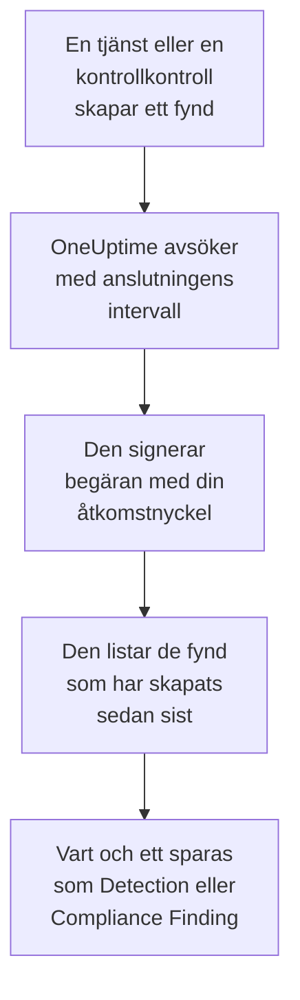

# AWS Security Hub

Importera fynd från [AWS Security Hub](https://aws.amazon.com/security-hub/) till säkerhetshändelserna i OneUptime: fynd från GuardDuty, Inspector, Macie och IAM Access Analyzer, Security Hubs egna kontrollkontroller och fynd från partnerprodukter. Där söker du i dem bredvid dina loggar, spårningar och mätvärden, korrelerar dem med alla andra källor och larmar jouren för dem som spelar roll. OneUptime läser dem med en åtkomstnyckel som du själv skapar, som bara får utföra en skrivskyddad åtgärd, och ändrar ingenting i AWS. Det finns ingen agent, EventBridge-regel eller S3-export att konfigurera.

:::cards
- [Konfigurera anslutningen](#konfigurera-anslutningen): En IAM-policy, en åtkomstnyckel och anslutningens formulär.
- [Vad som importeras](#vad-som-importeras): Hur varje fynd blir en säkerhetshändelse.
- [Så fungerar avsökningen](#så-fungerar-avsökningen): Det fönster som varje avsökning läser, och varför det överlappar det föregående med 30 minuter.
- [Felsökning](#felsökning): Vad varje fel betyder och vad du ska ändra.
:::

## Så fungerar det



Varje minut avsöker OneUptime varje aktiverad anslutning vars avsökningsintervall har passerat. En avsökning anropar Security Hubs `GetFindings` i din region, signerad med [Signature Version 4](https://docs.aws.amazon.com/IAM/latest/UserGuide/reference_sigv-create-signed-request.html), för de fynd som har skapats sedan förra avsökningen. Den sparar vart och ett som en [OCSF](https://schema.ocsf.io/)-händelse: en kontrollkontroll som ett Compliance Finding (klass `2003`), och alla andra fynd som ett Detection Finding (klass `2004`). Identifieringsregler, monitorer och instrumentpaneler behandlar det sedan som en säkerhetshändelse från vilken annan källa som helst.

## Innan du börjar

- I OneUptime rollen Project Owner, Project Admin eller Security Admin. Security Member och Security Viewer kan se anslutningar och deras körningshistorik, men inte ändra dem.
- Ett AWS-konto med Security Hub aktiverat i den region som du ansluter. Security Hub är regionalt: en anslutning läser de fynd som ett konto har i en region.
- För att läsa alla kontons och regioners fynd via en anslutning: Security Hubs delegerade administratörskonto, i sin hemregion, med [aggregering mellan regioner](https://docs.aws.amazon.com/securityhub/latest/userguide/finding-aggregation.html) påslagen. **Security Hub → Settings → Regions** visar hemregionen.
- Utgående HTTPS från OneUptime-appen och -workerna till `securityhub.<region>.amazonaws.com`, eller `securityhub.<region>.amazonaws.com.cn` i Kina, och en korrekt klocka på deras värdar: AWS avvisar en begäran som är signerad med mer än 5 minuters avvikelse.

## Konfigurera anslutningen

Anslutningen signerar sina begäranden med en IAM-åtkomstnyckel. Nyckelns identitet behöver en enda åtgärd, `securityhub:GetFindings`, och inget annat: anslutningen ändrar aldrig ett fynd.

:::steps
### Tillåt läsning av fynd

Öppna **Policies → Create policy** i [IAM-konsolen](https://console.aws.amazon.com/iam/), välj **JSON** och klistra in den här policyn. Ge den ett namn, till exempel `OneUptimeSecurityHubRead`:

```json
{
  "Version": "2012-10-17",
  "Statement": [
    {
      "Effect": "Allow",
      "Action": "securityhub:GetFindings",
      "Resource": "*"
    }
  ]
}
```

`GetFindings` kan inte begränsas till en resurs, så `Resource` förblir `*`. Den hanterade policyn `AWSSecurityHubReadOnlyAccess` fungerar också, men tillåter mer.

### Skapa en åtkomstnyckel

1. Öppna **Users → Create user**, ge användaren ett namn, till exempel `oneuptime-security-hub`, låt konsolåtkomst vara avstängd och koppla policyn. För andra kontons fynd gör du detta i det delegerade administratörskontot.
2. Öppna användaren, sedan **Security credentials → Access keys → Create access key**, och välj **Third-party service**.
3. Kopiera **Åtkomstnyckel-ID** och **Hemlig åtkomstnyckel**. AWS visar hemligheten bara en gång.

### Lägg till anslutningen i OneUptime

Öppna **Produkter → Security Events → Anslutningar** (`/dashboard/{projectId}/security-events/connections`), klicka på **Lägg till anslutning**, välj **AWS Security Hub** och klicka på **Nästa**. Fyll i inställningarna i tabellen nedan, klicka på **Nästa** och klistra in hemligheten i **Hemlig åtkomstnyckel**.

### Testa den innan du sparar

Klicka på **Testa de här inställningarna** under **Testa innan du sparar**. Testet signerar en begäran med värdena i formuläret och sparar ingenting, så en fel nyckel eller en saknad behörighet syns innan anslutningen finns. Klicka sedan på **Nästa**, ge anslutningen ett **Namn** och skapa den.
:::

| Inställning | Vad du anger |
| --- | --- |
| **Region** | Regionens kod, till exempel `us-east-1`, `eu-central-1` eller `us-gov-west-1`: för andra kontons fynd administratörskontots hemregion. |
| **Åtkomstnyckel-ID** | Nyckelns ID: 16 till 128 bokstäver eller siffror, oftast 20 som börjar med `AKIA`, eller `ASIA` för tillfälliga autentiseringsuppgifter. |
| **Hemlig åtkomstnyckel** | Nyckelns hemlighet. Den krypteras, returneras aldrig av API:t och visas aldrig igen. Ersätt den med **Uppdatera inloggningsuppgifter** på anslutningen. |
| **Session token** | Bara för tillfälliga autentiseringsuppgifter, som behöver den: en `ASIA`-nyckel avvisas utan den, och en `AKIA`-nyckel avvisas med den. |

Tillfälliga autentiseringsuppgifter från `aws sts assume-role` eller `aws sts get-session-token` går ut, för en antagen roll efter högst 12 timmar, och avsökningen stannar tills du klistrar in nya med **Uppdatera inloggningsuppgifter**. En långlivad nyckel med den här snäva policyn, roterad enligt ditt eget schema, fortsätter att avsöka utan tillsyn. För att byta från tillfälliga autentiseringsuppgifter till en långlivad nyckel anger du den nya nyckeln i **Uppdatera inloggningsuppgifter** och slår på **Remove the stored Session token**.

Steget **Hämtning** har också en valfri **Beskrivning**, **Hämtningsintervall (minuter)**, ett heltal från `1` till `1440` som börjar på `5`, och **Aktiverad**, som börjar påslagen.

## Vad som importeras

Varje fynd blir en händelse, med leverantören `Amazon Web Services` och produkten `AWS Security Hub`. Ett fynd med ett `Compliance`-objekt, en kontrollkontroll mot en standard som AWS Foundational Security Best Practices eller CIS, blir ett Compliance Finding (OCSF-klass `2003`). Alla andra fynd blir ett Detection Finding (OCSF-klass `2004`).

| Fyndfält | OneUptime-kolumn |
| --- | --- |
| `Id`, en ARN för fynd som AWS skapar | Händelse-UID, som även dubbletter tas bort efter |
| `CreatedAt`, annars `UpdatedAt`, annars `FirstObservedAt` | Händelsens tid |
| `Title` | Regelnamn |
| `GeneratorId`, till exempel GuardDuty-fyndtypen eller kontrollens ID | Regel-ID |
| `Title`, annars `Description` | Meddelande |
| `Severity.Label`, annars ett band av `Severity.Normalized` | Allvarlighetsgrad |
| `Workflow.Status`: `NEW`, `NOTIFIED`, `RESOLVED` eller `SUPPRESSED`, annars det äldre `WorkflowState` | Status |
| `Types` under `TTPs/`: `TTPs/Initial Access/...` blir `TA0001` | MITRE ATT&CK-taktiker och -tekniker |
| IAM-användaren för en åtkomstnyckel- eller användarresurs, `Network.SourceIpV4` eller `SourceIpV6`, `Process.Name` eller `Process.Path` | Aktörens användare, IP och process |
| Instans-ID:t för en `AwsEc2Instance`-resurs, `Network.DestinationIpV4` eller `DestinationIpV6`, `Network.DestinationPort`, det första `Resources[].Id` | Målets värd, IP, port och resurs |
| Dessa, varje `Resources[].Id`, `AwsAccountId`, nätverkets domäner, namn på skadlig kod och värden från hotinformation | Observables |
| Hela fyndet, utplattat till nycklar med punkter, till exempel `Compliance.Status` och `Remediation.Recommendation.Url` | `attributes` |

När ett fynd saknar `Severity.Label` avgör `Severity.Normalized`: `0` är Informational, `1` till `39` Low, `40` till `69` Medium, `70` till `89` High och `90` till `100` Critical. Ett fynd som Security Hub uppdaterar senare, med en ny `Workflow.Status` eller en kontroll som nu godkänns, behåller sitt `Id`, så det importeras inte igen: händelsen behåller fyndet som det var vid importen.

## Så fungerar avsökningen

Varje avsökning listar de fynd som har skapats i dess fönster, de äldsta först, 100 per sida, och följer `NextToken` tills den har läst hela fönstret:

```text
POST https://securityhub.{region}.amazonaws.com/findings
    {"Filters": {"CreatedAt": [{"Start": "{window start}", "End": "{window end}"}]},
     "SortCriteria": [{"Field": "CreatedAt", "SortOrder": "asc"}],
     "MaxResults": 100}
```

- **Skapandetiden är markören.** Fynd listas efter `CreatedAt`, aldrig efter `FirstObservedAt`. GuardDuty skapar ett fynd när den har sett tillräckligt med aktivitet, och en kontrollkontroll när Security Hub kontrollerar resursen första gången, timmar eller dagar efter att aktiviteten började. En markör på observationstiden skulle hoppa över dem.
- **Den första avsökningen ser 24 timmar bakåt**, så att en ny anslutning direkt visar sina senaste fynd.
- **Varje senare avsökning börjar 30 minuter före den sparade markören.** `CreatedAt` sätts av tjänsten som hittade problemet, och fyndet når Security Hub senare: GuardDuty skickar nya fynd inom fem minuter, och en misslyckad leverans via EventBridge försöks igen i upp till 24 timmar. Överlappningen läser sådana fynd vid nästa avsökning. Ett fynd som kommer mer än 30 minuter efter sitt `CreatedAt` kan hamna bakom markören: importera dess tidsintervall för att hämta det.
- **En avsökning läser högst 24 timmar förbi markören.** En anslutning vars markör har hamnat efter kommer ikapp i en serie fönster på 24 timmar, och dess **Hälsa** visar **Catching up**.
- **Dubbletter tas bort efter fyndets `Id`** inom projektet, så att överlappningen, ett upprepat fönster och en import aldrig sparar ett fynd två gånger.

### När ett fönster innehåller mer än en avsökning kan läsa

En avsökning skickar högst 20 begäranden med 100 fynd: 2 000 fynd. När ett fönster innehåller fler blir körningen **Delvis**, med en varning som:

```text
Stopped after 20 findings requests (the per-run request limit) before the window was fully read. The last finding read was created at 2026-09-14T08:12:44.000Z.
```

Fynd läses de äldsta först, så OneUptime flyttar markören till skapandetiden för det senast lästa fyndet, och nästa avsökning börjar där, utan överlappningen på 30 minuter, med samma fönsterlängd. Ett upptaget konto kommer ikapp ungefär 2 000 fynd per avsökning i stället för att läsa samma fynd igen. Överlappningen kommer tillbaka när markören har flyttats 30 minuter förbi den punkten.

När en körning inte alls kommer förbi den sparade markören, till exempel för att de 30 minuterna av överlappning ensamma innehåller mer än 2 000 fynd, gör OneUptime i stället fönstret kortare:

1. **Smalna av.** Nästa avsökning läser ett fönster som är hälften så långt, från samma startpunkt, och fortsätter att halvera tills ett fönster läses helt, ner till en minut. Körningens varning säger det: `This window holds more records than one poll can read; the next poll reads a {n} minute window from the same starting point.`
2. **Växa igen.** När ett fönster har lästs helt är nästa dubbelt så långt igen, upp till 24 timmar.
3. **Gå förbi en enda minut.** Om till och med en minut innehåller mer än en avsökning kan läsa går avsökningen förbi den, så att nyare fynd fortsätter att komma, och senare avsökningars överlappning når inte längre tillbaka till den. Körningen förblir **Delvis**, och **Senaste fel** lyder `More records were created in the one minute from {cursor} to {end} than one poll can read. Polling moved past this minute so newer records keep arriving; use Import this time range in Diagnostics on this minute to recover what one run can read.` Importera den minuten med **Import this time range** för att hämta det som en körning kan läsa.

En körning som misslyckas helt, med ett fel från AWS, behåller markören och fönsterlängden, och nästa avsökning läser samma fönster igen. Det enda undantaget är en begäran som fick tidsgräns: markören stannar, men nästa fönster är hälften så långt, eftersom ett fönster som är för tungt för att besvaras i tid skulle få tidsgräns vid varje försök. Att ändra **Hämtningsintervall (minuter)** ändrar inget av detta: det avgör hur ofta en avsökning startar, inte var dess fönster börjar.

### Kör, förhandsgranska och importera vid behov

Klicka på **Diagnostik** på en anslutning för att se dess senaste körningar och arbeta med den manuellt. Alla som kan ändra anslutningen kan starta de här åtgärderna; alla som kan se den kan läsa historiken.

- **Kör nu** startar en avsökning direkt, med den vanliga markören, även när anslutningen inte är **Aktiverad**.
- **Preview findings** läser ett tidsintervall på upp till 7 dagar och importerar ingenting.
- **Import this time range** importerar ett intervall på upp till 7 dagar, efter att du har bekräftat, utan att flytta markören. Fynd som redan har importerats hoppas över.
- **Copy diagnostics** på en körning kopierar dess rapport till supporten. Den innehåller aldrig autentiseringsuppgifter.

## Testa anslutningen

**Testa anslutningen** på en anslutnings rad och **Testa de här inställningarna** i formuläret körs i API-processen, inte i en bakgrundsworker, så att ett test svarar även när det är workerna som är problemet. Det kör de här kontrollerna i ordning:

| Kontroll | Vad den kontrollerar |
| --- | --- |
| **Konfiguration** | Varje inställning finns och är korrekt formaterad. Ingenting kontaktas när detta misslyckas. |
| **Authenticate with AWS** | AWS godtar en signerad `GetFindings`-begäran för ett fynd som har skapats under de senaste 24 timmarna. AWS kontrollerar signaturen före IAM-policyn, så ett avslag från policyn klarar ändå den här kontrollen: nyckeln är rätt. |
| **Read findings** | Security Hub besvarar den begäran: identiteten får anropa `securityhub:GetFindings`, och Security Hub är aktiverat i regionen. |
| **Findings available to import** | Hur många fynd som har skapats under de senaste 24 timmarna och de senaste 7 dagarna, en sida på 100 för varje, så `100+` betyder fler. Inga på 7 dagar är en varning, inte ett fel. |
| **Background workers**, **Poll scheduler**, **Security event storage** | OneUptimes egen sida: en process tar jobben från Worker-kön, avsökningsjobbet körs varje minut och lagringen för säkerhetshändelser svarar. |
| **Scheduled polling** | För en sparad anslutning: avsökningen är påslagen, ingen körning har fastnat i väntan på en worker och avsökningar körs i tid. |

Varje begäran i ett test har en tidsgräns på 20 sekunder. Ett test importerar aldrig något och flyttar aldrig markören, och varje kontroll som misslyckas säger vad du ska ändra.

## Felsökning

Anslutningens **Senaste fel** sparar hela felmeddelandet, med autentiseringsuppgifter maskerade, bakom ett prefix som namnger det steg som misslyckades. När en anslutning har ett fel väljer du **Visa fel** i dess kolumn **Åtgärder** för att läsa det, och **Kopiera fel** i dialogrutan för att kopiera det. Varje meddelande börjar med `AWS Security Hub findings request`; läs det som följer.

:::details Last Error säger `failed (HTTP 401)` eller `failed (HTTP 403)`
AWS avvisade begäran. Meddelandet citerar AWS felkod, eller AWS egna ord när ingen kod skickades:

- `AccessDeniedException`, eller `is not authorized to perform`: nyckeln är rätt, men dess identitet får inte anropa `securityhub:GetFindings`. Koppla policyn från [Konfigurera anslutningen](#konfigurera-anslutningen). En permissions boundary eller en service control policy kan också neka den.
- `InvalidAccessException`, eller `is not subscribed to AWS Security Hub`: Security Hub är inte aktiverat för det här kontot i den här **Region**, eller så är kontot inte dess administratör där.
- `InvalidSignatureException` eller `SignatureDoesNotMatch`, eller `The request signature we calculated does not match`: **Hemlig åtkomstnyckel** hör inte till **Åtkomstnyckel-ID**. Skapa en ny åtkomstnyckel och spara den med **Uppdatera inloggningsuppgifter**.
- `UnrecognizedClientException` eller `InvalidClientTokenId`, eller `The security token included in the request is invalid`: AWS känner inte till **Åtkomstnyckel-ID**. Det är felstavat, borttaget, inaktiverat eller från en annan partition, eller så är det en tillfällig nyckel utan sin **Session token**.
- `ExpiredTokenException`, eller `The security token included in the request is expired`: de tillfälliga autentiseringsuppgifterna har gått ut. Utfärda nya, eller byt till en långlivad nyckel.
- `RequestTimeTooSkewed` eller `RequestExpired`, eller `Signature expired`: klockan på OneUptime-värdarna går mer än 5 minuter fel. Rätta NTP på app- och workervärdarna.
- Ingen kod alls: AWS sa inte om det var nyckeln eller policyn som avvisade den. Kontrollera nyckeln först, sedan policyn.
:::

:::details Last Error säger `failed (HTTP ...)` med en annan status
- `HTTP 404`: ingen Security Hub-slutpunkt svarade i den här **Region**. Jämför den med regionmenyn i AWS-konsolen: `us-east-1`, inte `us-east1` eller `N. Virginia`.
- `HTTP 429`: kontot nådde Security Hubs gräns, 3 `GetFindings`-begäranden per sekund i en region. Nästa avsökning försöker igen. Om det fortsätter, leta efter ett annat verktyg eller en annan anslutning som läser samma konto och region.
- `HTTP 5xx`: Security Hub hade ett problem på sin sida. Nästa avsökning försöker igen.
- `HTTP 400`: Security Hub avvisade frågan, som OneUptime bygger, inte dina inställningar. Skicka meddelandet till OneUptimes support.
:::

:::details Last Error säger `returned`, `timed out` eller `Could not reach data source`
- `returned a non-JSON body` eller `returned an unrecognized response shape`: något annat än Security Hub svarade, till exempel en proxys inloggningssida eller en gateway som skriver om svar. Det rapporteras i stället för att tas som ett tomt fönster, så att markören aldrig flyttas förbi fynd som ingen har läst.
- `timed out after 60 seconds with no response`, eller `failed: Could not reach data source`: begäran fick inget svar. Security Hubs slutpunkter är offentliga, så kontrollera DNS, brandväggar och proxyer mellan OneUptime-appen och -workerna och `securityhub.<region>.amazonaws.com`.
:::

:::details Last Polled är Never och Last Error är tom
Ingen avsökning har slutförts för den här anslutningen. Kör **Testa anslutningen**: dess kontroller **Background workers** och **Poll scheduler** namnger orsaken. På en egenvärdad installation är den vanliga orsaken `DISABLE_QUEUE_WORKERS=true` på appen, utan en separat worker-distribution som tar jobben: sätt den till `false`, eller kör worker-distributionen (Helm: `worker.enabled: true`).
:::

:::details En körning är Partial
- `Stopped after 20 findings requests`: fönstret innehöll mer än de 2 000 fynd som en körning läser. Ingenting går förlorat: nästa avsökning börjar efter det senast lästa fyndet. En anslutning som förblir **Delvis** avsökning efter avsökning håller på att komma ikapp en eftersläpning, och dess **Senast hämtad** och **Senast importerade händelse** fortsätter att flytta fram. Om den aldrig kommer ikapp skapar kontot mer än 2 000 fynd per avsökningsintervall: gör **Hämtningsintervall (minuter)** kortare.
- `More records were created in the one minute from ... than one poll can read`: avsökningen gick förbi den minuten. Importera den med **Import this time range** i **Diagnostik**. En import läser lika mycket som en avsökning.
:::

:::details Testet lyckas, men ingenting importeras
Läs **Findings available to import** i testets rapport. `0` de senaste 7 dagarna betyder att Security Hub inte har skapat något fynd i det här kontot och den här regionen: kontrollera att GuardDuty, Inspector eller en säkerhetsstandard är påslagen där. För att se andra kontons och regioners fynd ansluter du administratörskontot i dess hemregion.
:::

:::details Ett fynd i Security Hub-konsolen kom aldrig fram
Jämför dess `CreatedAt` med dess `ProcessedAt`, när Security Hub tog emot det. Ett fynd som kom mer än 30 minuter efter sitt `CreatedAt` kan hamna bakom markören: importera dess `CreatedAt` med **Import this time range**.
:::

## Vad du får

- **Sök.** Filtrera fynd efter allvarlighetsgrad, status, regel, konto, resurs eller vilken observable som helst i utforskaren för säkerhetshändelser, bredvid alla andra källor.
- **Korrelation.** Varje fynds användare, instanser, IP-adresser, resurs-ARN:er och konto-ID:n indexeras som observables, så en sökning hittar allt som nämner dem.
- **Identifieringsregler.** Sigma-regler som körs enligt ett schema över dina säkerhetshändelser och öppnar larm som larmar jouren.
- **Monitorer.** Monitorer för säkerhetshändelser räknar matchande händelser, till exempel nya kritiska GuardDuty-fynd eller misslyckade kontroller, och öppnar incidenter eller larm över en tröskel.

Säkerhetshändelser debiteras som resten av din telemetri, per inmatad GB. Se [Priser](https://oneuptime.com/pricing).

## Nästa steg

:::cards
- [Säkerhetshändelser](/docs/telemetry/security-events): Sök, korrelera och larma på det du importerar.
- [Okta System Log](/docs/integrations/okta): Importera även inloggningarna från din identitetsleverantör.
- [Roller](/docs/permissions/reference#roller): Vad Security-rollerna kan se och ändra.
- [Översikt över integrationer](/docs/integrations/index): De andra verktygen du kan ansluta.
:::
