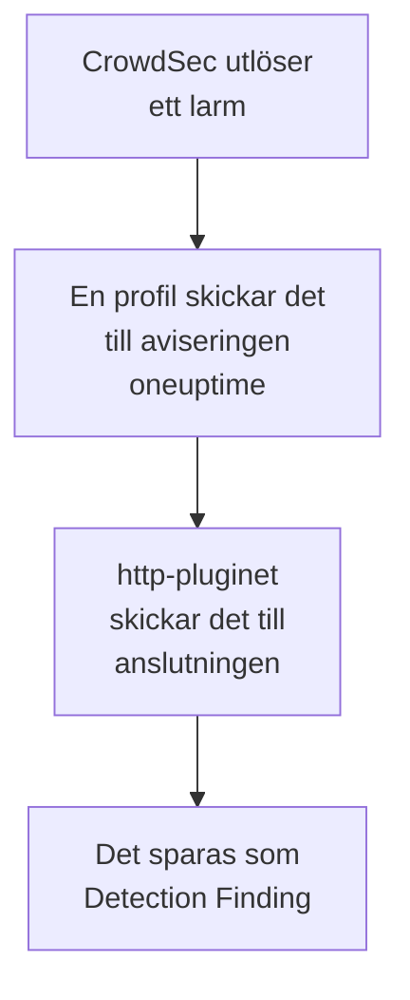

# CrowdSec

Ta emot larm från [CrowdSec](https://www.crowdsec.net/) i OneUptimes säkerhetshändelser så snart CrowdSec utlöser dem, och blockera adresserna på ditt projekts blocklista med CrowdSec. CrowdSecs eget aviseringsplugin skickar varje larm till en CrowdSec-anslutning, som öppnar ärenden utifrån CrowdSecs detektioner. När du slår på blockering bannlyser OneUptime varje adress du blockerar via CrowdSecs Local API, och varje bouncer som läser den blockerar adressen.

:::cards
- [Konfigurera anslutningen](#konfigurera-anslutningen): En anslutning, och aviseringen som skickar CrowdSecs larm till den.
- [Vad som tas emot](#vad-som-tas-emot): Hur varje CrowdSec-larm blir en säkerhetshändelse.
- [Blockera adresser med CrowdSec](#blockera-adresser-med-crowdsec): Bannlys adresserna på din blocklista i CrowdSec.
- [Läs CrowdSecs blocklistor](#läs-crowdsecs-blocklistor): Listorna som CrowdSec Console levererar, som ett threat intel-flöde.
- [Felsökning](#felsökning): Vad varje fel betyder och vad du ska ändra.
:::

## Så fungerar det



CrowdSecs Local API lämnar varje larm som en profil skickar till en avisering vidare till den aviseringens plugin. Anslutningens avisering använder CrowdSecs `http`-plugin: det skickar larmet, i CrowdSecs eget JSON, till intaget för säkerhetshändelser med din intagningsnyckel och anger anslutningen. OneUptime sparar det som en [OCSF](https://schema.ocsf.io/)-händelse av typen Detection Finding (klass `2004`), prövar det mot dina detektionsregler och öppnar ett ärende utifrån var och en av CrowdSecs egna detektioner som ligger på eller över anslutningens **Öppna ärenden från**. Ingenting avsöks: ett larm kommer fram några sekunder efter att CrowdSec har utlöst det.

## Innan du börjar

- I OneUptime rollen Projektägare, Projektadministratör eller Säkerhetsadministratör. Säkerhetsmedlem och Säkerhetstittare kan se anslutningar, men inte ändra dem.
- CrowdSec 1.5 eller senare, med dess Local API och `http`-aviseringspluginet som följer med. Den här sidan är skriven mot CrowdSec v1.8.2.
- Utgående HTTPS från värden som kör CrowdSecs Local API till ditt OneUptime.
- För att även blockera adresser: en Local API som OneUptime kan nå, och en maskin för OneUptime (se [Blockera adresser med CrowdSec](#blockera-adresser-med-crowdsec)).

## Konfigurera anslutningen

:::steps
### Lägg till anslutningen i OneUptime

Öppna **Produkter → Säkerhetshändelser → Anslutningar** (`/dashboard/{projectId}/security-events/connections`), klicka på **Lägg till anslutning**, välj **CrowdSec** och klicka på **Nästa**. För att bara ta emot larm lämnar du varje inställning i tabellen nedan tom; för att även blockera adresser fyller du i dem.

### Testa den innan du sparar

Klicka på **Testa de här inställningarna** under **Testa innan du sparar**. Utan någon Local API angiven säger testet det och kontaktar ingenting; med en angiven når testet Local API, loggar in som maskinen och sparar ingenting. Klicka sedan på **Nästa**, ge anslutningen ett **Namn** i steget **Larm**, välj värdet för **Öppna ärenden från** och skapa den.

### Spara aviseringen på CrowdSec-värden

När anslutningen skapas öppnas dess **Skicka larm**, som du öppnar igen från anslutningens rad. **Välj en intagningsnyckel** och spara sedan aviseringen som visas, med din nyckel och din anslutning redan ifyllda, på värden som kör CrowdSecs Local API:

```yaml title="/etc/crowdsec/notifications/oneuptime.yaml"
type: http
name: oneuptime

# info or quieter: at debug, CrowdSec logs each request's headers.
log_level: info

format: |
  {{.|toJson}}

url: https://oneuptime.com/security-events/v1/ingest?connection=YOUR_CONNECTION_ID&format=crowdsec
method: POST
headers:
  Content-Type: application/json
  x-oneuptime-token: YOUR_INGESTION_TOKEN
```

### Skicka dina profilers larm till aviseringen

I `/etc/crowdsec/profiles.yaml` lägger du till `oneuptime` i `notifications` för varje profil vars larm OneUptime ska ta emot, och läser sedan in CrowdSec på nytt:

```yaml title="/etc/crowdsec/profiles.yaml"
notifications:
  - oneuptime
```

```bash
sudo systemctl reload crowdsec
```

### Skicka ett testlarm

```bash
sudo cscli notifications test oneuptime
```

**Skicka larm** visar när det kommer fram, och **Visa larm** öppnar det i säkerhetshändelserna. Det är en händelse med allvarlighetsgraden Informational, och det öppnar inget ärende.
:::

| Inställning | Vad du anger |
| --- | --- |
| **Local API-URL** | Bara för att blockera adresser: där OneUptime når CrowdSecs Local API, till exempel `https://crowdsec.example.com:8080`. Använd `https` överallt där anslutningen korsar ett nätverk. |
| **Maskin-ID** | Bara för att blockera adresser: maskinen som OneUptime loggar in som, tillagd på CrowdSec-värden med `sudo cscli machines add oneuptime --auto -f -`. |
| **Blockera adresser med CrowdSec** | Avslaget på en ny anslutning. Påslaget bannlyser det adresserna och intervallen på din blocklista i CrowdSec, och kräver de tre andra inställningarna (se [Blockera adresser med CrowdSec](#blockera-adresser-med-crowdsec)). |
| **Maskinlösenord** | Bara för att blockera adresser: lösenordet som `cscli` skrev ut för maskinen. Det krypteras, returneras aldrig av API:t och visas aldrig igen. Ersätt det med **Uppdatera inloggningsuppgifter** på anslutningen. |

Steget **Larm** har också en valfri **Beskrivning** och **Aktiverad**, som börjar påslagen. En anslutning som inte är aktiverad behåller larmen den tar emot som händelser, och öppnar inget ärende utifrån dem.

I en container hamnar aviseringen i mappen som är monterad på `/etc/crowdsec/notifications/`, och en omstart av containern läser in den. En Kubernetes-installation anger den i sina Helm-värden under `config.notifications`, med `profiles.yaml` bredvid under `config`.

## Vad som tas emot

Varje larm som CrowdSec skickar blir en händelse av typen Detection Finding (OCSF-klass `2004`), med leverantören och produkten `CrowdSec`:

| CrowdSec-fält | OneUptime-kolumn |
| --- | --- |
| `uuid`, eller en hash för ett larm som saknar det | Händelse-UID, som även dubbletter tas bort efter |
| `stop_at`, eller `start_at` | Händelsens tid |
| `scenario` | Regel-ID och regelnamnet: scenariots titel på CrowdSec Hub, eller dess namn |
| `source.ip`, eller `source.value` för ett `Ip`-larm | Aktörens IP |
| `target_fqdn` eller `target_host` för larmet eller dess händelser, annars den `machine` som dess händelser anger | Målvärd |
| `target_user`, `target_uri` | Målets användare och resurs |
| Det första beslutets `type` | Status: `Blocked` för en bannlysning, `Challenge` för en captcha, `Logged` utan beslut eller i simuleringsläge |
| Scenariots beteende | Allvarlighetsgrad, och dess MITRE ATT&CK-taktiker och -tekniker |
| Allt annat, till exempel `source.cn`, `source.as_name` och `events_count` | `attributes`: larmets fält utplattade till nycklar med punkter, dess första 10 händelser i sin helhet, och OneUptimes tolkning under `crowdsec.` |

Ett CrowdSec-larm har ingen egen allvarlighetsgrad, så OneUptime tar den från det som scenariot upptäcker, så som CrowdSec Hub märker det (`ssh:bruteforce`, `http:exploit`):

| Beteende | Allvarlighetsgrad |
| --- | --- |
| En exploit, till exempel en CVE eller det som AppSec-komponenten blockerade, eller det en angripare gör när den väl har tagit sig in | High |
| Brute force, överbelastningsattacker, bedrägeri, en omöjlig inloggning, eller ett beteende som OneUptime inte kan placera | Medium |
| Skanningar, sonderingar, crawls, bottar, spam och ändringar i molnets granskningsloggar | Low |
| CrowdSecs egna testscenarier | Informational |

Med **Öppna ärenden från** på **Hög och högre** öppnar CrowdSecs exploits ärenden, och dess vardagliga bannlysningar av skannrar och lösenordsgissare förblir händelser för dina detektionsregler. Bara CrowdSecs egna detektioner öppnar ärenden. Ett beslut som någon har lagt till med `cscli` eller i CrowdSecs Console, en adress på en CrowdSec-blocklista, testlarmet och OneUptimes egna bannlysningar som kommer tillbaka har allvarlighetsgraden Informational, och öppnar inget. Ett larm som skickas två gånger, som `cscli notifications reinject` gör, sparas en gång.

## Blockera adresser med CrowdSec

Slå på **Blockera adresser med CrowdSec** på en anslutning, så bannlyses adresserna och intervallen på ditt projekts [blocklista](/docs/telemetry/security-cases#blocklista) i CrowdSec. Varje bouncer som läser dess Local API, till exempel dess bouncers för brandväggen, nginx och Traefik, blockerar dem där den körs, så som den blockerar CrowdSecs egna bannlysningar. Blockeringar går igenom samma godkännanden, samma gränser för automatisk respons och samma **Häv** som på alla andra ställen där din blocklista tillämpas.

Reglaget är avslaget på en ny anslutning. Så här slår du på det:

1. Lägg till en maskin för OneUptime på CrowdSec-värden; kommandot skriver ut dess lösenord:

   ```bash
   sudo cscli machines add oneuptime --auto -f -
   ```

2. Låt OneUptime nå Local API, som lyssnar på `127.0.0.1:8080` om inget annat anges: ställ in `api.server.listen_uri` i CrowdSecs `config.yaml`, servera den över TLS eller bakom en `https`-proxy, och släpp igenom OneUptimes adresser i din brandvägg.
3. Redigera anslutningen, fyll i **Local API-URL** och **Maskin-ID**, ange lösenordet i **Maskinlösenord**, slå på **Blockera adresser med CrowdSec** och spara. **Testa anslutningen** kontrollerar sedan att maskinen loggar in och läser OneUptimes bannlysningar, utan att ändra något.

Hur en bannlysning skapas, och hur den upphör:

- Varje blockering är ett bannlysningsbeslut, skapat så som `cscli decisions add` skapar ett, under scenariot `oneuptime/blocklist`. CrowdSec behåller det som ett manuellt beslut, så det delas aldrig med CrowdSecs Central API om du inte delar manuella beslut. OneUptime läser och tar bara bort sina egna bannlysningar, aldrig en som en person eller CrowdSec har skapat.
- En blockering med ett slut är en bannlysning till exakt det slutet, och CrowdSec häver den då själv, oavsett om OneUptime kan nå CrowdSec eller inte. En blockering tills den hävs är en bannlysning på 7 dagar, som förnyas när 3 dagar eller mindre återstår, så en bannlysning som OneUptime inte längre upprätthåller upphör inom en vecka.
- **Häv** tar bort bannlysningen vid nästa genomgång, inom en minut. En bannlysning som tas bort i CrowdSec, med `cscli decisions delete` eller en flush, skapas igen vid nästa genomgång så länge blockeringen varar.
- En adress eller ett intervall på en av CrowdSecs tillåtelselistor bannlyses aldrig: blockeringen visar den som inte tillämpad där, med tillåtelselistans namn, och en redan skapad bannlysning tas bort så snart en tillåtelselista innehåller adressen.
- Ditt projekts egna adresser, till exempel dina **Betrodda proxyservrar**, lastbalanserare och edge-nätverk, blockeras aldrig någonstans, inte heller i CrowdSec.
- CrowdSec bannlyser bara: en utmaning tillämpas inte där, och en domän, en URL eller en fil skickas inte dit.

När Local API inte kan nås ändras ingenting i CrowdSec: bannlysningarna som CrowdSec har finns kvar och upphör när de upphör. **Tillämpad hos** på **Blocklista** säger när CrowdSec senast höll varje blockering, och OneUptime försöker igen efter 1 minut och väntar sedan dubbelt så länge varje gång, upp till 30 minuter. En ny blockering väntar tills den kan skapas.

## Läs CrowdSecs blocklistor

CrowdSec Console levererar blocklistorna som din organisation prenumererar på som en Raw IP List-integration: en adress per rad, bakom ett användarnamn och ett lösenord. Ett [threat intel-flöde](/docs/telemetry/threat-intelligence) läser dem och matchar dina händelser mot dem:

1. Skapa en Raw IP List-integration i CrowdSec Console, med IP-aggregering avstängd: OneUptime matchar adresser, inte intervall. Kopiera dess slutpunkt, användarnamn och lösenord.
2. Öppna **Produkter → Säkerhetshändelser → Detektioner → Hotinformation** i OneUptime, klicka på **Skapa Flöde med hotinformation** och välj **Lista med indikatorer**.
3. Klistra in slutpunkten som **List-URL**, välj **Användarnamn och lösenord** under **Inloggning** och klistra in båda. På CrowdSecs Community-abonnemang, som tillåter en nedladdning per dag, ställer du in **Hämtningsintervall (minuter)** på `1440`.

Listorna tillhör CrowdSec: du får använda dem i dina egna verktyg, men inte lämna dem vidare. OneUptime erbjuder ingen egen lista.

## Testa anslutningen

**Testa anslutningen** på en anslutnings rad och **Testa de här inställningarna** i formuläret körs i API-processen, inte i en bakgrundsworker. De kör de här kontrollerna i ordning:

| Kontroll | Vad den kontrollerar |
| --- | --- |
| **Konfiguration** | Inställningarna är antingen alla tomma eller alla angivna, och välformade. Ingenting kontaktas när detta misslyckas. |
| **Reach CrowdSec's Local API** | `GET /health` svarar. Utan någon Local API angiven säger kontrollen att anslutningen bara tar emot larm, och de tre nästa körs inte. |
| **Sign in to the Local API** | `POST /v1/watchers/login` godtar maskinen och dess lösenord. |
| **Read CrowdSec's allowlists** | `GET /v1/allowlists` svarar, och hur många adresser och intervall listorna innehåller. En Local API som är äldre än 1.6.8, och som inte har några, godkänns. |
| **Block with CrowdSec** | Bara med **Blockera adresser med CrowdSec** påslaget: maskinen kan läsa tillbaka OneUptimes bannlysningar, och hur många som gäller. Kontrollen ändrar ingenting. |
| **Background workers**, **Security event storage** | OneUptimes egen sida: en process tar jobben från Worker-kön, som sparar det CrowdSec skickar, och lagringen för säkerhetshändelser svarar. |
| **Alerts received** | För en sparad anslutning: när det senaste larmet kom fram. Inget larm ännu är en varning, med en beskrivning av hur du skickar ett testlarm. |

Ett test bannlyser eller tar aldrig bort något. **Kopiera rapport** kopierar checklistan som JSON, utan lösenordet eller tokens.

## Felsökning

Anslutningens **Hälsa** visar **Väntar på larm** tills det första larmet kommer fram, därefter **Tar emot larm**, hur lång tid det än dröjer till nästa; **Ärenden pausade** betyder att anslutningen inte är aktiverad. CrowdSec skriver det pluginet svarade i sin egen logg, `/var/log/crowdsec.log`, som `HTTP server returned non 200 status code`.

:::details Inget larm kommer fram
- Kör `sudo cscli notifications list`: `oneuptime` måste finnas i listan och vara aktiv i en profil. En avisering som ingen profil anger skickar ingenting.
- `401`: intagningsnyckeln i `x-oneuptime-token` saknas, är fel eller har gått ut, och `422`: den är avstängd. Välj en nyckel i **Skicka larm** och kopiera aviseringen igen.
- `400`: adressen anger ingen CrowdSec-anslutning i det här projektet. Kopiera adressen från anslutningens **Skicka larm**: den slutar på anslutningens ID.
- Ingenting alls i loggen: CrowdSec-värden kan inte nå ditt OneUptime. Kontrollera utgående HTTPS från den, och dess proxy.
:::

:::details Anslutningstestet misslyckas vid Reach CrowdSec's Local API
`CrowdSec Local API health check could not be completed` betyder att ingenting svarade: Local API lyssnar på `127.0.0.1` som standard, så OneUptime kan inte nå den förrän `api.server.listen_uri` och din brandvägg tillåter det. En varning om att den svarar över `http` betyder att maskinens lösenord korsar nätverket okrypterat: servera Local API över TLS, eller sätt en `https`-proxy framför den.
:::

:::details Anslutningstestet misslyckas vid Sign in to the Local API
`CrowdSec Local API login failed (HTTP 401)` slutar med vad du ska göra: kontrollera maskin-ID:t och lösenordet med `sudo cscli machines list`, validera en maskin som inte är validerad än med `sudo cscli machines validate oneuptime`, eller lägg till en maskin som loggar in med ett lösenord. Spara ett nytt lösenord med **Uppdatera inloggningsuppgifter**.
:::

:::details En blockering tillämpas inte i CrowdSec
Håll muspekaren över dess **Tillämpad hos**: den anger en tillåtelselista som innehåller adressen, en utmaning som CrowdSec inte tillämpar, eller felet från Local API. Så länge Local API inte kan nås fortsätter OneUptime att försöka, och bannlysningarna som CrowdSec redan har fortsätter att gälla.
:::

:::details CrowdSec skickar sina larm, men inget sparas
Det CrowdSec skickar sparas av bakgrundsworkerna: på en egenvärdad installation med `DISABLE_QUEUE_WORKERS=true` på appen och ingen separat worker-distribution tas larmen emot men sparas aldrig. **Testa anslutningen** visar det som en misslyckad kontroll **Background workers**. Sätt den till `false`, eller kör worker-distributionen (Helm: `worker.enabled: true`).
:::

## Nästa steg

:::cards
- [Säkerhetshändelser](/docs/telemetry/security-events): Sök, korrelera och larma på det CrowdSec skickar.
- [Säkerhetsärenden](/docs/telemetry/security-cases): Arbeta med ärendena som CrowdSecs detektioner öppnar, och blockera utifrån dem.
- [Hotunderrättelser](/docs/telemetry/threat-intelligence): Matcha dina händelser mot CrowdSecs blocklistor.
- [Översikt över integrationer](/docs/integrations/index): De andra verktygen du kan ansluta.
:::
