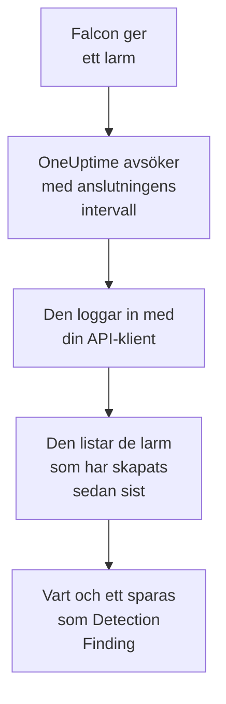

# CrowdStrike Falcon

Importera larm från [CrowdStrike Falcon](https://www.crowdstrike.com/platform/), från identifieringar på slutpunkter, identiteter och i molnet, till säkerhetshändelserna i OneUptime. Där söker du i dem bredvid dina loggar, spårningar och mätvärden, korrelerar dem med alla andra källor och larmar jouren för de som spelar roll. OneUptime läser dem via Falcon Alerts API med en API-klient som du skapar, och skriver aldrig till Falcon.

:::cards
- [Konfigurera anslutningen](#konfigurera-anslutningen): En API-klient med ett enda omfång och anslutningens formulär.
- [Vad som importeras](#vad-som-importeras): Hur varje Falcon-larm blir en säkerhetshändelse.
- [Så fungerar avsökningen](#så-fungerar-avsökningen): Det fönster som varje avsökning läser, och vad ett upptaget CID gör med det.
- [Felsökning](#felsökning): Vad varje fel betyder och vad du ska ändra.
:::

## Så fungerar det



Varje minut avsöker OneUptime varje aktiverad anslutning vars avsökningsintervall har passerat. En avsökning loggar in i ditt Falcon-moln med API-klientens ID och hemlighet, ber Alerts API om de larm som har skapats sedan förra avsökningen och sparar vart och ett som en [OCSF](https://schema.ocsf.io/)-händelse av typen Detection Finding (klass `2004`). Identifieringsregler, monitorer och instrumentpaneler behandlar den sedan som en säkerhetshändelse från vilken annan källa som helst.

## Innan du börjar

- I OneUptime rollen Project Owner, Project Admin eller Security Admin. Security Member och Security Viewer kan se anslutningar och deras körningshistorik, men inte ändra dem.
- Ett Falcon-kund-ID (CID) och en användare av Falcon-konsolen som kan hantera API-klienter: rollen Falcon Administrator, eller en anpassad roll med behörigheten API clients and keys.
- Utgående HTTPS från OneUptime-appen och -workerna till API-värden för ditt Falcon-moln, som anges under **Falcon cloud** nedan.

## Konfigurera anslutningen

:::steps
### Skapa en API-klient

1. Öppna **Support and resources → API clients and keys** i Falcon-konsolen och välj **Create API client**.
2. Ge den ett namn, till exempel `OneUptime security events`. Slå på **Alerts → Read** under **API scopes** och låt alla andra omfång vara avstängda: anslutningen skriver aldrig till Falcon.
3. Skapa klienten. Falcon visar dess klient-ID, dess hemlighet och dess bas-URL en gång. Kopiera alla tre nu: hemligheten kan återställas senare, men visas aldrig igen.

### Hitta ditt Falcon-moln

Den bas-URL som Falcon visade talar om vilket moln ditt CID finns i. Sidan **API clients and keys** visar det också, bredvid varje klient. En klient från ett moln avvisas av de andra.

| Bas-URL som Falcon visar | Falcon-moln |
| --- | --- |
| `https://api.crowdstrike.com` | US-1 |
| `https://api.us-2.crowdstrike.com` | US-2 |
| `https://api.eu-1.crowdstrike.com` | EU-1 |
| `https://api.laggar.gcw.crowdstrike.com` | US-GOV-1 |

### Lägg till anslutningen i OneUptime

Öppna **Produkter → Security Events → Anslutningar** (`/dashboard/{projectId}/security-events/connections`), klicka på **Lägg till anslutning**, välj **CrowdStrike Falcon** och klicka på **Nästa**. Fyll i inställningarna i tabellen nedan, klicka på **Nästa** och klistra in hemligheten i **Klienthemlighet**.

### Testa den innan du sparar

Klicka på **Testa de här inställningarna** under **Testa innan du sparar**. Testet loggar in och läser larm med värdena i formuläret, och sparar ingenting, så fel moln eller ett saknat omfång syns innan anslutningen finns. Klicka sedan på **Nästa**, ge anslutningen ett **Namn** och skapa den.
:::

| Inställning | Vad du anger |
| --- | --- |
| **Klient-ID** | API-klientens ID, så som Falcon visade det när du skapade klienten. |
| **Falcon cloud** | Det moln som ditt CID finns i: **US-1 (api.crowdstrike.com)**, **US-2 (api.us-2.crowdstrike.com)**, **EU-1 (api.eu-1.crowdstrike.com)** eller **US-GOV-1 (api.laggar.gcw.crowdstrike.com)**. Varje begäran går till det molnets API-värd. |
| **Klienthemlighet** | API-klientens hemlighet. Den krypteras, returneras aldrig av API:et och visas aldrig igen. Ersätt den med **Uppdatera inloggningsuppgifter** på anslutningen. |

Steget **Hämtning** har också en valfri **Beskrivning**, **Hämtningsintervall (minuter)**, ett heltal från `1` till `1440` som börjar på `5`, och **Aktiverad**, som börjar påslagen. En anslutning som inte är aktiverad kan fortfarande testas och avsökas manuellt.

## Vad som importeras

Anslutningen läser Falcons larm: det som Falcon-konsolen listar under **Endpoint security → Endpoint detections** och **Next-Gen SIEM → Alerts**, från varje produkt som ger dem. Varje larm blir en händelse av typen Detection Finding (OCSF-klass `2004`), med leverantören `CrowdStrike` och produkten `Falcon`:

| Falcon-fält | OneUptime-kolumn |
| --- | --- |
| `composite_id` | Händelse-UID, som även dubbletter tas bort efter |
| `created_timestamp` | Händelsens tid |
| `display_name`, eller `name` | Regelnamn |
| `pattern_id` | Regel-ID |
| `description`, eller regelnamnet | Meddelande |
| `severity_name`, eller `severity` från 0 till 100 | Allvarlighetsgrad |
| `status`, till exempel `new`, `in_progress` eller `closed` | Status |
| `tactic_id`, `technique_id` | MITRE ATT&CK-taktiker och -tekniker |
| `device.hostname`, `device.local_ip`, `user_name`, `filename` eller `cmdline` | Aktörens värd, IP, användare och process |
| `device.hostname`, `device.local_ip`, `device.external_ip`, `user_name`, `sha256` | Observables |
| Allt annat, till exempel `device.platform_name`, `falcon_host_link`, `product` och `timestamp` | `attributes`, utplattat till nycklar med punkter |

Händelsens tid är med avsikt när Falcon skapade larmet: tiden för beteendet bakom det, `timestamp`, stannar i `attributes.timestamp`.

## Så fungerar avsökningen

- **Skapandetiden är markören.** Larm listas efter `created_timestamp`, aldrig efter tiden för beteendet bakom dem. Falcon kan ge ett larm långt efter den aktivitet det beskriver, och en markör på aktivitetstiden skulle hoppa över varje sådant larm.
- **Den första avsökningen ser 24 timmar bakåt**, så att en ny anslutning direkt visar sina senaste larm.
- **Varje senare avsökning börjar 1 minut före den sparade markören**, så att ett larm som har skapats på gränsen mellan två fönster aldrig missas.
- **En avsökning läser högst 24 timmar förbi markören.** En anslutning vars markör har hamnat efter kommer ikapp i en serie fönster på 24 timmar.
- **Dubbletter tas bort efter `composite_id`** inom projektet, så att överlappningen och ett upprepat fönster aldrig sparar ett larm två gånger.
- **Varje fönster kostar** en tokenbegäran, som behålls under tokenens livstid, och sedan en larmfråga och en hämtning av larm per 1 000 larm, var och en med sin egen tidsgräns.

### När ett fönster innehåller mer än en avsökning kan läsa

En avsökning skickar högst 20 begäranden. Med en tokenbegäran och två begäranden för varje 1 000 larm läser den högst 9 000 larm. När ett fönster innehåller fler blir körningen **Delvis**, med en varning som:

```text
Stopped after 19 requests before reading the whole window. Alerts are read oldest first; every alert created before 2026-09-14T08:12:44.995Z was read.
```

Larmfrågan sorteras efter `created_timestamp`, de äldsta först, så OneUptime flyttar markören till skapandetiden för det senast lästa larmet, och nästa avsökning börjar där med samma fönsterlängd, från förskjutning `0`. Ett upptaget CID kommer på så sätt ikapp ungefär 9 000 larm per avsökning i stället för att läsa samma igen. Larm som har skapats vid samma tidpunkt läses två gånger, och dubblettkontrollen tar bort den andra kopian.

Falcons larmfråga kan inte bläddra förbi 10 000 resultat (`limit` plus `offset`). Begärandegränsen stoppar en körning vid 9 000 larm, före det taket. Om taket någon gång stoppar en läsning hanteras det på samma sätt: körningen är **Delvis**, markören flyttas till det senast lästa larmet och nästa fråga börjar igen från förskjutning `0`.

När en körning inte alls kommer förbi den sparade markören, till exempel för att fler än 9 000 larm delar överlappningsminuten, gör OneUptime i stället fönstret kortare:

1. **Smalna av.** Nästa avsökning läser ett fönster som är hälften så långt, från samma startpunkt, och fortsätter att halvera tills ett fönster läses helt, ner till en minut. Körningens varning säger det: `This window holds more records than one poll can read; the next poll reads a {n} minute window from the same starting point.`
2. **Växa igen.** När ett fönster har lästs helt är nästa dubbelt så långt igen, upp till 24 timmar.
3. **Gå förbi en enda minut.** Om till och med en minut innehåller mer än en avsökning kan läsa går avsökningen förbi den, så att nyare larm fortsätter att komma. Körningen förblir **Delvis**, och **Senaste fel** lyder `More records were created in the one minute from {cursor} to {end} than one poll can read. Polling moved past this minute so newer records keep arriving; use Import this time range in Diagnostics on this minute to recover what one run can read.` Importera den minuten med **Import this time range** för att hämta det som en körning kan läsa.

En körning som misslyckas helt, med ett fel från Falcon, behåller markören och fönsterlängden, och nästa avsökning läser samma fönster igen. Det enda undantaget är en begäran som fick tidsgräns: markören stannar, men nästa fönster är hälften så långt, eftersom ett fönster som är för tungt för att besvaras i tid skulle få tidsgräns vid varje försök. Att ändra **Hämtningsintervall (minuter)** ändrar inget av detta: det avgör hur ofta en avsökning startar, inte var dess fönster börjar.

### Kör, förhandsgranska och importera vid behov

Klicka på **Diagnostik** på en anslutning för att se dess senaste körningar och arbeta med den manuellt. Alla som kan ändra anslutningen kan starta de här åtgärderna; alla som kan se den kan läsa historiken.

- **Kör nu** startar en avsökning direkt, med den vanliga markören, även när anslutningen inte är **Aktiverad**.
- **Preview alerts** läser ett tidsintervall på upp till 7 dagar och importerar ingenting.
- **Import this time range** importerar ett intervall på upp till 7 dagar, efter att du har bekräftat, utan att flytta markören. Larm som redan har importerats hoppas över.
- **Copy diagnostics** på en körning kopierar dess rapport till supporten. Den innehåller aldrig autentiseringsuppgifter.

## Testa anslutningen

**Testa anslutningen** på en anslutnings rad och **Testa de här inställningarna** i formuläret körs i API-processen, inte i en bakgrundsworker, så att ett test svarar även när det är workerna som är problemet. Det kör de här kontrollerna i ordning:

| Kontroll | Vad den kontrollerar |
| --- | --- |
| **Konfiguration** | **Klient-ID**, **Falcon cloud** och **Klienthemlighet** finns och är korrekt formaterade. Ingenting kontaktas när detta misslyckas. |
| **Authenticate with CrowdStrike Falcon** | `POST /oauth2/token` med API-klientens ID och hemlighet, på ditt molns värd, returnerar en token. |
| **Read alerts from the Falcon Alerts API** | En larmfråga efter ett larm (`limit=1`) över de senaste 24 timmarna godtas, vilket bevisar omfånget **Alerts → Read**. |
| **Alerts available to import** | Hur många larm som har skapats de senaste 24 timmarna och de senaste 7 dagarna. Inga på 7 dagar är en varning, inte ett fel: avsökningen importerar nya larm allteftersom Falcon skapar dem. |
| **Background workers**, **Poll scheduler**, **Security event storage** | OneUptimes egen sida: en process tar jobben från Worker-kön, avsökningsjobbet körs varje minut och lagringen för säkerhetshändelser svarar. |
| **Scheduled polling** | För en sparad anslutning: avsökningen är påslagen, ingen körning har fastnat i väntan på en worker och avsökningar körs i tid. |

Varje begäran i ett test har en tidsgräns på 20 sekunder. Ett test importerar aldrig något och flyttar aldrig markören, och varje kontroll som misslyckas säger vad du ska ändra. **Kopiera rapport** kopierar checklistan som JSON, utan autentiseringsuppgifter eller tokens.

## Felsökning

Anslutningens **Senaste fel**, och varje kontroll som misslyckas, sparar hela felmeddelandet, med autentiseringsuppgifter maskerade, bakom ett prefix som namnger det steg som misslyckades. När en anslutning har ett fel väljer du **Visa fel** i dess kolumn **Åtgärder** för att läsa det, och **Kopiera fel** i dialogrutan för att kopiera det. Läs prefixet först.

:::details Last Error börjar med `CrowdStrike Falcon token request`
- `CrowdStrike Falcon token request failed (HTTP 401)` eller `(HTTP 403)`: Falcon avvisade API-klientens ID och hemlighet, innan Alerts API kontaktades. Kontrollera att **Falcon cloud** är ditt CID:s moln, eftersom en klient från ett annat moln avvisas här, att **Klient-ID** är klientens och att **Klienthemlighet** är den hemlighet som utfärdades med den. Om hemligheten har gått förlorad återställer du den i Falcon-konsolen och sparar den med **Uppdatera inloggningsuppgifter**.
- `CrowdStrike Falcon token request returned ...`: Falcon svarade med något oanvändbart, en kropp som inte är JSON eller som saknar `access_token`. Det är oftast en proxy eller gateway emellan, inte autentiseringsuppgifterna.
:::

:::details Last Error börjar med `CrowdStrike Falcon alerts`
- `CrowdStrike Falcon alerts query failed (HTTP 403)`: token godtogs, men API-klienten har inte omfånget **Alerts → Read**. Slå på det för klienten under **API clients and keys** och spara. Det gäller för nästa token, så testa igen efter en minut.
- `CrowdStrike Falcon alerts query failed (HTTP 401)`: Alerts API avvisade token, vilket nästan alltid betyder att **Falcon cloud** inte är det moln som utfärdade klienten.
- `CrowdStrike Falcon alerts query failed (HTTP 429)` eller `CrowdStrike Falcon alerts fetch failed (HTTP 429)`: Falcon begränsar den här API-klientens hastighet. OneUptimes HTTP-klient behåller inga svarshuvuden vid ett fel, så meddelandet slutar oftast med `the X-RateLimit-RetryAfter header was not available` i stället för att citera det. Schemalagda avsökningar försöker igen av sig själva. Om det fortsätter ger du OneUptime en egen API-klient i stället för en som delas med andra verktyg.
- `CrowdStrike Falcon alerts query failed (HTTP 400)`: Falcon avvisade frågan. Anslutningen skickar ett fast FQL-filter på `created_timestamp`, så kopiera rapporten och skicka den till OneUptimes support.
- `CrowdStrike Falcon alerts query returned ...` eller `CrowdStrike Falcon alerts fetch returned ...`: Falcon svarade `200`, med en kropp som inte är JSON eller som inte har en form som anslutningen känner till. Det rapporteras i stället för att tolkas som ett tomt fönster, så att markören aldrig passerar larm som ingen har läst.
- `CrowdStrike Falcon alerts fetch failed (HTTP ...)`: larmen listades, men hämtningen av dem misslyckades, av samma skäl som frågan. En `403` här betyder att omfånget togs bort mellan de två anropen.
:::

:::details Last Error säger att begäran inte kunde slutföras
`CrowdStrike Falcon token request could not be completed`, `CrowdStrike Falcon alerts query could not be completed` och `CrowdStrike Falcon alerts fetch could not be completed` betyder att ingenting kom tillbaka: en tidsgräns, ett DNS-fel eller blockerad utgående trafik. Kontrollera utgående HTTPS från OneUptime-appen och -workerna till ditt molns API-värd, till exempel `api.crowdstrike.com`.
:::

:::details Last Error namnger ett okänt moln
`CrowdStrike Falcon cloud "..." is not one of us-1, us-2, eu-1, us-gov-1` betyder att det sparade molnet inte är ett som anslutningen känner till. Redigera anslutningen och välj ett moln i listan.
:::

:::details En körning är Partial
- `Stopped after 19 requests before reading the whole window`: fönstret innehöll mer än de 9 000 larm som en körning läser. Ingenting går förlorat: nästa avsökning börjar efter det senast lästa larmet. En anslutning som förblir **Delvis** avsökning efter avsökning håller på att komma ikapp en eftersläpning, och dess **Senast hämtad** och **Senast importerade händelse** fortsätter att flytta sig framåt. Antalet kan ligga något över 19 när token förnyades under körningen.
- `Falcon returned alerts out of created_timestamp order, so this run cannot name a point to resume from.`: frågan ignorerade ordningen från äldst till nyast, så körningen kan inte flytta markören till sitt sista larm, och nästa avsökning läser i stället ett kortare fönster. Om det upprepas skickar du körningens rapport till OneUptimes support.
- `More records were created in the one minute from ... than one poll can read`: avsökningen gick förbi den minuten. Importera den med **Import this time range** i **Diagnostik**. En import läser lika mycket som en avsökning.
:::

:::details Last Polled är Never och Last Error är tom
Ingen avsökning har körts, så ingenting har nått Falcon. **Testa anslutningen** visar det som en misslyckad kontroll **Background workers** eller **Poll scheduler**. På en egenvärdad installation är den vanliga orsaken `DISABLE_QUEUE_WORKERS=true` på appen, utan en separat worker-distribution som tar jobben: sätt den till `false`, eller kör worker-distributionen (Helm: `worker.enabled: true`).
:::

:::details Testet lyckas, men inga händelser visas
Läs **Alerts available to import**: en varning där betyder att Falcon inte har skapat några larm de senaste 7 dagarna, så det finns inget att importera ännu. Annars öppnar du **Diagnostik**, kontrollerar den senaste avsökningens fönster och antal och använder **View events in this time range** på en körning för att öppna tidsintervallet för de larm som den importerade.
:::

## Vad du får

- **Sök.** Filtrera Falcon-larm efter allvarlighetsgrad, status, MITRE-taktik, värd, användare eller vilken observable som helst i utforskaren för säkerhetshändelser, bredvid den värdens loggar och mätvärden.
- **Korrelation.** Varje larms värdnamn, IP-adresser, användare och filhashar indexeras som observables, så en sökning hittar allt som nämner en värd i alla källor.
- **Identifieringsregler.** Sigma-regler som körs enligt ett schema över dina säkerhetshändelser och öppnar larm som larmar jouren.
- **Monitorer.** Monitorer för säkerhetshändelser räknar matchande händelser och öppnar incidenter eller larm över en tröskel.

Säkerhetshändelser debiteras som resten av din telemetri, per inmatad GB. Se [Priser](https://oneuptime.com/pricing).

## Nästa steg

:::cards
- [Säkerhetshändelser](/docs/telemetry/security-events): Sök, korrelera och larma på det du importerar.
- [Microsoft Defender XDR](/docs/integrations/microsoft-defender-xdr): Importera även larmen från Microsofts Defender-arbetsbelastningar.
- [Roller](/docs/permissions/reference#roller): Vad Security-rollerna kan se och ändra.
- [Översikt över integrationer](/docs/integrations/index): De andra verktyg som du kan ansluta.
:::
