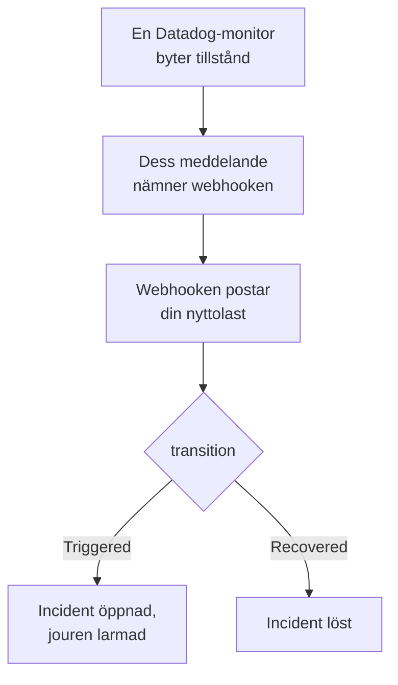

# Datadog

Skicka larm från [Datadog](https://www.datadoghq.com)-monitorer till OneUptime, så att varje larm blir en incident som larmar ditt jourteam och löses när Datadog-monitorn har återhämtat sig. Datadog skickar sina larm genom sin [Webhooks-integration](https://docs.datadoghq.com/integrations/webhooks/), så det finns inget att installera på någon av sidorna.

:::cards
- [Välj hur OneUptime tar emot larm](#välj-hur-oneuptime-tar-emot-larm): En Incoming Request-monitor eller ett eget arbetsflöde.
- [Ta emot larm med en monitor](#ta-emot-larm-med-en-monitor): En incident per larm, löst vid återhämtning.
- [Konfigurera Datadog](#konfigurera-datadog): En webhook och de monitorer som aviserar den.
- [Felsökning](#felsökning): När larm inte kommer fram eller incidenter förblir öppna.
:::

## Så fungerar det



En Datadog-monitor aviserar de webhooks som dess meddelande nämner när den byter tillstånd: när den utlöses, varnar, återhämtar sig eller saknar data. Webhookens JSON-kropp skriver du själv, utifrån Datadogs [mallvariabler](https://docs.datadoghq.com/integrations/webhooks/#usage), så den här guiden ger dig en som namnger varje larm och säger vad som hände med det.

## Innan du börjar

- Ett Datadog-konto där du kan konfigurera integrationer och redigera monitorer.
- I OneUptime behörighet att skapa monitorer, eller arbetsflöden om du väljer den vägen.

## Välj hur OneUptime tar emot larm

Konfigurera OneUptime först: det ger dig den URL som Datadog skickar till.

| Väg | Använd den när |
| --- | --- |
| En Incoming Request-monitor (rekommenderas) | Du vill att varje larm ska bli en incident som larmar jouren och löses när Datadog-monitorn har återhämtat sig. Det finns inget att bygga. |
| Ett arbetsflöde med en Webhook-utlösare | Du behöver egen logik: filtrera larm, forma om dem eller anropa andra system först. Ett arbetsflöde deklarerar en incident för varje larm som det får, och löser den inte vid återhämtning. |

Båda får samma JSON från samma webhook, så du kan börja med det ena och byta senare genom att ändra en URL i Datadog.

## Ta emot larm med en monitor

En [Incoming Request-monitor](/docs/monitor/incoming-request-monitor) ger dig en URL, och dess kriterier avgör vad varje larm gör.

:::steps
### Skapa monitorn

Gå till **Monitorer** och klicka på **Skapa monitor**. Välj **Incoming Request** under **Monitortyp**, ge den namnet `Datadog` och klicka på **Nästa**.

### Deklarera en incident för varje larm

Öppna det första kriteriet i steget **Kriterier**, det som markerar monitorn som offline. Ställ in dess filter på **Begärandekropp**, **Innehåller**, `"transition":"Triggered"`. Det här kriteriet deklarerar redan en incident när filtret matchar. Fyll i incidenten:

- **Incidenttitel**: `{{requestBody.title}}`.
- **Incidentbeskrivning**, under **Beskrivning**: `{{requestBody.body}}`, sedan `Datadog: {{requestBody.link}}` på en egen rad.
- **Allvarlighetsgrad**: den incidentallvarlighetsgrad som de här larmen ska ha.
- **Jourpolicyer**, under **Jour**: de policyer som ska larmas.
- **Lös incident automatiskt**, under **Fler fält**: låt den vara påslagen, som den börjar. Utan den ignoreras återhämtningar och incidenter förblir öppna.

### Öppna en incident per larm

Öppna **Inställningar** i samma kriterium och slå på **Group incidents and alerts by a payload field**. Fyll i den som nedan, så att varje larm får sin egen incident och dess återhämtning löser den:

| Fält | Värde |
| --- | --- |
| **Open a separate incident for each…** | `requestBody.alert_key` |
| **Field that signals recovery** | `requestBody.transition` |
| **Value that means recovered** | `Recovered` |

### Få monitorn online igen

Öppna det andra kriteriet, det som markerar monitorn som online, och ställ in dess filter på **Begärandekropp**, **Innehåller**, `"transition":"Recovered"`.

### Kopiera URL:en

Klicka på **Skapa monitor**. Monitorns sida **Översikt** visar dess **Heartbeat URL**. Kopiera den till Datadog:

```text
https://oneuptime.com/heartbeat/<secret key>
```

En egenvärdad installation har sin egen värd i stället för `oneuptime.com`.
:::

Nyttolasten nedan sätter `alert_key` till Datadog-monitorns ID och taggarna för den grupp som larmade, så att varje grupp i en multi-alert-monitor får sin egen incident och den gruppens återhämtning löser den. En monitor som utlöses igen eller aviserar igen medan dess incident är öppen öppnar ingen andra. Se [Ta emot larm från ett annat system](/docs/monitor/incoming-request-monitor#ta-emot-larm-från-ett-annat-system) för vad varje inställning gör.

> [!NOTE]
> En avisering **Warn** eller **No Data** öppnar ingen incident med de här filtren. För att också larmas vid varningar klickar du på **Lägg till kriterier**, ger det nya kriteriet filtret **Begärandekropp**, **Innehåller**, `"transition":"Warn"`, en incident med sin egen **Allvarlighetsgrad** och samma grupperingsinställningar, och drar det sedan ovanför det första kriteriet. Kriterier kontrolleras uppifrån, och det första som matchar avgör.

## Konfigurera Datadog

:::steps
### Lägg till webhooken

Öppna [rutan för Webhooks-integrationen](https://app.datadoghq.com/integrations/webhooks) i Datadog och installera den om den inte redan är installerad. Lägg till en webhook med de här inställningarna och spara den sedan:

- **Name**: `oneuptime`. Monitorer nämner webhooken med det här namnet, som `@webhook-oneuptime`.
- **URL**: den URL som du kopierade från OneUptime.
- **Payload**:

  ```json
  {
    "alert_key": "$ALERT_ID $ALERT_SCOPE",
    "transition": "$ALERT_TRANSITION",
    "title": "$EVENT_TITLE",
    "body": "$TEXT_ONLY_MSG",
    "host": "$HOSTNAME",
    "priority": "$PRIORITY",
    "link": "$LINK"
  }
  ```

### Nämn webhooken i dina monitorer

Lägg till `@webhook-oneuptime` i monitorns aviseringsmeddelande i varje Datadog-monitor som ska larma genom OneUptime, och spara monitorn. Datadog skickar då den monitorns larm och återhämtningar till OneUptime.
:::

| Variabel | Vad Datadog lägger i den |
| --- | --- |
| `$ALERT_ID` | ID:t för den Datadog-monitor som larmade. |
| `$ALERT_SCOPE` | Taggarna för den grupp som larmade, som `host:web-1`. |
| `$ALERT_TRANSITION` | Vad som hände: `Triggered`, `Re-Triggered`, `Warn`, `Recovered`, `No Data` eller `Renotify`, bland annat. |
| `$EVENT_TITLE` | Händelsens titel, som `[Triggered] High CPU`. |
| `$TEXT_ONLY_MSG` | Monitorns meddelande, utan Markdown. |
| `$LINK` | En länk till händelsen i Datadog. |

## Testa det

Skicka ett larm till OneUptime, så som Datadog skulle göra:

```bash
curl -X POST "https://oneuptime.com/heartbeat/<secret key>" \
  -H "Content-Type: application/json" \
  -d '{
    "alert_key": "1234 host:web-1",
    "transition": "Triggered",
    "title": "[Triggered] High CPU",
    "body": "CPU is above 90% on web-1.",
    "host": "web-1",
    "priority": "normal",
    "link": "https://app.datadoghq.com/event/event?id=1"
  }'
```

En incident öppnas med titeln `[Triggered] High CPU`. Skicka samma begäran med `transition` satt till `Recovered`, så löses incidenten.

Testa sedan från Datadog: öppna en monitor som nämner webhooken, klicka på **Test Notifications** och skicka dess avisering **Alert**. Titta på OneUptime-monitorns tidslinje för att se att den kom fram.

## Ta emot larm med ett arbetsflöde

Använd ett [arbetsflöde](/docs/workflows/index) när du behöver egna steg mellan Datadog och incidenten.

:::steps
### Skapa arbetsflödet

Gå till **Arbetsflöden**, klicka på **Skapa arbetsflöde** och sedan på **Börja från grunden**. Ge det namnet `Datadog alerts` och klicka på **Skapa arbetsflöde**.

### Lägg till Webhook-utlösaren

Klicka på det streckade blocket **Välj vad som startar det här arbetsflödet** och välj **Webhook**. Klicka på utlösaren, sedan på **Kopiera URL**, och använd den URL:en i webhooken i Datadog.

### Kontrollera att monitorn är utlöst

Klicka på **Lägg till komponent**, lägg till ett block **If / Else** och anslut utlösarens punkt **Out** till det. Ställ in **Value to check** på `{{local.components.webhook-1.returnValues.request-body.transition}}`, **Comparison** på **is equal to** och **Compare with** på `Triggered`.

### Deklarera incidenten

Lägg till ett block **Create One Incident** och anslut sidan **Yes** av blocket **If / Else** till det. Välj under **Incident Template** en mall som ställer in allvarlighetsgraden och de jourpolicyer som ska larmas (se [Incidentmallar](/docs/incidents/settings#incidentmallar)). Ange under **JSON Object** vad som kommer från Datadog:

```json
{
  "title": "{{local.components.webhook-1.returnValues.request-body.title}}",
  "description": "{{local.components.webhook-1.returnValues.request-body.body}}\nDatadog: {{local.components.webhook-1.returnValues.request-body.link}}"
}
```

Utan en mall måste **JSON Object** också innehålla `incidentSeverityId`, ID:t för en av projektets incidentallvarlighetsgrader.

### Slå på arbetsflödet

Slå på **Aktiverad** överst i **Byggare**. Ett arbetsflöde som är avstängt svarar Datadog med `400`.
:::

Varje avisering `Triggered` deklarerar en ny incident. En återhämtning tar sidan **No** av blocket **If / Else**, där ingenting är anslutet, så körningen slutar där. Använd monitorn för en incident per larm som löses vid återhämtning.

## Felsökning

:::details Inget kommer fram till OneUptime
- Kontrollera att Datadog-monitorns meddelande nämner `@webhook-oneuptime`, stavat som webhooken heter.
- Monitorn svarar `200` direkt, innan den kontrollerar något, även för en felaktig hemlig nyckel. Titta på monitorns tidslinje för att se om larm kommer fram.
- Ett arbetsflöde som är avstängt svarar `400`. Slå på **Aktiverad** överst i dess **Byggare**.
:::

:::details Incidenter skapas men löses aldrig
- Datadog-monitorn måste också avisera webhooken om sina återhämtningar. Ett meddelande som nämner webhooken bara för larm, inuti ett villkor, skickar ingen återhämtning.
- Kriteriets incident behöver **Lös incident automatiskt**, under **Fler fält**.
- **Value that means recovered** måste vara exakt `Recovered`. Jämförelsen är skiftlägeskänslig.
- Återhämtningens `alert_key` måste vara larmets: behåll `$ALERT_ID $ALERT_SCOPE` som det står i nyttolasten.
:::

:::details Ett fält visar namnet på en variabel, eller ingenting
Datadog fyller bara i de variabler som gäller för händelsen. Skicka en testavisering och titta sedan på vad som kom fram: i monitorns tidslinje, eller för ett arbetsflöde i **Loggar → Körningar**.
:::

:::details Alla larm från en monitor slås ihop till en incident
Varje grupp behöver sin egen `alert_key`. Kontrollera att nyttolasten bygger den från både `$ALERT_ID` och `$ALERT_SCOPE`, och att grupperingssökvägen är `requestBody.alert_key`.
:::

## Säkerhet

- **Behandla URL:en som ett lösenord.** Alla som har den kan öppna incidenter. Om den läcker återställer du den: **Återställ hemlig nyckel för inkommande begäran** på monitorns sida **Inställningar**, eller **Återställ URL** i arbetsflödets **Webhook**-utlösare. Uppdatera sedan webhookens **URL** i Datadog.
- **Egenvärdad?** Datadog skickar webhooks från internet, så din OneUptime måste kunna nås därifrån över HTTPS.

## Nästa steg

:::cards
- [Övervakning av inkommande förfrågningar](/docs/monitor/incoming-request-monitor): Varje inställning för den monitor som tar emot dina larm.
- [Prometheus Alertmanager](/docs/integrations/prometheus-alertmanager): Samma konfiguration, för Alertmanager.
- [Eskaleringsregler](/docs/on-call/escalation-rules): Bestäm vem en jourpolicy larmar, och när.
- [Översikt över integrationer](/docs/integrations/index): De andra verktyg som du kan ansluta.
:::
