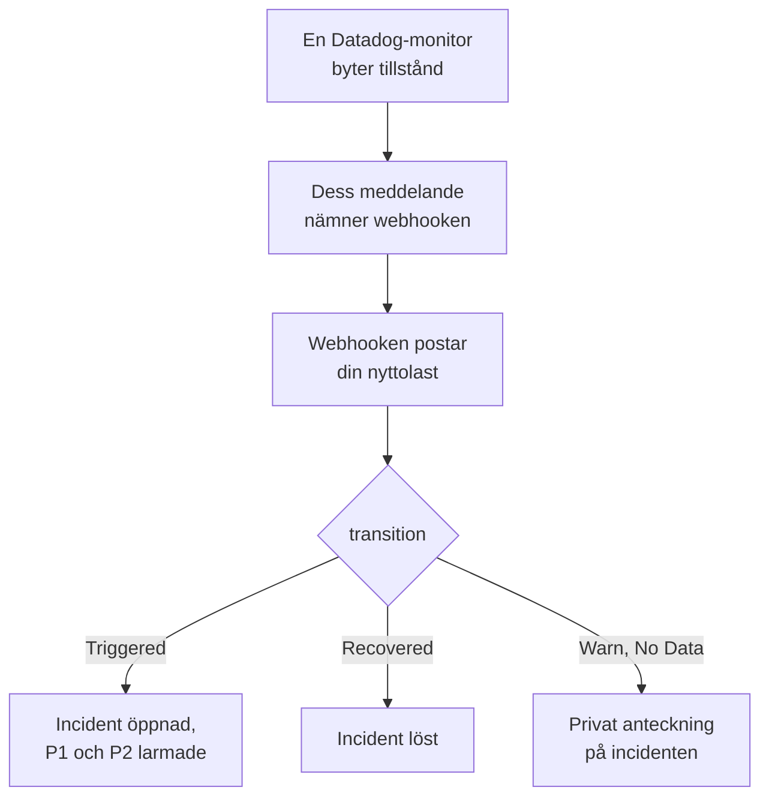

# Datadog

Skicka larm från [Datadog](https://www.datadoghq.com)-monitorer till OneUptime, så att vart och ett blir en incident eller ett larm, larmar ditt jourteam när det är brådskande och löses när Datadog-monitorn har återhämtat sig. Datadog skickar sina larm genom sin [Webhooks-integration](https://docs.datadoghq.com/integrations/webhooks/), så det finns inget att installera på någon av sidorna.

:::cards
- [Välj hur OneUptime tar emot larm](#välj-hur-oneuptime-tar-emot-larm): En arbetsflödesmall eller en Incoming Request-monitor.
- [Börja från mallen](#börja-från-mallen): Välj vem som ska larmas, kopiera URL:en och se vad varje larm gör.
- [Ta emot larm med en monitor](#ta-emot-larm-med-en-monitor): En incident per larm, löst vid återhämtning.
- [Konfigurera Datadog](#konfigurera-datadog): En webhook och de monitorer som aviserar den.
- [Felsökning](#felsökning): När larm inte kommer fram eller incidenter förblir öppna.
:::

## Så fungerar det



En Datadog-monitor aviserar de webhooks som dess meddelande nämner när den byter tillstånd: när den utlöses, varnar, återhämtar sig eller saknar data. Webhookens JSON-kropp skriver du själv, utifrån Datadogs [mallvariabler](https://docs.datadoghq.com/integrations/webhooks/#usage), så den här guiden ger dig en som namnger varje larm och säger vad som hände med det.

## Innan du börjar

- Ett Datadog-konto där du kan konfigurera integrationer och redigera monitorer.
- I OneUptime behörighet att skapa arbetsflöden, eller monitorer om du väljer den vägen. På OneUptime Cloud behöver arbetsflöden planen **Growth** eller högre.

## Välj hur OneUptime tar emot larm

Konfigurera OneUptime först: det ger dig den URL som Datadog skickar till.

| Väg | Använd den när |
| --- | --- |
| Arbetsflödesmallen (rekommenderas) | Du vill ha varje larm som en incident eller ett larm med en allvarlighetsgrad som följer monitorns prioritet, med jouren larmad för P1 och P2, med varningar noterade på den och löst vid återhämtning. Det finns inget att bygga. |
| En Incoming Request-monitor | Du vill ha incidenter utan ett arbetsflöde, på vilken plan som helst, och en monitor vars status följer Datadog. |

Båda får samma JSON från samma webhook, så du kan börja med det ena och byta senare genom att ändra en URL i Datadog.

## Börja från mallen

Dialogen **Skapa ett arbetsflöde** har två Datadog-mallar, under **Datadog** i kategorilistan: **Declare an incident when a Datadog monitor triggers**, och **Create an alert when a Datadog monitor triggers** för larm. Båda gör samma sak, var och en med sin egen sorts post.

:::steps
1. Gå till **Arbetsflöden** och klicka på **Skapa arbetsflöde**. Under **Eller börja från en mall** väljer du **Datadog** i kategorilistan, klickar på **Declare an incident when a Datadog monitor triggers**, eller **Create an alert when a Datadog monitor triggers**, och klickar på **Använd den här mallen**.
2. Under **Who to page for P1 and P2 monitors** väljer du de jourpolicyer som ska larmas, eller ingen för att inte larma någon, och klickar på **Skapa arbetsflöde**. Arbetsflödet öppnas i **Byggare**, avstängt.
3. Klicka på utlösaren **Webhook**, sedan på **Kopiera URL**, och spara URL:en till Datadog.
4. Slå på **Aktiverad** högst upp i **Byggare**. Ett arbetsflöde som är avstängt svarar Datadog med `400`.
:::

Sedan [konfigurerar du Datadog](#konfigurera-datadog) att skicka sina larm till den URL:en. Arbetsflödets steg `read-event-1` öppnas med samma inställningar, för när du kommer tillbaka till det i **Byggare**.

### Vad arbetsflödet gör

Efter utlösaren **Webhook** läser steget **Check With JavaScript** `read-event-1` den `transition` som Datadog skickar, och **Incident From Another Tool**, eller **Alert From Another Tool** i larmmallen, gör det den betyder, utifrån larmets cykelnyckel. Datadog behåller nyckeln från det att ett larm utlöses tills det återhämtar sig, och nästa gång det utlöses är nyckeln ny, så varje gång får en egen incident. Incidenten behåller nyckeln i sitt anpassade fält `datadogAlertCycleKey`.

| Transition | Vad arbetsflödet gör |
| --- | --- |
| `Triggered`, `Re-Triggered` | Deklarerar en incident med titeln `Datadog: <monitor>`, med den allvarlighetsgrad som monitorns prioritet motsvarar, utanför dina statussidor. Beskrivningen länkar till larmet i Datadog och visar prioriteten, värden, omfånget och monitorns meddelande. En avisering för ett larm som redan har sin incident öppnar ingen andra och larmar ingen igen. |
| `Recovered` | Löser larmets incident, om den inte redan är löst. Varför står på dess tidslinje. |
| `Warn`, `Re-Warn`, `No Data`, `Re-No Data` | Lägger till en privat anteckning på larmets incident, som säger vilket tillstånd monitorn har nu. |
| `Renotify` | Ingenting: larmet är fortfarande öppet. |

En varning eller en återhämtning för ett larm utan incident ändrar ingenting. Allt annat, till exempel en begäran från ett annat verktyg, lämnas orört: `read-event-1` tar **No**, och körningens **Steg** säger varför. Inget går tillbaka till Datadog: det löser sina egna larm när signalen återhämtar sig, och det är det som löser incidenten.

### Prioriteter och larmning

En ny incident larmar de jourpolicyer du valde när dess monitor är P1 eller P2, eller saknar prioritet. P3, P4 och P5 öppnar en incident och larmar ingen. I ett nytt projekt kopplas prioriteterna till dessa allvarlighetsgrader för incidenter och larm:

| Datadog-prioritet | Incident | Larm | Jour |
| --- | --- | --- | --- |
| P1 | Critical Incident | High | Larmad |
| P2 | Critical Incident | High | Larmad |
| Ingen prioritet | Critical Incident | High | Larmad |
| P3 | Major Incident | Low | Inte larmad |
| P4 | Minor Incident | Low | Inte larmad |
| P5 | Minor Incident | Low | Inte larmad |

Med egna allvarlighetsgrader går P1, P2 och ingen prioritet till din allvarligaste, P3 till den mittersta, och P4 och P5 till din minst allvarliga.

- För att koppla en prioritet till en av dina efter namn, redigera `SEVERITY_BY_NAME` i steget `read-event-1`, till exempel `{ P3: 'Minor Incident' }`.
- För att larma även för P3, ställ in **Compare with** i steget `if-page-1` **If / Else** på `3`.

## Ta emot larm med en monitor

En [Incoming Request-monitor](/docs/monitor/incoming-request-monitor) ger dig en URL, och dess kriterier avgör vad varje larm gör.

:::steps
### Skapa monitorn

Gå till **Monitorer** och klicka på **Skapa monitor**. Välj **Incoming Request** under **Monitortyp**, ge den namnet `Datadog` och klicka på **Nästa**.

### Deklarera en incident för varje larm

Öppna det första kriteriet i steget **Kriterier**, det som markerar monitorn som offline. Ställ in dess filter på **Begärandekropp**, **Innehåller**, `"transition":"Triggered"`. Det här kriteriet deklarerar redan en incident när filtret matchar. Fyll i incidenten:

- **Incidenttitel**: `{{requestBody.title}}`.
- **Incidentbeskrivning**, under **Beskrivning**: `{{requestBody.body}}`, sedan `Datadog: {{requestBody.link}}` på en egen rad.
- **Allvarlighetsgrad**: den incidentallvarlighetsgrad som de här larmen ska ha.
- **Jourpolicyer**, under **Jour**: de policyer som ska larmas.
- **Lös incident automatiskt**, under **Fler fält**: låt den vara påslagen, som den börjar. Utan den ignoreras återhämtningar och incidenter förblir öppna.

### Öppna en incident per larm

Öppna **Inställningar** i samma kriterium och slå på **Group incidents and alerts by a payload field**. Fyll i den som nedan, så att varje larm får sin egen incident och dess återhämtning löser den:

| Fält | Värde |
| --- | --- |
| **Open a separate incident for each…** | `requestBody.alert_key` |
| **Field that signals recovery** | `requestBody.transition` |
| **Value that means recovered** | `Recovered` |

### Få monitorn online igen

Öppna det andra kriteriet, det som markerar monitorn som online, och ställ in dess filter på **Begärandekropp**, **Innehåller**, `"transition":"Recovered"`.

### Kopiera URL:en

Klicka på **Skapa monitor**. Monitorns sida **Översikt** visar dess **Heartbeat URL**. Kopiera den till Datadog:

```text
https://oneuptime.com/heartbeat/<secret key>
```

En egenvärdad installation har sin egen värd i stället för `oneuptime.com`.
:::

Nyttolasten nedan sätter `alert_key` till Datadog-monitorns ID och taggarna för den grupp som larmade, så att varje grupp i en multi-alert-monitor får sin egen incident och den gruppens återhämtning löser den. En monitor som utlöses igen eller aviserar igen medan dess incident är öppen öppnar ingen andra. Se [Ta emot larm från ett annat system](/docs/monitor/incoming-request-monitor#ta-emot-larm-från-ett-annat-system) för vad varje inställning gör.

> [!NOTE]
> En avisering **Warn** eller **No Data** öppnar ingen incident med de här filtren. För att också larmas vid varningar klickar du på **Lägg till kriterier**, ger det nya kriteriet filtret **Begärandekropp**, **Innehåller**, `"transition":"Warn"`, en incident med sin egen **Allvarlighetsgrad** och samma grupperingsinställningar, och drar det sedan ovanför det första kriteriet. Kriterier kontrolleras uppifrån, och det första som matchar avgör.

## Konfigurera Datadog

:::steps
### Lägg till webhooken

Öppna [rutan för Webhooks-integrationen](https://app.datadoghq.com/integrations/webhooks) i Datadog och installera den om den inte redan är installerad. Lägg till en webhook med de här inställningarna och spara den sedan:

- **Name**: `oneuptime`. Monitorer nämner webhooken med det här namnet, som `@webhook-oneuptime`.
- **URL**: den URL som du kopierade från OneUptime.
- **Payload**:

  ```json
  {
    "alert_key": "$ALERT_ID $ALERT_SCOPE",
    "alert_cycle_key": "$ALERT_CYCLE_KEY",
    "transition": "$ALERT_TRANSITION",
    "alert_priority": "$ALERT_PRIORITY",
    "title": "$EVENT_TITLE",
    "body": "$TEXT_ONLY_MSG",
    "host": "$HOSTNAME",
    "scope": "$ALERT_SCOPE",
    "priority": "$PRIORITY",
    "link": "$LINK"
  }
  ```

### Nämn webhooken i dina monitorer

Lägg till `@webhook-oneuptime` i monitorns aviseringsmeddelande i varje Datadog-monitor som ska larma genom OneUptime, och spara monitorn. Datadog skickar då den monitorns larm och återhämtningar till OneUptime.
:::

| Variabel | Vad Datadog lägger i den |
| --- | --- |
| `$ALERT_ID` | ID:t för den Datadog-monitor som larmade. |
| `$ALERT_SCOPE` | Taggarna för den grupp som larmade, som `host:web-1`. |
| `$ALERT_CYCLE_KEY` | Ett ID som förblir detsamma från det att ett larm utlöses tills det återhämtar sig. |
| `$ALERT_TRANSITION` | Vad som hände: `Triggered`, `Re-Triggered`, `Warn`, `Recovered`, `No Data` eller `Renotify`, bland annat. |
| `$ALERT_PRIORITY` | Prioriteten för Datadog-monitorn, `P1` till `P5`, eller ingenting för en monitor utan prioritet. |
| `$EVENT_TITLE` | Händelsens titel, som `[Triggered] High CPU`. |
| `$TEXT_ONLY_MSG` | Monitorns meddelande, utan Markdown. |
| `$LINK` | En länk till händelsen i Datadog. |

En nyttolast fungerar för båda vägarna: mallen går på `alert_cycle_key` och `alert_priority`, och monitorn på `alert_key`. Behåll dem alla, så kan du byta senare genom att bara ändra URL:en.

## Testa det

Skicka ett larm till den URL du kopierade, som Datadog skulle göra:

```bash
curl -X POST "<url>" \
  -H "Content-Type: application/json" \
  -d '{
    "alert_key": "1234 host:web-1",
    "alert_cycle_key": "7151157925468446720",
    "transition": "Triggered",
    "alert_priority": "P1",
    "title": "[Triggered] High CPU",
    "body": "CPU is above 90% on web-1.",
    "host": "web-1",
    "scope": "host:web-1",
    "priority": "normal",
    "link": "https://app.datadoghq.com/event/event?id=1"
  }'
```

Med mallen öppnas en incident med titeln `Datadog: High CPU`, och de jourpolicyer du valde larmas. Med monitorn öppnas en incident med titeln `[Triggered] High CPU`. Skicka samma begäran med `transition` inställd på `Recovered`, så löses incidenten.

Testa sedan från Datadog: öppna en monitor som nämner webhooken, klicka på **Test Notifications** och skicka dess avisering **Alert**. För att se att den kom fram öppnar du arbetsflödets **Loggar → Körningar**, eller OneUptime-monitorns tidslinje.

## Felsökning

:::details Inget kommer fram till OneUptime
- Kontrollera att Datadog-monitorns meddelande nämner `@webhook-oneuptime`, stavat som webhooken heter.
- Monitorn svarar `200` direkt, innan den kontrollerar något, även för en felaktig hemlig nyckel. Titta på monitorns tidslinje för att se om larm kommer fram.
- Ett arbetsflöde som är avstängt svarar `400`. Slå på **Aktiverad** överst i dess **Byggare**.
:::

:::details Arbetsflödet körs, men öppnar ingenting
Öppna körningen i **Loggar → Körningar**. Posten `read-event-1` under dess **Steg** säger varför den tog **No**.

- `Datadog named no alert cycle key`: lägg till `"alert_cycle_key": "$ALERT_CYCLE_KEY"` i webhookens nyttolast i Datadog.
- `Datadog named no transition`: lägg till `"transition": "$ALERT_TRANSITION"` i webhookens nyttolast i Datadog.
:::

:::details Jouren larmas inte
- Bara P1- och P2-monitorer och monitorer utan prioritet larmar. Se [Prioriteter och larmning](#prioriteter-och-larmning).
- En avisering för ett larm som redan har sin incident larmar ingen igen.
- Om ingen valdes i dialogen **Skapa ett arbetsflöde** har arbetsflödet inget steg som larmar.
:::

:::details Incidenter skapas men löses aldrig
- Datadog-monitorn måste också avisera webhooken om sina återhämtningar. Ett meddelande som nämner webhooken bara för larm, inuti ett villkor, skickar ingen återhämtning.
- Med mallen: öppna återhämtningens körning i **Loggar → Körningar**: dess sista steg säger varför. Återhämtningens `alert_cycle_key` måste vara larmets, så behåll `$ALERT_CYCLE_KEY` som den är i nyttolasten.
- Med monitorn behöver kriteriets incident **Lös incident automatiskt**, under **Fler fält**.
- **Value that means recovered** måste vara exakt `Recovered`. Jämförelsen är skiftlägeskänslig.
- Återhämtningens `alert_key` måste vara larmets: behåll `$ALERT_ID $ALERT_SCOPE` som det står i nyttolasten.
:::

:::details Ett fält visar namnet på en variabel, eller ingenting
Datadog fyller bara i de variabler som gäller för händelsen. Skicka en testavisering och titta sedan på vad som kom fram: i monitorns tidslinje, eller för ett arbetsflöde i **Loggar → Körningar**.
:::

:::details Alla larm från en monitor slås ihop till en incident
Med monitorn behöver varje grupp sin egen `alert_key`. Kontrollera att nyttolasten sätter den från både `$ALERT_ID` och `$ALERT_SCOPE`, och att grupperingssökvägen är `requestBody.alert_key`.
:::

## Säkerhet

- **Behandla URL:en som ett lösenord.** Alla som har den kan öppna incidenter. Om den läcker återställer du den: **Återställ URL** i arbetsflödets **Webhook**-utlösare, eller **Återställ hemlig nyckel för inkommande begäran** på monitorns sida **Inställningar**. Uppdatera sedan webhookens **URL** i Datadog.
- **Länkar går till Datadog.** Mallen länkar ett larm bara på en Datadog-webbplats, vad en begäran än säger, och skriver det Datadog skickade som text.
- **Egenvärdad?** Datadog skickar webhooks från internet, så din OneUptime måste kunna nås därifrån över HTTPS.

## Nästa steg

:::cards
- [Arbetsflödesmallar](/docs/workflows/authoring): Skapa ett arbetsflöde från en mall och ändra det i Byggare.
- [Övervakning av inkommande förfrågningar](/docs/monitor/incoming-request-monitor): Varje inställning för den monitor som tar emot dina larm.
- [New Relic](/docs/integrations/new-relic): Samma mall, för New Relic-ärenden.
- [Eskaleringsregler](/docs/on-call/escalation-rules): Bestäm vem en jourpolicy larmar, och när.
- [Översikt över integrationer](/docs/integrations/index): De andra verktyg som du kan ansluta.
:::
