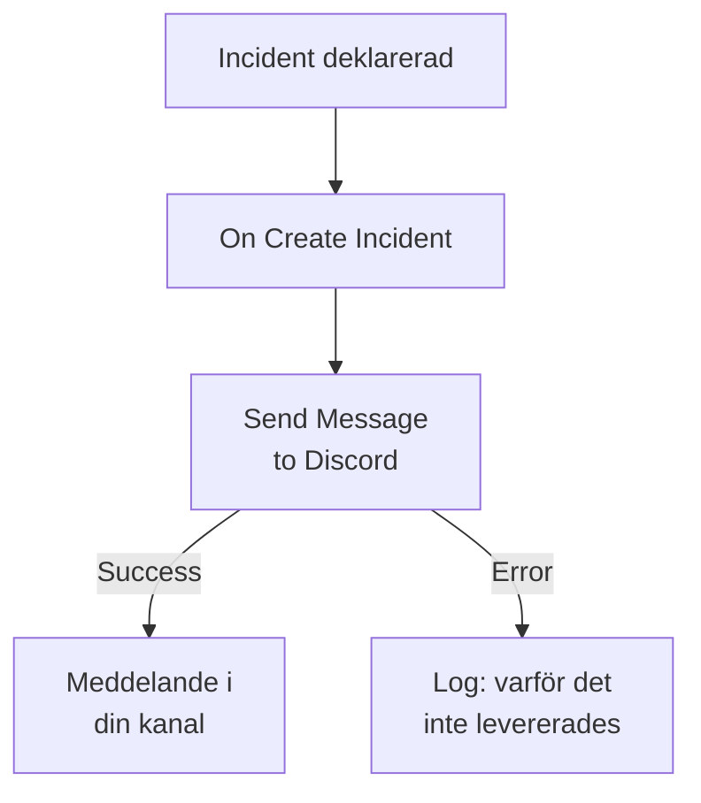

# Discord

Posta ett meddelande i en [Discord](https://discord.com)-kanal när en incident öppnas, så att de som följer kanalen får veta det direkt. OneUptimes arbetsflödessteg **Send Message to Discord** postar via kanalens webhook, och en färdig mall bygger hela arbetsflödet åt dig. Den här integrationen är **utgående**: OneUptime postar i kanalen och läser inte det som sägs där.

:::cards
- [Så fungerar det](#så-fungerar-det): Vad arbetsflödet gör när en incident öppnas.
- [Kom igång](#konfigurera-integrationen): En webhook i Discord och sedan arbetsflödet: från mallen eller från grunden.
- [Tips](#tips): Formatering, långa meddelanden och fler händelser.
- [Felsökning](#felsökning): Vad stegets fel betyder och vad du ska ändra.
:::

## Så fungerar det



Steget postar **Message Text** till kanalens webhook. Det tar sin utgång **Success** när Discord tar emot meddelandet, och sin utgång **Error**, med Discords skäl, när Discord avvisar det. Mallen kopplar ett steg **Log** till **Error**, så att en körning som inte kunde posta säger varför.

## Innan du börjar

- I Discord behörigheten **Manage Webhooks** på kanalen.
- I OneUptime rätten att skapa arbetsflöden och variabler. På OneUptime Cloud kräver arbetsflöden planen **Growth** eller högre.

## Konfigurera integrationen

:::steps
### Skapa en webhook i Discord

1. Öppna kanalens inställningar i Discord med **Edit Channel**, sedan **Integrations → Webhooks**, och välj **New Webhook**.
2. Ge den ett namn, till exempel `OneUptime`, och kontrollera att den postar i rätt kanal.
3. Välj **Copy Webhook URL**.

Alla som har URL:en kan posta i kanalen, så var lika rädd om den som om ett lösenord.

### Bygg arbetsflödet

Börja från mallen, som bygger hela arbetsflödet åt dig, eller från grunden.

:::tabs
@tab Från mallen
1. Öppna **Arbetsflöden** och klicka på **Skapa arbetsflöde**.
2. Skriv `Discord` i **Sök mallar…**, klicka på **Tell Discord when an incident opens** och klicka sedan på **Använd den här mallen**.
3. Behåll namnet **Notify Discord on new incident** eller ändra det, och klicka på **Nästa**.
4. Klistra in URL:en i **Discord Webhook URL** och klicka på **Skapa arbetsflöde**.

Arbetsflödet öppnas i **Byggare** med tre steg: **On Create Incident**; **Send Message to Discord**, som postar incidentens nummer, titel, allvarlighetsgrad och tillstånd; och ett steg **Log** på dess utgång **Error**. URL:en sparas som arbetsflödets hemliga variabel `discordWebhookUrl`.
@tab Från grunden
1. Spara URL:en som en hemlig global variabel: gå till **Arbetsflöden → Globala variabler**, klicka på **Skapa Arbetsflöde Variabel**, ge den namnet `DISCORD_WEBHOOK_URL` och klicka på **Nästa**. Klistra in URL:en i **Innehåll**, slå på **Hemlighet** och klicka på **Skapa Arbetsflöde Variabel**.
2. Gå till **Arbetsflöden**, klicka på **Skapa arbetsflöde**, välj **Börja från grunden**, ge arbetsflödet ett namn och klicka på **Skapa arbetsflöde**.
3. Klicka på **Välj vad som startar det här arbetsflödet** i **Byggare** och välj **On Create Incident** under **Populära**. Klicka på utlösaren: dess **Fields to pass on** börjar med **Titel**, så klicka på **Lägg till fält** och välj de andra fält som ditt meddelande visar, till exempel **Incident Number With Prefix**.
4. Klicka på **Lägg till komponent**, sök efter `discord` och klicka på **Send Message to Discord**. Anslut utlösarens utgång **Success** till det.
5. Klicka på det nya steget. Klicka på **{ }** i **Discord Incoming Webhook URL** och välj `DISCORD_WEBHOOK_URL` under **Global variables**. Skriv meddelandet i **Message Text** och infoga incidentens fält med **{ }**.
:::

Ett meddelande byggt från grunden läser incidentens fält med referenser som dessa:

```text
🚨 **Incident {{local.components.incident-on-create-1.returnValues.model.incidentNumberWithPrefix}} declared**
**Title:** {{local.components.incident-on-create-1.returnValues.model.title}}
```

### Slå på och testa

Slå på **Aktiverad** högst upp i **Byggare**. Från och med nu postas varje ny incident i kanalen.

För att testa utan att öppna en incident klickar du på **Kör arbetsflöde** och väljer en incident du redan har under **Incident**: de senaste visas i listan, och genom att skriva dess nummer eller en del av dess titel hittar du en annan. Klicka på **Kör arbetsflödet manuellt** och bekräfta med **Kör**. Panelen **Arbetsflödeskörning** följer körningen, och meddelandet dyker upp i kanalen. Om steget i stället tar **Error** säger raden från steget **Log** varför: se [Felsökning](#felsökning).
:::

## Tips

- **Formatera med Discords Markdown.** Texten skickas som den är skriven, så Discords Markdown fungerar i den: asterisker runt ett ord gör det fetstilt, och en URL visas som en länk.
- **Tänk på gränsen på 2 000 tecken.** Discord tar emot meddelanden på upp till 2 000 tecken. Ett längre kortas av och slutar med "… (truncated — see OneUptime for the full text)" i stället för att avvisas.
- **Posta mer än nya incidenter.** Bygg ett annat arbetsflöde på **On Update Incident** för tillståndsändringar, eller på **On Create Alert** för larm, med samma steg. För att bara posta vissa incidenter sätter du ett block **If / Else** före steget.
- **Bara Discords egna adresser.** Steget postar till en `https`-URL på `discord.com` eller `discordapp.com` och följer inte omdirigeringar, så en URL som pekar någon annanstans stoppar körningen.

## Felsökning

När steget tar **Error** säger körningen varför: mallens steg **Log** skriver `❌ Discord could not deliver the incident notification:` och Discords skäl.

:::details Discord svarar "Unknown Webhook" eller "Invalid Webhook Token"
Webhooken har tagits bort, eller så kopierades URL:en fel. Skapa en ny webhook och ersätt URL:en: i mallens arbetsflöde variabeln `discordWebhookUrl`, i ditt eget arbetsflöde innehållet i `DISCORD_WEBHOOK_URL`.
:::

:::details Discord svarar "You are being rate limited"
Discord begränsar hur ofta en webhook kan posta. En skur av incidenter kan nå gränsen: posta färre meddelanden, till exempel bara för vissa allvarlighetsgrader.
:::

:::details Körningen stoppar med "Discord Webhook URL must be an https URL on discord.com or discordapp.com"
**Discord Incoming Webhook URL** innehåller något annat än en Discord-webhook, eller så är variabeln den läser tom. Klistra in URL:en från **Copy Webhook URL** igen.
:::

## Nästa steg

:::cards
- [Arbetsflödeskomponenter](/docs/workflows/components#discord): Varje inställning i steget och vad dess utgångar betyder.
- [Telegram](/docs/integrations/telegram): Samma idé, i en Telegram-chatt.
- [Arbetsflödeskörningar](/docs/workflows/runs-and-logs): Läs vad varje körning av arbetsflödet gjorde.
- [Översikt över integrationer](/docs/integrations/index): Det utgående mönstret och de andra verktygen du kan ansluta.
:::
