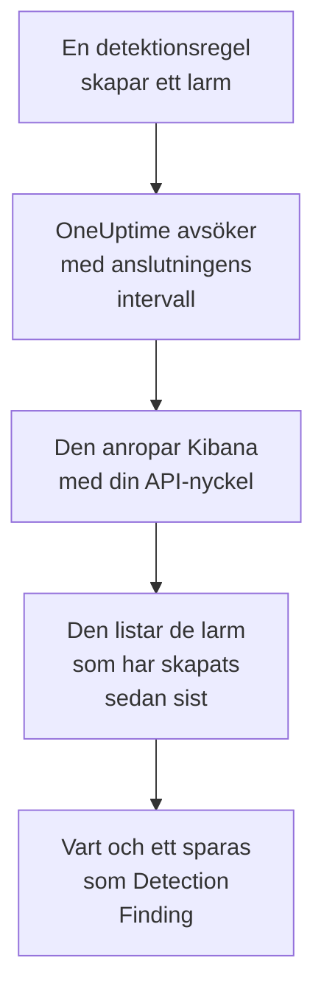

# Elastic Security

Importera de detektionslarm som dina regler i [Elastic Security](https://www.elastic.co/security) utlöser till säkerhetshändelserna i OneUptime. Där söker du i dem bredvid dina loggar, spårningar och mätvärden, korrelerar dem med alla andra källor och larmar jouren för dem som spelar roll. OneUptime läser dem via Kibanas API för detektionsmotorn med en API-nyckel som du själv skapar, och ändrar ingenting i Elastic.

:::cards
- [Konfigurera anslutningen](#konfigurera-anslutningen): En API-nyckel, dess behörigheter och anslutningens formulär.
- [Vad som importeras](#vad-som-importeras): Hur varje detektionslarm blir en säkerhetshändelse.
- [Så fungerar avsökningen](#så-fungerar-avsökningen): Det fönster som varje avsökning läser, och vad ett upptaget space gör med det.
- [Felsökning](#felsökning): Vad varje fel betyder och vad du ska ändra.
:::

## Så fungerar det



Varje minut avsöker OneUptime varje aktiverad anslutning vars avsökningsintervall har passerat. En avsökning ber Kibana om de detektionslarm som har skapats i ditt space sedan förra avsökningen, 1 000 åt gången, och sparar vart och ett som en [OCSF](https://schema.ocsf.io/) Detection Finding-händelse (klass `2004`). Alla regeltyper räknas: anpassad fråga, tröskel, EQL, indikatormatchning, maskininlärning och nya termer. Identifieringsregler, monitorer och instrumentpaneler behandlar sedan larmen som säkerhetshändelser från vilken annan källa som helst.

## Innan du börjar

- I OneUptime rollen Project Owner, Project Admin eller Security Admin. Security Member och Security Viewer kan se anslutningar och deras körningshistorik, men inte ändra dem.
- Elastic Security 8.x eller senare, på Elastic Cloud eller din egen Elastic-stack, med detektionsregler som körs i ett Kibana-space.
- Kibana-åtkomst som kan se detektionslarmen i det spacet: indexbehörigheterna `read` och `view_index_metadata` på `.alerts-security.alerts-<space-id>`, och en Kibana-funktionsbehörighet för Security som låter den läsa larm där.
- En Kibana som OneUptime kan nå över HTTPS. OneUptime Cloud ansluter från internet, så Kibana behöver en offentlig adress, som Elastic Cloud-distributioner har: privata adresser avvisas. En egenvärdad OneUptime ansluter från sina app- och workercontainrar och kan nå en Kibana i ditt privata nätverk, om inte `DATA_SOURCE_BLOCK_PRIVATE_ADDRESSES` är `true`.

## Konfigurera anslutningen

:::steps
### Skapa en API-nyckel

1. Öppna **Stack Management → API keys** i Kibana och välj **Create API key**.
2. Ge den ett namn, till exempel `oneuptime-security-events`. En nyckel har behörigheterna hos användaren som skapar den, om du inte ger den färre: den behöver bara dem ovan.
3. Välj när den går ut, eller aldrig. En nyckel som går ut stoppar anslutningen tills du ersätter den.
4. Skapa nyckeln och kopiera dess **Base64**-värde, som Kibana bara visar en gång. Inte nyckelns ID, och inte paret `id:api_key`.

### Hitta ditt spaces ID

Larm sparas per space. Öppna det space där dina regler körs: dess ID är den del av Kibana-adressen som kommer efter `/s/`, till exempel `security` i `https://kibana.example.com/s/security/app/security`. Standardspacet har ingen `/s/`-del och behöver inget ID.

### Lägg till anslutningen i OneUptime

Öppna **Produkter → Security Events → Connections** (`/dashboard/{projectId}/security-events/connections`), klicka på **Lägg till anslutning**, välj **Elastic Security** och klicka på **Nästa**. Fyll i inställningarna i tabellen nedan, klicka på **Nästa** och klistra in nyckeln i **API-nyckel**.

### Testa den innan du sparar

Klicka på **Test these settings** under **Testa innan du sparar**. Testet autentiserar och läser larm med värdena i formuläret och sparar ingenting, så ett fel space eller en saknad behörighet syns innan anslutningen finns. Klicka sedan på **Nästa**, ge anslutningen ett **Namn** och skapa den.
:::

| Inställning | Vad du anger |
| --- | --- |
| **Kibana URL** | Adressen som Kibana erbjuds från, till exempel `https://kibana.example.com` eller `https://<deployment>.kb.<region>.cloud.es.io`. Utan sökväg: ingen `/app/security`, ingen `/api` och ingen `/s/<space>`-del. |
| **Kibana space** | Spacets ID, inte dess namn: bokstäver, siffror, bindestreck och understreck. Lämna tomt för standardspacet. |
| **API-nyckel** | Nyckelns **Base64**-värde, ensamt: OneUptime lägger själv till schemat `ApiKey`. Det krypteras, returneras aldrig av API:t och visas aldrig igen. Ersätt det med **Update credentials** på anslutningen. |

Steget **Polling** har också en valfri **Beskrivning**, **Poll Interval (Minutes)**, ett heltal från `1` till `1440` som börjar på `5`, och **Aktiverad**, som börjar påslagen.

## Vad som importeras

Varje detektionslarm blir en Detection Finding-händelse (OCSF-klass `2004`), med leverantören `Elastic` och produkten `Elastic Security`:

| Larmfält | OneUptime-kolumn |
| --- | --- |
| `_id`, larmets ID | Händelse-UID, som även dubbletter tas bort efter |
| `kibana.alert.original_time`, annars `kibana.alert.start`, annars `@timestamp` | Händelsens tid |
| `kibana.alert.rule.name` | Regelnamn |
| `kibana.alert.rule.uuid`, annars `kibana.alert.rule.rule_id` | Regel-ID |
| `kibana.alert.reason`, annars regelnamnet, annars `kibana.alert.rule.description` | Meddelande |
| `kibana.alert.severity`, annars ett band av `kibana.alert.risk_score` | Allvarlighetsgrad |
| `kibana.alert.workflow_status`: `open`, `acknowledged` eller `closed` | Status |
| `kibana.alert.rule.threat`, inklusive undertekniker | MITRE ATT&CK-taktiker och -tekniker |
| `user.name`, `host.name`, `source.ip` eller `host.ip`, `process.name` eller `process.executable` | Aktörens användare, värd, IP och process |
| `process.name`, `process.executable` och `process.command_line`; `process.parent.name`, `process.parent.executable` och `process.parent.command_line` | Processens namn, sökväg och kommandorad; den överordnade processens namn, sökväg och kommandorad |
| `user.target.name`, `destination.domain`, `destination.ip`, `destination.port`, `file.path` | Målets användare, värd, IP, port och resurs |
| Dessa, plus `related.*`, `dns.question.name`, `url.domain` och filhashar | Observables |
| Hela larmet, utplattat till nycklar med punkter, med `_index` och `_id` | `attributes` |

Ett larms tid är med avsikt tiden för den aktivitet det handlar om. Dess `@timestamp`, när regeln skapade det, är vad avsökningen läser, så ett larm som skapades i dag om gårdagens aktivitet visas under i går i utforskaren för säkerhetshändelser. När ett larm saknar allvarlighetsgrad avgör dess riskpoäng: från `74` Critical, från `48` High, från `22` Medium, och därunder Low.

## Så fungerar avsökningen

Varje avsökning listar de larm som har skapats i dess fönster, de äldsta först, 1 000 per sida. I ett annat space än standardspacet börjar sökvägen med `/s/{Kibana space}`:

```text
POST {Kibana URL}/api/detection_engine/signals/search
    {"query": {"range": {"@timestamp": {"gte": "{window start}", "lt": "{window end}"}}},
     "size": 1000, "sort": [{"@timestamp": "asc"}]}
```

- **Skapandetiden är markören.** Larm listas efter sin egen `@timestamp`, när regelkörningen skapade dem, aldrig efter tiden för aktiviteten de handlar om. En regel som körs varje timme skapar larm om aktivitet som är upp till en timme gammal, och en markör på aktivitetstiden skulle hoppa över alla.
- **Den första avsökningen ser 24 timmar bakåt**, så att en ny anslutning direkt visar sina senaste larm.
- **Varje senare avsökning börjar 1 minut före den sparade markören**, så att ett larm som har skapats på gränsen mellan två fönster aldrig missas.
- **En avsökning läser högst 24 timmar förbi markören.** En anslutning vars markör har hamnat efter kommer ikapp i en serie fönster på 24 timmar, och dess **Health** visar **Catching up**.
- **Dubbletter tas bort efter larmets `_id`** inom projektet, så att överlappningen, ett upprepat fönster och en import aldrig sparar ett larm två gånger.

Kibanas larmsökning tar en storlek och en sortering, men ingen sidtoken. Därför paginerar OneUptime genom att flytta intervallets början till det sista larmet på varje sida, och utelämnar, efter `_id`, de larm som den redan har läst vid det ögonblicket. En regelkörning stämplar ofta många larm med samma tid, och en sådan grupp läses sida för sida, inget två gånger och inget överhoppat.

### När ett fönster innehåller mer än en avsökning kan läsa

En avsökning läser högst 10 000 larm, i högst 20 begäranden. När ett fönster innehåller fler blir körningen **Partial**, med en varning som:

```text
Stopped after collecting 10000 alerts; the window holds more.
```

Larm läses de äldsta först, så OneUptime flyttar markören till skapandetiden för det senast lästa larmet, och nästa avsökning börjar där med samma fönsterlängd. Ett upptaget space kommer ikapp 10 000 larm per avsökning i stället för att läsa samma larm igen. Larm som skapades i exakt samma ögonblick läses två gånger, och dubblettkontrollen tar bort den andra kopian.

De utelämnade ID:na skickas med i varje begäran, och Kibana begränsar storleken på en begäran. När fler larm delar ett ögonblick än en begäran kan utelämna, ungefär 7 800, stannar körningen där som **Partial**, med en varning som namnger ögonblicket.

När en körning inte alls kommer förbi den sparade markören gör OneUptime i stället fönstret kortare:

1. **Smalna av.** Nästa avsökning läser ett fönster som är hälften så långt, från samma startpunkt, och fortsätter att halvera tills ett fönster läses helt, ner till en minut. Körningens varning säger det: `This window holds more records than one poll can read; the next poll reads a {n} minute window from the same starting point.`
2. **Växa igen.** När ett fönster har lästs helt är nästa dubbelt så långt igen, upp till 24 timmar.
3. **Gå förbi en enda minut.** Om till och med en minut innehåller mer än en avsökning kan läsa går avsökningen förbi den, så att nyare larm fortsätter att komma. Körningen förblir **Partial**, och **Senaste fel** lyder `More records were created in the one minute from {cursor} to {end} than one poll can read. Polling moved past this minute so newer records keep arriving; use Import this time range in Diagnostics on this minute to recover what one run can read.` Importera den minuten med **Import this time range** för att hämta det som en körning kan läsa.

En körning som misslyckas helt, med ett fel från Kibana, behåller markören och fönsterlängden, och nästa avsökning läser samma fönster igen. Det enda undantaget är en begäran som fick tidsgräns: markören stannar, men nästa fönster är hälften så långt, eftersom ett fönster som är för tungt för att besvaras i tid skulle få tidsgräns vid varje försök. Att ändra **Poll Interval (Minutes)** ändrar inget av detta: det avgör hur ofta en avsökning startar, inte var dess fönster börjar.

### Kör, förhandsgranska och importera vid behov

Klicka på **Diagnostics** på en anslutning för att se dess senaste körningar och arbeta med den manuellt. Alla som kan ändra anslutningen kan starta de här åtgärderna; alla som kan se den kan läsa historiken.

- **Run now** startar en avsökning direkt, med den vanliga markören, även när anslutningen inte är **Aktiverad**.
- **Preview alerts** läser ett tidsintervall på upp till 7 dagar och importerar ingenting.
- **Import this time range** importerar ett intervall på upp till 7 dagar, efter att du har bekräftat, utan att flytta markören. Larm som redan har importerats hoppas över.
- **Copy diagnostics** på en körning kopierar dess rapport till supporten. Den innehåller aldrig autentiseringsuppgifter.

## Testa anslutningen

**Testa anslutningen** på en anslutnings rad och **Test these settings** i formuläret körs i API-processen, inte i en bakgrundsworker, så att ett test svarar även när det är workerna som är problemet. Det kör de här kontrollerna i ordning:

| Kontroll | Vad den kontrollerar |
| --- | --- |
| **Konfiguration** | Varje inställning finns och är korrekt formaterad. Ingenting kontaktas när detta misslyckas. |
| **Authenticate with Kibana** | Kibanas `/api/status` svarar fullständigt. Kibana svarar även anropare som den inte har autentiserat, med mindre, så ett kort svar gör att den här kontrollen misslyckas. |
| **Read detection alerts** | Ett larm som har skapats under de senaste 24 timmarna kan läsas. Det bevisar behörigheterna och spacet. |
| **Alerts available to import** | Hur många larm som har skapats under de senaste 24 timmarna och de senaste 7 dagarna, med `+` där Elasticsearch bara räknade en del av dem. Inga på 7 dagar är en varning, inte ett fel. |
| **Background workers**, **Poll scheduler**, **Security event storage** | OneUptimes egen sida: en process tar jobben från Worker-kön, avsökningsjobbet körs varje minut och lagringen för säkerhetshändelser svarar. |
| **Scheduled polling** | För en sparad anslutning: avsökningen är påslagen, ingen körning har fastnat i väntan på en worker och avsökningar körs i tid. |

Varje begäran i ett test har en tidsgräns på 20 sekunder. Ett test importerar aldrig något och flyttar aldrig markören, och varje kontroll som misslyckas säger vad du ska ändra.

## Skicka säkerhetshändelser till Elastic Security

OneUptime kan också skicka det den hittar till Elasticsearch, som Elastic Common Schema (ECS)-dokument i en dataström, så att larmen, tidslinjerna och upptäcktsreglerna i Elastic Security ser OneUptimes upptäckter bredvid dina egna. En upptäckt är ett dokument med `event.kind` `alert`, och alla andra händelser har `event.kind` `event`.

:::steps
### Skapa en API-nyckel som får skriva

Öppna **Stack Management → API keys** i Kibana, klicka på **Create API key**, ge den behörigheterna nedan och kopiera dess **Encoded**-värde.

### Lägg till målet

Öppna **Produkter → Security Events → Connections**. Klicka på **Lägg till mål** under **Skicka till ditt SIEM**, välj Elastic Security under **SIEM** och klicka på **Nästa**. Fyll i **Elasticsearch-URL**, distributionens Elasticsearch-slutpunkt och inte Kibanas, och klistra in nyckeln i **API-nyckel**. **Dataström** är valfri: lämnas den tom går dokumenten till `logs-oneuptime.security-default`, som Elasticsearch skapar vid första skrivningen.

### Skicka en testhändelse och börja skicka

Klicka på **Skicka en testhändelse**: ett dokument kommer fram i dataströmmen. Behåll sedan **Endast upptäckter** under **Vad som ska skickas**, eller välj **Alla säkerhetshändelser**, och klicka på **Börja skicka**.
:::

Nyckelns behörigheter, för standarddataströmmen:

```json title="oneuptime-writer-role.json"
{
  "oneuptime-writer": {
    "indices": [
      {
        "names": [
          "logs-oneuptime.security-*"
        ],
        "privileges": [
          "create_doc",
          "auto_configure"
        ]
      }
    ]
  }
}
```

- Dokument skickas i omgångar om upp till 500, vart och ett med sin händelses eget id, så att en händelse som skickas två gånger lagras en gång.
- Ett dokument som Elasticsearch inte kan mappa utelämnas och nämns i **Visa fel**, och ett som den inte kan ta emot just nu (`429`) skickas igen.
- Larm som OneUptime har importerat från Elastic Security skickas aldrig tillbaka dit.

## Felsökning

Anslutningens **Senaste fel** sparar hela felmeddelandet, med autentiseringsuppgifter maskerade, bakom ett prefix som namnger det steg som misslyckades. När en anslutning har ett fel väljer du **Visa fel** i dess kolumn **Åtgärder** för att läsa det, och **Kopiera fel** i dialogrutan för att kopiera det. Läs prefixet först.

:::details Last Error börjar med `Elastic Security status request`
- `Elastic Security status request failed (HTTP ...)`: Kibana avvisade statusbegäran.
  - `HTTP 401`: Kibana godtog inte API-nyckeln. Det är inte **Base64**-värdet, eller så har den gått ut eller ogiltigförklarats. Skapa en ny nyckel och spara den med **Update credentials**.
  - `HTTP 404`: **Kibana URL** har en sökväg, eller är inte Kibana.
  - `HTTP 503`: Kibana rapporterar sig själv som otillgänglig, oftast för att den inte når Elasticsearch.
  - `HTTP 3xx`: Kibana omdirigerade begäran, och omdirigeringar avvisas. Använd adressen som Kibana erbjuds från.
- `Elastic Security status request returned ...`: något annat än Kibana svarade, till exempel en inloggningssida eller en proxy.
- När bara testet misslyckas och säger att Kibana `answered without authenticating the request` nådde nyckeln inte fram till Kibana. Kontrollera att det är **Base64**-värdet, och att ingen proxy framför Kibana tar bort rubriken `Authorization`.
:::

:::details Last Error börjar med `Elastic Security alerts search`
- `Elastic Security alerts search failed (HTTP ...)`: Kibana avvisade larmsökningen.
  - `HTTP 403`: nyckeln loggar in, men kan inte läsa spacets larm. Ge den behörigheterna under [Innan du börjar](#innan-du-börjar).
  - `HTTP 404`: inget space har det ID:t i **Kibana space**, eller så är Elastic Security inte aktiverat i det.
  - `HTTP 429` eller `HTTP 5xx`: Kibana eller Elasticsearch begränsar begäranden eller misslyckas. Nästa avsökning försöker igen.
- `Elastic Security alerts search returned ...`: Kibana svarade `200`, men utan en läsbar sida med larm, till exempel med ett eget fel. Meddelandet citerar det. Det rapporteras i stället för att tas som ett tomt fönster, så att markören aldrig flyttas förbi larm som ingen har läst.
:::

:::details Last Error slutar med `did not complete`
`Elastic Security alerts search did not complete`, och samma sak för statusbegäran, betyder att begäran inte fick något svar: en tidsgräns, ett namn som inte kan slås upp, en avvisad anslutning eller en avvisad privat adress. Kontrollera att OneUptime-appen och workerna kan nå Kibana, med rätt schema och port. Efter en tidsgräns läser nästa avsökning ett fönster som är hälften så långt.
:::

:::details Last Polled är Never och Last Error är tom
Ingen avsökning har slutförts för den här anslutningen. Kör **Testa anslutningen**: dess kontroller **Background workers** och **Poll scheduler** namnger orsaken. På en egenvärdad installation är den vanliga orsaken `DISABLE_QUEUE_WORKERS=true` på appen, utan en separat worker-distribution som tar jobben: sätt den till `false`, eller kör worker-distributionen (Helm: `worker.enabled: true`).
:::

:::details En körning är Partial
- `Stopped after collecting 10000 alerts; the window holds more`: fönstret innehöll mer än de 10 000 larm som en körning läser. Ingenting går förlorat: nästa avsökning börjar efter det senast lästa larmet. En anslutning som förblir **Partial** avsökning efter avsökning håller på att komma ikapp en eftersläpning, och dess **Last Polled** och **Last Event Imported** fortsätter att flytta fram. Om den aldrig kommer ikapp skapar spacet mer än 10 000 larm per avsökningsintervall: gör **Poll Interval (Minutes)** kortare.
- `More records were created in the one minute from ... than one poll can read`: avsökningen gick förbi den minuten. Importera den med **Import this time range** i **Diagnostics**. En import läser lika mycket som en avsökning.
:::

:::details Testet lyckas, men ingenting importeras
Läs **Alerts available to import** i testets rapport. `0` de senaste 7 dagarna betyder att ingen regel har skapat något larm i det spacet: kontrollera att det finns aktiverade regler där, och att **Kibana space** är det space där de körs. Om det finns larm vidgar du tidsintervallet i utforskaren för säkerhetshändelser: larm visas under tiden för sin aktivitet, som kan ligga långt före när de skapades.
:::

## Vad du får

- **Sök.** Filtrera larm efter allvarlighetsgrad, status, regel, MITRE ATT&CK-teknik, användare, värd eller vilken observable som helst i utforskaren för säkerhetshändelser, bredvid alla andra källor.
- **Korrelation.** Varje larms användare, värdar, IP-adresser, domäner och hashar indexeras som observables, så en sökning hittar allt som nämner dem.
- **Identifieringsregler.** Sigma-regler som körs enligt ett schema över dina säkerhetshändelser och öppnar larm som larmar jouren.
- **Monitorer.** Monitorer för säkerhetshändelser räknar matchande händelser, till exempel nya kritiska larm, och öppnar incidenter eller larm över en tröskel.

Säkerhetshändelser debiteras som resten av din telemetri, per inmatad GB. Se [Priser](https://oneuptime.com/pricing).

## Nästa steg

:::cards
- [Säkerhetshändelser](/docs/telemetry/security-events): Sök, korrelera och larma på det du importerar.
- [Splunk Enterprise Security](/docs/integrations/splunk): Importera även notable events från ett Splunk-search head.
- [Roller](/docs/permissions/reference#roller): Vad Security-rollerna kan se och ändra.
- [Översikt över integrationer](/docs/integrations/index): De andra verktygen du kan ansluta.
:::
