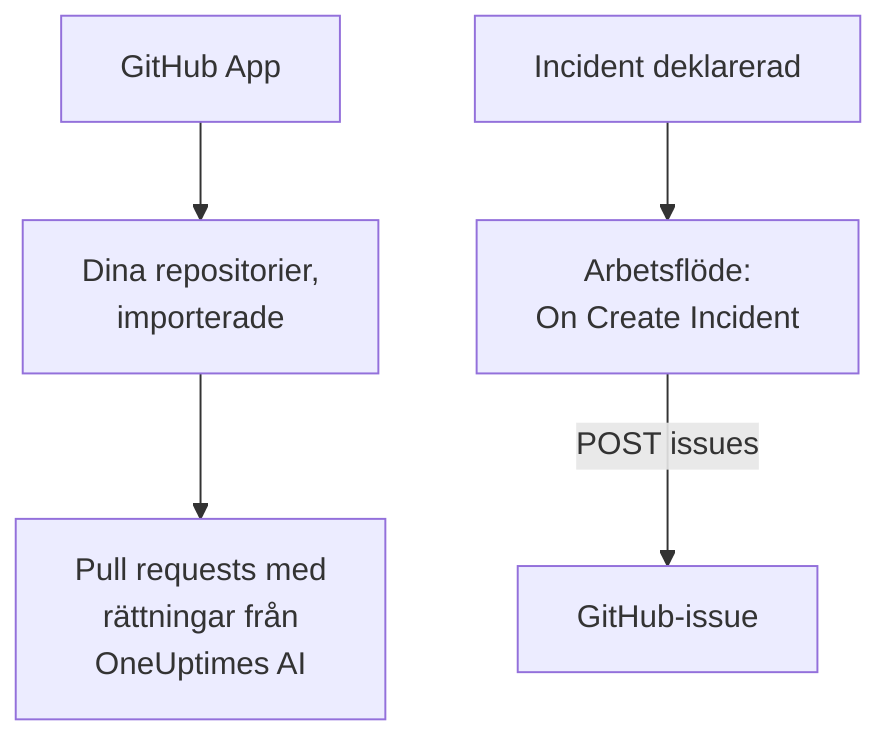

# GitHub

OneUptime arbetar med [GitHub](https://github.com) på två sätt. Anslut dina repositorier via OneUptimes GitHub App, så öppnar OneUptimes AI pull requests som rättar det den hittar, och svarar när du nämner den i ett issue eller en pull request. Eller bygg ett arbetsflöde som öppnar ett GitHub-issue för varje incident, så att uppföljningsarbetet spåras i det repositorium som äger tjänsten.

:::cards
- [Välj hur du ansluter](#välj-hur-du-ansluter): GitHub App eller ett arbetsflöde, och vad vart och ett gör.
- [Anslut dina repositorier](#anslut-dina-repositorier): GitHub App, för pull requests med rättningar.
- [Öppna ett issue för varje incident](#öppna-ett-github-issue-för-varje-incident): Ett arbetsflöde, två block.
- [Felsökning](#felsökning): När GitHub avvisar en begäran.
:::

## Så fungerar det



De två är fristående, och du kan använda det ena eller båda. GitHub App arbetar i de repositorier som du installerar den på. Arbetsflödet behöver bara en token och anropar GitHubs [REST API](https://docs.github.com/en/rest/issues/issues#create-an-issue) som vilket annat API som helst.

## Välj hur du ansluter

| Sätt | Vad det gör | Vad det behöver |
| --- | --- | --- |
| GitHub App | Importerar dina repositorier. OneUptimes AI öppnar pull requests i dem som rättar undantag, långsamma spårningar och orsakerna som dess undersökningar hittar, och svarar på omnämnanden i issues och pull requests. | En organisation eller ett konto att installera appen på. På OneUptime Cloud planen **Growth**. |
| Ett arbetsflöde | Öppnar ett GitHub-issue för varje incident, i det repositorium du väljer. | En GitHub-token som kan skapa issues, och ett arbetsflöde med två block. |

## Anslut dina repositorier

Öppna **Produkter → Kod** och klicka på **Anslut GitHub**. GitHub frågar var appen ska installeras och vilka repositorier den får använda. Varje repositorium i installationen importeras och hålls uppdaterat när du lägger till repositorier i installationen eller tar bort dem.

Om appen redan är installerad på kontot, för ett annat projekt eller direkt från GitHub, klickar du på **Anslut en befintlig installation** under **Anslut GitHub** i stället för att installera den igen. Det kräver ett GitHub-konto som administrerar installationen: ägaren till ett personligt konto, eller någon med admin-behörighet till varje repositorium som installationen har åtkomst till, så som en ägare av organisationen har.

En egenvärdad instans behöver först en egen GitHub App: [GitHub-integration](/docs/self-hosted/github-integration) visar hur du skapar den. Därefter öppnar AI pull requests i dina repositorier från [Kod](/docs/ai/ai-agent), och sidan [GitHub App](/docs/ai/github-app) visar vad appen gör när du nämner den i ett issue eller en pull request.

## Innan du börjar

Resten av den här sidan bygger arbetsflödet. Det behöver:

- En GitHub-token som kan skapa issues i repositoriet: en fine-grained personal access token för det repositoriet, med behörigheten **Issues** satt till **Read and write**, eller en klassisk token med omfånget `repo`. Skapa en i GitHubs [tokeninställningar](https://github.com/settings/tokens).
- I OneUptime behörighet att skapa arbetsflöden och globala variabler. På OneUptime Cloud kräver arbetsflöden **Growth**-abonnemanget eller högre.

## Spara token

:::steps
1. Gå till **Arbetsflöden → Globala variabler** och klicka på **Skapa Arbetsflöde Variabel**.
2. Ge den namnet `GITHUB_TOKEN` och klicka på **Nästa**.
3. Klistra in token i **Innehåll**, slå på **Hemlighet** och klicka på **Skapa Arbetsflöde Variabel**.
:::

En hemlig variabel ersätts med `[REDACTED]` i körningsloggar, så token syns aldrig i en körning.

## Öppna ett GitHub-issue för varje incident

:::steps
### Skapa arbetsflödet

Gå till **Arbetsflöden**, klicka på **Skapa arbetsflöde** och sedan på **Börja från grunden**. Ge det namnet `Incidents to GitHub` och klicka på **Skapa arbetsflöde**.

### Lägg till utlösaren

Klicka på det streckade blocket **Välj vad som startar det här arbetsflödet** och välj **On Create Incident**. Klicka på utlösaren: dess **Fields to pass on** börjar med **Titel**, så klicka på **Lägg till fält** och välj **Beskrivning** och **Incident Number With Prefix**.

### Öppna issuet

Klicka på **Lägg till komponent**, lägg till ett block **API Post (JSON)** och anslut utlösarens punkt **Success** till det. Sätt dess **URL** till `https://api.github.com/repos/your-org/your-repo/issues`, med ditt repositoriums ägare och namn. Sätt under **Fler fält** dess **Request Headers** till:

```json
{
  "Authorization": "Bearer {{global.variables.GITHUB_TOKEN}}",
  "Accept": "application/vnd.github+json",
  "X-GitHub-Api-Version": "2022-11-28"
}
```

Och **Request Body** på:

```json
{
  "title": "{{local.components.incident-on-create-1.returnValues.model.title}}",
  "body": "{{local.components.incident-on-create-1.returnValues.model.description}}\n\nOpened by OneUptime for incident {{local.components.incident-on-create-1.returnValues.model.incidentNumberWithPrefix}}.",
  "labels": ["incident"]
}
```

### Testa det och slå sedan på det

Klicka på **Kör arbetsflöde**, välj en testincident under **Incident** och kör det. Steget **API Post (JSON)** visar ett `201`-svar med det nya issuet, med dess `number` och dess `html_url`. Slå sedan på **Aktiverad** högst upp i **Byggare**.
:::

Issuet förblir öppet när incidenten är löst, eftersom uppföljningsarbetet oftast lever längre än incidenten. För ärenden som hålls i takt med incidenten åt båda hållen, se [Jira](/docs/integrations/jira).

## Tips

- **GitHub Enterprise Server.** Skicka begäran till din server i stället: `https://your-github-host/api/v3/repos/your-org/your-repo/issues`. En server på en privat nätverksadress kräver en egenvärdad OneUptime vars administratör tillåter det: se [Utgående nätverksåtkomst](/docs/workflows/configuration#utgående-nätverksåtkomst).
- **Tilldela det.** Lägg till `"assignees": ["octocat"]` eller `"milestone": 3` i bodyn. GitHub släpper etiketter, tilldelade och milstolpar utan ett ord när token inte får pusha till repositoriet.
- **Bara vissa incidenter.** Sätt ett block **If / Else** mellan utlösaren och API-blocket, och öppna issues bara på dess **Yes**-sida, till exempel för en allvarlighetsgrad.

## Felsökning

Steget **API Post (JSON)** tar **Error** när GitHub avvisar begäran. Dess **Response Status** och **Response Body** i körningen säger varför.

:::details GitHub svarar 401
Token är fel, har gått ut eller har återkallats. Skapa en ny och ersätt innehållet i `GITHUB_TOKEN`.
:::

:::details GitHub svarar 403
Token kan inte skapa issues där: en fine-grained token utan **Issues** satt till **Read and write** för det här repositoriet, en token som din organisation inte har godkänt, eller en klassisk token som inte är auktoriserad för din organisations single sign-on. En 403 vars body talar om en hastighetsgräns betyder att token har skickat för många begäranden: vänta, eller öppna issues för färre incidenter.
:::

:::details GitHub svarar 404
Ägaren eller repositoriet i **URL** är fel, eller så kan token inte se repositoriet. GitHub svarar 404, inte 403, för ett privat repositorium som en token inte kan se.
:::

:::details GitHub svarar 410 eller 422
- `410`: issues är avstängda i repositoriets inställningar.
- `422`: GitHub kan inte läsa bodyn. Kontrollera att den är giltig JSON, att `title` är satt och att `labels` och `assignees` är listor.
:::

## Nästa steg

:::cards
- [GitHub App](/docs/ai/github-app): Be OneUptimes AI om en ändring, en revidering eller en granskning direkt från GitHub.
- [GitLab](/docs/integrations/gitlab): Samma arbetsflöde, för GitLab-issues.
- [Arbetsflödeskomponenter](/docs/workflows/components#api): Alla inställningar för API-blocken.
- [Översikt över integrationer](/docs/integrations/index): Mönstren bakom varje integration.
:::
