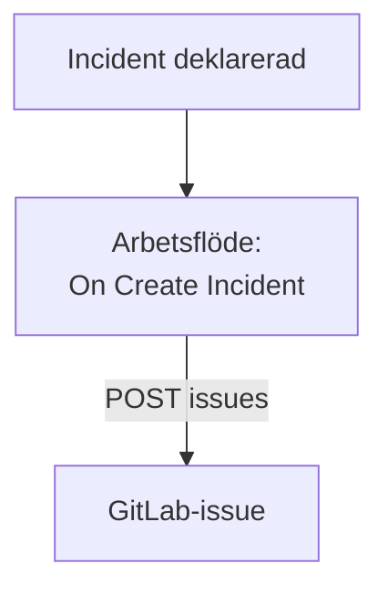

# GitLab

Öppna ett [GitLab](https://gitlab.com)-issue för varje OneUptime-incident, så att uppföljningsarbetet spåras i det projekt som äger tjänsten. Ett arbetsflöde anropar GitLabs [Issues API](https://docs.gitlab.com/api/issues/#new-issue), på GitLab.com eller på ditt eget GitLab.

:::cards
- [Spara token](#spara-token): Håll GitLabs token utanför dina arbetsflöden.
- [Öppna ett issue för varje incident](#öppna-ett-gitlab-issue-för-varje-incident): Ett arbetsflöde, två block.
- [Tips](#tips): Ditt eget GitLab, projektsökvägar och tilldelade.
- [Felsökning](#felsökning): När GitLab avvisar en begäran.
:::

> [!NOTE]
> OneUptimes AI arbetar också i GitLab-repositorier: anslut dem i Kod med en åtkomsttoken, så öppnar den en merge request för varje rättning. Se [Ansluta ett repositorium](/docs/ai/ai-agent#ansluta-ett-repositorium).

## Så fungerar det



Arbetsflödet körs en gång för varje ny incident. Dess block **API Post (JSON)** skickar incidentens titel och beskrivning till projektets issues, signerade med en åtkomsttoken.

## Innan du börjar

- GitLab-projektets ID. Välj åtgärdsmenyn, de lodräta prickarna, på projektets översiktssida, och sedan **Copy project ID**.
- En GitLab-åtkomsttoken med omfånget `api`, för en användare eller bot vars roll i projektet kan skapa issues: en projekt-, grupp- eller personlig åtkomsttoken. Skapa den under **Settings → Access tokens** i projektet, gruppen eller dina användarinställningar.
- I OneUptime behörighet att skapa arbetsflöden och globala variabler. På OneUptime Cloud kräver arbetsflöden **Growth**-abonnemanget eller högre.

## Spara token

:::steps
1. Gå till **Arbetsflöden → Globala variabler** och klicka på **Skapa Arbetsflöde Variabel**.
2. Ge den namnet `GITLAB_TOKEN` och klicka på **Nästa**.
3. Klistra in token i **Innehåll**, slå på **Hemlighet** och klicka på **Skapa Arbetsflöde Variabel**.
:::

En hemlig variabel ersätts med `[REDACTED]` i körningsloggar, så token syns aldrig i en körning.

## Öppna ett GitLab-issue för varje incident

:::steps
### Skapa arbetsflödet

Gå till **Arbetsflöden**, klicka på **Skapa arbetsflöde** och sedan på **Börja från grunden**. Ge det namnet `Incidents to GitLab` och klicka på **Skapa arbetsflöde**.

### Lägg till utlösaren

Klicka på det streckade blocket **Choose what starts this workflow** och välj **On Create Incident**. Klicka på utlösaren: dess **Fields to pass on** börjar med **Titel**, så klicka på **Lägg till fält** och välj **Beskrivning** och **Incident Number With Prefix**.

### Öppna issuet

Klicka på **Lägg till komponent**, lägg till ett block **API Post (JSON)** och anslut utlösarens punkt **Success** till det. Sätt dess **URL** till `https://gitlab.com/api/v4/projects/12345678/issues`, med ditt projekts ID i stället för `12345678`. Sätt under **Fler fält** dess **Request Headers** till:

```json
{
  "PRIVATE-TOKEN": "{{global.variables.GITLAB_TOKEN}}"
}
```

Och **Request Body** på:

```json
{
  "title": "{{local.components.incident-on-create-1.returnValues.model.title}}",
  "description": "{{local.components.incident-on-create-1.returnValues.model.description}}\n\nOpened by OneUptime for incident {{local.components.incident-on-create-1.returnValues.model.incidentNumberWithPrefix}}.",
  "labels": "incident,oneuptime"
}
```

### Testa det och slå sedan på det

Klicka på **Kör arbetsflöde**, välj en testincident under **Incident** och kör det. Steget **API Post (JSON)** visar ett `201`-svar med det nya issuet, med dess `iid` och dess `web_url`. Slå sedan på **Aktiverad** högst upp i **Byggare**.
:::

Blocket skickar JSON, så det behöver ingen `Content-Type`-rubrik. GitLab skapar etiketter som det inte har sett förut, så `incident` och `oneuptime` behöver inte konfigureras. Issuet förblir öppet när incidenten är löst, eftersom uppföljningsarbetet oftast lever längre än incidenten.

## Tips

- **Ditt eget GitLab.** Skicka begäran till din server i stället: `https://gitlab.example.com/api/v4/projects/12345678/issues`. En server på en privat nätverksadress kräver en egenvärdad OneUptime vars administratör tillåter det: se [Utgående nätverksåtkomst](/docs/workflows/configuration#utgående-nätverksåtkomst).
- **Projektets sökväg i stället för dess ID.** Sökvägen fungerar i stället för ID:t, med dess `/` skrivet som `%2F`: `projects/your-group%2Fyour-project/issues`. URL:en skickas exakt som den är skriven, så koda den själv.
- **Tilldela det.** Lägg till `"assignee_ids": [42]` eller `"due_date": "2026-12-31"` i bodyn, eller `"confidential": true` för att bara visa det för projektmedlemmar.
- **Bara vissa incidenter.** Sätt ett block **If / Else** mellan utlösaren och API-blocket, och öppna issues bara på dess **Yes**-sida, till exempel för en allvarlighetsgrad.

## Felsökning

Steget **API Post (JSON)** tar **Error** när GitLab avvisar begäran. Dess **Response Status** och **Response Body** i körningen säger varför.

:::details GitLab svarar 401
Token är fel, har gått ut eller har återkallats. Skapa en ny och ersätt innehållet i `GITLAB_TOKEN`.
:::

:::details GitLab svarar 403
Token har inte omfånget `api`, eller så kan dess användares roll i projektet inte skapa issues. Bodyn nämner `insufficient_scope` när det är omfånget.
:::

:::details GitLab svarar 404
Projektets ID i **URL** är fel, eller så kan token inte se projektet. GitLab svarar 404, inte 403, för ett privat projekt som en token inte kan se.
:::

:::details GitLab svarar 400
GitLab kan inte läsa bodyn: `title` saknas, eller så har ett fält fel typ. Bodyn nämner fältet.
:::

## Nästa steg

:::cards
- [GitHub](/docs/integrations/github): Samma arbetsflöde för GitHub, och GitHub App.
- [Arbetsflödeskomponenter](/docs/workflows/components#api): Alla inställningar för API-blocken.
- [Arbetsflödeskörningar](/docs/workflows/runs-and-logs): Läs vad varje begäran skickade och fick tillbaka.
- [Översikt över integrationer](/docs/integrations/index): Mönstren bakom varje integration.
:::
