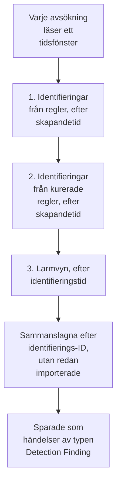

# Google SecOps

Hämta larm och identifieringar från [Google SecOps](https://cloud.google.com/security/products/security-operations) (tidigare Chronicle) till säkerhetshändelserna i OneUptime. Där söker du i dem bredvid dina loggar, spårningar och mätvärden, korrelerar dem med alla andra källor och larmar jouren för de som spelar roll.

:::cards
- [Välj hur du ansluter](#välj-hur-du-ansluter): En webhook från en SOAR-playbook, den hanterade anslutningen eller UDM-vidarebefordran.
- [Konfigurera den hanterade anslutningen](#konfigurera-den-hanterade-anslutningen): En nyckel för ett tjänstkonto och anslutningens formulär.
- [Så avsöker anslutningen](#så-avsöker-anslutningen): Tre läsningar av varje fönster, och deras budgetar.
- [Felsökning](#felsökning): Vad Last Error säger och vad du ska göra.
- [Skicka säkerhetshändelser till Google SecOps](#skicka-säkerhetshändelser-till-google-secops): OneUptimes detektioner, i Google SecOps.
:::

## Välj hur du ansluter

| Väg | Vad som kommer in | Använd den när |
| --- | --- | --- |
| En webhook från en SOAR-playbook | Varje larm som en playbook postar, inom några sekunder | Du kör SOAR-playbooks och vill ha deras larm i OneUptime utan avsökning. |
| Den hanterade anslutningen | Larm, och identifieringar från regler om du väljer det, avsökta med ett intervall | Du vill att OneUptime hämtar dem åt dig, utan något att konfigurera i SecOps. |
| Vidarebefordran av UDM-händelser | Råa UDM-händelser, för fullständig sökning och korrelation | Du exporterar redan UDM-händelser och vill ha alla. |

Varje väg normaliserar det som kommer in till [OCSF](https://schema.ocsf.io/), Open Cybersecurity Schema Framework som OneUptime sparar varje säkerhetshändelse i, så att identifieringsregler och instrumentpaneler fungerar på samma sätt oavsett källa.

## Innan du börjar

- För den hanterade anslutningen, i OneUptime, rollen Project Owner, Project Admin eller Security Admin. Security Member och Security Viewer kan läsa anslutningar, men inte skapa dem.
- För webhooken och UDM-vidarebefordran en intagningsnyckel: öppna **Projektinställningar → Telemetri och APM → Intagningsnycklar** och klicka på **Skapa ingestion-nyckel**.
- För den hanterade anslutningen behörighet att skapa ett tjänstkonto i Google Cloud i det projekt som din SecOps-instans är kopplad till.

## Skicka larm från en SOAR-playbook

SOAR-playbooks i Google SecOps kan posta larm till vilken HTTP-slutpunkt som helst. Peka en mot inmatningen av säkerhetshändelser i OneUptime.

:::steps
### Lägg till en åtgärd HTTP request

Lägg till en åtgärd **HTTP request** i din SOAR-playbook i SecOps som körs på nya larm.

### Peka den mot OneUptime

Ställ in dess **Method** på `POST` och dess **URL** på `https://oneuptime.com/security-events/v1/ingest`, eller `https://<your-host>/security-events/v1/ingest` på en egenvärdad installation. Lägg till de här huvudena:

```text
Content-Type: application/json
x-oneuptime-token: <your telemetry ingestion key>
```

Skicka larmets JSON som **Body**. En identifiering, regeluppgifter med de matchade UDM-händelserna under `collectionElements`, känns igen av sig själv, sparas som en händelse av typen Detection Finding, och användarna, värdarna och IP-adresserna i dess matchade händelser behålls som observables.

### Kontrollera att larm kommer fram

Kör playbooken. Dess larm visas i **Produkter → Security Events** inom några sekunder.
:::

## Vidarebefordra UDM-händelser

För fullständig sökning och korrelation vidarebefordrar du själva UDM-händelserna, till exempel från en exportpipeline i BigQuery, en Cloud Function eller vilken vidarebefordrare som helst som du redan kör:

```bash
curl -X POST "https://oneuptime.com/security-events/v1/ingest?format=udm" \
  -H "Content-Type: application/json" \
  -H "x-oneuptime-token: <your telemetry ingestion key>" \
  -d '{
    "events": [
      {
        "metadata": {
          "event_type": "USER_LOGIN",
          "event_timestamp": "2026-08-21T10:00:00Z",
          "vendor_name": "Google",
          "product_name": "Google SecOps"
        },
        "principal": { "user": { "userid": "alice" }, "ip": ["203.0.113.7"] },
        "target": { "hostname": "vpn-gw-01" },
        "security_result": [{ "severity": "HIGH", "action": ["BLOCK"] }]
      }
    ]
  }'
```

- `format` kan vara `udm`, `ocsf`, `google-secops-alert` eller `generic`. Om du utelämnar det identifieras formatet händelse för händelse.
- Kroppen kan vara en händelse, en lista med händelser eller `{ "events": [...] }`.
- `x-oneuptime-service-name` namnger den telemetritjänst som händelserna hör till. Utan den hör de till den tjänst som har namn efter nyttolastens produkt.

## Konfigurera den hanterade anslutningen

OneUptime avsöker din klientorganisations identifieringar och larm med ett intervall, utan SOAR-konfiguration. Google SecOps är en leverantör av Security Event Connections, så den skapas, testas, avsöks och diagnostiseras på samma sida och på samma sätt som alla andra hanterade anslutningar.

:::steps
### Skapa en nyckel för ett tjänstkonto

Skapa ett tjänstkonto i Google Cloud i det projekt som din SecOps-instans är kopplad till, och ge det rollen **Chronicle API Viewer** (`roles/chronicle.viewer`). Den rollen omfattar behörigheterna `legacySearchDetections`, `legacySearchCuratedDetections`, `countAllCuratedRuleSetDetections` och `legacyFetchAlertsView` som anslutningen läser med.

Lägg till en nyckel av typen **JSON** på tjänstkontots flik **Keys** och ladda ner den. Du klistrar in hela filen i anslutningen. Dess `token_uri` måste vara en `https`-URL på en Google-värd, vilket en nyckel som har laddats ner från Google Cloud redan är.

### Hitta regionen och instansens resursnamn

Öppna **SIEM Settings → Profile** i Google SecOps. Instansens resursnamn har formen `projects/{project}/locations/{location}/instances/{instance}`, där instansdelen är SecOps-instansens ID; ett visningsnamn för en anslutning eller namnet på ett tjänstkonto kan inte användas i stället. Regionen är den regionala slutpunkt som betjänar den platsen, och den måste matcha locations-segmentet i instansens resursnamn, annars avvisas anslutningen när du sparar den.

### Lägg till anslutningen

Öppna **Produkter → Security Events → Anslutningar** (`/dashboard/{projectId}/security-events/connections`), välj **Lägg till anslutning**, välj **Google SecOps** och fyll i formuläret med inställningarna i tabellen nedan.

### Testa innan du sparar

Välj **Testa de här inställningarna** under **Testa innan du sparar** innan du sparar. Testet körs med värdena i formuläret utan att spara något, så en felformaterad nyckel, en saknad roll eller fel instans upptäcks innan anslutningen finns. I redigeringsformuläret testar samma knapp den **Region**, det **Instansens resursnamn** och den **Data to import** som visas på skärmen med den sparade nyckeln; ett fält för autentiseringsuppgifter som lämnas tomt behåller den sparade nyckeln. När något av det som testas skiljer sig från det som anslutningen har sparat, även en nyss angiven nyckel, registreras ingen rad i körningshistoriken, eftersom anslutningen ännu inte har de inställningarna.
:::

| Inställning | Var du hittar den | Obligatorisk |
| --- | --- | --- |
| **Region** | Den regionala slutpunkten för Google SecOps (`us`, `europe`, `asia-southeast1`, ...) som matchar platsen i din instans resursnamn. Det finns ingen standard, så att en klientorganisation utanför USA inte av misstag kan spara fel slutpunkt. | Ja |
| **Instansens resursnamn** | Google SecOps **SIEM Settings → Profile**: `projects/{project}/locations/{location}/instances/{instance}`. | Ja |
| **Stäng larm när deras ärende stängs** | I formulärets sista steg, av tills du slår på det. På stänger ett stängt ärende dess Google SecOps-larm: se [Stäng larm när deras ärende stängs](#stäng-larm-när-deras-ärende-stängs). | Nej |
| **Tjänstkontots JSON** | Google Cloud, tjänstkontots flik **Keys**. Klistra in hela JSON-nyckelfilen. Endast skrivning: krypterad i vila, returneras aldrig av API:et och visas aldrig igen på sidan. Använd **Uppdatera inloggningsuppgifter** på anslutningen för att byta den. | Ja |
| **Data to import** | **Larm** importeras alltid, eftersom Googles larm-API alltid returnerar dem. Välj **Detektioner** för att även importera regelträffar som inte gav något larm. Det vidarebefordrar inte råa UDM-händelser: dem vidarebefordrar du själv, som ovan. | Larm alltid |

Formulärets avsökningssteg ber om ett **Namn**, en valfri **Beskrivning**, anslutningens inställning **Aktiverad** och **Hämtningsintervall (minuter)**: ett heltal från `1` till `1440`, standard `5`. Allt utanför det intervallet avvisas när du sparar.

Nya identifieringar importeras som händelser av typen Detection Finding som tillskrivs en telemetritjänst `Google SecOps`.

## Läs anslutningens hälsa

Listan över anslutningar visar **Namn**, **Leverantör** (med anslutningens val av Data to import under), **Status** (Enabled eller Disabled), **Hälsa**, **Intervall (minuter)**, **Senast hämtad**, **Senaste lyckade hämtning** och **Senast importerade händelse**. När en anslutning har ett fel visas **Visa fel** i dess kolumn **Åtgärder**, bredvid **Testa anslutningen**, **Kör nu**, **Diagnostik**, **Redigera** och **Uppdatera inloggningsuppgifter**. Enabled betyder att automatisk avsökning är konfigurerad. Last Polled registrerar ett försök; ett lyckat tomt fönster bevisar inte att en viss identifiering har importerats.

**Hälsa** visar **Last poll succeeded** först när en händelse har importerats. Fram till dess visar en anslutning som lyckas **Polling, no events imported yet**, och det är det tillstånd som du ska undersöka med Testa anslutningen. De andra tillstånden är **No records returned**, **Partial import**, **Catching up**, **Last poll failed**, **Poll overdue**, **Schedule paused** och **Väntar på första hämtningen**; håll muspekaren över ett tillstånd för att se vad det betyder.

> [!NOTE]
> Anslutningen använder Chronicles äldre API:er för identifieringar och larm `v1alpha`, som Google levererar som pre-GA. När en avsökning misslyckas sparar anslutningens fält **Senaste fel** hela felmeddelandet, med autentiseringsuppgifter maskerade, bakom ett prefix som namnger det steg som misslyckades, även när Chronicle svarar `200` och lägger avvisningen i kroppen. Välj **Visa fel** i anslutningens kolumn **Åtgärder** för att läsa meddelandet, och sedan **Kopiera fel** i dialogrutan för att kopiera det till supporten.

## Så avsöker anslutningen



En gång i minuten köar en bakgrundsworker en avsökning för varje aktiverad anslutning vars intervall har passerat sedan den senaste avsökningen. Varje avsökning är en körning i anslutningens historik, utförd av en worker. Den läser ett tidsfönster på tre sätt och slår samman resultaten efter identifierings-ID, så att en post som returneras av mer än en genomgång sparas en gång:

1. **Identifieringar från regler efter skapandetid.** `legacy:legacySearchDetections` med `ruleId=-` (varje revision av varje regel) och `listBasis=CREATED_TIME`, där `nextPageToken` följs tills sidan är den sista.
2. **Identifieringar från kurerade regler efter skapandetid.** `legacy:legacySearchCuratedDetections` på samma sätt, en gång per kurerad (Google-skriven) regel. Den slutpunkten tar ett ID för en kurerad regel (`ur_...`) och har inget jokertecken för "alla regler", så genomgången anropar först `:countAllCuratedRuleSetDetections` för veckan före fönstret till dess slut, och söker i varje kurerad regel som gav identifieringar. En kurerad regel som inte har utlösts den veckan har inget att importera. En klientorganisation utan åtkomst till kurerade regler svarar på den här genomgången med `400`, `403` eller `404`; det registreras som en varning på körningen, inte som ett fel.
3. **Larmvyn efter identifieringstid.** `legacy:legacyFetchAlertsView`, som täcker telemetrilarm, SOAR-larm och larm från maskinintelligens utöver regellarm. Slutpunkten har ingen sidindelning, så ett svar som Google begränsar delas upp i mindre fönster och läses igen.

Larmvyn kan bara filtrera efter identifieringstid, och Google gör ofta ett larm läsbart långt efter dess identifieringstid (inmatningsfördröjning, schemalagda regler, omkörningar över sena data). En schemalagd avsökning **söker därför också igenom larmvyn under de 24 timmarna före sitt fönster**, bara larm, registrerat som kontrollen **Read late alerts by detection time**. Poster som redan har importerats hoppas över, så genomsökningens upprepningar visas under **Already imported**. Genomsökningen görs efter bästa förmåga: när Google begränsar den, dess budget tar slut eller den misslyckas får körningen en varning, men avsökningen blir inte Partial eller Misslyckades och markören flyttas ändå framåt, eftersom den dag som den ser tillbaka på redan har lästs av tidigare avsökningar.

Avsökning efter **skapandetid** är hela designen. En regel i Google SecOps körs enligt ett schema (var 10:e minut, varje timme, varje dag), och den identifiering som den skapar har en `detectionTime` som är slutet på regelns tidsfönster eller tiden för den matchade händelsen, medan `createdTime` är när identifieringsmotorn faktiskt skapade den. En identifiering som skapas kl. 10:05 för ett fönster som slutar kl. 09:00 har en identifieringstid som redan ligger bakom en markör som passerade 09:00 för flera avsökningar sedan, så en anslutning som avsöker efter identifieringstid ser den aldrig, och inte heller någon händelse som kommer sent. Att läsa efter skapandetid får varje avsökning att fråga "vad har Google skapat sedan jag senast tittade", och det är den fråga som har ett svar. Varje körning registrerar sin skapandefördröjning, hur många hämtade poster som skapades mer än ett avsökningsintervall (plus en minut) efter sin identifieringstid, och den största skillnaden, så att effekten syns i Diagnostics.

Den första avsökningen för en ny anslutning ser **24 timmar** bakåt efter skapandetid. Varje avsökning därefter fortsätter från anslutningens sparade markör med en överlappning på **1 minut**; en post som har skapats på en fönstergräns läses av båda avsökningarna och sparas en gång, eftersom avsökningar hoppar över händelser som redan har sparats med samma käll-ID. Varje schemalagd avsökning läser högst **24 timmar** förbi markören, så en anslutning med en äldre sparad markör kommer ikapp i på varandra följande fönster på 24 timmar (Health visar **Catching up**) i stället för att kasta identifieringarna däremellan. Använd **Import this time range** i Diagnostics för poster som skapades före det första fönstret på 24 timmar.

### När ett fönster innehåller mer än en avsökning kan läsa

Anslutningen ger varje avsökning fasta budgetar: genomgången av identifieringar från regler har **20** söksidor, den kurerade genomgången upp till **200** begäranden (räkningen plus minst en sida per kurerad regel som utlöstes den senaste veckan, de mest aktiva reglerna först), larmvyn och dess genomsökning efter sena larm delar på **16** begäranden, och hela läsningen stoppas efter **4 minuter**. Den kurerade genomgången startar inga fler kurerade regler när 60 % av den tiden har gått åt, så att larmvyn ändå körs. När en avsökning inte kan söka i alla aktiva kurerade regler registrerar den en varning som säger hur många som inte söktes i, i stället för att hålla kvar markören, eftersom ett kortare fönster fortfarande skulle ha alla de reglerna att söka i. En genomgång som en budget stoppade halvvägs registreras som en varningskontroll som namnger budgeten (till exempel `Read rule detections by created time was stopped by the request budget after 20 requests.`), och en genomgång som budgeten aldrig lät starta är en överhoppad kontroll med samma orsak i körningens varningar, aldrig en framgång. Ett fönster med fler identifieringar än så kan inte läsas i en avsökning, och avsökningen läser aldrig samma fönster igen i all oändlighet:

1. **Smalna av.** Googles sökslutpunkter returnerar de nyaste identifieringarna först, så en avsökning som stoppas tidigt har ingen punkt att fortsätta från. Avsökningen registreras som **Delvis**, markören stannar där den var och nästa avsökning läser ett fönster som är hälften så långt från samma startpunkt, med varningen `This window holds more records than one poll can read; the next poll reads a {n} minute window from the same starting point.` Halveringen fortsätter ner till en minut, tills ett fönster får plats.
2. **Växa igen.** Varje slutförd avsökning fördubblar nästa fönster, upp till maxvärdet 24 timmar, så att en skur kostar några korta avsökningar i stället för en permanent långsam anslutning.
3. **Gå förbi en enda minut.** Om till och med en minut innehåller fler identifieringar än en avsökning kan läsa flyttar avsökningen markören förbi den minuten, så att nyare identifieringar fortsätter att komma. Körningen är **Delvis** och samma text står först i **Senaste fel**: `More records were created in the one minute from {start} to {end} than one poll can read. Polling moved past this minute so newer records keep arriving; use Import this time range in Diagnostics on this minute to recover what one run can read.` För att hämta det som en körning kan läsa öppnar du **Diagnostik**, väljer ett anpassat intervall som täcker den minuten (intervallfälten använder din lokala tid; meddelandet är i UTC) och kör **Import this time range**; en import har samma gränser per körning som en avsökning. Identifieringar som redan har importerats hoppas över.

En avsökning som är Partial sparar också sina varningar i **Senaste fel**, där de stannar tills en slutförd avsökning rensar dem. En avsökning som misslyckas helt (ett fel, inte för många poster) behåller sin markör och fönsterlängd och försöks igen vid nästa tick. Det enda undantaget är en begäran som fick tidsgräns: nästa avsökning läser ett fönster som är hälften så långt från samma startpunkt (`The source did not answer in time for this window; the next poll reads a {n} minute window from the same starting point.`), eftersom ett fönster som är för tungt för att besvaras i tid annars skulle få tidsgräns vid varje nytt försök. Ett kortare avsökningsintervall ändrar inget av detta: fönstret avgörs av markören och resultatet av den senaste avsökningen, inte av hur ofta avsökningar körs.

## Testa anslutningen

**Testa anslutningen**, på anslutningens rad eller i **Diagnostik**, körs synkront i API-processen. Den behöver ingen bakgrundsworker, och det är just därför som den kan tala om när ingen worker körs. Checklistan:

1. **Konfiguration**: varje fält finns och är korrekt formaterat: en **Region** som stöds och som matchar instansens plats, ett **Instansens resursnamn** med rätt form och en nyckel **Tjänstkontots JSON** med `client_email`, en läsbar `private_key` och en `token_uri` från Google. Ingenting kontaktas om detta misslyckas.
2. **Authenticate with Google**: nyckeln byts mot en åtkomsttoken hos Googles OAuth-slutpunkt, innan Chronicle kontaktas.
3. **Read rule detections**, **Read curated rule detections** och **Read the alerts view**: ett prov med en post för varje genomgång över de senaste 24 timmarna. Den kurerade kontrollen läser räkningarna för kurerade regler för de senaste 7 dagarna och provar den kurerade regel som har flest identifieringar; om ingen kurerad regel utlöstes den veckan lyckas den utan något att prova. En kurerad läsning som besvaras med `400`, `403` eller `404` är en varning, eftersom klientorganisationen kanske helt enkelt inte har åtkomst till kurerade regler.
4. **Detections available to import**: vad Google har med det sparade valet **Data to import** och med det andra (bara Varningar, eller Varningar och **Detektioner**) under de senaste 24 timmarna och de senaste 7 dagarna: larmvyns antal träffar och en söksida efter skapandetid per intervall, angivet som ett tal eller som `1000+`. När det sparade valet inte har något men det andra har det varnar kontrollen: dina regler skapar identifieringar, men larm är inte aktiverat för dem. Redigera anslutningen och välj **Detektioner** under **Data to import**, eller aktivera larm för reglerna i Google SecOps.
5. **Background workers**, **Poll scheduler** och **Security event storage**: om en process förbrukar OneUptimes Worker-kö, om avsökningsjobbet med en minuts takt är registrerat, och om lagringen för säkerhetshändelser svarar på samma dubblettsökning som avsökningen kör före varje infogning, så att en trasig analysdatabas misslyckas här med ett namn i stället för en timme senare som ett avsökningsfel.
6. **Scheduled polling** (bara sparade anslutningar): om avsökningen är aktiverad, om en köad körning har fastnat i väntan på en worker, och om anslutningen avsöks enligt schemat.

Varje begäran i ett test har en tidsgräns på 20 sekunder. Tester rör varken avsökningsmarkören eller händelselagringen. En sparad anslutning som testas med sina sparade inställningar får en rad i körningshistoriken av typen test, och radens detaljer visar samma checklista.

## Förhandsgranska, kör och importera vid behov

Öppna **Diagnostik** på en anslutning för att se de senaste körningarna och styra anslutningen. Projektägare, projektadministratörer och säkerhetsadministratörer kan starta åtgärder. Säkerhetsmedlemmar och säkerhetsläsare kan läsa historiken.

- **Kör nu** köar en avsökning direkt, med den vanliga markören och inmatningsvägen, även när schemalagd avsökning är inaktiverad. Tillstånden köad och körs förblir synliga medan workern utför begäran. Om en körning blir kvar i kön kontrollerar du att workers bearbetar Worker-kön; kontrollen **Background workers** i Testa anslutningen säger om någon process gör det.
- **Preview detections** läser ett valt tidsintervall utan att importera eller ändra markören. Använd den senaste timmen, 24 timmar, 7 dagar eller ett anpassat intervall på upp till 7 dagar. Intervallet matchar larmvyn i SecOps, som läser efter identifieringstid, och de två sökgenomgångarna läser både identifieringar som har skapats i det och identifieringar vars identifieringstid infaller i det, så en förhandsgranskning av i går visar även identifieringar som skapades i går om äldre händelser. Förhandsgranskningen visar identifieringstid och skapandetid var för sig. Resultaten följer anslutningens sparade val **Data to import**.
- **Import this time range** importerar det valda intervallet, efter att du har bekräftat, utan att flytta avsökningsmarkören. Det är också så du hämtar en minut som avsökningen gick förbi, som beskrivs ovan. Förhandsgranska intervallet först. Upprepade avsökningar och importer hoppar över händelser som redan har sparats med samma käll-ID i projektet. Importer kan utlösa konfigurerade identifieringsregler och monitorer, precis som schemalagd avsökning.

Varje körnings detaljer visar **Requested window (UTC)**, anslutningens val **Data to import** och fem tal:

| Tal | Vad det räknar |
| --- | --- |
| **Returned by Google SecOps** | Poster som Google returnerade över de tre genomgångarna, efter sammanslagning efter ID. |
| **Imported into OneUptime** | Rader som har skrivits till händelselagringen. |
| **Already imported** | Poster som har hoppats över eftersom samma käll-ID redan är sparat i det här projektet; överlappningen på 1 minut och omkörningar gör detta normalt. |
| **Avvisad** | Returnerade objekt som inte är identifieringar från Google SecOps. De räknas och varnas för, försöks aldrig igen och håller inte kvar markören. |
| **Misslyckades** | Poster som inte kunde normaliseras. En avsökning försöker igen med dem i ett kortare fönster. |

**Provider details** lägger till **Time basis read**, posterna **Returned by each pass** (identifieringar från regler, identifieringar från kurerade regler och larmvyn) och **Creation lag**. Därefter följer kontrollerna, en per genomgång, varningarna och exempel på identifieringar. En schemalagd avsöknings detaljer visar också **Window read by this poll** och vad **Next scheduled poll reads**, och en avsökning som är Partial säger om den behöll sin startpunkt och smalnade av nästa fönster, eller gick förbi en enda minut som den namnger. **Framgång**, **No records returned**, **Delvis** och **Misslyckades** är olika utfall.

Använd **View events in this time range** på en körning för att öppna händelsetidsintervallet för de identifieringar som den returnerade. En identifiering som har skapats i dag med gårdagens identifieringstid kan annars döljas av ett filter på senaste händelser. Körningshistoriken bevarar fel efter att en senare slutförd avsökning har rensat Last Error. Använd **Copy diagnostics** när du kontaktar supporten; tjänstkontots autentiseringsuppgifter och tokens tas aldrig med.

## Varför ser jag inga händelser?

Gå igenom de här punkterna i ordning. Var och en kan skiljas från nästa i **Diagnostik** eller med **Testa anslutningen**.

1. **Data to import.** Som standard importeras bara **Larm**, och en identifiering från en regel är bara ett larm när larm är aktiverat för regeln i Google SecOps. En klientorganisation vars regler skapar identifieringar utan larm avsöker ärligt tomt för alltid. Kör **Testa anslutningen**: kontrollen **Detections available to import** räknar med och utan **Detektioner** och säger till när ett val av dem skulle lägga till poster. Redigera anslutningen och välj **Detektioner** under **Data to import**, eller aktivera larm för reglerna.
2. **Hur ofta reglerna körs och identifieringsfördröjning.** Identifieringar skapas när regeln körs, och det kan vara upp till en timme eller en dag efter de händelser som de beskriver. Anslutningen avsöker efter skapandetid, så de kommer med den första avsökningen efter att Google har skapat dem, inte vid sin identifieringstid. En regel som du nyss har aktiverat har ännu inte skapat något, och en lugn klientorganisation har inget att skapa. Tillgänglighetskontrollen rapporterar hur många identifieringar som skapades under de senaste 24 timmarna och 7 dagarna; noll med och utan **Detektioner** betyder att Google ännu inte har något som OneUptime kan importera.
3. **Läs talen från den senaste körningen.** I Diagnostics är **Returned by Google SecOps** med noll i **Imported into OneUptime** och ett motsvarande tal i **Already imported** anslutningen som fungerar som avsett: de identifieringarna importerades av en tidigare avsökning. **Avvisad**-poster är objekt som Google returnerade och som inte alls är identifieringar.
4. **Avsöker något över huvud taget?** Last Polled med `Never` och en tom Last Error betyder att ingen avsökning har slutförts för den här anslutningen. Testa anslutningen rapporterar **Background workers** (processer som förbrukar Worker-kön), **Poll scheduler** (registreringen av schemaläggaren med en minuts takt) och **Scheduled polling** (den här anslutningens eget schema, inklusive en försenad avsökning eller en körning som har fastnat i kön). Se punkten om felsökning nedan för de distributionsinställningar som orsakar det.
5. **Titta på rätt ställe.** Händelser sparas under sin identifieringstid, som kan ligga timmar eller dagar före den tid då de skapades och importerades, så ett filter på "senaste timmen" i Security Events döljer en identifiering om i går som importerades för en minut sedan. Använd **View events in this time range** på en körning i Diagnostics: den öppnar händelsetidsintervallet för de identifieringar som den körningen returnerade.

## Så sätts allvarlighetsgraden

Google SecOps sparar en identifierings allvarlighetsgrad på olika ställen beroende på vem som skrev regeln, och OneUptime läser dem i den här ordningen och använder den första som namnger en allvarlighetsgrad:

1. **Googles egen allvarlighetsgrad** (`detection[].severity`). Google sätter den på kurerade regler, till exempel Applied Threat Intelligence och de kurerade regeluppsättningarna.
2. **Larmets allvarlighetsgrad** (Collectionens `severity`), för SOAR-larm och webhook-kroppar.
3. **Regelns `meta`-allvarlighetsgrad.** För en anpassad YARA-L-regel lämnar Google `detection[].severity` tom och returnerar regelns avsnitt `meta` som `ruleLabels`. OneUptime läser etiketten `severity`, som är det värde som regelinstrumentpanelen i Google SecOps visar. Info, Informational, Low, Medium, High och Critical känns igen, oavsett skiftläge.
4. **Regelns utfall `$risk_score`**, om regeln inte sätter någon allvarlighetsgrad, indelat enligt [Googles rekommenderade intervall](https://docs.cloud.google.com/chronicle/docs/yara-l/outcome-syntax): 90–100 Critical, 80–89 High, 50–79 Medium, 20–49 Low, 1–19 Informational. OneUptime använder bara en poäng som regeln själv sätter. Den ignorerar den `riskScore` som Google fyller i för regler utan en (40 för larmande regler, annars 15), eftersom den standarden inte säger något om hur allvarlig identifieringen är.

En identifiering som ingen av dessa delar in visas som Unknown. För att dela in en anpassad regel lägger du till en allvarlighetsgrad i dess avsnitt `meta` i Google SecOps, till exempel `severity = "High"`, eller sätter `$risk_score` i dess avsnitt `outcome`. Identifieringar som regeln skapar därefter importeras med den allvarlighetsgraden.

## Stäng larm när deras ärende stängs

Med **Stäng larm när deras ärende stängs** påslaget stänger ett stängt [säkerhetsärende](/docs/telemetry/security-cases#stäng-ett-ärende) de Google SecOps-larm det kom från. Varje larm markeras som stängt med ärendets utlåtande, en True Positive som skadlig och en False Positive eller Benign Positive som inte skadlig, tillsammans med ärendets avslutningsanteckning och en länk tillbaka till ärendet. Ärendets tidslinje berättar hur många larm som stängdes.

- Tjänstkontot behöver `chronicle.legacies.legacyUpdateAlert`, som rollen `roles/chronicle.editor` har. Rollen `roles/chronicle.viewer` läser larm men kan inte stänga dem, och en `403` står då på ärendet.
- Ett larm som Google SecOps inte längre har hoppas över. När Google SecOps inte går att nå försöker OneUptime igen i ungefär en timme och skriver sedan på ärendet vad den inte kunde stänga.

## Bevaka dina andra händelser efter dess indikatorer

Ett [threat intel-flöde](/docs/telemetry/threat-intelligence#så-läses-google-secops) med **Google SecOps** som **Källa** läser via den här anslutningen indikatorerna som hotunderrättelserna i Google SecOps hittade i dess händelser, och bevakar resten av projektets händelser efter dem: inloggningarna, nätverksflödena och slutpunktshändelserna som Google SecOps aldrig såg.

## Skicka säkerhetshändelser till Google SecOps

OneUptime kan också skicka det det hittar till Google SecOps, så att det SIEM ditt team arbetar i ser OneUptimes detektioner bredvid sina egna. Varje säkerhetshändelse importeras som en UDM-händelse, med sin allvarlighetsgrad, sina MITRE ATT&CK-taggar och regeln som hittade den:

| Säkerhetshändelse | UDM-händelsetyp |
| --- | --- |
| En inloggning | `USER_LOGIN` |
| En process som startas, öppnas, injiceras i eller avslutas | `PROCESS_LAUNCH`, `PROCESS_OPEN`, `PROCESS_INJECTION`, `PROCESS_TERMINATION` |
| En process som höjde sina behörigheter | `PROCESS_PRIVILEGE_ESCALATION` |
| All annan processaktivitet | `PROCESS_UNCATEGORIZED` |
| En nätverksanslutning | `NETWORK_CONNECTION` |
| Allt annat, eller en händelse utan de fält som dess typ behöver | `GENERIC_EVENT` |

I en processhändelse är `principal` den process som agerade och `target` den process den agerade på: vid en start den överordnade processen och den process den startade.

:::steps
### Skapa en nyckel som får importera händelser

Skapa i Google Cloud ett tjänstkonto i projektet som din SecOps-instans är kopplad till och ge det en roll med behörigheten `chronicle.events.import`, till exempel **Chronicle API Editor** (`roles/chronicle.editor`). Lägg till en nyckel av typen **JSON** på fliken **Keys** och ladda ned den.

### Lägg till målet

Öppna **Produkter → Security Events → Anslutningar**. Klicka på **Lägg till mål** under **Skicka till ditt SIEM**, välj Google SecOps under **SIEM** och klicka på **Nästa**. Välj **Region**, fyll i **Instansens resursnamn** som för anslutningen ovan och klistra in nyckeln i **Tjänstkontots JSON**.

### Skicka en testhändelse

Klicka på **Skicka en testhändelse**. En `GENERIC_EVENT` från produkten `OneUptime Security Events` skickas till Google SecOps med inställningarna i formuläret, och inget sparas. Den syns i Google SecOps inom några minuter.

### Välj vad som skickas

Behåll **Endast upptäckter** under **Vad som ska skickas**, alltså det dina regler och hotunderrättelser hittade och larmen som dina anslutna produkter gav, eller välj **Alla säkerhetshändelser**. Klicka på **Börja skicka**.
:::

- Ett mål skickar de händelser som kommer in från det ögonblick det sparas, aldrig projektets historik, och skickar nya varje minut.
- Larm som OneUptime har importerat från Google SecOps skickas aldrig tillbaka dit.
- När Google SecOps inte svarar eller avvisar en batch behåller målet sin plats och försöker igen vid nästa körning. Dess **Status** visar då **Misslyckas**, och **Visa fel** visar vad Google SecOps svarade.

## Felsökning

:::details Identifieringar från anpassade regler visar allvarlighetsgraden Unknown medan kurerade är indelade
Regeln sätter ingen allvarlighetsgrad. Lägg till `severity = "Low"`, `"Medium"`, `"High"` eller `"Critical"` i regelns avsnitt `meta`, eller sätt `$risk_score` i dess avsnitt `outcome` (se [Så sätts allvarlighetsgraden](#så-sätts-allvarlighetsgraden)). Versioner före den här ändringen ignorerade också en anpassad regels `meta`-allvarlighetsgrad; en uppgradering delar in de identifieringar som de versionerna importerade på nytt, utifrån de regeletiketter som har sparats med varje identifiering.
:::

:::details Larm visas i Google SecOps men aldrig i OneUptime
Uppgradera till en version som läser identifieringar från kurerade regler en kurerad regel i taget och som söker igenom larmvyn efter sena larm. Tidigare versioner skickade `ruleId=-` till `legacySearchCuratedDetections`, som inte har något jokertecken, så Google besvarade varje kurerad sökning med en tom framgång; och de läste bara larmvyn över avsökningens egna få minuter av identifieringstid, så ett larm som Google gjorde läsbart senare sågs aldrig. Båda såg ut som en frisk, lugn anslutning. Använd **Import this time range** i Diagnostics efter uppgraderingen för att importera de senaste 7 dagarna.
:::

:::details Google returnerar noll poster
Kontrollera det exakta tidsfönstret, tidsbasen och det sparade valet **Data to import** i Diagnostics, och kör Testa anslutningen för att läsa tillgänglighetstalen med och utan **Detektioner**. En regelträff utan larm kräver kryssrutan **Detektioner**. Förhandsgranska en period som täcker både dess identifieringstid och dess skapandetid. Den första schemalagda avsökningen ser 24 timmar bakåt efter skapandetid; använd **Import this time range** för äldre poster.
:::

:::details Health visar Partial import
Öppna den senaste körningen i **Diagnostik** och läs dess varningar; samma varningar finns i Last Error. `This window holds more records than one poll can read; ...` betyder att avsökningen smalnar av sitt fönster från samma startpunkt och att ingen åtgärd behövs: det växer igen när avsökningarna slutförs. `More records were created in the one minute from ...` betyder att avsökningen gick förbi den minuten; importera den med **Import this time range** för att hämta de identifieringar som den hoppade över. En varning som säger att en genomgång stoppades av, eller inte kördes på grund av, begärandebudgeten eller avsökningens tidsbudget namnger den genomgång som kortades av. Ett kortare avsökningsintervall ändrar inte fönstret. En tom Last Error bevisar inte ensam en fullständig täckning.
:::

:::details Health visar Poll overdue
Schemalagda avsökningar körs inte i tid. Kontrollera worker-kön och kör Testa anslutningen för kontrollerna **Background workers** och **Scheduled polling**.
:::

:::details Status visar Disabled
Schemalagd avsökning hoppar över anslutningen. Behöriga användare kan fortfarande testa, förhandsgranska, köra en avsökning med **Kör nu** eller importera från Diagnostics.
:::

:::details Last Polled är `Never` och Last Error är tom
Ingen avsökning har slutförts för den här anslutningen. Öppna **Diagnostik**: när dess körningshistorik inte innehåller någon avsökning, eller bara en som har fastnat i kön, har bakgrundsworkern inte kört avsökningsjobbet alls, så ingenting har någonsin nått Chronicle. I egenvärdade distributioner är den vanliga orsaken `DISABLE_QUEUE_WORKERS=true` på appcontainern utan en separat worker-distribution som tömmer köerna. Sätt antingen `DISABLE_QUEUE_WORKERS=false` (standarden i `config.example.env` som Docker Compose levereras med), eller kör den dedikerade worker-distributionen (Helm: `worker.enabled: true`, som är `false` som standard). Testa anslutningen rapporterar detta som en misslyckad kontroll **Background workers**, **Poll scheduler** eller **Scheduled polling**. En avsökning som kördes men stoppades innan den nådde anslutningen är i stället en misslyckad körning i den historiken: `Another poll or import for this source is still running in this project` betyder att en annan avsökning eller import från Google SecOps i det här projektet höll källåset, och anslutningen köas igen vid nästa tick. En schemaläggare som inte ens kunde köa en avsökning skriver `Scheduler could not queue a poll:` och orsaken i Last Error.
:::

:::details Last Error är ifylld
En avsökning försöktes och något i den misslyckades, en avsökning kunde inte läsa hela sitt fönster, eller schemaläggaren kunde inte köa en avsökning. För en misslyckad avsökning sparar fältet hela felmeddelandet med autentiseringsuppgifter maskerade. När en anslutning har ett fel väljer du **Visa fel** i dess kolumn **Åtgärder** för att öppna hela meddelandet, och sedan **Kopiera fel** i dialogrutan för att kopiera det till supporten. Fältet rensas vid nästa slutförda avsökning, vilket också tar bort åtgärden **Visa fel**; körningshistoriken behåller det. Läs prefixet först. Ett meddelande som börjar med `More records were created in the one minute from` är den överhoppade minuten och inte ett fel; se **Health visar Partial import** ovan. Bara fyra prefix har en HTTP-status, så ett meddelande utan status är inte ett bevis på ett fel på OneUptimes sida:

- `Google token exchange failed (HTTP ...)`: tjänstkontots autentiseringsuppgift avvisades hos Googles OAuth-slutpunkt, innan Chronicle ens kontaktades. Oftast en felformaterad eller återkallad nyckel, eller en nyckel från fel projekt.
- `Google token exchange returned ...`: samma OAuth-slutpunkt svarade, men med något oanvändbart: ingen `access_token`, eller en kropp som inte är JSON. Fortfarande före Chronicle, och oftast en proxy eller gateway emellan snarare än själva nyckeln.
- `Google SecOps detections search failed (HTTP ...)`: Chronicle självt avvisade sökningen efter skapandetid (`legacySearchDetections` eller `legacySearchCuratedDetections`). En `403` betyder oftast att tjänstkontot saknar rollen **Chronicle API Viewer** i det projekt som instansen är kopplad till; i den kurerade genomgången nedgraderas en `400`, `403` eller `404` till en varning, eftersom klientorganisationen kanske helt enkelt inte har åtkomst till kurerade regler.
- `Google SecOps detections search returned ...`: Chronicle svarade `200` på sökningen, men kroppen var inte en läsbar sida med identifieringar: tom, inte JSON eller en form som parsern inte känner igen. Rapporteras i stället för att räknas som ett lugnt fönster, så att markören inte kan flyttas förbi det som missades.
- `Google SecOps curated rule detection counts failed (HTTP ...)`: Chronicle avvisade `countAllCuratedRuleSetDetections`, det anrop som namnger de kurerade regler som den kurerade genomgången söker i. En `400`, `403` eller `404` nedgraderas till en varning av samma skäl som den kurerade sökningen; allt annat får avsökningen att misslyckas.
- `Google SecOps curated rule detection counts returned ...`: Chronicle svarade `200` på räkningarna för kurerade regler, men kroppen var tom, inte JSON eller en form som parsern inte känner igen. Rapporteras i stället för att läsas som "ingen kurerad regel utlöstes", så att identifieringar från kurerade regler inte hoppas över i tysthet.
- `Google SecOps alerts fetch failed (HTTP ...)`: Chronicle självt avvisade begäran till larmvyn. En `403` betyder oftast att tjänstkontot saknar rollen **Chronicle API Viewer** i det projekt som instansen är kopplad till; en `404` betyder oftast att instansens resursnamn pekar på en annan instans, eller att regionprefixet inte är ett som Chronicle betjänar.
- `Google SecOps alerts fetch returned ...`: Chronicle svarade `200`, men kroppen var inte en läsbar ström av identifieringslarm: tom, inte JSON eller en form som parsern inte känner igen. Det rapporteras med avsikt i stället för att räknas som ett tomt fönster: att behandla en kropp som den inte kunde läsa som "inga larm" skulle flytta markören förbi allt som missades.
- `Google SecOps alerts query was rejected by Chronicle on an HTTP 200`: Chronicle godtog begäran, körde den och avvisade frågan inuti den kropp som den returnerade (`validSnapshotQuery` eller `validBaselineQuery` false, eller `queryValidationErrors`). Det är Googles avvisning, och det finns ingen HTTP-status någonstans i den.
- `timed out after 60 seconds with no response`: varken Googles OAuth-slutpunkt eller Chronicle svarade innan klienten gav upp (ett anslutningstest använder en tidsgräns på 20 sekunder per begäran och rapporterar samma formulering med det talet). Ingenting kom tillbaka, så meddelandet pekar inte ut någon sida; kontrollera utgående trafik från OneUptime-workern och även klientorganisationen.
- Ett meddelande som inte passar något av ovanstående kom inte från Google. Ett som börjar med ett fältnamn, `Region`, `Instance resource name` eller `Service account JSON`, betyder att de sparade inställningarna inte klarar valideringen: redigera anslutningen, eller ersätt nyckeln med **Uppdatera inloggningsuppgifter**. En anslutning som har överförts från den tidigare Google SecOps-anslutningen och vars sparade inställningar inte längre klarar dagens regler hamnar här tills den redigeras. Annars låg felet på OneUptimes sida: oftast kom identifieringarna fram, och det var skrivningen av dem till telemetrilagringen som misslyckades.
:::

:::details Last Error citerar `Unknown name "pageSize": Cannot bind query parameter`
Meddelandet lyder `Google SecOps alerts fetch failed (HTTP 400)` och pekar ut en begärandeparameter som inte stöds i larmvyn. Upstream **13.0.0** har redan ersatt `pageSize` med `alertListOptions.maxReturnedAlerts` på den slutpunkten. Granska de faktiska app- och worker-avbildningarna, även egna byggen och separat distribuerade workers, om det här felet fortfarande visas. Att byta tjänstkontots nyckel rättar inte en frågeparameter som inte stöds. Ett lyckat utbyte av OAuth-token bekräftar att autentiseringsuppgiften godtogs; avvisningen av parametern ensam bevisar varken autentisering eller auktorisering.
:::

### En larmbegäran returnerar fortfarande `400 INVALID_ARGUMENT`

Ett lyckat utbyte av OAuth-token bekräftar att Google godtog tjänstkontots autentiseringsuppgift. Det bekräftar inte SecOps-instansens resursnamn eller behörigheten att läsa den instansen. Ett allmänt svar `Request contains an invalid argument` säger inte vilket argument som misslyckades.

Upstream-versionen **13.0.0** använder redan `alertListOptions.maxReturnedAlerts` i larmvyn. Om en distribution som rapporterar den versionen fortfarande skickar `pageSize` dit kontrollerar du de faktiska avbildningar som varje avsökande worker använder, även separat distribuerade workers och egna byggen.

1. Kontrollera **versionerna av de körande app- och worker-avbildningarna**. Att uppdatera en lokal källfil för anslutningen eller att ladda upp tjänstkontots JSON igen uppdaterar inte en distribuerad container. Distribuera en avbildning som innehåller anslutningens rättelse på varje app eller dedikerad worker som kör avsökningsjobbet. Om du bygger din egen avbildning bygger du om den med den rättade källan och distribuerar en ny, oföränderlig tagg; att starta om en pod med den gamla avbildningen räcker inte.
2. Kontrollera begäran till larmvyn mot [Googles API-referens](https://docs.cloud.google.com/chronicle/docs/reference/rest/v1alpha/projects.locations.instances.legacy/legacyFetchAlertsView). Den använder `timeRange.startTime`, `timeRange.endTime`, `snapshotQuery=` (ett tomt värde tar med alla larmstatusar), `alertListOptions.maxReturnedAlerts` och `includeNonAlertingDetections`, uttryckligen satt utifrån det sparade valet **Data to import**. Den får inte skicka `pageSize` eller `pageToken` till den slutpunkten. De två genomgångarna efter skapandetid använder [`legacySearchDetections`](https://docs.cloud.google.com/chronicle/docs/reference/rest/v1alpha/projects.locations.instances.legacy/legacySearchDetections) och `legacySearchCuratedDetections`, där `ruleId`, `listBasis`, `alertState`, `pageSize` och `pageToken` är de dokumenterade parametrarna, och deras fel har i stället prefixet för identifieringssökningen. `legacySearchCuratedDetections` får alltid ett ID för en kurerad regel, aldrig `-`. Ersätt det inte med ett filter som utesluter stängda larm, eftersom identifieringar då går förlorade.
3. Jämför hela resursen `projects/{project}/locations/{location}/instances/{instance}` med värdena i inställningarna för din Google SecOps-klientorganisation. Instansdelen måste vara SecOps-instansens ID; ett visningsnamn för en anslutning eller namnet på ett tjänstkonto kan inte användas i stället. Bekräfta att den regionala slutpunkten matchar instansens plats.
4. Vänta på nästa konfigurerade avsökningsintervall efter att distributionen är klar. **Senast hämtad** bör flyttas framåt och **Senaste fel** bör rensas vid en slutförd avsökning. Om fönstret innehåller identifieringar bör de visas under **Produkter → Security Events**; ett lugnt fönster kan med rätta mata in noll händelser.

Om samma fel kvarstår öppnar du **Visa fel** från anslutningens kolumn **Åtgärder**, använder **Kopiera fel** i dialogrutan och ger supporten det meddelandet, avbildningens tagg eller digest, regionen och instansens resursnamn. Autentiseringsuppgifter i det registrerade meddelandet är maskerade; skicka inte tjänstkontots privata nyckel, JWT-intyget eller åtkomsttoken separat. Fel som registrerades före uppgraderingen kan redan vara avkortade; en senare misslyckad avsökning registrerar hela meddelandet. En misslyckad avsökning behåller sitt fönster för ett nytt försök, och en avsökning som är Partial smalnar av sitt nästa fönster eller går förbi en enda minut som den namnger i Last Error. Schemalagd ikappkörning bearbetar upp till 24 timmar per körning.

## Uppgradera från den tidigare Google SecOps-anslutningen

Google SecOps hade tidigare ett eget anslutningskort, ett eget API och en egen avsökare. Den är nu en leverantör av Security Event Connections, och en uppgradering flyttar befintliga anslutningar åt dig.

- **Anslutningar flyttas automatiskt.** När den uppgraderade versionen kör sina datamigreringar kopieras varje Google SecOps-anslutning till Security Event Connections med leverantören `google-secops`. Den behåller sitt ID, sitt namn, sin **Region**, sitt **Instansens resursnamn**, sin tjänstkontonyckel, sitt tillstånd **Aktiverad**, sitt avsökningsintervall, sitt val **Data to import**, sin avsökningsmarkör, Last Polled, Last Successful Poll, Last Event Imported och Last Error, så att avsökningen fortsätter där den slutade. Anslutningen behåller identiteten `Google` / `Google SecOps` som den tidigare importerade under, så identifieringar som redan har importerats räknas som **Already imported** i stället för att sparas två gånger.
- **Den senaste körningshistoriken följer med.** De 500 senaste körningarna för varje anslutning kopieras till dess körningshistorik i **Diagnostik**. En körning som fortfarande var köad eller pågick kopieras som misslyckad med `This operation was still in progress when Google SecOps moved to Security Event Connections, so its outcome was not recorded here. Check the imported security events before running it again.`
- **De tidigare raderna inaktiveras, de tas inte bort.** En gammal worker som fortfarande körs under en löpande distribution kan därför inte avsöka samma instans en andra gång. Att återgå till en version med den tidigare anslutningen kräver att du aktiverar de raderna igen.
- **En anslutning som inte kan flyttas stannar där den var.** En utan sparad nyckel, eller vars nyckel inte kan dekrypteras med den här serverns `ENCRYPTION_SECRET`, hoppas över och namnges i worker-loggen; lägg till den igen under **Produkter → Security Events → Anslutningar**. En vars sparade inställningar inte längre klarar dagens validering flyttas ändå, och dess avsökningar misslyckas med ett meddelande som namnger fältet tills du redigerar den. En som ett tillfälligt databasfel avbröt flyttas när migreringen körs igen vid nästa start av en worker, och avsökningen fortsätter från dess kopierade markör.
- **API-routerna har ändrats.** Routerna `/google-secops-connection` och `/google-secops-connection-run`, inklusive `/google-secops-connection/test` och `/google-secops-connection/:connectionId/run`, ersätts av `/security-event-connection` och `/security-event-connection-run` med leverantören `google-secops`; åtgärderna är `/security-event-connection/test` och `/security-event-connection/:connectionId/run`. De tidigare fälten på översta nivån flyttas in i `config` och `secrets`:

  ```json
  {
    "data": {
      "name": "Google SecOps production",
      "provider": "google-secops",
      "config": {
        "region": "us",
        "instanceResourceName": "projects/{project}/locations/{location}/instances/{instance}"
      },
      "secrets": {
        "serviceAccountJson": "<the service account key file, as a JSON string>"
      },
      "alertingOnly": true,
      "pollIntervalInMinutes": 5,
      "isEnabled": true
    }
  }
  ```

  `alertingOnly` är motsatsen till den tidigare `includeNonAlertingDetections`: sätt den till `false` för att även importera **Detektioner**. `secrets` är endast för skrivning, som `serviceAccountJson` var.

- **Händelser har ett nytt anslutningsattribut.** Identifieringar som importerades före flytten behåller attributet `oneuptime.google_secops.connection_id`. Identifieringar som importeras efter den har `oneuptime.security_connection.id` (med `oneuptime.security_connection.provider` satt till `google-secops`), som varje hanterad anslutning. Båda innehåller samma anslutnings-ID, så filtrera på båda för att söka över uppgraderingen. **View events in this time range** på en överförd körning använder det attribut som dess händelser skrevs med.

## Vad du får

- **Sök.** Filtrera händelser efter allvarlighetsgrad, OCSF-klass, aktör, mål eller vilken observable som helst i utforskaren för säkerhetshändelser.
- **Korrelation.** Varje händelses användare, värdar, IP-adresser och domäner indexeras som observables, så en sökning hittar allt som nämner en värd, bredvid den värdens loggar och mätvärden.
- **Identifieringsregler.** Sigma-regler som körs enligt ett schema över dina säkerhetshändelser, öppnar larm som larmar jouren och skriver händelser av typen Detection Finding.
- **Monitorer.** Monitorer för säkerhetshändelser räknar matchande händelser och öppnar incidenter eller larm över en tröskel.
- **Instrumentpaneler och AI.** Widgetar för säkerhetshändelser på instrumentpaneler, bland dem en Sankey-flödesvy, och AI-verktygen `search_security_events` och `security_event_summary` för frågor på vanligt språk.

Säkerhetshändelser debiteras som resten av din telemetri, per inmatad GB. Se [Priser](https://oneuptime.com/pricing).

## Nästa steg

:::cards
- [Säkerhetshändelser](/docs/telemetry/security-events): Sök, korrelera och larma på det du importerar.
- [Microsoft Sentinel](/docs/integrations/microsoft-sentinel): Importera även incidenterna från en Sentinel-arbetsyta.
- [Roller](/docs/permissions/reference#roller): Vad Security-rollerna kan se och ändra.
- [Översikt över integrationer](/docs/integrations/index): De andra verktyg som du kan ansluta.
:::
