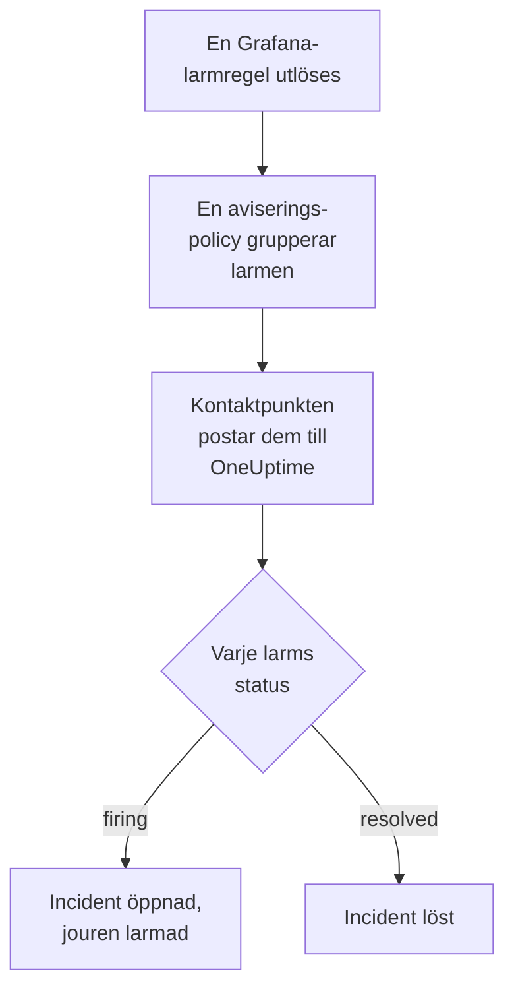

# Grafana

Skicka larm från [Grafana](https://grafana.com) till OneUptime, så att varje larm som utlöses blir en incident som larmar ditt jourteam och löses när larmet har återhämtat sig. Grafana skickar sina larm genom en webhook-kontaktpunkt, så det finns inget att installera på någon av sidorna.

:::cards
- [Välj hur OneUptime tar emot larm](#välj-hur-oneuptime-tar-emot-larm): En Incoming Request-monitor eller ett eget arbetsflöde.
- [Ta emot larm med en monitor](#ta-emot-larm-med-en-monitor): En incident per larm, löst vid återhämtning.
- [Konfigurera Grafana](#konfigurera-grafana): En webhook-kontaktpunkt och den policy som använder den.
- [Felsökning](#felsökning): När larm inte kommer fram eller incidenter förblir öppna.
:::

## Så fungerar det



Grafanas aviseringspolicyer grupperar de larm som utlöses, och en webhook-kontaktpunkt postar varje grupp som en JSON-avisering. Den har samma form som en avisering från [Prometheus Alertmanager](/docs/integrations/prometheus-alertmanager): en `status`, en lista `alerts` där varje larm har sin egen `status` och sitt eget `fingerprint`, och de `commonLabels` och `commonAnnotations` som dess larm delar. Grafana lägger till en `title` och en `message` som är skrivna för människor.

## Innan du börjar

- Grafana 9 eller senare, med Grafana Alerting, standard sedan Grafana 9. Den måste kunna nå din OneUptime över HTTPS.
- I OneUptime behörighet att skapa monitorer, eller arbetsflöden om du väljer den vägen.

## Välj hur OneUptime tar emot larm

Konfigurera OneUptime först: det ger dig den URL som Grafana skickar till.

| Väg | Använd den när |
| --- | --- |
| En Incoming Request-monitor (rekommenderas) | Du vill att varje larm ska bli en incident som larmar jouren och löses när larmet har återhämtat sig. Det finns inget att bygga. |
| Ett arbetsflöde med en Webhook-utlösare | Du behöver egen logik: filtrera larm, forma om dem eller anropa andra system först. Ett arbetsflöde öppnar en incident per avisering, inte per larm, och löser den inte vid återhämtning. |

Båda får samma JSON från samma kontaktpunkt, så du kan börja med det ena och byta senare genom att ändra en URL i Grafana.

## Ta emot larm med en monitor

En [Incoming Request-monitor](/docs/monitor/incoming-request-monitor) ger dig en URL, och dess kriterier avgör vad varje avisering gör.

:::steps
### Skapa monitorn

Gå till **Monitorer** och klicka på **Skapa monitor**. Välj **Incoming Request** under **Monitortyp**, ge den namnet `Grafana` och klicka på **Nästa**.

### Deklarera en incident för varje utlöst larm

Öppna det första kriteriet i steget **Kriterier**, det som markerar monitorn som offline. Ställ in dess filter på **Begärandekropp**, **Innehåller**, `"status":"firing"`. Det här kriteriet deklarerar redan en incident när filtret matchar. Fyll i incidenten:

- **Incidenttitel**: `{{requestBody.commonLabels.alertname}}`.
- **Incidentbeskrivning**, under **Beskrivning**: `{{requestBody.message}}`, den text som Grafana skriver för aviseringen.
- **Allvarlighetsgrad**: den incidentallvarlighetsgrad som de här larmen ska ha.
- **Jourpolicyer**, under **Jour**: de policyer som ska larmas.
- **Lös incident automatiskt**, under **Fler fält**: låt den vara påslagen, som den börjar. Utan den ignoreras återhämtningar och incidenter förblir öppna.

### Öppna en incident per larm

Öppna **Inställningar** i samma kriterium och slå på **Group incidents and alerts by a payload field**. Fyll i den som nedan, så att varje larm får sin egen incident och dess återhämtning löser den:

| Fält | Värde |
| --- | --- |
| **Open a separate incident for each…** | `requestBody.alerts[*].fingerprint` |
| **Field that signals recovery** | `requestBody.alerts[*].status` |
| **Value that means recovered** | `resolved` |

### Få monitorn online igen

Öppna det andra kriteriet, det som markerar monitorn som online, och ställ in dess filter på **Begärandekropp**, **Innehåller**, `"status":"resolved"`.

### Kopiera URL:en

Klicka på **Skapa monitor**. Monitorns sida **Översikt** visar dess **Heartbeat URL**. Kopiera den till Grafana:

```text
https://oneuptime.com/heartbeat/<secret key>
```

En egenvärdad installation har sin egen värd i stället för `oneuptime.com`.
:::

Varje larm i en avisering öppnar sin egen incident, upp till **Max incidents per request** (`100` om du inte ändrar det), och varje larms egen `status` avgör när dess incident löses. Grafanas `fingerprint` identifierar ett larm utifrån dess etiketter, så det är värdet att gruppera efter. Se [Ta emot larm från ett annat system](/docs/monitor/incoming-request-monitor#ta-emot-larm-från-ett-annat-system) för vad varje inställning gör.

> [!WARNING]
> Gruppera inte efter en etikett som alla larm i en avisering delar. Grafanas standardpolicy för aviseringar grupperar larm efter `grafana_folder` och `alertname`, så alla larm i en avisering har samma `alertname`: att gruppera efter `requestBody.alerts[*].labels.alertname` slår ihop hela aviseringen till en incident.

`{{requestBody.commonLabels.alertname}}` och `{{requestBody.message}}` beskriver hela aviseringen, som under standardpolicyn är en larmregel. Grupperingsnyckeln är också en variabel, `{{fingerprint}}`, men den är en hash som inte säger något till den som svarar. Se [Incident- och larmmallar](/docs/monitor/incident-alert-templating) för alla variabler som du kan använda.

## Konfigurera Grafana

:::steps
### Lägg till en webhook-kontaktpunkt

Gå till **Alerting → Contact points** i Grafana och klicka på **+ Add contact point**. I Grafana 11 och senare finns **Alerting** under **Alerts & IRM**, och **Contact points** är en flik i **Notification configuration**.

Ge kontaktpunkten namnet `OneUptime`, välj **Webhook** under **Integration** och klistra in den URL som du kopierade i **URL**. Låt **HTTP Method** stå på `POST` och klicka på **Save contact point**.

### Skicka larm dit

Gå till **Alerting → Notification policies**. Ställ in standardpolicyns kontaktpunkt på `OneUptime`, eller lägg till en underordnad policy som matchar de larm som OneUptime ska få, med `OneUptime` som kontaktpunkt.
:::

Grafana skickar `Content-Type: application/json`, som monitorn behöver för att läsa fälten i en avisering. Kontaktpunktens inställning **Max Alerts** begränsar larmen i en avisering: håll den på `0`, ingen gräns, eller högst på monitorns **Max incidents per request**.

## Testa det

1. Öppna kontaktpunkten `OneUptime` i Grafana och klicka på **Test**. Grafana skickar ett utlöst testlarm, och en incident öppnas i OneUptime. Ett testlarm återhämtar sig aldrig, så lös den incidenten manuellt.
2. Låt en riktig larmregel utlösas, till exempel genom att sänka dess tröskel en stund, och se hur dess incident öppnas och sedan löses när du sätter tillbaka tröskeln.

## Ta emot larm med ett arbetsflöde

Använd ett [arbetsflöde](/docs/workflows/index) när du behöver egna steg mellan Grafana och incidenten.

:::steps
### Skapa arbetsflödet

Gå till **Arbetsflöden**, klicka på **Skapa arbetsflöde** och sedan på **Börja från grunden**. Ge det namnet `Grafana alerts` och klicka på **Skapa arbetsflöde**.

### Lägg till Webhook-utlösaren

Klicka på det streckade blocket **Välj vad som startar det här arbetsflödet** och välj **Webhook**. Klicka på utlösaren, sedan på **Kopiera URL**, och använd den URL:en i kontaktpunkten i Grafana.

### Kontrollera att aviseringen är utlöst

Klicka på **Lägg till komponent**, lägg till ett block **If / Else** och anslut utlösarens punkt **Out** till det. Ställ in **Value to check** på `{{local.components.webhook-1.returnValues.request-body.status}}`, **Comparison** på **is equal to** och **Compare with** på `firing`.

### Deklarera incidenten

Lägg till ett block **Create One Incident** och anslut sidan **Yes** av blocket **If / Else** till det. Välj under **Incident Template** en mall som ställer in allvarlighetsgraden och de jourpolicyer som ska larmas (se [Incidentmallar](/docs/incidents/settings#incidentmallar)). Ange under **JSON Object** vad som kommer från Grafana:

```json
{
  "title": "{{local.components.webhook-1.returnValues.request-body.title}}",
  "description": "{{local.components.webhook-1.returnValues.request-body.message}}"
}
```

Utan en mall måste **JSON Object** också innehålla `incidentSeverityId`, ID:t för en av projektets incidentallvarlighetsgrader.

### Slå på arbetsflödet

Slå på **Aktiverad** överst i **Byggare**. Ett arbetsflöde som är avstängt svarar Grafana med `400`.
:::

En körning hanterar en avisering, så den deklarerar en incident oavsett hur många larm aviseringen innehåller. En avisering som är `resolved` tar sidan **No** av blocket **If / Else**, där ingenting är anslutet, så körningen slutar där. Använd monitorn för en incident per larm som löses vid återhämtning.

## Felsökning

:::details Inget kommer fram till OneUptime
- Klicka på **Test** på kontaktpunkten: Grafana visar ett fel när den inte kan nå URL:en. Grafanas serverlogg har detaljerna.
- Monitorn svarar `200` direkt, innan den kontrollerar något, även för en felaktig hemlig nyckel. Titta på monitorns tidslinje för att se om aviseringar kommer fram.
- Ett arbetsflöde som är avstängt svarar `400`. Slå på **Aktiverad** överst i dess **Byggare**.
:::

:::details Incidenter skapas men löses aldrig
- Kriteriets incident behöver **Lös incident automatiskt**, under **Fler fält**.
- **Field that signals recovery** måste vara `requestBody.alerts[*].status`, och **Value that means recovered** exakt `resolved`. Jämförelsen är skiftlägeskänslig.
- Grupperingssökvägarna måste börja med `requestBody.`, och bara den första `[*]` i en sökväg läser en lista. En sökväg som bryter mot någon av reglerna matchar ingenting, utan något fel.
:::

:::details En incident för en avisering full av larm
Du har grupperat efter en etikett som är densamma för varje larm i en avisering, som `alertname` under standardpolicyn. Gruppera i stället efter `requestBody.alerts[*].fingerprint`.
:::

:::details Incidenten visar en referens i stället för ett värde
En referens till ett fält som aviseringen inte har lämnas som den är skriven, med klammerparenteser och allt. Jämför fältets namn med det som Grafana skickade: för ett arbetsflöde öppnar du körningen i **Loggar → Körningar** och jämför med det som utlösaren tog emot.
:::

Guiden för [Prometheus Alertmanager](/docs/integrations/prometheus-alertmanager#felsökning) täcker fler fall, och de gäller även Grafanas aviseringar.

## Säkerhet

- **Behandla URL:en som ett lösenord.** Alla som har den kan öppna incidenter. Om den läcker återställer du den: **Återställ hemlig nyckel för inkommande begäran** på monitorns sida **Inställningar**, eller **Återställ URL** i arbetsflödets **Webhook**-utlösare. Uppdatera sedan kontaktpunktens **URL** i Grafana.
- **Egenvärdad?** Låt Grafana nå din OneUptime över HTTPS genom din brandvägg.

## Nästa steg

:::cards
- [Övervakning av inkommande förfrågningar](/docs/monitor/incoming-request-monitor): Varje inställning för den monitor som tar emot dina larm.
- [Prometheus Alertmanager](/docs/integrations/prometheus-alertmanager): Samma konfiguration, med ett dödmansgrepp för din larmning.
- [Metrikövervakning](/docs/monitor/metrics-monitor): Larma på samma mätvärden i själva OneUptime.
- [Översikt över integrationer](/docs/integrations/index): De andra verktyg som du kan ansluta.
:::
