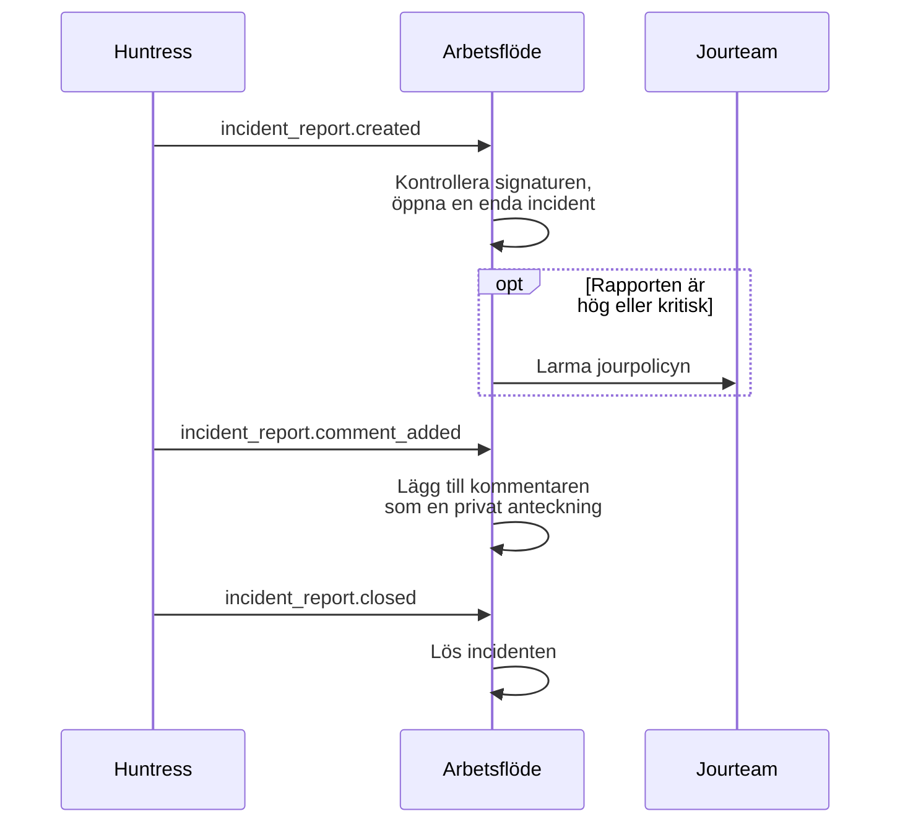

# Huntress-integration

Larma ditt jourteam för Huntress-incidentrapporter, med ett arbetsflöde. När Huntress SOC skickar en incidentrapport om en slutpunkt eller en identitet öppnar arbetsflödet en enda incident för den, larmar den jourpolicy du väljer, lägger till kommentarer från Huntress som privata anteckningar och löser incidenten när rapporten stängs i Huntress.

Den här integrationen är **inkommande**: Huntress skickar varje händelse om en incidentrapport till arbetsflödets egen URL, signerad med slutpunktens signeringshemlighet. OneUptime anropar aldrig Huntress och behöver därför ingen API-nyckel för Huntress.

:::cards
- [Så fungerar det](#så-fungerar-det): Vad arbetsflödet gör med varje händelse om en rapport.
- [Konfigurera](#konfigurera-integrationen): Skapa arbetsflödet, lägg till slutpunkten i Huntress, spara dess signeringshemlighet, skicka ett test.
- [Utlösaren](#utlösaren-huntress-incident-report): Värdena som en rapport ger arbetsflödet, och utlösarens inställningar.
- [Felsökning](#felsökning): Vad utlösarens fel betyder och vad du ska ändra.
:::

## Så fungerar det

Huntress skickar en händelse om en incidentrapport när rapporten skickas, när någon kommenterar den och när den stängs. Utlösaren **Huntress Incident Report** startar arbetsflödet en gång för varje händelse, och dess **Event** säger vilken det var: `created`, `comment-added` eller `closed`.

1. **Kontrollera.** En förfrågan måste vara signerad med slutpunktens signeringshemlighet, högst fem minuter innan den kommer fram. Allt annat avvisas, och utlösarens inställningar säger varför.
2. **Starta arbetsflödet.** Varje händelse startar en körning, med rapportens fält som utlösarens värden. En händelse som Huntress skickar igen startar inget mer.
3. **Öppna en enda incident.** Vid `created` öppnar arbetsflödet en incident med rapportens namn, till exempel `Huntress: Incident on DESKTOP-01 (Acme Corp)`. Beskrivningen innehåller rapportens sammanfattning, dess allvarlighetsgrad i Huntress, organisationen, den berörda värden eller identiteten, de indikatorer Huntress hittade och en länk till rapporten i Huntress. Incidenten får en etikett med rapportens organisation och larmar den jourpolicy du väljer när rapporten är hög eller kritisk.
4. **Följ rapporten.** Vid `comment-added` blir kommentaren en privat anteckning på incidenten. Vid `closed` löses incidenten, med orsaken på dess tidslinje.

Incidenten sparar rapportens nummer i sina anpassade fält, som `huntressReportId`: så hittar arbetsflödet den igen när Huntress kommenterar eller stänger rapporten. Incidenter som öppnas så visas aldrig på en statussida, och dina incidentregler (jour-, ägar-, etikett- och sekretessregler) gäller för dem som för alla andra incidenter.

## Innan du börjar

- I OneUptime en roll som kan skapa och redigera arbetsflöden, till exempel **Projektägare**, **Projektadministratör** eller **Arbetsflödesadministratör**.
- I Huntress rollen **Account Admin**: bara kontoadministratörer kan lägga till webhooks.
- En jourpolicy att larma.
- På OneUptime Cloud en plan med arbetsflöden: Growth eller högre. Varje händelse som Huntress skickar är en körning av arbetsflödet.
- På en egen installation en OneUptime som Huntress når från internet över HTTPS: Huntress skickar bara webhooks till `https://`-URL:er.

## Konfigurera integrationen

:::steps
### Skapa arbetsflödet

Öppna **Arbetsflöden** och klicka på **Skapa arbetsflöde**. Under **Eller börja från en mall** väljer du kategorin **Huntress**, väljer **Open an incident for each Huntress incident report** och klickar på **Använd den här mallen**.

### Välj vem som larmas

Dialogen frågar sedan vem som ska larmas: under **Who to page for high and critical reports** väljer du de jourpolicyer som ska larmas, eller ingen för att inte larma någon, och klickar på **Skapa arbetsflöde**. Arbetsflödet öppnas i **Byggare**, avstängt. För att senare ändra vem det larmar klickar du på dess steg **Page an On-Call Policy** och ändrar dess **Jourpolicyer**.

### Lägg till en webhook-slutpunkt i Huntress

Klicka på utlösaren **Huntress Incident Report** och klicka på **Kopiera URL** under **Lägg till en webhook-slutpunkt i Huntress**. URL:en ser ut som `https://oneuptime.com/workflow/huntress/<key>`; på en egen installation börjar den med din egen värd.

Öppna menyn uppe till höger i Huntress och välj **Integrations**. Klicka på **Add an Integration**, välj **Webhooks** och klicka på **Add Endpoint**. Klistra in URL:en, slå på **Incident Reports** och spara. Låt **Escalations**, **Platform Actions** och **Account Notices** vara avstängda: utlösaren tar emot de händelserna och startar ingenting för dem.

### Spara slutpunktens signeringshemlighet

Öppna slutpunktens meny (⋯) i Huntress och välj **View Signing Secret**. Kopiera hela: den börjar med `whsec_`. Klicka på **Spara signeringshemlighet** i utlösaren, klistra in den och klicka på **Spara signeringshemlighet**. Hemligheten krypteras och visas aldrig igen.

Tills hemligheten är sparad avvisar utlösaren varje förfrågan. Huntress skickar en avvisad händelse igen senare, så en händelse som avvisas nu kommer ändå fram.

### Slå på arbetsflödet och skicka ett test

Slå på **Aktiverad** högst upp i **Byggare**. Öppna slutpunktens meny (⋯) i Huntress och välj **Send Test**. Inom några sekunder visar utlösaren **Tar emot rapporter**.

> [!NOTE]
> Vad testet än innehåller visar utlösaren att det kom fram. Ett test med en incidentrapport startar arbetsflödet som vilken rapport som helst.
:::

## Vad arbetsflödet gör

Efter utlösaren gör **Incident From Another Tool** det som varje **Event** ber om, utifrån rapportens nummer:

| Event | Vad arbetsflödet gör |
| --- | --- |
| `created` | Öppnar en incident med utlösarens **Incident Severity ID**, med etiketten från dess **Organization Label ID**. För en hög eller kritisk rapport larmar **Page an On-Call Policy** din policy; en låg rapport larmar ingen. En rapport som redan har en incident öppnar ingen till. |
| `comment-added` | Hittar rapportens incident och lägger till kommentaren på den som en privat anteckning. |
| `closed` | Hittar rapportens incident och löser den, om den inte redan är löst. Orsaken står på dess tidslinje: Huntress stängde rapporten. |

Det är ett arbetsflöde som alla andra, så du kan ändra vad det gör: larma bara för kritiska rapporter genom att ändra vad **If / Else** efter **Incident From Another Tool** jämför, posta varje rapport i en chattkanal med ett Slack- eller Microsoft Teams-steg, eller skicka varje organisation till sin egen jourpolicy med en **Switch / Case** på **Organization**. Varje körning listas bland arbetsflödets körningar, med vad varje steg gjorde.

### Allvarlighetsgrader

Huntress ger varje incidentrapport en av tre allvarlighetsgrader. Utlösarens **Incident Severity ID** är den incidentallvarlighetsgrad som rapporten öppnas med: den som dess inställning väljer, annars ordningen på dina incidentallvarlighetsgrader, så som **Incidenter → Inställningar → Incidentallvar** listar dem:

| Allvarlighetsgrad i Huntress | Vad Huntress menar med den | Inställning | Incidentallvarlighetsgrad när inställningen är tom |
| --- | --- | --- | --- |
| Critical | Angripare vid tangentbordet, farlig skadlig kod eller aktiv kompromettering, som ska begränsas omedelbart. | **Allvarlighetsgrad för kritiska rapporter** | Den högsta |
| High | Bekräftad skadlig kod som kräver snabb åtgärd, eller kompromettering av en identitet som kräver handling. | **Allvarlighetsgrad för höga rapporter** | Den andra |
| Low | Potentiellt oönskade program, rester av skadlig kod och äldre fynd om identiteter. | **Allvarlighetsgrad för låga rapporter** | Den tredje |

Ett projekt med färre allvarlighetsgrader använder sin lägsta för resten. En rapport utan allvarlighetsgrad behandlas som hög. Om en allvarlighetsgrad du valt tas bort avgör ordningen igen.

### Organisationer

Utlösarens **Organization Label ID** är en etikett med namnet på rapportens Huntress-organisation, till exempel _Acme Corp_, som den skapar första gången en rapport från den organisationen kommer fram. Ett arbetsflöde tar emot rapporterna från alla organisationer i ditt Huntress-konto, och utlösarens **Endast dessa organisationer** begränsar det: ett organisationsnamn eller ID per rad, där namn inte skiljer på versaler och gemener.

> [!TIP]
> För att larma varje kunds eget team lägger du till en jourregel för incidenter per organisation, till exempel ”Om **Incidentetiketter** har någon av _Acme Corp_”, som kör kundens policy. Se [Jourregler för incidenter](/docs/incidents/settings#jourregler-för-incidenter).

## Utlösaren Huntress Incident Report

Utlösaren öppnas på Huntress: dess URL, en bock vid varje konfigurationssteg som är klart och vad Huntress skickade senast. Dess inställningar, som alla är valfria, är hopfällda under **Fler fält**: **Endast dessa organisationer**, **Allvarlighetsgrad för kritiska rapporter**, **Allvarlighetsgrad för höga rapporter** och **Allvarlighetsgrad för låga rapporter**.

| Värde | Vad det innehåller |
| --- | --- |
| **Event** | `created`, `comment-added` eller `closed`. En rapport som redan är stängd eller avfärdad är `closed`, oavsett vilken händelse som kom med den. |
| **Report ID** | Rapportens nummer i Huntress. |
| **Severity** | `critical`, `high` eller `low`. |
| **Status** | Rapportens status i Huntress, till exempel `sent`, `closed` eller `dismissed`. |
| **Subject** | Rapportens ämne, så som Huntress skriver det. |
| **Summary** | Det som SOC-analytikern skrev. |
| **Organization**, **Organization ID** | Den Huntress-organisation som rapporten gäller. |
| **Affected** | Den värd eller identitet som rapporten gäller. |
| **Platform**, **Indicators** | Var Huntress hittade det, och vad den hittade. |
| **Comment** | Kommentaren som någon lade till, vid `comment-added`. |
| **Report URL** | Var rapporten öppnas i Huntress. |
| **Incident Title**, **Incident Description** | En titel och en Markdown-beskrivning för en incident om rapporten. |
| **Note** | Markdown för en anteckning om händelsen: kommentaren, eller att Huntress stängde rapporten. |
| **Incident Severity ID**, **Organization Label ID** | Incidentallvarlighetsgraden och etiketten, som ovan. |
| **Received At** | När OneUptime tog emot händelsen. |

**Summary** och **Comment** är text som Huntress analytiker har skrivit. Använd **Incident Description** och **Note** för att lägga dem i en incident eller en anteckning: de behåller formateringen, och inget i dem hämtar en bild eller nämner någon.

För att prova arbetsflödet utan Huntress klickar du på **Kör arbetsflöde** i **Byggare** och skriver en **Event**, ett **Report ID** och de fält du behöver. Använd samma **Report ID** för att följa en rapport från `created` till `closed`.

## Huntress-anslutningar som skapats tidigare

Huntress konfigurerades tidigare under **Incidenter → Integrationer → Huntress**. Varje Huntress-anslutning blev ett påslaget arbetsflöde med samma namn, som gör det anslutningen gjorde: det larmar samma jourpolicyer för samma rapporter, lägger till samma etiketter och löser (eller antecknar bara) på samma sätt. Dess URL är fortfarande anslutningens, `https://oneuptime.com/api/huntress/webhook/<connection-id>`, och dess signeringshemlighet är densamma, så det finns inget att ändra i Huntress. Incidenterna som anslutningen öppnade behåller sin rapports nummer, så arbetsflödet hittar dem när Huntress kommenterar eller stänger de rapporterna.

## Säkerhet

- **Endast signerade förfrågningar.** Utlösaren kontrollerar rubrikerna `svix-id`, `svix-timestamp` och `svix-signature` som Huntress skickar mot förfrågans innehåll, precis som det kom fram. En förfrågan som inte är signerad med den sparade hemligheten, eller som signerades mer än fem minuter före eller efter, avvisas.
- **Hemligheten förblir hemlig.** Den lagras krypterad, returneras aldrig av API:et och visas aldrig igen. **Ersätt signeringshemlighet** i utlösaren sparar en annan, till exempel hemligheten för en ny slutpunkt.
- **URL:en är en adress, inte ett lösenord.** Den slutar med arbetsflödets nyckel; bara en förfrågan som signerats med slutpunktens hemlighet startar arbetsflödet.
- **En slutpunkt per arbetsflöde.** Varje arbetsflöde har sin egen URL och hemlighet. Skapa ett andra arbetsflöde för att ta emot rapporterna från ett andra Huntress-konto.

## Använd e-post i stället

Huntress skickar också incidentrapporter med e-post, och en [övervakare för inkommande e-post](/docs/monitor/incoming-email-monitor) kan öppna incidenter från de e-postmeddelandena, till exempel när ämnet innehåller `Critical Incident Report`. Den behandlar dock e-postmeddelandena som en enda övervakares status: medan dess incident är öppen öppnar nästa rapport ingen, och incidenten löses av övervakarens kriterier i stället för när Huntress stänger rapporten. Arbetsflödet öppnar en incident per rapport och löser var och en med sin rapport, så välj det. Så snart arbetsflödet tar emot rapporter slutar du skicka e-postmeddelandena till övervakaren, annars larmar varje rapport två gånger.

## Felsökning

När utlösaren avvisar en förfrågan visar dess inställningar orsaken under **Den senaste förfrågan avvisades**. I Huntress listar **View Delivery Attempts** i slutpunktens meny (⋯) varje leverans med OneUptimes svar.

:::details "A request arrived but was refused, because no signing secret is saved for this workflow yet"
Spara slutpunktens signeringshemlighet: se [Konfigurera integrationen](#konfigurera-integrationen). Huntress skickar den avvisade förfrågan igen.
:::

:::details "The request's signature does not match the signing secret"
Den sparade hemligheten hör inte till den här slutpunkten. Varje slutpunkt har sin egen: öppna slutpunktens meny (⋯) i Huntress, välj **View Signing Secret**, kopiera hela och spara den med **Ersätt signeringshemlighet**.
:::

:::details "The request was signed more than five minutes from now"
Klockorna hos Huntress och på din OneUptime-server skiljer sig åt med mer än fem minuter, eller så är förfrågan en upprepning. På en egen installation kontrollerar du att serverns klocka går rätt.
:::

:::details "A request arrived while this workflow is off"
Slå på **Aktiverad** högst upp i **Byggare**. Huntress skickar den avvisade förfrågan igen, och då startar den arbetsflödet.
:::

:::details "No Huntress workflow has this address."
Arbetsflödet har tagits bort eller arkiverats, dess utlösare är inte längre **Huntress Incident Report**, eller så är slutpunktens URL i Huntress inte arbetsflödets. Kopiera URL:en från utlösaren och klistra in den i slutpunkten i Huntress igen.
:::

:::details Ingen incident öppnades
Öppna arbetsflödets körningar och rapportens körning. Om **Incident From Another Tool** misslyckades med `This project has no incident severities to put the incident at.` lägger du till en under **Incidenter → Inställningar → Incidentallvar**.
:::

:::details Ingen larmades
En låg rapport öppnar en incident utan att larma någon. Annars säger rapportens körning vad **Page an On-Call Policy** gjorde, och incidentens sida **Jourexekveringar** visar vad varje policy gjorde.
:::

## Nästa steg

:::cards
- [Arbetsflödesutlösare](/docs/workflows/triggers): De andra sätten att starta ett arbetsflöde.
- [Jourregler för incidenter](/docs/incidents/settings#jourregler-för-incidenter): Larma varje organisations eget team, via dess etikett.
- [Incidentstatusar och allvarlighetsgrader](/docs/incidents/states-and-severities): Ordna de allvarlighetsgrader som Huntress-rapporter öppnas med.
- [Översikt över integrationer](/docs/integrations/index): De andra verktyg du kan ansluta.
:::
