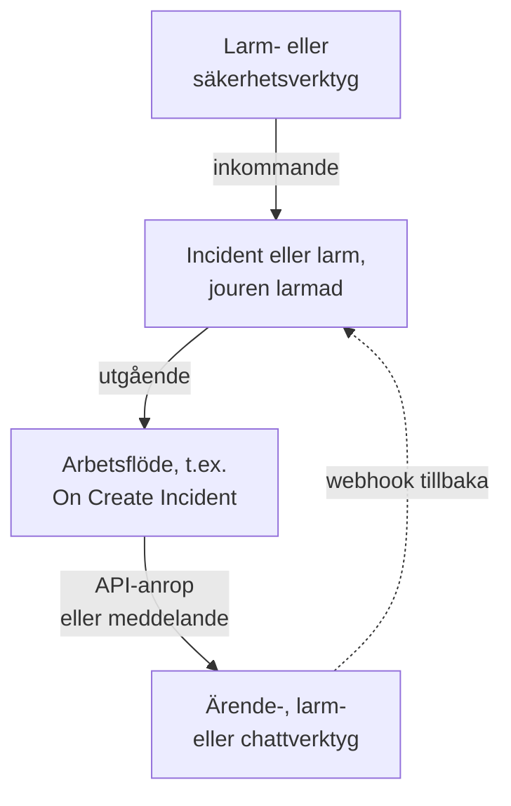

# Översikt över integrationer

OneUptime fungerar med de verktyg ditt team redan använder. Larmverktyg skapar incidenter i OneUptime, och OneUptime skapar ärenden, jourlarm och chattmeddelanden i andra verktyg. Vissa verktyg ansluts från ett formulär, andra från en färdig arbetsflödesmall. Alla andra verktyg med en webhook eller ett API ansluts via ett arbetsflöde som du bygger själv.

:::cards
- [Välj hur du ansluter](#välj-hur-du-ansluter): De fyra sätten att ansluta och när du använder vart och ett.
- [Katalog](#katalog): Alla verktyg med en guide, grupperade efter vad de gör.
- [Bygg din egen integration](#bygg-din-egen-integration): Mönstren för inkommande och utgående data, för alla andra verktyg.
- [Skydda autentiseringsuppgifter](#skydda-autentiseringsuppgifter): Hemliga variabler och de rubriker som varje verktyg förväntar sig.
:::

## Så fungerar integrationer

Varje integration flyttar data i en riktning eller i båda. **Inkommande**: ett annat verktyg berättar för OneUptime att något är fel, och OneUptime skapar en incident eller ett larm och larmar jourteamet. **Utgående**: något händer i OneUptime, och ett arbetsflöde berättar det för ett annat verktyg: det skapar ett ärende, larmar någon eller publicerar ett meddelande.



En dubbelriktad integration, som Jira eller Dynamics 365, använder båda riktningarna: ett arbetsflöde skickar ut incidenten, och ett annat, som startas av det andra verktygets webhook, hämtar tillbaka ändringar.

## Välj hur du ansluter

| Sätt | Passar bäst för | Exempel |
| --- | --- | --- |
| En inbyggd anslutning | Verktyg som OneUptime ansluter till själv. Du fyller i ett formulär, och det finns inget att bygga. | [Slack](/docs/workspace-connections/slack), [Microsoft Teams](/docs/workspace-connections/microsoft-teams), anslutningarna för [Säkerhetshändelser](/docs/telemetry/security-events) |
| En arbetsflödesmall | Ärendeverktyg, synkade åt båda hållen, övervakningsproblem, säkerhetsincidentrapporter och chattmeddelanden. Du väljer en mall och fyller i några inställningar. | [Jira](/docs/integrations/jira), [Microsoft Dynamics 365](/docs/integrations/microsoft-dynamics-365), [Huntress](/docs/integrations/huntress), [Zabbix](/docs/integrations/zabbix) |
| En Incoming Request-monitor | Larmverktyg som skickar en webhook. Du får en incident per larm, skickad till jouren och löst när larmet återhämtar sig, utan arbetsflöde. | [Zabbix](/docs/integrations/zabbix), [Prometheus Alertmanager](/docs/integrations/prometheus-alertmanager), [Grafana](/docs/integrations/grafana) |
| Ett arbetsflöde som du bygger | Alla verktyg med en webhook eller ett REST API, och all egen logik. | [PagerDuty](/docs/integrations/pagerduty), [Opsgenie](/docs/integrations/opsgenie), [ServiceNow](/docs/integrations/servicenow) |

Börja från toppen av tabellen: ju högre upp ett sätt står, desto mindre finns det att underhålla.

## Katalog

### Övervaknings- och larmverktyg

| Verktyg | Riktning | Vad det gör |
| --- | --- | --- |
| [Zabbix](/docs/integrations/zabbix) | Båda | Gör Zabbix-problem till incidenter eller larm, löser dem när de återhämtat sig, och kvitterar eller stänger problemen från OneUptime. |
| [Prometheus Alertmanager](/docs/integrations/prometheus-alertmanager) | Inkommande | Gör aviseringar från Alertmanager till incidenter. |
| [Grafana](/docs/integrations/grafana) | Inkommande | Gör larm från Grafana till incidenter. |
| [Datadog](/docs/integrations/datadog) | Inkommande | Gör larm från Datadog-monitorer till incidenter. |

### Säkerhetsverktyg

| Verktyg | Riktning | Vad det gör |
| --- | --- | --- |
| [Huntress](/docs/integrations/huntress) | Inkommande | Larmar jouren vid incidentrapporter från Huntress och löser incidenten när rapporten stängs. |
| [Google SecOps](/docs/integrations/google-secops) | Båda | Hämtar detektioner och indikatorer från Google SecOps till Säkerhetshändelser, och skickar dit det OneUptime hittar. |
| [Microsoft Sentinel](/docs/integrations/microsoft-sentinel) | Båda | Hämtar incidenter från Microsoft Sentinel till Säkerhetshändelser, och skickar dit det OneUptime hittar. |
| [Microsoft Defender XDR](/docs/integrations/microsoft-defender-xdr) | Inkommande | Hämtar larm från Microsoft Defender XDR till Säkerhetshändelser. |
| [CrowdStrike Falcon](/docs/integrations/crowdstrike-falcon) | Inkommande | Hämtar larm från CrowdStrike Falcon till Säkerhetshändelser. |
| [Splunk Enterprise Security](/docs/integrations/splunk) | Båda | Hämtar notable events från Splunk till Säkerhetshändelser, och skickar dit det OneUptime hittar. |
| [Elastic Security](/docs/integrations/elastic-security) | Båda | Hämtar detektionslarm från Elastic Security till Säkerhetshändelser, och skickar dit det OneUptime hittar. |
| [AWS Security Hub](/docs/integrations/aws-security-hub) | Inkommande | Hämtar fynd från AWS Security Hub till Säkerhetshändelser. |
| [Okta System Log](/docs/integrations/okta) | Inkommande | Hämtar inloggningar, kontoändringar och hotdetektioner från Okta till Säkerhetshändelser. |

### Ärendehantering och IT-tjänstehantering

| Verktyg | Riktning | Vad det gör |
| --- | --- | --- |
| [Jira](/docs/integrations/jira) | Båda | Skapar ett Jira-ärende för varje incident eller larm och hämtar tillbaka statusändringar och kommentarer. |
| [Microsoft Dynamics 365](/docs/integrations/microsoft-dynamics-365) | Båda | Skapar ett Dynamics 365-ärende för varje incident eller larm och hämtar tillbaka statusändringar och anteckningar. |
| [ServiceNow](/docs/integrations/servicenow) | Utgående | Skapar en ServiceNow-incident för varje OneUptime-incident och löser den tillsammans med incidenten. |
| [GitHub](/docs/integrations/github) | Utgående | Skapar ett GitHub-issue för en incident. |
| [GitLab](/docs/integrations/gitlab) | Utgående | Skapar ett GitLab-issue för en incident. |

### Verktyg för jourlarm

| Verktyg | Riktning | Vad det gör |
| --- | --- | --- |
| [PagerDuty](/docs/integrations/pagerduty) | Utgående | Utlöser en PagerDuty-incident för varje OneUptime-incident och löser den tillsammans med incidenten. |
| [Opsgenie](/docs/integrations/opsgenie) | Utgående | Skapar ett Opsgenie-larm för varje OneUptime-incident och stänger det tillsammans med incidenten. |

### Chattverktyg

| Verktyg | Riktning | Vad det gör |
| --- | --- | --- |
| [Slack](/docs/workspace-connections/slack) | Båda | En inbyggd anslutning: incidentkanaler, åtgärder från Slack och jour. |
| [Microsoft Teams](/docs/workspace-connections/microsoft-teams) | Båda | En inbyggd anslutning: incidentkanaler, åtgärder från Teams och jour. |
| [Mattermost](/docs/workflows/components#mattermost) | Utgående | Publicerar incidentuppdateringar i en Mattermost-kanal. |
| [Discord](/docs/integrations/discord) | Utgående | Publicerar incidentuppdateringar i en Discord-kanal. |
| [Telegram](/docs/integrations/telegram) | Utgående | Skickar ett meddelande till en Telegram-chatt när ett larm utlöses. |
| [IRC](/docs/integrations/irc) | Utgående | Publicerar incidentuppdateringar i en IRC-kanal. |

> [!TIP]
> Slack och Microsoft Teams har också arbetsflödessteg. Använd den inbyggda anslutningen för incidentkanaler och jour, och ett arbetsflödessteg när du bara behöver ett meddelande i en kanal.

### Hostingplattformar

| Verktyg | Riktning | Vad det gör |
| --- | --- | --- |
| [Vercel](/docs/integrations/vercel) | Inkommande | Lägg till OneUptime från Vercel Marketplace: spår, loggar, drifttidsmonitorer och en statussida för dina Vercel-projekt. |

## Byt från ett annat verktyg

För att lämna ett annat verktyg för jour, drifttid eller statussidor tar du över ditt team i stället för att ansluta de två. **Projektinställningar → Avancerad → Importera från ett annat verktyg** läser ditt konto med en API-nyckel, visar vad det hittade och skapar det du kryssar i. Varje verktyg har en guide:

- Verktyg för jour och incidenter: [Opsgenie](/docs/moving-to-oneuptime/opsgenie), [PagerDuty](/docs/moving-to-oneuptime/pagerduty), [incident.io](/docs/moving-to-oneuptime/incident-io), [Splunk On-Call](/docs/moving-to-oneuptime/splunk-on-call) och [Grafana OnCall](/docs/moving-to-oneuptime/grafana-oncall).
- Verktyg för drifttid och statussidor: [UptimeRobot](/docs/moving-to-oneuptime/uptimerobot), [Atlassian Statuspage](/docs/moving-to-oneuptime/atlassian-statuspage), [Better Stack](/docs/moving-to-oneuptime/better-stack), [Pingdom](/docs/moving-to-oneuptime/pingdom), [StatusCake](/docs/moving-to-oneuptime/statuscake) och [Uptime Kuma](/docs/moving-to-oneuptime/uptime-kuma).

## Bygg din egen integration

Ett verktyg utan guide passar ändå in i ett av två mönster. Kan det skicka en webhook använder du det inkommande mönstret. Har det ett REST API använder du det utgående mönstret. Båda är arbetsflöden: se [Översikt över arbetsflöden](/docs/workflows/index) för att komma igång.

### Inkommande: ett annat verktyg skickar data till OneUptime

För ett larmverktyg börjar du med en [Incoming Request-monitor](/docs/monitor/incoming-request-monitor#ta-emot-larm-från-ett-annat-system): den skapar en incident per larm och löser den vid återhämtning, utan att du behöver bygga något. Bygg ett arbetsflöde när du behöver egen logik:

:::steps
1. Öppna **Arbetsflöden**, klicka på **Skapa arbetsflöde** och sedan på **Börja från grunden**. Namnge arbetsflödet och klicka på **Skapa arbetsflöde**.
2. Klicka på det streckade blocket **Välj vad som startar det här arbetsflödet** och välj **Webhook**. Klicka på utlösaren och sedan på **Kopiera URL**.
3. Skicka det andra verktygets webhook till den URL:en som en `POST` med `Content-Type: application/json`.
4. Lägg till blocken som agerar på den. De läser begäran med referenser som `{{local.components.webhook-1.returnValues.request-body.status}}`: ett **If / Else**-block för att kontrollera ett fält och sedan **Create One Incident** för att deklarera en incident.
5. Slå på **Aktiverad** högst upp i **Byggare**, skicka ett test från det andra verktyget och öppna **Loggar → Körningar** för att se vad som kom in.
:::

URL:en är den enda autentiseringsuppgiften, så behandla den som ett lösenord. Se [Webhook](/docs/workflows/triggers#webhook).

### Utgående: OneUptime skickar data till ett annat verktyg

:::steps
1. Spara verktygets API-nyckel som en hemlig global variabel, som visas [nedan](#skydda-autentiseringsuppgifter).
2. Skapa ett arbetsflöde, klicka på det streckade blocket och välj en händelseutlösare, t.ex. **On Create Incident**. Klicka på utlösaren: dess **Fields to pass on** börjar med **Titel**, så klicka på **Lägg till fält** och välj de andra fälten som ska skickas, t.ex. **Beskrivning**.
3. Klicka på **Lägg till komponent** och lägg till ett **API Post (JSON)**-block. Koppla utlösarens **Success**-punkt till det.
4. Fyll i **URL**, **Request Headers** med rubriken `Authorization` och **Request Body** med incidentens fält, t.ex. `{{local.components.incident-on-create-1.returnValues.model.title}}`.
5. Klicka på **Kör arbetsflöde**, välj en incident under **Incident** och kör det. En testkörning skickar begäran på riktigt. Slå sedan på **Aktiverad**.
:::

När verktyget behöver datan i en annan form lägger du till ett [Run Custom JavaScript](/docs/workflows/components#custom-code)-block mellan de två. Receptet är detsamma för Zendesk, New Relic, AWS (via SNS), StatusCake och alla andra: bara URL:en och innehållet ändras.

## Skydda autentiseringsuppgifter

Klistra aldrig in en API-nyckel eller en token i ett block. Spara den en gång som en hemlig global variabel:

:::steps
1. Gå till **Arbetsflöden → Globala variabler** och klicka på **Skapa Arbetsflöde Variabel**.
2. Ge den ett namn, t.ex. `JIRA_AUTH`, och klicka på **Nästa**.
3. Klistra in nyckeln i **Innehåll**, slå på **Hemlighet** och klicka på **Skapa Arbetsflöde Variabel**.
:::

Alla block läser den som `{{global.variables.JIRA_AUTH}}`. En variabels innehåll kan inte läsas igen när det har sparats, och innehållet i en hemlig variabel ersätts med `[REDACTED]` i körningsloggar. För tokens som löper ut, som de från Microsoft Entra ID, hämtar en [OAuth 2.0-variabel](/docs/workflows/variables#oauth-20-variabler-token-som-förnyar-sig-själva) en ny själv. Se [Arbetsflödesvariabler](/docs/workflows/variables#globala-variabler).

### Lathund för autentisering

De flesta utgående integrationer lägger nyckeln i en rubrik i begäran. De vanliga formerna:

| Schema | Vad du skickar | Används av |
| --- | --- | --- |
| Bearer-token | `Authorization: Bearer {{global.variables.TOKEN}}` | GitHub och de flesta moderna API:er |
| Basic-autentisering | `Authorization: Basic {{global.variables.BASE64_USER_PASS}}` | Jira Cloud, ServiceNow |
| Rubrik med API-nyckel | `Authorization: GenieKey {{global.variables.OPSGENIE_KEY}}` | Opsgenie |
| Rubrik med privat token | `PRIVATE-TOKEN: {{global.variables.GITLAB_TOKEN}}` | GitLab |
| Nyckel i innehållet | `routing_key` i JSON-innehållet | PagerDuty Events API |
| OAuth 2.0-klientautentiseringsuppgifter | `Authorization: Bearer {{local.variables.dynamicsAccessToken}}`, från en OAuth 2.0-variabel | Microsoft Dynamics 365 |

För Basic-autentisering kodar du `username:password`, eller `email:api_token`, en gång och sparar resultatet som hemligheten. På macOS eller Linux:

```bash
printf '%s' 'you@example.com:your_api_token' | base64 | tr -d '\n'
```

Använd `printf`, inte `echo`: `echo` lägger till en radbrytning, som kodas tillsammans med resten och förstör autentiseringsuppgifterna. `tr` håller ett långt resultat på en rad.

## Egenhostade installationer

En egenhostad OneUptime anropar andra verktyg från ditt nätverk, och andra verktyg anropar den från sina:

- **Utgående:** arbetsflödesbegäranden till privata nätverksadresser nekas om inte en administratör tillåter dem. Se [Utgående nätverksåtkomst](/docs/workflows/configuration#utgående-nätverksåtkomst).
- **Inkommande:** ett verktygs webhooks måste nå din OneUptime via HTTPS, så ett verktyg i molnet behöver en offentlig adress att anropa.
- **Inbyggda integrationer** har var sin installationsguide: [Slack](/docs/self-hosted/slack-integration), [Microsoft Teams](/docs/self-hosted/microsoft-teams-integration), [GitHub](/docs/self-hosted/github-integration), [Twilio](/docs/self-hosted/twilio-integration), [SendGrid Inbound Email](/docs/self-hosted/sendgrid-inbound-email) och [Push Notifications](/docs/self-hosted/push-notifications).

## Nästa steg

:::cards
- [Översikt över arbetsflöden](/docs/workflows/index): Hur arbetsflöden körs och hur du bygger ditt första.
- [Övervakning av inkommande förfrågningar](/docs/monitor/incoming-request-monitor): Ta emot larm från alla verktyg utan arbetsflöde.
- [Jira](/docs/integrations/jira): En komplett dubbelriktad integration, utifrån mallar.
- [Arbetsflödesvariabler](/docs/workflows/variables): Skicka data mellan block och håll hemligheter utanför dem.
:::
