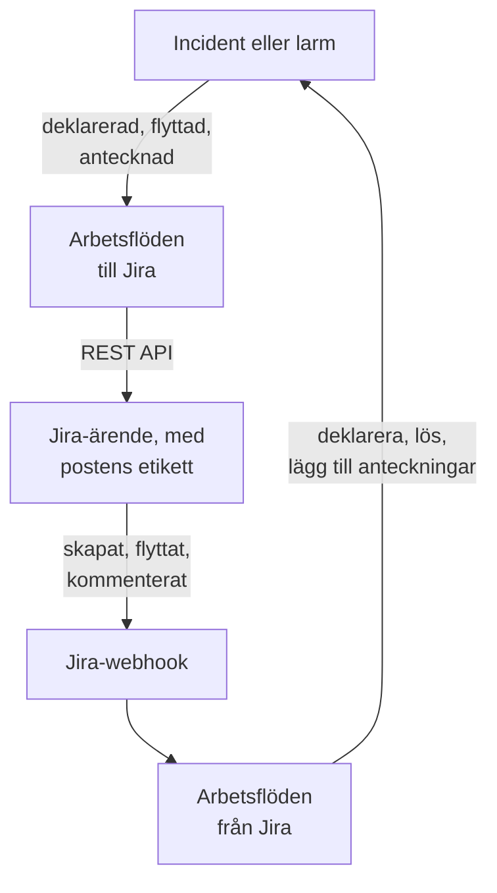

# Jira

Håll [Jira](https://www.atlassian.com/software/jira)-ärenden i takt med dina OneUptime-incidenter och -larm, åt båda hållen. Färdiga arbetsflödesmallar skapar ett ärende för varje incident eller larm, flyttar det i takt med posten och kopierar anteckningar till det som kommentarer. Andra deklarerar incidenter från nya ärenden och hämtar tillbaka statusändringar, kommentarer och redigeringar. Det finns inget plugin: arbetsflödena anropar Jiras REST API, och Jira anropar deras webhook-URL:er.

:::cards
- [Börja från en mall](#börja-från-en-mall): De 17 mallarna, vad de frågar efter och hur du ställer in dem.
- [Så fungerar mallarna](#så-fungerar-mallarna): Hur ärenden och poster förblir kopplade, utan loopar.
- [Bygg det själv](#bygg-det-själv): Varje riktning för hand, när en mall inte passar.
- [Felsökning](#felsökning): Vad Jiras svar betyder.
:::

> [!NOTE]
> Atlassian byter namn på saker i Jira Cloud: ett **projekt** heter nu ett **utrymme** i stora delar av gränssnittet, och ett **ärende** heter ett **arbetsobjekt**. Webbplatser använder båda orden, så där ordvalet spelar roll hittar du båda här.

## Så fungerar det



Varje mall är ett litet arbetsflöde, så du tar bara de riktningar du vill ha, för incidenter, larm eller båda. Mallarna OneUptime → Jira startar från en händelse i OneUptime och anropar Jiras REST API. Mallarna Jira → OneUptime startar från en Jira-webhook. Alla hittar varandras poster via två etiketter på ärendet.

Allt på den här sidan är skrivet för **Jira Cloud**. [Jira Data Center](#jira-data-center) visar vad som ändras på ett självhanterat Jira.

## Innan du börjar

- En Jira Cloud-webbplats, t.ex. `https://your-domain.atlassian.net`, och ett projekt att skapa ärenden i.
- En Jira-användare för integrationen och en API-token för den. Ge användaren **Browse Projects**, **Create Issues**, **Edit Issues**, **Add Comments** och **Transition Issues** i projektet.
- En Jira-administratör, för att registrera de webhooks som mallarna Jira → OneUptime behöver.
- I OneUptime behörighet att skapa arbetsflöden. På OneUptime Cloud kräver arbetsflöden **Growth**-abonnemanget eller högre.

## Börja från en mall

Dialogrutan **Skapa ett arbetsflöde** har 17 Jira-mallar under **Jira** i kategorilistan: nio för incidenter och sedan åtta för larm, varje grupp under sin egen rubrik. De delar en konvention, etiketter på Jira-ärendet, så alla kombinationer av dem fungerar tillsammans.

### Mallar för incidenter

| Mall | Vad den gör | Vad den frågar efter |
| --- | --- | --- |
| **OneUptime → Jira** | | |
| Create a Jira issue when an incident is declared | Skapar ett ärende för varje ny incident och lägger till incidentens ID som etikett. Incidenter som deklarerats från Jira, och privata incidenter, hoppas över. | API URL, API token, project key, issue type, OneUptime URL |
| Move the Jira issue when the incident is acknowledged or resolved | Flyttar det kopplade ärendet framåt: till en In Progress-status när incidenten kvitteras och till en Done-status när den löses. Flyttar det aldrig bakåt. | API URL, API token |
| Copy incident private notes to the Jira issue | Publicerar varje ny privat anteckning som en kommentar på det kopplade ärendet, som en intern kommentar i Jira Service Management. | API URL, API token |
| Copy incident public notes to the Jira issue | Publicerar varje ny offentlig anteckning som en kommentar på det kopplade ärendet. | API URL, API token |
| Comment on the Jira issue when the incident is edited | När incidentens titel, allvarlighetsgrad, beskrivning, grundorsak eller åtgärdsanteckningar ändras publicerar den hur incidenten ser ut nu, som en intern kommentar i Jira Service Management. | API URL, API token |
| **Jira → OneUptime** | | |
| Declare an incident when a Jira issue is created | Deklarerar en incident för varje nytt ärende, hållen borta från dina statussidor, med en allvarlighetsgrad som väljs utifrån ärendets prioritet, och sätter sedan etikett på ärendet för att koppla ihop de två. | Site URL, API URL, API token och en Jira-webhook för **Issue created** |
| Acknowledge or resolve the incident when its Jira issue moves | Kvitterar incidenten när dess kopplade ärende flyttas till en In Progress-status, och löser den när ärendet flyttas till en Done-status. | En Jira-webhook för **Issue updated** |
| Add Jira comments to the incident as private notes | Kopierar varje kommentar från ett kopplat ärende till incidenten som en privat anteckning. | Site URL, API URL, API token och en Jira-webhook för **Comment created** |
| Add Jira issue changes to the incident as private notes | Antecknar varje redigering av ett kopplat ärende, t.ex. prioriteten, den ansvariga eller sammanfattningen, på incidenten som en privat anteckning. Statusändringar lämnas åt mallen ovan. | Site URL och en Jira-webhook för **Issue updated** |

### Mallar för larm

Mallarna för larm gör samma jobb för larm. Det finns en färre, eftersom larm inte har offentliga anteckningar. [Vad som skiljer sig för larm](#vad-som-skiljer-sig-för-larm) visar resten.

| Mall | Vad den gör | Vad den frågar efter |
| --- | --- | --- |
| **OneUptime → Jira** | | |
| Create a Jira issue when an alert is created | Skapar ett ärende för varje nytt larm, även varje larm som en monitor utlöser, och lägger till larmets ID som etikett. Larm som skapats från Jira, och privata larm, hoppas över. | API URL, API token, project key, issue type, OneUptime URL |
| Move the Jira issue when the alert is acknowledged or resolved | Flyttar det kopplade ärendet framåt: till en In Progress-status när larmet kvitteras och till en Done-status när det löses. Flyttar det aldrig bakåt. | API URL, API token |
| Copy alert private notes to the Jira issue | Publicerar varje ny privat anteckning som en kommentar på det kopplade ärendet, som en intern kommentar i Jira Service Management. | API URL, API token |
| Comment on the Jira issue when the alert is edited | När larmets titel, allvarlighetsgrad, beskrivning, grundorsak eller åtgärdsanteckningar ändras publicerar den hur larmet ser ut nu, som en intern kommentar i Jira Service Management. | API URL, API token |
| **Jira → OneUptime** | | |
| Create an alert when a Jira issue is created | Skapar ett larm för varje nytt ärende, med en allvarlighetsgrad som väljs utifrån ärendets prioritet, och sätter sedan etikett på ärendet för att koppla ihop de två. | Site URL, API URL, API token och en Jira-webhook för **Issue created** |
| Acknowledge or resolve the alert when its Jira issue moves | Kvitterar larmet när dess kopplade ärende flyttas till en In Progress-status, och löser det när ärendet flyttas till en Done-status. | En Jira-webhook för **Issue updated** |
| Add Jira comments to the alert as private notes | Kopierar varje kommentar från ett kopplat ärende till larmet som en privat anteckning. | Site URL, API URL, API token och en Jira-webhook för **Comment created** |
| Add Jira issue changes to the alert as private notes | Antecknar varje redigering av ett kopplat ärende, t.ex. prioriteten, den ansvariga eller sammanfattningen, på larmet som en privat anteckning. Statusändringar lämnas åt mallen ovan. | Site URL och en Jira-webhook för **Issue updated** |

Ingen av mallarna OneUptime → Jira skickar en incident markerad som [**Privat incident**](/docs/incidents/declaring-incidents#steg-1-incidentdetaljer), eller ett larm markerat som **Privat larm**, till Jira: varken posten, dess status, dess anteckningar eller dess redigeringar, om du inte slår på det. Se [Begränsningar](#begränsningar).

### Vad som skiljer sig för larm

Varje mall för larm är byggd som sin tvilling för incidenter, steg för steg. Där larm skiljer sig från incidenter gör mallarna det också:

- **Inga offentliga anteckningar.** Larm har bara privata anteckningar, så varje kommentar som mallarna för larm publicerar är en intern kommentar i Jira Service Management.
- **Ingen statussida.** Ett larm når aldrig en statussida, så **Create an alert when a Jira issue is created** skriver allvarlighetsgraden, titeln, beskrivningen och `customFields.jiraIssueKey`, och inget annat.
- **Två allvarlighetsgrader, så Medium blir Low.** Ett nytt projekt har två allvarlighetsgrader för larm, High och Low, medan det har tre för incidenter. Skapandemallen fördelar Jiras prioriteter över de allvarlighetsgrader som projektet har. Med de två standardgraderna blir Highest, High, Critical och Blocker till High, och alla andra prioriteter blir Low, även Medium och Major. För att skicka Medium till High ändrar du `medium: 1` till `medium: 0` i `PRIORITY_RANK` i skriptet `prepare-alert-1`.
- **Länkar och etiketter för larm.** Ärendet länkar till `/dashboard/<project id>/alerts/<alert id>` och får etiketten `oneuptime-alert-<alert id>`.
- **Nummer säger vad de numrerar.** Med standardprefixet `#` kan ett larm och en incident båda vara `#12`, så mallarna skriver `Alert #12` eller `Incident #12`. Ett nummer med eget prefix, t.ex. `ALT-12`, skrivs som det är.
- **Privata larm.** Ett larm markerat som **Privat larm**, för hand eller av en integritetsregel för larm, hålls utanför Jira om du inte ställer in `SYNC_PRIVATE_ALERTS` på `true`.

**Monitorer utlöser larm av sig själva, och det kan bli många.** **Create a Jira issue when an alert is created** skapar ett ärende för vart och ett. Om inte varje larm förtjänar ett ärende sätter du ett villkor framför Jira-steget. För att bara skapa ärenden för larm med High:

1. Öppna arbetsflödets **Byggare** och lägg till ett **If / Else**-block.
2. Ställ in **Value to check** på `{{local.components.alert-on-create-1.returnValues.model.alertSeverity.name}}`, **Comparison** på **is equal to** och **Compare with** på `High`.
3. Ta bort linjen från `alert-on-create-1` till `prepare-issue-1` genom att dra dess ände bort från punkten (se [Städa upp](/docs/workflows/authoring#städa-upp)). Koppla utlösarens **Success** till **If / Else**-blocket och dess **Yes** till `prepare-issue-1`.

Ett larm som tar **No**-sidan avslutar körningen där, och inget ärende skapas för det.

### Vad mallarna frågar efter

Steget **Konfigurera** i skapandeguiden frågar efter upp till fem värden. Tabellerna ovan visar vilka varje mall behöver.

- **Jira Site URL** — adressen du öppnar Jira på, t.ex. `https://your-domain.atlassian.net`. På Jira Data Center dess bas-URL, t.ex. `https://jira.example.com:8443` eller `https://example.com/jira`. Mallarna som tar in Jira i OneUptime länkar till ärendet i den beskrivning eller anteckning de skriver, och den länken går alltid till den här webbplatsen, oavsett vad händelsen säger. Därför godtar fältet en webbplats adress och inget annat: ett schema, en värd, en port om det finns en, och på Data Center sökvägen som Jira körs under. Det avvisar adressen till en sida på webbplatsen, en fråga eller ett användarnamn, och säger vad du ska skriva i stället. Ett snedstreck på slutet går bra. Om variabeln senare töms nämns ärendet utan länk.
- **Jira API URL** — vart arbetsflödet skickar sina Jira-begäranden: din webbplats, t.ex. `https://your-domain.atlassian.net`, utan snedstreck på slutet. Med en API-token med scopes, vilket omfattar alla tokens för tjänstkonton, använder du `https://api.atlassian.com/ex/jira/<cloudId>` i stället. Ditt `cloudId` finns i JSON:en på `https://your-domain.atlassian.net/_edge/tenant_info`. Med en klassisk token är det samma adress som **Jira Site URL**, så i mallarna som frågar efter båda fyller guiden i den från **Jira Site URL** tills du skriver i den själv.
- **Jira API Token (base64 of email:token)** — inte token ensam, utan kontots e-postadress och token kodade tillsammans, vilket är så Jira Cloud tar emot Basic-autentisering. [Skapa API-token](#skapa-api-token) visar hur. Tokens löper ut, som standard ett år efter att de skapades, så anteckna datumet någonstans.
- **Jira Project Key** — projektet (utrymmet) som nya ärenden skapas i: `OPS` i `OPS-123`.
- **Jira Issue Type** — ärendetypen som ska skapas, stavad exakt som i det projektet, t.ex. `Task`, `Bug` eller `Incident`.
- **OneUptime URL** — adressen du öppnar OneUptime på: `https://oneuptime.com`, eller din egen värd. Ärendets beskrivning länkar med den tillbaka till incidenten eller larmet.

### Skapa API-token

:::steps
1. Skapa en token för en dedikerad Jira-användare, ett vanligt Atlassian-konto som bara används av integrationen, i stället för för en person: ärenden och kommentarer tillskrivs tokenens ägare. Logga in som den användaren och skapa token på [id.atlassian.com/manage-profile/security/api-tokens](https://id.atlassian.com/manage-profile/security/api-tokens). En klassisk token (**Create API token**) fungerar med din webbplats URL. En token med scopes (**Create API token with scopes**) fungerar bara med `api.atlassian.com`-adressen ovan. De klassiska scopen `read:jira-work` och `write:jira-work` täcker alla anrop som mallarna gör.
2. Koda kontots e-postadress och token:

   ```bash
   printf '%s' 'jira-bot@example.com:your_api_token' | base64 | tr -d '\n'
   ```

   Använd `printf`, inte `echo`: `echo` lägger till en radbrytning, som kodas tillsammans med resten, och då godtar Jira inte längre autentiseringsuppgifterna. På din webbplats URL visar det sig sällan som en `401` (se [Begränsningar](#begränsningar)). `tr` håller utdata på en rad: GNU `base64` på Linux bryter raden efter var 76:e tecken, och en nutida token är tillräckligt lång för att brytas.

3. Klistra in utdata i **Jira API Token (base64 of email:token)**.
:::

Ett Atlassian-**tjänstkonto** fungerar också. En organisationsadministratör skapar det och dess token i [admin.atlassian.com](https://admin.atlassian.com) under **Directory → Service accounts**. Den token har alltid scopes, så **Jira API URL** måste vara adressen `https://api.atlassian.com/ex/jira/<cloudId>` (**Jira Site URL** förblir din webbplats), och e-postadressen du kodar är tjänstkontots egen. Ge tjänstkontot projektbehörigheterna som anges ovan, som du skulle göra för vilken användare som helst.

### Skapa arbetsflödena

:::steps
1. Öppna **Arbetsflöden → Skapa arbetsflöde**. Välj **Jira** i kategorilistan under **Eller börja från en mall**, eller skriv `Jira` i **Sök mallar…**, och klicka på mallen du vill ha. Den öppnas och visar vad den gör och vilka inställningar den kommer att fråga efter. Klicka på **Använd den här mallen**.
2. **Namn** fylls i från mallen. Ändra det om du vill.
3. **Konfigurera** frågar efter värdena ovan. De sparas som arbetsflödets egna variabler under **Arbetsflödesvariabler** i dess meny. API-token sparas som en hemlighet: den döljs i **Loggar → Körningar** och används bara i `Authorization`-rubriken i Jira-anropen.
4. Klicka på **Skapa arbetsflöde**. Varje arbetsflöde skapas avstängt: slå på **Aktiverad** högst upp i dess **Byggare**.
:::

Börja med **Create a Jira issue when an incident is declared**, eller **Create a Jira issue when an alert is created** för larm: alla andra mallar OneUptime → Jira av samma slag hittar ärendet via etiketten som den här lägger till. Slå på den, deklarera en testincident eller skapa ett testlarm, och öppna arbetsflödets **Loggar → Körningar**. Körningen ska sluta som **Utförd**, och **Response Body** i dess sista steg, `create-issue-1`, nämner det nya ärendet.

Varje arbetsflöde har sin egen kopia av de här värdena. När du byter ut token uppdaterar du `jiraBasicAuthToken` under **Arbetsflödesvariabler** i varje Jira-arbetsflöde som frågade efter den. Om Jira flyttar till en annan adress uppdaterar du `jiraSiteUrl` och `jiraBaseUrl` på samma sätt.

### Anslut webhook-mallarna

Mallarna Jira → OneUptime, fyra för incidenter och fyra för larm, startar från en [Webhook-utlösare](/docs/workflows/triggers#webhook), så Jira måste få veta vart händelserna ska skickas. Gör det i den här ordningen:

1. Skapa arbetsflödet och **slå på det först**. Ett arbetsflöde som är avstängt svarar Jira med `400`, och Jira försöker inte igen med en leverans som nekats med en `4xx`. Händelser som skickas innan du slår på det går förlorade och köas inte.
2. Öppna arbetsflödets **Byggare**, klicka på utlösarblocket **Webhook** (`webhook-1`) och klicka på **Kopiera URL** högst upp i dess inställningar. URL:en ser ut så här:

   ```text
   https://<your OneUptime host>/workflow/trigger/<webhook secret key>
   ```

3. Gå i Jira till **Settings → System → WebHooks** (under **Advanced**) och klicka på **Create a WebHook**. Klistra in URL:en, kryssa i händelsen från tabellen nedan under **Issue related events**, och ange ett JQL-filter så att bara ärendena i ditt projekt utlöser den. Lämna **Exclude body** omarkerad: arbetsflödet läser allt från innehållet.

| Mall | Jira-händelse | JQL-filter |
| --- | --- | --- |
| **Incidenter** | | |
| Declare an incident when a Jira issue is created | **Issue created** | `project = OPS AND (labels is EMPTY OR labels != oneuptime)` |
| Acknowledge or resolve the incident when its Jira issue moves | **Issue updated** | `project = OPS` |
| Add Jira comments to the incident as private notes | **Comment created** | `project = OPS` |
| Add Jira issue changes to the incident as private notes | **Issue updated** | `project = OPS` |
| **Larm** | | |
| Create an alert when a Jira issue is created | **Issue created** | `project = OPS AND (labels is EMPTY OR labels != oneuptime)` |
| Acknowledge or resolve the alert when its Jira issue moves | **Issue updated** | `project = OPS` |
| Add Jira comments to the alert as private notes | **Comment created** | `project = OPS` |
| Add Jira issue changes to the alert as private notes | **Issue updated** | `project = OPS` |

Ersätt `OPS` med din projektnyckel. Filtret på de två mallar som skapar en post håller ärendena som OneUptime skapade helt borta från dem: de skulle hoppa över dem ändå, men en händelse som aldrig kommer fram kostar ingen körning. `labels != oneuptime` ensamt skulle också utesluta alla ärenden utan etiketter, och därför finns `labels is EMPTY` med. De andra mallarna agerar bara på kopplade ärenden, så `project = OPS AND labels = oneuptime` är ett snävare filter för dem.

Varje arbetsflöde har sin egen URL, så vart och ett behöver sin egen Jira-webhook. Två mallar på **Issue updated** innebär två webhooks, och fyra om du också använder versionerna för larm.

**Använder du båda mallarna som skapar en post?** **Declare an incident when a Jira issue is created** och **Create an alert when a Jira issue is created** lyssnar båda på **Issue created**. Var och en kontrollerar ärendets etiketter hos Jira innan den skapar något, men de två leveranserna kommer samtidigt, så ett nytt ärende kan få både en incident och ett larm. Registrera de två för olika ärenden, efter projekt eller efter ärendetyp:

```text
project = OPS AND issuetype = Incident AND (labels is EMPTY OR labels != oneuptime)
project = OPS AND issuetype = Alert AND (labels is EMPTY OR labels != oneuptime)
```

Använd ärendetyper som finns i ditt projekt, stavade som Jira stavar dem.

Innan du förlitar dig på det:

- **Jira anropar bara via HTTPS, på sina tillåtna portar.** OneUptime Cloud fungerar. En egenhostad installation måste gå att nå från internet via HTTPS på en port från Jiras lista.
- **Alla som har URL:en kan utlösa arbetsflödet.** Jiras webhooks innehåller inget som ett arbetsflöde kan verifiera, så URL:en är den enda hemligheten. Den som har den kan deklarera incidenter eller skapa larm (mallarna som skapar en post frågar Jira om ärendet de nämner finns och inte är kopplat än, men tar titeln, beskrivningen och prioriteten från begäran) och kan flytta eller lägga till anteckningar på incidenter och larm vars ID eller Jira-ärendenyckel de känner till. Det som en sådan begäran säger skrivs som text (se [Begränsningar](#begränsningar)), och länken till ärendet går till den webbplats som din **Jira Site URL** anger, oavsett vad begäran säger. Ha bara URL:en i Jira. Om den läcker klickar du på **Webhook**-utlösaren i arbetsflödets **Byggare**, klickar på **Återställ URL** och klistrar in den nya URL:en i Jira-webhooken. Den gamla URL:en slutar fungera direkt.
- **Varje händelse är en körning.** På OneUptime Cloud räknas varje leverans mot ditt abonnemangs arbetsflödeskörningar, även de som en mall hoppar över. JQL-filtret håller det antalet nere. Se [Abonnemangsgränser](/docs/workflows/configuration#plangränser).

### Kontrollera att det fungerar

Varje körnings **Steg** säger vad mallen gjorde, så öppna körningen i **Loggar → Körningar** och se hur den slutade:

- **Utförd**: den gjorde sitt jobb, och dess sista steg nämner ärendet, incidenten eller larmet.
- **Utförd**, med steget **Check With JavaScript** på **No**: den hoppade över händelsen med flit, och steget säger varför: ärendet är inte kopplat till en post av det här slaget, anteckningen kom från Jira, posten är privat, eller den nya statusen har ingen Jira-status kopplad till sig.
- **Fel**: ett steg misslyckades, och dess post under **Steg** säger varför. Vid ett Jira-anrop ingår Jiras svar.
- **Fel** vid `link-issue-1`: en mall som skapar en post utifrån ett Jira-ärende skapade den, men Jira tog inte emot länketiketterna, så de andra mallarna kan inte hitta den än. Lägg till etiketterna för hand.

Att hoppa över är normalt: de flesta Jira-händelser är inte sådana som en viss mall agerar på. Se [Arbetsflödeskörningar](/docs/workflows/runs-and-logs).

## Så fungerar mallarna

### Så förblir de två sidorna kopplade

Jira håller kopplingen. Ett ärende som hör till en incident eller ett larm har två etiketter:

- `oneuptime`, som markerar ärendet som kopplat.
- `oneuptime-incident-<incident id>` för en incident, eller `oneuptime-alert-<alert id>` för ett larm, som namnger posten. ID:t är den sista delen av postens adress i instrumentpanelen: `/dashboard/<project id>/incidents/<incident id>`.

De två mallar som skapar ett ärende lägger till båda etiketterna när de skapar ärendet, och de två mallar som skapar en post från ett Jira-ärende lägger till dem så snart posten finns. Alla andra mallar korsar över via dem: de från OneUptime → Jira söker i Jira efter postens etikett, och de från Jira → OneUptime läser postens ID från ärendets etiketter. Så byt inte namn på dem och ta inte bort dem. För att koppla ett ärende som skapats för hand lägger du till de två etiketterna själv, men bara när posten inte har något ärende än.

**Ett ärende är kopplat till en incident eller ett larm, aldrig båda.** Mallarna som skapar en post hoppar över alla ärenden som har `oneuptime`, eller en etikett som börjar med `oneuptime-incident-` eller `oneuptime-alert-`, och mallarna av det ena slaget ignorerar ärenden som är kopplade till det andra. När du kopplar ett ärende för hand ger du det en postetikett, inte en av varje.

**En post har ett ärende.** Mallarna som publicerar på ett ärende eller flyttar det agerar bara när exakt ett ärende har postens etikett. När du klonar ett ärende i Jira kopieras dess etiketter, så en klon av ett kopplat ärende gör anspråk på samma post. Från och med då stannar de mallarna, och varje körning slutar med ett överhopp som nämner båda ärendena:

```text
More than one Jira issue is labelled oneuptime-incident-<id> (OPS-17, OPS-30). A cloned issue copies the label: remove it from every issue except the one filed for the incident.
```

Den andra riktningen har inte den kontrollen: statusändringar, kommentarer och redigeringar på klonen når posten som om de gjorts på originalet. Så när du klonar ett kopplat ärende tar du bort båda etiketterna från klonen.

Incidenter och larm som skapats från Jira sparar också ärendenyckeln i `customFields.jiraIssueKey`, som skrivs när de skapas. Det är så mallarna som skapar ett ärende vet att posten redan har ett.

### Så undviker mallarna loopar

Varje skrivning i en riktning är en händelse i den andra: en kommentar som publiceras i Jira kommer tillbaka som en **Comment created**-webhook, och en anteckning som läggs till i OneUptime utlöser anteckningsutlösaren. Tre saker stoppar ekot:

- **Markörer i texten.** Varje kommentar som mallarna publicerar i Jira börjar med `Synced from OneUptime`. Varje anteckning som skrivs från Jira, och grundorsaken till varje statusändring som görs från Jira, börjar med `Synced from Jira`. Varje riktning hoppar över text som har den andra sidans markör, även i en kommentar som någon skrev och som citerar en.
- **Etiketter på nya ärenden.** Ärenden som OneUptime skapade har etiketten `oneuptime`, och mallarna som skapar en post hoppar över dem. De frågar Jira efter ärendets etiketter innan de skapar något, i stället för att lita på händelsen. Poster som skapats från Jira har `customFields.jiraIssueKey`, och mallarna som skapar ett ärende hoppar över dem.
- **Statusar går bara framåt, på båda sidor.** Statusmallarna skriver en ny rad i postens statustidslinje, som knappen **Lös** gör, och alltid till en senare status. Övergångsmallarna flyttar heller aldrig ett ärende bakåt. Så när den ena sidan löser är den andra redan klar och ändrar ingenting.

Behåll markörerna när du redigerar mallarna. De är konstanterna `FROM_ONEUPTIME` och `FROM_JIRA` i hjälpblocket högst upp i varje skript. En kommentar eller anteckning som skrivs utan sin markör kopieras direkt tillbaka.

### Så väljer övergångsmallen en status

Jira har inget anrop som heter "flytta till Done". Ett ärende flyttas via en övergång, och vilka övergångar det har beror på dess arbetsflöde och status. Så **Move the Jira issue when the incident is acknowledged or resolved**, och dess tvilling för larm, läser de övergångar som är öppna för ärendet och väljer en utifrån den status den leder till:

- **Bara framåt.** Jira delar in statusar i tre kategorier, To Do, In Progress och Done, och mallen väljer aldrig en övergång till en tidigare kategori än ärendets, inte ens för en status som anges i `STATE_TO_JIRA_STATUS`. Att kvittera en incident vars ärende redan är Done slutar med `Jira issue OPS-17 is already Done, so it was not moved back to an In Progress status.`
- **De vanliga namnen först.** För en löst post vinner en status som heter Done, Resolved, Closed, Complete, Completed eller Fixed. För en kvitterad vinner In Progress eller Work in Progress. En status med ett annat namn i rätt kategori används när den är den enda som passar.
- **Aldrig en gissning som släpper arbetet.** En status vars namn liknar Canceled, Declined, Rejected, Won't Do, Duplicate, Obsolete, Waiting, Pending, Escalated, On Hold eller Blocked väljs aldrig, om inte `STATE_TO_JIRA_STATUS` anger den. Så en Jira Service Management-förfrågan som kan gå till Resolved eller till Canceled går till Resolved.
- **Två vägar till samma status.** När två övergångar leder till samma status tar den den utan skärm.

När den fortfarande är osäker flyttar den ingenting och säger varför: två statusar passar lika bra, eller ingen av övergångarna är en som den får välja på egen hand.

```text
Jira issue OPS-17 could move to Released or Deployed for a Done status. Name the one to use in STATE_TO_JIRA_STATUS.
Jira issue OPS-17 has no transition from In Review to a Done status that can be chosen without naming it in STATE_TO_JIRA_STATUS.
```

Ange då statusen i `STATE_TO_JIRA_STATUS`, högst upp i skriptet `plan-transition-1`, utifrån namnen på dina OneUptime-statusar. En status som står där flyttar ärendet till den Jira-statusen efter namn, oavsett kategori, så länge det inte är bakåt:

```javascript
const STATE_TO_JIRA_STATUS = {
  Resolved: "Resolved",
  Acknowledged: "In Progress",
};
```

### Ändra vad en mall gör

Öppna arbetsflödets **Byggare** och klicka på blocket du vill ändra. De inställningar du troligast vill ändra är konstanter högst upp i ett skript, **JavaScript Code** i ett **Check With JavaScript**-block, precis under det delade hjälpblocket. Versionerna för incidenter och för larm av en mall har samma konstanter i samma block:

| Konstant | Mall och block | Vad den styr |
| --- | --- | --- |
| `STATE_TO_JIRA_STATUS` | Move the Jira issue when the incident (or alert) is acknowledged or resolved — `plan-transition-1` | Kopplar ett OneUptime-statusnamn till ett Jira-statusnamn, t.ex. `{ Resolved: 'Resolved', Acknowledged: 'In Progress' }`. Statusar som inte står här går efter betydelse: kvitterad flyttar ärendet till en In Progress-status, löst till en Done-status, och alla andra statusar hoppas över. Ange en status här när körningsloggen ber dig — se [Så väljer övergångsmallen en status](#så-väljer-övergångsmallen-en-status). |
| `PREFERRED_STATUS`, `NEVER_GUESS` | Move the Jira issue when the incident (or alert) is acknowledged or resolved — `plan-transition-1` | De statusnamn som mallen föredrar när den går efter betydelse, och de som den aldrig väljer om inte `STATE_TO_JIRA_STATUS` anger dem. Båda är reguljära uttryck som jämförs med statusnamnet utan hänsyn till skiftläge. |
| `SYNC_PRIVATE_INCIDENTS` | Varje mall för incidenter OneUptime → Jira — `prepare-issue-1`, `plan-transition-1` eller `build-comment-1` | `false` håller incidenter markerade som **Privat incident** utanför Jira: inget ärende skapas för dem, deras ärende flyttas inte, och varken deras anteckningar eller redigeringar publiceras. Ställ in den på `true` för att skicka dem ändå. Varje mall har sin egen kopia, så ställ in den i varje mall som ska skicka dem. |
| `SYNC_PRIVATE_ALERTS` | Varje mall för larm OneUptime → Jira — `prepare-issue-1`, `plan-transition-1` eller `build-comment-1` | Samma sak för larm markerade som **Privat larm**: `false` håller dem utanför Jira på samma sätt, och `true` skickar dem ändå. Ställ in den i varje mall för larm som ska skicka dem. |
| `JIRA_STATUS_TO_STATE` | Acknowledge or resolve the incident (or alert) when its Jira issue moves — `read-event-1` | Kopplar ett Jira-statusnamn till ett OneUptime-statusnamn, t.ex. `{ 'In Review': 'Monitoring' }`. Statusar som inte står här går efter Jiras statuskategori: In Progress kvitterar incidenten eller larmet, Done löser det, och To Do motsvarar ingenting. |
| `PRIORITY_RANK` | Declare an incident when a Jira issue is created — `prepare-incident-1`; Create an alert when a Jira issue is created — `prepare-alert-1` | Kopplar en Jira-prioritet, skriven med gemener, till `0` (din högsta allvarlighetsgrad), `1` eller `2` (den lägsta), med graderna däremellan fördelade över intervallet. Prioriteter som inte står här hamnar i mitten. Med de två allvarlighetsgrader för larm som ett nytt projekt har är `0` High och både `1` och `2` Low, så Medium blir Low om du inte ändrar det till `medium: 0`. |
| `EVENTS` | Add Jira comments to the incident (or alert) as private notes — `read-comment-1` | De kommentarshändelser som blir anteckningar. Lägg till `'comment_updated'` för att också kopiera redigeringar — varje redigering blir en ny anteckning — och kryssa även i **Comment updated** på Jira-webhooken. |
| `IGNORED_FIELDS` | Add Jira issue changes to the incident (or alert) as private notes — `read-changes-1` | De Jira-fält, med gemener, vars ändringar inte är värda en anteckning. En ändring utelämnas när antingen fältets ID eller namn står på listan, och det är så `'rank'` fångar Rank, ett anpassat fält som kommer med ett ID som `customfield_10019`. Status står på listan eftersom statusmallen hanterar den. |

Status- och statusnamn som används som nycklar måste stavas exakt som de heter, versaler inräknade. Håll `{{` borta från koden: ett skript fylls i som vilken annan inställning som helst innan det körs, så två öppnande klammerparenteser i rad skulle läsas som en referens.

För att skicka fler fält på nya ärenden redigerar du **Request Body** i blocket `create-issue-1` i mallarna som skapar ett ärende. Det innehåller ärendets projekt, typ, sammanfattning, etiketter och beskrivning, och du kan lägga till en prioritet, komponenter, en ansvarig eller anpassade fält inuti `fields`, i de former som [Fyll i fler fält](#fyll-i-fler-fält) beskriver. Behåll båda etiketterna. Formuleringen av sammanfattningen och beskrivningen finns i skriptet `prepare-issue-1`. Beskrivningen anger postens allvarlighetsgrad, status och beskrivning, och sedan dess grundorsak och åtgärdsanteckningar när den har sådana: en monitor fyller i dem när den utlöser en incident eller ett larm, och de förklarar det ofta.

Privata anteckningar och redigeringskommentarer markeras som interna av `properties`-posten, `sd.public.comment`, i **Request Body** i deras `post-comment-1`-block. Bara Jira Service Management läser den. Ta bort den bara om kunderna ska se de kommentarerna.

### Begränsningar

- **Bara Jira Cloud.** Mallarna anropar Jira Clouds REST API v3 med Basic-autentisering. Data Center har ingen v3 och tar en personlig åtkomsttoken som `Bearer`, så varje API-block behöver ändringarna i [Jira Data Center](#jira-data-center): sökvägar som `/rest/api/2/...`, vanliga strängar i stället för innehåll i Atlassian Document Format, och rubriken. Blocken `find-issue-1` ändras mest: Data Center har ingen `/search/jql`, så de måste göra en `POST` till `/rest/api/2/search` i stället.
- **Incidenter som deklareras från Jira är tysta.** De skapas dolda från dina statussidor, utan att statussidornas prenumeranter aviseras, eftersom texten i ett ärende inte skrevs för kunder. För att visa en slår du på **Synlig på statussidan** på incidentens sida **Inställningar** (se [Hålla en incident borta från statussidan](/docs/incidents/states-and-severities#håll-en-incident-borta-från-statussidan)), eller slår på **Show On Status Pages** under **Fler fält** i mallens `incident-from-another-tool-1`-block.
- **Privata incidenter och larm stannar i OneUptime.** Mallarna OneUptime → Jira hoppar över dem, och varje överhopp står i **Loggar → Körningar**. För att skicka dem ändå ställer du in `SYNC_PRIVATE_INCIDENTS` eller `SYNC_PRIVATE_ALERTS` på `true`. Att göra en post privat senare stoppar synkroniseringen från och med då, men tar inte tillbaka det som Jira redan har. Mallarna Jira → OneUptime kontrollerar inte detta, så kommentarer, redigeringar och statusändringar på ett kopplat ärende når fortfarande en privat post.
- **Inget går bakåt.** Att öppna ett Jira-ärende igen ändrar ingenting i OneUptime, och en status i kategorin To Do motsvarar ingen status. Se [Ordningen är en verklig begränsning](/docs/incidents/states-and-severities#ordningen-är-en-verklig-begränsning-inte-en-visningspreferens). Övergångsmallarna flyttar heller aldrig ett ärende till en tidigare statuskategori.
- **Varje larm får ett ärende.** Utom privata larm skapar mallen för larm som skapar ärenden ett ärende för varje larm, även vart och ett som en monitor utlöser. [Vad som skiljer sig för larm](#vad-som-skiljer-sig-för-larm) visar hur du lägger till ett villkor.
- **De första sekunderna kan missa ärendet.** Jiras sökning hänger efter en stund när ett ärende ändras, så en anteckning, en statusändring eller en redigering under de första sekunderna efter att en post skapats kan missa det nya ärendet och sluta med överhoppet `No Jira issue is labelled …`. Den körningen görs inte om. Detsamma gäller direkt efter att en post skapats från Jira, tills dess etiketter har lagts till.
- **Privat och offentlig betyder olika saker i Jira.** I ett Jira Service Management-projekt blir privata anteckningar och redigeringskommentarer, som innehåller grundorsaken och åtgärden, interna kommentarer, medan en incidents offentliga anteckningar blir kommentarer som kunden kan se. I alla andra typer av projekt är de alla vanliga kommentarer som alla som kan se ärendet kan läsa.
- **Redigeringskommentarer följer sparningar, inte ändringar.** Detaljformulären för incidenter och larm skickar titeln och allvarlighetsgraden varje gång de sparas, så om du sparar ett efter att bara ha ändrat dess etiketter, eller dess privata inställning, publiceras också en kommentar, med samma värden som den förra. Utlösaren ger arbetsflödet posten som den ser ut nu, inte vad som ändrades.
- **Formatering följer inte med över.** Anteckningar publiceras i Jira som oformaterad text, så Markdown kommer fram som sina råa tecken. Jiras formaterade text kommer in i OneUptime som den wikimarkering som Jiras webhooks skickar, t.ex. `*bold*`, och läses exakt som den skrevs: en bild, en länk, HTML, ett diagram eller ett chattomnämnande som `<!channel>` som skrivits i ett ärende, en kommentar, en status eller ett namn visas som sina tecken och gör ingenting, eftersom en osynlig word joiner placeras efter tecknet som skulle starta det. En kopia av texten behåller word joinern. Länken till ärendet går till den webbplats som arbetsflödets **Jira Site URL** anger. Ett arbetsflöde behåller skripten det skapades med, så ett arbetsflöde som skapats från en äldre version av en mall skriver text som den versionen gjorde: skapa det igen från mallen för att få detta.
- **Arbetsflöden som skapats före Jira Site URL länkar till ärendet på den webbplats som händelsen anger.** Ett arbetsflöde behåller skripten och inställningarna det skapades med, så ett arbetsflöde för skapande från ärende, kommentarer eller ärendeändringar som gjordes innan dess mall frågade efter **Jira Site URL** tar fortfarande ärendelänkens webbplats från ärendets adress i händelsen. För att länka till din egen webbplats skapar du arbetsflödet igen från mallen, som frågar efter **Jira Site URL**. Slå på det nya arbetsflödet, klistra in dess webhook-URL i Jira-webhooken i stället för den gamla (varje arbetsflöde har sin egen URL), och ta sedan bort det gamla arbetsflödet.
- **En felaktig eller utgången token säger sällan ifrån.** På din webbplats URL svarar Jira på ett anrop som den inte kan autentisera som den skulle svara en anonym besökare, inte med en `401`. Så en felaktig eller utgången token visar sig som skapandemallens `The target project doesn't exist or you don't have permission to create issues in it` (en `400`), som `Issue does not exist or you do not have permission to see it` (en `404`), eller som överhoppet `No Jira issue is labelled oneuptime-incident-<id>, or the Jira credentials cannot see it.` En ren `401` är mest vad adressen `api.atlassian.com` svarar. För att testa värdet skickar du det till `/rest/api/3/myself`: det svarar med kontots namn och e-postadress när värdet fungerar, och `401` när det inte gör det.

  ```bash
  curl -H 'Authorization: Basic <the encoded value>' https://your-domain.atlassian.net/rest/api/3/myself
  ```

- **Samma händelse kan komma två gånger.** Jira försöker igen med en leverans som misslyckades med ett serverfel eller fick timeout. Om OneUptime redan hade startat körningen lägger mallarna för kommentarer och ärendeändringar till en andra anteckning. Mallarna som skapar en post skapar ingen andra: de frågar först Jira efter ärendets etiketter, och när ett nytt försök kommer har den första körningen redan satt etikett på ärendet. Det hjälper inte när den första körningen skapade posten men Jira nekade etiketterna: körningen misslyckas vid `link-issue-1`, och du måste lägga till etiketterna för hand.

## Bygg det själv

Mallarna täcker de vanliga fallen. För att bygga en riktning själv, eller ändra den utöver dess konstanter, bygger det här avsnittet båda riktningarna för hand, för incidenter. [Gör samma sak för larm](#gör-samma-sak-för-larm) överför det till larm.

### Spara Jira-autentiseringsuppgifterna

Jira Cloud tar emot Basic-autentisering som byggs av kontots e-postadress och en API-token, kodade tillsammans, som i [Vad mallarna frågar efter](#vad-mallarna-frågar-efter).

1. Gå till **Arbetsflöden → Globala variabler** och klicka på **Skapa Arbetsflöde Variabel**. Ge den namnet `JIRA_AUTH`, klistra in det kodade värdet i **Innehåll**, slå på **Hemlighet** och skapa den.
2. Skapa en andra variabel, `JIRA_URL`, med `https://your-domain.atlassian.net` utan snedstreck på slutet, och låt **Hemlighet** vara avstängd.

Alla block kan då skicka `Basic {{global.variables.JIRA_AUTH}}` som sin `Authorization`-rubrik, och token syns aldrig i arbetsflödet eller dess körningar. Med en token med scopes är `JIRA_URL` i stället `https://api.atlassian.com/ex/jira/<cloudId>`, och varje sökväg nedan hänger oförändrad på den.

Tokens löper som standard ut efter ett år och förnyas inte. För att slippa byta ut en för hand kan en organisation med Atlassians centrala användarhantering ge ett tjänstkonto en [OAuth 2.0-autentiseringsuppgift](https://support.atlassian.com/user-management/docs/create-oauth-2-0-credential-for-service-accounts/): ett klient-ID och en hemlighet som ett arbetsflöde byter mot en kortlivad token, som sidan [Microsoft Dynamics 365](/docs/integrations/microsoft-dynamics-365) gör.

### Skapa ett Jira-ärende för varje incident

:::steps
1. Skapa ett arbetsflöde från grunden som heter `Incidents to Jira`. Klicka på det streckade blocket och lägg till utlösaren **On Create Incident**. Dess **Fields to pass on** börjar med **Titel**: klicka på **Lägg till fält** och välj **Beskrivning** och **Incidentnummer**. ID:t skickas alltid vidare. Låt dess **Identifier** vara `incident-on-create-1`.
2. Klicka på **Lägg till komponent**, lägg till ett **API Post (JSON)**-block och koppla utlösarens **Success**-punkt till det. Ställ in dess **Identifier** på `create-issue`, dess **URL** på `{{global.variables.JIRA_URL}}/rest/api/3/issue` och, under **Fler fält**, dess **Request Headers** på `{"Authorization": "Basic {{global.variables.JIRA_AUTH}}", "Accept": "application/json"}`.
3. Ställ in dess **Request Body** på ärendet, och ersätt `OPS` och `Bug` med din projektnyckel och en ärendetyp i det projektet:

   ```json
   {
     "fields": {
       "project": { "key": "OPS" },
       "issuetype": { "name": "Bug" },
       "summary": "OneUptime #{{local.components.incident-on-create-1.returnValues.model.incidentNumber}}: {{local.components.incident-on-create-1.returnValues.model.title}}",
       "labels": ["oneuptime"],
       "description": {
         "type": "doc",
         "version": 1,
         "content": [
           {
             "type": "paragraph",
             "content": [
               {
                 "type": "text",
                 "text": "{{local.components.incident-on-create-1.returnValues.model.description}}"
               }
             ]
           }
         ]
       }
     }
   }
   ```

4. Slå på **Aktiverad**, deklarera en testincident och öppna **Loggar → Körningar**. Steget `create-issue` visar en `201` och ett innehåll med det nya ärendets `id`, `key` och `self`.
:::

Beskrivningen ser tung ut eftersom Jira Clouds v3-API tar formaterad text som **Atlassian Document Format**, ett dokumentträd i stället för en sträng. Innehållet ovan innehåller det minsta giltiga dokumentet: ett stycke med en textnod. Detsamma gäller `environment` och anpassade textfält med flera rader. Ett senare block läser den nya nyckeln som `{{local.components.create-issue.returnValues.response-body.key}}`.

### Fyll i fler fält

Inuti `fields` kan du lägga till:

- **Prioritet**: `"priority": { "id": "20000" }`, med ett prioritets-ID från din webbplats.
- **Ansvarig**: `"assignee": { "id": "<accountId>" }`. Jira Cloud anger personer med deras Atlassian-konto-ID.
- **Etiketter**: `"labels": ["oneuptime", "sev1"]`, en lista med strängar utan blanksteg.
- **Komponenter**: `"components": [{ "id": "10000" }]`.
- **Anpassade fält**: `"customfield_10034": "..."`, efter fältets eget ID. Ett fält med enkelval tar `{"value": "red"}`, ett textfält med flera rader ett dokument som beskrivningen.

Fråga Jira vad ett projekt behöver i stället för att gissa. Det första anropet listar ett projekts ärendetyper, och det andra fälten i en av dem, vilka som är obligatoriska och deras `customfield_NNNNN`-ID:n:

```bash
curl -u 'you@example.com:your_api_token' \
  'https://your-domain.atlassian.net/rest/api/3/issue/createmeta/OPS/issuetypes'

curl -u 'you@example.com:your_api_token' \
  'https://your-domain.atlassian.net/rest/api/3/issue/createmeta/OPS/issuetypes/10001'
```

### Ta med incidentens ID till Jira

Varje halva av en dubbelriktad synkronisering behöver att ett system sparar det andras ID. Spara incidentens ID på ärendet: Jira skickar då tillbaka det med varje händelse, och det inkommande arbetsflödet läser det från begäran. Lägg det i en etikett, samma som [mallarna](#så-förblir-de-två-sidorna-kopplade) använder, så att dina arbetsflöden och mallarna hittar varandras ärenden:

```json
"labels": ["oneuptime", "oneuptime-incident-{{local.components.incident-on-create-1.returnValues.model._id}}"]
```

En Jira-administratör kan i stället lägga till ett kort anpassat textfält, till exempel med namnet OneUptime Incident ID, som du ställer in som `"customfield_10050": "{{local.components.incident-on-create-1.returnValues.model._id}}"`. Det är enklare att läsa tillbaka än en etikett.

För att ge alla i Jira en väg tillbaka lägger du efter `create-issue` till ett **API Post (JSON)**-block som publicerar en fjärrlänk på `{{global.variables.JIRA_URL}}/rest/api/3/issue/{{local.components.create-issue.returnValues.response-body.key}}/remotelink`:

```json
{
  "globalId": "system=https://oneuptime.com&id={{local.components.incident-on-create-1.returnValues.model._id}}",
  "object": {
    "url": "https://oneuptime.com/dashboard/{{local.components.incident-on-create-1.returnValues.model.projectId.value}}/incidents/{{local.components.incident-on-create-1.returnValues.model._id}}",
    "title": "OneUptime incident #{{local.components.incident-on-create-1.returnValues.model.incidentNumber}}"
  }
}
```

Klicka för detta på **Lägg till fält** i utlösarens **Fields to pass on**, välj **Projekt-ID**, och behåll `.value`: en kolumn som innehåller en annan posts ID kommer fram som `{"_type": "ObjectID", "value": "..."}`. `globalId` gör anropet säkert att upprepa: Jira uppdaterar länken som har det i stället för att lägga till en andra.

### Kommentera och gör övergångar medan incidenten fortskrider

Bygg detta som ett andra arbetsflöde, så att ett fel här aldrig hindrar att ärenden skapas.

:::steps
1. Skapa ett arbetsflöde som heter `Incident updates to Jira`, med utlösaren **On Update Incident**. Klicka på **Lägg till fält** i **Fields to watch** och välj **Current Incident State**. Klicka på **Lägg till fält** i **Fields to pass on**, öppna **Current Incident State** och välj **Namn**.
2. Lägg till ett **If / Else**-block: **Value to check** `{{local.components.incident-on-update-1.returnValues.model.currentIncidentState.name}}`, **Comparison** **is equal to**, **Compare with** `Resolved`, eller namnet på din lösta status.
3. Hitta ärendet efter dess **Yes**-sida med ett **API Post (JSON)**-block vars **Identifier** är `find-issue`, som publicerar till `{{global.variables.JIRA_URL}}/rest/api/3/search/jql`:

   ```json
   {
     "jql": "project = OPS AND labels = \"oneuptime-incident-{{local.components.incident-on-update-1.returnValues.model._id}}\"",
     "fields": ["key"],
     "maxResults": 1
   }
   ```

4. Läs ärendets ID som `{{local.components.find-issue.returnValues.response-body.issues[0].id}}`, och använd det i anropen nedan.
:::

Skicka JQL:en i innehållet i stället för att lägga den i URL:en: en URL skickas exakt som den är skriven, utan att kodas åt dig, och JQL är full av blanksteg, citattecken och `=`-tecken. En fråga måste vara avgränsad, och det är därför `project =`-delen finns med. På Cloud är slutpunkten `/rest/api/3/search/jql`; den äldre `/rest/api/3/search` finns inte längre.

- **Kommentar**: ett **API Post (JSON)**-block till `{{global.variables.JIRA_URL}}/rest/api/3/issue/<id>/comment`, med ett dokument som sin `body`: `{"body": {"type": "doc", "version": 1, "content": [{"type": "paragraph", "content": [{"type": "text", "text": "Resolved in OneUptime."}]}]}}`.
- **Övergång**: ett **API Get (JSON)**-block på `{{global.variables.JIRA_URL}}/rest/api/3/issue/<id>/transitions` listar de övergångar som är öppna från ärendets status, var och en med ett `id`, ett `name` och den status den leder till, `to`. Ett **API Post (JSON)**-block till samma URL med `{"transition": {"id": "31"}}` utför en och svarar `204`.

Ett övergångs-ID hör till ärendets Jira-arbetsflöde, så en Jira-administratör som redigerar det arbetsflödet kan förstöra ett hårdkodat ID. Att läsa listan när arbetsflödet körs, som mallarna gör, undviker det.

### Ta emot ändringar från Jira

Bygg först det mottagande arbetsflödet:

1. Skapa ett arbetsflöde som heter `Jira to OneUptime`, med utlösaren **Webhook**.
2. Öppna arbetsflödets **Byggare**, klicka på **Webhook**-utlösaren och klicka på **Kopiera URL** högst upp i dess inställningar. URL:en ser ut så här:

   ```text
   https://oneuptime.com/workflow/trigger/<webhook secret key>
   ```

   En egenhostad installation använder sin egen värd. Behandla URL:en som ett lösenord: alla som har den kan starta arbetsflödet. Om den läcker klickar du på **Återställ URL** på samma ställe, och den gamla URL:en slutar fungera direkt.

3. Lägg till ett **Update One Incident**-block från utlösaren. Ställ in dess **Query** på `{"_id": "{{local.components.webhook-1.returnValues.request-body.oneuptimeIncidentId}}"}`, och dess **Data (JSON Object)** på ändringen, t.ex. ett nytt `currentIncidentStateId`. Ett **Find One Incident State**-block med frågan `{"name": "Resolved"}` ger dig det ID:t som `{{local.components.incident-state-find-one-1.returnValues.model._id}}`.

Slå på det och låt sedan Jira anropa det, från en automatiseringsregel eller från en webhook:

:::tabs
@tab Automation rule
1. Öppna projektets automatisering i Jira: **Space settings → Automation**, eller **Project settings → Automation** på äldre webbplatser. För flera projekt använder du **Settings → System → Global automation**.
2. Skapa en regel med utlösaren **Work item transitioned** (**Issue transitioned** på äldre webbplatser), inställd att köras när statusen flyttas till **Done**. Utlösaren **Work item updated** utelämnar statusändringar.
3. Lägg till åtgärden **Send web request**: **Web request URL** arbetsflödets URL, **HTTP method** `POST`, en `Content-Type: application/json`-rubrik och ett **Custom data**-innehåll:

   ```json
   {
     "oneuptimeIncidentId": "{{issue.customfield_10050}}",
     "issueKey": "{{issue.key}}",
     "status": "{{issue.status.name}}"
   }
   ```

   Med en etikett i stället för ett anpassat fält skickar du `"labels": "{{issue.labels}}"` och plockar ut ID:t med ett **Run Custom JavaScript**-block.

4. Slå på regeln och flytta ett testärende till Done. Kontrollera regelns granskningslogg i Jira och **Loggar → Körningar** i OneUptime.

För att vara säker på att en begäran kommer från din regel lägger du till en andra rubrik, `X-OneUptime-Secret`, med ett värde du hittar på, och använder åtgärdens alternativ **Hide** på den. Placera ett **If / Else**-block före uppdateringen i arbetsflödet: **Value to check** `{{local.components.webhook-1.returnValues.request-headers.x-oneuptime-secret}}`, **Comparison** **is equal to** och **Compare with** samma värde, sparat i en hemlig global variabel.

Send web request anropar bara portarna 80, 8080, 443, 6017, 8443, 8444, 7990, 8090, 8085, 8060, 8900 och 9900. Jira Cloud räknar regelkörningar mot en månatlig kvot som beror på ditt abonnemang, så en regel på varje övergång i ett livligt projekt blir snabbt många.
@tab Jira webhook
1. Gå som Jira-administratör till **Settings → System → WebHooks** (under **Advanced**) och klicka på **Create a WebHook**.
2. Klistra in arbetsflödets URL, kryssa i **Issue updated** och ange ett JQL-filter, t.ex. `project = OPS AND labels = oneuptime`.
3. Läs Jiras egen payload i arbetsflödet: `issue` innehåller ärendet, och `changelog.items` innehåller varje ändrat fält, före och efter. För en statusändring tar du elementet vars `field` är `status`. Ett **Run Custom JavaScript**-block är det enklaste sättet att läsa det.

En webhook kan ha en hemlighet, och då signerar Jira innehållet i en `X-Hub-Signature`-rubrik. Ett arbetsflöde kan inte kontrollera den, eftersom Webhook-utlösaren lämnar över ett innehåll som redan har lästs som JSON. Jira försöker igen med en misslyckad leverans upp till fem gånger, så arbetsflödet måste klara samma händelse två gånger.
:::

Hur som helst är arbetsflödets URL en autentiseringsuppgift: ha den i Jira och återställ den om den läcker.

### Gör samma sak för larm

Börja med mallarna för larm i [Börja från en mall](#börja-från-en-mall). För att bygga ett arbetsflöde för larm för hand följer du stegen ovan med larmversionen av varje block och fält:

| Incident | Larm |
| --- | --- |
| **On Create Incident** (`incident-on-create-1`) | **On Create Alert** (`alert-on-create-1`) |
| **On Update Incident** (`incident-on-update-1`) | **On Update Alert** (`alert-on-update-1`) |
| **On Create Incident Internal Note** | **On Create Alert Internal Note** |
| **On Create Incident Public Note** | Inget: larm har inga offentliga anteckningar |
| `incidentNumber`, `currentIncidentState`, `incidentSeverity` | `alertNumber`, `currentAlertState`, `alertSeverity` |
| **Find One Incident State** | **Find One Alert State** |
| **Update One Incident** | **Update One Alert** |
| Etikett `oneuptime-incident-<incident id>` | Etikett `oneuptime-alert-<alert id>` |
| `/dashboard/<project id>/incidents/<incident id>` | `/dashboard/<project id>/alerts/<alert id>` |

Ett arbetsflöde har exakt en utlösare, så incidenter och larm behöver ett arbetsflöde var. För att göra samma Jira-arbete för båda bygger du det en gång i ett arbetsflöde med en **Manual**-utlösare och startar det från båda med ett **Execute Workflow**-block.

## Jira Data Center

Självhanterat Jira fungerar på samma sätt med en handfull utbyten. Jira Server nådde slutet på sin support i februari 2024, så Data Center är det självhanterade målet.

| Cloud | Data Center |
| --- | --- |
| `/rest/api/3/...` | `/rest/api/2/...`: det finns ingen v3 på Data Center |
| `POST /rest/api/3/search/jql` för att söka med JQL | `POST /rest/api/2/search`: det finns ingen `/search/jql` på Data Center. Innehållet behåller `jql`, `fields` och `maxResults`; skicka `expand` som en lista, `["transitions"]` |
| `description` som ett Atlassian Document Format-dokument | `description` som en vanlig sträng i wikimarkering |
| `Authorization: Basic base64(email:api_token)` | `Authorization: Bearer <personal access token>` |
| API-token från id.atlassian.com | **Profile → Personal access tokens → Create token** på ditt eget Jira-konto |
| Automatiseringsåtgärden **Send web request** | Automatiseringsåtgärden **Send outgoing web request** |

Så blocket som skapar ärendet blir en `POST` till `/rest/api/2/issue`, med en vanlig beskrivning:

```json
{
  "fields": {
    "project": { "key": "OPS" },
    "issuetype": { "name": "Bug" },
    "summary": "OneUptime #123: Checkout is down",
    "description": "Plain text goes straight in here."
  }
}
```

Andra skillnader att planera för:

- **Jira Site URL är din bas-URL**, som **Administration → System → General configuration** visar den, med dess port och den sökväg som Jira körs under: `https://jira.example.com:8443` eller `https://example.com/jira`. Mallarna länkar till ett ärende på `<base URL>/browse/<key>`. Fältet tar en sökväg med ett segment, t.ex. `/jira`, och avvisar en längre, som är adressen till en sida i Jira och inte dess bas-URL.
- **Personliga åtkomsttokens** finns från Jira Core och Jira Software 8.14 och Jira Service Management 4.15. De löper ut, som standard efter 365 dagar. Basic-autentisering med lösenord fungerar fortfarande, men några misslyckade inloggningar utlöser en CAPTCHA som låser ute kontot från REST API:et tills någon löser den i en webbläsare. Föredra en token.
- **Automatisering är inbyggd** från Jira Data Center 10.0. Före det var det appen Automation for Jira, som installerades separat.
- **Leverans av webhooks är asynkron** från Data Center 10.0, så händelser kan komma i fel ordning. Se till att det mottagande arbetsflödet klarar det.

## Felsökning

Öppna det misslyckade steget i **Loggar → Körningar** först. Jira svarar med ett JSON-innehåll som nämner vad den nekade, och API-blocket sparar det i `response-body`.

:::details 401 Unauthorized
Koda `email:api_token` igen med `printf`, inte `echo`, och uppdatera token: en radbrytning på slutet är den vanliga orsaken. Kontrollera sedan att tokenens konto kan skapa ärenden i projektet. På Data Center kontrollerar du att du skickar `Bearer`, inte `Basic`. På en Cloud-webbplats URL liknar felaktiga autentiseringsuppgifter oftare nästa punkt.
:::

:::details Jira säger att ett projekt eller ärende som finns inte finns, eller en sökning hittar ingenting
På en Cloud-webbplats URL beror detta oftast på autentiseringsuppgifterna, inte på datan: Jira svarar på ett anrop som den inte kan autentisera som den skulle svara en anonym besökare. Skicka det kodade värdet till `/rest/api/3/myself`, som [Begränsningar](#begränsningar) visar. Om det svarar `401` kodar du det igen eller byter ut token. Om det svarar med rätt konto saknar kontot en behörighet i projektet: **Browse Projects** för att se dess ärenden, **Create Issues** för att skapa ett.
:::

:::details 400 Bad Request som nämner ett fält
Ärendetypen finns inte i projektet, eller så har projektet ett obligatoriskt fält som du inte skickar. Kör `createmeta`-anropen i [Fyll i fler fält](#fyll-i-fler-fält) mot det projektet och den ärendetypen, och jämför. En `400` om `description` betyder att Clouds v3-API fick en sträng i stället för ett Atlassian Document Format-dokument.
:::

:::details 404 Not Found
Kontrollera bas-URL:en och API-versionen: `/rest/api/3/...` på Cloud, `/rest/api/2/...` på Data Center.
:::

:::details 429 Too Many Requests
Jira begränsar hur snabbt du anropar den. Svaret innehåller `Retry-After`, i sekunder. Skrivningar till ett och samma ärende är hårt begränsade, så ett arbetsflöde som kommenterar och gör en övergång tätt efter varandra kan slå i gränsen. Placera ett **Sleep**-block mellan anropen, eller flytta massarbete till ett schemalagt arbetsflöde.
:::

:::details Övergångsanropet svarar 400
Övergångs-ID:t är inte öppet från ärendets nuvarande status. Hämta `/transitions` för det ärendet och använd ett ID från svaret.
:::

:::details Jira visar att regeln eller webhooken kördes, men inget når OneUptime
Kontrollera porten först: Jira anropar bara sina tillåtna portar. Skicka sedan en begäran själv till arbetsflödets URL med `curl` och leta upp den i **Loggar → Körningar**. Om din kommer fram och Jiras inte gör det ligger problemet på Jiras sida. Om körningen finns där men nekades kontrollerar du att arbetsflödet är påslaget.
:::

:::details Arbetsflödet körs, men incidenten ändras inte
Ett **Update One Incident**-block rapporterar `Items Updated: 0` när dess fråga inte matchade något, och det är en framgång, inte ett fel. Kontrollera att ID:t i begäran verkligen är OneUptime-incidentens, och att du frågar på `_id`.
:::

:::details En referens visas som den är skriven i ett Jira-ärende
En referens som inte kan lösas upp skickas som den är skriven, klammerparenteser och allt, i stället för att tömmas. På körningens flik **Steg** är inställningen den stod i markerad med **Did not resolve**: oftast en felskriven block-identifier eller en variabel som bytt namn.
:::

## Nästa steg

:::cards
- [Microsoft Dynamics 365](/docs/integrations/microsoft-dynamics-365): Samma dubbelriktade synkronisering för Dynamics 365-ärenden.
- [Arbetsflödesvariabler](/docs/workflows/variables): Hemligheter, och hur du läser ett blocks värden från nästa.
- [Arbetsflödeskonfiguration & säkerhet](/docs/workflows/configuration): Webhooksäkerhet, utgående nätverksåtkomst och abonnemangsgränser.
- [Översikt över integrationer](/docs/integrations/index): De andra verktygen du kan ansluta.
:::
