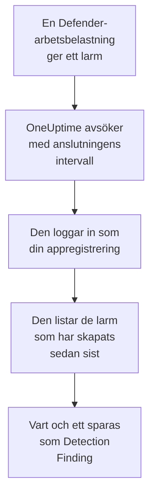

# Microsoft Defender XDR

Importera larmen från varje [Microsoft Defender XDR](https://learn.microsoft.com/en-us/defender-xdr/)-arbetsbelastning, från slutpunkter, identiteter, e-post och molnappar, till säkerhetshändelserna i OneUptime. Där söker du i dem bredvid dina loggar, spårningar och mätvärden, korrelerar dem med alla andra källor och larmar jouren för de som spelar roll. OneUptime läser dem via säkerhets-API:et i Microsoft Graph med en appregistrering som du skapar: ingen agent, playbook eller Sentinel-arbetsyta behövs.

:::cards
- [Konfigurera anslutningen](#konfigurera-anslutningen): En appregistrering, en behörighet och anslutningens formulär.
- [Vad som importeras](#vad-som-importeras): Hur varje Defender-larm blir en säkerhetshändelse.
- [Så fungerar avsökningen](#så-fungerar-avsökningen): Det fönster som varje avsökning läser, och vad en upptagen klientorganisation gör med det.
- [Felsökning](#felsökning): Vad varje fel betyder och vad du ska ändra.
:::

## Så fungerar det



Varje minut avsöker OneUptime varje aktiverad anslutning vars avsökningsintervall har passerat. En avsökning loggar in i Microsoft Entra ID som din appregistrering, ber Microsoft Graph om de larm som har skapats sedan förra avsökningen ([List alerts_v2](https://learn.microsoft.com/en-us/graph/api/security-list-alerts_v2)) och sparar vart och ett som en [OCSF](https://schema.ocsf.io/)-händelse av typen Detection Finding (klass `2004`). Identifieringsregler, monitorer och instrumentpaneler behandlar den sedan som en säkerhetshändelse från vilken annan källa som helst.

## Innan du börjar

- I OneUptime rollen Project Owner, Project Admin eller Security Admin. Security Member och Security Viewer kan se anslutningar och deras körningshistorik, men inte ändra dem.
- En Microsoft Entra-klientorganisation med en licens för Microsoft Defender XDR: vilken Defender-arbetsbelastning som helst som är ansluten till Microsoft Defender-portalen, till exempel Defender for Endpoint, for Identity, for Office 365 eller for Cloud Apps.
- En Entra-roll som kan registrera program, till exempel Programadministratör, och en Global administratör eller Administratör för privilegierade roller för att ge administratörsmedgivande.
- Utgående HTTPS från OneUptime-appen och -workerna till `login.microsoftonline.com` och `graph.microsoft.com`, eller till `login.microsoftonline.us` och `graph.microsoft.us` för Azure Government.

## Konfigurera anslutningen

Anslutningen loggar in med [OAuth 2.0-flödet för klientautentiseringsuppgifter](https://learn.microsoft.com/en-us/entra/identity-platform/v2-oauth2-client-creds-grant-flow): som ett program, aldrig som en person, med en enda programbehörighet.

:::steps
### Registrera ett program

1. Logga in på [Azure-portalen](https://portal.azure.com) och öppna **Microsoft Entra ID**.
2. Gå till **App registrations → New registration**. Ge den namnet `OneUptime Security Events`, låt **Supported account types** stå på **Accounts in this organizational directory only**, lämna omdirigerings-URI:n tom och välj **Register**.
3. Kopiera **Program-ID (klient)** och **Katalog-ID (tenant)** från appens sida **Overview**.

### Låt den läsa larm

1. Gå till **API permissions → Add a permission → Microsoft Graph → Application permissions**, välj `SecurityAlert.Read.All` och välj **Add permissions**. Det är den behörighet med minst privilegier som anropet [List alerts_v2](https://learn.microsoft.com/en-us/graph/api/security-list-alerts_v2#permissions) godtar för ett program: lägg inte till `SecurityAlert.ReadWrite.All`.
2. Välj **Grant admin consent for** din klientorganisation och bekräfta. Behörighetens status måste vara **Granted**: utan medgivande avvisas varje läsning med `403`.

### Skapa en klienthemlighet

Gå till **Certificates & secrets → Client secrets → New client secret**, välj när den upphör att gälla och välj **Add**. Kopiera hemlighetens **Value**, inte dess **Secret ID**, innan du lämnar sidan: den visas aldrig igen.

Anteckna när hemligheten upphör att gälla. Den dagen stoppas avsökningen med `Microsoft Defender XDR token request failed (HTTP 401)` tills du ersätter den med **Uppdatera inloggningsuppgifter**.

### Lägg till anslutningen i OneUptime

Öppna **Produkter → Security Events → Anslutningar** (`/dashboard/{projectId}/security-events/connections`), klicka på **Lägg till anslutning**, välj **Microsoft Defender XDR** under **EDR / XDR** och klicka på **Nästa**. Fyll i inställningarna i tabellen nedan, klicka på **Nästa** och klistra in hemlighetens värde i **Klienthemlighet**.

### Testa den innan du sparar

Klicka på **Testa de här inställningarna** under **Testa innan du sparar**. Testet loggar in och läser larm med värdena i formuläret, och sparar ingenting, så en felaktig hemlighet eller ett saknat medgivande syns innan anslutningen finns. Klicka sedan på **Nästa**, ge anslutningen ett **Namn** och skapa den.
:::

| Inställning | Var du hittar den |
| --- | --- |
| **Katalog-ID (tenant)** | Appens sida **Overview**. Klientorganisationens GUID, eller en verifierad domän som `contoso.onmicrosoft.com`. |
| **Program-ID (klient)** | Appens sida **Overview**. GUID:t för den app som har `SecurityAlert.Read.All`. |
| **Moln** | **Offentligt Azure-moln**, som också betjänar Microsoft 365 GCC, eller **Azure Government (USA)** för GCC High (`login.microsoftonline.us` och `graph.microsoft.us`). Microsoft 365 DoD och 21Vianet-molnet i Kina stöds inte. |
| **Klienthemlighet** | Hemlighetens **Value**. Den krypteras, returneras aldrig av API:et och visas aldrig igen. Ersätt den med **Uppdatera inloggningsuppgifter** på anslutningen. |

Steget **Hämtning** har också en valfri **Beskrivning**, **Hämtningsintervall (minuter)**, ett heltal från `1` till `1440` som börjar på `5`, och **Aktiverad**, som börjar påslagen.

## Vad som importeras

Varje [larm](https://learn.microsoft.com/en-us/graph/api/resources/security-alert) från Defender XDR blir en händelse av typen Detection Finding (OCSF-klass `2004`), med leverantören `Microsoft` och produkten `Microsoft Defender XDR`, tillskriven telemetritjänsten `Microsoft Defender XDR`:

| OCSF-kolumn | Fält i larmet |
| --- | --- |
| `eventUid` | `id`, Graph-larmets ID, som även dubbletter tas bort efter |
| `time` | `firstActivityDateTime`, eller `createdDateTime` om det saknas |
| `message`, `ruleName` | `title` |
| `ruleId` | `detectorId`, eller `alertPolicyId` om det saknas |
| `severityName` | `severity`: `informational`, `low`, `medium` eller `high`, och `unknown` förblir Unknown |
| `statusName` | `status`: `new` blir New, `inProgress` In Progress, `resolved` Resolved |
| `mitreTechniques` | `mitreTechniques` |
| `mitreTactics` | `categories` eller `category`, när det är en ATT&CK-taktik: `CredentialAccess` blir `TA0006`. Andra kategorier stannar i `attributes`. |
| `principalHost`, `principalUser`, `principalIp`, `principalProcess` | Den `evidence` som har rollen `source`, `attacker` eller `compromised`, annars den första av varje slag |
| `processName`, `processPath`, `processCommandLine`, `parentProcessName`, `parentProcessPath` | Det processbevis som `principalProcess` kommer från: dess `imageFile`, `processCommandLine` och `parentProcessImageFile`. Graph ger ingen kommandorad för den överordnade processen. |
| `targetHost`, `targetUser`, `targetIp`, `targetResource` | Den `evidence` som har en målroll, till exempel `destination` eller `attacked`. URL:er, postlådor och molnresurser fyller `targetResource`. |
| `observables` | Varje värdnamn, IP, användare, filnamn, SHA-1 och SHA-256, URL, domän, postlåda och resurs-ID i `evidence` |
| `attributes` | Hela larmet, utplattat till nycklar med punkter som `evidence.0.hostName`, `serviceSource` och `incidentId` |

Larm från varje `serviceSource` importeras, även Microsoft Sentinels när Sentinel är anslutet till Defender-portalen. Incidenter importeras inte, men varje larm behåller sitt `incidentId` och sitt `incidentWebUrl` i `attributes`.

## Så fungerar avsökningen

Varje avsökning listar de larm som har skapats i dess fönster, 100 per sida, och följer Graphs `@odata.nextLink` tills den har läst hela fönstret:

```text
GET https://graph.microsoft.com/v1.0/security/alerts_v2?$filter=createdDateTime ge {start} and createdDateTime lt {end}&$top=100
```

- **Skapandetiden är markören.** Defender skapar ofta ett larm timmar efter dess `firstActivityDateTime`, och en markör på aktivitetstiden skulle hoppa över varje sådant larm.
- **Den första avsökningen ser 24 timmar bakåt**, så att en ny anslutning direkt visar sina senaste larm.
- **Varje senare avsökning börjar 1 minut före den sparade markören**, så att ett larm som har skapats på gränsen mellan två fönster läses två gånger och importeras en gång.
- **En avsökning läser högst 24 timmar förbi markören.** En anslutning vars markör har hamnat efter, medan workerna låg nere eller klientorganisationen begränsades, kommer ikapp i en serie fönster på 24 timmar.
- **Dubbletter tas bort efter larmets `id`** bland projektets händelser från `Microsoft` / `Microsoft Defender XDR`, så att överlappningen, ett upprepat fönster och en import aldrig sparar ett larm två gånger.
- **En misslyckad körning ändrar ingenting.** Efter ett nätverksfel, eller en felstatus från Graph, förblir markören och fönsterlängden som de var, och nästa avsökning läser samma fönster igen. Det enda undantaget är en begäran som fick tidsgräns: markören stannar, men nästa fönster är hälften så långt, eftersom ett fönster som är för tungt för att besvaras i tid skulle få tidsgräns vid varje försök.

### När ett fönster innehåller mer än en avsökning kan läsa

En avsökning läser högst 20 sidor med 100 larm: 2 000 larm. När den gränsen stoppar den före slutet av dess fönster blir körningen **Delvis**, med den här varningen:

```text
Stopped after 20 alerts requests (the per-run request limit) before reading the whole window. Microsoft Graph lists alerts newest first and documents no way to sort them oldest first, so this run cannot name a point to resume from.
```

[List alerts_v2](https://learn.microsoft.com/en-us/graph/api/security-list-alerts_v2) dokumenterar `$filter`, `$top`, `$skip` och `$count`, men inte `$orderby`, och returnerar de nyaste larmen först. De 2 000 larm som en stoppad körning läste är de nyaste i dess fönster, så att flytta markören förbi dem skulle hoppa över de äldre som den aldrig nådde. OneUptime gör i stället fönstret kortare:

1. **Smalna av.** Nästa avsökning läser ett fönster som är hälften så långt, från samma startpunkt, och fortsätter att halvera tills ett fönster läses helt, ner till en minut. Körningens varning säger det: `This window holds more records than one poll can read; the next poll reads a {n} minute window from the same starting point.` Larm som redan har importerats från det längre fönstret hoppas över som dubbletter.
2. **Växa igen.** När ett fönster har lästs helt flyttas markören till dess slut, och nästa fönster är dubbelt så långt igen, upp till 24 timmar.
3. **Gå förbi en enda minut.** Om till och med en minut innehåller mer än 2 000 larm går avsökningen förbi den, så att nyare larm fortsätter att komma. Körningen förblir **Delvis**, och **Senaste fel** lyder `More records were created in the one minute from {cursor} to {end} than one poll can read. Polling moved past this minute so newer records keep arriving; use Import this time range in Diagnostics on this minute to recover what one run can read.` Importera den minuten med **Import this time range** för att hämta det som en körning kan läsa.

En körning som är **Delvis** av en annan anledning, till exempel ett larm som inte kunde läsas som en säkerhetshändelse, försöks igen på samma sätt, från samma startpunkt. Att ändra **Hämtningsintervall (minuter)** ändrar inget av detta: det avgör hur ofta en avsökning startar, inte var dess fönster börjar.

### Kör, förhandsgranska och importera vid behov

Klicka på **Diagnostik** på en anslutning för att se dess senaste körningar och arbeta med den manuellt. Alla som kan ändra anslutningen kan starta de här åtgärderna; alla som kan se den kan läsa historiken.

- **Kör nu** startar en avsökning direkt, med den vanliga markören, även när anslutningen inte är **Aktiverad**.
- **Preview alerts** läser ett tidsintervall på upp till 7 dagar och importerar ingenting.
- **Import this time range** importerar ett intervall på upp till 7 dagar, efter att du har bekräftat, utan att flytta markören. Larm som redan har importerats hoppas över.
- **Copy diagnostics** på en körning kopierar dess rapport till supporten. Den innehåller aldrig autentiseringsuppgifter.

## Testa anslutningen

**Testa anslutningen** på en anslutnings rad och **Testa de här inställningarna** i formuläret körs i API-processen, inte i en bakgrundsworker, så att ett test svarar även när det är workerna som är problemet. Det kör de här kontrollerna i ordning:

| Kontroll | Vad den kontrollerar |
| --- | --- |
| **Konfiguration** | De fyra inställningarna finns och är korrekt formaterade. Ingenting kontaktas när detta misslyckas. |
| **Authenticate with Microsoft Entra** | Microsoft Entra ID utfärdar en token för Microsoft Graph, i det moln som du valde. Det misslyckas vid en felaktig eller utgången hemlighet, ett felaktigt klientorganisations- eller klient-ID eller fel moln. |
| **Read alerts from Microsoft Graph** | Ett larm som har skapats de senaste 24 timmarna kan läsas (`$top=1`). En `403` här är den saknade behörigheten `SecurityAlert.Read.All`, det saknade administratörsmedgivandet eller en klientorganisation utan Defender XDR. |
| **Alerts available to import** | Hur många larm som har skapats de senaste 24 timmarna och de senaste 7 dagarna, en sida med 100 för var och en, så `100+` betyder fler. Inga på 7 dagar är en varning, inte ett fel. |
| **Background workers**, **Poll scheduler**, **Security event storage** | OneUptimes egen sida: en process tar jobben från Worker-kön, avsökningsjobbet körs varje minut och lagringen för säkerhetshändelser svarar. |
| **Scheduled polling** | För en sparad anslutning: avsökningen är påslagen, ingen körning har fastnat i väntan på en worker och avsökningar körs i tid. |

Varje begäran i ett test har en tidsgräns på 20 sekunder. Ett test importerar aldrig något och flyttar aldrig markören, och varje kontroll som misslyckas säger vad du ska ändra.

## Felsökning

Anslutningens **Senaste fel** sparar hela felmeddelandet, med autentiseringsuppgifter maskerade, bakom ett prefix som namnger det steg som misslyckades. När en anslutning har ett fel väljer du **Visa fel** i dess kolumn **Åtgärder** för att läsa det, och **Kopiera fel** i dialogrutan för att kopiera det. Läs prefixet först.

:::details Last Error börjar med `Microsoft Defender XDR token request`
- `Microsoft Defender XDR token request failed (HTTP ...)`: Microsoft Entra ID vägrade att utfärda en token, så Graph kontaktades aldrig. Meddelandet slutar med en ledtråd utifrån Entras `error`-kod:
  - `invalid_client` (`AADSTS7000215`): hemligheten är felaktig, har upphört att gälla eller tillhör en annan app. Skapa en ny under **Certificates & secrets** och spara den med **Uppdatera inloggningsuppgifter**.
  - `unauthorized_client` (`AADSTS700016`): **Program-ID (klient)** finns inte i det **Katalog-ID (tenant)**, eller så är **Moln** felaktigt.
  - `AADSTS90002`: den klientorganisationen finns inte.
  - `invalid_scope`: Graph-omfånget finns inte i det moln som du valde. Kontrollera **Moln**.
- `Microsoft Defender XDR token request returned ...`: Microsoft Entra ID svarade med något oanvändbart, en kropp som inte är JSON eller som saknar `access_token`. Det är oftast en proxy eller gateway emellan, inte autentiseringsuppgifterna.
- `Microsoft Defender XDR token request did not complete: ...`: tokenslutpunkten kunde inte nås eller svarade inte i tid. Kontrollera utgående HTTPS från OneUptime-appen och -workerna till `login.microsoftonline.com` eller `login.microsoftonline.us`.
:::

:::details Last Error börjar med `Microsoft Defender XDR alerts request`
- `Microsoft Defender XDR alerts request failed (HTTP ...)`: Graph vägrade att lista larmen. Meddelandet namnger Graphs felkod och en ledtråd:
  - `403` (`Authorization_RequestDenied`): `SecurityAlert.Read.All` eller dess administratörsmedgivande saknas, eller så har klientorganisationen ingen licens för Defender XDR. Medgivandet tar några minuter att börja gälla.
  - `401` (`InvalidAuthenticationToken`) efter att en token har utfärdats: **Moln** passar oftast inte klientorganisationen.
  - `429` (`TooManyRequests`): Graph begränsar appen, och nästa avsökning läser samma fönster igen. Meddelandet kan inte citera Graphs `Retry-After`, eftersom OneUptimes HTTP-klient inte behåller några svarshuvuden vid ett fel. Om det fortsätter höjer du **Hämtningsintervall (minuter)**.
  - `5xx`: ett problem på Graphs sida. Nästa avsökning försöker igen.
  - `400`: Graph ville inte köra frågan, som OneUptime bygger, inte dina inställningar. Kopiera meddelandet till OneUptimes support.
- `Microsoft Defender XDR alerts request returned ...`: Graph svarade `200`, men med något som anslutningen inte kunde använda: en kropp som inte är JSON, ingen lista `value` eller en `@odata.nextLink` som inte är en `https://`-länk på Graph-värden för ditt moln. En sådan länk avvisas, så att token aldrig skickas någon annanstans. Det rapporteras i stället för att tolkas som ett tomt fönster, så att markören aldrig passerar larm som ingen har läst.
- `Microsoft Defender XDR alerts request did not complete: ...`: Graph kunde inte nås eller svarade inte i tid: 60 sekunder för en avsökning, 20 för ett test. Kontrollera utgående HTTPS till `graph.microsoft.com` eller `graph.microsoft.us`.
:::

:::details Testet lyckas, men Last Polled är Never
Avsökningsjobbet har aldrig körts. Läs kontrollerna **Background workers** och **Poll scheduler**. På en egenvärdad installation är den vanliga orsaken `DISABLE_QUEUE_WORKERS=true` på appen, utan en separat worker-distribution som tar jobben: sätt den till `false`, eller kör worker-distributionen (Helm: `worker.enabled: true`, som är `false` som standard).
:::

:::details Avsökningar lyckas, men ett larm som du känner till saknas
Jämför larmets `createdDateTime` i Defender-portalen med körningens fönster i **Diagnostik**: fönster utgår från skapandetid, inte aktivitetstid.

- Ett larm som skapades innan anslutningen fanns är äldre än den första tillbakablicken på 24 timmar. Importera det med **Import this time range**.
- En körning som är **Delvis** stoppades av gränsen på 2 000 larm. Nästa avsökning läser ett kortare fönster från samma start, så larmet importeras så snart ett fönster som innehåller det har lästs helt.
- Om **Senaste fel** namnger en minut som avsökningen gick förbi importerar du den minuten med **Import this time range**.
:::

:::details Samma larm visas två gånger
Överlappningen på 1 minut är inte orsaken: den andra läsningen räknas som en dubblett och sparas inte. Två händelser med samma `eventUid` importerades under olika produkter, till exempel samma larm som också kommer via en Microsoft Sentinel-anslutning. Dubbletter tas bort per leverantör och produkt.
:::

## Vad du får

- **Sök.** Filtrera Defender-larm efter allvarlighetsgrad, status, MITRE-teknik, värd, användare, IP eller vilken observable som helst i utforskaren för säkerhetshändelser, bredvid den värdens loggar och mätvärden.
- **Korrelation.** Varje larms bevis, dess enheter, användare, IP-adresser, filer och URL:er, indexeras som observables, så en sökning hittar allt som nämner en värd i alla källor.
- **Identifieringsregler.** Sigma-regler som körs enligt ett schema över dina säkerhetshändelser och öppnar larm som larmar jouren.
- **Monitorer.** Monitorer för säkerhetshändelser räknar matchande händelser och öppnar incidenter eller larm över en tröskel.

Säkerhetshändelser debiteras som resten av din telemetri, per inmatad GB. Se [Priser](https://oneuptime.com/pricing).

## Nästa steg

:::cards
- [Säkerhetshändelser](/docs/telemetry/security-events): Sök, korrelera och larma på det du importerar.
- [Microsoft Sentinel](/docs/integrations/microsoft-sentinel): Importera även incidenterna från en Sentinel-arbetsyta.
- [Roller](/docs/permissions/reference#roller): Vad Security-rollerna kan se och ändra.
- [Översikt över integrationer](/docs/integrations/index): De andra verktyg som du kan ansluta.
:::
