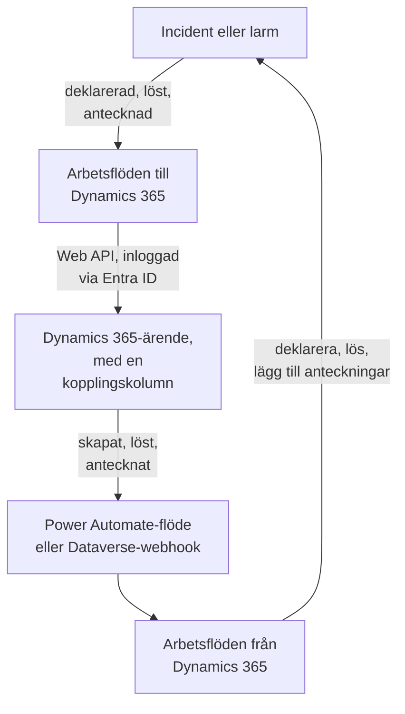

# Microsoft Dynamics 365

Håll [Microsoft Dynamics 365](https://www.microsoft.com/dynamics-365)-ärenden i takt med dina OneUptime-incidenter och -larm, åt båda hållen. Färdiga arbetsflödesmallar skapar ett ärende för varje incident eller larm, stänger det när posten är löst och kopierar anteckningar till det. Andra deklarerar incidenter från nya ärenden och hämtar tillbaka lösningar och anteckningar. Det finns inget plugin: arbetsflödena anropar Dataverse Web API, och Dynamics 365 anropar deras webhook-URL:er.

:::cards
- [Förbered Dynamics 365](#förbered-dynamics-365): En appregistrering, en programanvändare och en kopplingskolumn.
- [Börja från en mall](#börja-från-en-mall): De 13 mallarna, vad de frågar efter och hur du ställer in dem.
- [Så fungerar mallarna](#så-fungerar-mallarna): Hur ärenden och poster förblir kopplade, utan loopar.
- [Bygg det själv](#bygg-det-själv): Varje riktning för hand, när en mall inte passar.
:::

## Så fungerar det



Varje mall är ett litet arbetsflöde, så du tar bara de riktningar du vill ha, för incidenter, larm eller båda. Mallarna OneUptime → Dynamics 365 anropar Dataverse Web API, inloggade som ett program via Microsoft Entra ID. Mallarna Dynamics 365 → OneUptime startar när ett Power Automate-flöde eller en Dataverse-webhook anropar dem. En textkolumn som du lägger till i tabellen Case kopplar varje ärende till sin post.

## Innan du börjar

- En Dynamics 365-miljö med tabellen **Case**. Ärenden kommer från Dynamics 365 Customer Service: en Dataverse-miljö utan det har ingen `incident`-tabell att skriva till.
- Behörighet att registrera ett program i **Microsoft Entra ID** och att skapa en programanvändare i miljön. Det är ofta två olika administratörer.
- I OneUptime behörighet att skapa arbetsflöden. På OneUptime Cloud kräver arbetsflöden **Growth**-abonnemanget eller högre.

> [!NOTE]
> Den här sidan använder Dataverses namn, inte etiketterna på Dynamics-formulären. Ett ärende är tabellen `incident`, dess samling i en URL är `incidents`, dess nyckel är `incidentid` och dess titelkolumn är `title`. Ärendenumret du ser är `ticketnumber`.

## Förbered Dynamics 365

Både mallarna och ett arbetsflöde som du bygger själv behöver detta. OneUptime loggar in som ett program, inte som en person, med OAuth 2.0-flödet för klientautentiseringsuppgifter.

:::steps
### Registrera ett program i Microsoft Entra ID

1. Logga in på [Azure-portalen](https://portal.azure.com) som administratör för klientorganisationen för din Dynamics-miljö och öppna **Microsoft Entra ID**.
2. Gå till **App registrations → New registration**. Ge den namnet `OneUptime Integration`, låt **Supported account types** stå på **Accounts in this organizational directory only** och välj **Register**.
3. Kopiera **Application (client) ID** och **Directory (tenant) ID** från appens sida **Overview**.
4. Gå till **Certificates & secrets → Client secrets → New client secret** och kopiera hemlighetens **Value**, inte dess ID, innan du lämnar sidan: den visas aldrig igen. En klienthemlighet lever högst 24 månader, så anteckna när den löper ut.

Lägg inte till några API-behörigheter och ge inget administratörsmedgivande: utan en inloggad användare gör de ingenting. Dynamics 365 bestämmer vad programmet får göra, via dess programanvändare.

### Skapa programanvändaren

1. Välj **Manage → Environments** i [administrationscentret för Power Platform](https://admin.powerplatform.microsoft.com/) och sedan din miljö.
2. Välj **Settings → Users + permissions → Application users**, sedan **+ New app user** och **+ Add an app**. Välj registreringen och välj **Add**.
3. Välj en **Business unit** och ge den sedan en anpassad säkerhetsroll med redigeringsikonen bredvid **Security roles**. På nivån Organization behöver rollen:
   - **Case**: Create, Read, Write, Append och Append To.
   - **Note**: Create, Read och Append, för anteckningsmallarna.
   - **Activity**: Create, Read och Append, eftersom stängning av ett ärende registrerar en Case Resolution, som är en aktivitet.
   - **Account**, och **Contact** om ärenden skapas i en kontakts namn: Read och Append To.
4. Välj **Save** och sedan **Create**.

En programanvändare kan bara ha en anpassad roll: kopiera en befintlig och skala ner den. Utan den här användaren utfärdar Microsoft Entra ID fortfarande tokens, men varje anrop till Dynamics 365 misslyckas med `403` och `0x80072560`, "The user isn't a member of the organization."

### Lägg till en kopplingskolumn i tabellen Case

Dataverse har inget som liknar Jiras etiketter, så ett ärende och en OneUptime-post hittar varandra via en kolumn som du lägger till.

1. Välj din miljö i [make.powerapps.com](https://make.powerapps.com), öppna **Tables → Case → Columns** och välj **New column**.
2. Ge den namnet `OneUptime Link`, behåll **Data type** som **Single line of text** och spara. Standardmaxlängden på 100 räcker gott: mallarna skriver högst 55 tecken.
3. Öppna den nya kolumnen och kopiera dess **Logical name**, t.ex. `new_oneuptimelink`. Prefixet kommer från din lösnings utgivare, så ditt kan vara annorlunda, t.ex. `cr4f2_oneuptimelink`.

Lägg till kolumnen i formuläret Case om agenterna ska se kopplingen.
:::

## Börja från en mall

Dialogrutan **Skapa ett arbetsflöde** har 13 Dynamics 365-mallar under **Dynamics 365** i kategorilistan: sju för incidenter och sedan sex för larm, varje grupp under sin egen rubrik. De delar kopplingskolumnen, så alla kombinationer av dem fungerar tillsammans.

### Mallar för incidenter

| Mall | Vad den gör | Vad den frågar efter |
| --- | --- | --- |
| **OneUptime → Dynamics 365** | | |
| Create a Dynamics 365 case when an incident is declared | Skapar ett ärende för varje ny incident, med en prioritet som väljs utifrån dess allvarlighetsgrad och incidentens ID i kopplingskolumnen. Incidenter som deklarerats från Dynamics 365, och privata incidenter, hoppas över. | De fem Dynamics 365-inställningarna, kunden för nya ärenden och OneUptime-URL:en |
| Resolve the Dynamics 365 case when the incident is resolved | Stänger det kopplade ärendet som **Problem Solved** när incidenten är löst och registrerar en Case Resolution som när man löser det för hand. Öppnar aldrig ett ärende igen. | De fem Dynamics 365-inställningarna |
| Copy incident private notes to the Dynamics 365 case | Lägger till varje ny privat anteckning i det kopplade ärendet som en anteckning. | De fem Dynamics 365-inställningarna |
| Copy incident public notes to the Dynamics 365 case | Lägger till varje ny offentlig anteckning i det kopplade ärendet som en anteckning, så att agenterna kan berätta för kunderna vad statussidan säger. | De fem Dynamics 365-inställningarna |
| **Dynamics 365 → OneUptime** | | |
| Declare an incident when a Dynamics 365 case is created | Deklarerar en incident för varje nytt ärende, hållen borta från dina statussidor, med en allvarlighetsgrad som väljs utifrån ärendets prioritet, och skriver sedan incidentens ID i ärendets kopplingskolumn. | De fem Dynamics 365-inställningarna och ett flöde eller en webhook för nya ärenden |
| Resolve the incident when its Dynamics 365 case is resolved | Löser incidenten när dess kopplade ärende är löst. | De fem Dynamics 365-inställningarna och ett flöde eller en webhook för statusändringar på ärenden |
| Add Dynamics 365 case notes to the incident as private notes | Kopierar varje anteckning som en agent lägger till i ett kopplat ärende till incidenten som en privat anteckning. | De fem Dynamics 365-inställningarna och ett flöde eller en webhook för nya anteckningar |

### Mallar för larm

Mallarna för larm gör samma jobb för larm. Det finns en färre, eftersom larm inte har offentliga anteckningar, och **Create an alert when a Dynamics 365 case is created** skriver inga statussideinställningar, eftersom ett larm aldrig når en statussida.

| Mall | Vad den gör | Vad den frågar efter |
| --- | --- | --- |
| **OneUptime → Dynamics 365** | | |
| Create a Dynamics 365 case when an alert is created | Skapar ett ärende för varje nytt larm, även varje larm som en monitor utlöser. Larm som skapats från Dynamics 365, och privata larm, hoppas över. | De fem Dynamics 365-inställningarna, kunden för nya ärenden och OneUptime-URL:en |
| Resolve the Dynamics 365 case when the alert is resolved | Stänger det kopplade ärendet som **Problem Solved** när larmet är löst. | De fem Dynamics 365-inställningarna |
| Copy alert private notes to the Dynamics 365 case | Lägger till varje ny privat anteckning i det kopplade ärendet som en anteckning. | De fem Dynamics 365-inställningarna |
| **Dynamics 365 → OneUptime** | | |
| Create an alert when a Dynamics 365 case is created | Skapar ett larm för varje nytt ärende, med en allvarlighetsgrad som väljs utifrån ärendets prioritet, och skriver sedan larmets ID i ärendets kopplingskolumn. | De fem Dynamics 365-inställningarna och ett flöde eller en webhook för nya ärenden |
| Resolve the alert when its Dynamics 365 case is resolved | Löser larmet när dess kopplade ärende är löst. | De fem Dynamics 365-inställningarna och ett flöde eller en webhook för statusändringar på ärenden |
| Add Dynamics 365 case notes to the alert as private notes | Kopierar varje anteckning som en agent lägger till i ett kopplat ärende till larmet som en privat anteckning. | De fem Dynamics 365-inställningarna och ett flöde eller en webhook för nya anteckningar |

Ingen av mallarna OneUptime → Dynamics 365 skickar en incident markerad som **Privat incident**, eller ett larm markerat som **Privat larm**, till Dynamics 365: varken posten, dess status eller dess anteckningar, om du inte slår på det. Se [Ändra vad en mall gör](#ändra-vad-en-mall-gör).

**Monitorer utlöser larm av sig själva, och det kan bli många.** **Create a Dynamics 365 case when an alert is created** skapar ett ärende för vart och ett. Om inte varje larm förtjänar ett ärende placerar du ett **If / Else**-block mellan utlösaren och resten av arbetsflödet, till exempel på `{{local.components.alert-on-create-1.returnValues.model.alertSeverity.name}}`, och kopplar bara dess **Yes**-sida vidare.

### Vad mallarna frågar efter

Steget **Konfigurera** i skapandeguiden frågar efter upp till sju värden: varje mall frågar efter de första fem, Dynamics 365-inställningarna, och de två mallar som skapar ett ärende frågar också efter de två sista. Steget kontrollerar formen på varje Dynamics 365-inställning innan något skapas och säger vad du ska skriva i stället, eftersom ett värde med fel form inte ger fel någonstans förrän vid en körning.

- **Dynamics 365 Environment URL** — din miljös adress, t.ex. `https://yourorg.crm.dynamics.com`, från [administrationscentret för Power Platform](https://admin.powerplatform.microsoft.com/) under **Environments**, din miljö, **Environment URL**. Bara adressen: inte Web API-slutpunkten, som slutar med `/api/data/v9.2`, och inget snedstreck på slutet.
- **Directory (Tenant) ID** — från appregistreringens sida **Overview**.
- **Application (Client) ID** — från samma sida.
- **Client Secret Value** — klienthemlighetens **Value** från **Certificates & secrets**. Inte dess **Secret ID**, som är ett GUID: guiden avvisar ett GUID här.
- **Case Link Column** — kopplingskolumnens logiska namn, t.ex. `new_oneuptimelink`.
- **Customer for New Cases** — bara de två mallar som skapar ett ärende frågar efter den. Varje ärende behöver en kund, och en OneUptime-incident har ingen, så alla nya ärenden skapas i en kunds namn: klistra in ID:t för ett konto, eller `contacts(<id>)` för en kontakt. Öppna posten i Dynamics 365: dess ID är delen efter `id=` i adressen.
- **OneUptime URL** — bara de två mallar som skapar ett ärende frågar efter den: adressen du öppnar OneUptime på, t.ex. `https://oneuptime.com`. Ärendets beskrivning länkar med den tillbaka till incidenten eller larmet.

**Så loggar mallarna in.** Guiden sparar klientorganisationen, klient-ID:t och hemligheten i en enda [OAuth 2.0-variabel](/docs/workflows/variables#oauth-20-variabler-token-som-förnyar-sig-själva), `dynamicsAccessToken`, under arbetsflödets **Arbetsflödesvariabler**: Client Credentials, token-URL:en `https://login.microsoftonline.com/<tenant>/oauth2/v2.0/token`, scopet `<environment URL>/.default` och klienthemligheten, som skickas i begärans innehåll och sparas krypterad. Varje anrop till Dynamics 365 skickar `Authorization: Bearer {{local.variables.dynamicsAccessToken}}`. OneUptime hämtar token första gången ett steg behöver den, hämtar en ny innan den löper ut och ersätter den med `[REDACTED]` i körningsloggar och stegspår.

För att kontrollera inloggningen innan något körs öppnar du **Arbetsflödesvariabler**, klickar på **Visa** vid `dynamicsAccessToken` och klickar på **Uppdatera nu**. **Access Token Fetched** betyder att appregistreringen är rätt. Annars säger felet från Microsoft Entra ID vad som är fel, t.ex. `AADSTS7000215: Invalid client secret provided`.

Varje arbetsflöde har sin egen kopia. När du byter ut klienthemligheten öppnar du `dynamicsAccessToken` i varje Dynamics 365-arbetsflöde och använder **Uppdatera inloggningsuppgifter**.

### Skapa arbetsflödena

:::steps
1. Öppna **Arbetsflöden → Skapa arbetsflöde**. Välj **Dynamics 365** i kategorilistan under **Eller börja från en mall**, eller skriv `Dynamics` i **Sök mallar…**, och klicka på mallen du vill ha. Den öppnas och visar vad den gör och vilka inställningar den kommer att fråga efter. Klicka på **Använd den här mallen**.
2. **Namn** fylls i från mallen. Ändra det om du vill.
3. **Konfigurera** frågar efter värdena ovan.
4. Klicka på **Skapa arbetsflöde**. Varje arbetsflöde skapas avstängt: slå på **Aktiverad** högst upp i dess **Byggare**.
:::

Börja med **Create a Dynamics 365 case when an incident is declared**, eller **Create a Dynamics 365 case when an alert is created** för larm: alla andra mallar OneUptime → Dynamics 365 av samma slag hittar ärendet via kopplingen som den här skriver. Slå på den, deklarera en testincident eller skapa ett testlarm, och öppna arbetsflödets **Loggar → Körningar**. Körningen ska sluta som **Utförd**, och **Response Body** i dess sista steg, `create-case-1`, innehåller det nya ärendets `ticketnumber`, till exempel `CAS-01001-X1Y2Z3`.

### Anslut mallarna Dynamics 365 → OneUptime

Mallarna Dynamics 365 → OneUptime, tre för incidenter och tre för larm, startar från en [Webhook-utlösare](/docs/workflows/triggers#webhook), så Dynamics 365 måste få veta vart händelserna ska skickas. Gör det i den här ordningen:

1. Skapa arbetsflödet och **slå på det först**. Ett arbetsflöde som är avstängt nekar leveranser, och de köas inte.
2. Öppna arbetsflödets **Byggare**, klicka på utlösarblocket **Webhook** (`webhook-1`) och klicka på **Kopiera URL** högst upp i dess inställningar. URL:en ser ut så här:

   ```text
   https://<your OneUptime host>/workflow/trigger/<webhook secret key>
   ```

3. Låt Dynamics 365 skicka till den, från ett Power Automate-flöde eller från en Dataverse-webhook.

Varje mall behöver bara veta vilken rad som ändrades. Den läser raden igen från Dynamics 365 innan den gör något, så den tar aldrig ett ärendes titel, status eller koppling från begäran, och det spelar ingen roll vilken av de två som skickar den.

:::tabs
@tab Power Automate flow
Skapa i [Power Automate](https://make.powerautomate.com) ett **Automated cloud flow** med **Microsoft Dataverse**-utlösaren **When a row is added, modified or deleted**, inställd som nedan, med **Scope** inställt på **Organization**. Lägg till den inbyggda åtgärden **HTTP**: **Method** `POST`, **URI** arbetsflödets URL, en `Content-Type: application/json`-rubrik och innehållet nedan, med radens ID valt från utlösarens dynamiska innehåll.

| Mall | Change type | Table name | Select columns | Body |
| --- | --- | --- | --- | --- |
| Deklarera en incident / skapa ett larm när ett ärende skapas | Added | Cases | | `{"PrimaryEntityId": "<Case>"}` |
| Lös incidenten / larmet när dess ärende löses | Modified | Cases | `statecode,statuscode` | `{"PrimaryEntityId": "<Case>"}` |
| Lägg till ärendeanteckningar i incidenten / larmet som privata anteckningar | Added | Notes | | `{"PrimaryEntityId": "<Note>"}` |

För att bara skicka vissa ärenden använder du utlösarens **Filter rows**, t.ex. `prioritycode eq 1` för ärenden med hög prioritet. Brödtexten anger raden som `PrimaryEntityId`, som en Dataverse-webhook gör: mallarna läser själva raden tillbaka från Dynamics 365.
@tab Dataverse webhook
Registrera URL:en med [Plug-in Registration Tool](https://learn.microsoft.com/en-us/power-apps/developer/data-platform/register-web-hook): **Register New WebHook**, med **HttpHeader**-autentisering och en egen rubrik; själva URL:en är hemligheten. Registrera sedan ett steg på den för varje händelse nedan, med **Event Pipeline Stage of Execution** inställt på **PostOperation** och **Execution Mode** på **Asynchronous**.

| Mall | Message | Primary Entity | Filtering Attributes |
| --- | --- | --- | --- |
| Deklarera en incident / skapa ett larm när ett ärende skapas | `Create` | `incident` | |
| Lös incidenten / larmet när dess ärende löses | `Close`, och `Update` för statusändringar som andra gör | `incident` | `statecode, statuscode` (Update) |
| Lägg till ärendeanteckningar i incidenten / larmet som privata anteckningar | `Create` | `annotation` | |

När ett ärende löses utlöses meddelandet **Close**, inte **Update**, och därför behöver den mallen båda. En webhook skickar plugin-programmets körningskontext, som anger raden i `PrimaryEntityId`, eller för **Close** i dess `IncidentResolution`, och mallarna läser den därifrån. En Dataverse-webhook anropar bara portarna 80 och 443 och har inget eget radfilter: varje nytt ärende når skapandemallen, om du inte avgränsar den med `ONLY_PRIORITIES`.
:::

Innan du förlitar dig på någon av dem:

- **Alla som har URL:en kan utlösa arbetsflödet.** Eftersom mallarna läser varje rad igen från Dynamics 365 kan en begäran bara få dem att titta på ett riktigt ärende eller en riktig anteckning. Den kan ändå få skapandemallarna att agera på ett ärende som inte är kopplat än. Ha bara URL:en i flödet eller webhooken. Om den läcker klickar du på **Webhook**-utlösaren i arbetsflödets **Byggare**, klickar på **Återställ URL** och klistrar in den nya URL:en i flödet eller webhooken. Den gamla URL:en slutar fungera direkt.
- **Varje händelse är en körning**, även de som en mall hoppar över. På OneUptime Cloud räknas var och en mot ditt abonnemangs arbetsflödeskörningar, och filtrering i flödet håller antalet nere. Se [Abonnemangsgränser](/docs/workflows/configuration#plangränser).
- **Använder du båda mallarna som skapar en post från ett ärende?** **Declare an incident when a Dynamics 365 case is created** och **Create an alert when a Dynamics 365 case is created** agerar båda på varje ärende de får. Var och en kontrollerar kopplingskolumnen först, men två leveranser för ett nytt ärende kommer samtidigt, så ärendet kan få både en incident och ett larm. Skicka olika ärenden till de två, till exempel efter ärendetyp.

### Kontrollera att det fungerar

Varje körnings **Steg** säger vad mallen gjorde, så öppna körningen i **Loggar → Körningar** och se hur den slutade:

- **Utförd**: den gjorde sitt jobb, och dess sista steg nämner ärendet, incidenten eller larmet.
- **Utförd**, med steget **Check With JavaScript** på **No**: den hoppade över händelsen med flit, och steget säger varför: ärendet är inte kopplat till en post av det här slaget, anteckningen kom från den andra sidan, posten är privat, eller den nya statusen stänger inte ärendet.
- **Fel**: ett steg misslyckades, och dess post under **Steg** säger varför. Vid ett Dynamics 365-anrop ingår svaret från Dynamics 365.
- **Fel** vid `link-case-1`: en mall som skapar en post från ett ärende skapade den, men Dynamics 365 tog inte emot kopplingen, så de andra mallarna kan inte hitta den än. Skriv in kopplingen i ärendets kolumn för hand.

Om en körning stannar vid det första Dynamics 365-steget med `Could not get an OAuth 2.0 access token for {{local.variables.dynamicsAccessToken}}` är inloggningsinställningarna fel, och meddelandet citerar svaret från Microsoft Entra ID. Se [Vad mallarna frågar efter](#vad-mallarna-frågar-efter).

## Så fungerar mallarna

### Så förblir de två sidorna kopplade

Ärendet håller kopplingen. Ett ärende som hör till en incident har `oneuptime-incident-<incident id>` i sin kopplingskolumn, och ett som hör till ett larm har `oneuptime-alert-<alert id>`. ID:t är den sista delen av postens adress i instrumentpanelen.

Mallarna som skapar ett ärende skriver den när de skapar ärendet, och mallarna som skapar en post från ett ärende skriver den så snart posten finns. Alla andra mallar korsar över via den: de från OneUptime → Dynamics 365 slår upp ärendet via dess koppling, och de från Dynamics 365 → OneUptime läser postens ID från ärendet. För att koppla ett ärende som skapats för hand skriver du in värdet i dess kopplingskolumn själv, men bara när posten inte har något ärende än.

**Ett ärende är kopplat till en incident eller ett larm, aldrig båda.** En kolumn används för båda slagen. Mallarna för incidenter ignorerar ett ärende som är kopplat till ett larm, och omvänt, och mallarna som skapar en post från ett ärende lämnar alla ärenden vars kopplingskolumn innehåller något alls i fred.

**En post har ett ärende.** Mallarna som skriver till ett ärende agerar bara när exakt ett ärende innehåller postens koppling. Om kopplingen kopieras till ett andra ärende stannar de, och varje körning slutar med ett överhopp som nämner båda:

```text
More than one Dynamics 365 case holds the link oneuptime-incident-<id> (CAS-01001-X1Y2Z3, CAS-01002-K4L5M6). Clear it on every case except the one opened for the incident.
```

Incidenter och larm som skapats från ett ärende sparar också ärendets ID och nummer i `customFields.dynamicsCaseId` och `customFields.dynamicsCaseNumber`, som skrivs när de skapas. Det är så mallarna som skapar ett ärende vet att posten redan har ett.

### Så undviker mallarna loopar

Varje skrivning i en riktning är en händelse i den andra: en anteckning som läggs till i ett ärende kommer tillbaka som en ny anteckning, och en privat anteckning som läggs till i OneUptime utlöser anteckningsutlösaren. Fyra saker stoppar ekot:

- **Markörer i texten.** Varje anteckning som mallarna lägger till i ett ärende har titeln `Synced from OneUptime: …`, och det har också ämnet på varje Case Resolution som de registrerar. Varje anteckning som skrivs från Dynamics 365, och grundorsaken till varje statusändring som görs därifrån, börjar med `Synced from Dynamics 365`. Varje riktning hoppar över text som har den andra sidans markör, även i en anteckning som någon skrev och som citerar en.
- **Kopplingen från första sparningen.** Ett ärende som OneUptime skapar har sin koppling från det ögonblick det finns, så när dess **Create** kommer tillbaka hittar mallen som skapar en post från ett ärende det kopplat och gör ingenting.
- **`customFields.dynamicsCaseId`.** En post som skapats från ett ärende har detta fält, och mallarna som skapar ett ärende hoppar över sådana poster.
- **Statusar går bara framåt, på båda sidor.** När posten löses stängs ärendet, och ärendets **Close** hittar då posten redan löst. När ärendet löses först löses posten, och dess uppdatering hittar ärendet redan stängt. Ett ärende som redan är löst eller avbrutet öppnas aldrig igen.

Behåll markörerna när du redigerar mallarna. De är konstanterna `FROM_ONEUPTIME` och `FROM_DYNAMICS` i hjälpblocket högst upp i varje skript.

### Ändra vad en mall gör

Öppna arbetsflödets **Byggare** och klicka på blocket du vill ändra. De inställningar du troligast vill ändra är konstanter högst upp i ett skript, **JavaScript Code** i ett **Check With JavaScript**-block, precis under det delade hjälpblocket. Versionerna för incidenter och för larm har samma konstanter i samma block.

| Konstant | Mall och block | Vad den styr |
| --- | --- | --- |
| `SYNC_PRIVATE_INCIDENTS`, `SYNC_PRIVATE_ALERTS` | Varje mall OneUptime → Dynamics 365 — `prepare-case-1`, `plan-case-1`, `build-note-1` | `false` håller privata poster utanför Dynamics 365: inget ärende skapas för dem, deras ärende ändras inte, och deras anteckningar läggs inte till. Ställ in den på `true` i varje mall som ska skicka dem. |
| `SEVERITY_TO_PRIORITY`, `DEFAULT_PRIORITY` | Skapa ett Dynamics 365-ärende — `prepare-case-1` | Projektets allvarlighetsgrader fördelas över ärendeprioriteterna efter sin ordning: den allvarligaste skapar ett High-ärende (`1`), den minst allvarliga ett Low-ärende (`3`), och de däremellan Normal-ärenden (`2`). Ange en allvarlighetsgrad efter namn, med gemener, för att välja dess prioritet själv, t.ex. `{ 'major incident': 1 }`. `DEFAULT_PRIORITY` (`2`) gäller för en allvarlighetsgrad som projektets lista inte har, eller ett projekt med bara en. |
| `CASE_ORIGIN`, `CASE_TYPE` | Skapa ett Dynamics 365-ärende — `prepare-case-1` | Det nya ärendets `caseorigincode` (`3`, Web) och `casetypecode` (`2`, Problem). För att ställa in någon annan kolumn lägger du till den i `CASE` i samma skript, under dess logiska namn. |
| `MAX_TITLE_LENGTH`, `MAX_DESCRIPTION_LENGTH` | Skapa ett Dynamics 365-ärende — `prepare-case-1` | Tabellen Cases egna gränser, 200 och 2000 tecken. Beskrivningen behåller länken tillbaka till OneUptime hur mycket som än kortas. Höj dem om din tabell Case tillåter mer. |
| `RESOLVED_CASE_STATUS` | Lös Dynamics 365-ärendet — `plan-case-1` | Statusen som en löst post stänger sitt ärende med: `5` är Problem Solved, `1000` Information Provided. |
| `STATE_TO_CASE_STATUS` | Lös Dynamics 365-ärendet — `plan-case-1` | Stänger ärendet med en annan löst status vid en egen löst status, efter statusens namn: `{ Closed: 1000 }` stänger det som Information Provided. Bara när posten löses ändras dess ärende: en aktiv status som Researching sätts aldrig. |
| `PRIORITY_RANK` | Skapa från ett Dynamics 365-ärende — `prepare-incident-1`, `prepare-alert-1` | Kopplar en ärendeprioritet (`1` High, `2` Normal, `3` Low) till `0` (din högsta allvarlighetsgrad), `1` eller `2` (den lägsta). Prioriteter som inte står här hamnar i mitten. Med de två allvarlighetsgrader för larm som ett nytt projekt har blir Normal till Low om du inte ändrar `2: 1` till `2: 0`. |
| `ONLY_PRIORITIES` | Skapa från ett Dynamics 365-ärende — `prepare-incident-1`, `prepare-alert-1` | Tom tar den alla ärenden som flödet eller webhooken skickar. `[1]` skapar bara poster för ärenden med hög prioritet. |
| `CASE_STATUS_TO_STATE`, `CASE_STATE_TO_STATE_FLAG` | Lös när Dynamics 365-ärendet är löst — `decide-state-1` | En ärendestatus, efter namn, till en OneUptime-status, t.ex. `{ Researching: 'Acknowledged' }`. Annars avgör ärendets tillstånd: Resolved löser posten. Lägg till `2: 'isResolvedState'` för att också lösa den när dess ärende avbryts. |
| `MESSAGES` | Varje mall Dynamics 365 → OneUptime — `read-event-1`, eller `prepare-incident-1` och `prepare-alert-1` | Händelserna som mallen agerar på. Lägg till `'Update'` i anteckningsmallens lista för att också kopiera redigerade anteckningar: varje redigering blir en ny anteckning. |
| `MAX_NOTE_LENGTH` | Anteckningsmallarna — `build-note-1`, `read-note-1` | Den längsta anteckning som var och en skriver: 100 000 tecken till Dynamics 365, vilket är en antecknings egen gräns, och 30 000 till OneUptime. |

Status- och statusnamn som används som nycklar måste stavas exakt som de heter, versaler inräknade. Håll `{{` borta från koden: ett skript fylls i som vilken annan inställning som helst innan det körs, så två öppnande klammerparenteser i rad skulle läsas som en referens.

### Begränsningar

- **Microsofts kommersiella moln.** Token-URL:en är `login.microsoftonline.com`. För molnen US Government (GCC High, DoD) eller Kina öppnar du `dynamicsAccessToken`, använder **Redigera inställningar** och ändrar token-URL:en till inloggningsvärden för ditt moln, t.ex. `login.microsoftonline.us`.
- **Dynamics 365 kan vägra att lösa ett ärende.** Dina Customer Service-inställningar kan hindra att ett ärende löses medan det har öppna aktiviteter eller öppna underordnade ärenden, och en affärsregel eller ett plugin-program kan också neka det. Körningen misslyckas vid `close-case-1`, med orsaken från Dynamics 365, och ärendet förblir som det var.
- **Poster och ärenden går aldrig bakåt.** Att öppna ett ärende igen ändrar ingenting i OneUptime, och en löst post öppnas aldrig igen. Ett ärende som redan är löst eller avbrutet öppnas aldrig igen för att stängas på nytt.
- **Anteckningar och beskrivningar är oformaterad text.** En anteckning som skrivits i Dynamics 365s redigerare för formaterad text kommer in i OneUptime som texten den visar, och det gör även en ärendebeskrivning som skrivits i redigeraren eller hämtats från ett e-postmeddelande: stycken och radbrytningar behålls, medan formatering, bilder och e-postmeddelandets egna format försvinner. En OneUptime-anteckning kommer fram i Dynamics 365 som sina råa tecken, Markdown och allt. Text från Dynamics 365 — ett ärendes titel och beskrivning, en anteckning, namnen på statusar, prioriteter, kunder och personer — läses exakt som den skrevs: en bild, en länk, HTML, ett diagram eller ett chattomnämnande som `<!channel>` som skrivits i den visas som sina tecken och gör ingenting, eftersom en osynlig word joiner placeras efter tecknet som skulle starta det. En kopia av texten behåller word joinern. Ett arbetsflöde behåller skripten det skapades med, så ett arbetsflöde som skapats från en äldre version av en mall skriver text som den versionen gjorde: skapa det igen från mallen för att få detta. Bilagor stannar i Dynamics 365; anteckningen i OneUptime nämner filen.
- **Redigerade anteckningar kopieras inte**, bara nya, om du inte lägger till `'Update'` i `MESSAGES`.
- **Privata incidenter och larm stannar i OneUptime**, men mallarna Dynamics 365 → OneUptime kontrollerar inte detta: anteckningar och statusändringar på ett kopplat ärende når fortfarande en privat post.
- **Varje ärende får en post.** Om du inte filtrerar flödet eller ställer in `ONLY_PRIORITIES` skapar mallarna som skapar en post från ett ärende en incident eller ett larm för varje nytt ärende de får. I en livlig kundtjänstmiljö blir det många.
- **Samma händelse kan komma två gånger.** En Dataverse-webhook försöker igen en gång när OneUptime svarar `502`, `503` eller `504`. Ett upprepat **Create** som kommer efter att den första körningen kopplat ärendet lämnas i fred. Ett som kommer medan den första körningen fortfarande pågår kan skapa en andra post.

## Bygg det själv

Mallarna täcker de vanliga fallen. För att bygga en riktning själv bygger det här avsnittet båda för hand, för incidenter, efter [Förbered Dynamics 365](#förbered-dynamics-365). [Gör samma sak för larm](#gör-samma-sak-för-larm) överför det till larm.

### Logga in med en OAuth 2.0-variabel

Skapa token en gång, för alla arbetsflöden, som en [OAuth 2.0-variabel](/docs/workflows/variables#oauth-20-variabler-token-som-förnyar-sig-själva):

1. Gå till **Arbetsflöden → Globala variabler**, öppna menyn **Mer** (**⋯**) bredvid **Skapa Arbetsflöde Variabel** och välj **Create OAuth 2.0 Variable**. Ge den namnet `DYNAMICS_TOKEN`.
2. Välj **Microsoft Entra ID** under **Leverantör**, ersätt `{tenant-id}` i **Token-URL** med ditt Directory (tenant) ID och välj **Client Credentials**.
3. Ange **Klient-ID** och **Klienthemlighet** under **Autentiseringsuppgifter**. Ställ in scopet på `https://yourorg.crm.dynamics.com/.default` under **Avancerad** och skapa sedan variabeln.

Alla block skickar då `Bearer {{global.variables.DYNAMICS_TOKEN}}` i sin `Authorization`-rubrik. OneUptime hämtar token, hämtar en ny innan den löper ut och håller den borta från körningsloggarna.

Scopet måste vara din miljö-URL följd av `/.default`. En felaktig miljö-URL är den vanliga orsaken till `AADSTS70011: The provided value for the input parameter 'scope' is not valid`.

### Skapa ett ärende för varje incident

:::steps
1. Skapa ett arbetsflöde från grunden som heter `Incidents to Dynamics 365`. Klicka på det streckade blocket och lägg till utlösaren **On Create Incident**. Dess **Fields to pass on** börjar med **Titel**: klicka på **Lägg till fält** och välj **Beskrivning** och **Incidentnummer**. ID:t skickas alltid vidare.
2. Klicka på **Lägg till komponent**, lägg till ett **API Post (JSON)**-block och koppla utlösarens **Success**-punkt till det. Ställ in dess **Identifier** på `create-case` och dess **URL** på `https://yourorg.crm.dynamics.com/api/data/v9.2/incidents?$select=incidentid,ticketnumber`.
3. Ställ in dess **Request Headers** under **Fler fält** på:

   ```json
   {
     "Authorization": "Bearer {{global.variables.DYNAMICS_TOKEN}}",
     "OData-MaxVersion": "4.0",
     "OData-Version": "4.0",
     "Accept": "application/json",
     "If-None-Match": "null",
     "Prefer": "return=representation"
   }
   ```

4. Ställ in dess **Request Body** på ärendet, med GUID:t för kontot som dina ärenden hör till:

   ```json
   {
     "title": "OneUptime #{{local.components.incident-on-create-1.returnValues.model.incidentNumber}}: {{local.components.incident-on-create-1.returnValues.model.title}}",
     "description": "{{local.components.incident-on-create-1.returnValues.model.description}}",
     "caseorigincode": 3,
     "prioritycode": 1,
     "new_oneuptimelink": "oneuptime-incident-{{local.components.incident-on-create-1.returnValues.model._id}}",
     "customerid_account@odata.bind": "/accounts(00000000-0000-0000-0000-000000000000)"
   }
   ```

5. Slå på **Aktiverad**, deklarera en testincident och öppna **Loggar → Körningar**. Steget `create-case` visar en `201` och ett innehåll med det nya `incidentid` och `ticketnumber`.
:::

Varje ärende behöver en kund, så `customerid` är obligatoriskt. Det kan peka på ett konto eller en kontakt, och därför skriver du `customerid_account@odata.bind` eller `customerid_contact@odata.bind`, stavat exakt. `Prefer: return=representation` gör svaret till `201` med själva ärendet, så att nästa block kan läsa `{{local.components.create-case.returnValues.response-body.incidentid}}`. Utan den svarar Dynamics 365 `204` utan innehåll.

`new_oneuptimelink` är kopplingskolumnen från [Förbered Dynamics 365](#förbered-dynamics-365), med samma värde som mallarna skriver, så att dina arbetsflöden och mallarna hittar varandras ärenden. Använd din kolumns logiska namn.

### Koppla prioritet och status

Dynamics 365 levereras med `severitycode` med ett enda alternativ, så ställ in `prioritycode` i stället, och förgrena på incidentens allvarlighetsgrad med ett **If / Else**-block för en prioritet per allvarlighetsgrad. Skicka de här kolumnerna som tal:

| Kolumn | Värden |
| --- | --- |
| `prioritycode` | `1` High, `2` Normal, `3` Low |
| `caseorigincode` | `1` Phone, `2` Email, `3` Web, `2483` Facebook, `3986` Twitter, `700610000` IoT |
| `casetypecode` | `1` Question, `2` Problem, `3` Request |
| `statecode` | `0` Active, `1` Resolved, `2` Cancelled |
| `statuscode` | `1` In Progress, `2` On Hold, `3` Waiting for Details, `4` Researching, `5` Problem Solved, `6` Cancelled, `1000` Information Provided, `2000` Merged |

`statuscode` kan anpassas, så din miljö kan ha egna värden.

### Lös ärendet när incidenten löses

Bygg detta som ett andra arbetsflöde, så att ett fel här aldrig hindrar att ärenden skapas.

:::steps
1. Skapa ett arbetsflöde som heter `Close Dynamics 365 cases`, med utlösaren **On Update Incident**. Klicka på **Lägg till fält** i **Fields to watch** och välj **Current Incident State**. Klicka på **Lägg till fält** i **Fields to pass on**, öppna **Current Incident State** och välj **Is Resolved State**.
2. Lägg till ett **If / Else**-block: **Value to check** `{{local.components.incident-on-update-1.returnValues.model.currentIncidentState.isResolvedState}}`, **Comparison** **is true**.
3. Lägg efter dess **Yes**-sida till ett **API Get (JSON)**-block med **Identifier** `find-case`, samma rubriker utan `Prefer` och denna **URL**:

   ```text
   https://yourorg.crm.dynamics.com/api/data/v9.2/incidents?$select=incidentid&$filter=new_oneuptimelink%20eq%20'oneuptime-incident-{{local.components.incident-on-update-1.returnValues.model._id}}'
   ```

4. Lägg efter det till ett **API Post (JSON)**-block till `https://yourorg.crm.dynamics.com/api/data/v9.2/CloseIncident`, med samma rubriker och detta innehåll:

   ```json
   {
     "IncidentResolution": {
       "@odata.type": "Microsoft.Dynamics.CRM.incidentresolution",
       "subject": "Resolved in OneUptime",
       "incidentid@odata.bind": "/incidents({{local.components.find-case.returnValues.response-body.value[0].incidentid}})"
     },
     "Status": 5
   }
   ```
:::

URL:en skickas exakt som den är skriven, så blankstegen i `$filter` skrivs som `%20`. En fråga svarar med en `value`-lista, och `value[0]` är dess första ärende. `Status` är en `statuscode` för tillståndet Resolved: `5` är Problem Solved.

Använd `CloseIncident` för att lösa, i stället för en `PATCH` av `statecode`: den registrerar den Case Resolution som ett löst ärende förväntas ha, och en `PATCH` nekas där en administratör har konfigurerat statusövergångar. För allt annat, som en prioritet eller en titel, skickar du ett **API Patch (JSON)**-block till `https://yourorg.crm.dynamics.com/api/data/v9.2/incidents(<the case id>)` med en `If-Match: *`-rubrik, som hindrar det från att skapa ett nytt ärende, och bara de kolumner du ändrar.

### Ta emot ändringar från Dynamics 365

Bygg först det mottagande arbetsflödet:

1. Skapa ett arbetsflöde som heter `Dynamics 365 to OneUptime`, med utlösaren **Webhook**.
2. Öppna arbetsflödets **Byggare**, klicka på **Webhook**-utlösaren och klicka på **Kopiera URL** högst upp i dess inställningar. URL:en ser ut så här:

   ```text
   https://oneuptime.com/workflow/trigger/<webhook secret key>
   ```

   På en egenhostad installation har URL:en din egen värd. Behandla URL:en som ett lösenord: alla som har den kan starta arbetsflödet. Om den läcker klickar du på **Återställ URL** på samma ställe, och den gamla URL:en slutar fungera direkt.

3. Lägg till ett **If / Else**-block som kontrollerar en delad hemlighet före allt annat: **Value to check** `{{local.components.webhook-1.returnValues.request-headers.x-oneuptime-secret}}`, **Comparison** **is equal to**, **Compare with** ett värde som du hittar på, sparat i en hemlig global variabel.
4. Lägg efter dess **Yes**-sida till ett **Update One Incident**-block. Ställ in dess **Query** på `{"_id": "{{local.components.webhook-1.returnValues.request-body.oneuptimeIncidentId}}"}`, och dess **Data (JSON Object)** på ändringen, t.ex. ett nytt `currentIncidentStateId`. Ett **Find One Incident State**-block med frågan `{"name": "Resolved"}` ger dig det ID:t som `{{local.components.incident-state-find-one-1.returnValues.model._id}}`.

Slå på det och låt sedan Dynamics 365 anropa det:

:::tabs
@tab Power Automate flow
1. Skapa i [Power Automate](https://make.powerautomate.com) ett **Automated cloud flow** med **Microsoft Dataverse**-utlösaren **When a row is added, modified or deleted**: **Change type** `Modified`, **Table name** `Cases`, **Scope** `Organization` och **Select columns** `statecode,statuscode`, så att det bara utlöses vid statusändringar.
2. Lägg till **Get a row by ID** på `Cases`, med radens ID från utlösaren: en uppdatering innehåller bara de kolumner som ändrades.
3. Lägg till den inbyggda åtgärden **HTTP**: **Method** `POST`, **URI** arbetsflödets URL, rubrikerna `Content-Type: application/json` och `X-OneUptime-Secret: <your secret>`, och ett innehåll som byggs från raden: `oneuptimeIncidentId` är kopplingskolumnen utan `oneuptime-incident-`, t.ex. `replace(<link column>, 'oneuptime-incident-', '')`, bredvid `ticketnumber` och `statecode`.
4. Spara flödet och slå på det.

Microsoft Dataverse-anslutningen är premium: flödets ägare behöver licensen, och flödet stannar om den löper ut. Leveransen tar oftast några sekunder.
@tab Dataverse webhook
1. Registrera arbetsflödets URL med [Plug-in Registration Tool](https://learn.microsoft.com/en-us/power-apps/developer/data-platform/register-web-hook): **Register New WebHook**, med **HttpHeader**-autentisering och rubriken `X-OneUptime-Secret`.
2. Registrera ett steg för meddelandet **Update** på `incident`, med **Filtering Attributes** begränsat till de kolumner du behöver, **PostOperation** och **Asynchronous**.
3. Läs payloaden i arbetsflödet: den är plugin-programmets körningskontext, där `InputParameters` är en lista med `{key, value}`-par och den ändrade raden finns under `Target`. Ett **Run Custom JavaScript**-block är det enklaste sättet att läsa den.

Dataverse anropar bara portarna 80 och 443, väntar 60 sekunder på ett svar och försöker igen en gång, bara vid `502`, `503` och `504`. En uppdatering innehåller bara de kolumner som ändrades, så registrera en post-image för de andra.
:::

### Gör samma sak för larm

Larm fungerar på samma sätt. Byt posttyp, så ändras inget annat:

| Incident | Larm |
| --- | --- |
| **On Create Incident** (`incident-on-create-1`) | **On Create Alert** (`alert-on-create-1`) |
| **On Update Incident** (`incident-on-update-1`) | **On Update Alert** (`alert-on-update-1`) |
| `incidentNumber`, `currentIncidentState`, `incidentSeverity` | `alertNumber`, `currentAlertState`, `alertSeverity` |
| **Find One Incident State** | **Find One Alert State** |
| **Update One Incident** | **Update One Alert** |

Ett arbetsflöde har exakt en utlösare, så incidenter och larm behöver ett arbetsflöde var. För att göra samma Dynamics 365-arbete för båda bygger du det en gång i ett arbetsflöde med en **Manual**-utlösare och startar det från båda med ett **Execute Workflow**-block.

## Felsökning

Öppna det misslyckade steget i **Loggar → Körningar** först. Båda Microsoft-slutpunkterna svarar med ett JSON-innehåll som förklarar problemet, och API-blocket sparar det i `response-body`.

:::details 400 med AADSTS70011, scopet är inte giltigt
Scopet är inte din miljö-URL följd av `/.default`. Kopiera URL:en från administrationscentret för Power Platform och ta bort eventuellt snedstreck på slutet och alla `/api/data/...`-sökvägar.
:::

:::details 401 Unauthorized från Dynamics 365
`Authorization`-rubriken saknas eller är felaktigt utformad. Den måste innehålla `Bearer`, ett blanksteg och sedan token.
:::

:::details 403 Forbidden med 0x80072560
"The user isn't a member of the organization": programanvändaren saknas eller hör till en annan appregistrering. Token är i ordning. Skapa användaren som i [Förbered Dynamics 365](#förbered-dynamics-365).
:::

:::details 403 Forbidden med ett behörighetsfel
Programanvändaren finns, men dess säkerhetsroll saknar en behörighet som anropet behöver, t.ex. Create, Read eller Write på **Case**.
:::

:::details 400 Bad Request om kunden
`customerid` är obligatoriskt. Skicka `customerid_account@odata.bind` eller `customerid_contact@odata.bind`, stavat exakt, med en adress som `/accounts(<guid>)`.
:::

:::details 404 Not Found på CloseIncident
`CloseIncident` följer med Dynamics 365 Customer Service, inte med enbart Dataverse. Sök efter den i din miljös `$metadata`.
:::

:::details 412 Precondition Failed med DuplicateRecord
En regel för dubblettidentifiering gav träff. Avgränsa regeln, eller sluta skicka fältet som den matchar på.
:::

:::details 429 Too Many Requests
Dataverses gränser för tjänsteskydd tillåter ungefär 6 000 begäranden, och 20 minuters körningstid, per användare under en period på fem minuter. Svaret innehåller `Retry-After`, i sekunder. Placera ett **Sleep**-block i ett arbetsflöde som skickar i skurar, eller flytta arbetet till ett schemalagt arbetsflöde.
:::

:::details Inget når OneUptime
Skicka en begäran själv till webhook-URL:en med `curl` och leta upp den i **Loggar → Körningar**. Om din kommer fram och den från Dynamics 365 inte gör det tittar du längre upp i kedjan: flödets egen körningshistorik, eller de misslyckade System Jobs för en Dataverse-webhook.
:::

:::details Arbetsflödet körs, men incidenten ändras inte
Ett **Update One Incident**-block rapporterar `Items Updated: 0` när dess fråga inte matchade något, och det är en framgång, inte ett fel. Kontrollera att ID:t i begäran verkligen är OneUptime-incidentens, och att du frågar på `_id`.
:::

## Nästa steg

:::cards
- [Jira](/docs/integrations/jira): Samma dubbelriktade synkronisering för Jira-ärenden.
- [Arbetsflödesvariabler](/docs/workflows/variables#oauth-20-variabler-token-som-förnyar-sig-själva): OAuth 2.0-variabler och de tokens som de håller färska.
- [Arbetsflödeskonfiguration & säkerhet](/docs/workflows/configuration): Webhooksäkerhet, utgående nätverksåtkomst och abonnemangsgränser.
- [IP-adresser](/docs/configuration/ip-addresses): OneUptimes utgående adresser, om Dynamics 365 står bakom en lista över tillåtna adresser.
:::
