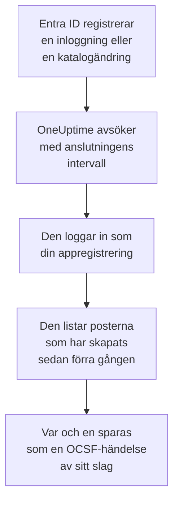

# Microsoft Entra ID

Importera inloggningarna och katalogändringarna i [Microsoft Entra ID](https://learn.microsoft.com/en-us/entra/identity/) till säkerhetshändelserna i OneUptime och, om du vill, aktiviteten i Exchange, SharePoint, OneDrive och Teams från [Microsoft 365-granskningsloggen](https://learn.microsoft.com/en-us/purview/audit-log-activities). Där söker du i dem bredvid dina loggar, spårningar och mätvärden, korrelerar dem med alla andra källor och larmar jouren för de som spelar roll. OneUptime läser dem med en appregistrering som du skapar, och ändrar ingenting i din klientorganisation.

:::cards
- [Konfigurera anslutningen](#konfigurera-anslutningen): En appregistrering, dess behörigheter och anslutningens formulär.
- [Vad som importeras](#vad-som-importeras): Vilka poster, och hur var och en blir en säkerhetshändelse.
- [Så fungerar avsökningen](#så-fungerar-avsökningen): Det fönster som varje avsökning läser, och varför det överlappar det föregående med 30 minuter.
- [Felsökning](#felsökning): Vad varje fel betyder och vad du ska ändra.
:::

## Så fungerar det

Varje minut avsöker OneUptime varje aktiverad anslutning vars avsökningsintervall har passerat. En avsökning loggar in i Microsoft Entra ID som din appregistrering och läser, i den här ordningen, katalogändringarna ([List directoryAudits](https://learn.microsoft.com/en-us/graph/api/directoryaudit-list)) och inloggningarna ([List signIns](https://learn.microsoft.com/en-us/graph/api/signin-list)) som har registrerats sedan förra avsökningen, och sedan, när alternativet **Microsoft 365-granskningslogg** är påslaget, granskningsloggens nya innehåll ([Office 365 Management Activity API](https://learn.microsoft.com/en-us/office/office-365-management-api/office-365-management-activity-api-reference)). Varje post sparas som en [OCSF](https://schema.ocsf.io/)-händelse: en inloggning som en händelse av typen Authentication, en tilldelad roll som en händelse av typen User Access Management, ett nätfiskeutlåtande som ett Detection Finding.

## Innan du börjar

- I OneUptime rollen Project Owner, Project Admin eller Security Admin. Security Member och Security Viewer kan se anslutningar och deras körningshistorik, men inte ändra dem.
- För inloggningar: Microsoft Entra ID P1 eller P2, som ingår i Microsoft 365 E3, E5 och Business Premium: Microsoft Graph ger inloggningar bara till sådana klientorganisationer. Katalogändringar läses i alla klientorganisationer.
- En Entra-roll som kan registrera program, till exempel Programadministratör, och en Global administratör eller Administratör för privilegierade roller för att ge administratörsmedgivande.
- För Microsoft 365-granskningsloggen: granskning påslagen för klientorganisationen, vilket den är som standard: i [Microsoft Purview-portalen](https://purview.microsoft.com) får **Audit** inte erbjuda **Start recording user and admin activity**.
- Utgående HTTPS från OneUptimes app och workers till `login.microsoftonline.com`, `graph.microsoft.com` och `manage.office.com`, eller till `login.microsoftonline.us`, `graph.microsoft.us` och `manage.office365.us` för Azure Government.

## Konfigurera anslutningen

Anslutningen loggar in med [OAuth 2.0-flödet för klientautentiseringsuppgifter](https://learn.microsoft.com/en-us/entra/identity-platform/v2-oauth2-client-creds-grant-flow): som ett program, aldrig som en person, med skrivskyddade behörigheter.

:::steps
### Registrera ett program

1. Logga in i [administrationscentret för Microsoft Entra](https://entra.microsoft.com) och öppna **App registrations**.
2. Välj **New registration**. Ge den namnet `OneUptime Security Events`, låt **Supported account types** stå på **Accounts in this organizational directory only**, lämna omdirigerings-URI:n tom och välj **Register**.
3. Kopiera **Program-ID (klient)** och **Katalog-ID (tenant)** från appens sida **Overview**.

### Låt den läsa loggarna

1. Gå till **API permissions → Add a permission → Microsoft Graph → Application permissions**, välj `AuditLog.Read.All` och välj **Add permissions**. Microsoft dokumenterar att listan över inloggningar också kan kräva `Directory.Read.All`: lägg till den om inloggningar avvisas med `403` när medgivandet har getts.
2. För Microsoft 365-granskningsloggen lägger du till en andra behörighet: **Add a permission → Office 365 Management APIs → Application permissions**, sedan `ActivityFeed.Read`.
3. Välj **Grant admin consent for** din klientorganisation och bekräfta. Varje behörighets status måste vara **Granted**: utan medgivande avvisas varje läsning med `403`.

### Skapa en klienthemlighet

Gå till **Certificates & secrets → Client secrets → New client secret**, välj när den upphör att gälla och välj **Add**. Kopiera hemlighetens **Value**, inte dess **Secret ID**, innan du lämnar sidan: den visas aldrig igen. Den dag den upphör att gälla stoppas avsökningen med `Microsoft Entra ID token request failed (HTTP 401)` tills du ersätter den med **Uppdatera inloggningsuppgifter**.

### Lägg till anslutningen i OneUptime

Öppna **Produkter → Security Events → Anslutningar** (`/dashboard/{projectId}/security-events/connections`), klicka på **Lägg till anslutning**, välj **Microsoft Entra ID** under **Identitet** och klicka på **Nästa**. Fyll i inställningarna i tabellen nedan, klicka på **Nästa** och klistra in hemlighetens värde i **Klienthemlighet**. Slå på **Microsoft 365-granskningslogg** i steget **Hämtning** för att läsa den också.

### Testa den innan du sparar

Klicka på **Testa de här inställningarna** under **Testa innan du sparar**. Testet loggar in och läser varje logg med värdena i formuläret, och sparar ingenting, så en felaktig hemlighet eller ett saknat medgivande syns innan anslutningen finns. Klicka sedan på **Nästa**, ge anslutningen ett **Namn** och skapa den.
:::

| Inställning | Var du hittar den |
| --- | --- |
| **Katalog-ID (tenant)** | Appens sida **Overview**. Klientorganisationens GUID, eller en verifierad domän som `contoso.onmicrosoft.com`. Med **Microsoft 365-granskningslogg** påslaget GUID:t: Management API:et känner bara igen en klientorganisation på det. |
| **Program-ID (klient)** | Appens sida **Overview**. GUID:t för den app som har `AuditLog.Read.All`. |
| **Moln** | **Offentligt Azure-moln**, eller **Azure Government (USA)** för GCC High (`login.microsoftonline.us`, `graph.microsoft.us` och `manage.office365.us`). |
| **Microsoft 365-granskningslogg** | Valfritt, avstängt som standard. Påslaget läser varje avsökning också Microsoft 365-granskningsloggen. Appen behöver `ActivityFeed.Read`. |
| **Klienthemlighet** | Hemlighetens **Value**. Den krypteras, returneras aldrig av API:et och visas aldrig igen. Ersätt den med **Uppdatera inloggningsuppgifter** på anslutningen. |

Steget **Hämtning** har också en valfri **Beskrivning**, **Hämtningsintervall (minuter)**, ett heltal från `1` till `1440` som börjar på `5`, och **Aktiverad**, som börjar påslagen.

## Vad som importeras

Varje händelse har leverantören `Microsoft` och produkten `Microsoft Entra ID`. Dess attribut `entra.log` anger vilken logg en inloggning eller en ändring kom från, och en Microsoft 365-posts `microsoft365.contentType` dess innehållstyp.

| Post | OCSF-klass | Allvarlighetsgrad |
| --- | --- | --- |
| En inloggning som lyckades | Authentication (`3002`), status `Success` | Informational |
| En inloggning som väntar på ett andra steg, till exempel MFA (`50074`, `50076`) eller en uppmaning att byta lösenord | Authentication (`3002`), status `Interrupted` | Informational: ett steg, inte ett fel |
| En inloggning som misslyckades, med Entras orsak och felkod | Authentication (`3002`), status `Failure` | Low |
| En inloggning som Identity Protection bedömde som medelhög eller hög risk | Authentication (`3002`) | Medium eller High |
| En ändrad användare, grupp eller roll, efter dess kategori | Account Change (`3001`), Group Management (`3006`), User Access Management (`3005`), eller Entity Management (`3004`) för resten | Medium för en privilegierad roll, till exempel Global Administrator; Low för en ändring som misslyckades |

Med **Microsoft 365-granskningslogg** påslaget importeras de poster som ett säkerhetsteam agerar på från den, och resten, som en öppnad fil eller ett läst e-postmeddelande, räknas bara:

| Microsoft 365-post | OCSF-klass | Allvarlighetsgrad |
| --- | --- | --- |
| En Exchange-cmdlet, till exempel `New-InboxRule` eller `Set-Mailbox`, en inkorgsregel som skapats i Outlook, eller e-post som skickats som någon annan | API Activity (`6003`) | Medium när den vidarebefordrar e-post, med `microsoft365.forwardsMail` satt till `true` |
| En tilldelad postlådebehörighet, till exempel `Add-MailboxPermission` | User Access Management (`3005`) | Low |
| En fil som delats i SharePoint eller OneDrive | File Hosting Activity (`6006`) | Low med en gäst eller en länk som vem som helst kan öppna, med `microsoft365.sharedOutside` satt till `true` |
| En administratör för en webbplatssamling som lagts till eller tagits bort | User Access Management (`3005`) | Low |
| E-post med skadlig kod eller nätfiske som Microsoft Defender for Office 365 hittat | Detection Finding (`2004`) | High för skadlig kod, Medium för nätfiske |
| Ett larm som Microsoft 365 utlöste | Detection Finding (`2004`) | Larmets egen |
| En app, en bot eller en connector som lagts till i ett team | Application Lifecycle (`6002`) | Low |

Exchanges eget underhåll, som körs som dess systemkonto, utelämnas om det inte vidarebefordrar e-post. Varje händelse behåller hela posten, utplattad till nycklar med punkter som `status.errorCode` eller `Parameters.ForwardTo`, så att en regel läser vilket fält som helst under Microsofts namn på det. Regelbibliotekets regler för Entra ID läser dem så som de importeras här.

Samma inloggningar och katalogändringar kan i stället nå OneUptime som loggar, exporterade av en diagnostikinställning i Azure och lästa av [Dina loggar](/docs/telemetry/security-events#hitta-säkerhetshändelser-i-dina-loggar). Varje post får samma händelse-ID båda vägarna, men en post som läses båda vägarna sparas två gånger: läs Entra ID en väg.

## Så fungerar avsökningen

- **Poster läses efter när Entra ID registrerade dem**, `activityDateTime` för en ändring och `createdDateTime` för en inloggning.
- **Den första avsökningen ser 24 timmar bakåt**, så att en ny anslutning direkt visar sina senaste poster.
- **Varje senare avsökning börjar 30 minuter före den sparade markören.** Microsoft dokumenterar att båda loggarna kommer minuter för sent, så överlappningen läser en försenad post vid nästa avsökning, och dubbletter tas bort efter post-ID inom projektet.
- **En avsökning läser högst 24 timmar förbi markören.** En anslutning vars markör har hamnat efter kommer ikapp i en serie fönster på 24 timmar.
- **En klientorganisation utan Microsoft Entra ID P1 eller P2** importerar sina katalogändringar, och varje körnings kontroll **Read sign-ins** varnar för att inloggningarna inte lästes.
- **En misslyckad körning ändrar ingenting.** Efter ett nätverksfel, eller en felstatus från Graph, förblir markören och fönsterlängden som de var, och nästa avsökning läser samma fönster igen. Det enda undantaget är en begäran som fick tidsgräns: markören stannar, men nästa fönster är hälften så långt, eftersom ett fönster som är för tungt för att besvaras i tid skulle få tidsgräns vid varje försök.

Microsoft 365-granskningsloggen läses efter när Microsoft gjorde varje innehållsblob tillgänglig, en dag i taget, och inte längre bakåt än de 7 dagar Microsoft sparar den. Den första avsökningen prenumererar appen på `Audit.Exchange`, `Audit.SharePoint` och `Audit.General`, och Microsoft gör de första posterna i en ny prenumeration tillgängliga inom 12 timmar. Granskningsloggen stoppar aldrig loggarna från Entra ID: en saknad behörighet är en varning och fönstret går vidare, medan ett fel på Microsofts sida, till exempel `HTTP 503`, gör körningen **Delvis** så att fönstret läses igen.

### När ett fönster innehåller mer än en avsökning kan läsa

Varje logg har en egen budget: 10 sidor med 500 katalogändringar, 20 sidor med 500 inloggningar och, för Microsoft 365-granskningsloggen, 120 begäranden och 10 000 poster. En avsökning stoppar efter 4 minuter. När en budget stoppar en logg före slutet av dess fönster är körningen **Delvis**, och dess varning namnger loggen och budgeten. Microsoft Graph listar de nyaste posterna först, så OneUptime kortar fönstret i stället för att flytta markören förbi poster som den aldrig nådde:

1. **Smalna av.** Nästa avsökning läser ett fönster som är hälften så långt, från samma startpunkt, och fortsätter att halvera tills ett fönster läses helt, ner till en minut. Körningens varning säger det: `This window holds more records than one poll can read; the next poll reads a {n} minute window from the same starting point.` Poster som redan har importerats från det längre fönstret hoppas över som dubbletter.
2. **Växa igen.** När ett fönster har lästs helt flyttas markören till dess slut, och nästa fönster är dubbelt så långt igen, upp till 24 timmar.
3. **Gå förbi en enda minut.** Om till och med en minut innehåller mer än en avsökning kan läsa går avsökningen förbi den, så att nyare poster fortsätter att komma. Körningen förblir **Delvis**, och **Senaste fel** lyder `More records were created in the one minute from {cursor} to {end} than one poll can read. Polling moved past this minute so newer records keep arriving; use Import this time range in Diagnostics on this minute to recover what one run can read.` Importera den minuten med **Import this time range** för att hämta det som en körning kan läsa.

Att ändra **Hämtningsintervall (minuter)** ändrar inget av detta: det avgör hur ofta en avsökning startar, inte var dess fönster börjar.

### Kör, förhandsgranska och importera vid behov

Klicka på **Diagnostik** på en anslutning för att se dess senaste körningar och arbeta med den manuellt. Alla som kan ändra anslutningen kan starta de här åtgärderna; alla som kan se den kan läsa historiken.

- **Kör nu** startar en avsökning direkt, med den vanliga markören, även när anslutningen inte är **Aktiverad**.
- **Preview records** läser ett tidsintervall på upp till 7 dagar och importerar ingenting.
- **Import this time range** importerar ett intervall på upp till 7 dagar, efter att du har bekräftat, utan att flytta markören. Poster som redan har importerats hoppas över. Microsoft Entra ID sparar 30 dagars inloggningar och katalogändringar med P1 eller P2, och 7 dagar utan.
- **Copy diagnostics** på en körning kopierar dess rapport till supporten. Den innehåller aldrig autentiseringsuppgifter.

## Testa anslutningen

**Testa anslutningen** på en anslutnings rad och **Testa de här inställningarna** i formuläret körs i API-processen, inte i en bakgrundsworker, så att ett test svarar även när det är workerna som är problemet. Det kör de här kontrollerna i ordning:

| Kontroll | Vad den kontrollerar |
| --- | --- |
| **Konfiguration** | Varje inställning finns och är korrekt formaterad. Ingenting kontaktas när detta misslyckas. |
| **Authenticate with Microsoft Entra** | Entra ID utfärdar en token för Microsoft Graph till appen, i det moln du valde. |
| **Read sign-ins** | Inloggningar från de senaste 24 timmarna kan läsas. En varning, inte ett fel, i en klientorganisation utan P1 eller P2. |
| **Read directory changes** | Katalogändringar från de senaste 24 timmarna kan läsas. |
| **Read the Microsoft 365 audit log** | Bara med alternativet påslaget: Management API:et svarar, och vilka innehållstyper appen prenumererar på. |
| **Records available to import** | Hur många inloggningar och katalogändringar de senaste 24 timmarna innehåller, högst 500 av varje, så `500+` betyder fler. Inga är en varning. |
| **Background workers**, **Poll scheduler**, **Security event storage** | OneUptimes egen sida: en process tar jobben från Worker-kön, avsökningsjobbet körs varje minut och lagringen för säkerhetshändelser svarar. |
| **Scheduled polling** | För en sparad anslutning: avsökningen är påslagen, ingen körning har fastnat i väntan på en worker och avsökningar körs i tid. |

Varje begäran i ett test har en tidsgräns på 20 sekunder. Ett test importerar aldrig något och flyttar aldrig markören, och varje kontroll som misslyckas säger vad du ska ändra.

## Felsökning

Anslutningens **Senaste fel** sparar hela felmeddelandet, med autentiseringsuppgifter maskerade. När en anslutning har ett fel väljer du **Visa fel** i dess kolumn **Åtgärder** för att läsa det, och **Kopiera fel** i dialogrutan för att kopiera det. Varje meddelande börjar med `Microsoft Entra ID`, namnger sedan begäran som misslyckades, och citerar Microsofts felkod när det finns en.

:::details Senaste fel säger `token request failed`
- `HTTP 401` med `invalid_client`: klienthemligheten är fel eller har upphört att gälla. Skapa en ny och spara den med **Uppdatera inloggningsuppgifter**.
- `HTTP 400` som namnger program-ID:t (klient) eller klientorganisationen: kontrollera båda på appens sida **Overview**, och att **Moln** är klientorganisationens.
:::

:::details Senaste fel säger `sign-ins request failed (HTTP 403)` eller `audit logs request failed (HTTP 403)`
- Felkod `Authorization_RequestDenied`: appen saknar `AuditLog.Read.All`, eller så har medgivandet inte getts. Ge administratörsmedgivande, vänta några minuter och testa igen. För inloggningar ger du också `Directory.Read.All`.
- Felkod `Authentication_RequestFromNonPremiumTenantOrB2CTenant`: klientorganisationen har inte Microsoft Entra ID P1 eller P2. Katalogändringar importeras fortfarande.
:::

:::details Microsoft 365-granskningsloggen läses inte
- `subscriptions request failed (HTTP 401)` eller `(HTTP 403)`, med `AF10001`: appen saknar `ActivityFeed.Read` från Office 365 Management APIs, eller så har medgivandet inte getts.
- `AF20010` till `AF20013`: Management API:et känner inte till **Katalog-ID (tenant)**. Använd klientorganisationens GUID.
- `subscription start failed` med `AF20023`: en administratör har stängt av prenumerationen. En innehållstyp som inte kan prenumereras på namnges i körningens varningar, och de andra läses fortfarande.
- Inga poster på flera timmar efter den första avsökningen: Microsoft gör en ny prenumerations första innehåll tillgängligt inom 12 timmar.
:::

:::details Senaste fel säger `did not complete`
Begäran fick inget svar: en tidsgräns, ett namn som inte kan slås upp eller en nekad adress. Kontrollera att OneUptimes app och workers kan nå värdarna i [Innan du börjar](#innan-du-börjar), genom alla proxyservrar du använder.
:::

:::details Testet lyckas, men Last Polled är Never
Avsökningsjobbet har aldrig körts. Läs kontrollerna **Background workers** och **Poll scheduler**. På en egenvärdad installation är den vanliga orsaken `DISABLE_QUEUE_WORKERS=true` på appen, utan en separat worker-distribution som tar jobben: sätt den till `false`, eller kör worker-distributionen (Helm: `worker.enabled: true`, som är `false` som standard).
:::

## Nästa steg

:::cards
- [Säkerhetshändelser](/docs/telemetry/security-events): Sök, korrelera och larma på det du importerar.
- [Okta-systemlogg](/docs/integrations/okta): Importera inloggningarna från en annan identitetsleverantör.
- [Google Workspace](/docs/integrations/google-workspace): Importera Googles inloggningar och administratörsändringar.
- [Översikt över integrationer](/docs/integrations/index): De andra verktygen du kan ansluta.
:::
