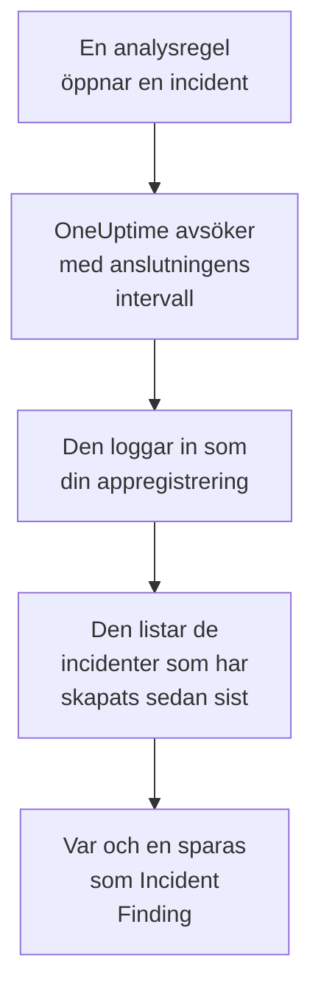

# Microsoft Sentinel

Importera de incidenter som dina [Microsoft Sentinel](https://learn.microsoft.com/en-us/azure/sentinel/overview)-analysregler öppnar till säkerhetshändelserna i OneUptime. Där söker du i dem bredvid dina loggar, spårningar och mätvärden, korrelerar dem med alla andra källor och larmar jouren för de som spelar roll. OneUptime läser dem med en appregistrering som du skapar, och ändrar ingenting i Azure.

:::cards
- [Konfigurera anslutningen](#konfigurera-anslutningen): En appregistrering, en roll och anslutningens formulär.
- [Vad som importeras](#vad-som-importeras): Hur varje Sentinel-incident blir en säkerhetshändelse.
- [Så fungerar avsökningen](#så-fungerar-avsökningen): Det fönster som varje avsökning läser, och vad en upptagen arbetsyta gör med det.
- [Felsökning](#felsökning): Vad varje fel betyder och vad du ska ändra.
:::

## Så fungerar det



Varje minut avsöker OneUptime varje aktiverad anslutning vars avsökningsintervall har passerat. En avsökning loggar in i Microsoft Entra ID som din appregistrering, ber Azure Resource Manager om de incidenter som har skapats sedan förra avsökningen och sparar var och en som en [OCSF](https://schema.ocsf.io/)-händelse av typen Incident Finding (klass `2005`). Identifieringsregler, monitorer och instrumentpaneler behandlar den sedan som en säkerhetshändelse från vilken annan källa som helst.

## Innan du börjar

- I OneUptime rollen Project Owner, Project Admin eller Security Admin. Security Member och Security Viewer kan se anslutningar och deras körningshistorik, men inte ändra dem.
- En Log Analytics-arbetsyta med Microsoft Sentinel aktiverat, i Azures offentliga moln eller i Azure Government (US).
- I Microsoft Entra ID behörighet att skapa en appregistrering och en klienthemlighet.
- På den resursgrupp som innehåller arbetsytan behörighet att tilldela roller, till exempel Ägare eller Administratör för användaråtkomst.

## Konfigurera anslutningen

Anslutningen loggar in med OAuth 2.0-flödet för klientautentiseringsuppgifter: som ett program, aldrig som en person. Dess åtkomst kommer från en Azure-roll, så appregistreringen behöver inga API-behörigheter.

:::steps
### Registrera ett program

1. Logga in på [Azure-portalen](https://portal.azure.com) och öppna **Microsoft Entra ID**.
2. Gå till **App registrations → New registration**. Ge den namnet `OneUptime Sentinel connector`, låt **Supported account types** stå på **Accounts in this organizational directory only**, lämna omdirigerings-URI:n tom och välj **Register**.
3. Kopiera **Program-ID (klient)** och **Katalog-ID (tenant)** från appens sida **Overview**.
4. Gå till **Certificates & secrets → Client secrets → New client secret**, välj när den upphör att gälla och välj **Add**. Kopiera hemlighetens **Value**, inte dess **Secret ID**, innan du lämnar sidan: den visas aldrig igen.

### Låt den läsa incidenter

1. Öppna den resursgrupp som innehåller din Log Analytics-arbetsyta i Azure-portalen.
2. Välj **Access control (IAM) → Add → Add role assignment**.
3. Välj **Microsoft Sentinel Reader** på fliken **Role**.
4. Välj **User, group, or service principal** på fliken **Members**, klicka på **Select members** och välj din appregistrering efter namn.
5. Välj **Review + assign**.

Rollen låter appen läsa incidenter (`Microsoft.SecurityInsights/incidents/read`) och inte skriva något. Microsoft rekommenderar att du tilldelar den på resursgruppen i stället för på arbetsytan, så att den även täcker lösningen `SecurityInsights` som incidenterna levereras från. En ny tilldelning kan ta några minuter att börja gälla.

### Hitta arbetsytans uppgifter

Öppna Log Analytics-arbetsytan i Azure-portalen. Dess sida **Overview** visar **Prenumerations-ID**, **Resource group** och arbetsytans namn. Arbetsytans resurs-ID innehåller samma tre:

```text
/subscriptions/{Subscription ID}/resourceGroups/{Resource group}/providers/Microsoft.OperationalInsights/workspaces/{Workspace name}
```

### Lägg till anslutningen i OneUptime

Öppna **Produkter → Security Events → Anslutningar** (`/dashboard/{projectId}/security-events/connections`), klicka på **Lägg till anslutning**, välj **Microsoft Sentinel** och klicka på **Nästa**. Fyll i inställningarna i tabellen nedan, klicka på **Nästa** och klistra in hemlighetens värde i **Klienthemlighet**.

### Testa den innan du sparar

Klicka på **Testa de här inställningarna** under **Testa innan du sparar**. Testet loggar in och läser incidenter med värdena i formuläret, och sparar ingenting, så en felaktig hemlighet eller en saknad roll syns innan anslutningen finns. Klicka sedan på **Nästa**, ge anslutningen ett **Namn** och skapa den.
:::

| Inställning | Var du hittar den |
| --- | --- |
| **Katalog-ID (tenant)** | Appens sida **Overview**. Klientorganisationens GUID, eller en verifierad domän som `contoso.onmicrosoft.com`. |
| **Program-ID (klient)** | Appens sida **Overview**. Ett GUID. |
| **Prenumerations-ID** | Arbetsytans sida **Overview**. Ett GUID. |
| **Resource group** | Arbetsytans sida **Overview**. 1 till 90 bokstäver, siffror, understreck, bindestreck, punkter eller parenteser, som inte slutar med en punkt. |
| **Workspace name** | Arbetsytans sida **Overview**. 3 till 90 bokstäver, siffror eller bindestreck, som börjar och slutar med en bokstav eller en siffra. |
| **Moln** | **Offentligt Azure-moln** (`login.microsoftonline.com`, `management.azure.com`) eller **Azure Government (USA)** (`login.microsoftonline.us`, `management.usgovcloudapi.net`). |
| **Klienthemlighet** | Hemlighetens **Value**. Den krypteras, returneras aldrig av API:et och visas aldrig igen. Ersätt den med **Uppdatera inloggningsuppgifter** på anslutningen. |

Steget **Hämtning** har också en valfri **Beskrivning**, **Hämtningsintervall (minuter)**, ett heltal från `1` till `1440` som börjar på `5`, och **Aktiverad**, som börjar påslagen.

## Vad som importeras

Varje Sentinel-incident blir en händelse av typen Incident Finding (OCSF-klass `2005`, aktivitet `Create`), tillskriven telemetritjänsten `Microsoft Sentinel`:

| OCSF-kolumn | Fält i Sentinel-incidenten |
| --- | --- |
| `time` | `properties.createdTimeUtc`, när Sentinel skapade incidenten |
| `eventUid` | `name`, incidentens GUID, som även dubbletter tas bort efter |
| `message`, `ruleName` | `properties.title` |
| `ruleId` | Regelns GUID i slutet av den första posten i `properties.relatedAnalyticRuleIds` |
| `severityName` | `properties.severity`: `High`, `Medium`, `Low` eller `Informational` |
| `statusName` | `properties.status`: `New`, `Active` eller `Closed` |
| `mitreTactics` | `properties.additionalData.tactics`, som ATT&CK-ID:n: `Persistence` blir `TA0003` |
| `principalUser` | `properties.owner.userPrincipalName` eller `properties.owner.email` |
| `targetResource` | `properties.incidentUrl`, en länk till incidenten i Azure-portalen |
| `observables` | Ägarens UPN, e-post och objekt-ID, och namnet på varje etikett |
| `attributes` | Hela incidenten, utplattad till nycklar med punkter som `properties.classification` och `properties.firstActivityTimeUtc` |

Stängda incidenter som har skapats i en avsöknings fönster importeras också. Filtrera på `statusName` i utforskaren för säkerhetshändelser för att bara se de öppna.

## Så fungerar avsökningen

Varje avsökning listar de incidenter som har skapats i dess fönster, de äldsta först, 50 per sida, och följer API:ets `nextLink` tills den har läst hela fönstret:

```text
GET https://management.azure.com/subscriptions/{sub}/resourceGroups/{rg}/providers/Microsoft.OperationalInsights/workspaces/{ws}/providers/Microsoft.SecurityInsights/incidents
    ?api-version=2024-03-01
    &$filter=(properties/createdTimeUtc ge {windowStart}) and (properties/createdTimeUtc lt {windowEnd})
    &$orderby=properties/createdTimeUtc asc
    &$top=50
```

- **Skapandetiden är markören.** En schemalagd analysregel som körs varje timme öppnar sin incident långt efter den aktivitet den upptäckte, och incidentens `firstActivityTimeUtc` kan ligga timmar eller dagar tidigare. En markör på aktivitetstiden skulle hoppa över varje sådan incident. Aktivitetstiderna finns kvar i `attributes`, och exemplen i diagnostiken visar båda.
- **Den första avsökningen ser 24 timmar bakåt**, så att en ny anslutning direkt visar sina senaste incidenter.
- **Varje senare avsökning börjar 1 minut före den sparade markören**, så att en incident som har skapats på gränsen mellan två fönster aldrig hoppas över.
- **En avsökning läser högst 24 timmar förbi markören.** En anslutning vars markör har hamnat efter kommer ikapp i en serie fönster på 24 timmar, och dess **Hälsa** visar **Catching up**.
- **Dubbletter tas bort efter incidentens GUID** (`name`) inom projektet, så att överlappningen, ett upprepat fönster och en import aldrig sparar en incident två gånger.

### När ett fönster innehåller mer än en avsökning kan läsa

En avsökning läser högst 20 sidor med 50 incidenter: 1 000 incidenter. När den gränsen stoppar den före slutet av dess fönster blir körningen **Delvis**, med en varning som:

```text
Stopped after 20 incidents requests (the per-run request limit) before reading the whole window. Incidents are read oldest first; every incident created before 2026-09-14T08:12:44.000Z was read.
```

Incidenter läses från äldst till nyast, så OneUptime flyttar markören till skapandetiden för den senast lästa incidenten, och nästa avsökning börjar där med samma fönsterlängd. En upptagen arbetsyta kommer på så sätt ikapp ungefär 1 000 incidenter per avsökning i stället för att läsa samma igen. Incidenter som har skapats vid samma tidpunkt läses två gånger, och dubblettkontrollen tar bort den andra kopian.

När en körning inte alls kommer förbi den sparade markören gör OneUptime i stället fönstret kortare:

1. **Smalna av.** Nästa avsökning läser ett fönster som är hälften så långt, från samma startpunkt, och fortsätter att halvera tills ett fönster läses helt, ner till en minut. Körningens varning säger det: `This window holds more records than one poll can read; the next poll reads a {n} minute window from the same starting point.`
2. **Växa igen.** När ett fönster har lästs helt är nästa dubbelt så långt igen, upp till 24 timmar.
3. **Gå förbi en enda minut.** Om till och med en minut innehåller mer än en avsökning kan läsa går avsökningen förbi den, så att nyare incidenter fortsätter att komma. Körningen förblir **Delvis**, och **Senaste fel** lyder `More records were created in the one minute from {cursor} to {end} than one poll can read. Polling moved past this minute so newer records keep arriving; use Import this time range in Diagnostics on this minute to recover what one run can read.` Importera den minuten med **Import this time range** för att hämta det som en körning kan läsa.

En körning som misslyckas helt, med ett fel från Microsoft Entra ID eller Azure Resource Manager, behåller markören och fönsterlängden, och nästa avsökning läser samma fönster igen. Det enda undantaget är en begäran som fick tidsgräns: markören stannar, men nästa fönster är hälften så långt, eftersom ett fönster som är för tungt för att besvaras i tid skulle få tidsgräns vid varje försök. Att ändra **Hämtningsintervall (minuter)** ändrar inget av detta: det avgör hur ofta en avsökning startar, inte var dess fönster börjar.

### Kör, förhandsgranska och importera vid behov

Klicka på **Diagnostik** på en anslutning för att se dess senaste körningar och arbeta med den manuellt. Alla som kan ändra anslutningen kan starta de här åtgärderna; alla som kan se den kan läsa historiken.

- **Kör nu** startar en avsökning direkt, med den vanliga markören, även när anslutningen inte är **Aktiverad**.
- **Preview incidents** läser ett tidsintervall på upp till 7 dagar och importerar ingenting.
- **Import this time range** importerar ett intervall på upp till 7 dagar, efter att du har bekräftat, utan att flytta markören. Incidenter som redan har importerats hoppas över.
- **Copy diagnostics** på en körning kopierar dess rapport till supporten. Den innehåller aldrig autentiseringsuppgifter.

## Testa anslutningen

**Testa anslutningen** på en anslutnings rad och **Testa de här inställningarna** i formuläret körs i API-processen, inte i en bakgrundsworker, så att ett test svarar även när det är workerna som är problemet. Det kör de här kontrollerna i ordning:

| Kontroll | Vad den kontrollerar |
| --- | --- |
| **Konfiguration** | Varje inställning finns och är korrekt formaterad. Ingenting kontaktas när detta misslyckas. |
| **Authenticate with Microsoft Entra** | Microsoft Entra ID utfärdar en token för Azure Resource Manager till din appregistrering. |
| **Read incidents** | En incident som har skapats de senaste 24 timmarna kan läsas (`$top=1`). Det bevisar rollen och arbetsytans uppgifter. |
| **Incidents available to import** | Hur många incidenter som har skapats de senaste 24 timmarna och de senaste 7 dagarna, en sida med 50 för var och en, så `50+` betyder fler. Inga på 7 dagar är en varning, inte ett fel. |
| **Background workers**, **Poll scheduler**, **Security event storage** | OneUptimes egen sida: en process tar jobben från Worker-kön, avsökningsjobbet körs varje minut och lagringen för säkerhetshändelser svarar. |
| **Scheduled polling** | För en sparad anslutning: avsökningen är påslagen, ingen körning har fastnat i väntan på en worker och avsökningar körs i tid. |

Varje begäran i ett test har en tidsgräns på 20 sekunder. Ett test importerar aldrig något och flyttar aldrig markören, och varje kontroll som misslyckas säger vad du ska ändra.

## Skicka säkerhetshändelser till Microsoft Sentinel

OneUptime kan också skicka det den hittar till Microsoft Sentinel, via Logs Ingestion API i Azure Monitor, till en anpassad tabell i arbetsytan som Sentinel körs på. Dina analysregler, jaktfrågor och arbetsböcker frågar sedan `OneUptimeSecurityEvents_CL` bredvid dina andra tabeller.

:::steps
### Skapa tabellen och dess datainsamlingsregel

Öppna arbetsytans **Tables → Create → New custom log (DCR-based)** i Azure-portalen. Döp tabellen till `OneUptimeSecurityEvents`, skapa en ny datainsamlingsregel, och en slutpunkt för datainsamling om formuläret ber om en. Ladda upp exemplet nedan som exempelfil, behåll transformationen som den är och skapa tabellen.

### Låt ett program skicka till den

Registrera ett program och ge det en klienthemlighet, som i [Registrera ett program](#registrera-ett-program). Öppna sedan datainsamlingsregeln, **Access control (IAM) → Add → Add role assignment**, välj **Monitoring Metrics Publisher** och välj programmet.

### Lägg till målet

Öppna **Produkter → Security Events → Anslutningar**. Klicka på **Lägg till mål** under **Skicka till ditt SIEM**, välj Microsoft Sentinel under **SIEM** och klicka på **Nästa**. Fyll i **Katalog-ID (tenant)**, **Program-ID (klient)** och **Klienthemlighet**, **Slutpunkt för logginmatning** från datainsamlingsslutpunktens (eller regelns) **Overview**, och **Oföränderligt ID för datainsamlingsregeln** från regelns **JSON View**. **Ström** är valfri: lämnas den tom är den `Custom-OneUptimeSecurityEvents_CL`.

### Skicka en testhändelse och börja skicka

Klicka på **Skicka en testhändelse**: en rad når tabellen inom några minuter. Behåll sedan **Endast upptäckter** under **Vad som ska skickas**, eller välj **Alla säkerhetshändelser**, och klicka på **Börja skicka**.
:::

Exempelfilen, en rad med varje kolumn i tabellen:

```json title="oneuptime-security-events-sample.json"
[
  {
    "TimeGenerated": "2026-10-21T10:00:00.000Z",
    "EventId": "0193c0de-cccc-4aaa-8bbb-000000000001",
    "EventUid": "okta-1",
    "ClassName": "Authentication",
    "CategoryName": "Identity & Access Management",
    "ActivityName": "Logon",
    "Severity": "Medium",
    "SeverityId": 3,
    "Status": "Failure",
    "Message": "Failed sign-in for alice",
    "VendorName": "Okta",
    "ProductName": "Okta System Log",
    "RuleId": "",
    "RuleName": "",
    "MitreTactics": [],
    "MitreTechniques": [],
    "PrincipalUser": "alice@example.com",
    "PrincipalHost": "laptop-7",
    "PrincipalIp": "203.0.113.7",
    "TargetUser": "",
    "TargetHost": "app.example.com",
    "TargetIp": "198.51.100.20",
    "TargetPort": 443,
    "TargetResource": "",
    "ProcessName": "",
    "ProcessCommandLine": "",
    "ParentProcessName": "",
    "Observables": [
      "alice@example.com",
      "203.0.113.7"
    ],
    "Attributes": {
      "okta.outcome.reason": "INVALID_CREDENTIALS"
    }
  }
]
```

- Logs Ingestion API tar emot upp till 1 MB per anrop, så rader skickas i omgångar om upp till 500. En omgång som Azure avvisar delas tills raden den inte tar emot har hittats och utelämnats, och strypning (`429`) försöks igen.
- En `403` betyder att programmet saknar **Monitoring Metrics Publisher** på regeln, och en `404` ett felaktigt oföränderligt ID eller en felaktig ström.
- Incidenter som OneUptime har importerat från Microsoft Sentinel skickas aldrig tillbaka dit.

## Felsökning

Anslutningens **Senaste fel** sparar hela felmeddelandet, med autentiseringsuppgifter maskerade, bakom ett prefix som namnger det steg som misslyckades. När en anslutning har ett fel väljer du **Visa fel** i dess kolumn **Åtgärder** för att läsa det, och **Kopiera fel** i dialogrutan för att kopiera det. Läs prefixet först.

:::details Last Error börjar med `Microsoft Sentinel token request`
- `Microsoft Sentinel token request failed (HTTP ...)`: Microsoft Entra ID vägrade att utfärda en token, så Azure kontaktades aldrig. Meddelandet citerar koden från Entra:
  - `AADSTS7000215` eller `invalid_client`: **Klienthemlighet** är felaktig eller har upphört att gälla, eller så är det hemlighetens ID i stället för dess värde. Skapa en ny hemlighet och spara den med **Uppdatera inloggningsuppgifter**.
  - `AADSTS700016` eller `unauthorized_client`: **Program-ID (klient)** finns inte i det angivna **Katalog-ID (tenant)**. Jämför båda med appens sida **Overview**.
  - `AADSTS90002` eller `HTTP 404`: den klientorganisationen finns inte. **Katalog-ID (tenant)** är felaktigt, eller så finns den i det andra molnet: kontrollera **Moln**.
  - `HTTP 429` eller `HTTP 5xx`: Microsoft Entra ID begränsar begäranden eller är otillgängligt. Nästa avsökning försöker igen.
- `Microsoft Sentinel token request returned ...`: Microsoft Entra ID svarade med något oanvändbart, till exempel en kropp som inte är JSON eller som saknar `access_token`. Det är oftast en proxy eller gateway emellan.
- `Microsoft Sentinel token request failed:`, utan status, eller `Microsoft Sentinel token request timed out after ... seconds with no response`: begäran fick inget svar. Kontrollera DNS, TLS och utgående HTTPS från OneUptime-appen och -workerna till `login.microsoftonline.com`.
:::

:::details Last Error börjar med `Microsoft Sentinel incidents list`
- `Microsoft Sentinel incidents list failed (HTTP ...)`: Azure Resource Manager avvisade begäran.
  - `HTTP 401`: den godtog inte token. Nästan alltid passar **Moln** inte klientorganisationen, eller så har appregistreringen tagits bort. En token som upphör att gälla mellan två sidor förnyas och försöks igen en gång av sig själv.
  - `HTTP 403` eller `AuthorizationFailed`: appen har ännu inte **Microsoft Sentinel Reader** på resursgruppen. Tilldela den och vänta några minuter.
  - `HTTP 404`: ingen arbetsyta har det **Prenumerations-ID**, den **Resource group** och det **Workspace name**, eller så är Microsoft Sentinel inte aktiverat där. Kopiera dem från arbetsytans sida **Overview**.
  - `HTTP 429` eller `HTTP 5xx`: Azure Resource Manager begränsar begäranden eller är otillgängligt. Nästa avsökning försöker igen.
  - `HTTP 400`: Azure Resource Manager avvisade begäran, som OneUptime bygger, inte dina inställningar. Skicka meddelandet till OneUptimes support.
- `Microsoft Sentinel incidents list returned ...`: Azure svarade `200`, men utan en läsbar sida med incidenter, eller med en `nextLink` till en annan värd, som anslutningen avvisar så att token aldrig lämnar Azure Resource Manager. Det rapporteras i stället för att tolkas som ett tomt fönster, så att markören aldrig passerar incidenter som ingen har läst.
- `Microsoft Sentinel incidents list failed:`, utan status, eller `Microsoft Sentinel incidents list timed out after ... seconds with no response`: begäran fick inget svar. Kontrollera utgående HTTPS från OneUptime-workerna till `management.azure.com` eller `management.usgovcloudapi.net`.
:::

:::details Last Polled är Never och Last Error är tom
Ingen avsökning har slutförts för den här anslutningen. Kör **Testa anslutningen**: dess kontroller **Background workers** och **Poll scheduler** namnger orsaken. På en egenvärdad installation är den vanliga orsaken `DISABLE_QUEUE_WORKERS=true` på appen, utan en separat worker-distribution som tar jobben: sätt den till `false`, eller kör worker-distributionen (Helm: `worker.enabled: true`).
:::

:::details En körning är Partial
- `Stopped after 20 incidents requests (the per-run request limit) before reading the whole window`: fönstret innehöll mer än de 1 000 incidenter som en körning läser. Ingenting går förlorat: nästa avsökning börjar efter den senast lästa incidenten. En anslutning som förblir **Delvis** avsökning efter avsökning håller på att komma ikapp en eftersläpning, och dess **Senast hämtad** och **Senast importerade händelse** fortsätter att flytta sig framåt.
- `Microsoft Sentinel returned incidents out of creation-time order, so this run cannot name a point to resume from.`: API:et ignorerade ordningen från äldst till nyast, så körningen kan inte flytta markören till sin sista incident, och nästa avsökning läser i stället ett kortare fönster. Om det upprepas skickar du körningens rapport till OneUptimes support.
- `More records were created in the one minute from ... than one poll can read`: avsökningen gick förbi den minuten. Importera den med **Import this time range** i **Diagnostik**. En import läser lika mycket som en avsökning.
:::

:::details Testet lyckas, men ingenting importeras
Läs **Incidents available to import** i testets rapport. `0` de senaste 7 dagarna betyder att arbetsytans analysregler inte har öppnat några incidenter, och det är inte ett fel i anslutningen. Kontrollera i Microsoft Sentinel att reglerna är aktiverade och inställda på att skapa incidenter.
:::

## Azure Government

Ställ in **Moln** på **Azure Government (USA)**. Anslutningen loggar då in på `login.microsoftonline.us` med omfånget `https://management.usgovcloudapi.net/.default` och läser incidenter från `management.usgovcloudapi.net`. Allt annat, även rolltilldelningen, är detsamma.

## Vad du får

- **Sök.** Filtrera incidenter efter allvarlighetsgrad, status, ägare, etikett eller taktik i utforskaren för säkerhetshändelser, bredvid alla andra källor.
- **Korrelation.** Varje incidents ägare och etiketter indexeras som observables, så en sökning hittar allt som nämner dem.
- **Identifieringsregler.** Sigma-regler som körs enligt ett schema över dina säkerhetshändelser och öppnar larm som larmar jouren.
- **Monitorer.** Monitorer för säkerhetshändelser räknar matchande händelser, till exempel nya High-incidenter, och öppnar incidenter eller larm över en tröskel.

Säkerhetshändelser debiteras som resten av din telemetri, per inmatad GB. Se [Priser](https://oneuptime.com/pricing).

## Nästa steg

:::cards
- [Säkerhetshändelser](/docs/telemetry/security-events): Sök, korrelera och larma på det du importerar.
- [Microsoft Defender XDR](/docs/integrations/microsoft-defender-xdr): Importera även larmen från varje Defender-arbetsbelastning.
- [Roller](/docs/permissions/reference#roller): Vad Security-rollerna kan se och ändra.
- [Översikt över integrationer](/docs/integrations/index): De andra verktyg som du kan ansluta.
:::
