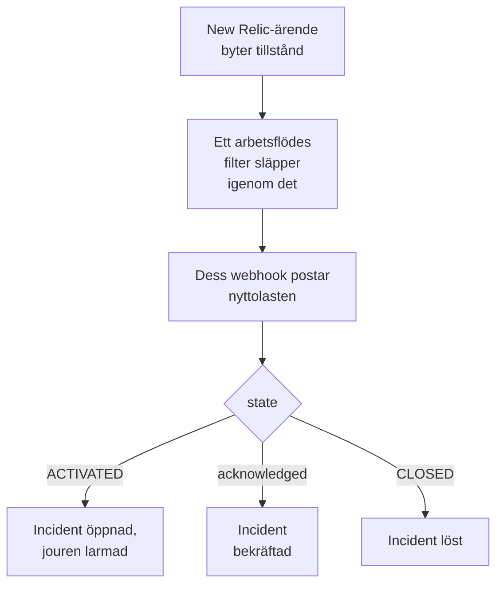

# New Relic

Skicka [New Relic](https://newrelic.com)-ärenden till OneUptime, så att varje ärende blir en incident eller ett larm som larmar ditt jourteam, bekräftas när någon bekräftar ärendet och löses när ärendet stängs. New Relic skickar sina ärenden genom ett [webhook-mål](https://docs.newrelic.com/docs/alerts/get-notified/notification-integrations/), så det finns inget att installera på någon av sidorna.

:::cards
- [Börja från mallen](#börja-från-mallen): Välj vem som ska larmas, kopiera URL:en och se vad varje ärende gör.
- [Konfigurera New Relic](#konfigurera-new-relic): Ett webhook-mål och arbetsflödet som aviserar det.
- [Testa det](#testa-det): Skicka ett ärende själv och sedan ett från New Relic.
- [Felsökning](#felsökning): När ärenden inte kommer fram eller incidenter förblir öppna.
:::

## Så fungerar det



Ett New Relic-arbetsflöde väljer de ärenden som ska skickas med sitt filter, och aviserar ett webhook-mål när ett aktiveras, bekräftas eller stängs, med en JSON-nyttolast som New Relic fyller i. Ärendets ID är hur OneUptime hittar den incident det öppnade.

## Innan du börjar

- Ett New Relic-konto där du kan skapa mål och arbetsflöden.
- I OneUptime behörighet att skapa arbetsflöden. På OneUptime Cloud kräver arbetsflöden planen **Growth** eller högre.

## Börja från mallen

Konfigurera OneUptime först: det ger dig den URL som New Relic skickar till. Dialogen **Skapa ett arbetsflöde** har två New Relic-mallar, under **New Relic** i kategorilistan: **Declare an incident for each New Relic issue**, och **Create an alert for each New Relic issue** för larm. Båda gör samma sak, var och en med sin egen sorts post.

:::steps
1. Gå till **Arbetsflöden** och klicka på **Skapa arbetsflöde**. Under **Eller börja från en mall** väljer du **New Relic** i kategorilistan, klickar på **Declare an incident for each New Relic issue**, eller **Create an alert for each New Relic issue**, och klickar på **Använd den här mallen**.
2. Under **Who to page for new New Relic issues** väljer du de jourpolicyer som ska larmas, eller ingen för att inte larma någon, och klickar på **Skapa arbetsflöde**. Arbetsflödet öppnas i **Byggare**, avstängt.
3. Klicka på utlösaren **Webhook**, sedan på **Kopiera URL**, och spara URL:en till New Relic.
4. Slå på **Aktiverad** högst upp i **Byggare**. Ett arbetsflöde som är avstängt svarar New Relic med `400`.
:::

Sedan [konfigurerar du New Relic](#konfigurera-new-relic) att skicka sina ärenden till den URL:en. Arbetsflödets steg `read-event-1` öppnas med samma inställningar, för när du kommer tillbaka till det i **Byggare**.

### Vad arbetsflödet gör

Efter utlösaren **Webhook** läser steget **Check With JavaScript** `read-event-1` den `state` som New Relic skickar, och **Incident From Another Tool**, eller **Alert From Another Tool** i larmmallen, gör det den betyder, utifrån ärendets ID. Incidenten behåller ID:t i sitt anpassade fält `newRelicIssueId`.

| Vad New Relic skickar | Vad arbetsflödet gör |
| --- | --- |
| `state` är `ACTIVATED` eller `CREATED` | Deklarerar en incident med titeln `New Relic: <issue>`, med den allvarlighetsgrad som ärendets prioritet motsvarar, utanför dina statussidor. Beskrivningen länkar till ärendet i New Relic och visar prioriteten, entiteterna, policyerna och villkoren. Den larmar de jourpolicyer du valde. Samma ärende igen, till exempel när New Relic höjer det till CRITICAL, öppnar ingen andra incident och larmar ingen igen. |
| `state` är `ACTIVATED` och `isAcknowledged` är `true` | Bekräftar ärendets incident, vilket stoppar jourens eskalering. Varför står på dess tidslinje. |
| `state` är `CLOSED` | Löser ärendets incident, om den inte redan är löst. Varför står på dess tidslinje. |

En bekräftelse eller en stängning för ett ärende utan incident ändrar ingenting. Allt annat, till exempel en begäran från ett annat verktyg, lämnas orört: `read-event-1` tar **No**, och körningens **Steg** säger varför. Inget går tillbaka till New Relic: det stänger sina egna ärenden när signalen återhämtar sig, och det är det som löser incidenten.

### Prioriteter och larmning

Varje nytt ärende larmar de jourpolicyer du valde, oavsett prioritet: New Relic höjer ett ärende från HIGH till CRITICAL på plats, på samma ärende, så att vänta på CRITICAL skulle aldrig larma för ett ärende som öppnades som HIGH och blev värre. För att larma för färre ärenden, avgränsa filtret för arbetsflödet i New Relic: bara det som passerar det når OneUptime. I ett nytt projekt kopplas prioriteterna till dessa allvarlighetsgrader för incidenter och larm:

| New Relic-prioritet | Incident | Larm | Jour |
| --- | --- | --- | --- |
| CRITICAL | Critical Incident | High | Larmad |
| HIGH | Major Incident | Low | Larmad |
| MEDIUM | Minor Incident | Low | Larmad |
| LOW | Minor Incident | Low | Larmad |

Med egna allvarlighetsgrader går CRITICAL till din allvarligaste, HIGH till den mittersta, och MEDIUM och LOW till din minst allvarliga. En incident behåller den allvarlighetsgrad den öppnades med när New Relic höjer dess ärende.

För att koppla en prioritet till en av dina efter namn, redigera `SEVERITY_BY_NAME` i steget `read-event-1`, till exempel `{ HIGH: 'Critical Incident' }`.

## Konfigurera New Relic

:::steps
### Lägg till webhook-målet

Gå i New Relic till **Alerts → Destinations** och lägg till ett **Webhook**-mål. Ställ in **Webhook name** på `OneUptime` och **Endpoint URL** på den URL du kopierade från OneUptime, och spara det. Låt **Use authorization** vara avstängd: URL:en är den enda inloggningsuppgiften.

### Lägg till arbetsflödet

Gå till **Alerts → Workflows** och klicka på **Add a workflow**. Ge det namnet `OneUptime`. Dess filter avgör vilka ärenden som når OneUptime, till exempel bara CRITICAL-ärenden, eller ett teams.

### Avisera målet

Lägg till **Webhook**-målet du skapade i arbetsflödet. Behåll nyttolasten som New Relic fyller i och lägg till en rad för `isAcknowledged` efter `state`, så att incidenten bekräftas tillsammans med sitt ärende:

```json
{
  "id": {{ json issueId }},
  "issueUrl": {{ json issuePageUrl }},
  "title": {{ json annotations.title.[0] }},
  "priority": {{ json priority }},
  "impactedEntities": {{ json entitiesData.names }},
  "totalIncidents": {{ json totalIncidents }},
  "state": {{ json state }},
  "isAcknowledged": {{ json isAcknowledged }},
  "trigger": {{ json triggerEvent }},
  "isCorrelated": {{ json isCorrelated }},
  "createdAt": {{ createdAt }},
  "updatedAt": {{ updatedAt }},
  "sources": {{ json accumulations.source }},
  "alertPolicyNames": {{ json accumulations.policyName }},
  "alertConditionNames": {{ json accumulations.conditionName }},
  "workflowName": {{ json workflowName }}
}
```

Raden att lägga till är `"isAcknowledged": {{ json isAcknowledged }},`. Klicka sedan på **Update message**.

### Avisera det vid aktiverat, bekräftat och stängt

Klicka på de tre prickarna på målet och välj **Notify when**. Låt **Activated**, **Acknowledged** och **Closed** vara påslagna.

### Aktivera arbetsflödet

Klicka på **Activate workflow**.
:::

OneUptime-arbetsflödet läser dessa fält i nyttolasten och lämnar de andra orörda:

| Fält | Vad New Relic lägger i det |
| --- | --- |
| `id` | ID för ärendet. |
| `issueUrl` | En länk till ärendet i New Relic. |
| `title` | Ärendets titel. |
| `priority` | Hur brådskande ärendet är: `CRITICAL`, `HIGH`, `MEDIUM` eller `LOW`. |
| `state` | Var ärendet står: `CREATED`, `ACTIVATED` eller `CLOSED`. |
| `isAcknowledged` | `true` när någon bekräftar ärendet i New Relic. |
| `impactedEntities` | Namnen på entiteterna som ärendet gäller. |
| `alertPolicyNames` | Namnen på policyerna bakom ärendet. |
| `alertConditionNames` | Namnen på villkoren bakom ärendet. |

## Testa det

Skicka ett ärende till den URL du kopierade, som New Relic skulle göra:

```bash
curl -X POST "<url>" \
  -H "Content-Type: application/json" \
  -d '{
    "id": "7d4a2e1c-3b5f-4c8e-9a1d-2f6b8c0e4a71",
    "issueUrl": "https://radar-api.service.newrelic.com/accounts/1234567/issues/7d4a2e1c-3b5f-4c8e-9a1d-2f6b8c0e4a71?notifier=WEBHOOK",
    "title": "High CPU on checkout-service",
    "priority": "CRITICAL",
    "impactedEntities": ["checkout-service"],
    "state": "ACTIVATED",
    "isAcknowledged": false,
    "alertPolicyNames": ["Production"],
    "alertConditionNames": ["CPU above 90%"]
  }'
```

En incident öppnas med titeln `New Relic: High CPU on checkout-service`, och de jourpolicyer du valde larmas. Skicka samma begäran med `isAcknowledged` inställd på `true`, så bekräftas incidenten. Skicka den med `state` inställd på `CLOSED`, så löses incidenten.

Testa sedan från New Relic: öppna arbetsflödets webhook-meddelande och klicka på **Send test notification**. För att se att det kom fram öppnar du OneUptime-arbetsflödets **Loggar → Körningar**.

## Felsökning

:::details Inget kommer fram till OneUptime
- Kontrollera att arbetsflödet i New Relic är aktivt och att dess filter släpper igenom ärendet.
- Kontrollera att målets **Endpoint URL** är URL:en för utlösaren **Webhook**.
- Ett arbetsflöde som är avstängt svarar `400`. Slå på **Aktiverad** överst i dess **Byggare**.
:::

:::details Arbetsflödet körs, men öppnar ingenting
Öppna körningen i **Loggar → Körningar**. Posten `read-event-1` under dess **Steg** säger varför den tog **No**.

- `New Relic named no issue ID`: behåll raden `"id": {{ json issueId }},` i nyttolasten.
- `is in no state`: behåll raden `"state": {{ json state }},` i nyttolasten.
:::

:::details Incidenter bekräftas inte
- Nyttolasten behöver raden `"isAcknowledged": {{ json isAcknowledged }},`. Utan den öppnas och löses en incident med sitt ärende, men bekräftas aldrig.
- Arbetsflödet i New Relic måste ha **Acknowledged** påslaget under **Notify when**.
:::

:::details Incidenter skapas men löses aldrig
- Arbetsflödet i New Relic måste ha **Closed** påslaget under **Notify when**.
- Öppna stängningens körning i **Loggar → Körningar**: dess sista steg säger varför. Stängningens `id` måste vara ärendets, så behåll `"id": {{ json issueId }},` som den är i nyttolasten.
:::

:::details Jouren larmas för för många ärenden
Varje nytt ärende som når OneUptime larmar. Avgränsa filtret för arbetsflödet i New Relic, så att bara de ärenden som ska larma når det. Se [Prioriteter och larmning](#prioriteter-och-larmning).
:::

:::details Jouren larmas inte
- En avisering för ett ärende som redan har sin incident larmar ingen igen, så en höjning till CRITICAL larmar ingen.
- Om ingen valdes i dialogen **Skapa ett arbetsflöde** har arbetsflödet inget steg som larmar.
:::

## Säkerhet

- **Behandla URL:en som ett lösenord.** Alla som har den kan öppna incidenter. Om den läcker klickar du på **Återställ URL** i arbetsflödets **Webhook**-utlösare. Uppdatera sedan målets **Endpoint URL** i New Relic.
- **Länkar går till New Relic.** Mallen länkar ett ärende bara på en New Relic-webbplats, vad en begäran än säger, och skriver det New Relic skickade som text.
- **Självhostad?** New Relic skickar webhooks från internet, så din OneUptime måste vara nåbar från det via HTTPS.

## Nästa steg

:::cards
- [Arbetsflödesmallar](/docs/workflows/authoring): Skapa ett arbetsflöde från en mall och ändra det i Byggare.
- [Datadog](/docs/integrations/datadog): Samma mall, för Datadog-monitorer.
- [Eskaleringsregler](/docs/on-call/escalation-rules): Bestäm vem en jourpolicy larmar, och när.
- [Översikt över integrationer](/docs/integrations/index): De andra verktyg som du kan ansluta.
:::
