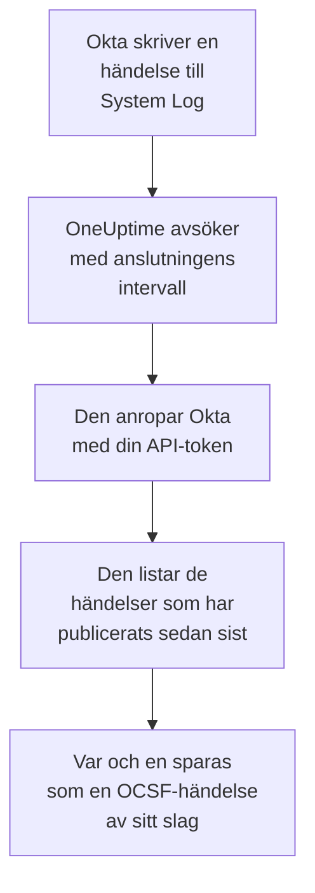

# Okta-systemlogg

Importera [Okta System Log](https://developer.okta.com/docs/reference/system-log-query/) till säkerhetshändelserna i OneUptime: inloggningar, MFA-utmaningar, konto- och gruppändringar och Oktas egna hotdetektioner. Där söker du i dem bredvid dina loggar, spårningar och mätvärden, korrelerar dem med alla andra källor och larmar jouren för dem som spelar roll. OneUptime läser dem med en API-token som du själv skapar, och ändrar ingenting i Okta.

:::cards
- [Konfigurera anslutningen](#konfigurera-anslutningen): En API-token och anslutningens formulär.
- [Vad som importeras](#vad-som-importeras): Vilka händelser, och hur var och en blir en säkerhetshändelse.
- [Så fungerar avsökningen](#så-fungerar-avsökningen): Det fönster som varje avsökning läser, och varför det överlappar det föregående med 15 minuter.
- [Felsökning](#felsökning): Vad varje fel betyder och vad du ska ändra.
:::

## Så fungerar det



Varje minut avsöker OneUptime varje aktiverad anslutning vars avsökningsintervall har passerat. En avsökning ber Okta om de System Log-händelser som har publicerats sedan förra avsökningen, och sparar var och en som en [OCSF](https://schema.ocsf.io/)-händelse: en inloggning som en Authentication-händelse, en kontoändring som en Account Change och en Okta-detektion som ett Detection Finding. Identifieringsregler, monitorer och instrumentpaneler behandlar den sedan som en säkerhetshändelse från vilken annan källa som helst. Det fungerar med alla Okta-celler, `okta.com`, `oktapreview.com` och `okta-emea.com`, och med en organisation på en egen domän.

## Innan du börjar

- I OneUptime rollen Project Owner, Project Admin eller Security Admin. Security Member och Security Viewer kan se anslutningar och deras körningshistorik, men inte ändra dem.
- En Okta-administratör som kan se System Log, för att skapa token. En token kan det som dess administratör kan, så använd en Read-only Administrator: den läser System Log och ändrar ingenting. En skrivskyddad administratör ser också användare, grupper, appar och inställningar, så var lika rädd om token som om ett lösenord.
- Helst ett tjänstekonto för den administratören. Okta inaktiverar en token när dess administratör inaktiveras, och när den har varit oanvänd i 30 dagar. Avsökningen använder den med några minuters mellanrum, så den förblir i bruk så länge anslutningen är aktiverad.
- Om din organisation bara tar emot API-anrop från en nätverkszon, en zon som innehåller de adresser som OneUptime anropar från: på OneUptime Cloud dess utgående adresser, och på en egenvärdad installation den offentliga adressen till dina app- och workervärdar.

## Konfigurera anslutningen

:::steps
### Skapa en API-token

1. Logga in i Oktas **Admin Console** som den skrivskyddade administratören.
2. Öppna **Security → API**, sedan fliken **Tokens**, och välj **Create token**.
3. Ge den ett namn, till exempel `OneUptime security events`. Låt **Any IP** stå kvar för var dess anrop får komma från, om inte din organisation behöver en zon.
4. Välj **Create token** och kopiera **Token Value**. Okta visar det bara en gång.

Varje token får använda en andel av organisationens API-hastighetsgräns, som dess rad på fliken **Tokens** visar. En avsökning gör högst 20 begäranden, så standardandelen räcker gott, om inte andra verktyg använder samma token.

### Lägg till anslutningen i OneUptime

Öppna **Produkter → Security Events → Anslutningar** (`/dashboard/{projectId}/security-events/connections`), klicka på **Lägg till anslutning**, välj **Okta System Log** och klicka på **Nästa**. Fyll i inställningarna i tabellen nedan, klicka på **Nästa** och klistra in token i **API token**.

### Testa den innan du sparar

Klicka på **Testa de här inställningarna** under **Testa innan du sparar**. Testet loggar in och läser händelser med värdena i formuläret och sparar ingenting, så en fel URL eller ett ogiltigt filter syns innan anslutningen finns. Klicka sedan på **Nästa**, ge anslutningen ett **Namn** och skapa den.
:::

| Inställning | Vad du anger |
| --- | --- |
| **Okta organization URL** | Adressen som dina användare loggar in på, till exempel `https://acme.okta.com`, `https://acme.oktapreview.com` eller `https://login.example.com`. Den måste använda `https`, utan sökväg. Inte Admin Consoles `-admin`-adress, som inte erbjuder API:t. |
| **Event filter** | Valfritt. Ett [System Log-filter](https://developer.okta.com/docs/reference/core-okta-api/#filter) som väljer vilka händelser som importeras, till exempel `eventType sw "user.session" or eventType sw "security"`. Tomt importerar familjerna nedan. Högst 2 000 tecken, på en rad, och inte på `published`: OneUptime anger själv tidsintervallet. |
| **API token** | Tokens värde, ensamt: OneUptime lägger själv till schemat `SSWS`. Det krypteras, returneras aldrig av API:t och visas aldrig igen. Ersätt det med **Uppdatera inloggningsuppgifter** på anslutningen. |

Steget **Hämtning** har också en valfri **Beskrivning**, **Hämtningsintervall (minuter)**, ett heltal från `1` till `1440` som börjar på `5`, och **Aktiverad**, som börjar påslagen.

## Vad som importeras

Utan **Event filter** importerar OneUptime de händelsefamiljer som ett säkerhetsteam håller koll på, efter `eventType`-prefix. Ett eget filter ersätter den här listan i stället för att lägga till i den:

| Prefix | Händelser |
| --- | --- |
| `user.session` | In- och utloggningar, åtkomst till Admin Console, personifiering |
| `user.authentication` | Autentiseringsresultat, inklusive single sign-on |
| `user.mfa` | Registrering, utmaningar och återställningar av faktorer |
| `user.account` | Lösenordsändringar och -återställningar, spärrar, profil- och behörighetsändringar |
| `user.lifecycle` | Användare som har skapats, aktiverats, stängts av, inaktiverats och tagits bort |
| `security.` | ThreatInsight, rapporter om misstänkt aktivitet och Oktas övriga detektioner |
| `policy.` | Utvärderingar av inloggningspolicyer, och policyändringar |
| `system.api_token` | API-tokens som har skapats och återkallats |
| `application.user_membership` | Apptilldelningar |
| `group.user_membership` | Ändringar i gruppmedlemskap |

Varje händelse blir en OCSF-händelse, med leverantören `Okta` och produkten `Okta System Log`, av den klass som dess `eventType` kräver:

| `eventType` | OCSF-klass | Aktivitet |
| --- | --- | --- |
| `user.session.start` | Authentication (`3002`) | `Logon` |
| `user.session.end` | Authentication (`3002`) | `Logoff` |
| `user.authentication.*` | Authentication (`3002`) | `Logon` |
| `user.mfa.*` | Authentication (`3002`) | `Authentication Ticket` |
| Andra `user.session.*`-händelser | Authentication (`3002`) | `Other` |
| `user.account.*`, `user.lifecycle.*` | Account Change (`3001`) | Den sista delen av händelsetypen, till exempel `Update Password` |
| `group.*` | Group Management (`3006`) | Den sista delen av händelsetypen, till exempel `Add` |
| `security.*`, och en `policy.evaluate_sign_on` som nekade åtkomst | Detection Finding (`2004`) | `Create`, med händelsetypen som regelnamn |
| Allt annat | `0`, uppkallad efter händelsetypen | Den sista delen av händelsetypen |

En händelse som inte hör till någon av dessa klasser behåller ändå varje fält och går fortfarande att söka på vart och ett av dem. Varje händelse fyller de här kolumnerna:

| Okta-fält | OneUptime-kolumn |
| --- | --- |
| `uuid` | Händelse-UID, som även dubbletter tas bort efter |
| `published`, när händelsen inträffade | Händelsens tid |
| `displayMessage`, annars händelsetypen och `outcome.reason` | Meddelande |
| `severity`: `DEBUG` och `INFO` är Informational, `WARN` Medium, `ERROR` High | Allvarlighetsgrad |
| `outcome.result`, till exempel `SUCCESS`, `FAILURE`, `ALLOW` eller `DENY` | Status |
| `actor.alternateId`, annars `actor.displayName`; `client.ipAddress` | Aktörens användare och IP |
| `alternateId` för `User` i `target` | Målanvändare |
| `alternateId` för `AppInstance` i `target` | Målresurs |
| Aktören, varje mål och klientens IP | Observables |
| Hela händelsen, utplattad till nycklar med punkter, till exempel `client.userAgent.browser` och `debugContext.debugData.requestUri` | `attributes` |

En misslyckad eller nekad inloggning på `INFO` höjs till Low, så att den sticker ut från en lyckad. System Log innehåller inga MITRE ATT&CK-referenser, så de kolumnerna förblir tomma.

## Så fungerar avsökningen

Varje avsökning listar de händelser som har publicerats i dess fönster, de äldsta först, 1 000 per sida, och följer den `next`-länk som Okta skickar fram till den sista sidan:

```text
GET {Okta organization URL}/api/v1/logs?since={window start}&until={window end}&sortOrder=ASCENDING&limit=1000&filter={Event filter}
```

- **Publiceringstiden är markören.** En System Log-händelse är själva aktiviteten, så `published` är både när den inträffade och det som avsökningen läser.
- **Den första avsökningen ser 24 timmar bakåt**, så att en ny anslutning direkt visar sina senaste händelser.
- **Varje senare avsökning börjar 15 minuter före den sparade markören.** Okta varnar för att en begäran med en sluttid kan utelämna fördröjda händelser, vilket Okta kallar ovanligt. Överlappningen läser dem vid nästa avsökning. En händelse som är fördröjd mer än 15 minuter kan hamna bakom markören: importera dess tidsintervall för att hämta den.
- **En avsökning läser högst 24 timmar förbi markören.** En anslutning vars markör har hamnat efter kommer ikapp i en serie fönster på 24 timmar, och dess **Hälsa** visar **Catching up**.
- **Dubbletter tas bort efter `uuid`** inom projektet, så att överlappningen, ett upprepat fönster och en import aldrig sparar en händelse två gånger.

En `next`-länk som pekar någon annanstans än din **Okta organization URL** följs aldrig, eftersom token skickas med varje begäran.

### När ett fönster innehåller mer än en avsökning kan läsa

En avsökning läser högst 10 000 händelser, i högst 20 begäranden. När ett fönster innehåller fler blir körningen **Delvis**, med en varning som:

```text
Stopped after collecting 10000 events; the window holds more. The last event read was published at 2026-09-14T08:12:44.000Z.
```

Händelser läses de äldsta först, så OneUptime flyttar markören till publiceringstiden för den senast lästa händelsen, och nästa avsökning börjar där, utan överlappningen på 15 minuter, med samma fönsterlängd. En upptagen organisation kommer ikapp 10 000 händelser per avsökning i stället för att läsa samma händelser igen. Överlappningen kommer tillbaka när markören har flyttats 15 minuter förbi den punkten.

När en körning inte alls kommer förbi den sparade markören, till exempel för att de 15 minuterna av överlappning ensamma innehåller mer än 10 000 händelser, gör OneUptime i stället fönstret kortare:

1. **Smalna av.** Nästa avsökning läser ett fönster som är hälften så långt, från samma startpunkt, och fortsätter att halvera tills ett fönster läses helt, ner till en minut. Körningens varning säger det: `This window holds more records than one poll can read; the next poll reads a {n} minute window from the same starting point.`
2. **Växa igen.** När ett fönster har lästs helt är nästa dubbelt så långt igen, upp till 24 timmar.
3. **Gå förbi en enda minut.** Om till och med en minut innehåller mer än en avsökning kan läsa går avsökningen förbi den, så att nyare händelser fortsätter att komma, och senare avsökningars överlappning når inte längre tillbaka till den. Körningen förblir **Delvis**, och **Senaste fel** lyder `More records were created in the one minute from {cursor} to {end} than one poll can read. Polling moved past this minute so newer records keep arriving; use Import this time range in Diagnostics on this minute to recover what one run can read.` Importera den minuten med **Import this time range** för att hämta det som en körning kan läsa, eller begränsa **Event filter**.

En körning som misslyckas helt, med ett fel från Okta, behåller markören och fönsterlängden, och nästa avsökning läser samma fönster igen. Det enda undantaget är en begäran som fick tidsgräns: markören stannar, men nästa fönster är hälften så långt, eftersom ett fönster som är för tungt för att besvaras i tid skulle få tidsgräns vid varje försök. Att ändra **Hämtningsintervall (minuter)** ändrar inget av detta: det avgör hur ofta en avsökning startar, inte var dess fönster börjar.

### Kör, förhandsgranska och importera vid behov

Klicka på **Diagnostik** på en anslutning för att se dess senaste körningar och arbeta med den manuellt. Alla som kan ändra anslutningen kan starta de här åtgärderna; alla som kan se den kan läsa historiken.

- **Kör nu** startar en avsökning direkt, med den vanliga markören, även när anslutningen inte är **Aktiverad**.
- **Preview log events** läser ett tidsintervall på upp till 7 dagar och importerar ingenting.
- **Import this time range** importerar ett intervall på upp till 7 dagar, efter att du har bekräftat, utan att flytta markören. Händelser som redan har importerats hoppas över. Okta sparar 90 dagars System Log.
- **Copy diagnostics** på en körning kopierar dess rapport till supporten. Den innehåller aldrig autentiseringsuppgifter.

## Testa anslutningen

**Testa anslutningen** på en anslutnings rad och **Testa de här inställningarna** i formuläret körs i API-processen, inte i en bakgrundsworker, så att ett test svarar även när det är workerna som är problemet. Det kör de här kontrollerna i ordning:

| Kontroll | Vad den kontrollerar |
| --- | --- |
| **Konfiguration** | Varje inställning finns och är korrekt formaterad. Ingenting kontaktas när detta misslyckas. |
| **Authenticate with Okta** | Okta godtar token för System Log, med en händelse läst och inget filter. |
| **Read System Log events** | En händelse från de senaste 24 timmarna kan läsas genom det filter som avsökningen använder, ditt eget eller standardfiltret, så ett ogiltigt **Event filter** misslyckas här i stället för vid den första avsökningen. |
| **Events available to import** | Hur många händelser som har publicerats under de senaste 24 timmarna och de senaste 7 dagarna, en sida på 1 000 för varje, så `1000+` betyder fler. Inga på 7 dagar är en varning, inte ett fel. |
| **Background workers**, **Poll scheduler**, **Security event storage** | OneUptimes egen sida: en process tar jobben från Worker-kön, avsökningsjobbet körs varje minut och lagringen för säkerhetshändelser svarar. |
| **Scheduled polling** | För en sparad anslutning: avsökningen är påslagen, ingen körning har fastnat i väntan på en worker och avsökningar körs i tid. |

Varje begäran i ett test har en tidsgräns på 20 sekunder. Ett test importerar aldrig något och flyttar aldrig markören, och varje kontroll som misslyckas säger vad du ska ändra.

## Felsökning

Anslutningens **Senaste fel** sparar hela felmeddelandet, med autentiseringsuppgifter maskerade, bakom ett prefix som namnger det steg som misslyckades. När en anslutning har ett fel väljer du **Visa fel** i dess kolumn **Åtgärder** för att läsa det, och **Kopiera fel** i dialogrutan för att kopiera det. Varje meddelande börjar med `Okta System Log events request` och citerar Oktas egen felkod efter statusen; läs det som följer.

:::details Last Error säger `failed (HTTP 400)`
Okta avvisade begärans parametrar, `E0000053`. När token fungerade är det nästan alltid **Event filter**: kontrollera dess operatorer, `eq`, `ne`, `co`, `sw`, `ew`, `pr`, `gt`, `ge`, `lt` och `le`, dess `and` och `or`, och de dubbla citattecknen runt dess värden, eller töm det för att använda standardfamiljerna. Vid en import kan det också betyda att intervallet börjar för mer än 180 dagar sedan.
:::

:::details Last Error säger `failed (HTTP 401)` eller `failed (HTTP 403)`
- `HTTP 401`: Okta godtog inte token, `E0000011`. Den har återkallats, varit oanvänd i 30 dagar, eller inaktiverats tillsammans med sin administratör; eller så klistrades den in med `SSWS` eller ett extra tecken. Skapa en ny token som skrivskyddad administratör och spara den med **Uppdatera inloggningsuppgifter**.
- `HTTP 403`: token loggar in, men dess administratör kan inte läsa System Log, `E0000006`. Skapa den som Read-only Administrator eller Super Administrator, och kontrollera att dess nätverkszon tillåter de adresser som OneUptime anropar från.
:::

:::details Last Error säger `failed (HTTP ...)` med en annan status
- `HTTP 404`: URL:en erbjuder inte Oktas API. Använd organisationens egen adress, till exempel `https://acme.okta.com`, utan sökväg och inte `-admin`-adressen.
- `HTTP 3xx`: Okta omdirigerade begäran, och omdirigeringar avvisas, eftersom token skickas med varje begäran. Använd organisationens egen adress.
- `HTTP 429`: Okta begränsar token, `E0000047`. Nästa avsökning försöker igen. Om det fortsätter höjer du tokens andel av hastighetsgränsen på fliken **Tokens**, ger OneUptime en egen token eller avsöker mer sällan.
- `HTTP 5xx`: Okta misslyckades, eller frågan överskred Oktas gräns på 30 sekunder, `E0000009`. Nästa avsökning försöker igen; om det fortsätter, kontrollera [status.okta.com](https://status.okta.com).
:::

:::details Last Error säger `returned` eller `did not complete`
- `returned a non-JSON body.` eller `returned an unrecognized response shape`: något annat än Oktas API svarade, till exempel en inloggningssida eller en proxy, eller så svarade Okta med ett fel. Det rapporteras i stället för att tas som ett tomt fönster, så att markören aldrig flyttas förbi händelser som ingen har läst.
- `returned a next link outside the Okta organization URL`: en `next`-länk pekade någon annanstans och följdes inte. Okta själv gör aldrig så: leta efter en proxy som skriver om rubriker.
- `did not complete`: begäran fick inget svar: en tidsgräns, ett namn som inte kan slås upp, ett certifikat som OneUptime inte litar på, eller en avvisad adress. Kontrollera att OneUptime-appen och -workerna kan nå din organisation över HTTPS, genom den proxy som du eventuellt använder.
:::

:::details Last Polled är Never och Last Error är tom
Ingen avsökning har slutförts för den här anslutningen. Kör **Testa anslutningen**: dess kontroller **Background workers** och **Poll scheduler** namnger orsaken. På en egenvärdad installation är den vanliga orsaken `DISABLE_QUEUE_WORKERS=true` på appen, utan en separat worker-distribution som tar jobben: sätt den till `false`, eller kör worker-distributionen (Helm: `worker.enabled: true`).
:::

:::details En körning är Partial
- `Stopped after collecting 10000 events`: fönstret innehöll mer än de 10 000 händelser som en körning läser. Ingenting går förlorat: nästa avsökning börjar efter den senast lästa händelsen. En anslutning som förblir **Delvis** avsökning efter avsökning håller på att komma ikapp en eftersläpning, och dess **Senast hämtad** och **Senast importerade händelse** fortsätter att flytta fram. Om den aldrig kommer ikapp publicerar organisationen fler matchande händelser än ett avsökningsintervall rymmer: begränsa **Event filter**, eller gör **Hämtningsintervall (minuter)** kortare.
- `More records were created in the one minute from ... than one poll can read`: avsökningen gick förbi den minuten. Importera den med **Import this time range** i **Diagnostik**. En import läser lika mycket som en avsökning.
:::

:::details Testet lyckas, men ingenting importeras
Läs **Events available to import** i testets rapport. Med standardfiltret publicerar en organisation med användare inloggningar hela tiden, så `0` de senaste 7 dagarna betyder att URL:en är en sandlåda eller en oanvänd organisation. Med ditt eget **Event filter** betyder det att filtret inte hittade något: jämför det med händelsetyperna i Admin Consoles System Log.
:::

## Vad du får

- **Sök.** Filtrera inloggningar, MFA-resultat, kontoändringar och Okta-detektioner efter allvarlighetsgrad, status, användare, IP eller vilken observable som helst i utforskaren för säkerhetshändelser, bredvid alla andra källor.
- **Korrelation.** Varje händelses användare, appar och IP-adresser indexeras som observables, så en sökning hittar allt som en användare gjorde, bredvid appens egna loggar.
- **Identifieringsregler.** Sigma-regler som körs enligt ett schema över dina säkerhetshändelser, till exempel misslyckade inloggningar per IP eller MFA-avslag per användare, och öppnar larm som larmar jouren.
- **Monitorer.** Monitorer för säkerhetshändelser räknar matchande händelser och öppnar incidenter eller larm över en tröskel.

Säkerhetshändelser debiteras som resten av din telemetri, per inmatad GB. Se [Priser](https://oneuptime.com/pricing).

## Nästa steg

:::cards
- [Säkerhetshändelser](/docs/telemetry/security-events): Sök, korrelera och larma på det du importerar.
- [AWS Security Hub](/docs/integrations/aws-security-hub): Importera även fynden från ditt moln.
- [Roller](/docs/permissions/reference#roller): Vad Security-rollerna kan se och ändra.
- [Översikt över integrationer](/docs/integrations/index): De andra verktygen du kan ansluta.
:::
