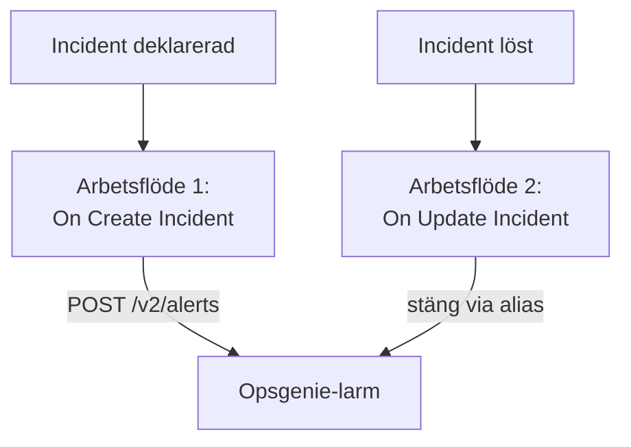

# Opsgenie

Skicka OneUptime-incidenter till [Opsgenie](https://www.atlassian.com/software/opsgenie). Ett arbetsflöde skapar ett Opsgenie-larm när en OneUptime-incident deklareras, och ett andra stänger det när OneUptime-incidenten är löst. Använd det så länge Opsgenie fortfarande larmar ditt team och OneUptime övervakar dina system.

:::cards
- [Spara API-nyckeln](#spara-api-nyckeln): Håll Opsgenies nyckel utanför dina arbetsflöden.
- [Skapa Opsgenie-larm](#skapa-ett-opsgenie-larm-för-varje-incident): Ett arbetsflöde, två block.
- [Stäng dem](#stäng-opsgenie-larmet): Ett andra arbetsflöde som följer incidentens status.
- [Felsökning](#felsökning): När Opsgenie nekar en begäran.
:::

> [!IMPORTANT]
> Atlassian slutade sälja Opsgenie i juni 2025 och avslutar supporten i april 2027. OneUptime larmar också personer, med jourpolicyer, scheman och eskaleringsregler. För att flytta över ditt team, se [Byt från Opsgenie](/docs/moving-to-oneuptime/opsgenie): en import tar över dina användare, team, scheman och eskaleringar.

## Så fungerar det



Båda arbetsflödena anropar [Opsgenie Alert API](https://docs.opsgenie.com/docs/alert-api). Det första ger larmet ett `alias` som bildas av OneUptime-incidentens ID, och det andra stänger larmet via det aliaset.

## Innan du börjar

- En Opsgenie-integration av typen **API** och dess **API Key**. Lägg till en under **Settings → Integrations** i Opsgenie, eller under ett teams **Integrations** för att skicka larm till det teamet.
- Din Opsgenie-region. Konton i Europa, som loggar in på `app.eu.opsgenie.com`, använder `api.eu.opsgenie.com`. Alla andra använder `api.opsgenie.com`.
- I OneUptime behörighet att skapa arbetsflöden och globala variabler. På OneUptime Cloud kräver arbetsflöden **Growth**-abonnemanget eller högre.

## Spara API-nyckeln

:::steps
1. Gå till **Arbetsflöden → Globala variabler** och klicka på **Skapa Arbetsflöde Variabel**.
2. Ge den namnet `OPSGENIE_KEY` och klicka på **Nästa**.
3. Klistra in API-nyckeln i **Innehåll**, slå på **Hemlighet** och klicka på **Skapa Arbetsflöde Variabel**.
:::

En hemlig variabel ersätts med `[REDACTED]` i körningsloggar, så nyckeln syns aldrig i en körning.

## Skapa ett Opsgenie-larm för varje incident

:::steps
### Skapa arbetsflödet

Gå till **Arbetsflöden**, klicka på **Skapa arbetsflöde** och sedan på **Börja från grunden**. Ge det namnet `Incidents to Opsgenie` och klicka på **Skapa arbetsflöde**.

### Lägg till utlösaren

Klicka på det streckade blocket **Välj vad som startar det här arbetsflödet** och välj **On Create Incident**. Klicka på utlösaren: dess **Fields to pass on** börjar med **Titel**, så klicka på **Lägg till fält** och välj **Beskrivning**.

### Skapa larmet

Klicka på **Lägg till komponent**, lägg till ett **API Post (JSON)**-block och koppla utlösarens **Success**-punkt till det. Ställ in **URL** på `https://api.opsgenie.com/v2/alerts`, eller `https://api.eu.opsgenie.com/v2/alerts` i Europa. Ställ in **Request Headers** under **Fler fält** på:

```json
{ "Authorization": "GenieKey {{global.variables.OPSGENIE_KEY}}" }
```

Och **Request Body** på:

```json
{
  "message": "{{local.components.incident-on-create-1.returnValues.model.title}}",
  "alias": "oneuptime-{{local.components.incident-on-create-1.returnValues.model._id}}",
  "description": "{{local.components.incident-on-create-1.returnValues.model.description}}",
  "priority": "P1",
  "source": "OneUptime"
}
```

### Testa det och slå sedan på det

Klicka på **Kör arbetsflöde**, välj en testincident under **Incident** och kör det. Steget **API Post (JSON)** visar ett `202`-svar, och larmet dyker upp i Opsgenie en stund senare. Slå sedan på **Aktiverad** högst upp i **Byggare**.
:::

Opsgenies schema är ordet `GenieKey`, ett blanksteg och sedan nyckeln. Opsgenie begränsar `message` till 130 tecken, och prioriteterna går från `P1` till `P5`: se [Koppla prioriteter](#koppla-prioriteter) för att skicka varje incidents egen.

## Stäng Opsgenie-larmet

Ett arbetsflöde har en utlösare, så det krävs ett andra arbetsflöde för att stänga det, som startar när en incidents status ändras.

:::steps
### Lägg till utlösaren On Update Incident

Skapa ett arbetsflöde som heter `Close Opsgenie alerts` och välj **On Update Incident** som utlösare. Klicka på **Lägg till fält** i **Fields to watch** och välj **Current Incident State**, så att det bara körs när statusen ändras. Fråga i **Fields to pass on** om den nya statusen är en löst status: klicka på **Lägg till fält**, öppna **Current Incident State** och välj **Is Resolved State**. Eller klicka på **Redigera som JSON** och ersätt JSON:en med:

```json
{ "_id": true, "currentIncidentState": { "isResolvedState": true } }
```

### Kontrollera att incidenten är löst

Lägg till ett **If / Else**-block efter utlösaren. Ställ in **Value to check** på `{{local.components.incident-on-update-1.returnValues.model.currentIncidentState.isResolvedState}}` och **Comparison** på **is true**.

### Stäng larmet

Lägg till ett **API Post (JSON)**-block efter **Yes**-sidan, med samma **Request Headers** och denna **URL**:

```text
https://api.opsgenie.com/v2/alerts/oneuptime-{{local.components.incident-on-update-1.returnValues.model._id}}/close?identifierType=alias
```

Ställ in **Request Body** på `{ "source": "OneUptime", "note": "Resolved in OneUptime" }`.

### Slå på det

Slå på **Aktiverad** och lös sedan en testincident i OneUptime. Opsgenie stänger sitt larm.
:::

`identifierType=alias` talar om för Opsgenie att adressen anger larmet med dess alias och inte med dess eget ID.

## Koppla prioriteter

För att skicka varje incidents allvarlighetsgrad som en Opsgenie-prioritet lägger du till ett **Run Custom JavaScript**-block mellan utlösaren och **API Post (JSON)**-blocket.

1. Klicka på **Lägg till fält** i utlösarens **Fields to pass on**, öppna **Incidentallvar** och välj **Namn**.
2. Ställ in blockets **Arguments** på `{ "severity": "{{local.components.incident-on-create-1.returnValues.model.incidentSeverity.name}}" }` och dess **JavaScript Code** på:

   ```javascript
   // Your incident severities, by name, to Opsgenie's priorities.
   const PRIORITY = {
     "Critical Incident": "P1",
     "Major Incident": "P2",
     "Minor Incident": "P3",
   };

   return { priority: PRIORITY[args.severity] || "P3" };
   ```

3. Ställ in `"priority"` i begärans innehåll på `"{{local.components.javascript-1.returnValues.returnValue.priority}}"`.

Namnen ovan är de tre allvarlighetsgrader som ett nytt projekt börjar med. Använd dina egna om du har bytt namn på dem.

## Felsökning

:::details Opsgenie svarar 401 eller 403
Nyckeln är fel, eller så hör den till den andra regionen. Kontrollera att rubriken innehåller `GenieKey`, ett blanksteg och nyckeln, att nyckeln tillhör en **API**-integration och att värden passar din region: `api.opsgenie.com` eller `api.eu.opsgenie.com`.
:::

:::details Stängningen svarar 404
Inget larm har det aliaset. Båda arbetsflödena måste bilda aliaset på samma sätt, `oneuptime-` följt av incidentens `_id`, och URL:en måste sluta med `?identifierType=alias`.
:::

:::details Larmet dyker aldrig upp, trots att steget visar 202
Opsgenie svarar `202` innan den bearbetar begäran, så en begäran som den nekar senare visar ändå `202`. Leta upp begäran i Opsgenies loggar för att se varför den nekades, till exempel en avstängd integration.
:::

:::details Arbetsflödet körs aldrig
Kontrollera att det är påslaget: **Aktiverad**, högst upp i dess **Byggare**. Öppna sedan **Loggar → Körningar**: en körning som tog **No**-sidan av **If / Else**-blocket är en uppdatering som inte var en lösning.
:::

## Nästa steg

:::cards
- [Byt från Opsgenie](/docs/moving-to-oneuptime/opsgenie): Ta över ditt team, dina scheman och eskaleringar innan Opsgenie upphör.
- [Eskaleringsregler](/docs/on-call/escalation-rules): Larma personer direkt från OneUptime.
- [PagerDuty](/docs/integrations/pagerduty): Samma två arbetsflöden för PagerDuty.
- [Översikt över integrationer](/docs/integrations/index): Mönstren bakom varje integration.
:::
