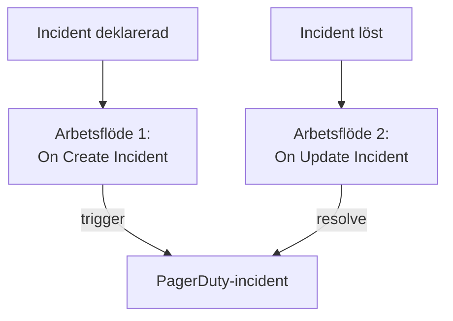

# PagerDuty

Skicka OneUptime-incidenter till [PagerDuty](https://www.pagerduty.com). Ett arbetsflöde utlöser en PagerDuty-incident när en OneUptime-incident deklareras, och ett andra löser den när OneUptime-incidenten är löst. Använd det när PagerDuty larmar ditt team och OneUptime övervakar dina system.

:::cards
- [Spara routing key](#spara-routing-key): Håll PagerDutys nyckel utanför dina arbetsflöden.
- [Utlös PagerDuty-incidenter](#utlös-en-pagerduty-incident-för-varje-incident): Ett arbetsflöde, två block.
- [Lös dem](#lös-pagerduty-incidenten): Ett andra arbetsflöde som följer incidentens status.
- [Felsökning](#felsökning): När PagerDuty nekar en händelse.
:::

> [!TIP]
> OneUptime larmar också personer, med jourpolicyer, scheman och eskaleringsregler. För att flytta ditt team från PagerDuty, se [Byt från PagerDuty](/docs/moving-to-oneuptime/pagerduty): en import tar över dina användare, scheman och eskaleringspolicyer.

## Så fungerar det



Båda arbetsflödena anropar PagerDutys [Events API v2](https://developer.pagerduty.com/docs/events-api-v2/overview/) med samma `dedup_key`, som bildas av OneUptime-incidentens ID. Det är den nyckeln som talar om för PagerDuty att resolve-händelsen stänger incidenten som trigger-händelsen öppnade.

## Innan du börjar

- En PagerDuty-tjänst med en Events API v2-integration. Öppna tjänsten i PagerDuty, sedan **Integrations**, klicka på **Add an integration** och välj **Events API V2**. Kopiera dess **Integration Key**: Events API kallar den routing key.
- I OneUptime behörighet att skapa arbetsflöden och globala variabler. På OneUptime Cloud kräver arbetsflöden **Growth**-abonnemanget eller högre.

## Spara routing key

:::steps
1. Gå till **Arbetsflöden → Globala variabler** och klicka på **Skapa Arbetsflöde Variabel**.
2. Ge den namnet `PAGERDUTY_ROUTING_KEY` och klicka på **Nästa**.
3. Klistra in integrationsnyckeln i **Innehåll**, slå på **Hemlighet** och klicka på **Skapa Arbetsflöde Variabel**.
:::

En hemlig variabel ersätts med `[REDACTED]` i körningsloggar, så nyckeln syns aldrig i en körning.

## Utlös en PagerDuty-incident för varje incident

:::steps
### Skapa arbetsflödet

Gå till **Arbetsflöden**, klicka på **Skapa arbetsflöde** och sedan på **Börja från grunden**. Ge det namnet `Incidents to PagerDuty` och klicka på **Skapa arbetsflöde**.

### Lägg till utlösaren

Klicka på det streckade blocket **Välj vad som startar det här arbetsflödet** och välj **On Create Incident**. Klicka på utlösaren: dess **Fields to pass on** börjar med **Titel**, så klicka på **Lägg till fält** och välj **Beskrivning**.

### Skicka trigger-händelsen

Klicka på **Lägg till komponent**, lägg till ett **API Post (JSON)**-block och koppla utlösarens **Success**-punkt till det. Ställ in **URL** på `https://events.pagerduty.com/v2/enqueue` och **Request Body** på:

```json
{
  "routing_key": "{{global.variables.PAGERDUTY_ROUTING_KEY}}",
  "event_action": "trigger",
  "dedup_key": "oneuptime-{{local.components.incident-on-create-1.returnValues.model._id}}",
  "payload": {
    "summary": "{{local.components.incident-on-create-1.returnValues.model.title}}",
    "source": "OneUptime",
    "severity": "critical",
    "custom_details": {
      "description": "{{local.components.incident-on-create-1.returnValues.model.description}}"
    }
  }
}
```

### Testa det och slå sedan på det

Klicka på **Kör arbetsflöde**, välj en testincident under **Incident** och kör det. Steget **API Post (JSON)** visar ett `202`-svar med `"status": "success"`, och PagerDuty skapar en incident. Slå sedan på **Aktiverad** högst upp i **Byggare**.
:::

Blocket skickar JSON, så det behöver ingen `Content-Type`-rubrik. PagerDutys `severity` är en av `critical`, `error`, `warning` och `info`: se [Koppla allvarlighetsgrader](#koppla-allvarlighetsgrader) för att skicka varje incidents egen.

## Lös PagerDuty-incidenten

Ett arbetsflöde har en utlösare, så det krävs ett andra arbetsflöde för att lösa den, som startar när en incidents status ändras.

:::steps
### Lägg till utlösaren On Update Incident

Skapa ett arbetsflöde som heter `Resolve PagerDuty incidents` och välj **On Update Incident** som utlösare. Klicka på **Lägg till fält** i **Fields to watch** och välj **Current Incident State**, så att det bara körs när statusen ändras. Fråga i **Fields to pass on** om den nya statusen är en löst status: klicka på **Lägg till fält**, öppna **Current Incident State** och välj **Is Resolved State**. Eller klicka på **Redigera som JSON** och ersätt JSON:en med:

```json
{ "_id": true, "currentIncidentState": { "isResolvedState": true } }
```

### Kontrollera att incidenten är löst

Lägg till ett **If / Else**-block efter utlösaren. Ställ in **Value to check** på `{{local.components.incident-on-update-1.returnValues.model.currentIncidentState.isResolvedState}}` och **Comparison** på **is true**.

### Skicka resolve-händelsen

Lägg till ett **API Post (JSON)**-block efter **Yes**-sidan, med samma **URL** och denna **Request Body**:

```json
{
  "routing_key": "{{global.variables.PAGERDUTY_ROUTING_KEY}}",
  "event_action": "resolve",
  "dedup_key": "oneuptime-{{local.components.incident-on-update-1.returnValues.model._id}}"
}
```

### Slå på det

Slå på **Aktiverad** och lös sedan en testincident i OneUptime. PagerDuty löser sin incident.
:::

Att kontrollera `isResolvedState` i stället för namnet på en status fortsätter att fungera när du byter namn på dina statusar. Se [Incidentstatusar och allvarlighetsgrader](/docs/incidents/states-and-severities).

## Koppla allvarlighetsgrader

För att skicka varje incidents allvarlighetsgrad lägger du till ett **Run Custom JavaScript**-block mellan utlösaren och **API Post (JSON)**-blocket och läser dess svar i innehållet.

1. Klicka på **Lägg till fält** i utlösarens **Fields to pass on**, öppna **Incidentallvar** och välj **Namn**.
2. Ställ in blockets **Arguments** på `{ "severity": "{{local.components.incident-on-create-1.returnValues.model.incidentSeverity.name}}" }` och dess **JavaScript Code** på:

   ```javascript
   // Your incident severities, by name, to PagerDuty's.
   const SEVERITY = {
     "Critical Incident": "critical",
     "Major Incident": "error",
     "Minor Incident": "warning",
   };

   return { severity: SEVERITY[args.severity] || "info" };
   ```

3. Ställ in `"severity"` i begärans innehåll på `"{{local.components.javascript-1.returnValues.returnValue.severity}}"`.

Namnen ovan är de tre allvarlighetsgrader som ett nytt projekt börjar med. Använd dina egna om du har bytt namn på dem.

## Felsökning

:::details PagerDuty svarar 400
Svarets innehåll säger vad PagerDuty nekade, och körningens **API Post (JSON)**-steg visar det. Oftast är routing key inte en integrationsnyckel för Events API v2: kopiera den igen från tjänstens **Integrations**. En händelse utan `summary`, `source` eller `severity` nekas också.
:::

:::details Resolve-händelsen stänger ingenting
Båda händelserna måste ha exakt samma `dedup_key`. Kontrollera att båda innehållen bildar den som `oneuptime-` följt av incidentens `_id`, och att resolve-arbetsflödet är påslaget.
:::

:::details Arbetsflödet körs aldrig
Kontrollera att det är påslaget: **Aktiverad**, högst upp i dess **Byggare**. Öppna sedan **Loggar → Körningar**: en körning som tog **No**-sidan av **If / Else**-blocket är en uppdatering som inte var en lösning.
:::

:::details PagerDuty visar en referens i stället för ett värde
En referens som inte kan lösas upp skickas som den är skriven, klammerparenteser och allt. Kontrollera blockets identifier, fältnamnet och variabelns namn, som är skiftlägeskänsligt. På körningens flik **Steg** är en inställning med en sådan referens markerad med **Did not resolve**.
:::

## Nästa steg

:::cards
- [Byt från PagerDuty](/docs/moving-to-oneuptime/pagerduty): Ta över ditt team, dina scheman och eskaleringspolicyer.
- [Eskaleringsregler](/docs/on-call/escalation-rules): Larma personer direkt från OneUptime.
- [Opsgenie](/docs/integrations/opsgenie): Samma två arbetsflöden för Opsgenie.
- [Översikt över integrationer](/docs/integrations/index): Mönstren bakom varje integration.
:::
