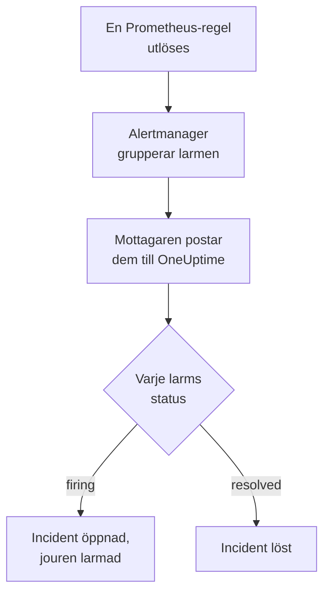

# Prometheus Alertmanager

Skicka larm från [Prometheus Alertmanager](https://prometheus.io/docs/alerting/latest/alertmanager/) till OneUptime, så att varje larm som utlöses blir en incident som larmar ditt jourteam och löses när larmet har återhämtat sig. Alertmanager postar sina aviseringar till en webhook-mottagare, så det finns inget att installera på någon av sidorna.

:::cards
- [Välj hur OneUptime tar emot larm](#välj-hur-oneuptime-tar-emot-larm): En Incoming Request-monitor eller ett eget arbetsflöde.
- [Ta emot larm med en monitor](#ta-emot-larm-med-en-monitor): En incident per larm, löst vid återhämtning.
- [Konfigurera Alertmanager](#konfigurera-alertmanager): En webhook-mottagare och den route som använder den.
- [Felsökning](#felsökning): När larm inte kommer fram eller incidenter förblir öppna.
:::

## Så fungerar det



Prometheus utvärderar dina larmregler och skickar de larm som utlöses till Alertmanager. Alertmanager grupperar dem efter etiketterna i din routes `group_by` och postar varje grupp till webhook-mottagaren som en JSON-avisering. Aviseringens lista `alerts` innehåller varje larm i gruppen, vart och ett med sin egen `status`, `firing` eller `resolved`, sina etiketter och anteckningar och ett `fingerprint` som identifierar det.

## Innan du börjar

- En Alertmanager vars `alertmanager.yml` du kan redigera och som kan nå din OneUptime över HTTPS.
- I OneUptime behörighet att skapa monitorer, eller arbetsflöden om du väljer den vägen.

## Välj hur OneUptime tar emot larm

Konfigurera OneUptime först: det ger dig den URL som Alertmanager skickar till.

| Väg | Använd den när |
| --- | --- |
| En Incoming Request-monitor (rekommenderas) | Du vill att varje larm ska bli en incident som larmar jouren och löses när larmet har återhämtat sig. Det finns inget att bygga. |
| Ett arbetsflöde med en Webhook-utlösare | Du behöver egen logik: filtrera larm, forma om dem eller anropa andra system först. Ett arbetsflöde öppnar en incident per avisering, inte per larm, och löser den inte vid återhämtning. |

Båda får samma JSON från samma mottagare, så du kan börja med det ena och byta senare genom att ändra en URL i `alertmanager.yml`.

## Ta emot larm med en monitor

En [Incoming Request-monitor](/docs/monitor/incoming-request-monitor) ger dig en URL, och dess kriterier avgör vad varje avisering gör.

:::steps
### Skapa monitorn

Gå till **Monitorer** och klicka på **Skapa monitor**. Välj **Incoming Request** under **Monitortyp**, ge den namnet `Alertmanager` och klicka på **Nästa**.

### Deklarera en incident för varje utlöst larm

Öppna det första kriteriet i steget **Kriterier**, det som markerar monitorn som offline. Ställ in dess filter på **Begärandekropp**, **Innehåller**, `"status":"firing"`. Det här kriteriet deklarerar redan en incident när filtret matchar. Fyll i incidenten:

- **Incidenttitel**: `{{requestBody.commonLabels.alertname}} on {{requestBody.commonLabels.instance}}`.
- **Allvarlighetsgrad**: den incidentallvarlighetsgrad som de här larmen ska ha.
- **Jourpolicyer**, under **Jour**: de policyer som ska larmas.
- **Lös incident automatiskt**, under **Fler fält**: låt den vara påslagen, som den börjar. Utan den ignoreras återhämtningar och incidenter förblir öppna.

### Öppna en incident per larm

Öppna **Inställningar** i samma kriterium och slå på **Group incidents and alerts by a payload field**. Fyll i den som nedan, så att varje larm får sin egen incident och dess återhämtning löser den:

| Fält | Värde |
| --- | --- |
| **Open a separate incident for each…** | `requestBody.alerts[*].fingerprint` |
| **Field that signals recovery** | `requestBody.alerts[*].status` |
| **Value that means recovered** | `resolved` |

### Få monitorn online igen

Öppna det andra kriteriet, det som markerar monitorn som online, och ställ in dess filter på **Begärandekropp**, **Innehåller**, `"status":"resolved"`.

### Kopiera URL:en

Klicka på **Skapa monitor**. Monitorns sida **Översikt** visar dess **Heartbeat URL**. Kopiera den till Alertmanager:

```text
https://oneuptime.com/heartbeat/<secret key>
```

En egenvärdad installation har sin egen värd i stället för `oneuptime.com`.
:::

`[*]` läser varje larm i en avisering, så en avisering med tre larm kan öppna tre incidenter, upp till **Max incidents per request** (`100` om du inte ändrar det). Varje larms egen `status` avgör vad som händer med dess incident: när ett larm i en avisering är löst och två fortfarande är utlösta stängs bara det lösta larmets incident. Se [Ta emot larm från ett annat system](/docs/monitor/incoming-request-monitor#ta-emot-larm-från-ett-annat-system) för vad varje inställning gör.

> [!WARNING]
> Gruppera efter ett värde som skiljer sig från larm till larm inom en avisering. Alertmanagers `fingerprint` är en hash av ett larms hela etikettuppsättning, så den skiljer sig alltid. En etikett i din routes `group_by` skiljer sig aldrig: det är den som samlar larmen i en avisering. Att gruppera efter `requestBody.alerts[*].labels.alertname` med routen nedan slår ihop varje larm i en avisering till en incident, som får det första larmets status.

## Namnge incidenterna

Titeln ovan läser etiketter som alla larm i aviseringen delar: `commonLabels` innehåller de etiketterna, och `commonAnnotations` de anteckningar som de delar. Med routen nedan, som grupperar efter `alertname` och `instance`, finns båda där. Ge incidenten en **Incidentbeskrivning** under **Beskrivning**, till exempel:

```text
{{requestBody.commonAnnotations.summary}}

{{requestBody.commonAnnotations.description}}
Severity: {{requestBody.commonLabels.severity}}
Alertmanager: {{requestBody.externalURL}}
```

- Grupperingsnyckeln är också en variabel, uppkallad efter det sista segmentet i dess sökväg: `{{fingerprint}}`. Den är en hash, så den säger ingenting till den som svarar.
- `{{requestBody.alerts[0].annotations.summary}}` läser aviseringens första larm, och det är inte alltid det larm som incidenten öppnades för.
- En referens till ett fält som aviseringen inte har lämnas som den är skriven, med klammerparenteser och allt, i stället för att tömmas.

Se [Incident- och larmmallar](/docs/monitor/incident-alert-templating) för alla variabler som du kan använda.

## Konfigurera Alertmanager

:::steps
### Lägg till en webhook-mottagare

Lägg till en mottagare i `alertmanager.yml` som skickar till den URL som du kopierade, och gör den till routens mottagare:

```yaml title="alertmanager.yml"
route:
  receiver: oneuptime
  group_by: ["alertname", "instance"]

receivers:
  - name: oneuptime
    webhook_configs:
      - url: "https://oneuptime.com/heartbeat/<secret key>"
        send_resolved: true
```

`send_resolved: true` är Alertmanagers standard, utskriven så att den förblir påslagen: utan den får OneUptime aldrig veta att ett larm har återhämtat sig. Alertmanager skickar `Content-Type: application/json`, som monitorn behöver för att läsa fälten i en avisering.

### Läs in Alertmanager igen

Läs in konfigurationen igen, eller starta om Alertmanager:

```bash
curl -X POST http://localhost:9093/-/reload
```
:::

Routen behåller Alertmanagers standardtider. Den väntar `30s` innan den skickar en ny grupp (`group_wait`), `5m` innan den skickar en grupp med nya larm igen (`group_interval`) och `4h` innan den upprepar en avisering som inte har ändrats (`repeat_interval`).

## Testa det

Skicka en avisering med två utlösta larm till OneUptime, så som Alertmanager skulle göra:

```bash
curl -X POST "https://oneuptime.com/heartbeat/<secret key>" \
  -H "Content-Type: application/json" \
  -d '{
    "version": "4",
    "status": "firing",
    "receiver": "oneuptime",
    "groupLabels": { "alertname": "DiskFull", "instance": "web-1" },
    "commonLabels": { "alertname": "DiskFull", "instance": "web-1", "severity": "critical" },
    "commonAnnotations": { "summary": "Disk almost full on web-1" },
    "externalURL": "http://alertmanager:9093",
    "alerts": [
      {
        "status": "firing",
        "labels": { "alertname": "DiskFull", "instance": "web-1", "severity": "critical", "device": "/dev/sda1" },
        "fingerprint": "a1b2c3d4e5f60001"
      },
      {
        "status": "firing",
        "labels": { "alertname": "DiskFull", "instance": "web-1", "severity": "critical", "device": "/dev/sdb1" },
        "fingerprint": "a1b2c3d4e5f60002"
      }
    ]
  }'
```

Två incidenter öppnas, en per `fingerprint`, var och en med titeln `DiskFull on web-1`. Skicka samma begäran med varje `status` satt till `resolved`, så löses båda.

För att testa hela vägen från Alertmanager utlöser du ett larm med `amtool`. Alertmanager skickar det efter `group_wait` och skickar sedan dess återhämtning när larmet går ut några minuter senare:

```bash
amtool alert add test_alert severity=warning \
  --annotation=summary="Test from Alertmanager" \
  --alertmanager.url=http://localhost:9093
```

## Ta emot larm med ett arbetsflöde

Använd ett [arbetsflöde](/docs/workflows/index) när du behöver egna steg mellan Alertmanager och incidenten.

:::steps
### Skapa arbetsflödet

Gå till **Arbetsflöden**, klicka på **Skapa arbetsflöde** och sedan på **Börja från grunden**. Ge det namnet `Alertmanager alerts` och klicka på **Skapa arbetsflöde**.

### Lägg till Webhook-utlösaren

Klicka på det streckade blocket **Välj vad som startar det här arbetsflödet** och välj **Webhook**. Klicka på utlösaren, sedan på **Kopiera URL**, och använd den URL:en i mottagaren i `alertmanager.yml`.

### Kontrollera att aviseringen är utlöst

Klicka på **Lägg till komponent**, lägg till ett block **If / Else** och anslut utlösarens punkt **Out** till det. Ställ in **Value to check** på `{{local.components.webhook-1.returnValues.request-body.status}}`, **Comparison** på **is equal to** och **Compare with** på `firing`.

### Deklarera incidenten

Lägg till ett block **Create One Incident** och anslut sidan **Yes** av blocket **If / Else** till det. Välj under **Incident Template** en mall som ställer in allvarlighetsgraden och de jourpolicyer som ska larmas (se [Incidentmallar](/docs/incidents/settings#incidentmallar)). Ange under **JSON Object** vad som kommer från Alertmanager:

```json
{
  "title": "{{local.components.webhook-1.returnValues.request-body.commonLabels.alertname}}",
  "description": "{{local.components.webhook-1.returnValues.request-body.commonAnnotations.summary}}\nAlertmanager: {{local.components.webhook-1.returnValues.request-body.externalURL}}"
}
```

Utan en mall måste **JSON Object** också innehålla `incidentSeverityId`, ID:t för en av projektets incidentallvarlighetsgrader.

### Slå på arbetsflödet

Slå på **Aktiverad** överst i **Byggare**. Ett arbetsflöde som är avstängt svarar Alertmanager med `400`.
:::

En körning hanterar en avisering, så den deklarerar en incident oavsett hur många larm aviseringen innehåller. En avisering som är `resolved` tar sidan **No** av blocket **If / Else**, där ingenting är anslutet, så körningen slutar där. Använd monitorn för en incident per larm som löses vid återhämtning.

## Övervaka själva Alertmanager

Ingen av vägarna märker när Prometheus eller Alertmanager slutar fungera: att inte få några larm ser precis ut som att allt är i sin ordning. Skicka därför ett larm som alltid är utlöst till en andra monitor, som deklarerar en incident när det larmet slutar komma. [kube-prometheus-stack](https://github.com/prometheus-community/helm-charts/tree/main/charts/kube-prometheus-stack) levereras med ett sådant larm, som heter `Watchdog`. På en vanlig Prometheus lägger du till en larmregel som heter `Watchdog` och vars uttryck alltid är sant, till exempel `vector(1)`.

:::steps
### Skapa watchdog-monitorn

Skapa en andra Incoming Request-monitor, som heter `Alertmanager watchdog`. Ställ in filtret för dess första kriterium, det som markerar monitorn som offline, på **Incoming Request**, **Not Recieved In Minutes**, `10`, och filtret för dess andra kriterium på **Incoming Request**, **Recieved In Minutes**, `10`. Instrumentpanelen stavar båda så. Kopiera den nya monitorns **Heartbeat URL**.

### Skicka watchdog-larmet dit

Lägg till en mottagare för watchdog-monitorns URL och en route som skickar `Watchdog` dit var femte minut. En underordnad route kontrolleras före sin överordnade routes mottagare, så `Watchdog` går till watchdog-monitorn och alla andra larm går fortfarande till den första:

```yaml title="alertmanager.yml"
route:
  receiver: oneuptime
  group_by: ["alertname", "instance"]
  routes:
    - receiver: oneuptime-watchdog
      matchers:
        - alertname = "Watchdog"
      group_wait: 0s
      group_interval: 5m
      repeat_interval: 5m

receivers:
  - name: oneuptime
    webhook_configs:
      - url: "https://oneuptime.com/heartbeat/<secret key>"
        send_resolved: true
  - name: oneuptime-watchdog
    webhook_configs:
      - url: "https://oneuptime.com/heartbeat/<watchdog secret key>"
```
:::

När watchdog-larmet inte har kommit på tio minuter går watchdog-monitorn offline och deklarerar en incident. Nästa watchdog-avisering gör monitorn online igen och löser incidenten.

## Felsökning

:::details Inget kommer fram till OneUptime
- Sök i Alertmanagers logg efter fel vid leverans till mottagaren.
- Monitorn svarar `200` direkt, innan den kontrollerar något, även för en felaktig hemlig nyckel. Titta på monitorns tidslinje för att se om aviseringar kommer fram.
- Ett arbetsflöde som är avstängt svarar `400`. Slå på **Aktiverad** överst i dess **Byggare**.
:::

:::details Incidenter skapas men löses aldrig
- Kontrollera att ingen mottagare anger `send_resolved: false`: då skickar Alertmanager aldrig någon återhämtning.
- Kriteriets incident behöver **Lös incident automatiskt**, under **Fler fält**.
- **Field that signals recovery** måste vara `requestBody.alerts[*].status`, och **Value that means recovered** exakt `resolved`. Jämförelsen är skiftlägeskänslig.
- Larm i en avisering utöver **Max incidents per request** läses inte alls, så deras återhämtningar går också förlorade.
- En återhämtning som hoppas över i en skur (se nedan) lämnar sin incident öppen för alltid: Alertmanager upprepar utlösta larm, men aldrig en återhämtning. Lös en sådan incident manuellt.
:::

:::details Ingen incident öppnas
Grupperingssökvägarna måste börja med `requestBody.`, och bara den första `[*]` i en sökväg läser en lista. En sökväg som bryter mot någon av reglerna matchar ingenting, utan något fel.
:::

:::details En incident för en avisering full av larm
Du har grupperat efter en etikett som är densamma för varje larm i en avisering, oftast en etikett från din routes `group_by`. Gruppera i stället efter `requestBody.alerts[*].fingerprint`.
:::

:::details Incidenten visar en referens i stället för ett värde
En referens till ett fält som aviseringen inte har lämnas som den är skriven, med klammerparenteser och allt. Regler sätter olika anteckningar, så använd de fält som dina regler sätter: i `commonAnnotations`, eller i varje larms `annotations`.
:::

:::details För många incidenter
Gruppera din route efter färre etiketter, eller höj `group_interval`, så att Alertmanager skickar relaterade larm tillsammans. En lägre **Max incidents per request** begränsar incidenterna från en avisering, men larm utöver gränsen läses inte, så deras återhämtningar går också förlorade.
:::

:::details Aviseringar hoppas över under en skur
När en nyare begäran når en monitor innan en tidigare har utvärderats, utvärderar OneUptime bara den nyaste, så att en enda avsändare inte kan översvämma en monitor. Den sista aviseringen i en skur utvärderas alltid, men en tidigare om andra larm kan hoppas över, eftersom Alertmanager skickar varje grupp till samma URL. Höj `group_wait` och `group_interval` för att sprida ut aviseringarna. På en egenvärdad installation anger du `INCOMING_REQUEST_INGEST_COALESCE_ENABLED=false` i OneUptime-appens miljö för att utvärdera varje begäran.
:::

## Säkerhet

- **Behandla URL:en som ett lösenord.** Alla som har den kan öppna incidenter. Om den läcker återställer du den: **Återställ hemlig nyckel för inkommande begäran** på monitorns sida **Inställningar**, eller **Återställ URL** i arbetsflödets **Webhook**-utlösare. Uppdatera sedan mottagarens `url` i `alertmanager.yml`.
- **Egenvärdad?** Låt Alertmanager nå din OneUptime över HTTPS genom din brandvägg.

## Nästa steg

:::cards
- [Övervakning av inkommande förfrågningar](/docs/monitor/incoming-request-monitor): Varje inställning för den monitor som tar emot dina larm.
- [Grafana](/docs/integrations/grafana): Samma konfiguration, för Grafana-larm.
- [Eskaleringsregler](/docs/on-call/escalation-rules): Bestäm vem en jourpolicy larmar, och när.
- [Översikt över integrationer](/docs/integrations/index): De andra verktyg som du kan ansluta.
:::
