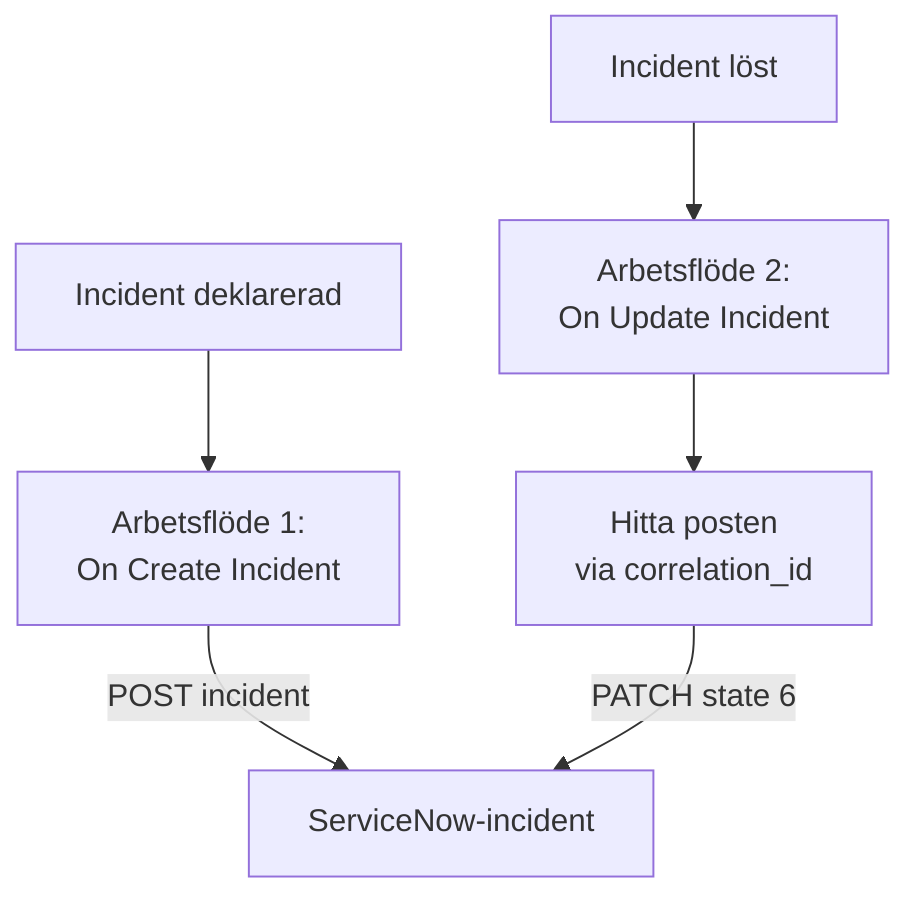

# ServiceNow

Skapa en [ServiceNow](https://www.servicenow.com)-incident för varje OneUptime-incident och lös den när OneUptime-incidenten är löst, så att din servicedesk följer det som din övervakning ser. Två arbetsflöden anropar ServiceNows [Table API](https://developer.servicenow.com/dev.do#!/reference/api/latest/rest/c_TableAPI).

:::cards
- [Spara autentiseringsuppgifterna](#spara-autentiseringsuppgifterna): Håll ServiceNow-lösenordet utanför dina arbetsflöden.
- [Skapa ServiceNow-incidenter](#skapa-en-servicenow-incident-för-varje-incident): Ett arbetsflöde, två block.
- [Lös dem](#lös-servicenow-incidenten): Hitta posten och stäng den sedan.
- [Felsökning](#felsökning): När ServiceNow nekar en begäran.
:::

## Så fungerar det



Det första arbetsflödet skriver OneUptime-incidentens ID i postens `correlation_id`. Det andra hittar posten via det ID:t och löser den sedan.

## Innan du börjar

- En ServiceNow-instans, t.ex. `https://your-instance.service-now.com`.
- En ServiceNow-användare för integrationen som kan skapa och uppdatera poster i tabellen `incident`, vanligtvis med rollen `itil`. Användarens namn och lösenord signerar begärandena.
- I OneUptime behörighet att skapa arbetsflöden och globala variabler. På OneUptime Cloud kräver arbetsflöden **Growth**-abonnemanget eller högre.

## Spara autentiseringsuppgifterna

Table API godtar Basic-autentisering: användarens namn och lösenord, kodade tillsammans.

:::steps
1. Koda dem en gång, på macOS eller Linux:

   ```bash
   printf '%s' 'integration.user:password' | base64 | tr -d '\n'
   ```

   Använd `printf`, inte `echo`: `echo` lägger till en radbrytning, som kodas tillsammans med resten och förstör autentiseringsuppgifterna.

2. Gå i OneUptime till **Arbetsflöden → Globala variabler** och klicka på **Skapa Arbetsflöde Variabel**. Ge den namnet `SERVICENOW_AUTH` och klicka på **Nästa**.
3. Klistra in det kodade värdet i **Innehåll**, slå på **Hemlighet** och klicka på **Skapa Arbetsflöde Variabel**.
:::

## Skapa en ServiceNow-incident för varje incident

:::steps
### Skapa arbetsflödet

Gå till **Arbetsflöden**, klicka på **Skapa arbetsflöde** och sedan på **Börja från grunden**. Ge det namnet `Incidents to ServiceNow` och klicka på **Skapa arbetsflöde**.

### Lägg till utlösaren

Klicka på det streckade blocket **Välj vad som startar det här arbetsflödet** och välj **On Create Incident**. Klicka på utlösaren: dess **Fields to pass on** börjar med **Titel**, så klicka på **Lägg till fält** och välj **Beskrivning**.

### Skapa posten

Klicka på **Lägg till komponent**, lägg till ett **API Post (JSON)**-block och koppla utlösarens **Success**-punkt till det. Ställ in **URL** på `https://your-instance.service-now.com/api/now/table/incident`. Ställ in **Request Headers** under **Fler fält** på:

```json
{
  "Authorization": "Basic {{global.variables.SERVICENOW_AUTH}}",
  "Accept": "application/json"
}
```

Och **Request Body** på:

```json
{
  "short_description": "OneUptime: {{local.components.incident-on-create-1.returnValues.model.title}}",
  "description": "{{local.components.incident-on-create-1.returnValues.model.description}}",
  "urgency": "1",
  "impact": "1",
  "correlation_id": "oneuptime-{{local.components.incident-on-create-1.returnValues.model._id}}"
}
```

### Testa det och slå sedan på det

Klicka på **Kör arbetsflöde**, välj en testincident under **Incident** och kör det. Steget **API Post (JSON)** visar ett `201`-svar med den nya posten, med dess `sys_id` och dess `number`, t.ex. `INC0012345`. Slå sedan på **Aktiverad** högst upp i **Byggare**.
:::

`urgency` och `impact` tar `1` för hög, `2` för medel och `3` för låg, och ServiceNow räknar fram prioriteten från de två. Alla andra kolumner i tabellen `incident` kan läggas i innehållet under sitt kolumnnamn.

## Lös ServiceNow-incidenten

Ett arbetsflöde har en utlösare, så det krävs ett andra arbetsflöde för att lösa den, som startar när en incidents status ändras.

:::steps
### Lägg till utlösaren On Update Incident

Skapa ett arbetsflöde som heter `Resolve ServiceNow incidents` och välj **On Update Incident** som utlösare. Klicka på **Lägg till fält** i **Fields to watch** och välj **Current Incident State**, så att det bara körs när statusen ändras. Fråga i **Fields to pass on** om den nya statusen är en löst status: klicka på **Lägg till fält**, öppna **Current Incident State** och välj **Is Resolved State**. Eller klicka på **Redigera som JSON** och ersätt JSON:en med:

```json
{ "_id": true, "currentIncidentState": { "isResolvedState": true } }
```

### Kontrollera att incidenten är löst

Lägg till ett **If / Else**-block efter utlösaren. Ställ in **Value to check** på `{{local.components.incident-on-update-1.returnValues.model.currentIncidentState.isResolvedState}}` och **Comparison** på **is true**.

### Hitta posten

Lägg till ett **API Get (JSON)**-block efter **Yes**-sidan, med samma **Request Headers** och denna **URL**:

```text
https://your-instance.service-now.com/api/now/table/incident?sysparm_query=correlation_id=oneuptime-{{local.components.incident-on-update-1.returnValues.model._id}}&sysparm_fields=sys_id&sysparm_limit=1
```

### Lös posten

Lägg till ett **API Patch (JSON)**-block efter sökblockets **Success**, med samma **Request Headers** och denna **URL**:

```text
https://your-instance.service-now.com/api/now/table/incident/{{local.components.api-get-1.returnValues.response-body.result[0].sys_id}}
```

Ställ in **Request Body** på:

```json
{
  "state": "6",
  "close_code": "Solution provided",
  "close_notes": "Resolved in OneUptime"
}
```

### Slå på det

Slå på **Aktiverad** och lös sedan en testincident i OneUptime. Dess ServiceNow-incident går över till Resolved.
:::

`state` `6` är Resolved i ServiceNows standardstatusar för incidenter. `close_code` måste vara en av lösningskoderna i din instans. Många instanser löser inte en incident utan en lösningskod och anteckningar, så skicka båda.

## Felsökning

:::details ServiceNow svarar 401
Autentiseringsuppgifterna är fel. Koda `username:password` igen med `printf`, inte `echo`, och ersätt innehållet i `SERVICENOW_AUTH`.
:::

:::details ServiceNow svarar 403
Användaren kan inte skriva till tabellen `incident`. Ge användaren rollen `itil`, eller en roll med samma rättigheter, och kontrollera att ingen åtkomstregel blockerar Table API för användaren.
:::

:::details ServiceNow svarar 400, eller lösningen ändrar ingenting
Ett kolumnnamn eller ett värde passar inte din instans: en anpassad `state`-lista eller en `close_code` som din instans inte har. Jämför med tabellen `incident` under **System Definition → Tables** i ServiceNow och med postens eget formulär.
:::

:::details Lösningen svarar 404
Söksteget hittade ingen post, så URL:en behöll referensen som den är skriven. Kontrollera att det första arbetsflödet skrev `correlation_id`, och att båda arbetsflödena bildar det på samma sätt: `oneuptime-` följt av incidentens `_id`.
:::

## Nästa steg

:::cards
- [Jira](/docs/integrations/jira): En dubbelriktad integration, synkad av färdiga mallar.
- [Arbetsflödeskomponenter](/docs/workflows/components#api): Alla inställningar för API-blocken.
- [Arbetsflödeskörningar](/docs/workflows/runs-and-logs): Läs vad varje begäran skickade och fick tillbaka.
- [Översikt över integrationer](/docs/integrations/index): Mönstren bakom varje integration.
:::
